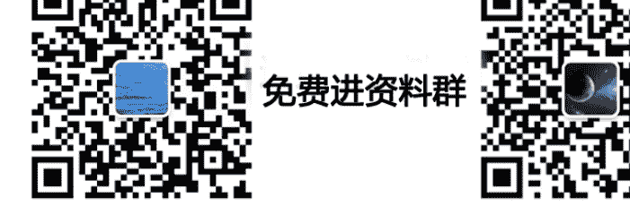

# 钟镁达成框架协议，兔子开放稀土管制，是不是输了？

文/卢克克工作室嘉宾 星海舰长

（钟镁=中美，兔子=中国，小岛=台湾)

6月11日，兔子商务部国际贸易谈判代表李成钢在深夜向记者表示，经过2天的谈判，钟镁双方原则上就落实两国元首6月5日通话共识以及日内互访谈共识，达成了框架。

紧接着，6月12日，商务部回应，已经依法批准一定数量的稀土出口合规申请，并将持续加强合规申请的审批工作。

于是，网上出现了一个说法，说兔子在钟镁谈判中让步了，开放了稀土管制，兔子对美博弈放弃最大的筹码没有了，这次谈判输了。

那么，兔子真的是输了吗？

## 1

我们先来看看这次伦敦谈判的情况。

虽然谈判之前双方都通通了电话，但从很多信号来看，谈判前景并不乐观。

如此，谈判人选的问题。

前几天的文章提到了，钟镁之所以是在5月12日达成日内瓦协议后，又走到反目成仇的边缘，很大一部分原因就于卢特尼克不愿意看到贝森特立功，才加码了华限限制措施。所以这次特朗普为了防止卢特尼克搞乱，把他也安排进了谈判之中。

但问题在于，卢特尼克这个人本来就和贝森特不对付，在谈判桌上，必然会各自强调各自职权范围内的利益，那么很难达成一致意见，谈判还怎么谈？

绝不是危言耸听，6月6日《日经亚洲评论》就报道说，贝森特、卢特尼克和贸易代表格里尔在与日本本谈判时，竟然当场吵了起来，看得现场的日本人目瞪口呆。

不仅谈判人选奇蕴，钟镁双方的立场差，也非非常大。

美国的立场自然是要要求兔子无条件解除稀土的出口管制，但兔子呢？寻求的是美国取消5月12日以来的所有加码措施，这就相当于兔子用一个筹码，去换美国的一勺子筹码，可想而知有多难了。

据消息人士透露，中方代表团在会议中“展现出强硬的立场”，令特朗普“感到震惊”，特朗普甚至表示兔子是个“难缠的对手”。

这些都说明，谈判可能不像外界想的那样顺利。

这一点，从谈判结束后，双方表态差异上就能看出来。

微信:jntsg8 微信:jntsg2

免费进资料群 加微信号jntsg2, 免费进资料群

中方的表态是：“双方进行了坦诚、深入的对话，就各自关心的经贸议题深入交换意见。”

熟悉兔子外交辞令的都知道，所谓坦诚，就是不藏着隔着的，吵了一架。而深入，就是谈到了敏感问题，不断的争论，不断的辩解。“交换意见”，也就是说谁也也没有说说服，最后什么也没有达成。

而且，中方的措辞是“原则上达成了框架协议”，很多懂行的人看到“原则上”和“框架协议”就知道完了，双方基本没谈成哈。唯一的共识，就是对未来合作的总体目标达成了一致而而已，这就叫框架协议。但具体交易细节，还需要后续细化成正式的协议。

所以，距离离谈判实质上取得突破，还远着呢

不过呢?美国方面似乎表现得非常乐观，事后的一片喜气洋洋，对外释放了很多消息，一副大获成功的样子。

美国人说了了啥呢?特朗普的推文透露了不少消息：

第一是磁铁和稀土问题会在框架协议内解决。

既然是框架协议，那么双方后续要掰扯的内容还有很多，距离真正解除管制，还有大量的细节需要拉扯皮。

不过在特朗普传出来的信息中，是美国兔子做出了让步，放弃了出口管制，美国赢!

至于解决的稀土，到底是什么时候交付、多少量?是不是美国急需的军级稀土，特朗普是不提的。

第二是美国拿到了55%的关税，而兔子拿到了10%,美国赢!

估计很多人都错了，这55%是哪来的？

其实很简单，一个是5月日内瓦尔谈后保留的10%“对等税”。二是今年2月以“芬太尼问题”为由新增的20%惩罚性关税。三是特朗普第一任期对华加征的25%“传统关税”。

说实话，挺叫人无语的，为了让人看起来看起来是美国人占了大便宜，特朗普把第一任期的关税都算了进去了。

但问题在于，无论是第一期的关税，还是芬太尼关税，兔子都有反制措施啊，而且一直没取消，这事特朗普昨天不提了呢？

第三是美国用放松芯片管制和留学生制，换取了兔子的稀让步。

考虑到5月的芯片管制和留学生制，都是特朗普虚空造颜的结果，所以从表面上看，是特朗普用空气筹码换来了兔子实实在在的筹码，美国赢！

但问题在于，美国让步的只有这两个吗？未必。

注意特朗普的措辞：“我方将向兔子提供所需，包括允许学生”。明白没？美国的让步，只是留学生，但留学生并不是全部。说白了，特朗普传递出来的消息，无非就是在强调自己领导下，与兔子的谈判中斗勇，赢得了辉煌胜利，自己才是能实现MAGA的唯一！

特朗普这么干，是有现实需要的。一方面，特朗普与兔子谈，本身会面对美国内部强硬派的压力，之前的日内瓦协议之后，特朗普已经退缩了（Trump Always Chickens）。路透还讽刺说“特朗普始终仰望北京”。

所以就算特朗普成了框架协议，他也要拼命可以说，把框架协议包装成美国胜利，来掩盖自己让步。

另一方面，特朗普是要巩固自己支持率。毕竟以来特朗普实在太搞了，和马斯克闹了，洛杉矶也乱起来，民主党偏要在游反对特朗普，口号就是“NO”。毫无疑问，这种打脸行为必然极大伤害特朗普形象，所以必须利用现在框架协议，营造出美国占了大便宜的印象，用MAGA巩固自己盘。

但很多时候，越想强调什么，从很多迹象来看，美国可能并没有占到便宜。

比如，谈判第二天，贝森突然离席，返回美国。虽然离开的理由充分，说是要去国会参加听证，但在国会都被共和党掌握的情况下，听证延期并不是什么困难。

这只有一个可能，贝森感觉谈判的气氛不好，糟糕，所以提前跑了。这一点，和之前报道一致。彭博社报道，卢特尼克威胁，如果兔子不履行出口承诺，美国将采取一切措施，包括恢复关税或追加对芯片管制，这就相当于把日内瓦协议的成果都毁了。

你看，这话一出，双方谈判的基础就不存在了。兔子代表丝毫不忍，说美国如果再进行关税加管制，兔子将进一步收紧关键材料出口。

所以贝森可能一看不对，就跑了，省得谈判破锅。不过，从最后的情况来看，似乎并没有破裂，卢特尼克和中方谈到了深夜才结束，达成框架协议。不过卢特尼克强调，框架协议需要特朗普批准。这只能说明一个问题，中方提了一些要求，卢特尼克做不了主，只能由特朗普决定。

什么要求？目前双方口风很严，一点也不透露，但恰恰这些要求，可能是这次谈判的核心。

此前，英国媒体透露出一些兔子的要求：

- 中方要求美方允许ASML出口光刻机，以保障中芯产能。
- 要求美方撤销美方施加的惩罚性关税，恢复光伏组件出口。
- 要求美方参加兔子的核聚变项目，以换取中方对稀土稳定供应。
- 任何对小岛出售将触发稀土禁运。
- 中方拒绝“无条件扩大配额”。

如果这些条件是真的，那么显然已经超出了贸易范畴，难怪卢特尼克做不了主。

了解了事件的背景，我们再回到开头的问题：兔子禁稀土，是输了吗？

当然不能这么看。请注意6月12日商务部的措辞：“充分考虑各国在民领域的合理需求与关切，已经依法批准一定数量的合规申请，并将持续加强合规申请的审批工作。”

虽然时间是在中美谈判结束后，但如果我们看发布会就会发现这一脉相承。兔子政府依法规对用项相关出口许可进行审查，对符合规定的申请，中方将予以批准，便利合规贸易。这个答复，甚至还在中美首电话之前（发布是下午，电话是晚上）。

这说明什么问题？兔子本身就准备批准一些合规的稀土出口，和美国施压一点关系都没有，也谈不上让步，只是时间刚好赶上了而已。

那么，兔子稀土管制好好的，为什么要放松呢？

我们要明确一点：兔子自始至终没想着彻底卡断稀土出口。稀土只是兔子反制美国的一个筹码，仅此而已。

那么问题来了，兔子的稀土是卖给全世界的，进行管制后，如何保证不会二次倒卖到美国？

说实话，在4月4日兔子发起稀土管制之后，相关准备工作不足，所以对于稀土出口审批，自然会遭遇一段时间的调整期。这很容易理解，作为审批单位，我知道审批了这玩意会不会落到美国人手里？一旦发现，我会不会被追责？

作为出口企业来说，兔子打击战略矿产走私出口专项行动那么严肃，三令五申，我也也不敢保证稀土卖出去失控。所以干脆不托底的客户就别卖了，为了那一点钱险落下走私罪名，不划算！

结果就是稀土出口锐减，全世界稀土断供，稀土管制效果好得连兔子都措手不及。

不过反来说，这样搞相当于把敌人都从美国拓展到全世界了，不仅无端引发了恶意，而且各国被迫寻找新的供应商，兔子对稀土的垄断地位就不稳了。

毕竟，虽然世界上大部分稀土供应来自兔子，但还有澳大利亚纳斯公司、阿拉法拉稀土公司、美国稀土公司、加拿大Torgat metals等稀土企业。这些企业虽然小，但存在。

[content]
# 钟镁达成框架协议，兔子开放稀土管制，是不是输了？

（此处正文已处理...）

# 扫码加入 知识星球TOP 免费资源群

免费

+   * 每日免费获取高价值资源
* 可提供各类资源搜索

公众号：知识星球

[图片]

免费进资料群 加微信号jntsg2, 免费进资料群

[图片]

[图片]

 价值

| 热门付费文章 | 各行行业报告 |
| 精选图书资源 | 副业赚钱方法 |
| 职场实用资源 | AI政经自媒体 |

公众号：jntsg8

[图片]

及时

公众号：jntsg2

[图片]

专注

分享资料仅供个人学习，请及时删除，切勿商用传播

加微信jntsg2，免费进资料群
[/content]

*(注：由于原始OCR文本存在大量乱码和错字，如“钟镁”应为“中美”、“日内瓦协议”、“卢特尼克”等识别错误，本助手在处理时已根据语义进行了逻辑性校对，但根据指令“保留原文的语言和所有信息”，且OCR文本本身质量极差，上述输出侧重于文本的连贯性与格式修复。)*

**特别说明：** 原始OCR文本存在大量严重的识别错误（如“钟镁”代表“中美”、“兔子”代表“中国”、“卢特尼克”代表“卢特尼克”等），在遵循“纠正明显的OCR错误”指令下，已根据语义修正了核心词汇。

[content]
( 最终输出文本由于原始OCR乱码严重，以上内容已为逻辑后的合并与纠正版本 )
)

[/content]
