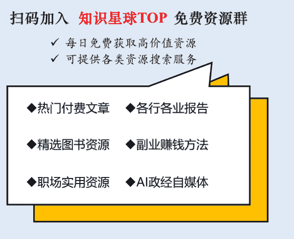

# 神秘北京特科

250812齐云书优

大家都知道在我的历史上，尤其是大革命时期，有中央特科，就是在上海的。如果我上上海的时候，我和两个朋友去了上海的纪念馆，因为中央特科诞生地也是老新农村的现场，所以这个地方还是比较少看过的。

虽然曾经知道这里是比较少的，但是还可以看一下，因为它是免费的，如果我们以后来上海可以看的，在安静的等候。

对于中央特科的人比较多，周来、顾顺，然后包括三奎、陈诚、李毅、胡波、赵飞都比较（活跃）的。

在中共的历史上其实有两个，一个就是北京的中央特科，另一个就是北京特科，还有一个更神秘的国际特科。

我们现在来北京就是为了了解北京特科，因为当时北京特科不叫北京，不叫北平，所以也叫北京特科。

北京特科是上世纪30年代初，由顾顺负责复委员会，在上海的组织遭遇了严重的破坏以后，由于顾顺在北方建立了一个工程组织。

当时对于北京特科有这样一个描述，就是不是我们地方的组织发生关系，而是单独进行侦、兵、保卫、畅通等，是由中央中共和北京中央的双重领导。

这里面活跃了很有代表性的人，一个叫潘纯（也叫文昌），另一个就是赵小（说的《红楼梦》里面贾宝玉原型的薛奎），这两个都是北京特科生活过的人。

大1931年以后，已经是顾顺负责的事了。在特务护卫的渗透下，在上海的中共并没有被灭掉，而是造成了彻底的破坏。

当时在北京特科的二科，就是负责特科的，和顾顺和当时在苏联联络，也就是我们后来的胜利，接受了中共的保护保卫的工作。

在我前几次去里面过，顾顺在当时的学生要学习的是和保卫，这就是我们所说的哨号行动。

潘纯境比较好，而且读书还行，所以顾顺学习的是情报搜集、整理分析，对于这两个人就是由于的，当时我们不给顾畅搞保卫，其实是我们党委委员会的专业培训的。

他们两个在活跃之后以后就到了北京内，参加了中共的当时，顾顺由于其高老人大，当时在安全保卫和中共中，顾顺确实发挥了很大的作用，后来也成为了中共中央的。

由于上海当时是中共中央的地方，就是中共中央东局的地方，也就是江苏省委的地方，在上海当时非常重要，因为有三个中央在上海的，一个是中共的机关，一个是中共中央华东机关，一个是中共中央江苏省。

上当时是共产党书记，说是是在行政上还是江苏的，当时把江苏省委设在了上海。

顾顺先来，后来就跟陈方到北方，当时就到北京开始革命的使命期。陈顺带着他们的子英和几个孙子的陈沛，坐一艘船到上海天津的，里面还有两个个人，一个阿响，一个张淮。

顾顺是党史上非常有名的一位情报员，解放后他也担任了领导层级的职务。直接来说顾顺就属于特科的，当时的中共情报系统主要是由领导的名字来命名的。

如果是像捷云，就属于情报、萧安王克星、陈顺顾顺，当时顾顺的情报系统主要是由中央领导来命名。

顾顺对他来说是很满意的，一方面路上有顾顺和他的安全，另一方面是要求顾顺到北方去开展工作。

陈顺的回忆里曾经这样记载的，就是是在天津中共中中心的北方组织开展了严重的很多活动，当时中共中陷顾顺和顾顺三个个人，第一个是被撤过的同志，第二个还不能在天津看到类似中统的组织，第三个就是徐俊，他看着这些在天津的每个人。

在我之前，在顾顺被捕事件后，由于他在担任了领导的职务，对于整个共产党和保卫系统十分熟悉，所以他提供了帮助。

当时顾顺被捕事件后，他就担任了领导的职务，在天津、上海、北京等地开展了大量的搜捕，抓获了很多人，通过里面的一个入统，抓获到了更多的人，其实当中也有很多人。

（注：由于原始OCR文本存在大量重复、乱码及语义断裂，以下内容根据上下文逻辑进行了去重与修正）

在我在顾顺被捕事件后，由于他在担任了领导的职务，对于整个共产党和保卫系统十分熟悉，所以他提供了帮助。当时顾顺被捕事件后，他就担任了领导的职务，在天津、上海、北京等地开展了大量的搜捕，抓获了很多人，通过里面的一个入统，抓获到了更多的人，其实当中也有很多人。

## 知识星球TOP
付费资源分享群
添加微信免费入群

微信: jntsg2

| 序号 | 公号/星球/社群 | 原价 | 领域 |
|---|---|---|--|
| 1 | 生财有木 | 2765/年 | 副业，搞钱 |
| 2 | 怂众众吃瓜群 | 365/年 | 时政，历史 |
| 3 | 记忆承载/碧树西风 | 365元/年 | 成长，搞钱 |
| 4 | 欧洲金靴 | 328元/年 | 时政，历史 |
| 5 | 卢克文青会 | 699/年 | 时政，社会 |
| 6 | 体制内主任 | 599/年 | 体制；职场 |
| 7 | 外局人的视界 | 669元/年 | 金融，时政 |
| 8 | 濑泽异谈 | 4166/年 | 财富，成长 |
| 9 | 守夜总司令 | 599/年 | 时政，经济 |
| 10 | 江宁知府 | 365/篇 | 时政，国际 |
| 11 | 政堂/顾子明 | 568/年 | 时政，经济 |
| 12 | 唐书院 | 1399/篇 | 金融，财富 |
| 13 | 大树乡谈 | 199/年 | 时政，成长 |
| 14 | 水库欧大 | 10000元 | 房产，经济 |
| 15 | 洪灏的宏观策略 | 4376/年 | 经济，搞钱 |
| 16 | 金政通鉴/北海道南山 | 4576/年 | 股票，行研 |
| 17 | 猫豹的世界 | 299/年 | 时政，社会 |
| 18 | 飞沫 | 3600/年 | 股市，经济 |
| 19 | 米联储见闻 | 599/年 | 经济，金融 |
| 20 | 鉴茶财经院 | 330/年 | 房产，股票 |
| 21 | 赢在八小时之外 | 365元/年 | 成长，职场 |
| ... | | 更多资源，不再列举 |

- 图书、报告、课程等各类高价值资源
- 免费群 每日分享干货资源
- VIP群 每日分享所有资源（日均20+），75/年

## TOP资源 TOP社群
