# 卢克文青云读书会251202 会员专属文章

## 泽连斯基与四十大盗

### 序 泽连斯基 · 2003

俄乌战争打了快 4 年了，平时在电视里看惯了一身军装、一脸悲情的泽连斯基，有时候会忘记，泽连斯基最初是一个喜剧演员。

2003 年，泽连斯基 25 岁，靠着边的喜剧，比使用男性某身体部位演奏《哈瓦那吉拉》民谣，在乌克兰和俄罗斯都小有名气。

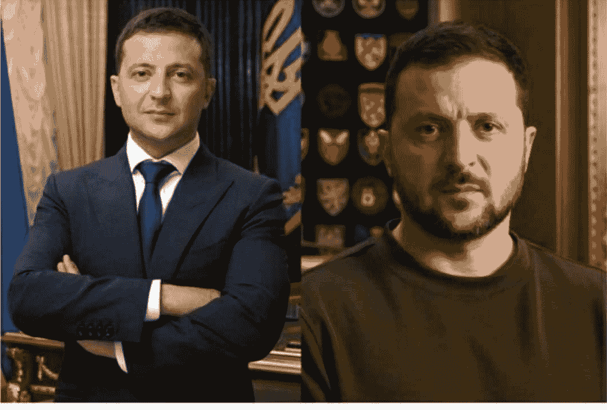

这一年泽连斯基干了三件大事：

第一件事，娶了同岁同乡同学的伊莲娜，结束 8 年的恋爱长跑。妻子后来作为编剧之一，创作了乌克兰现象级电视剧《人民公仆》。

第二件事，不再跟俄罗斯第一频道续签合同，转而投入乌克兰“1+1”电视台的怀抱。彼时基辅街头已暗流涌动，亲欧派偷偷覆盖亲俄海报，泽连斯基嗅出风向要变。

第二年乌克兰就开始了“橙色革命”，亲西方的尤先科最终打败亲俄的亚努科维奇，当了总统。

而“1+1”电视台的老板便是乌克兰大寡头科洛莫伊斯基，这是《人民公仆》剧的背后金主，一手把泽连斯基推向总统宝座。2019 年，泽连斯基正是靠着《人民公仆》电视剧，以及后来成立的“人民公仆党”，赢得了总统大选，从“演总统”变为“当总统”。

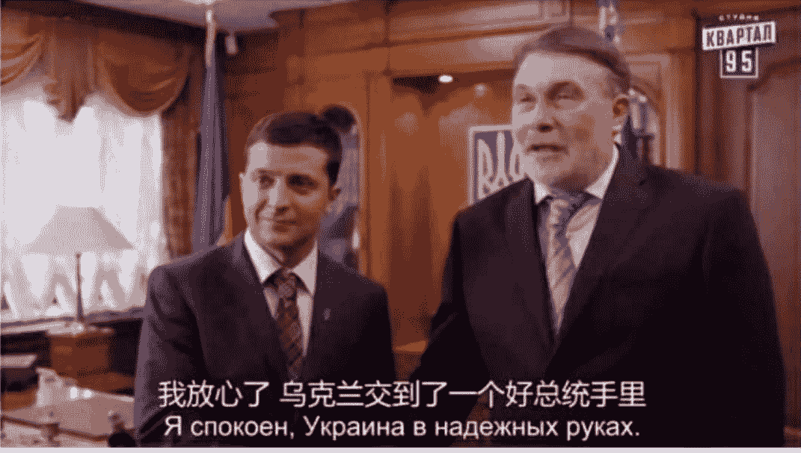

第三件事，拉着发小明季奇成立“95街区”公司 (Kvartal 95)，后来一路做大做强。

2011 年，叶尔马克作为律师加入，摆平“95街区”很多演出合同的烂摊子，同泽连斯基建立深厚友谊，后来成为《人民公仆》的制片人。

泽连斯基当选总统后，把工作室全部交给了明季奇打理。明季虽无实职但影响力巨大，被称为泽连斯基的“钱袋子”。

叶尔马克被任命为总统办公厅主任，实际上是乌克的二把手，从任免官员到内政外交，掌握 85% 的流向泽连斯基的信息。

而明季奇、叶尔马克，就是我们今天故事的主角。

## 一、第聂伯黑帮 3.0

基辅的政治版图上，“95 街区”早已不是搞笑起家的娱乐公司，而是掌控国家命脉的“第聂伯黑帮 3.0”。

既然有 3.0，那么肯肯定有 2.0、1.0。我们在《乌克兰低头不语》中曾详细介绍过“第聂伯黑帮”。响当当的“第聂伯黑帮”并非指街头黑帮，而是源自乌克兰第聂伯罗彼得罗夫斯州（简称第聂伯州）的区域政治经济集团。

简单来说，有点类似于我们南北朝至隋唐时期的“关陇集团”。最近热映的《唐朝诡事录》的“去天尺五”单元，也重点展现了关院集团的几大门阀士族。

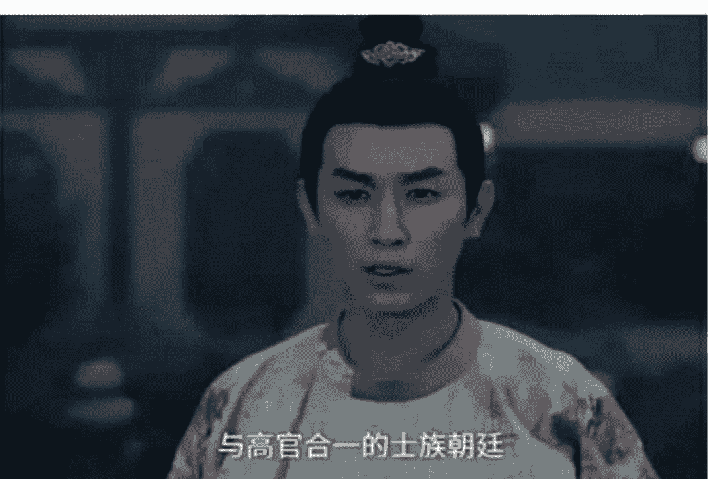

“第聂伯黑帮 1.0”发源于苏联勃列日涅涅夫时期，这位老兄我们都知道，喜欢勋章，人称“勋帝”，出身第聂伯，随后把老乡塞满政治局、克格勃。

1.0 这帮人恢复干部终身制，垄断各行行业，大贪无厌，买官卖官，如内部部长掌控黑手党集团等，把苏联的家庭底得千疮百孔。

苏联解体后，“第聂伯黑帮”从莫斯科转战乌克兰首都基辅，蜕变为“2.0版”，成员包括乌克兰第二任总统库奇马、前总理拉扎连科、前总理季莫申科、列丘奇（库奇马女婿）、第三任总统尤先科、寡头科洛莫伊斯基等人。

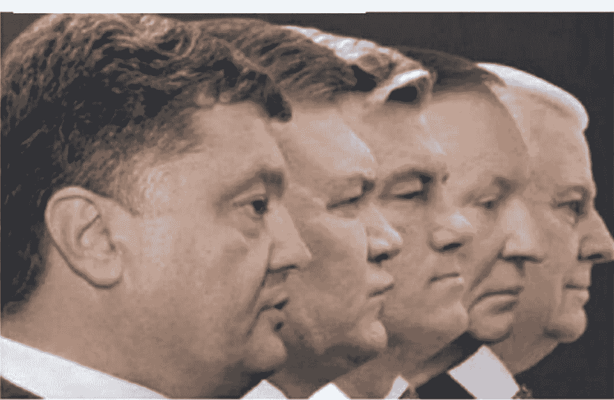

2.0 这帮人总体立场亲西方，伙同西方资本效仿利钦搞私有化，开启全面西方化之路，把国有工厂、油田像分瓜一样分。如果分均怎么办？第聂伯黑帮内部多次上演“从盟友到仇敌”的经典案例。库奇马原本是季莫申科的政治领导，季莫申科原本是尤先科的金主，双方斗得你死我活。第聂伯黑帮持续内斗，自然让顿涅茨克帮钻了空子。

地理上紧挨俄罗斯，首富阿赫梅夫捧着亲俄派。2014 年广场革命是乌克兰的历史转折点，亲俄派老家被端，一下子之间顿涅茨克和卢甘斯克闹独立。为争夺新的总统位子，阿赫梅夫和科洛莫伊斯基两位寡头打得不可交，但双方都拿不出像样的政治代理人。这个时候，“权力大王”波申科登场了，他在尤先科底下当过外交部长，亚努科维奇手当过贸易部长，漂亮的简历获得了西方的一致认可。西方快斩乱麻，迅速扶持波申科上线。波申科执政期间，阿赫梅夫背后操纵反对派，同波申科相互利用：“给我好处，我就同意你的政府提案。”乌克兰媒体把阿赫梅夫控制的议员团称之为“应召女郎”。科洛莫伊斯基则与波申科撕了脸，君子报仇年年晚。2019 年，科洛莫伊斯基全力扶持泽连斯基当选总统。第聂伯黑帮迎来 3.0 时代，黑帮的核心便是“95街区”工作室。

这个以喜剧起家的戏剧公司，凭借泽连斯基的总统宝座，开始成为乌克兰政局中不可忽视的一股派系，组织起覆盖政商界的利益网。泽连斯基曾演出时的搭档谢菲尔出任总统顾问，工作室总监科利亚夫科夫当选乌克兰最高拉达议员，30余名工作室成员担任总统公厅、安全机构、中央行政机关、国家部门及议会等要职。

除了工作室的人外，泽连斯基的亲友好自然少不了好处。泽连斯基的妻子伊莲娜有个闺蜜叫斯维特娜，她的丈夫是切尔尼绍夫，两个家庭走得很近，伊莲娜还是斯维特娜女儿的教母。切尔尼绍夫凭借这层关系成为泽连斯基的亲信，2019 年以后平步青云，先后任基辅州州长、乌克兰天然气公司总裁，一直干到副总理。总来说，副总理切尔尼绍夫和前文提到的商人明季、总统办公室主任叶尔马克构成了泽连斯基权力架构的“三驾马车”。

## 二、阿里巴巴与四十大盗

前文提到，“第聂伯黑帮”擅长窝里斗。泽连斯基和科洛莫伊斯基也是如此。老科原本以为小泽是自己的傀儡，没想到这演员比谁都懂江湖规矩：上岸先斩人。

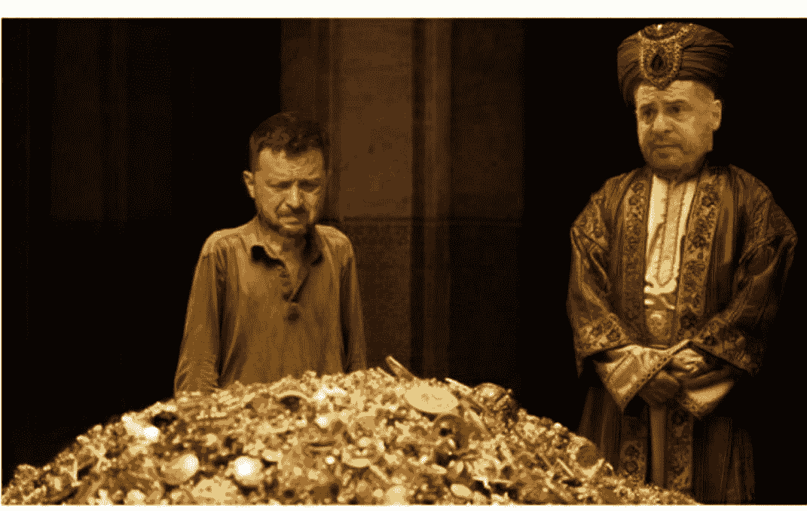

2022 年俄乌开战后，泽连斯基穿着军装站在废墟前的照片传遍全球，战时总总统受到国内民众空前支持。站稳脚跟、硬起腰杆的小泽，第一个就拿老东家开刀。2022 年 11 月，泽连斯基以“满足战时国防需求”为由，下令将洛莫伊斯基的 Privat 集团国有化。这招釜底抽薪足够狠。要知道该集团是科洛莫伊斯基商业帝国的核心，集团旗下的 PrivatBank 是乌克兰最大的私人银行，还控着乌克兰 22% 的股份。老科躲在豪宅里想设法出国，却发现自己的护照都被注销了。2023 年 9 月，乌克兰国家安全局以涉嫌欺骗”“洗钱”“雇杀人”等罪拘留了老科。

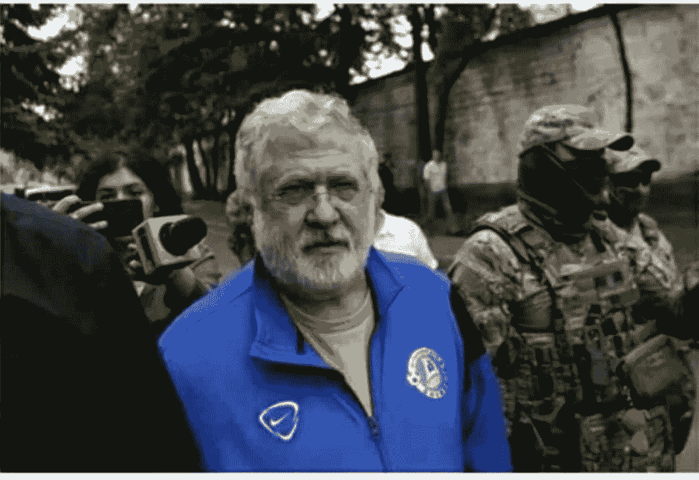

科洛莫伊斯基开始反击，他接连攻击泽连斯基政府，联系特朗普团队，用乌克兰的腐败信息打压拜登政府。乌克兰腐败问题一直是拜登政府拿捏泽连斯基的重要王牌。2025 年 1 月，特朗普正式就任，立马向普京施压，推动俄乌和谈。巧合的是，我们看到 2025 年上半年俄美和谈方案初见眉目，乌克兰“腐败门”迎来爆发。

先出事的是切尔尼绍夫。2025 年 6 月，乌克兰国家安全局 (NAB) 根据线索果断出手抓了副总理切尔尼绍夫。消息传出，基辅政界一片震惊，没人相信这个“第一闺蜜”会倒台。大家注意，这个时候俄美已经秘密进行多轮会谈，切尔尼绍夫只是泽连斯基的开菜。接着出事的是明季奇。科洛莫伊斯基紧咬不放，切尔尼绍夫后来缴纳了2亿美元的高额保释金，但这笔钱是泽连斯基的好友明季奇拿的。按照老科的说法，商人明季奇、切尔尼绍夫等人存在一个共同基金，类似于意大利的黑手党，如果有人犯罪，可以使用这笔钱捞人和资助其家庭。

明季奇这大老虎的贪腐案被揪了出来。乌克兰国家安全局揭露，明季奇伙同切尔尼绍夫利用乌克兰核发电公司承接合同，从承包商收取 15% 的回扣，涉案金额高达 1 亿美金。乌克兰核发电公司是乌克兰最大的电力生产商，运营着扎波热等所有核电站，核电量位居世界第七，满足乌克兰全国 55% 的电力需求，油水巨大。

1 月10 日凌晨，乌克兰国家安全局开始“弥达斯行动”，突击搜查了明季奇的住所，查获大量腐败证据和上千小时的秘密录音。

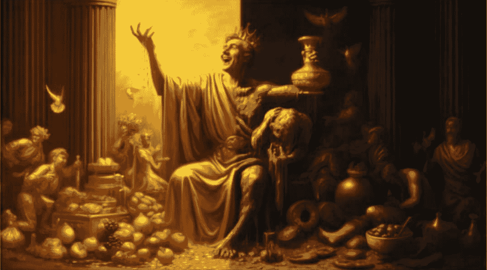

为什么叫“弥达斯行动”？弥达斯是古希腊人物，具有点石成金的能力，最后把自己的女儿变成了黄金。讽刺的是，明季奇家的厕所都是黄金装饰的。这位点石成金的贪腐大佬，最终被黄金反噬。而在就在“弥达斯行动”前几个小时，一辆豪华奔驰驰在基辅街头狂奔，全速前往乌克兰和波兰边境，而离边境最近的机场，一架波音 737 客机正准备飞往以色列。车里的人便是明季奇。不难看出，明季奇背后有高层庇护撑腰，有人提前向明季奇通风报信。

明季奇走了，但留下了上千小时录音。国家反腐局公布了明季奇的部分通话录音，录音中，有人炫耀“用装柠檬的箱子运送160 万美元”。有人威胁拒绝付回扣的企业家：“让你整个公司破产，把所有员工都征召入伍”。明季奇的录音带里，全是江湖黑话。相关人员都有自己的代号。“卡尔森”指的是明季奇，“男神”是核发电公司代表，“火箭”则是司法部长卢申科。泽连斯基政府撤销了司法部长卢申科（此前担任能源部长）、现能源部长格林丘克的职务，并对明季奇实施制裁。明季奇只是冰山一角。有传言称，明季奇不仅涉及能源，更重要的是一个以明季奇为核心的名单。泽连斯基听到这个消息，阿赫梅夫坐不住了，随即前往国外。阿赫梅夫的妻子和三个孩子都是美国籍，长期居住佛罗里达。

## 三、241号法案

我们频频提到国家安全局 (NABU)、特别反腐检察院 (SAPO) 两个，这两个机构有什么头呢？这就和我们之前的文章接上了。波申科时代主要靠西方支持上位，自然要对西方进行政治回报。1991 年独立以来，乌克兰一直是一个典型的寡头国家。无论是“第聂伯帮”还是“顿涅茨克帮”，虽然外交取向不同，但一直在竭力抵御外国资本的渗透。例如，法律规定，乌克兰土地、资源、战略产业不得出售给西方公司，只能由乌克兰本国公民持有。波申科不属于任何帮派，为了壮大自身势力，换取西方援助，主动为外国资本开绿灯。2018 年，波申科推动通过国有资产私有化法案，出售超3000 家“低效”国企，明确允许外国投资者参与竞拍。等到泽连斯基时代，乌克兰对美西方的依赖更进一步。泽连斯基继续通过“变卖乌克兰”来换取西方政治支持。2020 年，泽连斯基推动通过《关于农用土地流转条件的修正案》，正式解除了近20年的农地禁售令，为外资购买乌克兰土地扫清法律障碍。尤其是俄乌战争以来，泽连斯基为了获取西方军事援助，能变卖的只有乌克兰的未来了。

西方一方称赞泽连斯基是“民主斗士”，嘴上说着支持乌克兰的民主和主权，一边趁火劫劫，大举进攻乌克兰经济命脉。不少西方媒体这样描述战火中的乌克兰：“破产国家，价格低廉，稳赚不赔，收割尽快”。数十家欧美公司以跳楼价“收购”了乌克兰的债务、资源和肥沃的黑土地。嘉吉（Cargill）、杜邦（Dup）、孟山都（Monsanto）等公司以及贝莱德（BlackRock）这类基金，几乎将乌克兰的大半农田收入囊中。美国民主的金主——贝莱德集团，则依靠拜登政府的援乌政策，拿到同乌克兰政府的合作协议，深度介入该国能源、基建、国企等核心领域，近乎掌控其经济命脉。

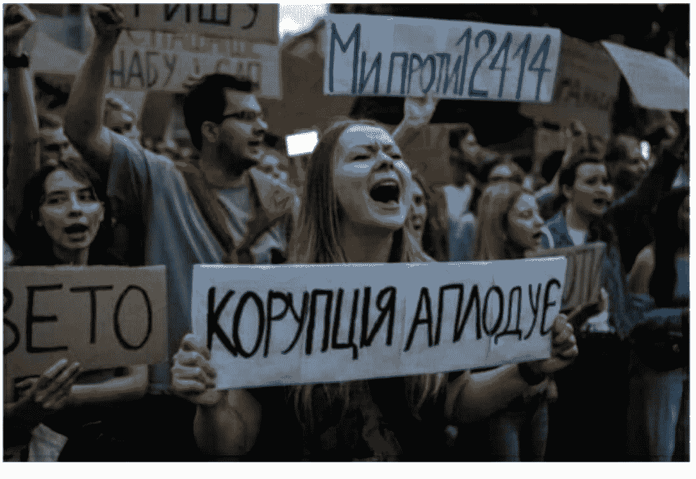

## 泽连斯基撑了三天就怂了，连夜撤回法案。

西方传递的信号很明确：泽连斯基只是西方的棋子，敢动主人的利益，分分钟就被废掉。

深度视野VIP群 人工追踪50+大V 付费进群加微信cuk255 微信ch5586

还是《普京胜利在望》一文中的那句话，新闻要连起来看，连起来，逻辑就清楚了。

从泽连斯基反腐败运动失败的那一刻起，美国要抛弃乌克兰、抛弃泽连斯基的结局已经注定了。

## 四、二十八条和约

乌克兰国家反腐败局与特别反腐败检察院成立了 10 年，整整 10 年，都没查出来像样的反腐败大案，为什么今年下半年集中查了一批大老虎呢？

从企业高管到副总理，再直指叶尔马马克，暗指泽连斯基，形成层层递进的攻击态势，精准打击“95 街区”的核心成员。

按照两大反腐机构的说法，“95 街区”黑帮的权力网络早已形成体系。大佬文集圈明季奇负责敛财，切尔尼尼夫等官员提供政治庇护，叶尔马马克控权力中枢。

西方媒体同步造势，将腐败丑闻渲染为“乌克兰的体制性溃败”和“泽连斯基的信任危机时刻”。

点石成金。乌克兰腐败不仅因为贪婪，更因为体制。

МИДАС БЕССМЕРТЕНЕН. ПОЧЕМУ УКРАНСКАЯ КОРРУПЦИЯ—ЭТО НЕ ПРОСТО ЖАДНОСТЬ, АСЛЕДСТВИЕ СИСТЕМЫ

Вопрос Читателей 19 ноября 2025, 08:30 Поделиться

深度视野VIP群 人工追踪50+大 付费进群加微信cuk255 微信chp5566

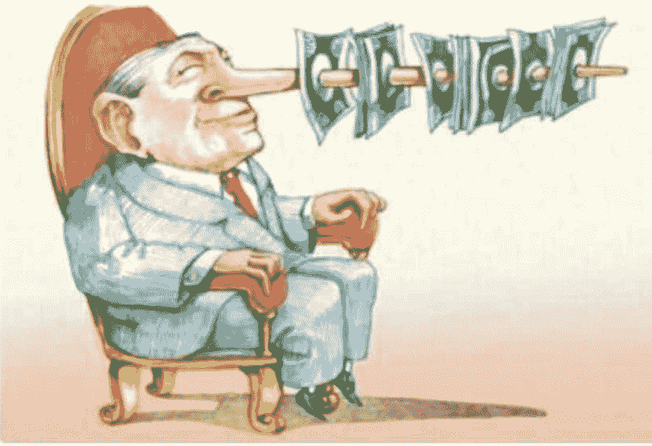

前文已经说到，叶尔马克的乌克兰的实际二把手，几乎每天都和泽连斯基在一起，同样在掩体休息、工作乃至健身，似乎是泽连斯基身边的“影子”，拥有一人之下万人之上的影响力。

在这样的逻辑下，身在其中的泽连斯基会是一个“无辜受害者”吗？

醉翁之意不在酒，美国对准的矛头从来只有一个，那就是泽连斯基，就是要倒逼泽连斯基同意特朗普和谈判计划，配合美国的外交布局。

11 月 20 日，就在乌克兰的腐败门走向高潮之际，特朗普高调推出了 28 点和平方案（二十八条和），字里行间全是大国分脏的傲慢：该计划的核心是乌克兰赔地，俄罗斯赔钱，美国获利。

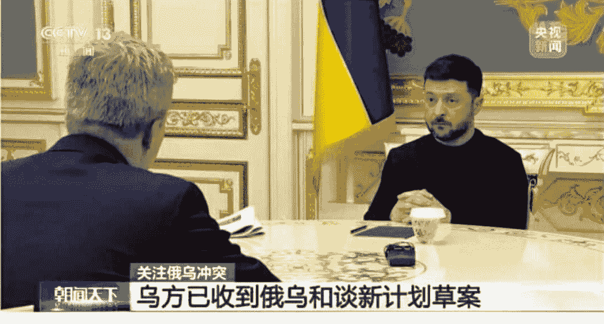

## 俄罗斯被美西方冻结的 3000 亿美元，全部都给美国，其中 1000 亿元用于美国在乌克兰的重建项目，剩余 2000 亿用于俄美双边的投资项目。

深度视野VIP群 人工追踪50+大V 付费群加微信cuk255 微信chp5568

## 作为回报，乌克兰不仅要割让乌东大片的土地，还要按照俄罗斯的要求保证中立化、无核化、非纳粹化、非军事化。

11 月 21 日，普京迅速回应，俄罗斯愿意在 28 点和平方案基础上，同美讨论具体细节。明眼人都看出来，俄美早就勾兑好了。

同一天，泽连斯基发表视频讲话，眼眼窝深陷，声音沙哑：“乌克兰正面面临非常艰难的选择，要么接受困难的 28 点计划，要么面临最严酷的冬季及随之而来的危险。”

而特朗普的态度更加十分强硬，下了最后通牒，要求泽连斯基必须在 11 月 27 日感恩节前给出肯定答复。

深度视野VIP群 人工追踪50+V 付费进群加微信cuk255 微信chp5568

事实上，因为泽连斯基的不配合，美国不止一次产生撤换泽连斯基的想法。

今年以来，泽连斯基总统去了 3 次美国。每一次都被美国羞辱。

2 月的访问，泽连斯基和特朗普当着媒体的面公开吵架。事后就有消息传出，美国副总统多次联系乌克兰驻英国大使扎卢日内，这是乌克兰的前军队司令，支持率一度超过了泽连斯基，是美国心中的“替代人选”。

8 月的访问，泽连斯基带着 7 位欧洲领导人撑场，中途离场给普京打电话，晾了半。访问前夕，还传出美英高层扎卢日内进行秘密会会，讨论如何撤掉泽连斯基。巧合的是，美国杂志《Vogue》紧接着以“总统规格”拍摄了泽连斯基封面。

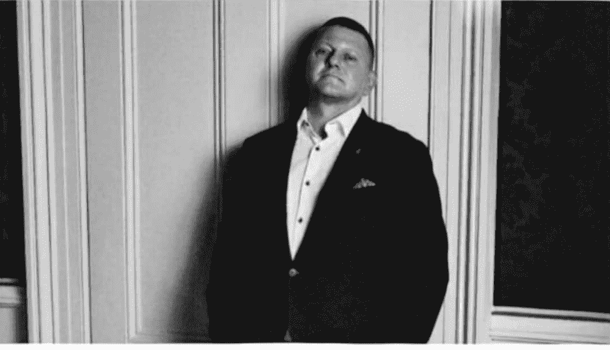

10 月的访问，特朗普更是把泽连斯基递过来的前线地图扔一边，威胁泽连斯基：“如果普京下定决心，他会毁你。”压力来到了乌克兰。

这份加强给乌克兰的《二十八条》，形象地说，就像加强给北洋政府的中国历史上最屈辱的协议更为妥当。泽连斯基签了 28 条，就是乌克兰的戈尔巴夫。毛泽东曾把“二十一条”看成“民国奇耻”，并预测“二十年内不足以存”。

1915 年的《凡尔赛条约》和 1919 年的《凡尔赛条约》同样如此。法国帅福煦表示：“这不是和平，这是休战的有效期”，能多久？”

面对这份丧权条约，泽连斯基会同意？即便泽连斯基同意，乌克兰民众会同意？即便当下的乌克兰民众同意，下一代乌克兰人会同意？特朗普丝毫不会关心，关心的是美国资本在乌克兰的权益能否持续，关心的是俄乌能否达成形式上的停火，关心的是 2026 年诺贝尔奖的归属。

泽连斯基不打算怎么办？乌克兰正在进行一场缓慢的颜色革命。按照美西方的剧本，如果泽连斯基不同意 28 点计划，叶尔马克就是下一个贪腐老虎。如果泽连斯基还不跪，他的腐败罪名也会接踵而至。“明季奇录音”又更新，录音里出现了泽连斯基妻子叶莲娜的声音，她似乎正同朋友讨论腐败计划。

## 五、喜剧和悲剧

冬将至，泽连斯基和乌克兰的命运来到了关键时刻。泽连斯基是否涉嫌腐败，目前尚无实质性的证据。但有一点可以肯定，乌克兰的系统性腐败由来已久。自独立以来，乌克兰便是欧洲最穷、最腐败的国家，从库奇到尤先科，从亚努科维奇到波罗申科，都是如此。

泽连斯基时代也不例外。乌克兰国防部因为军备采购的肥差频繁内斗，国防采购局的负责人一周以内就变更了 5 次。花钱逃兵役、花钱出国、黑市走私武器在乌克兰发展成为一条产业链。

在近期腐败丑闻发酵后，基辅国际社会学研究所 10 月的民调显示，认为“高层腐败严重”的受访比例从 6 月的 54%飙升到 78%。超过 80% 的受访者认为腐败是“非常严重的问题”，仅次于俄罗斯的武装进攻，创下 4 年来最高记录。在乌克兰家喻户晓的电视剧《人民公仆》中，泽连斯基所扮演的“英雄”形象深入人心。

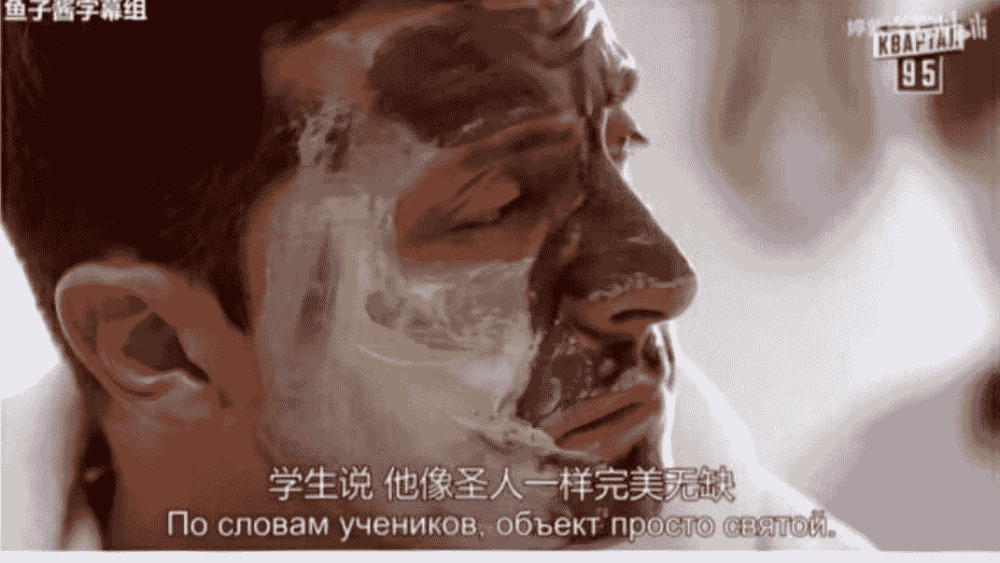

如今，泽连斯基的英雄形象正在慢慢倒塌，他的命运如今充满不确定性。11 月 17 日，乌克兰最高拉达议员热列兹尼亚克彼透露，私密民调数据显示，泽连斯基的支持率已低于 20%，民众对他的“信任裂缝”比前线战壕还深。

实际上，泽连斯基的总统任期在 2024 年就已经过期，只不过乌克兰处于战时状态，宪法规定战时禁止选举。美国的“28 点和平计划”规定，俄乌签署和平协议后，乌克兰将于 100 天内举行总统选举。潜台词是，泽连斯基背完锅，就要滚蛋。

所以，对泽连斯基来说，维持战争现状或许是最好的选择，只要俄乌冲突持续，战时状态延续，泽连斯基可能继续执政。

深度视野VIP群 人工追踪50+V 付费进群加微信cuk255 微信chp5566

但棋子从来掌握不了了自己的命运，正如特朗普反复说，泽连斯基手里没有牌。泽连斯基在战争泥潭挣扎了 4 年，最终得下跪。他低估了拜登的承诺，泽连斯基的任期只有 4 年，嘴上说着主义，心里都是普京的决心，最大的愿望就是收拾旧山河。

在米国和俄罗斯的强压面前，28 点和平协议早晚要签署，乌克兰大选早晚要举行，离开乌克兰可能面临政治清算，包括腐败指控。乌克兰的余生，像戈尔巴夫一样，一遍写回忆，一遍为正名。喜剧往往是悲剧。泽连斯基的政治生涯，如同一部充满讽刺的喜剧：从演员上的总统到现实中的总统，最终落幕。

而比泽连斯基更具悲剧性的是乌克兰的命运，实际上映照了乌克兰这个国家在强权博弈中的挣扎与无奈。几代人的福祉给了美国。《人民公仆》中有一句台词：“改变国家需要的不仅仅是理想，还有残酷的现实。”政治不是表演，治国靠剧本。面对强权和大国博弈的残酷，无论是泽连斯基还是乌克兰，都得撞头破血。尾声：乌克兰低头哭。我在 2012 年去过基辅，漫步在基辅的安德烈斜坡，扑面而来的是厚重的历史气息。置身于法国的蒙特街区，导游讲了这么一个故事：安德烈斜坡下面镇着一条邪恶的地下河，为了避免唤醒这条沉睡的河，山坡上的圣安德烈教堂特意没有建造钟楼。工作室曾写过《乌克兰低头不语》，这篇文章发表于 2019 年 5 月，那会儿战争尚未开始。现在多年过去了，今天的乌克兰已满目疮痍。本土的黑帮、腐败的官僚、美西方的资本、俄罗斯的军队就像安德烈斜坡下面的地下河。这条地下河从来没有沉睡，它流淌在乌克兰的深处，慢慢掏空这个国家。战争前夕，乌克兰人口有 430 万 万如今泽连斯基控制区的人口不到 300 万，失去的人口中一部分流向欧洲，一部分归俄罗斯，还有一部分永远留在了战场上。剩下的 300 万人，男人要继续在前线打仗，很多孩子和父母分离，很多老人拿不到退休金，很多女性找不到工作。即便有工作，月工资不过 400 美元。乌克兰还是国际上最著名的代孕中心和欧洲最大的红灯区。欧美夫妻选择同为白种人的乌克兰美女做代孕。没有生计来源，一些乌克兰女性只好选择代孕，每次可以赚到 2000 美元，对普通乌克兰人来说，无疑是巨款。乱世佳人半张饼。乌克兰从最初的“欧洲粮仓”变为了“欧洲子宫”。

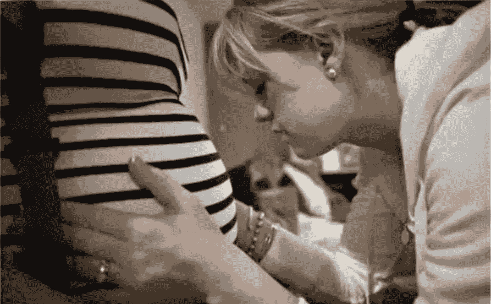

有一些乌克兰年轻女性来到中国，多在北广深的模特工作室、夜店和酒吧工作。我认识一位乌克兰朋友，她叫尤娅，毕业于敖德萨国立医科大学，目前在深圳一家酒吧工作，别问我们怎么认识的。前不久，我把《乌克兰低头不语》那篇文章机器翻译成英语，给她看。尤娅读了长时间，之后语带哽咽地告诉我，很喜欢文章的结尾：“美丽的乌克兰，宛如一名豆蔻女，被美西方、俄罗斯、本地的寡头们，一件一件褪衣裳。”看着自己只能成为玩物的乌克兰，没有任何反抗的，眼里含着泪水，咬紧牙关，瑟瑟发抖。她默默地转过头去，内心如烈火煎油，却只能低头不语。”尤娅说完这句话，同样低头不语，而那双深深的斯拉夫眼眸，早已吻满热泪。

战争快结束了，乌克兰却低头。

# 深度视野优质集（限时188/年）加微信cuk255

| 序号 | 内容 | 价格 |
| :--- | :--- | :--- |
| 1 | 吃瓜群众对话 | 188/年 |
| 2 | 内部私享 | 365/年 |
| 3 | 顾子明集 | 568/年 |
| 4 | 卢克文周 | 599/年 |
| 5 | 欧洲会员 | 328/年 |
| 6 | 砖瓦内部文档 | 400/年 |
| 7 | 卢克青读书会 | 699/年 |
| 8 | 鉴茶财经 | 3310/年 |
| 9 | 猫哥的视界 | 299/年 |
| 10 | 财新周 | 1498/年 |
| 11 | 杨世光金钱 | 2000/年 |
| 12 | 森森财经 | 1600/年 |
| 13 | 激源译译 | 持续更新 |
| 14 | 司马林解读全套书籍 | 2.3 万 |
| 15 | 虚构三部曲 | 599/年 |
| 16 | 克知识星球 | 268/年 |

额外再送：卢祺元新浪微博付费专栏、三村丰老王、三花九术文集。不定期内容：更多资源不写下了……
