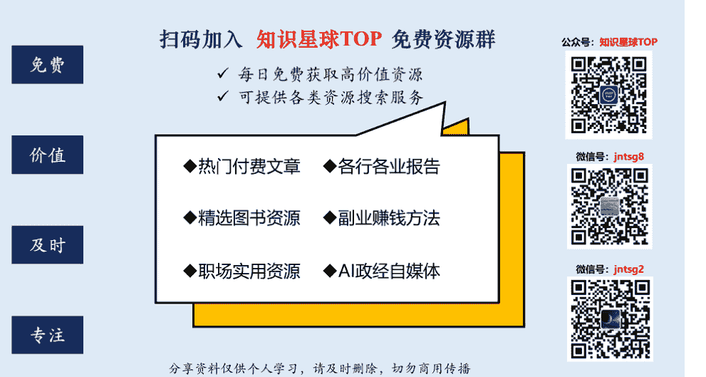

# 298 资本流转四矩阵与美元重置

20250419 卢麒麟

3. 大家好！今天是2025年4月19号，乙巳年三月二十二。今天是聊天儿。今天我们聊的主题是《资本流转四矩阵与美元重置》。原本想聊点别的，但是北方的朋友说大家都很敏感，聊一点技术上的问题吧。我想了想也好吧，因为无论是北方的朋友、北美的朋友，还是香港的朋友，大家都比较紧张，因为这涉及到一个大的历史转关头，还是希望我们能对未来有一个。

4. 关税战从4月2号开始到今天，已经十几天了，大概其状况大家有一个初步的判断。但是关税战的下一步会怎么走，会出现什么样的状况，会对投资产生样的影响呢？众说纷纭。我想通过一个分析框架或者一个模型来解释一下，通过资本流转解释一下，可能对大家会有一些帮助，另外就是可能对投资有一些帮助。

5. 最近北美的朋友非常紧张，因为他们的看法与我是一致的，就是特朗普的第一张牌打出来了，是关税战。特朗普不是没牌了呢？当然还有牌，那么他第二张牌就是金融战。不熟悉情况的朋友可能不觉得特朗普手上上有牌，中美关税，中国和美国的贸易顺差对美国来说是个事儿，但它真的没有那么重要，后边的金融战可能是血淋淋的。

6. 北美的朋友的一个初步的计算，我并不真实情况，我又不掌握实际数据。北美的朋友认为在美国大概600万华人或者是华裔或者是华人，他们持有的美元资产仅次于犹太人，约超过了6万亿美元，所以的朋友很紧张。因为当两个国家进入一种严重撕裂和对抗的时候，如出现二次大战罗斯对付日本人的状况的话，那么华侨和华裔或者是中资的财产，可能会成为鱼肉。

7. 除此之外，我们也有3万外汇储备，还有近3万的外汇挂。那么总额应该在12万美元左右的资产，这个构成美国人敲诈勒索的一个依据吧。所以美国人敢这么大声音做这件事情，情有无忌，其实是手上有牌。这是一个现状，无所谓是非对错，这一个现状。所以北美的朋友非常忧虑，他们说希望能够有一个基本的看法，有一个基本的方法，或者是一个预判，因为还有一些时间可以做安排吧。

8. 于中国手上的牌，我们也只是打了第一张牌，就是商品关税战。我们的第二张牌是货运关税战，还没有打出。我们的第三张牌一样是金融战的牌。现在第一张牌大家都完了，现在在等或者是观察，看看情形如何，然后开始准备第二轮的。在北美的朋友和香港的朋友，其实已经紧受到这种压力，或者是这种感觉压迫或者这种压力，我确实能感觉到外部的情形。

9. 一般义上地说，中国经济与美国经济具有一体性，就是高度互补。同时具有有同质性，所谓的一体性就是中国有货美国有钱，货和币在一起成为资本，合不到一起，币变成金，货变成库存，这是一体性。同质性是什么呢？我们两家的问题面貌不同，其实是一样的，就是美国过度依赖外边的货，我们过度依赖外边的币，就是我们的问题迥似不一样，其实具有同质性。第三点就是中美关系具有对抗性，因为必须有一个妥协。

10. 如果不能妥协，就必须重构。重构的过程，如果到了美国打钱金融牌的时候，其实离战争就不远了，非常近了。那么怎么来理解未来的走向，或者双方如何出手上的呢，以至于会出现什么样的结果呢？我们做了一个简单的判断。当然，我们一直有系统性的建议，有些建议可能没有什么意义或者没有起到应有的作用，但这并不重要，重要的是我们会有看法。

11. 今天在讨论四矩阵之前，我想重复一下子我对《资本论》的研究的一些看法。每次遇到危机，特别是经济危机，总能看到马克的智慧和他深刻的洞见。我已经经历过，马马克的第一卷是写价值论。价值论要解决的问题创造价值的问题，或者它侧重在供给的问题面上。

12. 《资本论》的第二卷、第三卷（第二卷是自然过程，恩格斯挑选出来的），二卷和三卷都是资本流转。二卷和三卷讲的是需求的问题和供给的问题。四矩阵的分析框架：

| 矩阵类型 | 核心逻辑 | 对应关系 |
| :--- | :--- | :--- |
| 区域流转 | 资本向哪里流动 | 需求平衡 |
| 结构性流转 | 资本向哪里流动 | 需求供给 |
| 商品流转 | 资本向哪里流动 | 需求过剩 |

13. 马克的判断，资本流向能力，就能创造价值的地方，资本必然会去。我已经讲过了，好多朋友是新来的：资金是重量、资本是量、米。资金进入流转过程中它不是资本，它无法产生利得。

14. 经济能够高速增长的原因是因为资本积累率较高：
- 自1949年建国一直到2008年，我们的资本积累都极高，积累率高达40%，过度的资本积累导致了生活问题。
- 积累率低，经济必然陷入衰退和停滞。
所以资本流转是极其重要的。资本主义之所以完成高度的资本积累，主要是由于我国通过工业化改造，进行了高强度的资产积累。

15. 在长时间之内，我们的生活状况处于比较充足的发展模式。如此形成了不同的经济模式。如果有人特别是新自由主义认为西方的经济更为合理，那么我必须说。

16. 中国持续数十年的较高度的资本积累，创造了中国奇迹。这个奇迹最终也会形成某种情况的反噬，因为任何事情一旦走向极端，它会带来一系列的问题。再强调中庸之道，就是太低了不好、太大了也不好。如果是增长的话，速度要控制在一个水平，要均衡。

17. 所以我们在这个跑步的过程中，形成了全球经济由平衡到不平衡到再平衡这样一个过程。我其实服马克的，其实《资本论》不太好读，其实马克思都说清楚了。第一卷在价值论里边讨论了资本得非常透彻；第二卷、第三卷论资本流转其实也说清楚了。如果你知道这样，不带着情绪（不带种族、阶级这样的情绪）来看望全球经济、来看中国经济的中美关系，他会看到一些人不容易察觉的问题。

18. 1978年之前那三十年，我们虽然通过资产重组控制了有效的资源，进行了高强度的资本积累，但是这种资本积累的形式是不可持续的。我今天没有时间讲苏联为什么倒下去？就是国家资本主义发展到一定程度需要改变的。我们好在了一个伟大的思想家邓小平，他在1978年他扭转了一个方法，就是在国家资本主义内引入社会资本主义和国际资本主义，引入社会资本和国际资本，形成国家资本、社会资本和国际资本三方主体。

19. 2018年之后，我国面临进一步的高增长，这个时候我们遇到了两个稀缺：
- 严重的资本稀缺：我们资本累积虽然达到了一定的程度，但如果高速发展，仍然需要高速的资本积累。
- 市场稀缺：我国本土的市场不足以容纳我们迅速崛起的产能。
这两个稀缺的问题需要外部性来解决。所以在1978年之后，中国改革开放引入了社会资本、引入了国际资本。其中引入国际资本的部分，解决了中国资本稀缺的问题，为未来的金融战埋下了伏笔。

20. 市场稀缺的问题呢，因为开放之后加入WTO，我们在一定程度上解决了市场稀缺问题，我们在外部获得了巨大的市场，但是市场稀缺的问题也留下了隐患。我再次重复中庸之道，就是对外部资本的依赖和对外部市场的依赖，既有好的一面，它可以极大地提升我们的水平，同时过度的依赖会形成反噬。

21. 关于资本流转的分析框架：
- 关税战和贸易战，属于必然。
- 金融战，属于必然。
- 资本流转的方向是非常明确的。
- 资本流向哪里，取决于它的程度。

22. 简单总结一下：
- 资金是重量，
- 资本是量，
- 米是能量。
- 美国是供给方，中国是需求。
- 一体性、同质性、对抗性是四矩阵的特征。

23. 资本流转四矩阵的定义：
- **左下角（现金/资金）：** 广义的现金，包含银行存款、黄金、数字货币等。
- **左上（不动产）：** 土地、房屋、工厂、设备、交通、运输等所有固定资产，特征是必须折旧。
- **右上角（动产）：** 流动性较高的资产，如股票、债券等金融产品。
- **右下角（商品）：** 大宗商品、一般性服务、能源、非大宗（消费品）。

24. 四矩阵与经济周期的对应关系：
- **复苏阶段：** 现金（资金）迅速向不动产转移。
- **繁荣期：** 现金进入不动产，有人领先将不动产清理进入动产。
- **衰退期：** 大家都清理不动产进入动产，大家离开动产，抛售股票、债券。
- **萧条期：** 为了生活必需及保值需求，开始进入商品；衰退周期之后商品进入萧条，因为商品无法长时间滞留资本，迅速还原为现金。

25. 马克思说资本是必须逐利的。你看到的资本在四矩阵中：
- 区域流转是资本逐利的过程；
- 结构性流转是资本避险的过程；
- 这种流转是国家干预的过程。

26. 我们在做经济学分析时，要理解：
- 积极财政政策：用于解决问题。
- 消极货币政策：用于提供流动性。
这三件事情结合起来形成判断。

27. 我的看法是，中国自2020年就开始进入衰退周期，2023年没有走出衰退，2024年陷入萧条的过程中，我们比美国早很多。各国的经济周期不同步，国家干预的方向、力度完全不同。

28. 如果我是川普或者是我是川普的经济顾问，我采取的策略与今天川普所做的完全相反。我会在上任的第一天解除对中国的一切经济制裁，解除对中国企业的一切制裁，解除对中国乃至香港一切个人的行政制裁。

29. 我会第一个访问北京，要求中国带资重建美国的基础设施。比如带资万亿美元重建全美的基础设施，包括机场、码头、铁路、高速铁路和公路，四年时间完成第一轮重建。我会允许美国所有的商品（包括高端的、涉及军事的）出售给中国，实现贸易平衡。这个做法的意义在于，在特定历史时间必须给美币找到资金，使货币、现金全部进入美国的资本积累，将美国的资本累积拉升到10%，使美国经济增长到6%—8%，拉升到10%。如果效率极高的话，经济增长可以是上述8%。

重置。那么美元充值的必要条件，显然这次这并不具备。

47. 美元充值的必要条件，实际上就是拆除这个给予充值的国家（美国是被充值的国家），是给予充值的国家，必须拆除这个金融壁垒，就是必须失去金融主权之后，它才能做这件事。如果它不拆除这个壁垒，比如说自由兑换，资本项下自由兑换，不拆除。我们现在没有拆除这个壁垒，你仅仅是依靠别人、一些组织、一些机构、一些人来做某种充值的努力，其实是非常困难的。此外，当今世界，除了中国拥有足够的优质资产和优质商品之外，欧洲、日本……

48. 欧洲、日本、韩国、台湾确实拥有相当数量的优质资产和优质商品，但能否成为美元充值呢？答案是否定的。因为日本被充值一次，所以这一次他们不会重蹈覆辙，不会重蹈覆辙。日本如果拿不下，台湾、韩国其实是提困的。虽然台湾积电车走哈，这也可以……这个，我们今天不讲那个复杂的问题，省得又那样样。好吧。欧洲呢，不要忘记这个世界上，还有另一半的犹太人在欧洲，欧洲的“老钱”是拒绝美元充值的，会翻脸的。

49. 我必须说，中国是幸运的。因为，如果2016年是希拉里当选的话，其实我们的压力会变得一天一样，但非常幸运，特朗普上来。特朗普上来之后，再加上拜登的四年，彻底打乱了美国在金融上的布局。虽然他们后来搞了很多事情，2018年的贸易战、2019年的香港黑衣风暴等等，做了很多充值的努力，充值前的预热准备工作。

2018年的贸易战、2019年的黑衣风暴、2020年的这个生物战等等。但，由于川普的一通王八拳，由于拜登的——他倒不是王八拳，我觉得我是真的没有能力或者是糊涂，或者是糊弄，给了我们八年时间，所以我可以确定的说，美国错过了充值的最佳时机，因为美国在经济上复苏期和繁荣期完成充值。当他进入衰退期和萧条期的时候，他是不能进行充值的，无法充值的。他会，除非使用战争等特殊的殖民手段，很难在特定历史时期完成充值。很遗憾，随着特朗普当选，51. 美国已经提前进入了衰退周期，甚至可能这个衰退周期很难持续十二个月，最长也不会超过十八个月，美国将陷入大萧条。所以，美国没有完成充值，美元没有完成充值，所以因为美元没有完成充值，美元必须开始重置，这个重置的过程已经开始表达为黄金价格的持续飙升。我想，我的分析框架和逻辑链梳理出来以后，大家对整个的事情看着就比较宏观，比较清晰了。

52. 现在，我们要观察的是美国，美国我确定它已经进入了衰退了，衰退的进程是怎样的？长度是怎样的？何时进入萧条期，进入一个可能是个大萧条吧。那么，它和我非常有大的关联性，它是我们的外部性。它具有一体性、同一性和对抗性，所以它会对我们构成强大的外部性影响。即便是我现在处于萧条的末期，应该在今年下半年走出萧条，进入复苏。但是由于外部性的干扰，可能会拉长我们这个转身的时间长度和步伐。

53. 我讲这些，都涉及到投资者外部市场和内部市场的一个基本判断和理解。在开始讲投资的时候，我印象、我现在无法回忆，是在2019年还是2020年，我就开始跟大家这个“短股资金”了。那时候，我们的基本判断的框架就是四矩阵，四个周期。基本的都记得四矩阵和四个周期的逻辑框架，基本的分析框架和逻辑链条都是这个，只是当时没有DeepSeek，无法完成建模。现在，我们可以将其进行建模了，建模之后，可以看得更清晰，可以对时间和空间更准确。

54. 美国由衰退周期进入萧条周期，其中一部分的资金会进入商品。当美国进入完整的进入萧条周期的时候，资金退出所有东方不动产、动产、商品，进入现金状况。美元一旦进入萧条，进入现金状况的时候，会大规模溢出，会大规模溢出，跨境流动。所以对时间的理解决定着对空间的变动，这一点非常重要。对于政策制定者来说，时间性也是重要的。我们要用针对性极强的政策来处理内部性和外部性，川普手上的牌过了。

55. 当前美国的政策选择，如果是以币换货，那么必须结束。

56. 当前美国的政策选择，如果是以币换货，那么必须结束。但现在看来，他们可能没有考虑关税和贸易战，一体化和同一性不够，更多的思考是以币产质。目前不具备硬性条件，实力不够，软力，这一块也做不到。

57. 就是美国以币换货，以币产质，最后一个是以币亡。用币战使对手掉，日本呢，差不多是死了。这个事情，我可以给出基本的结论：绝对做不到，尤其是对中国，政策选择的空间越窄。他在政策反复跳的时候，会会出现严重的问题。

58. 美元重置三种类型：
- 黄金：它对其他货币贬值，反而升值，猛烈贬值，重新定义美元的价值。
- 美元指数：对应的欧元、日元、英镑、瑞士法郎、瑞典克，指数的大幅下探。
- 购买力平价：无法进行精算，可以看它的通胀水平，那就是购买力下降的清晰标志。

59. 我想，我今天讲分析框架和逻辑链条之后，对美元重置和贬值的过程中可能发生的情况，你们心里有数，并且可以作为自己投资的依据。我想最后说说几句我国的策略，这个事情其实不应该说，以后可能惹麻烦。这里点到为止，我觉得我们现在要破除两大迷信：不要妄谈大局观，不要谈大棋观。

60. 一说大局，就使得迷局看不透；一说大棋，就使得政策走向了。这样的策略，我今天说十点，记一下就行了：
- 人民币锚定工业用电，与工业用电挂钩。
- 引导双外汇回归，就是外挂外汇和我们央行持有的外汇双外汇回归。
- 以国储3亿美元的国家储备为依据，发行20万亿稳定币。
- 以稳定币开启循环建设，将所有的现金变成资本，形成资本利，形成消费拉动。
- 直接税立法，我们需要真正的积极财政政策，直接税立法，立刻可以解决全体国民消费的问题，并且可大幅度增加消费。这个消费可以解决国内的供需矛盾，甚至可以解决全球的供需问题。
- 全体国民无差别保障，拉动消费或者刺激消费都是错误的，必须建立全体国民无差别保障。
- 执行新的马歇尔计划，对那些国家的圈层结构、我们的经济生态提供新马歇尔计划。
- 人民币维持与黄金的相对稳定，并迅速对美元进入升值通道，我们从此开始，再也不向美国和全世界输出通缩了。
- 我们要对中国的生态圈之内的国家取消关税壁垒。

共十个建议。好吧，今天就聊这么多。其实我很辛苦也很累，我刚刚修完牙，好吧，我就说这么多。涉及到具体投资的问题，明天下午三点钟有空，我们再聊几句，好，周末愉快！

## 免费 价值 专注

# 扫码加入 知识星球TOP 免费资源群

- 每日免费获取价值资源
- 可提供各类资源搜索服务

img/8d1711506ab86df3ace74948c47f2390_27_0.png

| 热门付费文章 | 各行行业报告 |
| 精选图书资源 | 副业赚钱方法 |
| 职场实用资源 | AI政经自媒体 |

公众号: 知识星球TOP 微信信号: jntsg8 微信信号: jntsg2

img/8d1711506ab86df3ace74948c47f2390_27_1.png
img/8d1711506ab86df3ace74948c47f2390_27_2.png
img/8d1711506ab86df3ace74948c47f2390_27_3.png

分享资料仅供个人学习，请及时删除，切勿商用传播
