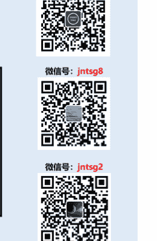

# 20250420 卢麟元

扫码加入 知识星球 免费资源群

| 优惠 | |
|---|---|
| *每日免费获取高价值资源 | *可提供各类投资服务 |
| 价值 | *闲门免费享家 *各行业业务报告 |
| 反时 | *精选图书资源 *职业转型方法 |
| 专注 | *职场实用资源 *AI及前沿媒体 |

分享资料仅供个人学习，请谨慎对待，严禁转发传播

## 正心以中和修身以和：

又被禁止言了，务必小心，保持平台，把课讲完。

## 正心以中和修身以和：

请大家注意香港金属交易储备的安排。在纽约和伦敦之外，将有第三个存储仓。此事意义重大，将影响贵金属定价权。特别是，黄金定价权。

## 正心以中和修身以和：

我一直在思考，美元再次转强的必要条件。亦或者，黄金深调的必要条件。唯一的出口：中美结束关税战。显然，短期内难以达成共识。

## 正心以中和修身以和：

而事情的发展，却是向着不可控的方向滑动。欧洲钱正在离开美国资本市场，规模可能高达5万亿美元。

## 正心以中和修身以和：

鲍威尔如继续硬得刚杠，不减息并开启QE；那么，美国可能很快再次股债汇三杀。

## 正心以中和修身以和：

从现在开始，我暂时不再谈论东大任何问题了。以下...请大家自行补课。

## 正心以中和修身以和：

至于日本，几乎肯定不会重复平成战败。当欧州撤资时，日子绝不会手软。甚至，在汇率上，会有残酷的反杀。

## 正心以中和修身以和：

让人牵挂的，是中东战局。如大乱，则会影响欧资回撤。普京的停战，显有有回撤之意。中东战局，很快进入关键博弈了。

## 正心以中和修身以和：

我的四矩阵理论与处置周期判断，令一些人很不开心。不过，那已经是事实。也是大家投资的依据。我的朋友们，不会再次沦为鼓噪者的韭菜了。

正心以中和修身以和：

其实，昨天的课，细听就已经做出了投资选择。有空时，再多听几遍。

正心以中和修身以和：

仍然坚持按既定方针办。

正心以中和修身以和：

奥彩对了，恳请大家不要在平台上发表愤怒的言论。不起作用，没有意义，保住平台要紧。谢谢。
