# 万物生·新消费时代商品力创新

刘煜宇 Tim Liu
美团闪购品牌业务部总经理

## 知识星球TOP 资源分享社群

公众号：知识星球TOP

打造一流资源分享社群
汇聚全网高价值资源

微信信号:top28688

- ◆付费文章
- ◆付费社群
- ◆时政&国际
- ◆副业&搞钱
- ◆财经&市场
- ◆行业&科技

微信信号:top28388

添加微信号免费进群

时政·历史·职场·体制·自媒体
学习·军事·软件·影音·社会学

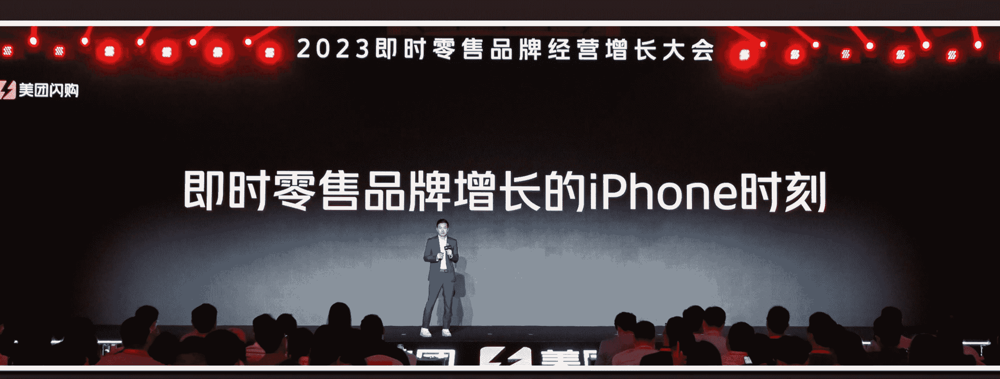

# 2023即时零售品牌经营增长大会

## 即时零售品牌增长的iPhone时刻

## NOW

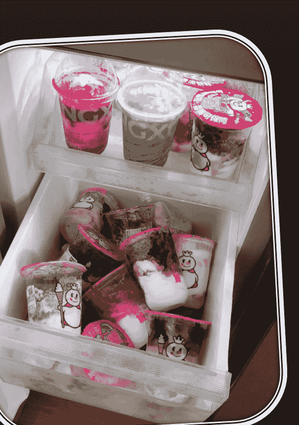
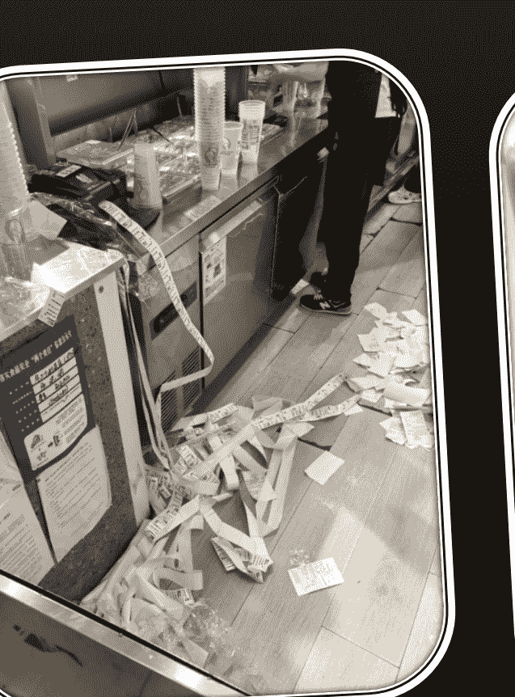
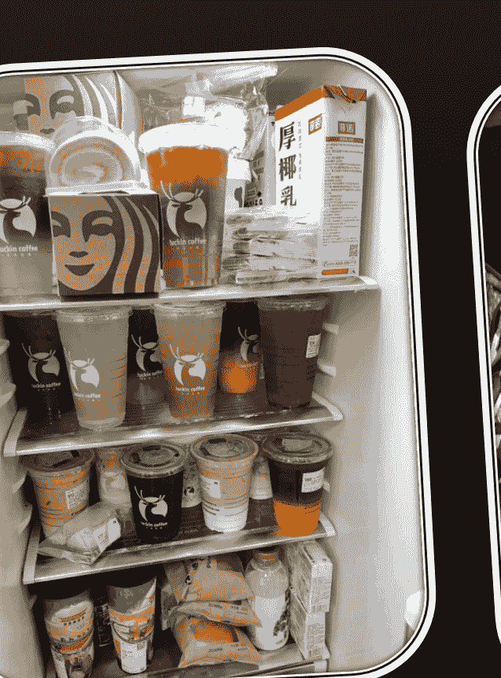
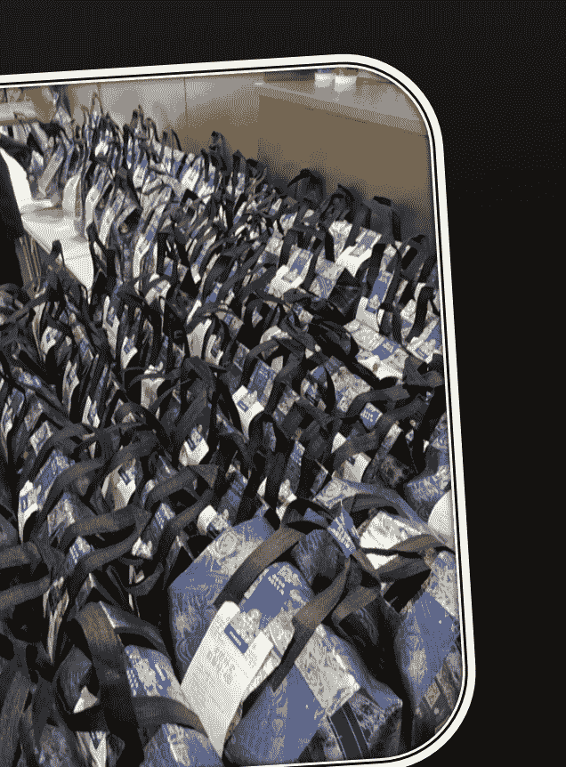

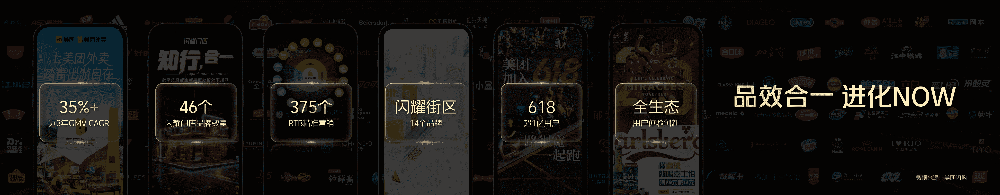

## 为每一份美好生活 分钟级送达

50%
七夕单量超超

少点繁琐 多点期待

数据来源：美团闪购

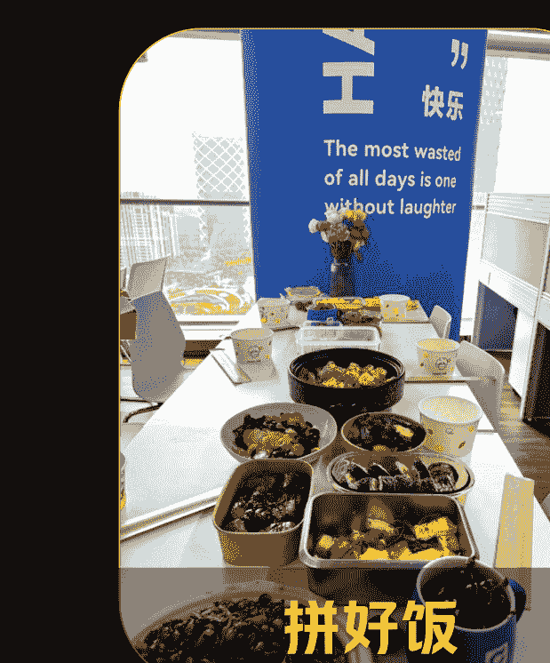

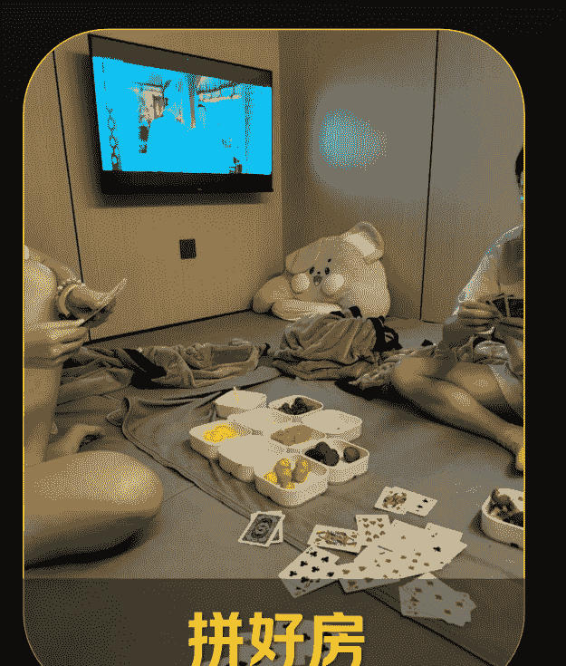

拼好饭
拼好团
拼好房
拼好宠

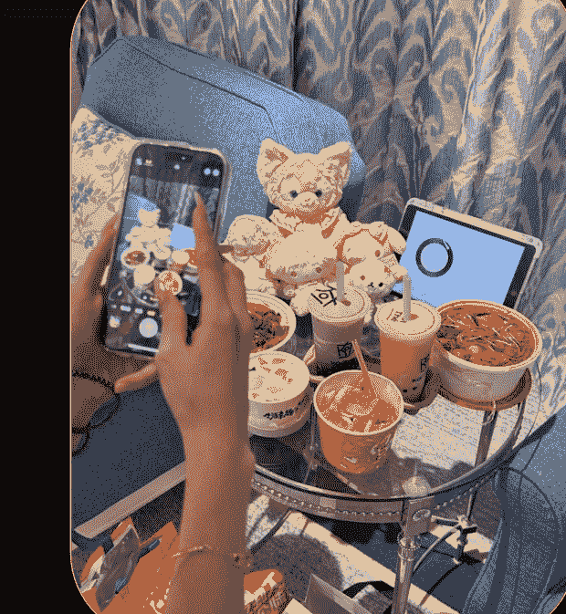
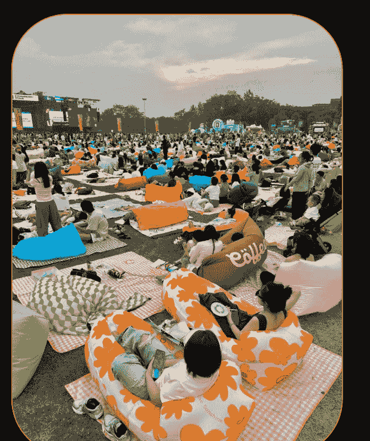
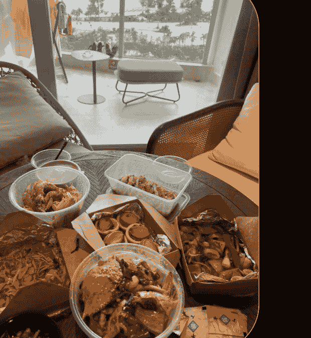

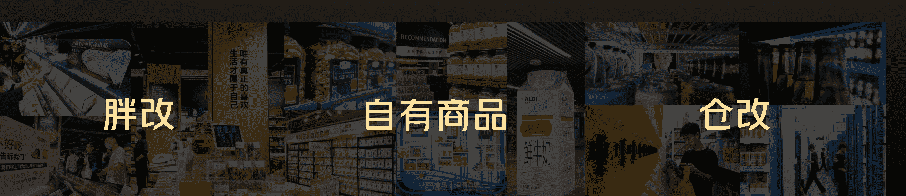

## 胖改
## 自有商品
## 仓改

## 渠道变化三冲击
正颠覆我们以往的经验认知

# 商品力

### 是什么限制了商品新的想象力？

- 碎片化用户需求
- 低效的渠道效率
- 品质难以协同归因
- 不断攀的成本

- 用户调研 1-3个月
- 产品研发 3-6个月
- 内容策划 3个月
- 上市店铺 6-9个月
- 广告/促销 6-12个月
- 复盘

## 数字化赋能提升效率

STEP 1
### 渠道：分销效率

STEP 2
### 营销：品效效率

STEP 3
### 商品+：商品创新效率

## 万千时刻 万种想象

FAST 2.0+ 万物生 新时代的商品力革新
更精准 更细分 更智能

## F 买得到 全面加速品牌数字化分销赋能

张天童 Timon Zhang
美团闪购品牌部食品类负责人

# 数据赋能46个品牌商 实现生意高效增长

| 指标 | 数值 |
| :--- | :--- |
| 累计覆盖门店 | 81.1w |
| 同比新增可售商品数 | 621.5w |
| 赋能品牌业务人数 | 7.4w |
| 贡献GMV增长 | 16.9% |

## 品类生意增量预测

| 品类 | 增长率 |
| :--- | :--- |
| 低温奶 | +49.4% |
| 啤酒 | +54.5% |
| 休闲食品 | +59.2% |
| 饮料 | +28.5% |

## 道阻且长 分销并非易事

| 传统商 | 超市 | 零食店 | 闪电仓 |
| :--- | :--- | :--- | :--- |
| -5% | +28% | +21% | +49% |

## 美团闪购数字化分销赋能2.0+

以用户需求为导向，覆盖性增长
价值回传
应用落地
供应链优化
AI智慧分销

## 深度探索D-RTM模式加速

## 百事食品D-RTM实战案例分享
苏晟 Zale Su
百事食品负责人

## D-RTM (Digital Route-To-Market) 场景运营

基于时购独有的十六大场景为切入点，高效串联FAST各环节的全链路计划

| 环节 | 内容 |
| :--- | :--- |
| D-RTM链路 | 场景探索 / 场景选品 / 供给提升 / 流量曝光 /促销优化 |
| 协同部门 | 品牌部门/市场部门/销售团队/媒介部门/品牌管理部门 |
| 核心指标 | 场景GMV提升/场景渗透率提升/商品曝光提升/效率提升 |
| 核心工具 | 十六大场景/闪电门店通道/RTB精准投放/AI智能分销 |

## 探索CNY礼赠场景下，食品生意增长点

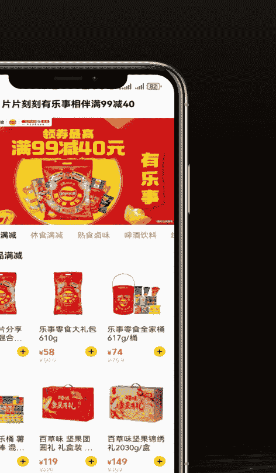
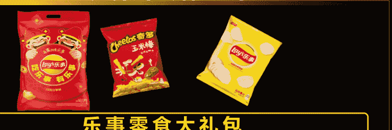

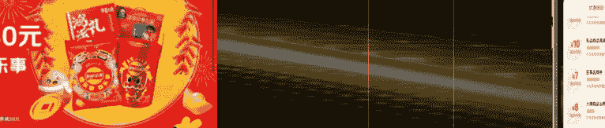

## 百事食品CNY GMV同比增长47.2%

## 春节场景洞察，共创即时零售机会

### 场景定位
春节是全年最大的送礼季，1-2月百事食品生意占比20%

### 场景洞察
- 本地欢聚轻赠：年轻用户对欢聚零食包和轻松赠的需求，满足更多场景
- 异地送礼：异地工作无法回家，想给亲人送礼，中大规格的礼盒传递关怀
- 商品共创：中大规格的零食包、坚果礼盒、冲调礼盒

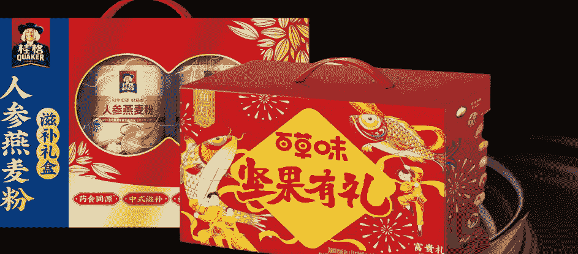

## 找到高需门店，通过闪耀门店和店内通提升礼盒供给

1. 智慧分销：找到礼盒高需门店集中，1W家门店贡献80%CNY生意
2. 闪耀门店：赋能直接分销门店，礼盒门店覆盖率同比提升38%，店均礼盒数量增0.9个，新上溯商品GMV贡献12.3%
3. 店内通：聚焦直接分销门店，上溯SKU13.8w个，单门店新增SKU2个

## O20+GTM团队直接分销
CNY礼盒包GMV同比+78.1% (Wait，此处为78.1%，修正为78.1%)

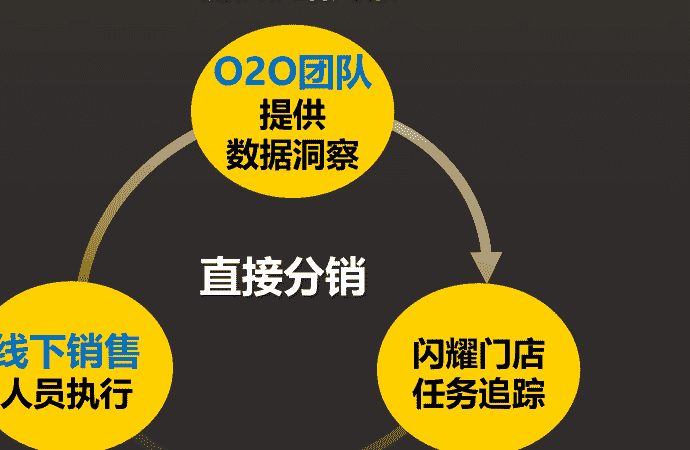

# 美团闪购 聚焦春节礼赠场景，优化促销方案，提升用户转化

## PEPSICO

### 本地欢聚轻礼场景
- 场景选品：亲友好友聚会，一件下单休闲零食和饮料
- 品牌类热度top1

### 异地送礼场景
- 场景选品：异地工作无法回家，想给亲人送礼
- 流量：春节高铁站硬广投放中心智，站内CNY礼赞会场接流量

### 营销优化
- ① 神价流量提升品牌曝光
- ② 跨类连带氛围促销
- ③ 礼盒包运费优惠，刺激转化
- 提到家自提，落地送达真方便，随时下单即刻送达

# 乐事米饼全新上线，通过D-RTM实现区域突破

## 乐事米饼

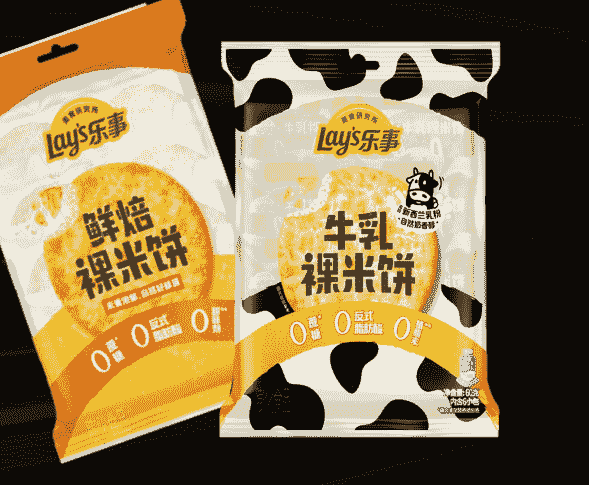

## 智慧分销 聚焦高流量

- 重点投放城市：销量环比增长13%
- 目标区域：米饼渗透率达50%
- 差异化：高流量门店精准触达

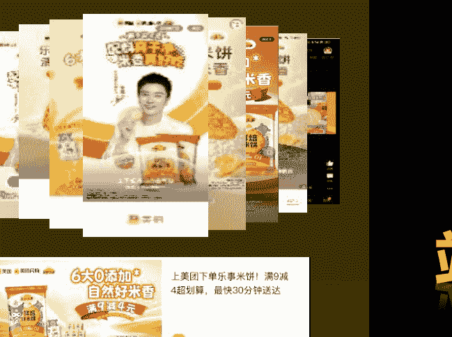
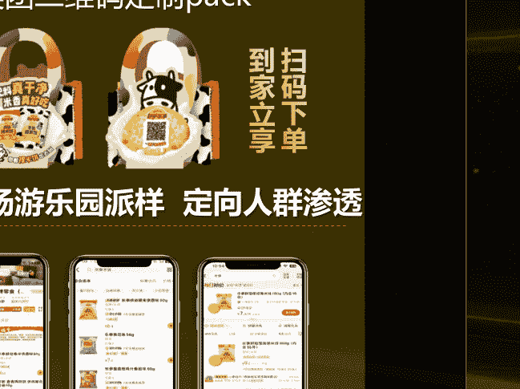

## 数字化赋能全域分销效率

## D-RTM AI 每个人都是决策专家 效果分析（场景-某品牌）

| 指标 | 数值 |
| :--- | :--- |
| 销售额同比增长 | +37% |
| 订单量同比增长 | +13% |
| 渗透率同比增长 | +3.3% |
| 渗透率对比增长 | +3.3% |

## D-RTM AI 每个人都是决策专家 场景渗透

| 活动机制 | 订单总数 | 商品单均价 | 活动单均价 | 金融金额 | 活动补贴金额 | 转化率 |
| :--- | :--- | :--- | :--- | :--- | :--- | :--- |
| 满15元减3 | 30,827 | 46,897 | 1.52 | 521,529.24 | 16.92 | 27,886 | 5.74% |
| 满19元减4 | 5,153 | 11,508 | 2.23 | 129,969.97 | 25.22 | 14,481.08 | 11.14% |
| 满39元减8 | 3,970 | 12,807 | 3.23 | 140,918.81 | 42.3 | 22,068.02 | 15.66% |
| 满49元减12 | 2,609 | 4,706 | 1.8 | 37,746.37 | 53.7 | 5,056.41 | 13.4% |
| 满99元减33 | 8,976 | 17,967 | 1.69 | 175,870.22 | 104.8 | 27,886 | 15.86% |

## D-RTM AI 每个人都是决策专家 人群画像策略

### 策略描述
基于夜间聚类分析历史购买、闲购意向主力人群以及夜间用户购买习惯偏好食物：辣肉、油、蛋糕等，圈3个高意向的购买人群；品牌画像核心人群为实力强且夜间有购买习惯的用户，品类画像核心人群为同夜间购买习惯的用户；跨态高力人群为具有高购买习惯的人群。

| 品牌画像核心人群 | 品类画像核心人群 | 跨态高力人群 |
| :--- | :--- | :--- |
| 预算（估值: 114.7万） | 预算（估值: 1556.5万） | 预算（估值: 3693.7万） |

取消人群 推荐理由：中产消费者消费力大

### 人群画像解析
这是一群以城市中产阶级为主（占比60.8%），性别均衡（男45.1%），年轻化（20-35岁占比63.2%）且具有高消费能力

### 人群画像

## D-RTM AI 每个人都是决策专家 分销策略

### 策略概述
基于历史设置的机制，深度分析夜间流量的成交情况，推荐‘满15减3’机制，其高价值订单数（30,827）显著提升转化率与GMV趋势清晰，该机制中最易落地，快速提升活动量及营销成本，作为核心策略规模化应用。

| 商品名称 | 规模 | 转化 |
| :--- | :--- | :--- |
| 核心人群 | 552.6万 | 15 元 |
| 核心人群 | | 19 元 |
| 核心人群 | 72.0万 | 49 元 |

### 商品渗透
| 商品名称 | 规模 | 转化 |
| :--- | :--- | :--- |
| 核心人群 | 北京 | 2222 |
| 核心人群 | 天津 | 72.3
| 核心人群 | 上海 | 58.2

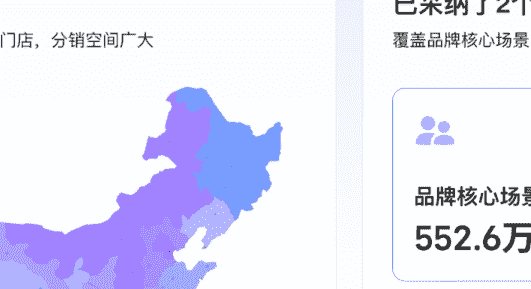

## D-RTM AI 每个人都是决策专家 细细食品

| 商品名称 | 规模 | 转化 |
| :--- | :--- | :--- |
| 核心人群 | 252 | | | | |
| 核心人群 | | | | | | |
| 核心人群 | | | | | | |

## D-RTM AI 每个人都是决策专家 数字化赋能全域分销

| 生态目标 | 场景渗透提升单——场景业务增长
| 目标场景 | 闪购十六大场景 | 自定义场景（文字描述） |
| 目标商品 | 品牌×类目 |
| 品牌 | 请选择 | 类目 | 请选择 |

## D-RTM AI 每个人都是决策专家 智能策略

### N1 STEP： 提出意诉求
挖掘经营需求，基于的业务目标，AI深度分析市场机会

### N2 STEP： AI生成策略
多维度精准制定策略，覆盖分销、营销、促销

### N3 STEP： 查看并采取策略
根据AI生成的策略查看需要需要的商品，人根据引导找到合适的位置，自主决策是否需要投放路径/广告/活动

### N4 STEP： 跟踪效果回收
全渠道埋点追踪，投放效果监控，智能生成效果分析报告

## 盈子通道
SPEED TO MARKET
别让过去限制未来
数字化赋能全域渠道分销效率提升

# 重塑即时零售速度与规模的新范式

### 选品
- 网红趋势洞察：无骨鸡爪
- 寻源
- 品牌沟通
- 授权：豹捷 × 脱骨侠

### 卖进
- 2个月合作时间
- 4000+ 铺货门店
- 1.2亿+ 人群触达
- +629% 单月CMV增长

### 运营

# 用户需求为核心 商品力重构与市场通路革新双突破

# 从渠道赋能到全产业链赋能

## 万千百刻 万种想象
FAST 2.0+ 万物生 新时代的商品力革新
更精准 更细分 更智能

# A 想得到
场景营销2.0
吕颖 Emma Lv
美团闪购品牌部数字化营销负责人

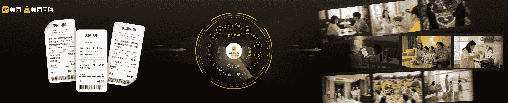

# 趋势一
各个场景品类丰富度持续提升，满足用户多样化的生活需求

### 居家场景
+40% 订单量 YOY

### 食物场景
+35% 订单量 YOY

### 出行场景
+35% 订单量 YOY

### 社交场景
+23% 订单量 YOY

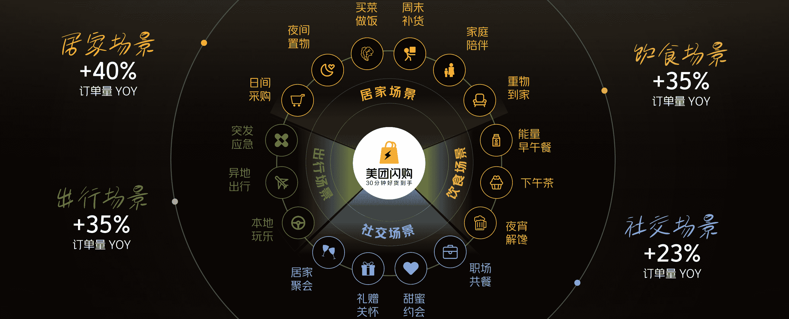

# 小到书皮，大到家，用户五花八门的消费需求，美团闪购都能30分钟送到家

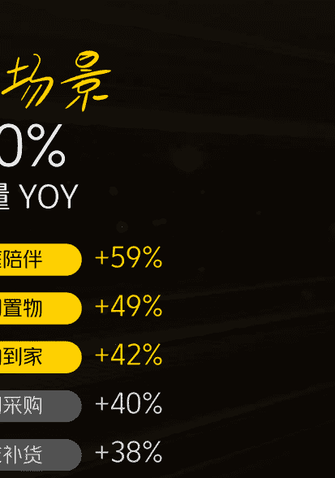

| 排名 | 项目 | 增长 |
|---|---|---|
| TOP1 | 需求软件 | +59% |
| TOP2 | 夜间置物 | +49% |
| TOP3 | 重物到家 | +42% |
| TOP3 | 日订单 | +40% |
| TOP5 | 宠物食品 | +38% |
| TOP6 | 零食饮料 | +26% |

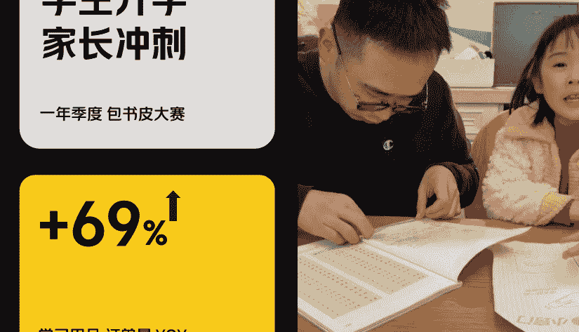

**+69%†** 学习用品（订单 YOY）
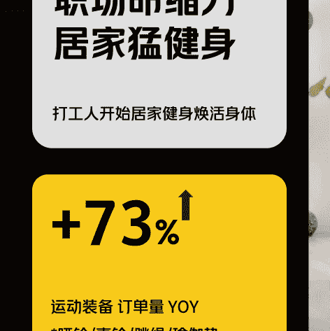

**+73%†** 活动装备（订单 YOY）
*瑜伽/健身/露营/跑步*
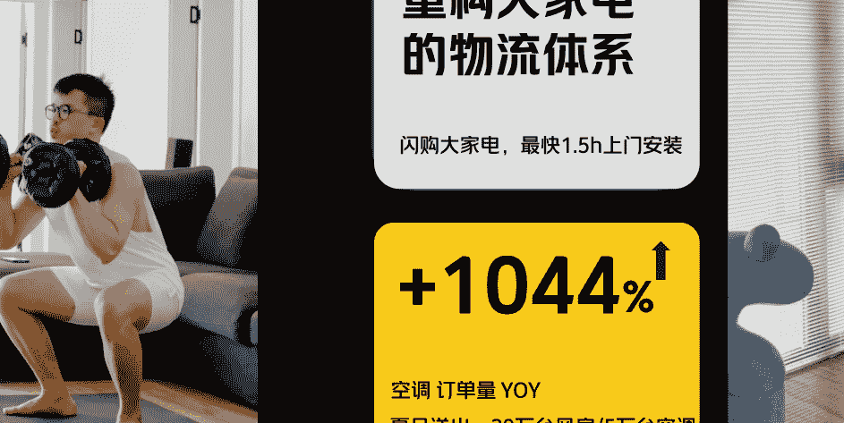

**+1044%†** 空调（订单 YOY）
夏日过卖：20万台空调/5万台空调
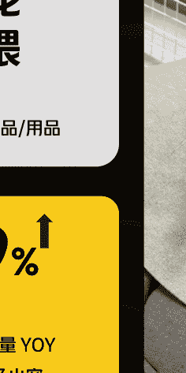

**+389%†** 异宠宠物（订单 YOY）
*狗/猫/仓宠/小宠*

数据来源：美团闪购各品类手机订单期间，其数据期间为2024.7-2025.6 订单 YOY 趋势

## 热点城市订单增长迅猛，美团闪购即时响应用户的热点场景消费

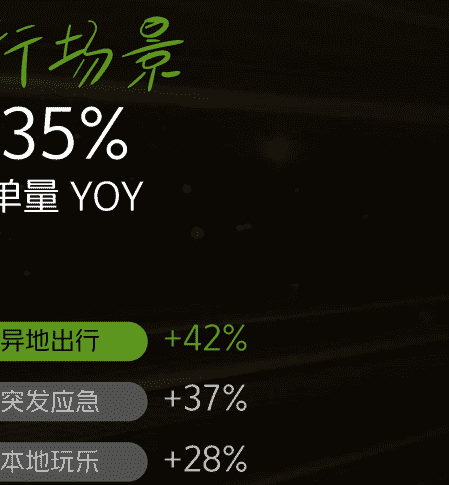
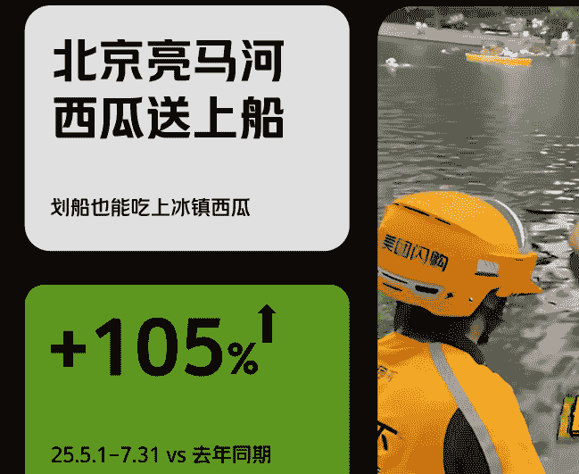

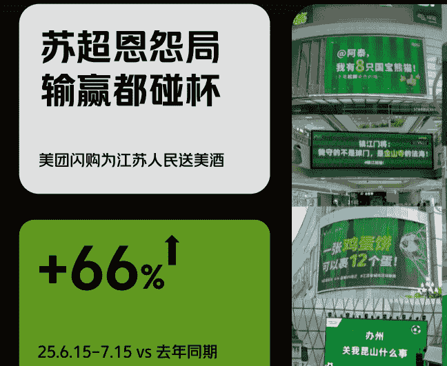

| | | | |
|---|---|---|
| TOP1 | 异地出行 | +42% |
| TOP2 | 夏季露营 | +37% |
| TOP3 | 本地休闲 | +28% |
| | 摄影器材、数码用品、户外装备 | |

# 生活风卷三餐，成功带动品牌创新，年轻人在饮食中治愈、取悦自己

| | | |
|---|---|---|
| TOP1 | 夜宵餐 | +44% |
| TOP2 | 下午 | +30% |
| TOP3 | 早餐 | +30% |
| | 组合调味、零食食品、糖果/散装、组合酒、营养保养 | |

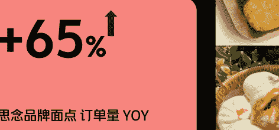

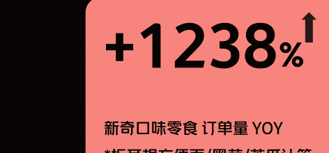

数据来源：美团闪购按类别统计期间，其数据周期为2024.7-2025.6 订单量 YOY

# 用户用美团闪购送出价值礼物，众多细分领域涌现的新趋势，为品牌带来新的蓝海

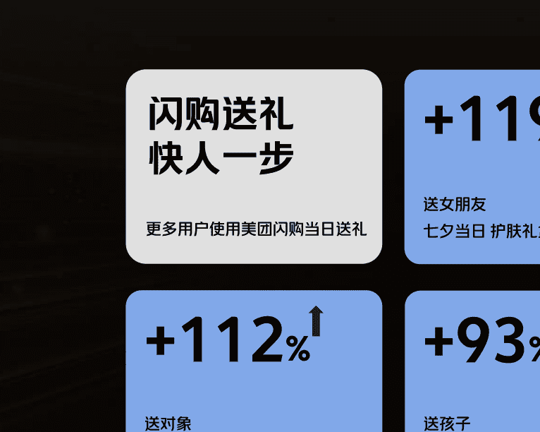
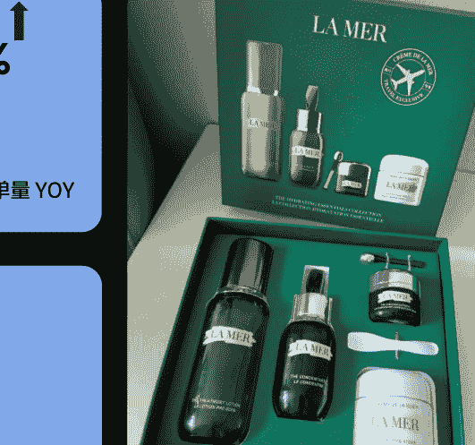
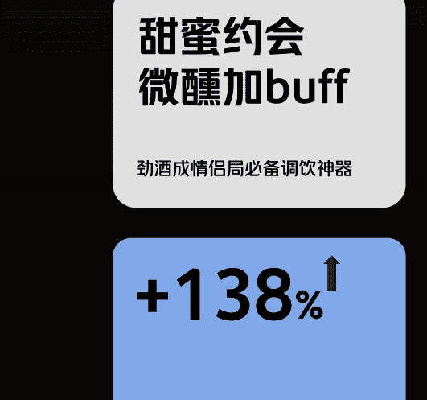
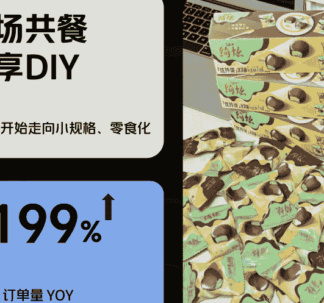
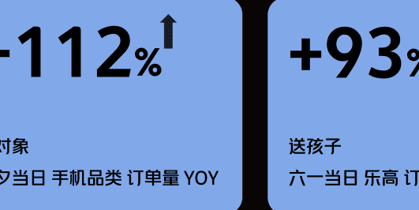

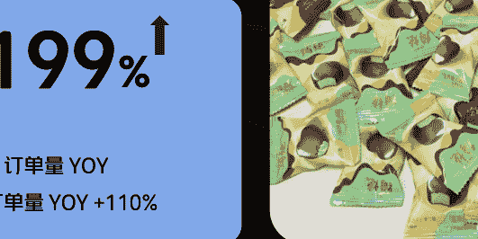

数据来源：美团闪购个别类目数据报告，其数据周期为2024.7-2025.6 订单量 YOY

## 趋势二
### 下沉市场的人群成为增长主力军
“该省省、该花花”的消费特征更加鲜明

- L5 酒店
- L2 医美
- L1 外卖
- L4 闪购

# 真正的消费潜力藏在场景的“缝隙里”

## 趋势三
围绕多元场景，商品在悄悄进化
品牌锚定细分场景创新撬动新增量

# 益益嘉里一人小零食
系列口碑单品上小零食，大受用户欢迎
25年6月单日GMV环比超800%

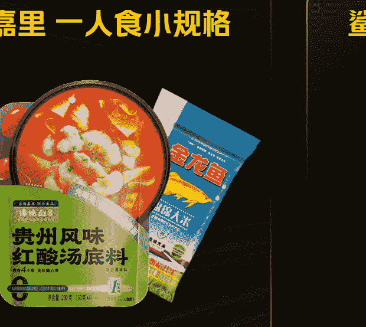

# 鲨鱼菲特 健康低脂需求
一年内通过美团外卖快速渗透零食仓，24年在美团闪购销售额突破1000%
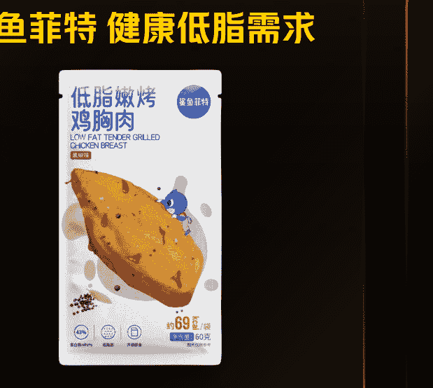

# 卫龙入新奇食谱
一年内成为年轻人常备零食，24年在美团闪购销量榜TOP5
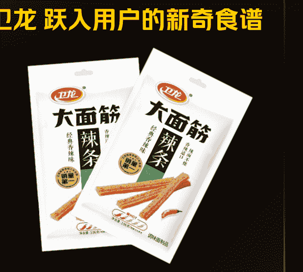

# 卫龙精酿
一年内成为美团闪购销量榜TOP1

# 场景下的创新
功能能够解决问题，便捷供给，提升效率

# 场景下的创新
青草味脉动，限量品

# 场景下的创新
青岛啤酒，脉动联名款

# 场景下的创新
功能能够显形，亮相传达自我态度
创新突破常规盲区，跨界营销激活热点，25年5-6月美团闪购GMV破百万
聚焦年轻人喜好，打造潮流圈触达
新品首发+口碑单下单

# 细分场景的时效性不足，仅提供场景的交易数据，分析不全面，缺乏行业视角，看不到在美团生态增长潜力

# 场景营销2.0
更智能的洞察，更细分的场景&人群，更丰富的生态触点

# AI 赋能场景
数据demo仅为示意，不代表平台真实情况

# 细分场景的排名
品类场景/人群空间/场景分析维度不全面

# 场景 X 商品/人群/城市交叉分析
本demo仅供示意，不代表品牌在平台上的实际表现

# 场景解码器 → 场景读心助手

## 美团 美团购
分析牛奶在早晨7-10点的用户画像与跨类目营销会点

| 快捷通道领券 | 家庭营养管理者 | |
|---|---|---|
| 牛奶+组合鸡蛋套餐 | 儿童燕麦+谷物早餐套餐 | |
| 全麦面包·黑威士+肠胃优菌营养餐 | 营养标准的早餐套餐 | |
| 便餐早餐组合购 | 份子早餐DIY套装 | |

| 午后(11-14点) | 午餐 | 新鲜食材 |
|---|---|---|
| 牛奶 | 方便 | |
| 奶昔 | | |
高峰出现在外卖、饮品与零食便利店、即时外卖、交通工具

| 下午(15-18点) | 健康 | | |
| 牛奶+水果 | | |
| 奶茶 · 巧克力 | | |
全工作日下班高峰，同事进行外卖订单、同享聚会组合

| 晚上(19-22点) | 晚餐 | | |
| 投食零食 | | |
| 牛奶+奶茶 | | |
深夜 | |
| 深夜(23-6点) | 深夜食堂 | | |
| 牛奶+天菜 | | |
| 功能性牛奶 | | |
深夜活跃在外卖平台、生鲜平台发货期，用户在深夜活跃移动趋势、深夜自食

## AI营销洞察
智能分析用户画像，发现跨类目营销会点

| 健康轻达人 | 专家 | |
|---|---|---|
| 优选牛奶+蛋白 | 护肤·全维 | |
| 酸奶·坚果 | 奶酪·养生组合 | |
| 功能性牛奶 | 增强 | |

分析牛奶在早晨7-10点的用户画像与跨类目营销会点还有几个会点：
南：高消费力+品质酒
中：结构+体验+家居用
北：下沉市场+实用手机、通信、各城市的品类特征

| | | | |
|---|---|---|
| TOP1 | 异地出行 | +42% |
| TOP2 | 夏季露营 | +37% |
| TOP3 | 本地休闲 | +28% |
| | 摄影器材、数码用品、户外装备 | |

拓展更多细分场景&人群，提供线下沉浸一体化解决方案

# 旅行 X 出行场景
开拓“旅游式”消费新场景

# 学生 X 核心场景
校内快速取，校园活动，开学从享新生活，同学价频道，学生需求实验室

# 外卖 X 餐饮场景
餐饮零售一起起点，多快好省

# 小镇 X 下市场市场
短剧&线下多元触点影响用户

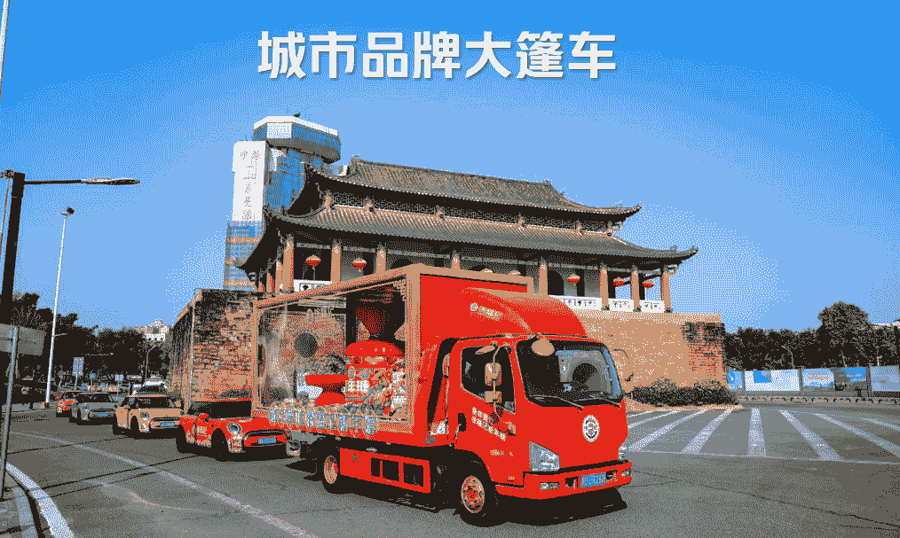
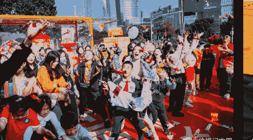
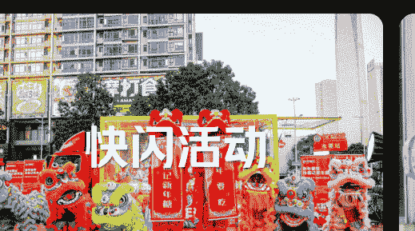

# 生活风卷三餐，成功带动品牌创新，年轻人在饮食中治愈、取悦自己
# 生活风卷三餐，成功带动品牌创新，年轻人在饮食中治愈、取悦自己
# 生活风卷三餐，成功带动品牌创新，年轻人在饮食中治愈、取悦自己
# 生活风卷三餐，成功带动品牌创新，年轻人在饮食中治愈、取悦自己

# 美团 闪购

## 腾讯 X 美团闪购
社交生态流量的独持内容，价值发现与增长红利（视频号、朋友圈等渠道）

## 小红书 X 美团闪购
投流笔记一键复制转转，美团闪购即刻转化

## 抖音 X 美团闪购
产品无缝植入原生信息，精准捕捉用户的场景需求

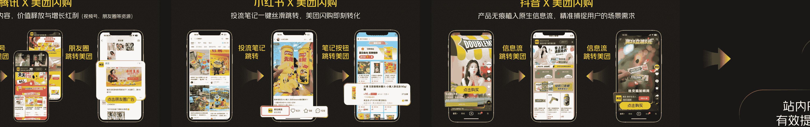

- 联投曝光人群回流，结合美团闪购人群拓包
- 站内RTB再营销：有效提升转化效率

## 海天 X - 一饭封神 & 脱口秀与TA的朋友们2

### 综艺营销带动用户搜索，搜索指数上涨200%

线上内容深度共建 x 线下生活场景渗透 x 社交裂变 x 闪润环接

- +200%↑ 美团内海天关爱搜索指数比增长
- +70%↑ 海天收获GMV 网比增长

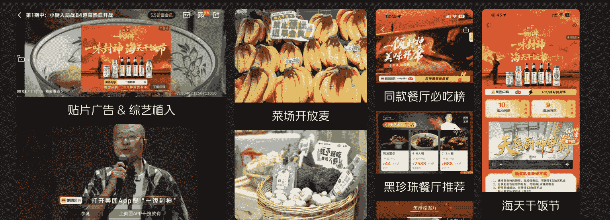

## 湾仔码头 X 腾讯视频 X 美团闪购 X 水饺皇后

借力电影承接用户心智转化，搜索指数上涨410%

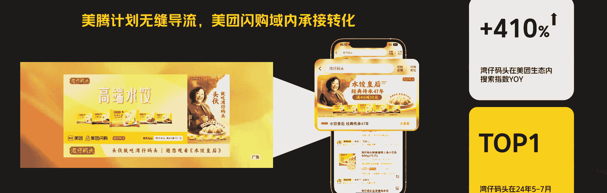

## 玛氏 X 美团闪购

### 站内外RTA联投增效，CPM 成本降低50%

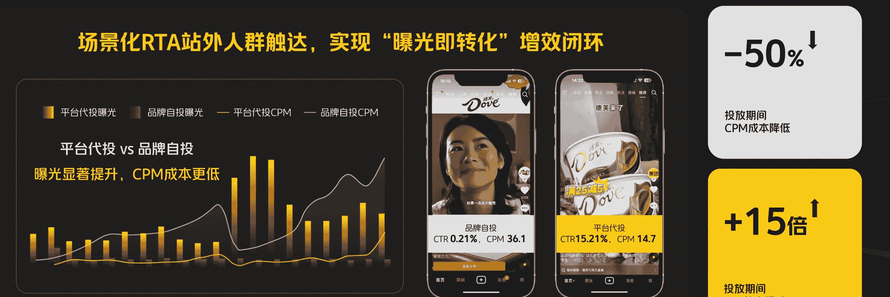
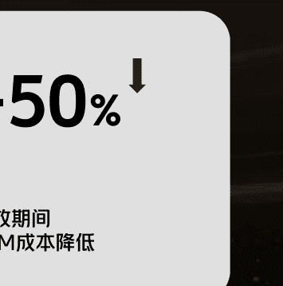

# 场景营销知行录2.0
Occasion-based Digital Marketing 2.0

## 场景营销知行录2.0发布

## 当算法与人类一同呼吸

## 场景营销便从“精准”走向“预见”，从“满足”走向“创造”

### 心价比
智启未来 促销新篇章

郑秀梅 Sharon Zheng
美团闪购品牌部非食品类负责人

## 过去2年我们在做什么？

## 提供便捷的促销工具，让品牌自运营更灵活

- 自建活动：自建活动占比

- 自建会场：自建会场占比

## 运营更下沉，让品牌区域也能自运营

## 即时零售促销的终极难题

- 100w+门店
- 十大人群
- 十六大场景
- N×营销目标

根本不可能，做个促销到底需要多少人才才能明白？？

## 化繁为简，从人工到智能

### AI智能控销
Smart Promotion
智能化算法决策赋能促销效率提升

## AI VS 人工

真高效 真增长 | 全品类都有有效

| ROI | 订单 | 活动GMV |
| --- | --- | --- |
| 休食 | 啤酒 | 个护/租赁/水饮 |

## 神价：过去VS未来

> 和现有促销叠加加叠叠乐
> 破价导致价格形象大损毁！！！！
> 商家提报不透明
> 抗位高不确定性
> 叠叠乐、价格形象大损毁

## 大家眼中的神价

> 和现有促销叠加加叠叠乐
> 破价导致价格形象大损毁！！！！
> 商家提报不透明
> 专注爆品生态结构不健康

## 每日神价

## 严选好物·商品爆发场

### 神价：极致质价比的单品爆发场域 神价
做年轻用户的商品严选场

| 聚焦FMCG | 高质量用户 | 中高端商品 |
| --- | --- | --- |
| 水饮 | 个护 | 趋势品 |
| 酒 | 1亿+ | 品单价 > 20 元 |
| 休食 | 更年轻 | 更高频 |

## 做神价我们是认真的

### 流量加持
+ - 站内日曝光
- 站外曝光

### 真补贴贴
+ - 补贴
- 打造个爆品

### 千人千面
+ - 千人千面推荐
- 智能推荐语

## 神价策略
湾仔码头 X 腾讯视频 X 美团闪购 X 水饺皇后
借力电影承接用户心智转化，搜索指数上涨410%

### 神价：极致质价比的单品爆发场域 神价
做年轻用户的商品严选场

### 神价：极致质价比的单品爆发场域 神价
做年轻用户的商品严选场
