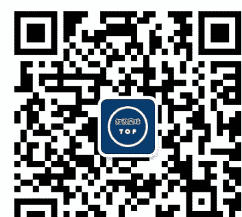
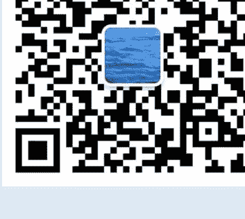
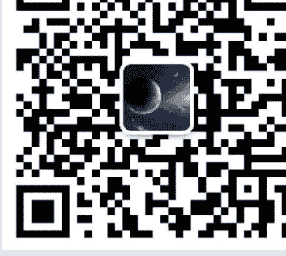
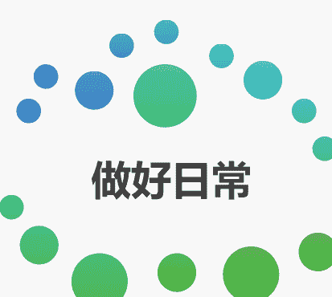
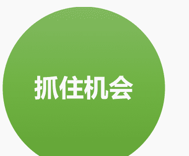
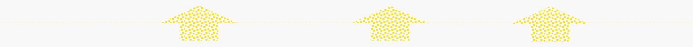
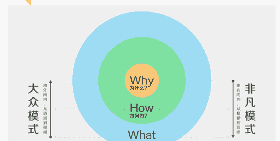
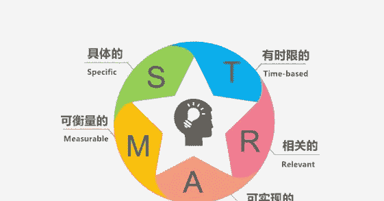
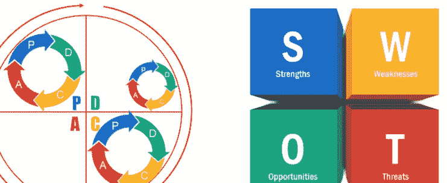
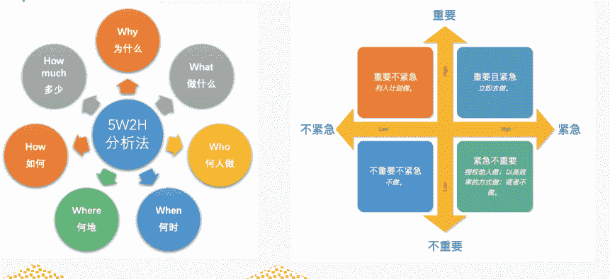

# 基于日常管理的团队文化与成长

郑吉敏 去哪儿旅行 技术总监

# 扫码加入 知识星球TOP 免费资源群

免费

公众号：知识星球TOP

- 每日免费获取高价值资源
- 可提供各类资源搜索服务

价值

微信：jntsg8

| 热门付费文章 | 各行各业报告 |
|---|---|---|
| 精选图书资源 | 副业赚钱方法 |
| 职场实用资源 | AI政经自媒体 |

及时

微信：jntsg2

关注

分享资料仅供个人学习，请及时删除，切勿商用传播

# 目录

- 1 酒店报价中心团队简介
- 2 以管理促成长-日常管理
- 3 以管理促成长-TL能力提升
- 4 回顾与思考

# 酒店报价中心团队简介

## 团队定位

团队核心定位与价值：负责筛选展示端房型，根据用户身份计算价格、优惠使用及权益兑换，对酒店业务关注的收益、过夜、营销、压力影响巨大。

- 产品力-底价、定价、高峰期运营、营销增长等战略贡献：2022年业务重点侧重OKR属于核心投入团队，实际产品所需的技术负责人24个、1053.4pd、129个团队，平均每个需求43.89pd，除届生外均承担产品需求负责人。

- 运维体系化，扩大持续做好数字化链路治理：完成商促新鲜指标0>1的指标和运维体系搭建，从70%提升到98%以上，总结出一套完整的数字化链路路径框架，并计划扩展到其他几项业务。

- 技术五要素年度王者，持续做好技术创新和稳定性：持续在稳定性/质量方面投入、打好根基、全流程QPS压力大，未出现稳定性问题。加大技术创新，通过架构演支持业务的变化和快速迭代。

| 平台选货 | 平台定价 | 平台验 | 商家促销 | 平台促销 | 商家券 |
|---|---|---|---|---|---|
| 报价抓取 | 酒店Tree | 粗排报价 | 平台券 | 权益云 | 平台选品 |
| 报价域 | | | | | 营销域 |

酒店报价中心团队(16人)负责业务域

| 图例 |
|---|
| 核心业务域 |
| 通用业务域 |
| 支撑业务域 |

## 团队代表作

### 项目维度

- 2020 主导【对内DDD对外API的酒店报价引擎重构】获金项奖CEO特别奖
- 2020 承担技术合伙人的【机酒交叉】获金项奖一等奖
- 2021 主导【“大站+微服务”技术架构整体调整】获金项奖三等奖
- 2022 承担技术合伙人的【优享会运营】获金项奖卓越业务贡献
- 2021 技术先进性团队
- 2021 技术品牌最佳奖贡献
- 2022 技术五要素王者团队
- 2022 金牌人才观2人（全司6人）
- 多人多次拿下技术文章原创之星、技术分享之星
- 疫情3年，主动离职的正式员工：2人

### 团队维度

# 团队文化

## Qunar人才观

| 肯担当 | 主动投入、认真负责、愿意承担重任 |
|---|---|
| 足够皮实 | 乐观坚韧、拥抱变化、能够抗住压力 |
| 有头 | 聪明敏锐、逻辑清晰、带着想法做事 |
| 真诚 | 团结、乐于分享、共同提升 |
| 乐观 | 日常积累、相信未来、等待机会 |
| 成长 | 追求进步、抓住机遇、不断突破 |

# 以管理促进成长

## 团队日常管理

着眼现在：定规则、控过程、重结果、扛责任
放眼未来：提升成员能力、提升团队业绩
人才观：肯担当、够皮实、有头、真诚、乐观、成长

### 以管理促成长-日常管理

着眼现在：定规则、控过程、常规、检查、表扬&惩罚、优先级、基础规则、人性化、出发
核心工作：关注细节、挖掘问题、定义、测量、优化、解决、技术指标、业务指标、效能指标、方案
挖掘&培养成员，放大他们的能性（引导、鼓励、支持...），加大核心工作以外事情，并投入（话题、团建、活动...）。肯担当、够皮实、有头、真诚、乐观、成长

做好日常：

时刻准备，当机会来你就成功了！
若想得到世界最好的东西，先让世界看到你！
1、工作是为了自己
2、借平台优势、主动锻炼
3、证明

肯担当、够皮实、有头、真诚、乐观、成长

着眼现在：重结果、常规、核心工作
个人业绩：个人价值、代表作、成长、个人影响力
团队业绩：团队价值、代表作、成长、团队影响力
肯担当、够皮实、有头、真诚、乐观、成长

着眼现在：扛责任、对外、对内复盘解决实际问题、降低对影响。认清现状（表达+挖掘）、改进+预防（多做内因）、TL带头（处理问题+总结）。肯担当、够皮实、有头、真诚、乐观、成长

放眼未来：提升成员能力、提升团队业绩
日常：专业能力、方法论
成绩：底层逻辑
问题：闭环思维
体现：晋升、绩效、薪资
人：成绩、个人代表
事：业绩、团队贡献
综合：影响力、成就感
肯担当、够皮实、有头、真诚、乐观、成长

### 以管理促成长-TL能力提升

## 提升方向

持续学习与提升
榜样
格局
职责：业务能力、眼光、向上管理、专业能力、胸襟、向下管理、综合能力、心理、横向管理

### 科学的时间管理

肯担当、够皮实、有头、真诚、乐观、成长

### 日常管理-TL能力提升-理论与方法

肯担当、够皮实、有头、真诚、乐观、成长

## 回顾与思考

### 日常思考

真正的以人为本：陪伴下属完成关键事情，给予决策等帮助或关心。
提前了解下属一定会询问的问题，并主动同步。
与团队成员一起参加公司或大部分部门的活动。
