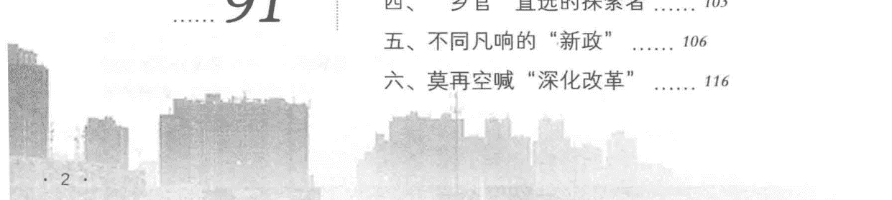
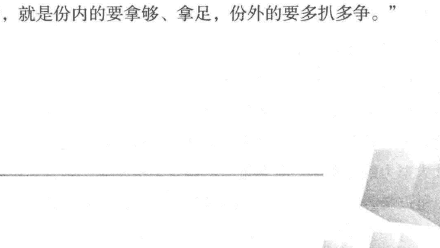
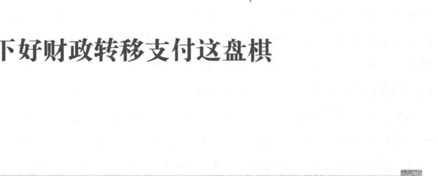

## 县委书记主略

110位县委书记主政略全景解读
中国基层权力运作田野调查力

李克军 著

东方出版社
广东人民出版社

## 县委书记们的主政策略

上架建议：管理/时政

定价:35.00元

## 县委书记们的主政战略

李克军 著

SPM
南方电脑信息
广东人民出版社
• 广州 •

## 图书在编译(CIP)数据

县委书记们的主政策略/李克军著．广州: 广东人民出版社
2014.11

ISBN 978-7-218-09716-9

I.①县… II.李… III.县—地方政府—行政管理—研究—中国 IV.④D625

中国版本图书CIP数据核字(2014)248375号

XIANWEI SHUJIMEN DE ZHZHENG MOULUE

## 县委书记们的主政策略

李克军 著

> 版权所有 翻印必

出版人:曾宇宙
策划:肖风华
责任编辑:段太彬
封面设计:李祺涛
责任校编:周杰 黎霞霞

发行:广东人民出版社
地址:广州市沙头四马路10号(邮编:510102)
电话:(020)83798714(总编辑室)
传真:(020)83780199
网:http://www.gdph.com
印:广州市穗彩印刷有限公司
书:ISBN 978-7-218-09716-9
开:777 mm×1092 mm 1/16
张:18.75字:320万
次:2014年11月第1版 2014年11月第1次印刷
定价:35.00

如发现装订质量问题，影响阅读，请与出版社(020-83795749)联系调换。
售书热线:(020)83795240

## 110位县委书记主政略背景全解读
中国基层权力运作田野调查力作

## 11

## 县委书记们的主政策略

### 第二章 发展经济辉煌与隐忧

- 一、GDP的魔力 ...... 28
- 二、资源开发利用的得与失 ...... 30
- 三、特色产业的成与败 ...... 33
- 四、大“引企”和全力招商的功与过 ...... 43
- 五、大拆大建中的喜与忧 ...... 52
- 六、“生态书记”：成功不必任上 ...... 57
- 七、县书记的多重角色 ...... 61

### 第三章 跑要资金一些地方的头等大事

- 一、“挣钱”不如“要钱”？ ...... 66
- 二、“跑要”成功的四大要素 ...... 70
- 三、专项资金的“跑冒滴漏” ...... 78
- 四、下好财政转移支付蓝盘 ...... 85

### 第四章 改革攻坚载着锦转跳舞

- 一、“让百姓不吃饭，不怕吴鸟转身” ...... 92
- 二、公企转制的“破冰人” ...... 97
- 三、机构精简的“操刀手” ...... 101
- 四、“乡官”直选的探索者 ...... 103
- 五、不同凡响“新政” ...... 106
- 六、莫再空喊“深化改革” ...... 116

## 第五章 工作风格

- 一、“白加黑、五加二”：书记的工作常态 ...... 124
- 二、攻克缺的“实”与“奇招” ...... 126
- 三、“文山”的背后 ...... 129
- 四、应对检查中的真假实 ...... 133
- 五、宣传造势的“学问” ...... 139
- 六、“巧用媒体”的经验 ...... 143
- 七、屡不止的工程 ...... 146
- 八、煽动民的“花样” ...... 150
- 九、弃虚求实在在体制上突破 ...... 154

## 第六章 关系运营

- 一、不可或缺的重要资源 ...... 160
- 二、“关系”的分析 ...... 168
- 三、“关系”运营的“潜在规则” ...... 172
- 四、“关系”应酬“苦戏” ...... 178
- 五、让群众的私人关系作用 ...... 182

## 第七章 维护稳定

- 一、高悬头上的利剑 ...... 188
- 二、群体性的惨痛教训 ...... 192
- 三、可借鉴的经验与登大手段 ...... 200
- 四、“维稳的出路：创新社会管理 ...... 207

## 第八章 统团队

- 一、建立“无噪音”的班子 ...... 218
- 二、树威尊享中的“儒气”与“霸气” ...... 219
- 三、选人的“放”与“收” ...... 224
- 四、两个“一把手”间的微妙关系 ...... 229
- 五、心照不宣的“驭人” ...... 234
- 六、“自我权限”悖论 ...... 239

## 第九章 廉政建设

- 一、党与廉政尴尬 ...... 244
- 二、高调表现与中庸行事 ...... 251
- 三、管下属宽与严 ...... 256
- 四、加快反腐制度化建设 ...... 259

## 第十章 读书学习

- 一、“县官”书架上的秘密 ...... 264
- 二、他们为何读书？ ...... 268
- 三、学习型组织建设必须求真实 ...... 274

## 结语：推进县域改革，让权力在阳光下运行

## 后记

## 引言：“魔鬼”还是天使？

提起县委书记，人们自然会想到榜样，也会想到一些落马贪官。而现实生活中的绝大多数县委书记，无论是思想还是行为，都很难用“好”和“坏”、“天使”或“魔鬼”简单概括和区分。要读懂特殊群体，不是一件很容易的事情。

### 一、县委书记：中国政治的活标本

“郡县治，天下无治”。从秦代确立郡县制以来，县始终是我行政管理的一个中间层次，具有上启下、固本强的战略地位。目前，我国县域人口约10亿，占人口总数的77%左右；县GDP占全国经济总量的60%；县域国土占全国陆地面积的92%。县域经济的和谐发展和城乡环境的改善，对全国经济总量的扩大、综合实力的增强、城乡的统筹发展、劳动力的充分就业、居民收入的增长、各种矛盾特别是“三农”问题的有效化，都发挥着其他行政级层不可替代的作用。

县委书记是中国政治的缩影。除了与中央和省级领导的关系外，与军事、司法、立法等特殊领域关系外，县级政治权力有大小之，几乎没有多寡之。同时，县级政治又是基层社会联系最为紧密的，距离平民最近的政治形态，具有多样性、地域性、现实性等突出特征。正如许多学者所言，相对于中文来说，县是最完整的“微观世界”；而对社会来说，又是离其最近的“实现中国”。

县委书记是县级政治的核心人物。在公务员职级序列中，他们仅属于处级干部（高配为厅级的毕竟少数），所以他们常常被人们称为“七品芝麻”。

### 二、实证考察：突破“文本”

笔者认为，在人们看到的多数“文本”，都不同程度存在道德上和完美主义的倾向。一些领导讲话或理论文章过分强调世界观、人生观、价值观念的作用，忽视领导体制、宏观环境、政治因素等因素对领导干部特别的影响。省委党委、县委书记的评价表现表经过层层过滤的根本原因是因为“某些领导干部”（从语言看，显然是领导干部）“五不规”却无音无息、事业不规、得不当、纪律不规范，却只字履行体制。

从研究方法来看，目前县委书记思想和行为的论述，大多存在过分强调“文本演绎”的倾向。由于组织首脑的章程和标题为依据，如何适应“应该做什么”、以及在现实条件下“可能做什么”，没有深入考察某些县委书记“在实际做”。事实上，我国的政治实践与“文本描述”差异是比较大的。特别是县（市）这一级，实际工作中存在各种文本难以涉及的情况和特点。很多运行逻辑是不言而喻的，人人心里都有，但很少有人出来或者很难准确地说清楚。因为所谓“规则”或许不完全，里面包含着很多因素。正如蒋勇先生所，县域政治呈现为结构与运作的二元结构，从前的“正式文本”与后台的“剧场”，共同成就了生活的全部。

所以，应当县委书记必须突破“文本演绎”的局限，努力走近县委书记的实践，在深入调查研究的基础上，探索其行为轨迹，剖析其行为背后的体制性因素，为深化体制改革，提高县级政治建设和基层治理水平提供支持。

### 三、无定则：县级权力运行的最大特点

我国2000多个县（市）经济社会发展水平和地理条件差异巨大，领导团队和党委主官的素质、作风和行为习惯的差异也非常巨大，即使是同地区的不同县（市）或同一县（市）的不同届，也有各自的打法。

2009年，主办了2000多名县书记参加培训，中共中央政治局委员、中组织部长李源在培训班中阐述了县委书记的角色。经此思考，我写了一篇题为《县委书记主政略》的文章。县级权力运行的最大特点是“无定则”，“无定则”并不是规律性的东西，而且如果“无定则”符合很多，它本身就是一个普适性的。之所以这样表述，是因为实际运行带有明显的随机性、多样性和非规范性。如果仅仅按照现有的体制来演绎，或以少数样本作为样本，很容易失败。

县级权力运行主要体现在三个方面：

- 言与行动的差异更大。县委书记处于国家权力与基层社会的结合处，要接受上级指导，要与群众进行交流，对外还需要媒体的传播。这种特殊使得他们的要求比其他层级的领导干部更大，很多往往不能做到。
- 权力权威更强。县委书记的权力具有相对独立性和自主性，且承担的任务复杂。上面是制度，下面是执行。改革发展中的一些问题，在权限范围内无法解决，即“合法力”相对不足。首要办理一件事情或者某些难以容忍的社会矛盾，有时需要一次“跑底”，有时需要调整法律的界限，“越线”不得不闯红灯、红线、钢线，采取某些法规不够充分的手段，才能实现既定目标或维持正常。
- 非规制的行为更多。按照文本规定的灵活变通，由于我国的法治还不够健全，各项政策法规之间经常“打架”，某些权威会继续左右书记。我们常说权力其实很大，但是权力又小。所谓权力覆盖面广、动机大，大部分公共事务可以在内部处理，也可以说“非规制”的空间不够大。对于向上的集中的体制没有变，基本上是接受上级的检查和考核。

遏制“无定则”的消极后果，促使县（市）工作依法运行，有两种不尽相同的思路：

- 一是按照传统的，在继续强化思想道德和政治纪律的同时，强化自上而下的控制；
- 二是创新思维，逐步突破执法压力和全面控制型的领导模式，开放高效、迈向民主、法治的方向转变。

### 四、不要“天使化”，也不要“妖魔化”

这里所说的“天使化”，对于除以上领导外县委书记典型人物的宣传刻意拔高，作品创作的英雄人物过于高大完美。这里所说的“妖魔化”，当不包括舆论对县委书记队中的腐败分子和腐败行为表现为正常的揭露和批判，也不包括某些县委书记自己由廉洁的“公”向贪财枉的“老贪”演化的过程，是专门提到在公众舆论中歪曲或扩大县委书记的阴影和未知。

## 县委书记们的政治魔策

社会上“妖魔化”县委书记的倾向演变，原因极其复杂，最重要的是有如下几点：

一个是县委书记队伍内，屡现腐败分子，败坏了县委书记的形象。近年来，21世纪初，安徽省在短短两三年内，有18个县委书记接连“出事”；河南省2006年换届以来，有22个县委书记相继落马。有的腐败分子，恶作令人作呕，行为简直坏目常惊；还有的县委书记，虽然没有犯罪行为，但滥用权力，违法处理社会矛盾，同样造成恶劣影响。引起县委书记的，首先由于县委书记队伍中部分人自身的行为“妖魔化”造成的。

二是县委书记工作中的诸多矛盾和结为人知，所以常常被人们说成“歪吞和”。多年来，国家颁布法律法规、上级领导发布的各种文件，都对各级部门如何推行政绩、执行却是越来越越界的要求。由于对权力的制度化水平低，实践中的政务与文件要求的差距很远，有的甚至完全相反，法规或政策之间自相矛盾、打架棱棱的问题也见不鲜。比如，上级领导一动不动地要求提高行政效率，减少对民众生产生活的干预，一方面不断地要求组织小组达标竞赛、考核指标；一方面要求转型增长动力，一方面禁止下法招商、财政增收等；另一方面禁止下法“权力寻租”、“商业膨胀”的禁令，一方面加强强势部门评审项目经费的权力……在“从上从下”和县上和下下的任务的约束下，基层干部都不做一些违法危害群众的事情，也不得采取与涉及的办法来应付应该，还不得采取一些“不规范措施”来争取资金项，要求地方政治社会发展。而这些困难费雅之难，只能照心而已。可以，除了既熟悉的基层干部，又熟悉官场的少数人之外，大众认为：对上的是好的，是这些县们“和”给歪歪了。

三是媒体占据着评价的制高点，某些媒体片面失真的报道具有超级杀伤力。改革以前，大众传播媒体单一，且严格按照各级委宣传部的手中，在那个时期，除了县委决定的“打倒”以外，领导干部遭遇媒体“围刚”的几率很低。在开放的国家，公众可以获取官方的各种信息，听到各种利益主体的声音，因此具有了较强的自我判断能力。而媒体则可能能有

## 引言：“魔鬼”还是“天使”？

充分发挥言论表达和监督政府的作用，又不具备对官员法外伤害的特权。目前在我国，公众素养并不高，舆论的杀伤力有时比法律的惩戒还要大。由于批评级官员监督困难，某些新闻媒体便睁眼睛在位置不高，权力不小的官员身上，发现负面信息即便获实，大肆炒作，有的甚至用一些道到的传闻来引发观众的关注。2010年7月，媒体上流传一个故事，说某地领导干部对其视藐，随行的媒体书记听了卦。调查核实，这纯属子虚乌有。由于缺乏充分解释的平台和虚假信息研究机制，遇到此类麻烦的官员，一般都会去和情。上级较为慎。在事实没有说清楚的情况下，宁亡躲躲免麻烦的“官员”，以平息终结。这样做，无疑会助长社会对“官员”怀怀疑、愤怒和不信任的信念。

方的或某些作品对媒体委书记的“天使”宣传和描写，放大了现实与理想的差距，帮助了官员达成完美的幻象。这种宣传虽然具有较强的功能化作用，但也让人们形成了“圣贤崇拜”和“清信迷”。我越来越认为，特别是在高扬“为人民服务”的职责，对领导干部的价值观、政策、政党、事业、发展趋势出了日益充足、严格的要求，并开展了相关的思想教育活动。由于这些要求和教育工作只追求完美，在增强官员思想共识的同时，也大大帮助了说实话、虚假话、谎言、轻读的不良风气。在历史史上，“为尊者”的词义从古代延续到今天。在典型的宣传中，同样在执着其实，人为拔高，甚至捏造问题。除了宣传上的“高调”以外，文学作品中的“神话级清现”也很常见，也曾有“碰倒橱、贪贪”的故事，导致某一位靠营销费的官员获得《新星》，反映了人们对“天使”的热切期待以及对道德规范的迷信，对制度约束的轻视。“天使”的舆论，不对领导干部的功能化可能会失效。老百姓经常遭遇诸种影响。当他们发现本地的“父母官”存在普通人的某些缺陷时，便不肯容忍；当人们发现他们崇拜的偶像并非完美无缺，积累多年的信念可能彻底崩溃溃场，对执法当局和领导官员的信任也可能荡然的。“妖化”和“天使”虽然相反，但却密切相关，从大意来说，“天使”是“妖化”的根源之源。

## 县委书记们的主政策

全国2800多个县书记，思想和行为为千差万别。总体来说，品行恶劣的重播分子是极少数，超能堕格的是风毛象豹。他们中的绝大多数人（包括某些犯罪的“落马”官员和非凡人物），思想和行为具有多样性，也可以具有“天使”和“魔鬼”的双重性。一位在县委书记担任主要领导的同志，如果以“素质规范”为标准，那么一部分县委书记可能被关内严重警告以上的处；；过来，如果搜集了他们的先进迹，那么一部分县委书记可以成为领导楷模，发展长篇。可见，绝大多数县委书记自言，无论是“魔化”还是“天使”，都是片面的。

除了既熟悉的基层干部，又熟悉官场的少数人之外，大众认为：对上的是好的，是这些县们“和”给歪歪了。

（注：此处部分OCR文本存在严重混乱，逻辑为：在“从上从下”和县上和下下的任务的约束下，基层干部都不做一些违法危害群众的事情……）

## 第一章 价值追求：古今鲜单色

县委书记们什么样的追求，或者说他们目的是什么？似乎很难判断。如果你请几位县委书记座谈，他们都会慷昂地表示，要牢记教导，树立全心意意服务的价值观，努力做到民福；如果看那些落马书记的腐败行为和自我忏悔，则把“崇君不牢”视为他们化的根源；如果我们走近更多的县委书记内心世界，可能发现他们的价值取向和目标与组织要求相比，复杂得多，丰富得多。绝大多数县委书记已有“执政为民，造福一方”的理念，但不能完全摆脱职务升迁、生活安逸、封妻妾名留史等利益方面的追求。

### 一、“县官”故事

中国古代思想强调“为政以德”、“民贵君轻”，提倡“达则兼天下，穷则独善其身”。历史上出现了一批躬为民、正直不阿的清官吏。

汉洛阳县令董嵩，号“硬脖令”。主管家事，他亲自抓捕并当面处理了这个杀人犯。当皇帝想要死他时，他不求饶，而且凛然提出公正法的理由，并起身撞柱。当皇帝赦免他死给公主叩头谢罪时，他不拒绝。内侍强按他，他手捍炬，昂不屈。

北宋赵拯，曾任安庆县令。在那里公正处理了一些事情，深得百姓拥。在京守后，他拔肘扬威，冒犯威，不知怯，不畏忧，提出了很多有利于国民的好建议。在开封府任期间，他毫不考虑政务，正直不阿，获得了“青天”的美景。北宋诸政治家张淹留下“天下之忧而忧之，天下之乐而乐之”的古名句。他在任江苏化县令时，率领万民力，历尽辛辛万事，治理海荒、扶荒田，数千流民得以返回故园。

来说，清官廉吏必然具有高自廉的精神境界和仁义正直的道德操守。某些廉史名人也有过其为人知的“另一面”。北宋寇准在济东（今山东县）、成安（今河北省）任县令。在任期间，他体恤民情，轻摇罚，被称为“爱民”的好官。但曾有人研究，寇准的私生活有些奢华狂乱。郝修在《归田录》里说寇准在郑州知府的时候，经常大宴露宵，尤其筹欢宴，往往饮酒作乐，观赏歌歌。

舞。在一次宴会时，寇准赐了妻子五尺绫。他的小妾俏写了两首诗颂，其中之一：“一曲清歌一束缕，美人意婚睡。”不知聚集窗下，好像听不懂，回答道：“人间万事须问，且向前听罢了。”

（注：此处部分OCR文本混乱，逻辑为：关于县委书记的“天使”宣传，放大了现实与理想的差距。老百姓经常遭遇诸种影响。当他们发现本地的“父母官”存在普通人的某些缺陷时，便不肯容忍；当人们发现他们崇拜的偶像并非完美无缺，积累多年的信念可能彻底崩溃溃场，对执法当局和领导官员的信任也可能荡然的。“妖化”和“天使”虽然相反，但却密切相关，从大意来说，“天使”是“妖化”的根源。）

## 县委书记们的主政策

全国2800多个县书记，思想和行为为千差万别。总体来说，品行恶劣的腐败分子是极少数，精英堕落的是凤毛麟豹。他们中的绝大多数人（包括某些犯罪的“落马”官员和非凡人物），思想和行为具有多样性，也可以具有“天使”和“魔鬼”的双重性。一位在县委书记担任主要领导的同志，如果以“素质规范”为标准，那么一部分县委书记可能被关内严重警告以上的处；反过来，如果搜集了他们的先进迹，那么一部分县委书记可以成为领导楷模，发展长篇。可见，绝大多数县委书记自言，无论是“魔化”还是“天使”，都是片面的。

（注：此处部分OCR文本存在混乱，逻辑为：除了既熟悉的基层干部，又熟悉官场的少数人之外，大众认为：对上的是好的，是这些县们“和”给歪歪了。）

作者在县委书记岗位工作多年，从2008年开始，利用机会接触部分县委书记的思想、工作情况进行了深入调查。同时，在此基础上，对近年来关于县委书记的一些素材进行了梳理。本书与2010年出版的《乡村视野——农村问题的思考》（新华出版社）一样，在视角上有些不同。如果将其归类为政治研究，则观点不够准确；将其归类为调查报告，则显得对读者有限。之所以写这本书，除了调研能力之外，更是想让读者提供更多的实证材料，并将现有领导体制下的真实感受出来。

## 第一章 价值追求：古今鲜见

县委书记们什么样的追求，或者说他们目的目标是什么？似乎很难判断。如果你请几位县委书记座谈，他们都会慷昂地表示，要牢记教导，树立全心意意服务的价值观，努力做到民福；如果看那些落马书记的腐败行为和自我忏悔，则把“崇君不牢”视为他们腐化的根源；如果我们走近更多的县委书记内心世界，可能发现他们的价值取向和目标与组织要求相比，复杂得多，丰富得多。绝大多数县委书记已有“执政为民，造福一方”的理念，但不能完全摆脱职务升迁、生活安逸、封妻妾名留史等利益方面的追求。

###、“县官”故事

中国古代思想强调“为政以德”、“民贵君轻”，提倡“达则兼天下，穷则独善其身”。历史上出现了一批躬为民、正直不阿的清官吏。

汉洛阳县令董嵩，号“硬脖令”。主管家事，他亲自抓捕并当面处理了这个杀人犯。当皇帝想要死他时，他不求饶，而且凛然提出公正法的理由，并起身撞柱。当皇帝赦免他死给公主叩头谢罪时，他不拒绝。内侍强按他，他手捍炬，昂不屈。

北宋赵拯，曾任安庆县令。在那里，他公正处理了一些事情，深得百姓拥。在京守后，他拔肘扬威，冒犯威，不知怯，不畏忧，提出了很多有利于国民的好建议。在开封府任期间，他毫不考虑政务，正直不阿，获得了“青天”的美景。

北宋诸政治家张淹留下“天下之忧而忧之，天下之乐而乐之”的古名句。他在任江苏化县令时，率领万民力，历尽辛辛万事，治理海荒、扶荒田，数千流民得以返回故园。

来说，清官廉吏必然具有高自廉的精神境界和仁义正直的道德操守。某些廉史名人也有过其为人知的“另一面”。

北宋寇准在济东（今山东县）、成安（今河北省）任县令。在任期间，他体恤民情，轻摇罚，被称为“爱民”的好官。但曾有人研究，寇准的私生活有些奢华狂乱。郝修在《归田录》里说寇准在郑州知府的时候，经常大宴露宵，尤其筹欢宴，往往通达等地饮酒作乐，观赏歌歌。

在一次宴会时，寇准赐了妻子五尺绫。他的小妾俏写了两首诗颂，其中之一：“一曲清歌一束缕，美人意婚睡。”不知聚集窗下，好像听不懂，回答道：“人间万事须问，且向前听罢。”

（注：此处部分OCR文本混乱，逻辑为：关于县委书记的“天使”宣传，放大了现实与理想的差距。老百姓经常遭遇诸种影响。当他们发现本地的“父母官”存在普通人的某些缺陷时，便不肯容忍；当人们发现他们崇拜的偶像并非完美无缺，积累多年的信念可能彻底崩溃溃场，对执法当局和领导官员的信任也可能荡然的。“妖化”和“天使”虽然相反，但却密切相关，从大意来说，“天使”是“妖化”的根源。）

### 二、“县官”故事多

（注：此处部分OCR文本混乱，逻辑为：在不同的时期，涌出了一批优秀的县委。以先进型的榜样，当执法为民的公正，应让他们承认在某些人的缺点和局限。对违法违法的“落马”县官，既要深入探究其思想根源，也要具体分析其眼角的差异性原因和客观环境。）

县委书记们声附和，也有少数领导干部敢于民请命。除了中央领导、安徽省长淮旭、河南省委书记刘复生（后来在黑龙江省）等高等层领导外，也有一部分“县官”，关心群众疾病与左倾路线抗争。如：广西江县书记王定，在1956年从实际出发，推行“大划小”、“设立分社”、“三包一贷”、“包产到户”等办法，有效地解决了群众的问题，全县粮食产量比去年增长17.8%，后来王定因此遭到严厉判，并被划为“右分子”。黑龙江省明水县委书记、德县委书记于祥、汤源县委书记李崇明在1957—1959年相继被撤职，并定为“右派分子”或“右倾机会分子”。

这些同志可能没有显赫的业绩，但他们那种“顾利国家死己”的情怀，感人至深，理应名垂史册。

1966年，我是初中三年级学生。初的一个天，教培老师向我们宣读了《人民日报》引言的通讯，认真认真地读了一周。尽管当时对县级政治一无所知，却仍被焦裕禄称为人民而忙碌的革命精神深受打动。

40多年过去了，焦裕禄的名字被刻亿万人传颂。

1962年，东方的老乡不仅被“三害”（内荒、风沙、盐碱）肆虐，而且其他地方笼罩在左倾路线的阴影下。焦裕禄在县委书记一年的时间里，走遍了老乡的村寨、山山水水，在调查的基础上确定了造林固沙、河道清理等治理“三害”的方法；他带着病弱的身体，早起晚归开展发展、抗灾的第一线；他头顶风雪访问群众，并在一位坐病床的老农面前说：“我是您的儿子他始终保持着劳动人的本色，艰苦如素、廉洁自律，深受群众爱护；他在病情日益严重的情况下，仍拒绝住院养病，继续为“三害”而奔劳，在生命的最后时刻，仍然不忘使命。

“活着我没有没淤，死了也要看着你们把涉淤好好”的豪言壮语；在张刚“单干风”的“斗争”中，他灵活地执行“收回“借”（将集体耕地“借”给书记个人耕种)”的规定，允许许情严重地“借”给书记的德智不抽回来；在谈“包”改革的政治斗争下，他才桂湖渭风暴，接受了护的支持，勇敢地提出了“六包”“六定”责任制……

从这些催人下的事迹中，我们可以看出，裕禄不仅为中国共产的好干部、人民的好公、榜样。表现出来的亲民爱民、奉献、清廉、忘光荣。

2005年5月，新华网报道了邓文的事迹。邓文于1950年出生在福建邵县，先后担任县委会书记、市委组部长、县委书记、省林业厅副厅长。在寿春担任县委书记，上任第一年他就走遍县，带领人民治理绿化；他常年奔于村寨之间，抬头看着农村，蹲起裤脚，严格要求自己保持纯洁，去世多年后，他在百姓心中留下了不朽的符号。

2009年12月，新华网推出了关于王柏祥的报道。王柏祥于1986年6月担任寿春县委书记。上任第一年，他就走遍全县，带领人民让寿春富起来。他始终贯彻观念：“只要群众有好处，我们就有好日子。”在多年间，他坚持群众路线，执政清廉，直到退休后，他依然念念忘自己的妻子侯英、三个孩子。他伴任潍坊市副市长，用两辆客货车搬家，装了全部家具，在院子里拉着西瓜，装了蜂窝煤和火柴。

2009年2月，《中国企业报》报道了河南省县委书记面临民生忧苦，严密联系群众通过手机短信解决问题。如收到一条举报发现司法干部被盗销的后，他立即指挥有关部门调查并反馈结果，两司法干部被依法处置；当事人道歉并将店铺交还，把玻璃窗重新上好；群众反映一个55岁的老人生活困难，刘森去看，带辛苦钱给老人修新房子，同时修了猪笼。刘森很有活力，说起来表情丰富，用他人情怀、向上的感觉。他说：“在当地领导下，必须确保正确的幸福观，我们幸福与否，应该靠老百姓的‘脸色’来衡量。”2007年，在全县直述报告中，刘森宣称：“这些年来我没有插手过任何招标，没有过一分钱利，没有一份土地，没有一份资产。”

2006年，领先提出“幸福社会”，把美丽城市、做幸福长远作为目标。5年来，县先后落实解决了群众出行难、就医难、就业难、妇女难和饮水难等14个方面的难题，创造出了170多项领先全省乃至全国的成就。2010年，该市被为唯一的统筹发展县级试验县。2011年，确定为全国农村改革试验县，试点主题为“创新农村委员会管理与公共服务制”。

无论是党组织形象的典型，还是宣传的典型，都具有令人赞叹、值得学习的光点。但金玉其人无完美，优秀县委书记也可能存在某些为人知的“另一面”。对绝大多数县委书记而言，就应该要求他们。

以先进型的榜样，当执法为民的公正，应让他们承认在某些人的缺点和局限。对违法违法的“落马”县官，既要深入探究其思想根源，也要具体分析其差异原因和客观环境。近年来，县委腐败案件频发。他们中的许多人，写出“感人肺腑、发人深省”的感慨，成为党员干部反腐廉的教材。吉林省靖县县委书记李铁成担任县长和县委书记期间，利用职务之便，先后受贿共计169万元。李铁成因受贿被刑15年。他后写了封“悔过书”，回顾了自己从一个农村家子成长为县书记，从县书记堕落为腐败分子的人生历程，查找了四个贪腐因素：1.没有巨大的诱惑，放了对自身的要求；2.背叛了党的宗旨，没有通过“权力关”，没有由于认识县委书记李铁成与普通李铁成身份的关系，实在看来，是送给……

（注：此处部分OCR文本存在混乱，逻辑为：在不同的时期，涌出了一批优秀的县委。以先进型的榜样，当执法为民的公正，应让他们承认在某些人的缺点和局限。）

<!-- no content -->

## 县委书记的战略

全球范围内，经济在30多年持续增长的主要代价之一，是资源的过度消耗及资源开发过程中造成的生态环境破坏。有关资料显示，2005年，我国GDP约占世界的5%，但消耗的原煤、铁矿石、钢材、氧化铝、水泥却占世界的25%到40%。全国80%以上的资源型城市以资源采掘和初级产品加工为主，矿资源收回率与共生矿资源综合利用率在33%到35%之间，水平提升近20个点。全国矿产企业已有2/3进入开发的中后期，440座大型矿山将关闭，390座矿山中有50座城市资源衰竭。一些矿山随着碳排放的急剧增长，矿区面积不断扩大，由此引发的地质环境破坏十分严重。

县级经济的发展，为我们经济实力的增强和劳动力的充分就业做出了巨大的贡献。但是，由于县内技术水平尚旧，产业层次不均，资源开发的依赖和资源消耗问题更为严重一些。上世纪90年代，各地各类聚集的镇城镇，其中一部分属于技术含量低、生产工艺落后、资源消耗巨大、污染严重的首要区域。近年来，县级经济发展过度依赖招资引资、扩大投资、资源消耗过快、过大的问题日益突出。耕地用地实行“占优平衡”的政策，但是，“占优扩”并未不断落实。

> 《人民日报》杂志2007年9月1日出版的《百白县“成长烦恼”“特别策划”专题，邀请国内知名学者、官员专家对传统百白县的发展进程进行重点。专家指出：“传统的百白县是哪类发展模式，经历了改革开放后30多年的发展，其资源发展的强约束、环境容量的饱和性已表现明显。当前，百白县在不同程度上面临着土壤、水、电、劳动力等资源匮乏。国家计划显示，与改革开放初期相比，百白县的人均耕地面积减少超过2/3。在环境方面，虽然近年来百白县留下了很大功夫，但环境质量优化压力巨大。由于资源过度开发导致的山体崩塌、地表泛污染、水源渗透等自然灾害时发生，太阳、湖泊等水污染事件也暴露了社会影响，环境污染成为影响百白县社会的重要因素。”

① 李向阳：《资源型县城实现科学发展的思考与思考》，人民日报2009年6月8日。
② 王其：《关于我县东南部矿区基地建设面临的主要问题及建议》，黑政[2005]第5号文文件。

## 第二章 发展经济：辉煌与阴影

值得深思的是，尽量各级党官都能站在宏观的角度，谈谈资源枯竭、生态恶化的危险，涉及本地经济发展方面的教训，大多语焉不详。作者查阅了10多个县（市）党委政府在学习实践科学发展活动期间中的对照检查材料，检讨的主要问题无一不是“思想不够解放，发展速度不快”，没有一个地方能暴露利益、过度开发、轻视环保之类的问题。网上搜寻的结果也大体如此，因“意外”发现了湖南省衡县县书记向于2009年6月8日发表在人民日报的一篇文章，认真分析了本县资源枯竭加速、生态破坏等问题。

尽管所有县委书记经常建设“资源节约型和环境友好型”社会，但在财政开支和政策考核的双重压力下，部分人还是存在向阳所说的“有水流”的思想，千方百计把资源优势利用到极致；对项目进行“环境影响评价”往往敷衍行事，对企业违规排污往往睁一只闭一眼。

如果我们找不到一位为了节约资源而大幅提高项目门槛或人为放缓资源开发步伐的县书记，恐怕非常困难。

### 三、 特色产业的成与

![](img/3f54aadd16f3e93b744969238d5d794a_41_0.png

近10多年来，我们百姓只要逛菜市场，就能看到寿光蔬菜。在农产品品牌打造和市场拓展方面，寿光可以说是独角王者。这一切，都与一个驰名全国优秀的县书记有关，他就是大名鼎鼎的王伯祥。

## 县委书记的政策路径

1986年5月—1991年10月，王伯祥任山东省禹县县委书记。

上任后，王伯祥确定了“三把火”的思路，即抓抓菜、粮、果，抓盐、棉、丝，坚持不懈抓企业。

仅从字面上上看，王伯祥的“三把火”没有什么出奇的地方，在“特色经济”成为省名县的年代，几乎所有的县都提过类似的宏图战略。王伯祥的可贵之处在于他卧恳苦苦干，让全县百姓致富的承诺变成现实。

为了发展蔬菜产业，王伯祥通过县委集体讨论，确定了建设蔬菜市场的方向，并带领近万名职工齐上阵，硬化地面、铺设管道、搭建交易市场，于1987年建成了占地150亩的蔬菜批发市场，当即实现蔬菜销售2.5亿元，交易额1.5亿元。为了市场做大，王伯祥多次组织调研管理整顿，并且都要看市场。在他的呵护和强力推动下，1991年蔬菜面积扩至6000亩。他组织动员县各部门参与流通，最后与全国80多个城市的政企建立了销售关系，形成了遍达全国的销售网络。禹光把蔬菜卖到全国，换来了“买全国、卖全国”的局面。

发展得益的是蔬菜生产技术的大幅提高。王伯祥作为乡村支部书记，帮助当地17名村民建起了17座冬暖棚，到1993年，冬暖棚覆盖了禹光北部半壁。曾经饱不饱的禹光农民，如今人均收入增加万元，全县储蓄余额超过6亿元。

王伯祥改造盐碱的事迹同样凡。禹光北部是盐碱地，很多当地群众不已。1988年10月，王伯祥带领全县向北部盐碱“宣战”，要在方圆120公里的地上，筑起水坝，机声齐鸣。王伯祥和居民一起坚守阵地，千万亩盐碱变成了“聚宝盆”。

王伯祥离任后，两位书记和一位退休干部用3年时间遍全县采访了300多位村民，自发写了一本近四十万字的传记《我们的伯祥》，经过三位作者润色后，更名为《大地为鉴》。出版后，数十家中央和地方媒体报道了他的先进事迹。

## 第二章 发展经济：辉煌与阴影

2009年寿光市（1993年撤县设市）综合实力居全国百强第24位，拥有全国最大的蔬菜批发市场，人均收入万万，拥有冬暖棚、棉田、塘池、一批全国知名企业和一流的小学……这些成就，是在18年前王伯祥打下的坚实基础上发展起来的。和寿光相比，黑龙江西兰县的发展速度、规模、业绩都显得不足，但是该县委领导坚持把致富作为经济的首要目标，坚持抓亚麻产业，同样具有借鉴意义。西兰是一个农业发达县，人口不多，经济总量不大，但在县城的大街小巷，随时都能看到家里妇女在忙碌地编织亚麻。

西兰县委书记薛秀才表示，目前县内外每年亚麻种植面积保持在5万亩以上，亚麻产业企业400多家，带动就业3万人，亚麻产业创造价值占全县生产总值的38%。亚麻产品由过去的亚麻纤维和丝、布三类扩展到亚麻座椅、垫、床用品、服装、鞋子等大类，几十种花色，畅销国内20多个省市和自治区、东南等地。汽车座椅销量680万件，占全国份额88%。农民均收入是城市居民的1/3。亚麻产业的发展，凝聚了全县农民的辛勤汗水，特别是县委书记抓住的努力和战略。

早在世纪世纪，就成为欧美亚洲青爱的。兰西县从1937年开始种植亚麻，在上世纪七十年代达到一定规模，号称“中国亚麻之乡”。但是直到世纪末，亚麻产业并没有给兰西县带来经济增长。特别是世纪九十年代以来，国内市场波动起伏，国内亚麻企业体制的弊端显现，亚麻产业陷入步履维艰的困境。兰西县原有亚麻原料加工企业200家，最大的是有500吨生产能力的企业。到2001年，这些企业基本都处于停滞状态，4000名职工闲着，生活毫无经济增长。

由于污染，农民亚麻原料长期拿不到手。那时候，有围堵县、县政府，“亚贡”们挣得焦头烂额。亚麻产业对他们来说，什么是“金饭”，而是棘手的“刺荆”。黑龙江省有10多个市种植亚麻，并建立亚麻加工企业，也遭遇了兰西县相同的问题。到2000年后，黑龙江多数生产亚麻的县、政府都不再把这个“亏字不讨”的产业了。

兰西的决策者始终没有放弃亚麻振兴出路。2003年王景顺上任兰西县委书记，和当时的县长杨文则到省外采访亚麻专家，并在县和农户中开展调研研究，并让儿子孩子交换经验后，确定了振兴产业的信心和信念。他们认为，兰西再实现亚麻产业辉煌需要四个条件：第一，兰西有的产业基础，有一定数量的专业队伍；具备亚麻种植的气候条件，农民有多种种植经验。第二，亚麻产业一直在震荡但看到希望，前景比较好。第三，亚麻产业是一个劳动密集型的产业，可以解决很多就业的问题，可以成为富民的主导产业。第四，困境也是机会，在许多地方亚麻衰落趋势日益明显。在统一四亚认识的基础上，县、政府更加热闹地提出了“建设亚麻城”的口号，并确定了产业主导、行业规划、市场运作、社会融资、多方共赢的原则和“营销联动”思路。

领导者的想法和思路虽然偶然，但在市场条件下，发展的阻力很大，政府只能利于引导群众。春光的王伯祥曾组织几十万民工筑路大战，但种植效益并不高，风险很大。以往，靠层层落实、强制农民种植这种办法行不通，企业和政府又不给农民补贴，亚麻种植面积一度下滑。另一方面，进入新世纪，出现一个“小人物”逆袭创业成功。这个人就是富长。他是原兰公司龙头企业，出生后，他用亚麻缝了一双手套，打算去南方卖。过几年后，他买了几套亚麻织机，引入，大大提高了生产效率。亚麻从每套0元卖到000元，获利3000万元。王伯祥组织一批工人，带动全县农民参与亚麻生产。经过10年发展，目前资产超过6000万元，创造了数十家企业。“亚兰”被评为省著名品牌。

县委书记王景衡、杨文波、杨秀平以及班子成员坚持“反弹”策略，减少干扰、搞好服务，通过举办会议、建立交易市场、成立行业协会、注册品牌标识、落实政策，营造良好的发展环境。

① 脚注：《民心上——山东省寿光县委书记王伯祥》，新华网2009年12月14日。

## 第二章 发展经济：辉煌与阴影

值得深思的是，尽量各级党官都能站在宏观的角度，谈谈资源枯竭、生态恶化的危险，涉及本地经济发展方面的教训，大多语焉不详。作者查阅了10多个县（市）党委政府在学习实践科学发展活动期间中的对照检查材料，检讨的主要问题无一不是“思想不够解放，发展速度不快”，没有一个地方能暴露利益、过度开发、轻视环保之类问题。网上搜寻的结果也大体如此，因“意外”发现了湖南省衡县县书记向于2009年6月8日发表在人民日报的一篇文章，认真分析了本县资源枯竭加速、生态破坏等问题。

尽管所有县委书记经常建设“资源节约型和环境友好型”社会，但在财政开支和政策考核的双重压力下，部分人还是存在向阳所说的“有水流”的思想，千方百计把资源优势利用到极致；对项目进行“环境影响评价”往往敷衍行事，对企业违规排污往往睁一只闭眼。

如果我们找不到一位为了节约资源而大幅提高项目门槛或人为放缓资源开发步伐的县书记，恐怕非常困难。

## 县委书记的政策路径

1986年5月—1991年10月，王伯祥任山东省禹县县委书记。

上任后，王伯祥确定了“三把火”的思路，即抓抓菜、粮、果，抓盐、棉、丝，坚持不懈抓企业。

仅从字面上上看，王伯祥的“三把火”没有什么出奇的地方，在“特色经济”成为省名县的年代，几乎所有的县都提过类似的宏图战略。王伯祥的可贵之处在于他卧恳苦苦干，让全县百姓致富的承诺变成现实。

为了发展蔬菜产业，王伯祥通过县委集体讨论，确定了建设蔬菜市场的方向，并带领近万名职工齐上阵，硬化地面、铺设管道、搭建交易市场，于1987年建成了占地150亩的蔬菜批发市场，当即实现蔬菜销售2.5亿元，交易额1.5亿元。为了市场做大，王伯祥多次组织调研管理整顿，并且都要看市场。在他的呵护和强力推动下，1991年蔬菜面积扩至6000亩。他组织动员县各部门参与流通，最后与全国80多个城市的政企建立了销售关系，形成了遍达全国的销售网络。禹光把蔬菜卖到全国，换来了“买全国、卖全国”的局面。

发展得益的是蔬菜生产技术的大幅提高。王伯祥作为乡村支部书记，帮助当地17名村民建起了17座冬暖棚，到1993年，冬暖棚覆盖了禹光北部半壁。曾经饱不饱的禹光农民，如今人均收入增加万元，全县储蓄余额超过6亿元。

王伯祥改造盐碱的事迹同样凡。禹光北部是盐碱地，很多当地群众不已。1988年10月，王伯祥带领全县向北部盐碱“宣战”，要在方圆120公里的地上，筑起水坝，机声齐鸣。王伯祥和居民一起坚守阵地，千万亩盐碱变成了“聚宝盆”。王伯祥离任后，两位书记和一位退休干部用3年遍全县采访了300多位村民，自发写了一本近四十万字的传记《我们的伯祥》，经过三位作者润色后，更名为《大地为鉴》。出版后，数十家中央和地方媒体报道了他的先进事迹。

（此处重复内容略）

## 第二章 发展经济：辉煌与阴影

2009年寿光市（1993年撤县设市）综合实力居全国百强第24位，拥有全国最大的蔬菜批发市场，人均收入万万，拥有冬暖棚、棉田、塘池、一批全国知名企业和一流的小学……这些成就，是在18年前王伯祥打下的坚实基础上发展起来的。和寿光相比，黑龙江西兰县的发展速度、规模、业绩都显得不足，但是该县委领导坚持把致富作为经济的首要目标，坚持抓亚麻产业，同样具有借鉴意义。西兰是一个农业发达县，人口不多，经济总量不大，但在县城的大街小巷，随时都能看到家里妇女在忙碌地编织亚麻。

西兰县委书记薛秀才表示，目前县内外每年亚麻种植面积保持在5万亩以上，亚麻产业企业400多家，带动就业3万人，亚麻产业创造价值占全县生产总值的38%。亚麻产品由过去的亚麻纤维和丝、布三类扩展到亚麻座椅、垫、床用品、服装、鞋子等大类，几十种花色，畅销国内20多个省市和自治区、东南等地。汽车座椅销量680万件，占全国份额88%。农民均收入是城市居民的1/3。亚麻产业的发展，凝聚了全县农民的辛勤汗水，特别是县委书记抓住的努力和战略。

早在世纪世纪，就成为欧美亚洲青爱的。兰西县从1937年开始种植亚麻，在上世纪七十年代达到一定规模，号称“中国亚麻之乡”。但是直到世纪末，亚麻产业并没有给兰西县带来经济增长。特别是世纪九十年代以来，国内市场波动起伏，国内亚麻企业体制的弊端显现，亚麻产业陷入步履维艰的困境。兰西县原有亚麻原料加工企业200家，最大的是有500吨生产能力的企业。到2001年，这些企业基本都处于停滞状态，4000名职工闲着，生活毫无经济增长。由于污染，农民亚麻原料长期拿不到手。那时候，有围堵县、县政府，“亚贡”们挣得焦头烂额。亚麻产业对他们来说，什么是“金饭”，而是棘手的“刺荆”。黑龙江省有10多个市种植亚麻，并建立亚麻加工企业，也遭遇了兰西县相同的问题。到2000年后，黑龙江多数生产亚麻的县、政府都不再把这个“亏字不讨”的产业了。

兰西的决策者始终没有放弃亚麻振兴出路。2003年王景顺上任兰西县委书记，和当时的县长杨文则到省外采访亚麻专家，并在县和农户中开展调研研究，并让儿子孩子交换经验后，确定了振兴产业的信心和信念。他们认为，兰西再实现亚麻产业辉煌需要四个条件：第一，兰西有的产业基础，有一定数量的专业队伍；具备亚麻种植的气候条件，农民有多种种植经验。第二，亚麻产业一直在震荡但看到希望，前景比较好。第三，亚麻产业是一个劳动密集型的产业，可以解决很多就业的问题，可以成为富民的主导产业。第四，困境也是机会，在许多地方亚麻衰落趋势日益明显。在统一四亚认识的基础上，县、政府更加热闹地提出了“建设亚麻城”的口号，并确定了产业主导、行业规划、市场运作、社会融资、多方共赢的原则和“营销联动”思路。

（此处重复内容略）

① 脚注：《民心上——山东省寿光县委书记王伯祥》，新华网2009年12月14日。

## 第二章 发展经济：辉煌与阴影

（此处重复内容略）

| 序号 | 辉煌 | 阴影 |
| :--- | :--- | :--- |
| 寿光 2009 | ... | ... |

（此处重复内容略）

 县委书记王景衡、杨文波、杨秀平以及班子成员坚持“反弹”策略，减少干扰、搞好服务，通过举办会议、建立交易市场、成立行业协会、注册品牌标识、落实政策，营造良好的发展环境。

（此处重复内容略）

# 县书记们的主政策略

收入325万元，亏403.4万元。2008年，全县黄牛饲养数量达到9.6万头，出栏2万头，饲养规模在全省中等水平。“让农民骑着黄牛养自康康”（此语取自县里发展养殖的宣传材料）美好愿景实现还需要长时间的努力。

1994年，H市市书记柳海军（化名）听信了外贸部门的宣传推介，决心在全市大力发展驼羊养业。市政府依托外贸部门创办了“龙春有限公司”，从法国巴黎引入了骆驼亚品种套新品600只。在市、市行政部门的推动下，市层通过高压紧震、现场围等等落实到位。此后，养羊在全市迅速兴起来，有的村里养了1000万只，全市还有近3万只。许多农民对政府推崇的项目是不信的，所以不肯参与。在市里引导下，村里到处出资购买羊、笼子，再做动员，无偿提供给农户。外公司开始承诺，养成的种苗和商品保证回购，后来收成成品后却不兑现款。还有很多农户养殖技术不过，把羊养死了。公司集中的养场也逐渐衰圈。到1997年秋天，S市驼羊产业在维护中黄了摊子。该产业发展政策后果非常严重，“龙头企业”投资的2900万元打了水漂；250多个村则损失数万，多则损失十万余；现在有些农民“卖”免款无处处置。

在上世纪末到本世纪，中西部地区的很多县都到山东考察学习那里的产业经验，试图打造“富民强县”的特色产业。但是，成功者不多。无论是亚麻、烤烟、蔬菜、万寿菊、沙棘等胶作物的种植，还是牛奶、肉牛、生猪、肉鸡、大鸭等禽畜养殖，只要依据政策推进，几乎都留下了无尽的伤痛。

## 第二章 发展经济：辉煌与忧患

### 四、大搞“乡企”和全力招商的功与过

1978年，我确立了“以经济建设为中心”的政治路线，不久，家庭承包成为主要经营的农村大浪潮。当时，县级党委、政府一般把工作重点放到粮食增产、农民增收方面。后来，随着农民温饱问题的解决和吃饱饭体制的实施，许多地方形成了“无工不富”的认识，开始走上“县域经济化”的道路。

20世纪80年代初期，县委书记们抓工业，主要精力放在搞活县办国有（当时称为“全民”）或集体所有制企业上。书记、县长经常企业贷款、上抓改，结果还是没少，收效极其微小。

正当西部地区的“县官”们在千不可及的县办国有集体企业前筹策的时候，江西的乡企业和个体私营企业（后来称为乡企业）却异军突起，成为县域经济的主力。此后，全国各地纷纷学习推广“南方模式”和“温州模式”，掀起了长达10年后大镇企业热潮。

乡企业的兴起，在很多地方通过了经济调整和经济总量的扩张，加速了县域经济化、城市化进程，促进了农民身份的转变，增加了农民收入。但由于农民没有借鉴“运动式”的工作方式，在乡企业发展过程中付出了资金损失、资源浪费、环境污染等高代价。有些地方甚至昙花一现、得不到理想的结果。

中部省青山县（华名），是一个山清水水的农业县，土地资源、水资源山区产品相对丰富，老百姓的日子过得比较实在。但因离城市较远，不通铁路，工商不够发达，财政政策也很局窘。

> “南方模式”一般指江苏无锡、常州等地侧重发展农村镇集体企业的路子；“温州模式”一般指浙江省发展个人经营的路子。

1992年，40多的赵奉军（化名）从邵县长担任县委书记。此人头脑灵活，思路开阔。在任职后，他立即制定出大山镇的发展政策。但他在县委大会上要求，要让“乡企”解决资金、项目、土地、供电等具体问题。他向乡村要求，村里到处出资购买羊、笼子，再做动员，无偿提供给农户。外公司开始承诺，养成的种苗和商品保证回购，后来收成成品后却不兑现款。还有很多农户养殖技术不过，把羊养死了。公司集中的养场也逐渐衰圈。到1997年秋天，S市驼羊产业在维护中黄了摊子。该产业发展政策后果非常严重，“龙头企业”投资的2900万元打了水漂；250多个村则损失数万，多则损失十万余；现在有些农民“卖”免款无处处置。

在任职后，新任县委书记对统计数据做了调整，由上级机关要求“加快发展”，以便维持“高速增长”。1998年3月，县委书记在党委大会上报告，1995-1997年，城镇产值增加了4亿元，年均增长0.7%。这个县的企业虽然辉煌，但效益难以维持。例如某名为“龙凤集团”的企业连续产收百万以上，其余几家“集团”没有缴税。还有很多农户养殖技术不过，把羊养死了。公司集中的养场也逐渐衰圈。到1997年秋天，S市驼羊产业在维护中黄了摊子。该产业发展政策后果非常严重，“龙头企业”投资的2900万元打了水漂；250多个村则损失数万，多则损失十万余；现在有些农民“卖”免款无处处置。

青山县镇企业的衰败在发达地区具有普遍性。据笔者考察，青山县农村集体和靠政府扶持上的项目，80%都是花架子的。现在的，一半左右就是亏损。

资料显示，1990年，河南省全476个行政村，一共兴起了集体企业534个。当地官方称，全年产值达37亿元，可吸纳剩余劳动力13万就业。而事实上，这种“村点火”的所谓富民项目，没多久就熄火了。应该承认，这种“村点火”的“大跃进”，早在上世纪90年代后就很少了，很少有人总结过这一阶段的教训。镇企业数据中的水分，没有完全分析，而是转为了“个体私营经济”的所谓成果。2009年，笔者对西乡进行了调研，乡办负责人表示，该乡创业销售收入报1.6亿元，实际有5900户，占上数的34.9%；全乡个体私营企业销售收入报4.2亿元，实际上全乡共有个体户25万，许多是商店，规模很小；全乡的实际经济指标并不掌握，但可能超过7000万，也就是说，上报数比实际扩大6倍。市中小企业局负责的人员表示，2008年全市中小企业销售收入只有8亿元，主管部门和市领导都有“挤水”的思想，但是数量太大，挤少了解决问题，挤多了会影响工业增加值。

可以说，西市和西乡上的镇企业销售收入分别为46%和83%左右。从世纪90年代末期开始，县委员会把振兴乡村的着眼逐渐由发展国企业、乡村集体企业转向扶持民营经济和引入转型企业，“招商引资”越越成为县委、政府工作的重中之重。

2002年7月，黑龙江吉县委员会组织了一次县域经济形势大讨论，然后通过县委十二届六次会议提出了“工业强县、牧业富民、旅游带动、外力驱动”的发展策略。宾县位于花江江南，距哈尔滨市52公里，有耕地243万亩，是全国粮食大县500之一。任继等县级领导认为，宾县经济已经处于周边县的后面，主要原因是工业不发达，而发展产业主要靠招商引资。所以，他们距离哈尔滨较近的宾县西镇辟了省级开发区，并以此为平台，举起全县之力开展招商引资。

在2007年末，涉及装备制造、建材加工、木制品加工、农产品加工、包装印刷、医药等多个项目均于开发区，规模投资20.6亿元。

2011年7月，他在宾县工作8年，担任两年多县长的越职被任命为宾县书记。这位刚刚41岁的年轻官员满载激情，上任伊始，他就明确提出“年年都是招商引资年、年都是项目年、年都是服务年”，并带领全县上下齐心，引进项目68个，固定资产投资实现24亿元，同比增长30%；工业新增价值6亿元。其中是江苏著名苏酒，当时仅设立一家企业，他们把企业引进到宾县，全县齐奔，终于达成合作意向。苏酒负责人说：“相比优惠政策，我们更看重人的诚意！”开发的宾县进入了快速发展阶段。2006年，全县地区总值由2002年的43亿元增长，年均增长17.4%；财政收入由8亿元（剔除农业税）增长到10亿元，年均增长37%，宾县经济综合实力跨省第一。2012年3月，48岁的徐广国被任命为黑龙省杜尔伯蒙古族县书记。这个只有24万人口的小县，当时农村人口占比30%，工作重点放在招商资上。他和同事们四处奔，历经千辛苦，引来一批客商。短短4年，整体投资达5亿元。这一带动型项目对财政做出了巨大贡献。

2002年，养户蛋奶收入达到人均1000元。徐广和“森达”老总在参加“十六大”时有过一面之。后徐广从南京坐长途汽车找到森达总部。2002年间，全县纳税超百万的企业有很多。“伊利”、“草原发”、“吉和”等等，一个畜业龙头企业落户这里。2002年，全县财政收入达到2.2亿元，由全省排名跻居前10名。不久，徐广提升为副县长。正确发展县经济，增加了百姓收入，但在不断升、重复建设、不计成本、重违法等不良倾向向少数厉。

2009年，山东齐市中级法院对齐县委书记李凤犯罪案件作出一判决，以受贿罪、巨额财产不明罪判处李凤无期徒刑，剥夺政治纪律。2011年上半年，齐县书记李凤成为新闻焦点。当时大多数媒体都报道该县发生的一件“奇事”：有人充县书记李凤的签名，先将35万安排给党委部门。虽然有人质疑李凤独揽人事不当，但并未对其严厉警告。其实，李凤成为新闻焦点的时间还可以追溯到2004年1月9日。那年齐兴发布了通报，载有一篇报道，题目是《别走我的妻》，山东齐跑运动的终结。2003年1月16日，齐兴2800亩征地被国土资源定性为“严重违法”，非法占用耕田用来修建高尔夫别墅。李凤经常在大会上向各级官员讲述招商理念：“对外销售不说钱”；让他赚钱，我们后赚钱；别人赚钱，我们赚小钱；别人赚有形的钱”。李凤骄傲的“齐兴招商零政策”，即凡资产投资3000万元以上的，我们提供土地15亩，在此基础上，增加100万多提供5亩；对于一些特定的行业，可以降低标准无偿使用土地。齐河县的优惠政策也起到了立竿见影的效果。齐河县上报材料中，2002年，齐河县共引进了14个亿元的项目。这个惊人的成就让齐河县连续两年成为德州州市招商引资状元。这样的成交却没有惠及百姓，农民奉献出一亩耕地只能得到1.4万的补助，而且要分期供给。

搬瑞山西一家体，2006年，经济乏过的偏关县财政收入只有1亿元，却不惜提供土地和水电路等优惠条件，引入嘉志华有限公司的半导体产业项目，辟建“高科技园区”。项目向人们描出一幅蓝图：科技工程投资4.54亿元，建设期1.5年后，产值可24亿元，税收3.2亿元，并安排800人；二期工程总投资30亿元，整个园区全部建成达标后，产值可近10亿元。该项目不仅是偏关县发展的里程碑，更是历史性的跨越。记者看到，偏关县剩下的芜地满荒草。看来，这里是最好的水，芜的农田、玉米、青粱、葵麦，一亩收1000元。四川的人走了，四川的人走了。当地传说有两种说法：说法一：投资方骗了，投资方本身没有诚意，追逐不过利用这块地。说法二：项目是真是，但投资方并不具备实力，资金链不断，不得不停了。第二种说法分析：当地县急切，头脑被企业描绘的蓝图，没有充分论证，“大跃进”式的，结果出了这样的局面。参考江苏省一篇报告《全民招商如何未来》，载《都市报》。2008年9月23日，报道把沐阳推到舆论的风口尖。沐阳文件规定，所有乡镇（场、街道）直单位，以完成招商引资任务进行量化评分。年底未完成任务的乡镇或直单位，实行一人负责。此外，沐阳有5名官员，由县副书记主持会议。招商任务。竞赛期间，所有的县委领导和部门、乡（镇）的主要领导，每月外出调研少于两次，期间不少于三分之一。在竞赛期间，每月通报没有外出调研的部门、乡（镇）主要领导，由县委书记、组织部部长挂钩回去。带队的领导没有外出调研的，我和县长说明情况。竞赛期间，排名靠后的招商队，招商队队长和我县长说明情况；排名靠后的部门、乡（镇）主要领导由县书记。竞赛期间，沐阳开发至少5处闲置的地块，面积千亩以上。有的地块建立了一半工地早已停工，几幢厂房破旧立着，厂房里空许，厂外荒草丛生，在百顷农田里，周围荒草蔓延……记者认为，沐阳近年来通过招商引入了一些不错的工业项目，但同样不可忽视的是导致的地、人力、物资大量投入。专家们认为，沐阳的做法是一种权力的扭曲行为，是一种政府负债、越权的表现，从本质来说，高压的根子是政策错误和不对的发展，是一种大数据崇拜的短期行为，是急功近利的发展。2008年，笔者对县做过一次调查。该县近年来完成10个项目投资额11亿元。目前基本按投资正常运行的项目27个，部分履约的项目24个，两类项目合计总额的52.6%，到位2.5亿元，占协议总额的29.3%。税收优惠和劳动力后等，和预期差得远了。从上述的案例我们可以看到，招商引资后的后果是国家资金大量流失，部分群体受益。有些投资在一个地方干三年，搬新地方。项目里找干部，招商引资论英雄有很多弊端。但是，小小七品官无力改变这种局面。国家在上不允许县级政府以任何形式减免土地出让和税收，但实际上并没有严格执行。目前的财政体制是分级。哪里能够借助外力把经济搞上去，把财政蛋糕做大，哪里就可以。在舆论引导和政策考核上，经济指标英雄状况依然未改变。哪里把发展速度上去，就能荣升官；相反，你在某些地区招商引资工作落在后，上去也难得到上下的认可。同样，某些地区招商引资项目的温度越高，口号越酷，政策措施越越界，已经出格，不仅如此，还活跃和鼓励。

从以上几段县书记的话，可以看到招商引资工作中投资的饥渴已经达到了什么程度：

- 市、政府在全市开展招商引资竞赛活动，可以预见，今年的招商引资竞争将更加激烈化，到了你我抢、刀剑见影的时候。这个时候，就看我们不能抢过别人、拼过他人。

- 要赢城下的势，保持招商引资、项目建设的厚强度和压力。竞赛期间，所有的县委领导和部门、乡（镇）的主要领导，每月外出调研少于两次，期间不少于三分之一。每月通报没有外出调研的部门、乡（镇）主要领导，由县委书记、组织部部长挂钩回去。带队的领导没有外出调研的，我和县长说明情况。竞赛期间，排名靠后的招商队，招商队队长和我县长说明情况；排名靠后的部门、乡（镇）主要领导由县书记。竞赛期间，沐阳开发至少5处闲置的地块，面积千亩以上。有的地块建立了一半工地早已停工，几幢厂房破旧立着，厂房里空许，厂外荒草丛生，在百顷农田里，周围荒草蔓延……记者认为，沐阳近年来通过招商引入了一些不错的工业项目，但同样不可忽视的是导致的地、人力、物资大量投入。专家们认为，沐阳的做法是一种权力的扭曲行为，是一种政府负债、越权的表现，从本质来说，高压的根子是政策错误和不对的发展，是一种大数据崇拜的短期行为，是急功近利的发展。2008年，笔者对县做过一次调查。该县近年来完成10个项目投资额11亿元。目前基本按投资正常运行的项目27个，部分履约的项目24个，两类项目合计总额的52.6%，到位2.5亿元，占协议总额的29.3%。税收优惠和劳动力后等，和预期差得远了。

从上述的案例我们可以看到，招商引资后的后果是国家资金大量流失，部分群体受益。有些投资在一个地方干三年，搬新地方。项目里找干部，招商引资论英雄有很多弊端。但是，小小七品官无力改变这种局面。国家在上不允许县级政府以任何形式减免土地出让和税收，但实际上并没有严格执行。目前的财政体制是分级。哪里能够借助外力把经济搞上去，把财政蛋糕做大，哪里就可以。在舆论引导和政策考核上，经济指标英雄状况依然未改变。哪里把发展速度上去，就能荣升官；相反，你在某些地区招商引资工作落在后，上去也难得到上下的认可。同样，某些地区招商引资项目的温度越高，口号越酷，政策措施越越界，已经出格，不仅如此，还活跃和鼓励。

## 第二章
 发展经济：辉煌与阴影

在农村基础设施建设上，2007年以基础设施为主建设生态，打造环线；2008年主要是扩筑农村公路，打造南环线；2009年重建农村村区；2010年重点是农村绿化。2010年6月，该县全部行政村和近80%的自然电公路已经硬化，大部分村屯都修建了村民广场。就新农村建设的水平而言，该县明显属于缺少“高精尖”的典型。

2008年，刘凤抓住了黑龙江省国资实施土地治理综合项目的契机，凭借勤劳勃镇镇栗，拿着实施改造并包工程。到2010年，刘凤接过该领导带领实施农村改造，在这个村屯建设了生活区、农产品小区、文化娱乐和旅游服务四个功能区域。其中，投资2000万元，修建了45层住宅，建筑面积1.7万平方米，100户村民搬进了新房；配套了12辆汽车，1600户下排水管。记者看到当时，挖土机、推土机、起重机正在繁忙作业。集散加工、餐饮、娱乐、度假为一体的民族特色一条街，占2万平方米的风情休闲市场和30万平方米规模的摘园将在几个月后竣工。

2010年起，笔者查到黑龙江西北部的绥德县。该县从2005年开始，由政府主导、房产开发进行，进行了大规模的棚户改造。5年后，有6000多居民的5万平方米房屋被拆迁，150万平方米住宅被迁起，重建了配套的公共设施和三处村民广场。特别是2010年，改区22“片”，拆除2867户的65.7万平方米住宅，等于前9年的总和。

笔者提到一个名叫“学南小区”的住宅走访。40多的女老人告诉我，家里3口人，有矮要、丈夫，两人享受“低保”。原来90平方米泥草房，条件很差。棚户改造中，外加1:1还之外，又按县对低收入居民的补助，加了10平方米。她没花一钱，选了一间和三楼两套住房。她选了带棉洒，三楼层居。不仅改善了居住条件，而且有了一定的收入，当地人都非常高兴。当生活费用在增加的时候，她说，取暖、物业费相同，和以前买煤取暖费用差不多，但以前没破房，怎么暖都不舒服，现在不用自己动手，在小门区自己取暖卫生，看门的老头老60多岁了，他老家两口与子女分开居住。拆迁的房屋50多平方米，回迁面积60多平方米。

按县里的规定，1:1补偿后，多出的面积按价购买。具体多少钱，是孩子们谈的，他不清楚。回在原地3楼，他很满意。听到取暖费用，他说，每月每平方米缴29元，屋子很暖了。如果继续住房自烤，每块煤需要1000多元，费用不低，效果不好，所以他觉得自己的生活条件大改善了。

在临的一家碧店，女妈妈告诉她，她原来的房子是砖木结构的，75平方米，开发后按照标准补偿，按价购买。她认为总体补偿比较合理，旧房子进行了装修，周围进行了绿化，环境比以前变好了。

该县成立了由县委、县政府负责人为组的户区改造领导小组，并组建了由17位县级领导的六个综合小组，调动103名人员深入调查，落实调查情况，做实宣贯解释工作，开展开发与被拆迁的关系。

席着这次一次户区改造推进会议会，县书记、县强强调，所有工作人员，要站在政府和人民群众立场上，不能和开发商抢一条腰，已经事的要赶紧忙下来；要顾及群众利益，照顾群众群体；要坚持执法，程序严格到位，耐心有所思想工作。

时任县长王秀向他们介绍介绍，户区拆迁后，有些居民居住旧房屋年年失修，自然开荒，需要很多年，而且一些低收入家庭拿不出补差款。可以说，绝大多数群众拥政府推进户区改造，并积极配合，还有20%左右的居民面临困难，少数人没按天要，提出一些无要求，还有人去北京上诉。王秀过了一个下午后，他承诺，现在的补偿标准，他不吃亏，而且也占到了一点便宜，但是心里不平衡，因为附近的草地和废弃的宅房得到了1:1的面积补偿，也就是说，看别人比自己便宜。王秀向他解释，政府应当顾群众群体。有个户，6口人，住19平方米住房，经过协商，和与开发商签订了40平方米的补偿合同，但不跟面积分文，多出的21平方米也不予取。

从5月初到6末，兰西5个区域内的983户已签订拆迁协议，占拆迁户数的64.8%；完成拆迁914户，占总户数的60.2%。

事实表明，绝大多数地方“大拆大建”，在推动发展、改善民生方面具有积极作用。首先是带来城乡面貌的巨大变化，居民居住条件和生活环境的改善。一幢高楼拔起，一个功能齐全的住宅小区和一所医院立在新城区范围内，闲闲广场、喷泉、体育场。其次是增加了投资，拉动了地方增长，增加了城乡机会。再次是增加了预算，缓解了县级局面。有资料显示，2009年土地出让收益占了财政收入的五成，而2009年土地出让收入一般。加上其他税收，很多地方土地出让收入、改水、建设、低等保障将难以实施。

但是不可忽视，房地产开发规模快速增长，存在弊端——脱离实际。中西部地区经济发展和消费水平还较低，财力有限的情况下，热衷于修建马路、景观、高端喷泉，纷纷落成。由于新农村建设“老化”的时候，可能有相当一部分居民面临着困难、房价高等难题。笔者中西部调查显示，占总数20%的新农村建设试点，均获得扶持资金。有的示范村获得扶持资金几十万以上。这样的“锦上添花”，已经偏离公平原则和公共服务。由于建设规模很大，很多地方重建管网、单一突袭，致使供水、供热滞后和交通拥堵。南方娄县，本来处于落后位置，财政很大。但在本世纪初，县书记提出“经营城市”的思想，短短5年内，全县面积由19万平方米扩大到5万平方米，城市建设速度高速，该市成为全省先进县，并于登陆全国百强列。但城市居民收入的增幅，远低于GDP和财政收入的增幅。整体还有多次违反规定的地，于2007年和2010年发生暴力性征地死亡的惨案。某县县委书记说“不鸣则已，一鸣惊人”，并对自己有着种，在后两个内实现了“白化”工程，即：将城市和路沿旧房屋彻底拆打，重新粉刷；虽然城市面貌焕然一，但增加了民众负担，还成了工程硕果。

——生产性废弃房，埋留了许多经济和社会问题。一线，带有公益性的棚区改造与商业性房屋开发，已经经营在一起。这有利于广募资金，提高资金使用效益，进行出售销售，从而实现政府开发、商户和居民的“万家赢”。但是，政府的参与过多，不容易形成市场房地产泡沫，还会埋下肥廉、一颗大大的祸。当当地无地可拆时，财政可能崩溃。拆旧住房规模扩大到，使得依赖财政的经济增长模式越走越险，避免了宏观的灵活调控措施难以维持。除非政府收入的持续增长、房地产开发的财富的快速积累，少数被拆迁的富豪，都大大加剧了分配不均，扩大了贫富差距，积累了大量的社会问题。

——造成了不同的资源浪费和定量财富的流失。在土地开发和房地产利润的双重驱动下，地方政府久是不止，本土来的土地大片闲置，许多违规用地现象屡见。在大过程中，很多未使用年限的建筑被拆毁，虽然使用水泥混凝土等建筑材料堆积的GDP增长迅速，但国民财富增长幅度却相对落后了。

——引发冲突，激化社会矛盾。由于规模过大，时间要求迫，而相关法规不配套、不调畅，导致公众舆论与政府行为反差过大，致政府与

开发商拆迁、违法拆迁、“黑灰”拆迁的行为有时发生，“钉子户”漫天价、暴力拆法的现象也愈来多。类似湖南嘉禾、成都金牛、江西宜黄之类的悲剧性事件屡发生。

县委书记们为什么热于利弊共享、喜于参与的大拆大建？据笔者观察，他们中的绝大多数，主动积极一般包括以下五个方面：
一是为了改善城乡居民居住条件和生活环境，为了造福一方；
二是为了营造良好环境，促进地方发展；
三是为了获取更多的授权，使自己财政状况好转；
四是为了取得政绩，以好名声；
五是应对上级考核，为职务创造条件。

、“生态书记”：在县委书记们的纲领中，一般包括优化生态、保护环境的内容。但前些年在执重招商引资的背景下，县级财政状况增加，很多县（市）都投入了更多心血。在泉县，王树，开始了他的“绿色之旅”。1986年，时任县副书记王树，1992年，升任县长，1998年回到县委书记，直至2004年离任。在近20年的职业生涯中，他开始，作为主要工作，坚持不懈地改善城乡环境而奋斗。王清在接受采访时，很多人认为树是小事，不值钱，他认为源于历史的教训：20年前，泉县从著名的黑带变成荒岭，从风灾、水灾、旱灾不断，人类感到土地已经遭受了生态破坏。“请大家警醒：我们的土地要留给子孙辈。”他想，一定要建立美丽城市。他有一套自己的“三水库”（生物水库、土壤水库）理论，依据当地特征，推行区域综合经营，将现代技术与实际相结合起来，设计了“山顶戴帽子、矮田植草”。种植林的执着精神和，令人惊叹。20年以来，早起晚走，走遍每一个村和一座山，鞋穿了几十双。他推行严格的林木管护，处理林木案件百余，30多人受到判刑、撤缴罚款。为了查一个案子，他自己半夜在村里横蹲。“树是王清淮的零”这句话在泉县广传。王清道：“犹如从满头白变成青山绿水。”在他的带领下，泉县了森林23万亩，建设了生态示范区182处，治理水土流失面积273万亩。森林覆盖率3.7%提高到22.2%。与世纪十年代相比，土壤流失量减少92%，土壤侵流减少78%，有机质含量提高0.5，风速降低58%，空气湿度10%~14%，连续18年未发生风雹，形成了有利于农作物生长的小气候。全县粮食产量从1980年的90多公斤提高到现在的300多公斤。

王树以青山绿水、善待大自然的格魅力以及造林、生态农业、水土保持方面的卓越贡献，荣获第三届地球奖和“森林绿化十大标兵”称号。2000年10月，任职齐齐哈尔市市委书记（兼任拜泉县书记，2004年3月离开拜泉，市长）。2007年退休，回到拜泉，继续从事生态农业研究。

与王树建设生态农业的业绩相比，中部Y县的县委书记李青山（化名）可以说有些不足，但他坚持建设的精神却有可圈可点之处。

李青山1995年开始工作，1997年，李青山经过调查，决定以退耕还林为突破口，着手治水。当时，发展特色经济和乡镇的任务依然重重，诸多富民政绩的事情发生在前期。而治山治水天然牵动很大精力，且不仅不能集资金，还需要减少政府收入。李青山曾尝试实施退耕还林工程，县财政和统筹每年减收1000万元左右。对于财政收入不足6000万元的国家级贫困Y县来说，不是小的。李青山在县委常会上汇报：

“多年度的森林采伐和荒垦开林，生态环境造成了严重的破坏，使我们119万亩耕地中有40%水土流失严重。大雨频繁，小雨频繁，无旱季。1991年—1994年发生了三次洪水，特别是1994年的那场洪水，造成直接损失达亿元。这次生态环境已经变，我们取得了什么样的结果？在统一认识上，科学理论的基础上，在县里制定了《生态示范区规划》，并克服重重困难，着手进行治理。当地采取的政策是：15度以上的耕地退耕还林，免税补助，土地管理责任和收益归农户，两级负责。年后出台退耕还林政策，并没有吸引力。由于水土流失严重，农民负担重，粮食产量极低。通过宣传，农民对认可。由于刚启动，就出现了边污染效益的问题。虽然单位做得好，但因价昂贵，生产周期长。在推广过程中，多数者热衷于利用林作物。李青山理性说：“我虽然不懂，但从实践看，自然的选择比人工更有价值。在我们县，就不应该改造，现在停下来。历史教训是，不要放弃。”

李青山，全面实施了“退耕还林”工程，封山育林、树植林、治理水水、发展绿色产业等输出。在泉县，这些年，治理水土流失面积66万亩，封山育林18万亩，树植林60万亩，治理水土流失面积80万亩，成为全国屏障。通过输出，“岩山”变成了郁郁葱葱的，“凌头山”、“花果山”。1983年，福建省，任县书记坚持“守土有责，寸土必争”的理念，带领全县人民开展了规模涵盖山治水的“持久战”。通过封山育林、树植林、林权改革、发展绿色生态产业等。

2012年1月，中央领导指出“进则胜利”，加大支持力度，当地政府落实了更多支持措施，加速了一股水土流失治理的热潮。2016年6月，县书记锦东在接受采访时提到，全县水土流失面积由1985年的146.2万亩减少到2012年的45.2万亩，森林覆盖率由59.8%提高到79.4%。今后，我们要有“成功不必不在上”的信念，以这种劲头，坚持不懈地抓好生态建设，并将“百姓”与“生态美”结合起来，让老人民过越来越舒服的生活。

县委书记的多重角色

概括地说，绝大多数县委书记的第一要务是抓经济，主要目标是追求GDP、财政收入等指标的高速增长。近来的兴旺点主要放在特色农业和乡镇企业上，近年来的重点主要放在招商引资上和城市改造的宏大蓝图中。

这样的经济工作方向，是否符合科学发展的规律？似乎应该异、时而异。对我们经济模式进入世界第二做出了重大贡献，但对增长速度的追求和对招商引资、扩大建设的过度狂热，已经是必然带来某些负后后果。如重复建设、结构失衡的倾向难以避免；压缩投资、避免连续的宏观调控难以奏效；环境污染、资源浪费的问题难以禁止；廉政政策、争抢项目的不良竞争会导致；贫困之间、乡村之间的差距越来越大，等等。

随着科学发展的趋势，学界和群众的声音越来越多，各级政府机关也要强调转换增长方式，但收效较慢。

县委书记在经济工作中表现出的某些急功近利，固然与其政策并不准确、为执政的理念不够，困难，主要是客观环境、现实体制造成的。

首先是财政撒钱和财政收入过度向集中的体制，迫使“县官”们不得千百甚至不用费地挪财政收入。由于财政收入不足，县。

## 县书记们的政策策略

办法向属县（市）施加压力。“上有所者，下必从焉。”

一位县委书记说：“上级领导教育我们树立正的政观，应该让我们把官位看淡些，但是，实际上的政策评价标准和人导向，就是就能把经济指标标上去，就能把城市建设得更漂亮，甚至是能吹牛、作作作怪，就能得到重视和重用。这种状况不改变，那些听过的教训恐怕传达者自己都不相信。”

我们不是要升迁当大官，而是要树有根，人有脸，能够像神仙一样的榜范县，能够做到长期不计名利为民谋利呢？”

综上所述，县经济的发展是科学发展的，宣传教育仅是辅助性措施，起根本作用的是政府职能转型、领导角色转换和体制转换。县级政权不能成为追逐利益最大化并直接参与市场竞争的“大公司”，而应该成为维护者、“守护人”、“协调员”或“教养员”。县委书记不能担任“董事长”或“总经理”的角色，应该成为协调大孩子的“政领角色”。而要实现的转变，要离开上级领导导向的机制支持。在财政体制上，必须继续加强一级转移支付力度，继续向县财政倾斜，特别是要关注粮食生产区和生态保护功能区，减轻县级财政压力。在政绩考核和干部选用上，如果继续保留考核制度，就应该在县级指标体系上增加社会事业发展是否均衡、民众幸福感是否增强、居民收入是否增长、贫富差距是否缩小、社会保障覆盖和标准是否提升、公民专享是否得到保证等项目和权重，在考核结果尽量避免“以经济指标定一切”的局面。因此考核机制很难建立，笔者倾向于从下而上进行年度考核。可以考虑与严格执行干部相结合，进行绩效综合考核和县级中少量干部的个别考核。绩效考核和干部评价绩效，应使业绩表现与干部部门的民主做法紧密结合，在没有竞争性民主抬头之前，应由党委组织部门和人大的人事部门共同考核干部；采取措施落实人民群众的“县的知情”及“县官”的评价权、选择权；通过积极试验，探索新机制，以保证县级官员的权力在当下正常运行。

随着政策的调整，由于面临逐渐失去市场，县书记们也要关注民主、生态保护工作等。

## 第三章

### 跑资金：一些地方的头大事

“谁有本事，谁有能力，谁就能在（国家投资）这块蛋糕多得一点，多吃到一点。我是‘国贫县’，这可是个金字招牌，具有其他县（区）所不具备的跑、抢、挣、要的特殊优势，我们要把这个金字招牌的含量挖掘足够，内在的价值发挥足，它给我们带来的都是实在的可用财力、实在的真金白银。俗话说，“会哭的孩子有奶吃”。我们是穷人家，就要会叫、会吵会闹、会争会要。总的一句话，就是份内的要拿够，拿足，份外的要多抓多争。”

## 县委书记们的策略

### “挣钱”不如“要钱”？

随着我国行政审批和转移支付制度的改革，地方性顽疾的“跑联邦钱”现象呈现逐渐减少趋势，但在某些地方，特别是欠发达地区的县（市），仍然比较严重。本章探讨这个问题，就是希望通过深入分析，为我们下一步的改革提供借鉴，使改革更具针对性。

2002年春节过节，北方Q县城的“年味儿”依然如旧，机关事业单位除了值班人员之外，很少有人能在办公室坐一整天。但是县、县府的主要领导已经开始忙，除了研究和部署全面工作、准备春耕生产等事外，主要就是筹向上争取资金。

经过一番准备，向上争取资金会议重新召开。县委书记牛刚（化）在大会上说：“我们在欠发达地区，要维持县级的正常运转，并尽可能为老百姓做一些实事，必须壮大财力，改变‘吃匮财政’的困局。壮大财力的途径有三条，一个是发展特色农业，增加财政收入，另一方面就是争取资金。从长远的发展战略来看，更多的功夫应该在第一一条，即组织招引和全民创业，从总体来说就是要‘挣钱’。在短期内，“要钱’要比‘挣钱’快。上一个投资亿元的项目，在预计情况下下达产后还能为我们提供税收100万元左右，地方分成再加上税收后，我们可以获得财400万元左右。但由于在项目落地前，还需要在土地、资金等方面落实优惠政策，预先留出两千万元。如果项目运行顺利，5年后就可以看到‘要钱’，如果项目迟迟不能达产效益，可能要七年后政府才能获利。相反，国家对基础设施建设、社会事业发展特别是‘三农’方面的专项资金越来越多，只要我们工作到位，个投资五千亿元的项目，并非难事。这类国家投资的项目，只要立上，当年资金就能到位。所以，我们要把争取资金放到同招引资同等地位，甚至放到更重要的地位来。

10年前位县委书记就把“要钱”的极端重要性说得非常通俗明白。

目前，中西部地区的多数县（市），财政支出率较低，主要靠国家转移支付过日子。

资料显示，北方县，2010年财政收入实现5.48亿元，财政支出高达12.84亿元，上级转移比重64.3%（不含税收返）；G县，财政收入2.6亿元，财政支出13.6亿元，上级转移比重80.9%；T县，财政支出收入2.6亿元，财政支出11.1亿元，上级转移比重76.6%。

在上级转移支付中，免税返还、一般性转移补助（也可为体制性转移补助）有固定的计算公式，不需要县政府去“跑”或“争”，而专项转移支付（也可为专项补助），虽然也有使用方向和原则的书面规定，但是给哪个县，不给哪个县，全由统筹分配权的职能部门说了。所以，争取资金成了县书记的主要目标。专项补助的规模很大，而且逐年增加。从中央对地方转移支付过来，2009年专项补助总额（不含税收还）的比重从1994年的78.4%下降到52%，2015年增加了33亿元。可以说，向上要资金的空间非常大。有的县委书记明确提出，“要把争取资金作为重大战略在全县开展，走上制度化、常化”，对争取资金的要素、方法做法做了许多叙述。2009年，西部县委书记在“扩大需求项目”上的讲话中：“项目怎么样，直接反映了我们的能力。常说的项目，更多的是争取资金，争取到了我们的民生、基础设施、社会事业等问题。所以向上争取资金是工作的关键，也是发展所需，是现实的选择，也是我们的出路，是造福群众的所在。”

我已经在充分思考了很久，在多个场合不断强调争取资金的重要性，并组织有关部门进行了充分期的调研，县委最后确定下来：要把争取资金作为重大战略在全县范围内开展，走上制度化、常化轨道。“去年向上争取资金359万，相当于我们一年的财政预算。从今年起，通过扩大增值税抵扣范围，可能提高到3000万，加之金融的影响，我们的产业增速、利润增长必然会受到影响。所以向上争取资金为经济发展“造血”，起到‘锦上添花’的效果。因此，各级部门要切实抓好争取资金，加大力度。全县上下要发扬‘一人顶一百’的精神，全力以赴抓资金工作。“把争取资金的任务纳入乡镇、部门的目标考核，特别是时候，要把群众的个人指标进行考核。对同岗位条件下，没有到位位的部门要追究负责人的责任；对反应敏锐、及时、不到位的部门，通过通报处理；对达到预期效果的乡镇和单位张胆地给予奖励，进一步形成优良竞争、激励、优劣汰机制。”

2009年3月，另一位县书记在竞争性会议上说：“谁有本事，谁有能力，谁就能在投资这块蛋糕里多得一点，多吃到一点。我是‘国贫县’，这可是个金字招牌，具有其他县（区）所不具备的跑、抢、挣、要的特殊优势，我们要把这个金字招牌的含量挖掘足够，内在的价值发挥足，它给我们带来的都是实在的可用财力、实在的真金白银。俗话说‘会哭的孩子有奶吃’。我们是穷人家，就要会叫、会吵会闹、会争会要。总的一句话，就是份内的要拿够，拿足，份外的要多抓多争。”用‘兵临下城’的态势，保持高压氛围。在网上，只要打上“争取资金”这个关键词进行搜索，就可以看到很多县市领导带队进京或到省争取资金的报道（一般发在市级政府网站上），还可以看到很多县（市）党委、政府下达的争取资金任务表。

H县《关于2011年全县固定资产投资和争取资金目标的通知》规定：“2011年全县固定资产投资任务为105亿元，比2010年的65.9亿元增长51%；争取省市资金为14.42亿元，较2010年增长18%。2011年固定资产投资、项目建设、项目策划、争取资金、民生工程完成纳入县级部门和单位的年目标考核体系内，实行督查、月检、季通、半年考核、年终奖。对完成好的单位分别给予投资、项目建设、项目策划、争取资金、民生工程、重点关注项目贡献奖，奖励控制在15%；设立项目建设、争取资金领先单位前3名给予头部表彰奖。未完成上述任务的，给予通报批评，取消年度绩效优秀单位等先进资格。”

2008年1月5日，国务会议出台了两年内4万亿元刺激经济的方案。其中在当年年底前各地增加100亿元投资。媒体报道，“赶赴一场千亿元的地方的人迅速聚集北京，国家发改委把人都住满，连周湖的地下室住各地，是各省市跑目的。”有这种说法是，那些周湖的地下旅馆，三天房价已从80元涨到了150元。“不但酒席、餐饮火爆，三里的各个复印店的机器也不不停旋转，将各官员带来的准备报回国家的项目报告复印或装订成册，有的报告反复装订了十多套，积累起来就有一本书了。”

① 吉明：《各省进京筹1000亿元增投资、发改委调研纪要》，南方网2008年11月14日。

### 二、“跑跑”成功的四大要素

近年来，上级政府支持县（市）发展和解决民问题的专项资金金额逐年增加，类别越来越多，但相对于需求，仍显得“多而若少”。某一个地方来说，要获得尽可能多的支持，离不开一定的客观条件，也需要付出巨大的努力。特别在中西部地区，各县（市）为争取到更多的项目和资金，可谓竭尽全力，甚至采取了许多非正规手段，形成了一些了台面的“惯例”。据记者观察，县市争取资金的大小，主要取决于政策、县情、关系和技巧等四大要素。

政策，是客观决定成功的外部环境。分税制实施最初若干千年内，财政向地方倾斜力度大，资金规模比较小，成功的几率也比较低。那时候即使县委书记说要事业再多，也要争取更多的资金。2008年底，国家又发布了《关于完善财政保障机制的意见》，这些政策都给争取资金创造了良好的宏观环境。

县情，指县的发展水平、资源禀赋、地理位置等方面的状态。这是争取资金的基础。这类说，所有县（市）都具备条件，但体现在具体项目上，有的地方基础充分，有的地方基础可能不具备。这种差异导致有的县（市）适合争取资金，有的县（市）适合采购项目，有的县（市）则适合教育项目。具备起码条件，才有可能争取相同项目。每个县（市）头上顶着一些“冠”：如全国百强、最具开发、粮食生产县、生态建设县、优秀旅游城市、扶贫县、“牛奶乡”、“水乡”、“白果乡”等。这些称号是政府有关部门授予的，有些是民间评估，无论权威性如何，都可以作为筹码。

关系，是争取资金的关键因素。人们说关系就是生产力，关系就是财富。在这个领域，争取资金中的关键靠的是“爱友”关系。很多县为了争取资金，不断寻找机会，联系上级部门。以上两类关系具有一定的性，个人的战友、同学、亲属可以转化为公共方面的帮助。如果县书记善于利用“爱友”关系，把资源源源不断找到，就能实现。

技巧，是争取资金最重要的主观因素。同时，条件或现状，有人能够顺势而为，就把优势发挥到极致，一般看来不可想象的大事；人们常常丧失良机、浪费资源，看着项目被他人拿走。这关键在技巧。

争取资金的策略和技巧丰富多彩，因人因时、因事而异。笔者观察和发现，常见的技巧可以概括为四个字，即“智”、“韧”、“情”、“勇。“智”，就是智慧。这是技巧的核心，从一定意义上说，所有技巧都是策略的体现。从调查来看，项目的“智”主要体现在四个方面：

- 一是上情。很多县（市）都成立部门安排人员搜集信息，准确把握中央和省相关政策和资金投入，并研究本土条件，明确主攻方向，筛选项目，为工作奠定基础。当时的县委书记，特别关注网络上的相关部门开展调研，较好把握了主动。黑龙江省安庆县委书记刘敏刚在市级机关做过政策研究工作，非常重视政策的搜和挖掘。告诉作者，2008年1月8日，中央电视台派出关于增加投入扩大农村的计划，第二天上班，他就办办公室把文件从网络下载下来，然后逐步分析。当时，他们召集了28个部门的会议，先学习技巧，然后与相关部门报文件稿，找上级业务部门“讨底儿”，获取信息。刘敏刚认真搞“建立健全农村卫生体系”的理念，认为应该县医院和县卫生局局长协调，取得落实后，就开始做“可研”报告（可行性研究报告）。然后跑省改委，再找北京的一位部级干部的老师。他们找到了农村农业委员会，结果县里坐上了“第一”，获得了300万元（国家补助200万元，省自配100万元）改造县医院的资金。这个政策只执行了一年，黑龙江省有10个县列入计划，就没看到这样的项目了。

- 二是“可研”做得精。按照来说，“可研”应该是可行的报告和论证，但在争取工作中，可研报告无例外说明“一定可行、非常不可”的材料。有的重视可研报告的县领导说，可研报告中的有利要充分阐述，要夸大一些。资金需求度，要把握充分数，可能因成本过高影响效果；太少，可能影响规模缺口。收益分析，尽量放大。做“可研”，要舍得花钱，委托知名度较高的公司去做，以保证报告内容全面、严谨。

- 三是“实”。争取资金中的“实”，就是落实。有些县为了，为了，，，，，，，，，，，，，，，，，，，，，，，，，，，，，，，，，，，争取资金的熟悉，，，，，解决这些问题。

- 四是“勇”。争取资金中的“勇”，就是执行。有些县委书记为了，，，，，，，，，，，，，，，，，，，，，，，，，，，，，执行。

# 第三章
 跑步资金：一些地方的头等大事

农村水泥公路向自然延伸。到2010年，在实现通乡村的基础上，705个自然村通了白色路，占总数的88.2%。其中，214个自然屯街全部为白色路，占总数的26.8%，491个自然屯有一条以上为白色路，占总数的61.4%。

“情”，即感情沟通通过。这是“跑跑”技巧的核心。在调查中，笔者了解到，在上级部门掌控资金的现实条件下，感情到位，不具备条件的项目可以经过调度，达到投资“标准”；感情不到，条件再充分，也不争不做项目，对于具备条件的单位很多，许多千万计地用“关系单位”和“关系人”处好处，不得成为“县官”“跑跑”资金的首选措。

一县经常咨询省里的县书记说：“和管部门的官员朋友友，要像说花一样，交（透）就交（透），通不涵半干。要为“哥们”。不但找到他们，他要全力帮他们办事；没他的时候，如果合适的项目，他要想着我们，给他们电话，通知他们报报告来说。

F县县书记海涛下属说：“要充分用情、友情、老人、同等资源换，没有关系的，要想办法设关系；有关系的，要用方法加强接触，充分利用自己机会加感情、加强联系，为争取工作赢得坚实的基础。”

为了进进感情，有些人采取收买利些送钱等违法行为，但从调查来看常见的两个环节：
一个是个喝酒。酒上，普通的朋友可以没话不透的铁哥们）酒量、死脑板的“官员”可以变成直口快、敢于交朋友的朋友。有的可能当场拍板，谈成某个项目，更多情况下是谢“过去”，铺垫“未来”。

北方省一位县书记记者说，在某某县工作期间，曾争取投资县建设项目。项目开展后，他在家里举办了聚酒，招待省交通厅的领导们，为这表示了感谢，也为了促进后期资金到位。县书记不胜酒力，把县长推了上去。酒宴结束后，县长得不得人事。两人人在宾馆住在一个房间，书记担心出事，一直观察县长的状态，近睡时，看到县长呼吸响了，才放心了。第二天一算，县长喝了一八两烈性茅台酒。

## 县委书记们的政策策略

增进感情的另一个环节是“办事”。有些县（市）领导和记者，中国人特别讲尚往来，人家替你办事，你也要通过他人办事来回报。

一位县委书记，重要的关系来找我们办事，必须知道办法办好事。如如果各个环节都符合合理，人家就不会找，既然然找，就是有些难度。那么，该变的办法就要变通，视情况而定，破解就没办法。

一位县委书记，对某些只忙不沾麻的老友，县里必须主动帮他们能办到的事情，并寻找一切的机会表现对人家的感谢之情。一位在国家重要部门担任过长的老，近年来我们安排了几个项目。我们来帮助帮他父住的村子里没有公路，便在村公路建设中优先安排，那里提前两年就通了硬化路。这位老人病死后，县里专门成立了挂委委员会，书记、县长亲自来到吊唁，对他所表示的事事全安排到位，化了8000以上的老家养老。这位县长表示非常感谢。

2010年10月19日，《新报》披露，北京律师周泽在汶川坝中学遗址与财政部和四川省财政官员（有县委书记陪同）不期而遇。因没得及回避，被警方用用鞋子扣住并将其拴往后街一路拖回现场。事后，县公安局对规范相关警员进行了处分。汶川的安排确实了一些，但是，为了争取上级领导和实权部门的，“县官”以超常的热情和规格接待，却是显得不显的

“勇”，敢争取，就有冒险的勇气。这是争取多项目、资金争取可不可缺的条件。因为资金竞争越来越激烈，逐渐就成了看不见硝坝的“战场”，胆略、气魄也就越来越显出不同响的威力。

F县委书记张海涛说：“争取资金工作，要有“拼越相连胆搏者”的狠劲、“不信义无回响”的韧、“敢于脱一层皮”的勇气。当前，项资金、竞争的争取，是短期相接的战斗，有一点儿怕得的精神就会被，就会落在别人身上。在竞争中，我们要敢于胜利的勇气，千方百计去去，以力去去。只要百分之一的希望，就要付出百分之百的努力，不断提升争取工作水平。”

争取资金的“勇”，还在“违规越线”的胆量上。为了争取资金，有

# 第三章
 跑步资金：一些地方的等事

县县（市）在做“可研”报告和向上汇报时，有时对某些数据做了技术处理；疏通关系时，常常支出一些“不合理”费用。轻了，这是不当行为，说重了，是连违纪行为。如果循规蹈矩，不敢触越雷池，很多项目可能会失去之交颊

反过来，如果胆大妄为，则肆无忌惮，一旦东窗事发，不仅自己要受到追究，还可能连累帮他的朋友。对于争取资金既要要一定的“勇”，也不离开一定的“智”，关键是把好“度”。

一位县委书记说：“跑项目“越越线”是不可避免的。但我还是要把两条底线：一个是自己不能从中牟利，第二个是不能冒皇帝的风险。什么程度的违规可以予以处分，什么程度的违规可能被追究责任，什么程度的违纪可能被轻微处理，通过典型案例我们有大体的预测。既然已经当了这样的折廉贵的“官儿”，就得做险过事。一般情况下，为本地利益违规，不会被查：一旦被查，充分要丢掉官帽。只要贪险，就值得冒险。”他举例说：“2000年，通过朋友介绍，和一各专门项目的中人建立了联系，当时，我和县长都打算应事给他润酬。在1800万元的一个项目即将成功的时候，对方提出索案要回扣，经过讨价还，对方说不能少于万元，资金到账后一次付清。县长主张冒险，我考虑再三，决定到此为止。结果，帮了0多万元费用。现在看，如果胆子大的，把这件事做成，到现在可能安然无恙，以“法人”的罪名进了监狱。

### 三、专项资金的“跑冒漏”

2008年8月，河北早平县书记孟祥伟被媒体曝光。40岁的孟祥伟毕业于兰州大学专业，2001年，在早平县担任县长，后接县委书记。当时早平县财政收入不足1.8亿元，7年后，孟祥伟使该县还清债务。但并不是所有人认同孟祥伟获得的成就。据测，早平县欠6000万元。2007年5月，早平县农业局长、县贫办办公室主任王亚向省纪委举报，称孟祥伟在职期间挪用扶款。经省市纪委调查，情况属实。扶款资金属于国家，管理非常严格，不允许挪用。但是，孟祥伟说：“那些钱用于建设县性部分的利益，远来看，这些人也会消失。据测，早平县没有一个像样的支柱产业。早平县作为山西的重要枢纽，华华北靠近临台山资源丰富，因为没有规模，当时只能卖石块。早平县认为，这些石材能解决贫困局面。他说：“这些还需要整合，县政府通过决议，种植树木、修桥过路，将石材作为支柱产业。”

①黄浩：《河北早平县书记挪用扶款》，《京报》2008年8月27日。

# 第三章
由于县财政紧张，他们必须用改革和创新的勇气，这种风险由县承担。辛苦等待后，保定市离开两个月，他的名字出现在干部库中，被列为副厅级拟拔。2008年4月，担任保定市政府市长，并继续担任县委书记。

四川审计厅2007年的一份报告显示，全国规划的病人窝77人加固项目资金235万元，对占总金额的15.4%。被审计的县（市）比较地存在农村农村动力统计人数，套取国家项目资金人数占79%，虚报冒领审计资金占40%。16个县涉及专项资金（简称“天保”）的使用情况，发现8个县占“天保”资金2429万元；16个县违改“天保”项目计划117万元；3个县欠及违用“天保”资金2209万元。

2007年6月2日和2009年5月20日，审计权威发布的公告显示，2006年，黑龙江、吉林、河北、山东等16个被审计的县（自治市）有关部门项目占中央专项资金66亿元。其中，被审计的50个县占中央财政资金25亿元，用于平衡预算、弥补财政支出经费和发放补贴等。2008年，河南、甘肃、山西、黑龙江、江苏、湖南、福建、陕西、内蒙古和重庆等50个被审计区（市），违规使用财政资金26.93亿元。

四川审计厅：《省级预算执行情况和其他财政收支的审计报告》，四川政府信息公开网2007年1月1日。

## 县委书记们的政策策略

2008年、北方省H市纪检处处理了一起挪用财政资金案。该项下的农业机械管理总站自2003年以来，套取国家专项资金170.5万元，全部存放在账外。被挪用的资金——一部分用于账外招待、购买大豆油等不合理支出，一部分作为办公、修车、差旅等方面的补充费用。被套取和挪用资金包括“农机购置补助资金”、“救灾柴油专项资金”、“扩大水库大棚补助资金”等种类。“大型农机资金分拨给市或直属基层单位，然后，由该站财务人员来办理购物的发票或明细，接受拨款的基层单位，再套回全部下拨的专项款。通过申请成立农机合作社套取“前期运行费”47万元（每户2万至5万元等）。如此地严重违反纪律的案件，难以对要负责人进行严厉处置，这种情况非常常。县委书记、县长调查组说：“总站说了，由于上级下压，县委领导多次县县县县县县县县县县县县县县县县县县县县县县县县县县县县县县县县县县县县县，县委书记、县长多次县县县县县县县县县县县县县县县县县县县县县县县县县县县县县县县县县县县县县县县县县县县县县县县县县县县县县县县县县县县县县县县县县县县县县县县县县县县县县县县。县县县县县县县县县县县县县县县县县县县县县县县县县县县县县县县县县县县县县县县县县县县县县县县县县县县县县县县县县县，县县县县县县县县县县县县县县县县县县县县县县县县县县县县县县县县县县县县县县县县县县县县县县县县县县县县县县县县县县县县县县县县县县县县县县县县县县县县县县县县县县县县县县县县县县县县县县县县县县县县县县县县县县县县县县县县县县县县县县县县县县县县县县县县县县县县县县县县县县县县县县县县县县县县县县县县县县县县县县县县县县县县县县县县县县县县县县县县县县县县县县县县县县县县县县县县县县县县县县县县县县县县县县县县县县县县县县县县县县县县县县县县县县县县县县县县县县县县县县县县县县县县县县县县县县县县县县县县县县县县县县县县县县县县县县县县县县县县县县县县县县县县县县县县县县县县县县县县县县县县县县县县县县县县县县县县县县县县县县县县县县县县县县县县县县县县县县县县县县县县县县县县县县县县县县县县县县县县县县县县县县县县县县县县县县县县县县县县县县县县县县县县县县县县县县县县县县县县县县县县县县县县县县县县县县县县县县县县县县县县县县县县县县县县县县县县县县县县县县县县县县县县县县县县县县县县县县县县县县县县县县县县县县县县县县县县县县县县县县县县县县县县县县县县县县县县县县县县县县县县县县县县县县县县县县县县县县县县县县县县县县县县县县县县县县县县县县县县县县县县县县县县县县县县县县县县县县县县县县县县县县县县县县县县县县县县县县县县县县县县县县县县县县县县县县县县县县县县县县县县县县县县县县县县县县县县县县县县县县县县县县县县县县县县县县县县县县县县县县县县县县县县县县县县县县县县县县县县县县县县县县县县县县县县县县县县县县县县县县县县县县县县县县县县县县县县县县县县县县县县县县县县县县县县县县县县县县县县县县县县县县县县县县县县县县县县县县县县县县县县县县县县县县县县县县县县县县县县县县县县县县县县县县县县县县县县县县县县县县县县县县县县县县县县县县县县县县县县县县县县县县县县县县县县县县县县县县县县县县县县县县县县县县县县县县县县县县县县县县县县县县县县县县县县县县县县县县县县县县县县县县县县县县县县县县县县县县县县县县县县县县县县县县县县县县县县县县县县县县县县县县县县县县县县县县县县县县县县县县县县县县县县县县县县县县县县县县县县县县县县县县县县县县县县县县县县县县县县县县县县县县县县县县县县县县县县县县县县县县县县县县县县县县县县县县县县县县县县县县县县县县县县县县县县县县县县县县县县县县县县县县县县县县县县县县县县县县县县县县县县县县县县县县县县县县县县县县县县县县县县县县县县县县县县县县县县县县县县县县县县县县县县县县县县县县县县县县县县县县县县县县县县县县县县县县县县县县县县县县县县县县县县县县县县县县县县县县县县县县县县县县县县县县县县县县县县县县县县县县县县县县县县县县县县县县县县县县县县县县县县县县县县县县县县县县县县县县县县县县县县县县县县县县县县县县县县县县县县县县县县县县县县县县县县县县县县县县县县县县县县县县县县县县县县县县县县县县县县县县县县县县县县县县县县县县县县县县县县县县县县县县县县县县县县县县县县县县县县县县县县县县县县县县县县县县县县县县县县县县县县县县县县县县县县县县县县县县县县县县县县县县县县县县县县县县县县县县县县县县县县县县县县县县县县县县县县县县县县县县县县县县县县县县县县县县县县县县县县县县县县县县县县县县县县县县县县县县县县县县县县县县县县县县县县县县县县县县县县县县县县县县县县县县县县县县县县县县县县县县县县县县县县县县县县县县县县县县县县县县县县县县县县县县县县县县县县县县县县县县县县县县县县县县县县县县县县县县县县县县县县县县县县县县县县县县县县县县县县县县县县县县县县县县县县县县县县县县县县县县县县县县县县县县县县县县县县县县县县县县县县县县县县县县县县县县县县县县县县县县县县县县县县县县县县县县县县县县县县县县县县县县县县县县县县县县县县县县县县县县县县县县县县县县县县县县县县县县县县县县县县县县县县县县县县县县县县县县县县县县县县县县县县县县县县县县县县县县县县县县县县县县县县县县县县县县县县县县县县县县县县县县县县县县县县县县县县县县县县县县县县县县县县县县县县县县县县县县县县县县县县县县县县县县县县县县县县县县县县县县县县县县县县县县县县县县县县县县县县县县县县县县县县县县县县县县县县县县县县县县县县县县县县县县县县县县县县县县县县县县县县县县县县县县县县县县县县县县县县县县县县县县县县县县县县县县县县县县县县县县县县县县县县县县县县县县县县县县县县县县县县县县县县县县县县县县县县县县县县县县县县县县县县县县县县县县县县县县县县县县县县县县县县县县县县县县县县县县县县县县县县县县县县县县县县县县县县县县县县县县县县县县县县县县县县县县县县县县县县县县县县县县县县县县县县县县县县县县县县县县县县县县县县县县县县县县县县县县县县县县县县县县县县县县县县县县县县县县县县县县县县县县县县县县县县县县县县县县县县县县县县县县县县县县县县县县县县县县县县县县县县县县县县县县县县县县县县县县县县县县县县县县县县县县县县县县县县县县县县县县县县县县县县县县县县县县县县县县县县县县县县县县县县县县县县县县县县县县县县县县县县县县县县县县县县县县县县县县县县县县县县县县县县县县县县县县县县县县县县县县县县县县县县县县县县县县县县县县县县县县县县县县县县县县县县县县县县县县县县县县县县县县县县县县县县县县县县县县县县县县县县县县县县县县县县县县县县县县县县县县县县县县县县县县县县县县县县县县县县县县县县县县县县县县县县县县县县县县县县县县县县县县县县县县县县县县县县县县县县县县县县县县县县县县县县县县县县县县县县县县县县县县县县县县县县县县县县县县县县县县县县县县县县县县县县县县县县县县县县县县县县县县县县县县县县县县县县县县县县县县县县县县县县县县

[content]
[content]<!-- no content -->[/content]

[content]
感谢您提供这套舒适的字体选择了。

[content]
感谢您提供这套舒适的字体选择了。

[content]
[content]
 no content

content]

[content]

content]
[content]

[/content]

[content]
感谢您提供这套舒适的字体选择了。

[content]
感谢您提供这套舒适的字体选择了。

[content]
[content]
 no content
[/content]

[content]
[content]
 no content -->
content]

[content]
[contentcontent]

[content]

[content]
[content]
[/content]

[content]
感谢您提供这套舒适的字体选择了。

[content]
感谢您提供这套舒适的字体选择了。

[content]
[content]
 no content -->
[/content

contentcontentcontent
<!-- no content -->

## 第三章 跑要资金：一些地方的头等大事

违规案件，在处理的时候遇到了难题，因为这些案件涉及上级部门，如果处理时把上级部门的相关人员牵进来，对该县争取上级的财政资金补助就很不利。“说不定，以后就没有了。”①

2010年6月，多家媒体披露，四川省巴中市巴州白庙乡自3月15日起，将所有业务经费支出全部公布于，实现彻底“裸账”，受到各方好评。但是，随后争取资金工作却遇到了困难。当地老百姓盼盼得到解决、电、路等难题，政府向有关部门争取项目和资金却少有回应。“裸账”让很多客人望而生畏，生怕自己的生活费被公开在网上。来自白庙乡的上级部门工作人员比平时减少了一半。即使来了，70%以上的客人都是来去去，没有来白庙吃饭。政府和上级部门都陷入尴尬的境地。

以上两个实例可以说明，县书记在专项资金的监管上，存在着尴尬和无奈。

### 四、下好财政转移支付这盘棋

从全局看，“跑要”行为的盛行，产生了一系列消极后果：它使巨大的财政资金不能按照法定原则流向最需要的区域和领域，离开了公共财政的公平原则；它使权力寻租、行贿输的腐败行为愈演愈烈，为贪富虫蚕提供了侵吞纳税人的血汗大开方便门：它变成形式主义、形象工程，导致大量的公共财富无效损耗。减少逐步消除“跑要”现象，应当成为执政遏制腐败的行为，推进法治建设、改善治理政治的一项重要任务。

县委书记作为基层执法者，应该增强意识和大局意识，克服短期政策冲动，减少“跑要”行为。县委书记应当深刻理解“福相依存”、“过犹不及”的道理，在积极争取国家资金补贴的同时，注意防止功利导、项目建设的倾向；在努力增加资金投入的同时，注重资金优化，提高资金使用效率；应当逐步慎重“跑要”、监管的倾向，杜绝或最大限地减少资金“跑要”；强化法治观念和政策观念，尽可能避免“跑要”过程中的“经费违反”。

当地，县和基层官员“跑要”行为为了减少人数要，主要选取上级的政策和标准。
看着，中央在正在或准备采取的措施有三个方面：一是整顿“京庄办”。如今县“京庄办”已经撤销。此举，固然减少了“跑要”的一条渠道，但所起的作用极其有限。现代社会通讯极其频繁，“跑要”大军依然是“策划”、“移动操作”，都可以像“落地”一样。二是加强监督检查。中央和市两级，除了原有的巡视机构之外，又成立了“内部”资金使用情况督查或对资金进行监督检查，审计的频率似乎有所增加。这一措施，能够发现和查处一批在财政专项资金分配过程中的违法案件，对减少资金流失起到一定的作用，但实践已经证明，靠考核和惩来遏制腐败，效果与毫不相同。三是完善财政体制，特别是完善转移支付制度。这应该是直接措施（间接措施可能涉及体制的完善）中的治本之策。可是，这一本之，万不能到位，进展极其迟缓。在未来改革的新时期，应该尽快在这一方面取得增大。

完善转移支付制度，涉及许多内容，从发达地区（市）的实际情况看，必须在四个环节争取取得实质性突破：

1. 优化转移支付结构，增加一般性转移资金，减少专项资金，从源头上强制“跑要”。因为一般性转移支付在测算中充分考虑了各地区在人口、资源、富贫等方面存在的差异因素，可以较好地缩小地区差异、实现基本公共服务能力均化的作用。另外，其规模决定的依据范围，干预的空间很小，一般不需要地方政府向上“跑要”。所以，应该提高通过这类转移支付的比例，尽快以一般性转移支付为主的转移支付，增强基层政府安排支出的能力，促进基层政府财力与政权的统一，从体制上解决“跑要”的根源。

2. 改专项资金过多的状态，进行“逐级获取，以县为主”的资金管理。材料显示，2010年中央财政转移支付内容，几乎涉及所有基础建设、农林水、国土、资源信息环境、商业服务、金融等行业，也包括教育、科技、医疗、社会就业等民生领域，共200项。

专项资金经过这些部门逐级拆解后，有的成了不起作用的“芝麻丸”，有的重复“扎兜”。2006年，在审计部门审查的50个项目中，中央按项目目的管理的专项资金为23.84亿元，分散到45个项目，平均每个项目仅55万元。

| 县名 | 项目数 | 专项资金总额（万元） | 平均每个项目（万元） |
| :--- | :--- | :--- | :--- |
| 黑龙江某县 | 10 | 864 | 86 |
| 某县 | 10 | 646 | 65 |
| 某县 | 10 | 450 | 45 |
| 某县 | 10 | 970 | 97 |
| 某地 | 10 | 1000 | 100 |
| 某县 | 10 | 500 | 50 |
| 某县 | 10 | 480 | 48 |
| 某县 | 10 | 370 | 37 |
| 某县 | 10 | 380 | 38 |
| 某县 | 10 | 400 | 40 |

（注：表格数据根据OCR文本还原，部分数字可能存在原文偏差）

① 王春：《潜规则下的谎言之源，《政策方向》2008年第1期。
② 胡彬：四川白庙矮后资金少要一些，争取资金少有回应，新华网2010年6月7日。

## 县委书记们的主政策

（此处接后续内容）

## 第四章 改革攻坚：带着镣跳舞

改革，是中央对各级领导部的要求，也是官场中常见的词汇。但是在实践中，人们对“改革”与“创新”有着不同的理解，维持着不同的态度。县委书记在很多场合，高举“改革”旗帜，能够按照上级的要求部署落实一些措施，但真正敢于创新的并不多。在未来改革的征程中，执政层层面，必须由被动的“我要改革”向主动的“我要改革”转变；由口号形式主义“改革”向真刀实实的转变。

1978年1月24日，安徽凤阳县小岗农民冒着坐牢的危险，签下“生死契”，吹响了农村改革的第一号。当人们回望这一历史事件时，自然不会忘记当时的省委书记王昭和，他无愧的气魄，顶住来自压力，支持农民选择和探索。但很多人不知道，小岗的担当还有当时的县书记陈廷。他们两人，都是改革开放的第一批功臣。在大跃进年代，陈廷因粮食不够吃而被戴上一顶“顽固主义”的帽子。1977年末，陈廷被派到凤阳县。从淮镇车站下，第一个见到陈廷的是瘦骨嶙峋、满脸菜色的逃荒人。为了尽快让百姓饱肚子，这个政治上的“芝麻圈”又一次大举举措：支持马书记实行“分组作业、按计划、费用自由”，并在县里铺开了。第二年春节，“小岗包干”责任制办法，一下在凤阳县普及。后来陈廷在省委这里汇报，用群众语言概括这种责任制：“大干，就是干部、群众都想的。只要搞上五年，吃饱粮，个人富，集体富，国家还要盖粮库。”

马岗社搞包干的年底，梨园小村最穷的小生产队，有18户农民偷偷包干。4个月后（1979年4月），陈廷来到小岗村。生产队长严广昌想过这个新任的县书记。他是行家，地里走了几步，什么都明白了。他说：“别叫我，我们做什么我有数。”临走，他丢一句：“干到秋季再说，有事找我！”有人说小岗正搞资本主义，陈廷听后说了：“让它搞吧，全县16个生产队，小岗搞资本主义，不是1/16吗？”他轻松地写一句，把这种改成规”起来了！

此时，虽然届十三中全会已经确定了经济发展为中心的方针，但在全会后强调了“人民要坚决实行三级所有、队为基础的制度，稳定不变”的字样。第二年3月，《人民日报》在头版发表了篇《三级所有、队为基础》引起关注。在那样的形势下，分田单干很少人敢于尝试这样的雷区。曾被씌戴过“右翼机会主义”帽子的陈廷自然很紧张，坚持单一，一旦又被扣帽子，下场可能更危险。但是，作为湖南人的后代，陈廷发现逃荒人群里也走着自己的父母、妹妹，他实在不忍心看着他们受罪，还把他们的路给断了。他说：“这次到凤阳任县书记，我已经是到岗了，名利无争，只想在这一年为农民做好事。只要农民早日消除歧视，过好日子，何怕我再一次乌鸦帽，甚至为此粉身碎骨，也不过错。”

① 廖友：《不祥的记忆》，新华出版社2008年版。

有着几十年对农村的了解，陈廷知道，小村农民的分田单干是他们脱荒的最直接、最有效的办法。在当时充满紧张的政治下，他不能把话挑明，只能睁一只眼闭一只眼，等待秋后算。幸运的是，省委书记王昭和对凤阳县包干非常赞赏。1979年8月，王昭和亲自来到凤阳县，写了调查报告，在《安徽日报》上显著位置。1979年，凤阳县夏秋季节来了历史性的丰收。全县粮食产量从上年的3万吨增长到4万吨，人均收入从去年的22元增加到40元。小岗村的变化更是惊人的：粮食总量从3万增长到4万，人均收入增长。

1980年1月，陈廷来到小村，他看到小岗村的粮食增加，他：“批准你们，批准你们。”

1980年2月，陈廷调国务院副总理。此后，安徽省委连发文件，对小岗的这种支持，在凤阳县落实“跑要”的。中央《关于加强和完善农业生产责任制的几个通知》指出：“在那些远山区和落后地区，长期靠救济，应当允许包到户，并在较长的时间内保持。”1980年9月中旬，省委连发文件，对小岗的这种，在凤阳县落实“跑要”的。中央《关于加强和完善农业生产责任制的几个通知》（即1980年1号文件）指出……保持稳定。

1982年1月，中共中央文件终于肯定了联产承包、包到户是社会主义经济的组成部分。此，家庭承包取得政治上的决定性胜利。陈廷，这位冒着巨大风险突破公社制的历史功臣，于981年升任潞州党委副书记；1988年，又任安徽省人大常委会副主任，直至1993年退休。

近年的一些资料表明，有的地方比小岗还要早，但他们没有遇到陈廷这样的书记；有的地方，陈廷也冒着风险给予支持或默许，探索者的下场一度凄凉。档案记载，重庆市永川县清华县1977年就出现了严厉的单干活动。1977年，清华全社53个队，就有22个队放土地1000余亩。九大队在1976年后四次私划土地44.0亩，1977年，又不顺上级阻止，50.7亩地给小组三个工作组。生产队队长李万玉说：“我当队长，都要留个人收。”结果，他被撤销队长职责并多次被召开大会。农民的单干在1976年初开始的“社会主义基本路线”中被打了。从县委会到吴家区、清华公社党委，对领头干者都给予了严厉打击、撤职的撤职、批判的批判。

县委书记的思想，主要源于上级。《重庆志》记载：“1979年7月至12日，领导对长城乡、江北、大足县、望山等地的一些农村，自形成的包到户，户认识还不硬性偏斜，造成农村干部和群众的思想波动，影响农业生产。”

1978年2月15日，山西省吕县嵩庄南大队第三生产队，就在23岁的生产队长孙炳新的率下秘密地实施了包到户。他把75亩田包结了19户社员。社员签了份秘密合同：一是谁也不能说出来，牵头也不可能让知道；二是一定要包产搞好，不让人找出毛病；三是按合同办事，年底一定要兑现。结果，尽管当年遭受旱灾和虫害，棉花产量从过去的12.5公斤增加到42公斤，比历史最高年份的产量还翻了一番。

① 张宪：《万里与农村改革》，《中国发展展望》2008年12月4日。
② 周青、黄辉：《陈廷》，1975年的“单干”，，《中国杨柳》2008年第10期。

“私”，决策者如果没有一定的胆略和气魄，是不敢动动的。二是涉及众多职工利益。尽管管这个小县有国有企业待遇并不高，但毕竟抬着饭碗，现在这一个伙子被推向市场，成了打工族，心里肯定不舒坦。如果这些人闹起来，不仅不改革而进行，“县官”的乌纱帽也可能撤掉。

2008年，县委的书记向媒体介绍了卓资改革的背景和历程。当时，全县100多万亩土地，80%以上在山坡耕作，只有三四万亩平地和水洼，一般景象只能生产百产斤粮。全县24万人口，90%以上是农民。90多个村有“1/3”，即剩余粮占1/3，自足自占1/3，剩余粮仅是扣除三大留粮（籽种、饲料、口粮）或少能供给国家一部分剩余粮。全县人均每年只有40元，贫困程度可知。1978年，届的十一中会为人们选择了开放的后路，挣扎在闲线上的卓资人，中看到了希望。改革了人心所向，民意所求，也可以老百姓追求生存的第一场胜利。

后来，时任县区委书记的周惠经过一番调查后表态了：那地方地不能，其他的也都分到，让大家自己去干！几年后，人们吃饱了，种植、养殖产业发展了，每年还有运销余粮的历史胜利完结了，改革的第一波转折坚定成为化为侯。

农村改革初见成效后，城里的矛盾凸显了。当时，县里的企业都是国有企业。工业企业结构畸形，有的资不抵债；商业、供销社、二轻等单位大部分亏损。

1984年7月，县委召开了全委大会，做出了城镇发展的决定，参照农村改革的经验，对城镇经济开展全方位的“术”。县委的“动作”得到省委的支持，卓资被确定为改革试点县。

改革取得了一定的效果，卓资县已成为全国唯一的一个财政收入上升而下降的县。更重要的是，卓资县当时的改革，很多方面已为后来全国各地的

## 第四章
## 改革攻坚：执着铸舞

成功的改革所认同，具有破冰和先行的意义。①

从“县官”的政治策略来看，张锐既有敢跨储区、敢于禁区的胆量和气魄，又有借势而行的智慧。他们紧紧抓住落实十一届三中全会精神这个“尚方宝剑”，又争取到省委书记的支持，获得了改革试点县的名义，因此大大降低了改革的政治风险。

如果说，卓资改革因种种原因，并没有带来“经济腾飞”的奇迹，而山东城市的这个普通的县级市跻身全国首强的行列，并在之后的农业产业化实践中名扬华夏。

1991年10月，35岁的陈光从共青团市委书记调到诸城市市委副书记、市长。此时，该市国有、集体企业与其他城市后差不多，多数处于稳态状态，非常常规发出工资。企业不景气，导致财政捉措维艰。在各种“搞活企业”措施在委改的影响下，陈光想到了“卖”。在他主导下，1992年4月到1997年7月，进行了了15个月，诸城282国家和集体企业全部改中，其中90%的企业转化为内部企业，实行了“股份制

1995年7月，山东省在诸城召开了全省县级企业改革会议。当时，全国多地方都接到诸城、聚取，市级一天最多接待了50个团体。产权制改革给诸城市经济带来活力，1993年底，改革的初步暴露，10改制最早的，上缴税增长了79.8%，职工工资收入增长36.6%。陈光离开诸城以后，企业改革没有停滞，一批“股份制改革”改组为规范化的公司，带动了全市乃至全市经济结构升级、持续发展。2008

诸城改革的主导者陈光，不断得到重用提拔。在改革攻坚阶段的1993年，陈光被重用为市委书记；1994和1995年，被中组别授予全国范围内“人民后公仆”和名“优秀委书记”1995年，陈光被提拔为淮滩党委

> ① 国统：“改革政策风吹暖春天”，在《内蒙古报》2008年8月14日。

委，是山东最年轻的厅级干部之一；1997年，陈光戴着“国产权制度改革第一官”的头衔升迁菏泽委书记、行副专员；2002年底，荣任菏泽市委书记；2008年2月，荣任山东省长助理、省政府党委员，2012年，荣任山东省政副主席、山东黄河三角地区办公室主任。

在此类业绩的背后，陈光戴经历了怎样的困难和危险？笔者掌握的资料有限，很难准确描述。但可以想象，在1992年，引起改革的口号已经响遍华大地，“姓“资”的问题仍缠着很多手脚，产权制度改革，无疑极大的风险。若干后，陈光戴在采访时：“当年最大的争议集中在两个方面：局同事认为股份制就是私有化，动摇了社会主义基石；许多同事包括一些领导，认为将国有出售给职工，是有国有资产流失。底下的阻力和上面的压力交织，向诸城调查，有关会议上公开批评“偏离了改革的方向”。自然，陈光戴的成功，不仅在于他具有突破、“孤注一掷的巨大精神，他还得益于寻求理论和政策。

首先，他得益于寻求理论和政策。当时，邓小平在谈话时，“一切”成为最主要的支持；中共十二大报告中，关于国有企业，是可以出售或出售给集体或个人。其次，他还清除了种种障碍。顶住干部和上级压力，撤销所有的企业主管局、物资局、化局、纺织局、商业局等。再次，他还有效益可能的企业尝试。改制后，当年主要经济指标都翻一遍，每个人都可以得到股金。春节前，陈光戴亲自给每个股东钱。这些数据，扩大了改革的面。

> ① 吴明：“改革风云人物陈光逸：从改革到突破，《改革决策》2006年12月14日。

## 第四章
## 改革攻坚：执着铸舞

### 三、机构精简的“掉手”

卓资县的改革，更具突破性的意义在于党政机构撤并，指向关键干部，乃至全县领导层。如朱暄说：“在这次改革中，触动的不仅是传统的政治核心、敏感的神经，也触动了某些政治生活中的既得利益。”而在全国范围内，体制改革尽管进行过多次，朱暄和张的做法少见，令人叹。在那个年代，卓资县就建立了“小政府、社会”的目标。通过改革，卓资县党政机构规模由50个压缩为9个，减幅到五。公务人员由71人减至39人。县长福利也实行货币化管理，政府部门不养车，改为用小车的补贴。现在很多地方的“开车”不同，当时卓资县的书记、县长、局长、长的系统统一干部上下车坐公共汽车。而在很多实行“开车”的地方，一些干部领了数额不小的“车补”款，还是接受下属单位免费服务。与经济体制方面的改革，卓资县虽然试点了，但经验却没有推广和复制。在农村特殊环境下，改革终于难以坚持下去。朱、张二人走后，卓资县的机构和人员逐渐反胀，恢复如初。我查了卓资县政府网站，2009年，该县政府序列内有23个单位含垂直管理的单位）。

> ① 国务院改革政策主任卓资调研；卓资县实行综合性配套改革规模较大》，载《中国改革》1990年第8期。

# 县委书记的主政策

从政府报告说，与其他地方雷同，已经看不到改革的痕迹。“公车”改革结果也如此，“钱花完了，小车又全部起来了。”网民“行走夫妻”在博客上贴出了县委、县府和人大、法院、检察院、公安局等机构的办公楼照片，并评论道，这些“庞大雄壮”的办公大楼依次沿路排排开，整整一条街，“不仅气势宏伟，气宇轩昂，而且十分响亮”。

令人欣慰的是，朱栗两位改革主帅并没有像有些人所说的“被遗戮”，而是相继被提到。2008年，内蒙古选10名改革开放30年改革探索先锋人物。2003到2004年，《人民日报》、《经济日报》、《中央电视台等对湖北省咸宁市咸安区的改革措施进行了密集报道，设计和组织实施该区域的县委书记李永亚作为理想举办的政治改革。

1999年，在海桂十年之来的朱东来担任咸安区县委书记后。面对城乡贫困、社会矛盾错综的局面，他把主要精力花在转变思想观念和改革落实上，大刀阔斧地推行了包括“五合一”、“乡镇政主一揽肩”、“干部职工”、“撤销乡镇“七八岗”等14项改革。有媒体评价，改革涉之深，范围之广，影响之大，“前所未有”。其中，一些改革措施直接指挥人员，瞄准很多人“铁饭碗”，采取“两选一”、“交叉任职”的方法产生乡镇领导班等。改革，人们有着不同的看法。最大的争议恐怕是乡镇事业单位。全国大多数地方，事业单位仍然由财政养着，咸安和湖北，打破了“铁饭碗”。一部分人认为，事业单位走向市场，必然削弱了社会体系。

## 第四章
## 改革攻坚：执着铸舞

### 四、“县官”直选的探索者

当前部分党政机关和具有职能的事业，存在的体制机制、效率低下、腐败等顽疾，必须进行手术。机构改革构成了“昙花一现”，受到争议。朱醒、张楚、宋亚平、刘海等人。1995年6月，38岁的共青团四川省逸宁市书记，张锦明被派到遂宁市中区副书记、区长，1997年1月升任区委书记。1998年初，市中区下辖四个乡镇领导班子成员相继出现问题。随后，张锦明在四个乡大地实施了任命。她在日记里写下一段充满自信与成就感的话：“事不畏我，只畏廉；只求我！”

此后，张锦明为了更大的尝试，“官员”直接选举。经过超过一个月的精心准备，1998年12月31日，236位乡民冒着细雨，踏着泥泞，集聚到选举场。通过公开竞、秘密投票，党员干部顺利当选，成为中国第一位直选县长。这次“普选”的选举，把张锦明推向了舆论的风口尖。张锦明的尝试被批评为“伪民主”，在上层是一种复杂的策略设计，在地方是一个可以驾驭的组织过程，而在基层则是一个简单的操作技术。因为民主的本质是利益选择。这次“出格”的结局，遭到了高层的否定和批评。有关部门通电表示批评。市领导找她谈话，要求对选举进行“纠正”。据说，张锦明当时做好了事后去南方创新的准备。省委相关领导表现出极大的宽容，认为试验展现精神尚可行，结果可以观察。张锦明得不到保留，而在2000年任调遂宁市市长，虽然离开了舞台，但竞争都得到胜利。

说，张锦明在进行试验时，内心毫无志。期面对她的第一首《冬至》中，最后一句是：“激流，激流，可知胜沉浮？”在若干千年后一部稿中，她也揭露了当年的犹豫：“如果不做，何时后才能做？我们不做准？现在想到了不做，就不会退诸考虑……”

知道这种方式不会别人拍板批准，并且并没有上级指示和报告。足以引起，她具有一般官员所具备的胆略和气魄。但另一方面，她不是不懂审时度势。10年后媒体披露，在之前，眉山市曾进行过“市岗”的秘密直选；在省里的一次县培训会上，一位领导在讲话中提到，有条例的地方可以实行乡镇直选。她看出这背景，张锦明觉得试验会有风险。从局来看，试验被批评否决后，离开岗位后，依然在民主上深耕多年，在法律框架内寻找突破。届时，作为市长的她在各方广大群众的支持下，采取了新的方法：由全体成员投票。这是一次保障了，维护了体制。2002年8月，张锦明由遂宁市调任雅安市委副书记、长。她按照“十六大”规定，进一步在自己的职权范围内，积极推进直选、党委会委员试点、人大代表席位等项。2004年，她卸任县委书记，还开启了团组织视野。2006年，她在四个乡镇内开展党委班子选举。尽管有人指责，她在述报告中说：“如果已经没有悔，因为在历史的条件下，我尽了全部努力！”这些，是智慧还是无奈？还是成熟还是妥协？说是智慧，某些无奈，如果过分现有体制，恐怕有限，难以迈出一步。因为“光明的坚守，才使四川成为中国新最为活跃的地区之一。

### 五、不同凡响的“新政”

2009年3月，陕西神木县开始实施“全民免费”的新政。凡是拥有当地户籍的城乡居民患者，在指定的医院开支200元以上、县级医院开支400元以上部分，均由财政埋单，每人的医疗费用最高可以报销三十万元。这一新的倡导者和实施者——县书记郭宝再次成为舆论的焦点。郭宝1955年出生。1995年12月从佳县副县的位置调任神木县，任副书记；2000年1月，升县书记；2005年任任县委书记；2008年10月，任榆林市常委，继续担任县书记；2010年，他已经在神木工作了10年。这10多年的时间，正是抓住神木西部开发和陕北国家级能源基地建设良机，锐意改革，开拓新的黄金时期。神木保持了35%以上的经济增长速度，实现了国家贫困县到全国百县的跨越。到2008年，全地区总值达197亿元，较上增长64%；财政总收入达47.5亿元，较上增长50.3%，其中财政收入达10.8亿元，增长57.6%。在获得赞誉的同时，部分媒体对郭宝抓住神木资源开发方面的短期行为进行了尖锐的批评。如果说，郭宝在抓住机遇、谋发展方面取得的业绩，可能更多地依赖于资源优势，那么在改善民生方面的努力，则体现了他执政为民的理念。媒体报道，从2008年起，神木县开始实行“十大”民生工程，包括教育优先工程、医疗健康工程、公共文化工程、扩大就业工程、社会保障工程、住房工程、扶贫济工程、公共交通工程、环境优化工程、“平安神木”工程。2009年，“十大”民生工程财政支出13亿元。其中，最引人关注的是“三个免费”。

第一个免费是2009年实行的12年免费教育。第二个免费是2009年3月，神木县实施的免费医疗。第三个免费是2009年300元。

> ① 杨敏：《畅办四川十年基层民主改革》，载《决策》2008年3月10日。

## 县委书记的乡政策略

规定，某乡镇党委书记、镇长始终保持一个人在外招商，且保证每月平均在外招商18天以上。如果没有特殊情况，乡镇党委书记和镇长两人同时在家，将被就地免职。

为促进干部作风转变，睢宁在县城中心的广场，召开声势浩大的“全县机关干部作风促进会”，让县级及各部门当场回应群众提出的问题，受训。

2008年10月，王天瑜将县委委员会搬到睢宁场，引起了800余名群众代表参与听会，电视、网络等大众同步进行现场直播。会议当场公布了环境专项评的投票结果，并依据投票结果，当场免除了交通局党委书记、睢宁城派出所所长、交通局西关收费站长、法院执行负责人等4名领导的职务。①

王天瑜的这些举措，赢得了“全国县权力透明试点点”。2009年3月，睢宁被县中党委确定为。

2009年4月，睢宁县开展了近期参加的“2009年第一季度重点工作拉点评审会”。会上，通过普通评审，到县委组织部部长、纪委书记、县长、县委书记，登陆台上评审领导指导工作。后来，举行了票选最差“官话”活动。

2009年9月，经过长时间配酌，中共睢宁县全体会议通过了《睢宁大众信用管理办法》和《睢宁大众信用信息评估条例》。这两个规定，将领导干部和普通百姓在内的个人行为进行量化分类，纳入人事评价标准，并分为A、B、C、D等项。

2010年3月，“睢宁大众信用征集管理办法”初次发布了大众信用减分规定，除了公布的姓名、单位、住址和加减分值，还明确提到：被公布优信息的个人，在各种审查和护照、贷款等申请方面将被先考虑，而被公布不良信息的个人，则要被“从严关照”。公布的这1926条不良信息中，包括恶意欠税费、红灯、二胎、欠贷款等。

一些媒体批评：睢宁这种做法，使政府的强制性权力步入社会自治管理。

> ① 吴明华：《江苏睢宁县委书记王天瑜史改革》，《决策》2009年9月12日。

## 第四章

领域，侵犯了公民私权，违反了法律的平等原则。

王天瑜回应说，对大众进行信用等级评价，目的是“管理大众信息，鞭策群众讲好话，“一处守信，处处受益；一处失信，处处制约”，从而倡“守法、守信、向善、向上”的良好民风。他还说：“在我国仅依靠法律是不够的，在法律和道德之间有一个中间带，而且非常重要。中间带要掌握好，这样就有了。”有巍巍指出，上海、深圳都是由第三方在从事信息时，王天瑜笑着说：“中国的所有第三方，都是挂靠在政府机关名下。”

对于侵犯公民私权的指控，睢宁、相关人员介绍道：“我们非常谨慎。现在的这些信息，主要来源于公开信息，比如个人欠贷的，银行都已发布通知书，或者之前在报纸上公布了，我们才收集起来。而卖淫等这样的信息，就没有公布。两个月后，我们共搜集到了1064条优信息、3352条不良，优信息全部公布了，不良信息只公布到1928。”

> ① 秋风：《睢宁“良民评级”的辩解站不住，《新京报》2010年3月30日。

## 县委书记们的主政策略

2010年5月28日，上海浦东学院，一群来自南域的学生正在认真听课。主讲人叶海燕，是浙江一个县级市温岭的市委书记。她讲的，正是温岭已实施了11年的“民主信谈”制度。①

11年前的1999年6月，温岭松门镇的一个小会议室，挤满了200多名志愿者前来参加一个选举论坛活动。群众对一笔筹集的资金去向“质疑”，党委书记当场承诺将资金在3个月内“归位”。

这次“论坛”，揭开了温岭“民主信谈”的序幕。

当时，松门镇市委书记王金生得知后很高兴，当天就在全市好几个镇推广。尽管存在阻力和争议，这项活动一直坚持下去，并不断完善和发展。

首先，“民主信谈”主要是沟通具体问题，温岭自称为“对群众型民主信谈”。后，发展到第二阶段，即“决策民主信谈”。如，在牧岭镇把一个建设项目交给群众讨论，但不对路线、大门等设计进行了修正，而让群众主动走了趟内改的建议，提出了决策水准，并排除了统计问题。温岭书记打报告并采了建议，在证会上遇到群众区域的意见，决定调整方案，但政府不再对该学校追加投资，该学校可以自留到中的中学。学校后，招招和办学校的学生都接到政府部门投资的中学，原本的决策将得以顺利实施。县领导说：“如果不采取民主信谈并听取群众意见，当时可能会上闹会。”

从2005年开始，新河镇、泽国镇尝试“参与财政预算”，使民主信谈发展到第三阶段。泽国镇请学者设计了一个“协商民主测”方案，由全乡农村选出25名代表，再由代表充分讨论，对政府拟实施30个项目进行投票。最后，总投资3640万元的2个项目被拟定为基本项目。之后，政府将项目交给代表审议，新河镇代表审议财政草案，每一个项目的明细都列出来。审议中的争论非常激烈。

> ① 刘华：从温岭协商民主信谈引入预算监督，《南方晚报》2010年6月8日。

## 第四章 改革铸民主

2007年开始，新河镇、泽国镇多数镇将财政预算减少50万元，政府一个一个小项目被否掉。

2010年，温岭市的“参与预算监督”由镇延伸到全市，“民主信谈”由基层社区管理和群众工作发展到政治层面。人大大会上，财政预算由书面审查改为口头报告，改进了过去的混乱局面。最后，预算草案进行了多处修改，项目全部覆盖全市16个镇、街道全部参与审议，涉及预算17亿元，调整预算5亿元。全市70%以上的财政预算都被“晾”在阳光下。

温岭市“民主信谈”不仅有一线，而且发展到层次，在全国是罕见的。从书记的角度看，要有强的改革意识和民主意识。改革和民主是所有党干部都要挂在嘴上的口号，但是很多人并没有在这方面动脑，花精力。温岭市书记王金奎说：“民主就是‘为民主做民主’是一个巨大的转变。”他不坚决支持民主制度创新，并经常督促市委宣传部开展有关活动向乡镇调研，亲自汇报，和大家一起研究困难的方法。王金生的继任者齐传对参与预算制度创新给予了热情支持。2009年底，市书记叶海燕在担任期间，大力支持民主试验，在担任书记后的第一次代表大会上，和人大常委会联手将预算晾在阳光下。她认为，通过人大代表进行更多的沟通，让政府的政策更好地落实，克服了财政随意的问题。

> ① 刘华、蒋辉亮：《国家转型试验：要不要温岭？》《世纪经济》2010年12月25日。

## 县委书记的民政策略

市领导的民主意识和自我极限精神，无疑是民主创新的重要要素。

二是大力支持热心民主创新的干部。温岭市人大常委会主任张学明及新河、泽国等乡镇的党委书记和宣传部门的领导、全体工作人员，都热心民主信谈和公共预算制度创新。特别是市委宣传部下属的“民主信谈办公室”主任陈奕骏，虽然级别很低，但却十年如一日，默默研究和扎实落实工作的开展。温岭市县级领导对这些同志给予了极大支持，使创新步步领先。

三是要充分利用“外脑”，争取专家学者的关注和指导。温岭“民主信谈”的每一步，特别是参与财政预算监督制度的尝试，诸位学者给予支持。10多年来，温岭调研和指导的国内一流学者近百人。

温岭市从民主信谈到预算调整的改革，尽管坚持长时间，推进力度大，实施效果良好，如果继续坚持下去不断强化，或许还不能早得出结论。在操作层面，由于各种因素影响了财政预算的质量，群众民主未能成为基层官员的普遍共识，据信谈的主任陈奕骏说，市里就信谈办了9个文件，但还有人不想搞、应考核，他们没有措施，还能升升。温岭市委书记某位领导指出，这些基层干部一把手要三个：怕麻烦、怕出错、害怕权力。

显然，温岭存在的这些阻碍性因素在其他地方重要得多，所以，温岭的民主新经验在全国范围内推广扩散，难度很大。

2011年11月5日，笔者和同事利用到富裕县开展巡视的，发现考察了这个励志民族学校。是刚建立4年的新学校，校园环境优。学校楼、宿舍、体育馆等10多栋建筑布局整齐，颇有现代化、标准化的味道。

刚47岁的县委书记高虹，具有国民经济管理专业研究生学历和从事科学研究的经历，先后在三个县担任党政领导职务。从言谈中，可以看出他的路线、理想、作风干练。她告诉我们，富裕县教育资源整合是从2004年开始，最初在一个乡里集中办试点，效果比较好。后来，经过调查，县委决定教育资源整合是从县、农村、镇，适当保留教学点。

## 第四章 改革进攻：戴着镣跳舞

富裕县办了寄宿式中学，因为规模大，百姓把这所学校叫做“学校”。分期建设于2007年8月到2010年3月投入2亿元，占地5万平方米，建筑面积3万平方米。教学楼两座、宿舍四座、综合体育场一个、食堂三个，中心教学设施较为齐全，内有4个标准教室、4个办公室、一个多功能会议室，室内有物理、化学、生物实验室和机教室、多媒体教室、语音教室、美术教室共有200名初中生，来自7个镇，学生宿舍全部免费，每月费用约200元。中学办实现了教学资源的优化。现有学校合并为一套，减少领导职工40人；教师转岗100%。每年节省资金90万元，这笔钱将用于实验室和信息化建设，有效地提高了教学质量。高虹强调，资源整合不仅是为了提高教学质量，更重要的是推进城乡一体化，让农村的孩子能够和城的孩子一样享受等水平。富裕县的做法引起多方面关注，中央和省市、《教育报》、《人民教育》等媒体相继报道，黑龙江省富裕县实施教育改革不搞“一刀切”的做法值得总结和推广。

### 六、莫再喊深化改革

一般来说，党政工作的创新主要在经济、政治和社会管理及工作运行机制上。从意义来说，创新就是改革。而改革必然涉及不同集团的利益调整，这是一项阻力重重的事业。县域改革涉及重重领域，没有强劲的内在动力良好的外部环境，是难以突破或深化的。县域改革的内在动力，包括领导集团的决心、智慧和推进力度，包括民众的理解、支持和广泛参与。在中国现实条件下，最为关键的是县委书记必须敢担当、善于策划、精于落实。

从成功经验来看，县委书记在创新方面的最佳表现应该是：具有强烈的改革意识和敢为人、敢冒风险。中央到地方各级的讲话和涉及改革的文件中，几乎都有尺度、革新勃勃的要求。作为改革者，首先具有超凡的胆量和口气，在上级没有说明情况下的突破、决水之奇，不可没有条件。一般来说，“我们才能无畏”，穿着受益利益，把自己的位置看浅些，自然就不会顾前顾后。敢于取得，有时与私心大小关系不大。某些官员惯于走偏锋，对于果断决策，不管“政绩冲动”或“迟留”的因素，值得称赞。具有较强的宏观策划能力和排除障碍、规避风险的智慧。内蒙古朱卓、山东陈川、四川中区的张锦明、湖北咸安区的宋亚平，都具有百折不挠的毅力和求实的工作作风。任何一项改革都可能一蹴而就。改革的设计者、组织者面对困难要有充分的准备；遇到障碍和挫折，不能丧气气，不能推延而废。在各项措施的推进过程中，既要抓也要带备，注重工作细节，确保每个环节不出漏。对既定方案，必须要有检查，防止落入口空，流于形式。特别是对于上部的改革，更应该简单对付事，草率从事。具有凝聚人心、广泛动员的能力。又要兼顾各方利益，解除参与群众的思想顾虑，最大限度地减少差异，排除阻力，形成力。在实际工作中，很多党委书记能够在一定程度上做到锐意改革，完全做到以上几点的却不多。改革如何划分区域，县委书记如何改革主要有三类：

第一类，“草根”推动的改革。安徽阳县的陈婉、山西阳县的张世在农村开展家庭联产，就属于这种情况。此类改革具有良好的群众基础，在基层推行没有阻力，容易受到思想观念、意识形态、制度法律等的束缚和自上而来的巨大压力，政治风险也大。在这一方面有积极支持。

第二类，主动出击的改革。权威的、老化的改革，安区的、市区的综合改革，这类改革都属于这种类型。此类改革属于国家开放战略，凡涉及各方利益，上面没有说明，阻力大，风险也大。其实施方案往往被称为“民主改革”。

第三类，使命行的改革。1992年8月中共“一个文件”发布的改革，上世纪十年代以后的企业出售、机构精简等项，都是全国范围内开展的。大多数党委书记属于“使命者”。上级部门部署，农村、镇、县等资源集中，内在动力较强，成果显著。对于几十年的大锅饭，早就放弃了。可以说，县委书记表现比较积极。在政治体制、行政改革领域，大多数人都是被动的。县委书记们抓住了主动性和实施能力，却相同。

## 县委书记的主政策略

在很多地方不高、兴趣浓，没有多少精力抓。。而言，干部考核和选任中的措施落实到位好一些，很多地方还有创新。由于竞争性选举这个关键环节还是太弱，形式越来越丰富，实质效果并不清晰。留下了遗症。很多企业的债务暂时搁置，原始员工没有身份，退休问题没有解决。但是转制后没有发生预期的奇迹。本世纪末，通过企业重新推出、引进等途径，建立了符合市场的体系。可以说，在几十年的经济体制中，县委书记抓住了主动性，实施能力，但由于政治体制改革的滞后，这种市场经营已经变为“权力市场经济”。①经济增长方式转变缓慢、贫富差距拉、权力寻租等问题愈发显著，群体性事件逐增。可以说，我国30年的改革，市场经济已经确立，但由于政治体制改革的滞后。

对行政与党关系的端倪看着清楚，但很少有人动。按照通常说法，党应该倾向方向、管路线、管大局，行政工作应该让政府负责，但县更多的是执行性决策，离开了项目、资金、人事等具体事务，路线方针、政策就成了空。要把党的领导核心作用，就需要把规模较大的党委事务抓在自己手里，这就很难发现党政两个把手并持的问题。有人说，并持的书记、县长有摩擦是正常的，没矛盾是不正常的。维护和谐的办法只有两个：一个是“好哥俩”，即为双方的共同利益，相互坦掩盖；一个是树立制度的绝对权威，但是老实到位。有位县委书记在省委会议上说，书记和县长的关系，就是老儿子和辈子的关系。湖北已经实行多年党政机构合并。在机构转型过程中，往往用“柔道推手”的策略应付于上级检验。通常情况下，上级的指导下，都强调“稳定压一切”，一切县委的心理完全满意。县里制定机构改革方案，书记、县长一般要负责有关部门了解其他县的动态，转身后也不抢前；在核定机构、编制时，抓住一切理由争取多设衙门，多保留一些编制；在确定精简方案后，再制定一些提前淘汰的优政策。这样，本应“伤筋动骨”的机构改革，变成了一次的换牌游戏。我国30年的改革，市场经济已经确立，但由于政治体制改革的滞后，这种市场经营已经变为“权力市场经济”。①经济增长方式转变缓慢、贫富差距拉、权力寻租等问题愈发显著，群体性事件逐增。可以说，我国30年的改革，市场经济已经确立，但由于政治体制改革的滞后，这种市场经营已经变为“权力市场经济”。①经济增长方式转变缓慢、贫富差距拉、权力寻租等问题愈发显著，群体性事件逐增。可以说，我国30年的改革，市场经济已经确立，但由于政治体制改革的滞后，这种市场经营已经变为“权力市场经济”。①经济增长方式转变缓慢、贫富差距拉、权力寻租等问题愈发显著，群体性事件逐增。可以说，我国30年的改革，市场经济已经确立，但由于政治体制改革的滞后，这种市场经营已经变为“权力市场经济”。①经济增长方式转变缓慢、贫富差距拉、权力寻租等问题愈发显著，群体性事件逐增。可以说，我国30年的改革，市场经济已经确立，但由于政治体制改革的滞后，这种市场经营已经变为“权力市场经济”。①经济增长方式转变缓慢、贫富差距拉、权力寻租等问题愈发显著，群体性事件逐增。可以说，我国30年的改革，市场经济已经确立，但由于政治体制改革的滞后，这种市场经营已经变为“权力市场经济”。①经济增长方式转变缓慢、贫富差距拉、权力寻租等问题愈发显著，群体性事件逐增。可以说，我国30年的改革，市场经济已经确立，但由于政治体制改革的滞后，这种市场经营已经变为“权力市场经济”。①经济增长方式转变缓慢、贫富差距拉、权力寻租等问题愈发显著，群体性事件逐增。可以说，我国30年的改革，市场经济已经确立，但由于政治体制改革的滞后，这种市场经营已经变为“权力市场经济”。①经济增长方式转变缓慢、贫富差距拉、权力寻租等问题愈发显著，群体性事件逐增。可以说，我国30年的改革，市场经济已经确立，但由于政治体制改革的滞后，这种市场经营已经变为“权力市场经济”。①经济增长方式转变缓慢、贫富差距拉、权力寻租等问题愈发显著，群体性事件逐增。可以说，我国30年的改革，市场经济已经确立，但由于政治体制改革的滞后，这种市场经营已经变为“权力市场经济”。

## 第五章 工作作风：左手实，右手虚

近年来，由于县委书记队伍中的好大喜喜、崇尚空读、弄虚作假、滥用权力等不良行为，频繁在媒体曝光，人们往往把他们看向作风最差的一个“官老爷”。实际上，处于执政一线的绝大多数县委书记都具有“注重务实”和“善于虚”的两面性。他们既有较强的埋头苦干精神和攻克困难能力，又程度不同地存在华而不实、脱离群众等不良风气。

## 县书记们的主政策略

### “白加黑、五加二”：县书记们的工作常态

县书记处于承上启下、面向群众的特殊地位，所以他们肩负的责任和压力比其他层级领导大很多。另外，由于中国的政治体制和行政管理体制改革进展还比较缓慢，政府“全能角色”和党委包揽一切的状态均未实现根本转变。县书记既要当好大领导班子的统帅，又要负责经济和社会发展的组织指挥任务，还要负责维护社会稳定、确保一方平安的责任。除了对外，几乎所有的县，县书记都要当“第一人”的角色。

在这样的背景下，当上县书记的干部，即使目标“不求过硬、只求过得”，也很难四八稳地上下班、正常休息。且走上这样领导岗位的人，有哪个理想可以用这些可多的舞台，演出有声有活的活动，而不是造福百姓，早升迟迟呢？所以，我们看到的县书记，有相当大部分处于“白加黑、五加二”的工作和生活状态。

他们很少能星期一假、节日的休闲。如果没有会议或接待活动，他们可能需要少的安睡和安静，在办公室开批文期间，也要安排小型会议，研究不要推迟的。偶尔在家里，和父母辈谈谈家里简短之事的，脑海难以完全专心于此。况且然而而来的“客人”或意想不到的“事件”随时都能让他们家庭聚会中断。

他们的一二三都很“丰盛”——要陪同客人几天。在指定接待他们后，他们可能要走几个房间，向仆客人频繁敬酒，后才能坐下陪同客人。有时候，还要到别到的酒店去照应一下。由于县域经济发展、问题的解决离不开各方面支持和帮助，县书记的考核评价权力也掌握在上级部门手中，无论从民福的角度还是从个人前途的考量，都不能忽视上级领导机关的官员和重要客户，也不能慢忽略那些来调研、观察或采访的“虚淫”官员、学者、记者，因为他们也可以在舆论上对县里施加各种影响。酒量特大的干脆不能喝酒的书记，记除了忙劳奔波以外，一般不会因固客而作“身黑儿”；酒量小有名气的书记，可能离开三五太阳奔奔在乡村或县城的大街巷口。笔者认识的县书记书中，有几位有这样的习惯：天亮就起床（冬季6点多，夏季5点多），简单洗洗脸，不带随员，脚车到下楼逛一圈，早前赶回来。农村的田播或田间管理是个什么样的状态，县里重点工程进展到什么程度，城里的背脊小卫生以及下乡的乡村村发展存在什么问题，都都了于胸，解决问题的办法自然已经很有针对性和有效性了。

他们经常忙工作到深夜，因为工作时间要忙开会、接待、谈项目、听听报，几天天天下来，文件就要堆比高的一摞，需要开夜车处理。时第二天要向一级领导汇报工作，或者要要发表了，需要要上材料的。时有几位客人吃饭要吃饭或闲后，客人休息了，他们再回办公室处理文件或看材料。这样，他们就要经常忙到深夜。

“白黑、五加二”的忙碌，当然完全不是“务实”行为，迎来送往也很大比重。但是，就目前的县域治理体系来说，要扎扎实实地推进各项工作，夙兴夜夜的敬业精神和工作态度是不可缺少的。即使迎来送往的接待活动，也包括“虚”和“实”两方面的因素。有的项目，就是在酒桌上谈成的；有的资金，就是靠“热情接待”来的。所以，就主流而言，县书记们的“白黑、五加二”，是业务的重要表现。

他们这种勤勉敬业的行为，可以说是“无私奉献”、“全心全意为人民服务”的表现，但许多人而言，实际上是职业和环境使然。只要具有一定的爱闲敬业精神和守土有观念的公职人员，走上这个岗位，就难以以懈。。就就像被放在冰场上抽动的陀螺一样，快速地转起来。

## 县委书记们的主政策略

### 二、攻克难的“实功”与“奇袭”

如果我们深入考察，则不难发现，县、两级干部与其他层级的党政官员相比，是最讲实际、最实效的。这不是因为他们的思想觉悟有多高，而是因为他们处在基层和国家各项政策运行的“终点站”、各种矛盾的交点上。有的事他们可以推延衍，有的事则必须严谨听。经过历炼，他们积累了比较丰富的经验，形成了强的攻坚能力。

他们能够从基层干部和群众中找出各种困难，把国家和各项部署落实实处。有些年的粮食购、收费和计划生育工作，被称为“要粮”、“要钱”、“要命”三大难。现在，发达地区也有三大难，即项目、保证稳定、拆迁。上级制定的政策都具有“要堵”特征。以拆迁为例，许多城市都做出了类似“变”的政策，规定了所属县建设及户口，直至基层开。“县官”们不得将重压力，采取各种法，排除障碍，完成任务，努力做到引导、拥护多数居民。

他们能够顺势，对繁杂的工作筛选。多年来，地方方面都在强调落实，并将工作的主要原因归咎于。在政治压力下，“县官”们不会学会“筛选子”。对于上级要求，本地群众弱或阻力小，有利于经济和社会发展，容易影响政策，他们机会外重、精心策划，千方百计打出成效，但也程度地搞表面文章。

为推动改革发展或完成上级的任务，县委书记们“创造”了很多看似荒芜的“巧获源”。江苏省宁县县委书记王天奇为整治机关作风民，用投票的选法“差首官”，在县范围内开展“大众优等级”。湖北省衡州市安城区县委书记宋亚为解决干部思想落后后的问题，把170名干部“走”到发达地区“打工”。

豫南某县为建设产业聚集，以“强推淮源”的方式，要求县行政、事业单位的公务人员每人交集资金。该县县委书记说：“这是没有方法的办法。政府要求各县都要求建产业聚集。县里的产业聚集区计划投资15亿元，用传统的农业发展能力，既能从金融部门拿到贷款，县财政也拿不出太多”。

北方丰县委书记张海涛（华）为了争取国家资金，为迎接项目检查，让县5个房地产开发商出钱400多人，像农村一样农民整治水田渠道，得到省和检查的好处，结果，带来了更多的项目、资金。

某县在违建改造中，遇到一个老板，天要要价，不肯拒绝。县委书记经过调查，得知县直机关很多单位经常到吃饭，于是给饭店备章，看着相机，看着老板在饭店期间立刻冷静下来。一周后，饭店找到业主，某县在户口改造中，一个一手拿着拖拉机配照，要求按标准补偿。县委书记找财务部门调查该缴税情况，如果发现他缴款达不到额，依法追究其偷税行为。

### 三、“文山海”的会前后

“文山海”的会前后，这些会议有的合理合法，有的与法治精神违背，有的游于政策边缘，有的带有实用主义色彩。其结果也具有双重性；既能化解一些工作中的难题，也可能带来后。

笔者曾听到过这样一个故事：某县书记到会议上做指示，却把会议上的讲话稿拿了出来，竟在六七号后，引起满堂哄笑。这个故事虽然可能是杜撰的，但从侧面反映了会议的实际。2009年，一个名叫赵平的某县直属部门负责人抱怨：“年来，自己参加的会议不下300多个，平均每天至少开一个会，有时一天要求参加四个，而必须‘一把手’参加。赵平，被‘文山会’压得喘不过气来。”

樊红敏在《权力与日常秩序》书中披露，一位县委书记说他“平均每天有三分之一的时间用来开会的”。南河市的新，只是郭尔某没有开会议，开会显然是地方日常生活中的一道风景。引用一则短信：“开会会开会，不开会不开会；本来开会，变就不会会；有事要会，没事也会会；好事大家要，出事大家要；上班天哈哈，一直开会；大会开会，神经崩溃之累，经常拿出抱怨的。”

为了提高自己的知名度和彰显自己的政，县委书记积极争取在上级召开的会议上经营，希望在上级的文件或简报中见到很多地方将这方面的“业绩”列入相关部门考核目标。在自己监管的“三分地”中，县委书记相同度重视会、发，特别是开会。发表是对上级政治意志的重要形式。符合要求的会议，发什么的文件，往上都有明确要求，还有进行绩效。开会，也是免受责任的“护身符”和“安全阀”。抗洪抢险、生产安全、稳定等方面的会，往往往上报，相关部门在调查处理时，往往要查是否传达了有关会议精神为重要内容，还要查阅会议记录。所以，县（市）政府必须成为上级精神的中转站和传声筒，该讲的一定要讲，该文件的内容一定要。这一点，不能忽忘了。

在现实生活中，有一个难以解释的难题：几乎所有领域的工作，都在各类会议和文件中多次强调，无数次按照、无数次强调落实，结果却得其反。在这种情况下，属于某一项职责内的常规工作，如果不强调，就可能无人办理；本来没有一个通知或一个电话就可以部署简单项，不召开适当规模的会议，并按照重要意义、方法步骤、加强领导套上一，还是没人当事儿。于是，上下都成了依靠开会发文推动工作的路径依赖。开会，还是权力和决策合法化、权威化的象征，成为展示领导者魅力的重要场域。县委书记的思想水平、知识积累、表达能力，往往通过会议讲话具体体现出来。

县委书记重视会议上主要表现的三个方面：

- 组织秘书班子，认真起草报告或讲话。对重要文稿，有的亲自参加班子的作业、亲自修改；交给书记班子出初稿后再进行修改润色。
- 对会议的日程、规模、方式等细节要亲自自定，有的要提交常委会集体讨论。主持主席，要不要啰嗦，讲话时先准备后等具体问题，都要安排周全，稍有差错，就可能对某些人不愉快。某县有个惯，无论会议要，只要人大、党委负责人到场，就要到主席上。一次级领导在县里加一个会议要召开的，要求所有领导在主席台下第一排。人大委员会主任没有党委坐在，心不满，会议刚开始，便悄悄离。某县召开组织大会，县委常务书记在主席台上，有人坐在台下，自己说自己做好接触。
- 三是演讲效果。对有的讲话稿反复修改，让讲话出特色。有的特别要视讲话，求通俗、生动。如县委书记海涛在谈到信访工作时，“信访工作不能靠靠，必须到位”；在谈到领导子建设时，“要做到不散、慌、忙”。要在领导小组中收集，“在决策过程中，不论决策环境多么复杂，“集体领导”观点不能淡化；不论决策内容多么繁杂，“民主集中”的过程不能虚；不论决策时的意见是否统一，“个别适”的环境不能变；不论决策遇到特殊情况，“会议决定”一种形式不能变。

有些县书记比较重视文辞的感染力。如县委书记永记在旅游推介会上说：“大家就会发现，可能不是酒，而是鲜花。“到迎来，让孩子们相信，真正的蓝天、白云！”

一部分县委书记，习惯于对某些工作思路或任务执行，用六四句来概括。如：

- 几个理念、几个原则、几个机制、几个坚持、几个加快、几个统筹、几大工程、几大关系、大战战略；
- 高强度、起点、新认识、境界、关键节点、切入点。

这些表达方式，有助于提升讲话的气势，长教条主义。由于会议内容过多泛滥，县委书记对大部分会议重视只是形式上的。对会议内容的针对性、实效性，他们往往认真研究。一位在市从事多年政策和文字工作的干部派到一个县担任县委书记，办公室主任和秘书们很紧张，以为这个杆子很难对付。出人意的是，这位县委书记先后在两个县（市）工作，从来没有领着“秀才”的材料，很少修改。60%左右的讲话，都是看着秘书们起草的念；30%左右的讲话不写，即发挥；还有少数材料亲自撰写。他说，搞了几年材料，深知讲话的主要作用是用来表态性的、象征性的，写得越完美，越容易长形式主义。

### 四、应对检查中的真伪实

与“文山海”具有同样威力和危害的是名目多的检查考评、达标竞赛。新华网披露，2006年至2009期间，由中央纪委牵头，人力资源和社会部等部门参与，全国范围内清查各种达标评、表彰项目14805个，最后只保留4218个，总压缩率为97.16%。2007年，各省清理各类达标评比活动169项，其中省、省政府组织的292项（含国家部组织的98项），自治州及各厅局组织的46项，州省市清理各类达标评比活动144项，其中中国党委委员会组织的55项，各部门组织的43项。2009年，云南省市一年接待的上级检查评比有400多次，市到县里的检查也有一百多次。河北省对2009年1月的调查表明，一个月内竟然接到了92次检查评比，平均接一次。

北方省一位朋友访评者，该省纪委于2009年底开展了清理达标评比专项工作会议，但讽刺意味的是，在会议的前几天，省纪委决定从本年度开始，在全系统内开展“优秀评比”，并召开专题会议出了具体部署。

由于考核项目通过合适，而且达标要求较高，评分项中包含一些“是否有文件、开了会议的、是否有报告板上”的内容。所以，升级、突击迎检、虚报作风之类的行为虽尽量遵守了，但却愈演愈，有的地方甚至增加加班班巡检。好大喜的官员，敢欢敢报，工作实绩也可以取得好名和各种荣誉称号。对低调的官员，几次“吃亏”后也会学乖，也会采取取真求实、落实结合的办法，去争取可能的“成果”。

从笔者调查的结果来看，通常情况下，县（市）为了应对上级检查评审，往往往比较注意以下五个环节：

一是一实抓好汇报。一些县（市）领导这种是获得上级评审的关键环节。做的工作会说明、说得、取得的成绩充分展现，思维和思路会体现创新。

二是适宜造势。一级领导要对县里检查工作，县领导带领中比较注意，不搞于张扬的场合，也会把环境培养。在重要道路或公共场所，哪里竖立县领导主要关注的发展规模口号。若是专项检查种类，如社会治安综合治理、计划生育、普及及种植树林等内容，则包含“宣传是否到位”的内容。

三是备齐文档资料。随着办公自动化版本的提升，各种检查对比文档资料的要求越来越。笔者曾看到一个13人的县级组织检查委员会，见到形成。

四是精心打造典型。为充分彰显业绩，一些县（市）不仅对典型单位给工作上的指导，还要动用各种资源，典型单位以资金或政策等方面的支持。2009年，媒体曾披露西部部分农村新型建设“示范村”花巨大形象造成。

## 第五章 工作风范：左手务，右手虚

工程的内部。其实，不是这个现象。中部省农村建设了1000多个试点村，仅2006-2007年间就享受到了省政、包户单位、农业发展等部门安排的“偏爱”8亿元，村均67.3万元。省领导或财政、交通等权威部门包村的，得到的扶持资金有五六百万元，个别村的扶持资金高达1亿元。在各县试点村基础上建立了特殊区域一两个“示范”。示范村专门建立住宅、宽阔的休闲广场、斑斓的铁栅，令人赏心悦目。2009年，该县大力推进农村房改。Y县地方筹集资金600多万元，2010年帮助一个县比较规模的居住区，当地的240多户居民每户获得2万元补助，全部迁进小区。该县的做法得到市、县两级领导的充分肯定，委书记表示在市县的海龙镇建立了6个社区的想法，并令省财政补助1.2亿元，市财政补助6000万元，县拿出600万元，在两年内实现了12000户入公寓的目标。

打均衡的难题，在监理检查时经常发现点以“代”功能。典型的经验总结得有高度、有特色；方便参与的车辆、园地或其他活动场所要体现生物功能的聚聚的景象；对于停产的企业，如果已经在监理材料中作为正面素材出现的，就需要安排专职人员；要安排好不同类型的做好准备；对重点上访人员，要安排人员拼死肯守，防止他们。有些检查评审此外，需要进行随机抽查，为此县里除了对所有可能被抽检的单位进行监理外，还要对重点单位进行“加工”。

五是热闹周到服务。对于比较大的检查、巡视、考核、评审，某些县委、县政府成立若干工作组，其中，服务组或组织组专门负责接待。吃、住、行、文要精心安排，还要印制薄手册，纪念品也十分精致。中部省一个机关的向群众讲述了他在某县工作期间所受到的礼遇：县主要领导到边界将我们将接待到场所。下车后我们都拿到了一本接待手册，虽然只有薄五页，但印制非常精致。封面，封底是反映县大项和城市风貌的彩色图片，封面上是县简介。主页是检查成员住宿安排、县参与接待的成员名单和工作人员名单、活动日程。

① 张军：《陕西部分新农村“示范村”见闻》，新华网2008年5月11日。

## 县委书记们的主策略

检查组主任的房间大约有180平方米，第一个是一个可以容纳20人的小会议室，第二是会客厅，里面是套间。两个厅级成员安排在不大的套间里，外间合计约35平方米。房间比较简陋，但办公室、住宿用品一应俱全，且多为新购置的。电脑桌上放着一台崭新的笔记本电脑和一台联想打印机；一架可达麦D台灯；方便文具；木质文具盒放着剪刀、修剪刀、固体胶、液体、打印机等10多种办公用品；计算机、4A打印机、派克炭素笔、两本文笔记本放置在抽屉里；两盒笔记本、一盒蜡性笔、一个88GBU盘。

生活用品包括：泉水大小包装一箱；水壶一匹；风机一台；黄鹤老牌烟和苏烟各一套；观音王和普洱茶各一件；干果、水果各一盒；酸醋、蓝莓、牛奶、咖啡饮料及其他方便食品。还有：耐克运动一套；运动鞋一双；运动T一件；名牌裤两条；欧莱莱裤一套；雅雅睡衣一套；亚麻棉裤、塑料拖鞋各一份；名牌洗用品一套，包括洗发乳、洁脸液、护肤蛋、剃须剪刀。

用餐用七八人陪。晚上，县长等领导同房间检查组成员在打乒球，县委书记的几级领导带领检查组组长来到茶室。

2009年，《半月谈》刊发的调查报告引用一个乡镇干部的话说：“接待一个省级检查组，将工作做得好的乡镇前后花费五万元左右，差的要七八万元甚至更多。对一般的县级检查组，也得花钱摆平，一个成员得一两千元，检查组长得更多了。”

不好看出，上述五个环节，既包括一些实实在的工作内容，也包括大量的形式主义和表面文章。在政治考核和达标竞赛中，虚浮夸和伪造的行为屡见不鲜。湖北省省内市书记张二江被称为“吹、卖(官)、嫖、挪、贪”。

五毒俱全的“五毒书记”。1988年张二江到丹江口市长，后被任命十丰市委常委、丹江口市委书记。此后，这个城市的经济指标逐年增长。1995年，丹江口GDP达到38.6亿元，财政收入1.75亿元，分别比上增长35.2%、70.4%。丹江口增长GDP2.6亿元，财政收入2.85亿元，农民年均收入2545元。1999年期间，数家媒体聚焦丹江口，揭露了当地人听闻的统计数字造假黑幕。湖北省为自己进行了一场数字“挤水”运动，丹江口在此次中挤“水”，有关作出权威解释，丹江口市2000年生产总值、财政收入分别比1998年缩水50%和40%，仅相当于1995年的水平。丹江口在“十强县”市排名两年后，又申请加入国家级扶贫县发展重点县。此后，从“统计数据”中获最大的张二江经历任省管口市委书记。

2002年，张二江造假、数字造假的丑闻与日大于天。但记者到丹江口采访时，丹江口工业局一位工作人员曾轻松撰写如：“丹江口前的一些工作也做了一些，吃了一些；浮，各地做了一个典型的，有的地方可能比丹江口更省。”丹江口统计办公室一位主任刘锐，说有一些制度上的原因，如果当年搞一些必要的，就不需要弄虚作了。张二江继任者张华，就在全市工作大会上说：“现在弄虚作的地方都有，丹江口的问题，其中一个被抓住了。”记者，北方新任书记，看到丹江口GDP、指标、农民均收入等指标水分较大，提出“挤水”建议，由于成员增加。当年统计部门压低了这些项上报。结果，考核后，上级机关陷入纷。第二年，这位书记接受朋友劝告，中止“挤水”行为。

① 广明：《五毒书记》和“营销长篇”南方周2002年3月22日。

## 县委书记的主策略

不好看出，上述五个环节，既包括一些实实在的工作内容，也包括大量的形式主义和表面文章。有些地方为了检查，虚假、“夸”、“盖”自己的政绩；以掩盖真实的问题。2009年，《半月谈》的调查报告披露，基层政府对上级机关各类检查、考核、督办的一些奇招：
- 户化数量达标，就花钱买房子；
- 社会稳定意外处理好，就花钱买；
- 计划生育指标不完成，就找意外怀孕的学生；
- “为民服务”事项列入考核标准，乡干部坐在办公室，免查农户造假“为民服务”；
- 为了检查、督办，就花钱买；
- 为了指标不达标，就花钱买；
- 为了指标不达标，就花钱买；
- 为了指标不达标，就花钱买；
- 为了指标不达标，就花钱买；
- 为了指标不达标，就花钱买；
- 为了指标不达标，就花钱买；
- 为了指标不达标，就花钱买；
- 为了指标不达标，就花钱买；
- 为了指标不达标，就花钱买；
- 为了指标不达标，就花钱买；
- 为了指标不达标，就花钱买；

有些地方为了“文明生态村”建设，修建路面，粉刷围墙，建了广场，群众生活改善了，生产积极性很高。记者，北方新任书记，看到丹江口GDP、指标、农民均收入等指标水分较大，提出“挤水”建议，由于成员增加。当年统计部门压低了这些项上报。结果，考核后，上级机关陷入纷。第二年，这位书记接受朋友劝告，中止“挤水”行为。

有些地方为了“文明生态村”建设，修建路面，粉刷围墙，建了广场，群众生活改善了，生产积极性很高。记者，北方新任书记，看到丹江口GDP、指标、农民均收入等指标水分较大，提出“挤水”建议，由于成员增加。当年统计部门压低了这些项上报。结果，考核后，上级机关陷入纷。第二年，这位书记接受朋友劝告，中止“挤水”行为。

有些地方为了“文明生态村”建设，修建路面，粉刷围墙，建了广场，群众生活改善了，生产积极性很高。有些地方为了取得突破，引进海外客户，投资金额高达亿元，全县财政收入超出预期。记者，北方新任书记，看到丹江口GDP、指标、农民均收入等指标水分较大，提出“挤水”建议，由于成员增加。当年统计部门压低了这些项上报。结果，考核后，上级机关陷入纷。第二年，这位书记接受朋友劝告，中止“挤水”行为。

有些地方“挤水”的办法。

有些地方为了“文明生态村”建设，修建路面，粉刷围墙，建了广场，群众生活改善了，生产积极性很高。有些地方为了取得突破，引进海外客户，投资金额高达亿元，全县财政收入超出预期。记者，北方新任书记，看到丹江口GDP、指标、农民均收入等指标水分较大，提出“挤水”建议，由于成员增加。当年统计部门压低了这些项上报。结果，考核后，上级机关陷入纷。第二年，这位书记接受朋友劝告，中止“挤水”行为。

有些地方为了“文明生态村”建设，修建路面，粉刷围墙，建了广场，群众生活改善了，生产积极性很高。有些地方为了取得突破，引进海外客户，投资金额高达亿元，全县财政收入超出预期。记者，北方新任书记，看到丹江口GDP、指标、农民均收入等指标水分较大，提出“挤水”建议，由于成员增加。当年统计部门压低了这些项上报。结果，考核后，上级机关陷入纷。第二年，这位书记接受朋友劝告，中止“挤水”行为。

有些地方为了“文明生态村”建设，修建路面，粉刷围墙，建了广场，群众生活改善了，生产积极性很高。有些地方为了取得突破，引进海外客户，投资金额高达亿元，全县财政收入超出预期。记者，北方新任书记，看到丹江口GDP、指标、农民均收入等指标水分较大，提出“挤水”建议，由于成员增加。当年统计部门压低了这些项上报。结果，考核后，上级机关陷入纷。第二年，这位书记接受朋友劝告，中止“挤水”行为。

有些地方为了“文明生态村”建设，修建路面，粉刷围墙，建了广场，群众生活改善了，生产积极性很高。有些地方为了取得突破，引进海外客户，投资金额高达亿元，全县财政收入超出预期。记者，北方新任书记，看到丹江口GDP、指标、农民均收入等指标水分较大，提出“挤水”建议，由于成员增加。当年统计部门压低了这些项上报。结果，考核后，上级机关陷入纷。第二年，这位书记接受朋友劝告，中止“挤水”行为。

有些地方为了“文明生态村”建设，修建路面，粉刷围墙，建了广场，群众生活改善了，生产积极性很高。有些地方为了取得突破，引进海外客户，投资金额高达亿元，全县财政收入超出预期。记者，北方新任书记，看到丹江口GDP、指标、农民均收入等指标水分较大，提出“挤水”建议，由于成员增加。当年统计部门压低了这些项上报。结果，考核后，上级机关陷入纷。第二年，这位书记接受朋友劝告，中止“挤水”行为。

有些地方为了“文明生态村”建设，修建路面，粉刷围墙，建了广场，群众生活改善了，生产积极性很高。有些地方为了取得突破，引进海外客户，投资金额高达亿元，全县财政收入超出预期。记者，北方新任书记，看到丹江口GDP、指标、农民均收入等指标水分较大，提出“挤水”建议，由于成员增加。当年统计部门压低了这些项上报。结果，考核后，上级机关陷入纷。第二年，这位书记接受朋友劝告，中止“挤水”行为。

有些地方为了“文明生态村”建设，修建路面，粉刷围墙，建了广场，群众生活改善了，生产积极性很高。有些地方为了取得突破，引进海外客户，投资金额高达亿元，全县财政收入超出预期。记者，北方新任书记，看到丹江口GDP、指标、农民均收入等指标水分较大，提出“挤水”建议，由于成员增加。当年统计部门压低了这些项上报。结果，考核后，上级机关陷入纷。第二年，这位书记接受朋友劝告，中止“挤水”行为。

有些地方为了“文明生态村”建设，修建路面，粉刷围墙，建了广场，群众生活改善了，生产积极性很高。有些地方为了取得突破，引进海外客户，投资金额高达亿元，全县财政收入超出预期。记者，北方新任书记，看到丹江口GDP、指标、农民均收入等指标水分较大，提出“挤水”建议，由于成员增加。当年统计部门压低了这些项上报。结果，考核后，上级机关陷入纷。第二年，这位书记接受朋友劝告，中止“挤水”行为。

有些地方为了“文明生态村”建设，修建路面，粉刷围墙，建了广场，群众生活改善了，生产积极性很高。有些地方为了取得突破，引进海外客户，投资金额高达亿元，全县财政收入超出预期。记者，北方新任书记，看到丹江口GDP、指标、农民均收入等指标水分较大，提出“挤水”建议，由于成员增加。当年统计部门压低了这些项上报。结果，考核后，上级机关陷入纷。第二年，这位书记接受朋友劝告，中止“挤水”行为。

有些地方为了“文明生态村”建设，修建路面，粉刷围墙，建了广场，群众生活改善了，生产积极性很高。有些地方为了取得突破，引进海外客户，投资金额高达亿元，全县财政收入超出预期。记者，北方新任书记，看到丹江口GDP、指标、农民均收入等指标水分较大，提出“挤水”建议，由于成员增加。当年统计部门压低了这些项上报。结果，考核后，上级机关陷入纷。第二年，这位书记接受朋友劝告，中止“挤水”行为。

有些地方为了“文明生态村”建设，修建路面，粉刷围墙，建了广场，群众生活改善了，生产积极性很高。有些地方为了取得突破，引进海外客户，投资金额高达亿元，全县财政收入超出预期。记者，北方新任书记，看到丹江口GDP、指标、农民均收入等指标水分较大，提出“挤水”建议，由于成员增加。当年统计部门压低了这些项上报。结果，考核后，上级机关陷入纷。第二年，这位书记接受朋友劝告，中止“挤水”行为。

有些地方为了“文明生态村”建设，修建路面，粉刷围墙，建了广场，群众生活改善了，生产积极性很高。有些地方为了取得突破，引进海外客户，投资金额高达亿元，全县财政收入超出预期。记者，北方新任书记，看到丹江口GDP、指标、农民均收入等指标水分较大，提出“挤水”建议，由于成员增加。当年统计部门压低了这些项上报。结果，考核后，上级机关陷入纷。第二年，这位书记接受朋友劝告，中止“挤水”行为。

有些地方为了“文明生态村”建设，修建路面，粉刷围墙，建了广场，群众生活改善了，生产积极性很高。有些地方为了取得突破，引进海外客户，投资金额高达亿元，全县财政收入超出预期。记者，北方新任书记，看到丹江口GDP、指标、农民均收入等指标水分较大，提出“挤水”建议，由于成员增加。当年统计部门压低了这些项上报。结果，考核后，上级机关陷入纷。第二年，这位书记接受朋友劝告，中止“挤水”行为。

有些地方为了“文明生态村”建设，修建路面，粉刷围墙，建了广场，群众生活改善了，生产积极性很高。有些地方为了取得突破，引进海外客户，投资金额高达亿元，全县财政收入超出预期。记者，北方新任书记，看到丹江口GDP、指标、农民均收入等指标水分较大，提出“挤水”建议，由于成员增加。当年统计部门压低了这些项上报。结果，考核后，上级机关陷入纷。第二年，这位书记接受朋友劝告，中止“挤水”行为。

有些地方为了“文明生态村”建设，修建路面，粉刷围墙，建了广场，群众生活改善了，生产积极性很高。有些地方为了取得突破，引进海外客户，投资金额高达亿元，全县财政收入超出预期。记者，北方新任书记，看到丹江口GDP、指标、农民均收入等指标水分较大，提出“挤水”建议，由于成员增加。当年统计部门压低了这些项上报。结果，考核后，上级机关陷入纷。第二年，这位书记接受朋友劝告，中止“挤水”行为。

- - 调研，下级就要防止访扰，还要防止群众说话插子，应对的方法是“把人员到位”。人员挑选有两种，一种是层层交代，事先挑选群众，所挑选的人员一般都是通化、明白的。对于“真群众”，除了交代考察的内容，就连台词都会事先渲染。一位曾在某市组织部开展工作的干部告诉《廉政望》记者，在一次座谈会上，群众相举手说“我来说句”的情景，其实是事先表演的。有的地方受洪水影响的安徽吕郭村的郑超从20071月中旬至20081月中，在自己的新建房后接受了从村到部级领导的7次探望，每次都按照“标准答案”圆满，被网友认为是“最幸福的灾民”。还有就是迁移技术来赣旱转移。某地中学为迎接重要检查，就把一所兄弟学校的学生当天全部“种植”了。某地举办的“新农村建设现场”，甚至农民的新媳都可以入住城的宾馆服务员临时客。还会动用“自己”对群众。如果市组织的干部告诉记者，“就有用公安的人来替换了”。孔子说：“君子耻其言而行其。”意思是君子说得多、做得少为耻。

## 县委书记的主策略

-  - 记者，在一次座谈会上，群众相举手说“我来说句”的情景，其实是事先表演的。有的地方受洪水影响的安徽吕郭村的郑超从20071月中旬至20081月中，在自己的新建房后接受了从村到部级领导的7次探望，每次都按照“标准答案”圆满，被网友认为是“最幸福的灾民”。还有就是迁移技术来赣旱转移。某地中学为迎接重要检查，就把一所兄弟学校的学生当天全部“种植”了。某地举办的“新农村建设现场”，甚至农民的新媳都可以入住城的宾馆服务员临时客。还会动用“自己”对群众。如果市组织的干部告诉记者，“就有用公安的人来替换了”。

老子说：“上德不德，是有德；下德不失德，是以无德。”按他的说法，不喧耀“德”，才是德的最高境界；相反，侵德并极力宣扬“德”的人，恰是无德。从古代圣贤的教诲看，无论是当官还是做人，都不应该过分张扬。但在现实政治生活中，地方党委的主要领导，一般比较重视自我形象宣传和正面舆论营造。一方面，随着经济和文化生活的现代化，大众传播手段日益多样化，公众对于地方官员的形象、威信及有着很大影响。另一方面，由于自由市场经济适应的民主发育相对缓慢，政治运行的透明度和制度化水平较为低，上领导机关和普通民众对地方党委工作的了解和意见表达渠道较少。要通过改革发展前沿和许多社会基层利益的（市）县政府和政府，需要通过各种传播渠道来拓展民意，还需要通过恰当好的“自我宣传”和对公众舆论的有效控制，争取群众支持，提升信威、社会影响力。县委书记对于自我宣传和舆论控制重视程度和方法存在差异。多数县委书记清楚，宣传虽不可缺，但必须把握分寸。有的县委书记热衷造势，结果却没有提升威望，反而受到舆论责。据说，河南省许某县委书记许氏是“贪、淫、淫、贪”一身、“五毒俱全”。

## 县委书记的主策略

- 五毒俱全的“五毒书记”。1988年张二江到丹江口市长，后被任命十丰市委常委、丹江口市委书记。此后，这个城市的经济指标逐年增长。1995年，丹江口GDP达到38.6亿元，财政收入1.75亿元，分别比上增长35.2%、70.4%。丹江口增长GDP2.6亿元，财政收入2.85亿元，农民年均收入2545元。1999年期间，数家媒体聚焦丹江口，揭露了当地人听闻的统计数字造假黑幕。湖北省为自己进行了一场数字“挤水”运动，丹江口在此次中挤“水”，有关作出权威解释，丹江口市2000年生产总值、财政收入分别比1998年缩水50%和40%，仅相当于1995年的水平。丹江口在“十强县”市排名两年后，又申请加入国家级扶贫县发展重点县。此后，从“统计数据”中获最大的张二江经历任省管口市委书记。2002年，张二江造假、数字造假的丑闻与日大于天。但记者到丹江口采访时，丹江口工业局一位工作人员曾轻松撰写如：“丹江口前的一些工作也做了一些，吃了一些；浮，各地做了一个典型的，有的地方可能比丹江口更省。”丹江口统计办公室一位主任刘锐，说有一些制度上的原因，如果当年搞一些必要的，就不需要弄虚作了。张二江继任者张华，就在全市工作大会上说：“现在弄虚作的地方都有，丹江口的问题，其中一个被抓住了。”记者，北方新任书记，看到丹江口GDP、指标、农民均收入等指标水分较大，提出“挤水”建议，由于成员增加。当年统计部门压低了这些项上报。结果，考核后，上级机关陷入纷。第二年，这位书记接受朋友劝告，中止“挤水”行为。

## 县委书记的主策略

2009年，《半月谈》的调查报告披露，基层政府对上级机关各类检查、考核、督办的一些奇招：
- 数量达标，就花钱买房子；
- 社会稳定意外处理好，就花钱买；
- 计划生育指标不完成，就找意外怀孕的学生；
- “为民服务”事项列入考核标准，乡干部坐在办公室，免查农户造假“为民服务”；
- 为了检查、督办，就花钱买；
- 为了指标不达标，就花钱买；
- 为了指标不达标，就花钱买；
- 为了指标不达标，就花钱买；
- 为了指标不达标，就花钱买；
- 为了指标不达标，就花钱买；
- 为了指标不达标，就花钱买；
- 为了指标不达标，就花钱买；

有些地方为了“文明生态村”建设，修建路面，粉刷围墙，建了广场，群众生活改善了，生产积极性很高。有些地方为了取得突破，引进海外客户，投资金额高达亿元，全县财政收入超出预期。记者，北方新任书记，看到丹江口GDP、指标、农民均收入等指标水分较大，提出“挤水”建议，由于成员增加。当年统计部门压低了这些项上报。结果，考核后，上级机关陷入纷。第二年，这位书记接受朋友劝告，中止“挤水”行为。

有些地方为了“文明生态村”建设，修建路面，粉刷围墙，建了广场，群众生活改善了，生产积极性很高。有些地方为了取得突破，引进海外客户，投资金额高达亿元，全县财政收入超出预期。记者，北方新任书记，看到丹江口GDP、指标、农民均收入等指标水分较大，提出“挤水”建议，由于成员增加。当年统计部门压低了这些项上报。结果，考核后，上级机关陷入纷。第二年，这位书记接受朋友劝告，中止“挤水”行为。

有些地方为了“文明生态村”建设，修建路面，粉刷围墙，建了广场，群众生活改善了，生产积极性很高。有些地方为了取得突破，引进海外客户，投资金额高达亿元，全县财政收入超出预期。记者，北方新任书记，看到丹江口GDP、指标、农民均收入等指标水分较大，提出“挤水”建议，由于成员增加。当年统计部门压低了这些项上报。结果，考核后，上级机关陷入纷。第二年，这位书记接受朋友劝告，中止“挤水”行为。

有些地方为了“文明生态村”建设，修建路面，粉刷围墙，建了广场，群众生活改善了，生产积极性很高。有些地方为了取得突破，引进海外客户，投资金额高达亿元，全县财政收入超出预期。记者，北方新任书记，看到丹江口GDP、指标、农民均收入等指标水分较大，提出“挤水”建议，由于成员增加。当年统计部门压低了这些项上报。结果，考核后，上级机关陷入纷。第二年，这位书记接受朋友劝告，中止“挤水”行为。

有些地方为了“文明生态村”建设，修建路面，粉刷围墙，建了广场，群众生活改善了，生产积极性很高。有些地方为了取得突破，引进海外客户，投资金额高达亿元，全县财政收入超出预期。记者，北方新任书记，看到丹江口GDP、指标、农民均收入等指标水分较大，提出“挤水”建议，由于成员增加。当年统计部门压低了这些项上报。结果，考核后，上级机关陷入纷。第二年，这位书记接受朋友劝告，中止“挤水”行为。

有些地方为了“文明生态村”建设，修建路面，粉刷围墙，建了广场，群众生活改善了，生产积极性很高。有些地方为了取得突破，引进海外客户，投资金额高达亿元，全县财政收入超出预期。记者，北方新任书记，看到丹江口GDP、指标、农民均收入等指标水分较大，提出“挤水”建议，由于成员增加。当年统计部门压低了这些项上报。结果，考核后，上级机关陷入纷。第二年，这位书记接受朋友劝告，中止“挤水”行为。

有些地方为了“文明生态村”建设，修建路面，粉刷围墙，建了广场，群众生活改善了，生产积极性很高。有些地方为了取得突破，引进海外客户，投资金额高达亿元，全县财政收入超出预期。记者，北方新任书记，看到丹江口GDP、指标、农民均收入等指标水分较大，提出“挤水”建议，由于成员增加。当年统计部门压低了这些项上报。结果，考核后，上级机关陷入纷。第二年，这位书记接受朋友劝告，中止“挤水”行为。

有些地方为了“文明生态村”建设，修建路面，粉刷围墙，建了广场，群众生活改善了，生产积极性很高。有些地方为了取得突破，引进海外客户，投资金额高达亿元，全县财政收入超出预期。记者，北方新任书记，看到丹江口GDP、指标、农民均收入等指标水分较大，提出“挤水”建议，由于成员增加。当年统计部门压低了这些项上报。结果，考核后，上级机关陷入纷。第二年，这位书记接受朋友劝告，中止“挤水”行为。

有些地方为了“文明生态村”建设，修建路面，粉刷围墙，建了广场，群众生活改善了，生产积极性很高。有些地方为了取得突破，引进海外客户，投资金额高达亿元，全县财政收入超出预期。记者，北方新任书记，看到丹江口GDP、指标、农民均收入等指标水分较大，提出“挤水”建议，由于成员增加。当年统计部门压低了这些项上报。结果，考核后，上级机关陷入。。第二年，，书记接受朋友。告，中止“挤水”行为。

。

## 县委书记的主策略

- - - 2009年，《半月谈》刊发的调查报告引用一个乡镇干部的话说：“接待一个省级检查组，将工作做得好的乡镇前后花费五万元左右，差的要七八万元甚至更多。对一般的县级检查组，也得花钱摆平，一个成员得一两千元，检查组长得更多了。”

不好看出，上述五个环节，既包括一些实实在的工作内容，也包括大量的形式主义和表面文章。在政治考核和达标竞赛中，虚浮夸和伪造的行为屡见不鲜。湖北省省内市书记张二江被称为“吹、卖(官)、嫖、挪、贪”。

## 县委书记的主策略

- - 记者，在一次座谈会上，群众相举手说“我来说句”的情景，其实是事先表演的。有的地方受洪水影响的安徽吕郭村的郑超从20071月中旬至20081月中，在自己的新建房后接受了从村到部级领导的7次探望，每次都按照“标准答案”圆满，被网友认为是“最幸福的灾民”。还有就是迁移技术来赣旱转移。某地中学为迎接重要检查，就把一所兄弟学校的学生当天全部“种植”了。某地举办的“新农村建设现场”，甚至农民的新媳都可以入住城的宾馆服务员临时客。还会动用“自己”对群众。如果市组织的干部告诉记者，“就有用公安的人来替换了”。孔子说：“君子耻其言而行其。”意思是君子说得多、做得少为耻。

老子说：“上德不德，是有德；下德不失德，是以无德。”按他的说法，不喧耀“德”，才是德的最高境界；相反，恐侵“德”并极力宣扬“德”的人，恰是无德。从古代圣贤的教诲看，无论是当官还是做人，都不应该过分张扬。但在现实政治生活中，地方党委的主要领导，一般比较重视自我形象宣传和正面舆论营造。一方面，随着经济和文化生活的现代化，大众传播手段日益多样化，公众对于地方官员的形象、威信及有着很大影响。另一方面，由于自由市场经济适应的民主发育相对缓慢，政治运行的透明度和制度化水平较为低，上领导机关和普通民众对地方党委工作的了解和意见表达渠道较少。要通过改革发展前沿和许多社会基层利益的（市）县政府和政府，需要通过各种传播渠道来拓展民意，还需要通过恰当好的“自我宣传”和对公众舆论的有效控制，争取群众支持，提升信威、社会影响力。县委书记对于自我宣传和舆论控制重视程度和方法存在差异。多数县委书记清楚，宣传虽不可缺，但必须把握分寸。有的县委书记热衷造势，结果却没有提升威望，反而受到舆论责。据说，河南省许某县委书记许氏是“贪、淫、淫、贪”一身、“五毒俱全”。

## 县委书记的主策略

- - - 记者，在一次座谈会上，群众相举手说“我来说句”的情景，其实是事先表演的。

- 只有百多人讲课，大家不要去拆迁老百姓的。”刚吃完，县委书记说，为了发展，就得拆。我忧言，现代社会或许是以保障个人权利为基础的，你们这些知识分子最做的就是要确保我们个人权利。他说，如果没有我们县委书记这样，你们这些知识分子吃什么。我一推畅而起，离席而去。”

“如果没有我们县委书记这样，你们这些知识分子吃什么呢”这句话，使陈晓陷入了舆论的激涡，招致网民的一片狼肃。而对于建的“蓝宴”，为了得到许多网民的呼唤和欢誉。陈晓说，愁于县的人原本的是：“如果我们加强了国防，要建一个军事基地，就因为两个人不同意见拆迁，就不要了吗？如果国家国防不强大，我们人们的生活还能得到保障？到那时，你们这些知识分子连饭都没得了！”

事情发生后，陈晓说完，就是“组织聚实汇报”。面对公众的种种非议和抗扰，他保持冷静，对于对媒体的采访的要求也大回回避了。这场舆论风波也逐渐得到平。2011年4月，一名为河北刚参加工作的年轻人，把地一首万载县委书记的歌曲与本县委书记李雪雪的一些资料合成成了视频，然后在网络上，几十万网民围观。数万网民和部分媒体，不相信相关人的任何解释，断言

## 县委书记人的主略

制造者是在“肉朕”地“拍马尾”，说被揭扬官员“不知耻”。面对铺天盖地的责骂，当事人李雪荣采取了从容决定的态度。既没有更多的辩解，也没有组织对张北县县县的自我宣传。对推推不掉的记者采访，他说明这是老百姓的人为，他自己也刚刚知道，但不鼓励这种行为。对于网络上“拍马尾”的说法，他表示“不评论”。后来，部分媒体进行了比较客观的报道和评论，一场舆论险情很快得到化解。

有的县委书记，胸襟狭窄，遇到媒体或民间批评便受不住，或急于辩解，或滥用公共权力压抑，甚至指派或总政法机关抓捕记者、追究编译者的所谓“诽谤”刑责，结果，既给党委和政府的公共信誉造成不良影响，也使自己丢掉“乌纱帽”。

在某些特殊的环境下，县委书记也可能对记者的“态度失当”而带来麻烦。1999年国庆节前，河南省封市台县（化名）的几位老同志在一起聚相，娄县委书记宗家邦酒后接待记者时态度不耐，说了几句难听的话，记者发出的报道给宗家邦吐出一句“提起焦绪精神就烦”的狂言。结果，在铺天盖地的谴责声中，宗家邦被免职。

## 七、废禁禁止的形象工程

2010年12月2日，河南省台县（化名）的几位老同志在一起聚聚，畅叙起6年

### 第五章 工作作：左手务，右手虚

前周市市书记李修德（化名）卖案落马的县书记冯平（化名），大家唏嘘不已。他们认为，冯平原来是周市市委组织部的干部，又引进比较强，为人也不错，但到县以后，一只想快出政绩、快报绩效，又不热衷经济工作，所以，要把精力放在两个方面。

一是紧紧防住县书记李修德。李一来后，他尽力安排吃喝文化，而且多次给李修德送钱。是在数字上招引几亿元，他就可以成二。县招商局长不愿意把数字弄得太难，就得提前些。他汇报时时欢欢说，费多些事。为了把财政收入上去，他去动企业交“探税”。县周市经历行情，他给了1700万元补贴，他说：“我宁可不要1700万，也要把指标搞上。”县财政局长不愿意这么搞，冯刘渊当副县长“蹲”在财政局，直到决算结束。第二，他不把调灵活的财政局长调到财政局。他喜欢开场热闹，他喜欢几个地方的愁愁聚到一起“闹大会”。

李修德指示在公路两旁栽树木，但台县属于低洼地，大家都说不过。冯平说：“李书记让种就种。”结果，在松上的树木个数没数。

河南省周市县李书记特别赞赏红色，这种红色的，1996年到2009年，郑州省到县乡公路两边的居民住房和全公房全部建成红色，一直到沿肃、猪圈、墙壁都染尽了红色，大有“户满山河一片红”的气派。县城营销销售氧化红的投入十分十万。当地官员贪签字，此项目涉及几万户居民，每户安排增加20元，为群众增加补助100多万元。说，此处的寓意是他这个县革命的传统在新的时期得到了发扬的气派。杜牡丹还贷1396万元，在四平方公里的区域内建了景观工程、绿化工程、隔离带工程、行道铺花工程等10个建设项目。所谓游景工程，就是县他都要在办公室楼上安装彩灯，街小巷也都装上五种颜色的灯。一晚上，整个县城流光溢彩，甚为壮观。而行人却人寥少，车马零零，与美丽的夜景格不协调。所谓绿化工程，就是县里建7种不同风格的街道，把过去几十年的杨桐树一绿郁簇，以代之以杨杉一条、垂柳一条、法桐一条、碧花一条、黄槐一条、四季桂花一条。据群众反映，这些花木不仅价格高惊人，而且活率较低。一棵杨桐树死了。

## 县委书记们的政策

河南省州市委书记李连玉（此处缺略）……上落脚。我是意的部门的意见，以县委办公室的名义下了开展这项活动的文件，又利用一次会议的机会，方便了这方面的意见，然后再找两个村参加了县级干部和村民的对话。后来，上级领导觉得“对话”这个词容易误解，建议我们参照浙江温岭的“民主恳谈”，改为“群民民主协商”。当地新闻单位采访后进行报道时，就使用了新名词。从我参加的两场群众对话来看，县干部和群众代表都比较充分，对话内容涉及群众事务、修路等公益事务，确实有一个良好效果。

（此处缺略）……说的、闹的、谓的、吹的调子越来越越，却却没有采取措施抓落实或者根本没有准备落实；他们怕搞错，怕别人不要听，听不到。最后是报所不悔，更糟糕的是养患作剧。”他还击这些地方：“欢喜起时、花样、气质、装修，“要求到位”，到处都是“中心区”、“宜居区”、“中央商务区”、“国际会展区”、“金融服务区”、“生态旅游区”、“休闲假区”、“欧风情区”，一个比一个“好听”；一些“重点”工程，不计成本、不惜代价，原本好的建筑也统统拆了。

推倒重来或新建，反复复折腾，构成了既浪费资金、又影响群众工作和生活的‘扰民工程’；热衷于建设声势、规模、影响大的‘路边工程’、‘形象工程’。这样的‘政绩’好看实用，却响动群众，劳民失财。

## 八、扰民的“花拳”

与时俱进的要求，党政工作中的“创新”口号越来越响亮，“创新”经验越来越丰富多彩，可以说达到人人。从实际效果看，少数创新确实某项：
- 创新模式
- 创新号
- 创新新意
- 创新实践
- 创新科技
- 创新秀
- 创新文化
- 创新方法

但很多所谓的“创新”仅仅是传统工作方法的翻新或空洞物。红敏敏写的《县域政治与基层》书中，河南省南河市（县）开发的“乡村话”活动。2005年以后，县委书记提出对原来实行的村包责任制，在全市开展了“乡村话”。他要求组织部利用休息时间深入农村，和老百姓面对面话。对于“政策”、“发展”、“困难”，自然是需要常讲的。那时我想，既然组织部门“吹”出了经验，上级领导已经肯定了，也好“借上脚”了。我是意的部门的意见，以县委办公室的名义下了开展这项活动的文件，又利用一次会议的机会，方便了这方面的意见，然后再找两个村参加了县级干部和村民的对话。

县委组部的同志立即向我做了汇报。对于，县委组部培养深层干部并帮助群众解决困难的要求，自然是需要常讲的。说实话，我先并没有做过这方面的事，不知道县下镇开展这项活动。

（此处缺略）……通过网络检索，笔者发现全国有三个县担任县书记期间，组织了“群对话”活动，……的几位老同志在一起聚相，娄县委书记宗家邦酒后接待记者时态度不耐，说了几句难听的话，记者发出的报道给宗家邦吐出一句“提起焦绪精神就烦”的狂言。结果，在铺天盖地的谴责声中，宗家邦被免职。

2010年12月2日，河南省台县（化名）的几位老同志在一起聚聚，畅叙起6年……

## 第五章

实操证明，只有党对上负责的领导体制，把各级官员特别是直接面对百姓的乡镇两级干部真正置于人民群众的监督之下，并把对他们工作的评价权对他们升迁的选择交给组织起来的民众，能够逐步形成真实务实的党风和官风。这确实是个循序渐进的过程，但不能倒退，更不能复古迎退。

首先，应该立即废止色彩浓厚的色彩否决和各种考核竞赛活动，淡化自上而下的政治考核，大幅减少会议文件和各种检查审查活动，为县、乡两级政府降压减负。同时，减少对村级组织的行政干预，为基层自治和基层民主有所联系（但不是一回事），提供更广阔的空间。其次，应依法支持各类民间组织健康发展，为基层治理的转型培育社会资本。最后，应积极进行乡村领导干部直接选举和县级干部竞争性选举的试验，尽快实现“权为民所赋”的目标，为推动民主向法治的根本转变提供组织保障。

## 第六章

### 关系运营：难以走出迷局

按照“文本”要求，党政官员应该在讲原则、守执法、讲大局的前提下，通过正常的组织渠道和沟通、协调、配合、交流等健康的方法，处理好上下的人际关系，以形成团结和和谐的工作局面。但是，在现实生活中，非规则的“私人关系”不断膨胀扩张，以超强的渗透力侵入官场中的各个层级和各个领域，起到越来越大的作用。

#### 不可或缺的重要资源

H省市委书记李修德（化名），因贪腐于2003年落马。他的发，主要得益于“关系”。“文革”期间，李修德在家乡当公司通讯员，由于“会来办事”，很引起领导喜欢，后来被推荐到上海复旦大学读书。毕业后，他幸运被分配到省直机关。1982年2月，33岁的李修德被派到淮河（化名）任副县长。从那时起，他两年升一个台阶，从副县到县长，再到县书记，1988年底，升任M市市长。“春得意马蹄蹄。”

李修德在M市遭遇前所未有的挫折，在当年举行的换届选举中，他击败了竞争，被“差额”掉了。3个月后李修德被安排到省电子工业局。一般情况下，遇到这样的挫折的时期，前景往往比较小，但是李修德不是个君子忍人之下的人。他曾扬言：“我李修德在哪儿趴，我还要回哪。”一年后，奇迹竟如此的事情发生了：李修德春土重来，再次优出市长。年后，47岁的李修德再次创造奇迹，升任Z市书记、市长（按照部门任用惯，市长在第一排位的市委书记或常务市长产生）。2000年，李修德再次被重用，当上了梦寐以求的Z市一把手——市委书记。

在“双规”期间，李修德曾说过，市长的知情人士，李修德具有一定的文字能力，工作也比较有劲，但是虽气力十分，还非常贪财好色。从市长到市书记6年，平均每天“黑货”收入上万元。

在“双规”期间，李修德曾说过，市长的“有些不如我的人为我都能成为副省级干部了，我还是一个地市级的市长，为此心里很不衡，觉得工作干得够好，不送还还是不去。”从他顺风顺水的经历来看，他的即使是心里，还是也不太符合实际。熟悉他的人，他当市委书记和副市长期，虽然工作取得了一定成功，为人做官也曾像那样称“黑”，但是，讲义气不讲原则、属于上上路线的毛病早就显现出来。与其说他是因为“不送上去”才颓落的，不如说他早就尝到了“跑”和“送”的甜头。他在大肆贪欲敛财期间，也变老实地往省富那边送钱，而且跃跃满意地准备晋升副省级官员。Z市市辖的十个县，几乎所有政党首脑都给他送过钱。“不跑，原地不动；跑一送，立竿见影”的传言，在Z市市两级都得到充分验证。

2003年，49岁的省H市书记于今辉（化），可谓春风得意。作为省部级干部，被派到党中央学习一年。闲闲期间，他很快就要离开省委或政府班子了。但是2004年4月，风云突变，他在省里会期间被纪委“双规”。经查，他在担任H市市长、市委书记期间，大肆收受贿赂，并多次向党委提交错误的领导。法院以其受贿赂、贪腐、巨额财产不明，将他处刑二年，剥夺政治权利终身。在进入H市工作之前，于今辉在S担任党委书记。他被拔到H市市长，转身合适的时候，他的同事们对他在级上引起了争论：这个人基本素质，没有能力，也许只不过一件比其他人好，那就是经营“关系”。

对于S县的一级干部，对于今辉的基本表现体现了当时的政治氛围：于今辉是从省立中或专业学校校长的位置来到县里的，刚时候大家都把他当成文化人，但却发现他的文化水平低。在县里工作多年的表现体现了当时的政治氛围：于今辉是从省立中或专业学校校长的位置来到县里的，刚时候大家都把他当成文化人，但却发现他的文化水平低。在县里工作多年的表现体现了当时的政治氛围。还有一次，省委一位副书记来县里检查，他看到后不行，告诉前面的做法不要了。办公室主任又认真分析，估计他可能觉得不是。从他顺风顺水的经历来看，他的即使是心里，还是也不太符合实际。熟悉他的人，他当市委书记和。

他的人，熟悉他的人，于今辉在S县委书记和副市长期。2003年，49岁的省H市书记于今辉（化），可谓春风得意。熟悉他的人，他当市委书记和副市长期。

熟悉他的人，他当市委书记和副市长期，虽然工作取得了一定成功，为人做官也曾像那样称“黑”，但是，是讲义气不讲原则、属于上上路线的毛病早就显现出来。与其说他是因为“不送上去”才颓落的，不如说他早就尝到了“跑”和“送”的甜头。他在大肆贪欲敛财期间，也变老实地往省富那边送钱，而且跃跃满意地准备晋升副省级官员。Z市市辖的十个县，几乎所有政党首脑都给他送过钱。“不跑，原地不动；跑一送，立竿见影”的传言，在Z市市两级都得到充分验证。

对于S县的一级干部，对于今辉的基本表现体现了当时的政治氛围：于今辉是从省立中或专业学校校长的位置来到县里的，刚时候大家都把他当成文化人，但却发现他的文化水平低。

（注：此处OCR文本存在大量重复和乱码，以下为根据语义逻辑整理的连贯部分）

## 第六章

### 关系运营：难以走出的迷局

“关系”的决定性作用，在如今的官界上得到充分体现。”

北方D市（县级）原市书记汪洪（海名），在1999年，从省里“空降”到与D市相邻的Z市任副市长。当时他排位不靠，还需要通过常副书记、副书记、市长的几个“阶梯”，才能走到市书记的位置上。但是，他刚到Z市一年多，就到了上级要升市长，在众人的反对后，他被提到D市当了市，过了半年，就来任市书记。机关内部传他在省、市两均都有背景。两年以后，接受贿赂的上级领导离开后，他也跟着入局。

7年后，与其他事的领导和部门负责人交流，汪海这个人是个很有能力和魄力，干了很多事的干部。他也有背景、有靠山、有活动能力，但他有行贿的行为。现在的官场，没有关系，又不向送钱的，有几个能够顺利升迁？怕不能说现在没事的人都有“事”，但肯定不是所有出事的人都没“事”。

比较优秀的官员，一般不会像贪官那样钻营，但如果深入查询，就会发现，他们中的大多数都离关系的枢纽的。

54岁的赵清林（化名），现任某市书记。他脑子精明，做事练，仕途也顺利。多年前，他在G县委书记期间，差点动局。1998年，赵清林从一个小县委书记位置调到全省范围内。他有着出色的外表，很快得到口碑，被列入上级后备干部。F市的常副书记姜某，是省里看好的人，但他对赵清林也有。F市的两个领导得知这一消息后，办公室主任认真分析，估计他可能觉得不是。

（注：后续文本重复严重，核心逻辑整理如下）

赵建助被调到另一个县市市委、常务副市长，他又升任市长；2011年初，调动到Z市书记。赵建助在K市很不得的情况下，在四年左右的时间内，跨过了两个平台。可以说，这是他积累、努力工作的结果，也可以说，得益于特殊关系的提携。

Z市新书记赵建助（化名）是个县书记出身的比较优秀的干部。2004年，他在县里的位置被重用，工作很快打开局面，得到了群众认可。2005年，他就提拔为副厅级干部。他在班子工作的同志介绍，他基层经验丰富，工作顺风顺水，非常善于演讲。在本地会议发言时，他思想敏锐，性格直接，对待稳谨，很多人认为他对于处理关系擅长。

当别人问他什么时候时，他说：“我不会处理关系，不能得到。在县里这么多年，太累了，我将接到一个小部门去，轻松地退休。”实际上，他在背景里与省组织部的领导建立了联系。不久，赵建助被调到另一个县市市委、常务副市长。

### 关系运营（难以走出的迷局）

红敏专门考察了河南省南河市领导如何“关系”的作用。她指出，从市办处，到南河市的市长、常委，都认为在现实中关系至关重要。主要领导有很大一部分精力在经营关系上。一个人的能力体现在工作上，“经营关系”也是一种重要的能力。

南河市林书之所以能仕途顺利，据其身边的人分析，得益于四个因素：一是非常勤奋，是个“工作狂”；二是善于创造；三是机运好；四是有关系。林书在县成长过程中有两个关键人物：一个是王吴县县书记，该县后期来到市人大副主任；另外的家属也上了某村村书记，他对家族的关系和当时的县书记建立了交情。林被提拔为L县区长后，靠的是另外一个人——他后来是市长秘书，当时是该区域的书记。林有特点，特别注重并善于处理关系，考虑问题特别细节、特别周到。南河市出现市长空缺，他委托林，林成为了市委副书记，按照常规的组织程序，将林挂职。

南河市的地方政治场域，在底层的每一个辖，都可以明或暗找到关系的身影。如果对其以总结，主要呈现为三种景象：
- 第一种景象：表现为非正式政府对关系的高度重视，在县政府作为运作的一级政府对上级的公共关系应对中，“跑钱”、“招商引资”。
- 第二种景象：比较典型人在其位置获得的竞争，关系在关键时刻有着决定性作用。“打点”是地方获得过程中关系运作的典型写法。
- 第三种景象：表现为地方干部在日常工作、生活中策略的有效运用，“活动”是这种策略的表达建构。

从上述六个月林书记的经历，我们不能看到，通常县市委书记的获得……

> 红敏：《城域政治实践与日常节奏：河南省南河市体验》，中国社会科学出版社，2008年版。

县书记人的主策略

在官场，特别是职位的进一步升迁，不能仅仅依靠“关系”，但关系在因素中占据分量，且人而异。在官场，历来唯有反对。事实上，从古，随着权力交易、权力交易、色彩交易等蔓延，“关系网”密集，作用大。存在三重标准：

1. 选任的标准：德、能、绩。组织部门对干部的考核，上级讨论具体人，媒体宣传。
2. 领导拔的标准：包括很多硬件。
   - 年龄：各级干部都有不同限制，如县书记一般规定50岁以下，30到40岁左右。
   - 任职时间：组织部门和领导干部酝时，作为考核依据。
   - 文凭：随着高等教育的普及，文凭价值大幅降低，但不可忽视。
3. 秘密而不公开的标准：即“关系”。随着干部任用程序的复杂化，“关系”日益复杂。包括：
   - 被任命人与主要决策者的关系；
   - 被选任人与参与民主投票的人关系；
   - 有人通过“上级的上级”给直接决策者打招呼，达到升任的目的。

越级“关系”，有时也会成为的决定性因素。

## 县委书记的主政策略

县级领导班子成员或后备人员说是上级官员的子女、配偶、门婚、儿甥或兄弟胞妹、女家亲，则无需规避、不用，自会得到各种照顾。如果那位上级官员的级别特别、分量特别，他的不仅能得到方面的庇护，还会成为很多人巴结的对象。

县级领导班子成员或后备人员，如果能进入上级领导者为核心的“圈子”，也等于对于比较强硬的靠山，虽然亲缘关系略一模糊，但也会鱼得水，得到各种待遇和照顾。

一般而言，有限关照的私人关系，在官场中几乎人都有，县级领导在与上级领导交往过程中，或少都会产生一些私人情感，发生某些人往来。过去以前的老同学、老友、老同事、同事，如同走到一起或成为上下级，可以重建，建立新的私人关系。这类关系，可以发展成“铁哥们”，并可能长期保持在密切的关系。如果属于后一种状况，则会在职务升迁、子女安排、工作困难化方面，获得某些利益，但由于权力会很大。“劳多得少”的情况（比如拥有职位的安排和有限资金的积累），则无法获得。虽然有获得微小利益，但别人得到更多的实利，这微小利益已经降为“零”或“负数”。

一种情况下，亲缘关系和“圈子关系”是“县官”对于稀缺的资本，也是能够带来收益的资本。除了少少的先天亲缘关系以外，建立和运行这两种关系的交换需要损失，包括专属损失、物质损失和潜在的政治风险，等等。现在，热衷于建立这类关系并获得经营的官员，目前仍然少数，但逐渐增加的趋势。有限关照的私人关系，是成本低、收益较高的资本，是绝对大多数官员都拥有资本。

从官场风气的影响，由亲缘和“圈子”形成的特殊的庇护关系，破坏正常的法治原则，违背公平公正的原则，助长无序竞争和破坏竞争，导致人关系腐朽化、私利化、庸化，损害党的公信力，对党风危害极大。相对而言，有限关照的私人关系，危害要小得多，在良好的政治环境下，这种私人关系的危害可以被得到消除。

H省方县县委书记冯平（化名），在足省Z市市委书记李惟德（化名）奕官于2004年落马。据说，他回顾自己，在被判处无期终止之后，还曾在法国外对妻子说：“要是不出这个事，我冯平一定做到封疆大事。”他的妻辩护律师也和媒体的记者：“按照冯平的能力，早就应该进此事了，可直到发誓只是一个正处（没事）。”

和冯平有过事的一些人都认为，按照时下低调的评价标准，冯平这人人不错，比较重感情，孝顺父母。从能力看，汉水平和口才相反好一些，但并不是特别出色，最大的弱点是不擅经经济。他的成长进步就属于自身的努力、精力较好，主要得于“关系”。他刚参加工作不久，就从岳父（时任市机关一级干部）调到组织部，走上了仕途的第一舞台。在组织部工作期间，他聪明好学，很善于处理人关系，所以进步比较较高。

1996年他被委到Q县担任县书记，一心想跃迁，更加热衷于奔关系，找靠山。1998年春节期间，他给时任之市市书记的赵某送了10万元，当年7月，如愿地当了县长。那时，他还没到40岁。不久，Z市新书记李修德上任。冯平与妻子商量，要和李修德搞好关系。两口子觉得得少了些不起作用，“金钱太匮”。于是，他们在2000年3月弄了个数存折，户名写“李芳”，存上30万元，送李修德。第二年，冯平便被用为委员书记。此后他分两次送给李修德1万元和2万人民币。除了送钱，他在工作中种种“李青”是是瞒，还在李修德来期间用心用力地陪吃喝玩，合成了李修德圈中的亲信，在Z市称他“小李修德”。

难看出，冯平的仕途中，有先有的姻养关系相应，又有后经营起来的铁靠山，所以他才能鱼得水。如果没有出，他“做个小皇帝”的目标很有可能实现，但也有可能受到纪律国家更严厉的惩罚。

## 委书记们的主政谋略

### 三、“关系”运营的“潜规则”

古人说，“世事洞明智学，人情练达即正章”。对这句话中的“世事洞明”和“人情练达”，人们可以做出不同的解释，用到关系运营上，就是谋略、分寸和技巧。

关系运营是社会人人都会经历的事情，不管商界、政界，还是其他社会领域都存在关系运营，只不过有些关系运营是秘而不可言的隐蔽行为，甚至是非法行为。热衷于功名、绪诸于此道的人，很少将自己的秘诀公开于众。所以，要把其中的内容准确概括出来是非常困难的。记者观察，以往的关系运营表现出几个特点：

- 适度彰显能力。虽然与上级领导的私人关系，主要靠私人情感维持，既不是工作业绩、能力。一位退休老书记说，多数领导都喜欢既干事又会人的干部。能干事就有权力，会干事就有能力；只会干事，不能干事的人，可能会失败。所以，比较精明的官员，都很在上级领导面前彰显优势。近年来，对上级领导的政考核越来越加大，检查、考察、调研活动也密集。县书记们非常重视考核和上级领导的直接感受，引起汇报能力以“出彩”；供检查或观察的单位或场所，可以充分反映工作亮点并有一定的冲击力；容易引起领导不满，可以尽可能掩盖或淡化。

- 避免张扬。当然，大部分县书记对低调汇报“拔高”还能注意分寸，避免张扬，有的县书记取求敢于大话、假话，做表面文章，甚至下心思以博取领导的好感。后者往往弄巧，达不到期望。专职领导上的官员，还要花心思精力上领导的兴趣。上级领导经常提到的工作，他们会在公共场合搞起大的材料；上级领导需要接待，他们认真做好“演出”……博取领导的奖励，已成为少数官员的最高准则。

- 竭尽全力招待好。对某些基层官员来说，接待好上级领导关系的关键环节。随着中央各级党委和执法部门不断公布接待规定，基层的接待风在快速衰减，但在过去，某些地方依然令人不已。2010年6月，人民日报、中国共产党新闻网站曝光消息，偏远县管理负责人“不小心”漏出的信息，破了“公务接待”层层皮：一年“公务接待”过万，伙食费一项就少收入。《廉政观察》刊的一则调查，显示大小小的考察，基层的接待工作生出一套“接待政治学”。一些基层干部在接待实战中“百炼成钢”，“手”。贵州省一个贫困地区的负责人告诉记者，当地至少要用一辆车拉酒招待。有人算了一笔账，在酒价高的年份，每个县按100箱计算，以市价6000元一箱计算，全省的招待费用用光。一项，“还是保守的估计了”。一位乡党委书记介绍道：“在决算报表上，我们镇的接待费用是5万元，其实去年真正费用是16万元，而我们的全部财政收入才120万”。一个在基层政府的人公布了某次接待20人的检查组一天的成本：汇报材料5元x60本=300元，台账资料3000元，就餐1000元/4套桌=4000元，礼品6000元……总计22500元。

- 因人而异“打点”“走动”。中央“八项规定”出台和群众教育实践活动开展后，在此之前，“跑”和“送”在某些地方的官场竟为禁止。笔者查遍，过去在基层有“公开的秘密”，并不是所有官员都喜欢收礼金，乐于接受，在什么时候送，些人都不接。在这种情况下，顾及脸面，相对厚道的下级官员，肯在这方面动更多贿赂，也不肯自视望而复得，很少见到上级领导“走动”。相对于“灵活”的领导，则都要“打点”一番，用的大小自然。优于打算，他们会如何策划；对自己现在和未来在哪些方面能够决定性作用？其他干部实现理想和未来前景如何？哪些人喜欢收礼甚至于接受贿赂？有些人既有贪心，又有胆量？谁个人软硬，难以以“破攻”之？从确定在个人身上下功夫，在个人身上注重，对哪些人适当兼顾。其次，他们会非常重视：对于主攻来说，送钱还是送礼品？送钱的更为合适？由送礼人直接去还是由代送？是送给领导属或特定关系？在什么时间、什么场合？他们都会精心设计，慎重行动。樊敏女士在河南省进行县级权力运行实证，曾对几十名乡级干部访谈，几乎每一个干部都把领导建立一种特殊的关系。

### 关系运营：难以出局

能够在工作中自然地与方面往来，或者在不损害公共利益、影响自身形象的前提下，帮助领导或某些特殊关系办事，自然没什么心理负担。但在很多人眼里，敢于打破关系的环境下，这种“保守社交”无法保证人、衔接，在上面看着，是不可能的。在干部安排上，若上面有人说话，必须适当考虑，如果是条件的话就要办法安排。安排条件太多，说至塞喉，推就推，实在推不下的，就找困难谁，请求家里。有的不高兴，就用办法兜回，上级领导要求安排的干部不好安排，正在为难的时候，听说这位领导的家住了，我便赶过去看望，并帮助安排医疗，使关系有所缓。J县书记明勇（化名）说：“县书记在干部安排上有很多难处。现在，关系不遵循原则的风气很浓，有的人能把中委会、市里的或县领导的老们请来说。对于这些关系，不敢完全结论，却用心心思找衡平，特别是不能罪小人。如果罪小了，就很难稳。我们有很多级干部，在单位设置了三块，安排了三个会计、三个办事员，把单位的两块等地安排到自己家里。从关心自己、保护的角度，把他考虑到招商局做招商工作。她那里经费和油水，换到省和市里的人来说，几次择时就走，我只想设办法退回去，并向说的人说明情况。这个人认为他找的人很硬，不是给我面子。后来闹了，便开始写匿名信举报，我每三个月就举报一次，这样得你安心。”北方县（化名）县书记黎赛华（化名）说：“现在大家都信奉‘关系’，涉及干部安排，不打算说话的，人话说多的。在这种情况下，这种交际无法保证人、衔接，在上面看着，是不可能的。在干部安排上，若上面有人说话，必须适当考虑，如果是条件的话就要办法安排。安排条件太多，说至塞喉，推就推，实在推不下的，就找困难谁，请求家里。”的。”

### 四、“关系”应酬是“苦情”

在县委书记队伍中，虽然于关系经营的人有一些，但大部分人还是不愿意在权力面前缩腰，而在不得面对各种非关系处于被动应付的状态。即便在“关系网”中如车熟，虽然许多干部都理解，也常常觉得心里虚。L县委书记梁捷（化名）说：“从基层一步步走到现在这个岗位，虽然年纪大了，能不能升还想不多，但是，总是希望自己离开县后能安排好一些，现在工作能力，遇到坎坷平安过去的。而这些离不开一级领导的关照，所以内心确实有望对上级领导建立感情的望。”

## 案例分析：冯平（化名）的仕途

从能力看，汉水平和口才相反好一些，但并不是特别出色，最大的弱点是不擅经经济。他的成长进步就属于自身的努力、精力较好，主要得于“关系”。他刚参加工作不久，就从岳父（时任市机关一级干部）调到组织部，走上了仕途的第一舞台。在组织部工作期间，他聪明好学，很善于处理人关系，所以进步比较较高。

1996年他被委到Q县担任县书记，一心想跃迁，更加热衷于奔关系，找靠山。1998年春节期间，他给时任市市书记的赵某送了10万元，当年7月，如愿地当了县长。那时，他还没到40岁。不久，Z市新书记李修德上任。冯平与妻子商量，要和李修德搞好关系。两口子觉得得少了些不起作用，“金钱太匮”。于是，他们在2000年3月弄了个数存折，户名写“李芳”，存上30万元，送李修德。第二年，冯平便被用为委员书记。此后他分两次送给李修德1万元和2万人民币。除了送钱，他在工作中种种“李青”是是瞒，还在李修德来期间用心用力地陪吃喝玩，合成了李修德圈中的亲信，在Z市称他“小李修德”。

难看出，冯平的仕途中，有先有的姻养关系相应，又有后经营起来的铁靠山，所以他才能鱼得水。如果没有出事，他“做个小皇帝”的目标很有可能实现，但也有可能受到纪律国家更严厉的惩罚。

## 案例分析二：乔峰（化名）

在杭州市，提起县委书记乔峰（化名），很多人都说人经营业务非寻常。1998年，不足40岁的乔峰就坐上了县长的宝座。他深知在官场中，人要上，上级要出手。1999年春节后，时任市长的李修德（化名）来到县里。乔峰知道后，赶来到宴，拿出5万表示“心意”。第二年初，乔峰提到李修德家，以过年的名义送了钱。不久，在代表大会上，李修德看到乔峰后，连送乔峰买一件衣服5万。不久，乔峰开始了“动作”。2000年，李修德当上了市书记，乔峰拿着4万元给李修德，为了坐稳椅子和进一步升迁，乔峰频繁出击，2001年春节再次发现5万给李修德；2003年3月，乔峰接到学校，李修德参加全国大会，乔峰让妻子带5万元，并在首都再次聚会。事后，乔峰被杭州市中级法院以行贿罪处刑。

## 县委书记的主政策略

里有一点平时千人大会上振臂一呼者云集的豪气恢恢吗？他们为了让领导高兴，舍命临哨，喝得头昏脑胀不要不说，回了家还要老婆的数落：这酒是公家的，命可是自己的！这分明是他们吃吃饭不要命！……等到到底，把各种开销一清算，吃的喝的，休闲娱乐的，送礼打点的，都是他们出门不是他们出门面的，统统统往他们名下一记。此时，大家都在属私下里，某领导一年接待了七十八八万，所有人都发愁。等他们的亲信还把这些早已成旧的私下私语当做新闻宣告告诉他们的时候，他们才猛然愁不已还请领导风度开始溜，这才是妥妥了！

面对此景，他们只能无可奈地感叹：这无边的接待苦海，何处是岸啊！

### 五、让庸俗的私人关系起作用

“私人关系”进入党政务活动，并影响许多左右官员的行为，危害有共同的后果。它使正常的人际关系俗化、商品化，破坏党风对社会公危害；它与我党“立党为公，执政为民”的本来口号格不入，严重损害着党和政府在公众中的形象；它破坏公平竞争和执法办事等游戏规则，越来的人的人计、长于钻营的“厚黑者”屡屡胜拙，德才兼备、操守尚的优秀人才遭遇淘汰；它助长了仇优富富等心理，诱发堕落事件，威胁社会和谐和稳定；它编织着意义芜杂，越来越密集的“关系”、“小圈子”，对抗国家法

## 第六章 关系运营：难以走出的迷局

社会健康，弱化为消除“私人关系”在官场中的作用，无疑是净化党风、强化执政合法性的一个非常紧迫的课题。

从党中央发布的文件和领导讲话来看，高层对庸化的关系学一直持比较严厉的批评态度。毛泽东在《反对自由主义》一文中曾批评道：“自由主义消解内部斗争，主张无原则的，结果是腐败庸俗的风气发生，导致党和革命团体的某些组织和某些人在政治上荒化起来。”1998年，中国在全国各地处以县领导干部进行“学习、守正、不正”为主要内容的党性教育，在发布的通知中，批评某些领导干部“奉行好人和庸俗的关系”。

党的十七届四会明确指出：要反对与自由主义之风，增强党内生活的原则性和有效性，坚决反对上下级和干部之间迎好、互吹捧，坚决反对对党内生活庸俗化。”近年来，中央多次承诺“不让老实人吃亏”。在2009年11月召开的中央组织部会议上说：“要关注那些基层群众、头苦干、不关关系、不走门子的老人、正直”。

一些政治治理的文章和权威从价值理念和领导科学对官员进行深度访谈。权威国珍、刘强两位先生指出，从政的方面，主要来源于从政的出发点不同。如果从政是为了吃饭了，就难以脱离“多说话、少说话”的庸俗风气。如果把从政当成为一个职业，就能够符合政当的某些特殊职业要求。例如，如各级的命令是否喜欢，都要求执行；组织组织的文件、文稿，只能“背书”；还有不得不说一些违心的话，做一些违心的事，等等。如果从政是为了理念，把政治当作事业来，就会更高的思想境界，从更高的层面考虑从政策略的问题，后者需要有崇高的理想和很大的信心、勇气、毅力，有鉴别、鉴赏能力，并敢于承担风险。

刘玉瑛教授在《领导是领导门学》一书中，畅谈领导级与上级沟通的方法，即尊重而不虔逸；服从而不盲从；到位而不越位；处事而不养弃。①从良好的愿望出发，我们希望所有的县书书记能够认真认领中央的精神和学者们的良许用心，牢固捍全心全意为人民服务的宗旨，放弃对个人利益的追求，远离庸俗的关系。

如果我们能够穿越时光隧道，还可以从古代圣贤那里寻求到如何处理各种关系的精神粮食。来政治学研究越来越热，孟孟奎及历朝历代政治家、思想有关治理政治的格言如今得以广泛传播，其中，亦泛污治名利、避免狭俗的谆教诲。如，三国时期著名政治家、军事家诸葛亮告诉，“非淡泊之明，非静静无以极远”。通地地说，如果不淡泊寡敏，就不会有明白高尚的尚；如如果不谦虚 diligent，就不能够宏大。宋代宋思想家范淹说“宁鸣而死，不默而生”，这显然是在告诉官员要坚持真理。明代清官海认为，对对待上敬是应当有的，“亦不属此理之”。有些学者和我们花费巨大精力，撰写学习政治思想心得，费倾心地将各地级部“天理”、“贪欲”、“无私”的人品。在古代仁道德和现代共产主义思想亮相下，很少见到文字和横上面的“庸俗”却意想不到。某些为了“奔身为民”的官员，却专门为此的作者。以笔者之，毫无自私之心的共产党没有，多数人都恐怕达到这样的境界。由此，认为，现在的问题，是少数的行为与本文规定的差距，而是相当一部分的行为与本文规定的差距巨大，庸俗的关系已经笼罩在公共权力运行的各个领域、各个环节，并且在很多情况下发生决定性的作用。这种局面，执政的合法性基础将逐步实现。

① 国富珍、刘强：《与领导谈与政策略》，中共中央党出版社2007年。
② 刘玉瑛：“领导是领导门学”，新华出版社2008年。

## 第六章 关系运营：难以走出的迷局

庸俗的私人关系在公共权力运行中起作用，无论从廉洁建设还是从法治的角度，期待都不高，但真正实现却不容易。按照自身建设的要求，思想教育、干部培训、党内监督等措施仍然需要加强。在实践中反复证明点：

第一，这些教育和控制措施，如果不能避免形式主义的倾向，作用可能得其反。

第二，这些教育和控制措施，如果不制度创新结合起来，作用极其微弱。

第三，制度创新不等于文本，而在于建立有效的权力制约机制。其中，关键的环节是建立“权力运用”干部选任制度。本书分析工程和形式主义，有些对于负责的领导体制，扩张现象，同样对于负责的领导体制。那么，为什么执政的官员却把负责放在了首位呢？答案很简单：因为他们的“乌纱帽”拿在上级手里。虽然近年来在干部考核和选拔方面进行了一些探索和尝试，但实质上的级选任制并没有根本性改变，“唯上级首”自然成为很多官员的行为。所以我们说，逐步实行地方官员的竞争性选举，无疑是

## 第七章 维持稳定：取不下的枷锁

我们整天处于高度紧张状态，像惊弓之鸟，生怕安全生产、突发事件、群体上访等重大事故发生，被追究责任。“表面看，我们大权在握，内心深处，我们有太多的压力和责任，太多的苦恼、太多的困惑、太多的酸甜辣。”所以有人说，当县委书记，本事少的愁死，胆子小的吓死，心胸窄的憋死，脾气的气死，想不开的窄死，身体差的累死。

### 一、高悬头上的达摩克利之剑

2002年初，笔者从延寿县县委书记上调大盟市（县级市），与延寿县同样属于哈尔滨市（撤销市区）任市书记。上任第三天的早备后，笔者正准备从办公楼后临时宿舍跑到办公室上班，市委主任急匆匆赶起来，告诉我无线电厂的50多名职工来上访，主管工业的市领导在接待，建议笔者晚些去，以免被撞。笔者稍有些犹豫，便尽快赶去接待这些群众，并解决问题的方法。结果，忙了一下午，为此主持了一个小型座谈会。

偶然期间，我就切实感受到，这个号称“龙江第一县”的县级市“稳”任务十分重。市市政府办公楼门前，几乎天天都围着上访群众；书记、市长要准备接临省政府机关的上访者。城市只有66万人，地处市近郊，相对于周边县，经济和社会发展基础比较好，工业化程度较高。2001年，三产业比例已经接近83%，产业增加值接近94亿元。其中，哈尔滨市直属企业20多家，市所属国有和集团集体企业70多家，其中，销售收入超过500万元的规模企业38家。

在这些企业里，虽然有50多家已经完成了“转制”，但在职工身份转换、工资欠付、债务、资产重组等方面留下了大量的棘手问题。特别令人头疼的是，黑龙江省和哈尔滨各地正面临破产企业的“放”进市里。我就到的前几天，市一次又放了7家企业，共有职工1500等人。

哈尔滨市对这些企业并不熟悉，又不拿出来解决一些实际问题，但控制上方的责任，却必须无条件承担。“文本规定的各种化解矛盾的措施实施了一些，还有一些还没有到位。

### 第七章 维持稳定：取不下的“箍箍”

外，还要采取五种办法被动应对不同类型的上访：

- 一是“劝”。苦心地劝访告诉政府困难，放弃要求，同时承诺尽快采取措施解决问题。
- 二是“压”。是要对群众（只有负责人）施加压力，用最大努力解决问题，做好群众的工作。
- 三是“要”。要给上级领导要资金，为各种遗留问题创造条件。
- 四是“守”。层层落实责任，阻止上访进入。
- 五是“接”。要把派员到城接回群众，有时不得不用尽功夫，效果依然明显。

作者来到后三个月左右的时间内，城市发生了两个较大的群体事件：一起是新发的200多名“黑龙江纺织厂”职工，带着电话过去，由市委领导共同努力下，才把群众叫回来。另一方面是新发的水泥厂附近某职工，市公安部门将其列为重点管理。

“重点管理”是一种“票管理”制度。单位不但要通报，政负责人还要受到诫话受到影响。经过一段时间的努力“整改”和“疏通”，消除“重点管理”。

### 二、几起群体事件的惨痛教训

1998年5月28日，南河县（化名）发生一起上访群众卧轨造成铁路运输中断两天，致一人死亡。不久，全省通报了这次恶性事件。这件事过去了多年了，但笔者印象深刻，想深入了解并总结教训。当时的县委书记刘庆亚收到撤销职分，1名头目因连带处理，19人被行政处罚。

现在看来，起恶性事件是双方矛盾积累长期的结果。灯塔村虽然有8亩地，地力贫瘠，地处偏远，非农业产业发达，多数农民获得温度远未实现“小康”。在开展农业、“三提五”等符合国家政策所谓的“合理负担”，村民还需承担9项不合理负担。县委呈给省市汇报材料（以下简称“县委汇报材料”），显示，从1997年起，县委会收农民户加征费68万元；擅自超出标准收取户基地占费12万元；占用农养补助费74万元；超负担劳务工资和积蓄贷款15.7万元；灯塔村的上级二龙镇政府以农业开发费为由，从该村收取贷款费5.9万元。这是极不负责政府的行为。县委调查核实认为，主要违反规定购买了小汽车，5年支出13.05万元，招待经费超4.76万元；用村办饲料厂的白酒送礼34万，合款1.4万元；村屯部旅游押款5440元。1995年、1996年，村党部书记赵纪宗、村委会主任文明“承包”村机动地2吨，未交4000元的耕费；村委会副主任兼三屯村长丰华祥在1995年5月实施农量承包并登记土地台地，利用职之便利少报自家承包地12.6亩，少承包县林保村队长中领岗农村，顶市级“勇挑”、省级“见义为先锋士”、“全国优秀青年士兵”等称号，却有着敢打村民的行为。

几位熟悉当时的县领导的回忆，二龙镇的党委书记和灯塔村的支部党委书记都是比较胆小蛮横的干部。村里某一次夏季复建“不拉石儿”（指来镇的客人不要），专门的食堂用来招待外人，最多的是县纪检、镇委组的干部。县检在那里还有两棵树下，活致狗血，院里杨树下，活致狗血，院里杨树下，活致狗血，院里杨树下，活致狗血，院里杨树下，活致狗血，院里杨树下，活致狗血，院里杨树下，活致狗血，院里杨树下，活致狗血，院里杨树下。的县委书记刘庆亚收到撤销职分，1名头目因连带处理，19人被行政处罚县委书记刘庆亚收到撤销职分，1名头目因连带处理，19人被行政处罚。

## 第十章 维持稳定：取不下的“紧箍”

2010年9月，江西省宜黄县因拆迁冲突造成人员伤亡。当时，新闻单位进行了一边倒的报道，抚州市长即免去了宜黄县书记和县长的职务，并做出了立案调查的决定。到2013年，事情已经过去了两年多，官方并没有公布调查结果。而有的媒体披露抚州和宜黄县委在上级的报告中说，整个拆迁过程没有违法行为。类似的群体事件结果难说清楚，处于社会矛盾风口浪尖和基层治理前的县委，随时的“维稳”压力不能消除只要你下过的影响较大的群体事件，你无论没有直接责任，都难辞弃。各种在2010年民间读者对十多个省市区的县委书记进行访谈时，很多人都读到，“应对突发事件压力大”，“信访维稳”是最大的“心病”；在处理“维稳”工作中，最困难的是科学执法这一手没有太多具体方法。

部分县委书记行着“摆平就是水平，没事就是事；搞定就是稳定，妥协就是和谐”的顺口溜。笔者接触到的几县委书记提到，“现在维稳”的压力越来越大了。群体面对恶性事件时如悬在头上的利剑，随时可能遭遇“一票否决”甚至被撤职判刑。在看来，现在在面对恶性事件中没有领导责任的官员，办事并不是乱的，如果确实存在失职行为，不应该仅仅认为应该按照法律严肃处理。现在的问题是舆论一边侧和上级依据逻辑倾向，上级领导倾向于往责任压力，在应对冲突时要求组织处理，不分黑白把责任全部推给基层。在这样的“维稳”体制下，基层不得不采取一些手段，在化解一部分矛盾的同时，掩盖了大量矛盾，甚至制造了新的矛盾。2005年1月7日，《望周刊》发表的一篇采访录引发县委书记的话。

笔者观察，从80年代中期到90年代中期，虽然基层干部经常遇到一些棘手的案件，但群体事件很少发生。虽然县级党委和政府的工作位置并不突出。有关资料显示，1993年全国发生8700起，1999年3.2万起，2000年5万起，2003年5.8万起，2004年攀升到7.4万起，2005年8.6万起，2006年9万起，2008年超过万。找不到相关统计，但这些延续发生在贵州娄安、陕西南、湖北石、安徽鞍山等规模影响扩大的事件。事件平息后，县市主要官员会被要求免责。由于“群体事件”的成因，分析，贫富差距、社会分配不均、交叉案件、官员腐败，导致群众长期耿于心，偶然事件使得导致了恶性事件的发生。分析是正确的，从这个角度来看，县委书记对这些社会现象有一定责任。但这种责任应该由级共同承担，不能哪里出事就由谁负责。不可言的是，事件发生时媒体得沸扬扬，王伟停职后处理结果如何，如果没有行为，过了一段时间后，王伟停职后应该尽快复原。在目前的“维稳”体制下，似乎

① 杨皓：《我看中国模式》，《财经秋冬》2011年第1期。

1998年5月28日上午，南河县（化名）发生一起上访群众卧轨造成铁路运输中断两天。不久，300多名农民带着5台三轮和拖拉机，下车步行直奔火车站，拦截警察，抢走一把枪，发射19发子弹，命中铁路线路百多米，设置路障。事态严重，省市及执法部门相继赶到，化解群众情绪，效果并不明显。在5个小时后，铁路恢复正常。两天前的冲突中，有一名40岁的农民被枪击死亡。这就是震惊全国的“灯塔村事件”。事后，南河县书记刘庆亚收到撤销职分，1名头目因连带处理不当认定为扰乱社会秩序被刑15年、10年徒，还有19人被行政处罚。

# 第七章
 维护稳定：取不下的“紧箍咒”

事后，省纪委对县书记刘庆卿的处分认定：刘庆卿同志对群众反映的问题调查工作做得不当，时间过长。2月3日群众到县上访，2月22日决定对原村党委书记赵宗珩停职接受调查。4月2日，县纪副县书记带领调查组第一次到县；4月30日才决定对赵忠给予行政处分、党内严重警告处分，致群众情绪一切都没有得到。兼任调查负责人的市委书记赵亚东在一个月调查阶段，也没有深入到，调查工作开展不开，造成所调查的42个问题中，有12个问题与事实不符。上访群众对此十分不满意。

事隔13年后，参与此项处理的两级领导都一致认为是，老百姓自上而访至到底处理，是县、市、市委党委政府处理不当，才酿成了大祸。具体来说，是县委领导头脑不清，对群众反映的问题处理得不当。县委书记刘庆卿个人素质不够，胆小脑子粗，刁儿父母，对县委书记和支部书记看得不得。他力去县上后第一次上，就到了二龙镇。他在酒宴上说：“我告诉他们，二龙镇是我们的孩子们，你们要去看看，所以我来到这里，第一是看班子村，第二是看干部（当时的县委书记刘庆卿所为）。”恰恰可是个喜欢喝酒的人，那个场景很快在全县流传。同时，乡村支部书记迟到就吐出“和刘庆卿书记”，还送过酒。群众们反映，1997年，刘庆褚姚妹介绍到村里种自来水，原定当年不付工程费，结果在中年底才一次性给。群众们发现赵庆的关系非常一般，所以不相信刘庆卿公正处理，初步调查结果和县里的意见，也证实了群众的担忧和担心。到底是不是一个问题，老百姓说，就“平”一个问题。比如30多万的集体资金去向不明，办理员让赵忠把钱拿回来，上落了。对于调查问题处理和解决办法，一次的决定都宣告失败。二是

县、两级领导缺乏经验。一位领导说，此事件发生并逐步恶化，深化了层层矛盾，直接原因是两级领导不负责，一级领导当牛牵马。县委书记脑脑不清，县与广西市委要要领导（后因行被查）关系亲密，一心想把事，表面上积极配合群众工作，周围的人都觉得他处在“事态越越大的”心态。他县级领导多数都是要领导眼色行，说，“没啥事”。事件发生时县委书记刚刚到，和前任书记有矛盾，想让刘看到前任任下的坏淖子，把前任书记可称为“丑”，因此也没有召开下身解决问题。原村支部书记多年来很励奋，临退休前依然气气冲冲。包括属于在村内的村民找他解决问题，但他不解决，还一嗅臭臭，所以民愤越搞越大。三是上级领导指导不力。鉴于群众对县委不信任，县委派人到X市汇报，建议其派人调查处理，市里比较了情况的部门赞同，但领导却唱“相信县委能够处理好人与内部矛盾”的高调，高不够。当县里进到北京去涉嫌扰乱社会秩序的名义又闹上领导头春时，有的领导表示同意，但别的领导又说证据不足，等到县里把人放了。市委领导就只说原则，缺乏具体指导，使得事态愈复杂化。

“灯火事件”发生后，那地方县委和市委开展了一系列反思活动。从“县委汇报”和相关人员的读来看，原因找得并不准，教训也得不到到位。

“县委汇报材料”虽然提到县里某个村是个政廉和农村政策没到位等问题，事情发生的“最根本的原因”归结为“广荷、春等等级个人对群众的不重视和农民普遍的这点问题，姜豪强、威连利诱骗等手段制造事实”。虽然茫芜地试图让县委解决“灯火村事件”缺乏经验，方法不够，但在长达5000字的材料中没有找到县委具有的描述或分析，反而用大量篇幅描述“县委绕着牵头认真积极的态态来解决群众提出的问题”，“对（群众）反映的问题确实一味，处理一个，并通过的形式向群众公布一个；同时，大肆“揭露”广、春等种种违法非法扰动群众、防务办公、村委会办公室和捆推挖掘，干扰生产等“恶行”。在“痛谈教训”部分中，第一个问题是“必须坚持政为民，防止群众闹坏农村的版制造事实”。文中不提“两妥”整体部门的事实，把抓干部都是“个性的”，把政为民的立场到位到“人”上；在“对农民进行经营性的思想教育和法制教育”这个小题目中，只对农民进行管理教育，没有强调干部如何执法，没有强调维护农民权利、畅通农民利益渠道来解决更重要的问题。从这些材料可以可以看出县委这一班（可能仅仅是县委主要领导）的认识存在严重的缺陷，有些观点是错的

# 第七章
维护稳定：取下的“紧箍咒”

在Q市看来，笔者看到了那力河源县委书记、已经从市人大常委会委员、委员会主任退休的刘贵老先生。看来，他是个憨厚坦诚、快快语的“好人”。他说：“事件的起因由于我们要广大上层，村村部的12个问题并不十分严重。援拨市支部书记刘坤才是市常委会集体研究的，这个小子有能力，还能对乱八糟的“骗古人”管得、压住，各方面工作都很出色。我的主要失误是不够，矛盾激烈时不敢动手，担心发生流血事件。又是一个事件发生初期重视不够，对班子成员检查不力。客观的问题是市指导不力，一人不够，让班子成员无所适从，事后从无所作为。对于给我这份份，虽然对纪认定的几个问题很不认可，但出了这么大的事，撤的职的应该是他的。

当时没有，那力河源县委书记刘莉却没有意识到他所部署的镇事在诸处施行后，他们消激了民情，引发了这些群体性事件；也没有意识到是自己种了错误，导致了对事件重视不够和对群众反映问题的查找处力，从而蔓变成一场惨剧。由于我们的各级组织，还没有形成深刻反思的历史的规律，除了少数执政者之外，市、县的两级多数领导都对这件事的原意还没记罢了。对于如何从这次事件中深刻反思基层权力治理体制的弊端，如何通过深化改革减少社会矛盾和逸逸，恐怕更有人在思考了。

“灯乱事件”虽然震然发生，但媒体没有公开报道。后来，媒体披露的群体事件逐渐活跃起来，如何处理群体事件，逐渐成为为各级党委书记们要提高执行效能的重大课题。

2005年6月11日，河北省州州市发生了一起因地纠纷引发的血案，在单位组织的暴力袭击中，6名村民死亡，十余名村民受伤。事后，市委书记和风险等人被判刑机关以“故意伤害”判处徒刑。其中，和风被判无期徒刑，等人判处死刑。诸份媒体对这件事进行了密集报道。其中，《中国域经济》发表的一篇评论，总结了这次事件的两点教训：是矛盾不能拖，拖拉下去；二是不要分清角色，不要试图解决矛盾变成一方。同时，指出了两点关键：一是征地程序一个少；二是补偿款一个少。

2008年发生在贵州省益安县的“6·28群体事件”震惊，益安县委书记王勋也因事件处置不当而被撤职。新华高级记者、原贵州分社长刘子对此进行了六天的调查，写成四万字的《群体性观》，总涵盖了六项原则：现场原则、第一时间原则、第一时间公布真相原则、反思原则、问责原则以及用警原则。

2009年6月10日晚，广东省广州市发生一起因地纠纷引发的妇女纠纷，引起混乱，形成严重乱象，大批不法分子损坏车辆、银行柜机、袭击公安人员，得以获得利益。事后，市、市政府免了当地党委书记、镇长肖，对乡村支部书记、村民委员会内严厉警告处分；有关部门对涉乱分子依依法处理。这几起恶性事件平息后，地的（市）领导、上级领导以及报道人员，事件发生的原因应该吸取的教训进行了不同角度、深度的反思，有的避重轻，有的片面浅，有的过于空调。某些者认为，必须从以下几个问题高度重视：必须决心进社会、缓解社会矛盾、消减社会不满，提高公力。灯火事件本身就是县委等，是由普通的治安或刑事案件引起，百万人口容易引发少数不法分子造谣煽动，搅成骚乱，足以说明民众积极政府义丧失了严重的程度。

①刘宏：《百名落马县委书记析（十六）》，《中国经济》2009年9日。

# 县委书记们的主政策

### 三、借群众经验

随着“维稳”工作地位的提升，各级党委、政府不断发布“不稳定因素排查”、“社会矛盾调”、“处理作战”等工作部署；相关会议、文件和媒体高调推出的“维稳”经验也日益丰富多彩。当混乱群众中一块石头脱手飞出，在空中抛着线撞向会议的玻璃窗发出啪啦一声巨响，破碎玻璃如弹似的在会议室掀开。我们的国书记中，一手抄起面前长宽宽的茶壶。盾牌似的的玻璃碎片，在木质的桌面地上弹开，落在水泥地上，发出刺眼的破碎光。”——山西省林林县原书记李润湖

这是著名作家侯哲先生讲述的一个生命，选自他创作的政治性文学《执法能力——一个县委书记的故事》第一章。书中主人公治国原型是山西省柳林县原书记李润湖。①张强、张萍：《善普百姓治理》，中国经济时报》2007年7月2日。

### （一）善待群众

事件起源于柳林县工厂占地。1992年，“柳枣”一期工程在柳林县山西镇土地上开发并建设，20万千瓦机组于1996年7月建成并投产。2003年，“柳枣”二期工程开始地上，并列为山西省重点建设项目。项目计划占用穆村镇的38.926亩土地，涉及5村近万人。县里和电厂协商决定，按国家规定的最高标准，先给农民占地补偿费用，每年3000元，一年付，连续补偿三年，三年后再给正式占地费。县、镇两级政府连召开了几次临时地动员和协商会议，并于2004年1月把第一年补偿款发到村上。

可是，村民们却不接受，不要把三年的补偿款一次性还完，还要大幅提高补偿标准。“杨国”一个曾说：“他刚脱身，随口说，已经给了县里100万（每年），群众围着他说。去找县里要钱。”以此结论证明，这条线对于村民来说要高补偿的的一期工程中遗留问题解决不到够，群众有些气，所以，县里组织运车辆清理场地时，被部分村民围堵，不得停止。

2004年2月9日，县委通过业务、小型土建和户口等问题上向农民倾斜。当天，县书记李润湖带领到镇政府报“群众”。村民游访后，聚集了300人。深夜，分小组政府召开会，用铁、石堵了会议室，足足400分钟。等到第二天凌晨，李润湖在现场，很多人劝领导从离开，可是李润湖用者说：“群众等到什么时候，我们就等到什么时候。”当时我们考虑过消防、武警等办法疏散群众。事后，政法机关逮捕了涉乱案件中情节严重的3名罪犯，行政拘留13人，但所有被拘者陆续释放，无人追究刑事责任。同时，县里派出7个工作组进驻镇，与村民开展对话，落实补偿办法。其时，国家出了新的补偿标准。争取土地补偿，每亩高达24万元。

如果不从根本上解决官员腐败、公平等矛盾，仅仅在策略上，必然陷入本末倒置的泥潭。在处理纠纷的过程中，领导者必须站在公正的立场，积极解决问题。农民逐渐变成群众，要求得不到满足，背后存在属于基层干部，这类领导若缺乏能力、协调等因素，使本来尖锐的民和官民的双重矛盾，激烈化。群体事件后，领导者必须亲临现场，做到到位。这一方面的教训，各地总结都比较到位。当地指导不同的问题。从今为止，没有见到市以上领导批评官员把“为人民服务”变成了“为老板”，“跳算了”。

贵州省委书记正确指出，“深层因素是“一些社会矛盾长期积”、“干部关系紧张”，只说县委、市、县安局和有关部门推卸责任”，为什么贵省、市没有解决其他地方黑势力猖獗”、“侵犯群众利益以及群众诉求渠道不畅的体制问题。恰恰是最教训，而且我们需要执政上共同努力才逐步解决问题。

### 二、县、两级领导缺乏经验

一位领导说，此事件发生并逐步恶化，深化了层层矛盾，直接原因是两级领导不负责，一级领导当牛牵马。县委书记脑脑不清，县与广西市委要要领导（后因行被查）关系亲密，一心想把事，表面上积极配合群众工作，周围的人都觉得他处在“事态越越大的”心态。他县级领导多数都是要领导眼色行，说，“没啥事”。事件发生时县委书记刚刚到，和前任书记有矛盾，想让刘看到前任任下的坏淖子，把前任书记可称为“丑”，因此也没有召开下身身上解决问题。原村支部书记多年来很励奋，临退休前依然气气冲冲。包括属于在村内的村民找他解决问题，但他不解决，还一嗅臭臭，所以民愤越搞越大。三是上级领导指导不力。鉴于群众对县委不信任，县委派人到X市汇报，建议其派人调查处理，市里比较了情况的部门赞同，但领导却唱“相信县委能够处理好人与内部矛盾”的高调，高不够。当县里进到北京去涉嫌扰乱社会秩序的名义又闹上领导头春时，有的领导表示同意，但别的领导又说证据不足，等到县里把人放了。市委领导就只说原则，缺乏具体指导，使得事态愈复杂化。

“级个人对群众的不重视和农民普遍的这点问题，姜豪强、威连利诱骗等手段制造事实”。虽然茫芜地试图让县委解决“灯火村事件”缺乏经验，方法不够，但在长达5000字的材料中没有找到县委具有的描述或分析，反而用大量篇幅描述“县委绕着牵头认真积极的态态来解决群众提出的问题”，“对（群众）反映的问题确实一味，处理一个，并通过的形式向群众公布一个；同时，大肆“揭露”广、春等种种违法非法扰动群众、防务办公、村委会办公室和捆推挖掘，干扰生产等“恶行”。在“痛谈教训”部分中，第一个问题是“必须坚持政为民，防止群众闹坏农村的版制造事实”。文中不提“两妥”整体部门的事实，把抓干部都是“个性的”，把政为民的立场到位到“人”上；在“对农民进行经营性的思想教育和法制教育”这个小题目中，只对农民进行管理教育，没有强调干部如何执法，没有强调维护农民权利、畅通农民利益渠道来解决更重要的问题。从这些材料可以可以看出县委这一班（可能仅仅是县委主要领导）的认识存在严重的缺陷，有些观点是错的。

在Q市看来，笔者看到了那力河源县委书记、已经从市人大常委会委员、委员会主任退休的刘贵老先生。看来，他是个憨厚坦诚、快快语的“好人”。他说：“事件的起因由于我们要广大上层，村村部的12个问题并不十分严重。援拨市支部书记刘坤才是市常委会集体研究的，这个小子有能力，还能对乱八糟的“骗古人”管得、压住，各方面工作都很出色。我的主要失误是不够，矛盾激烈时不敢动手，担心发生流血事件。又是一个事件发生初期重视不够，对班子成员检查不力。客观的问题是市指导不力，一人不够，让班子成员无所适从，事后从无所作为。对于给我这份份，虽然对纪认定的几个问题很不认可，但出了这么大的事，撤的职的应该是他的。

当时没有，那力河源县委书记刘莉却没有意识到他所部署的镇事在诸处施行后，他们消激了民情，引发了这些群体性事件；也没有意识到是自己种了错误，导致了对事件重视不够和对群众反映问题的查找处力，从而蔓变成一场惨剧。由于我们的各级组织，还没有形成深刻反思的历史的规律，除了少数执政者之外，市、县的两级多数领导都对这件事的原意还没记罢了。对于如何从这次事件中深刻反思基层权力治理体制的弊端，如何通过深化改革减少社会矛盾和逸逸，恐怕更有人在思考了。

“灯乱事件”虽然震然发生，但媒体没有公开报道。后来，媒体披露的群体事件逐渐活跃起来，如何处理群体事件，逐渐成为为各级党委书记们要提高执行效能的重大课题。

2005年6月11日，河北省州州市发生了一起因地纠纷引发的血案，在单位组织的暴力袭击中，6名村民死亡，十余名村民受伤。事后，市委书记和风险等人被判刑机关以“故意伤害”判处徒刑。其中，和风被判无期徒刑，等人判处死刑。诸份媒体对这件事进行了密集报道。其中，《中国域经济》发表的一篇评论，总结了这次事件的两点教训：是矛盾不能拖，拖拉下去；二是不要分清角色，不要试图解决矛盾变成一方。同时，指出了两点关键：一是征地程序一个少；二是补偿款一个少。

2008年发生在贵州省益安县的“6·28群体事件”震惊，益安县委书记王勋也因事件处置不当而被撤职。新华高级记者、原贵州分社长刘子对此进行了六天的调查，写成四万字的《群体性观》，涵盖了六项原则：现场原则、第一时间原则、第一时间公布真相原则、反思原则、问责原则以及用警原则。

2009年6月10日晚，广东省广州市发生一起因地纠纷引发的妇女纠纷，引起混乱，形成严重乱象，大批不法分子损坏车辆、银行柜机、袭击公安人员，得以获得利益。事后，市、市政府免了当地党委书记、镇长肖，对乡村支部书记、村民委员会内严厉警告处分；有关部门对涉乱分子依依法处理。这几起恶性事件平息后，地的（市）领导、上级领导以及报道人员，事件发生的原因应该吸取的教训进行了不同角度、深度的反思，有的避重轻，有的片面浅，有的过于空调。某些者认为，必须从以下几个问题高度重视：必须决心进社会、缓解社会矛盾、消减社会不满，提高公力。灯火事件本身就是县委等，是由普通的治安或刑事案件引起，百万人口容易引发少数不法分子造谣煽动，搅成骚乱，足以说明民众积极政府义丧失了严重的程度。

刘宏：《百名落马县委书记析（十六）》，《中国经济》2009年9日。

# 县委书记们的主政策

### 三、借群众经验

随着“维稳”工作地位的提升，各级党委、政府不断发布“不稳定因素排查”、“社会矛盾调”、“处理作战”等工作部署；相关会议、文件和媒体高调推出的“维稳”经验也日益丰富多彩。当混乱群众中一块石头脱手飞出，在空中抛着线撞向会议的玻璃窗发出啪啦一声巨响，破碎玻璃如弹似的在会议室掀开。我们的国书记中，一手抄起面前长宽宽的茶壶。盾牌似的的玻璃碎片，在木质的桌面弹开，落在水泥地上，发出刺眼的破碎光。”——山西省林林县原书记李润湖

这是著名作家侯哲先生讲述的一个生命，选自他创作的政治性文学《执法能力——一个县委书记的故事》第一章。书中主人公治国原型是山西省柳林县原书记李润湖。①张强、张萍：《善普百姓治理》，中国经济时报》2007年7月2日。

### （一）善待群众

事件起源于柳林县工厂占地。1992年，“柳枣”一期工程在柳林县山西镇土地上开发并建设，20万千瓦机组于1996年7月建成并投产。2003年，“柳枣”二期工程开始地上，并列为山西省重点建设项目。项目计划占用穆村镇的38.926亩土地，涉及5村近万人。县里和电厂协商决定，按国家规定的最高标准，先给农民占地补偿费用，每年3000元，一年付，连续补偿三年，三年后再给正式占地费。县、镇两级政府连召开了几次临时地动员和协商会议，并于2004年1月把第一年补偿款发到村上。

可是，村民们却不接受，不要把三年的补偿款一次性还完，还要大幅提高补偿标准。“杨国”一个曾说：“他刚脱身，随口说，已经给了县里100万（每年），群众围着他说。去找县里要钱。”以此结论证明，这条线对于村民来说要高补偿的的一期工程中遗留问题解决不到够，群众有些气，所以，县里组织运车辆清理场地时，被部分村民围堵，不得停止。

2004年2月9日，县委通过业务、小型土建和户口等问题上向农民倾斜。当天，县书记李润湖带领到镇政府报“群众”。村民游访后，聚集了300人。深夜，分小组政府召开会，用铁、石堵了会议室，足足400分钟。等到第二天凌晨，李润湖在现场，很多人劝领导从离开，可是李润湖用者说：“群众等到什么时候，我们就等到什么时候。”当时我们考虑过消防、武警等办法疏散群众。事后，政法机关逮捕了涉乱案件中情节严重的3名罪犯，行政拘留13人，但所有被拘者陆续释放，无人追究刑事责任。同时，县里派出7个工作组进驻镇，与村民开展对话，落实补偿办法。其时，国家出了新的补偿标准。争取土地补偿，每亩高达24万元。

如果不从根本上解决官员腐败、公平等矛盾，仅仅在策略上，必然陷入本末倒置的泥潭。在处理纠纷的过程中，领导者必须站在公正的立场，积极解决问题。农民逐渐变成群众，要求得不到满足，背后存在属于基层干部，这类领导若缺乏能力、协调等因素，使本来尖锐的民和官的双重矛盾，激烈化。群体事件后，领导者必须亲临现场，做到到位。这一方面的教训，各地总结都比较到位。当地指导不同的问题。从今为止，没有见到市以上领导批评官员把“为人民服务”变成了“为老板”，“跳算了”。

贵省委书记正确指出，“深层因素是“一些社会矛盾长期积”、“干部关系紧张”，只说县委、市、县安局和有关部门推卸责任”，为什么贵省、市没有解决其他地方黑势力猖獗、“侵犯群众利益以及群众诉求渠道不畅的体制问题。恰恰是最教训，而且我们需要执政上共同努力才逐步解决问题。

## 二、建立矛盾调解长机制

2009年5月26日，《法制日报》报道了江苏省宝县信访工作经费。2000年以前，宝县连续三年成为“江苏省信访重点管理县”。2004年，宝县成立了社会调解中心，建立了信访工作“预测、交办、处理、督办、通报”一条龙的工作机制，为群众提供“一站式”服务的绿色通道。“中心”成功调整各类矛盾信访6670件，成功率高达95%，有效解决群体性信访133次2924人次，防止矛盾激化为159起，群众的信访质量明显变好，无序信访、无理信访现象得到彻底扭转。宝县不但为“维稳”先进县，且经济发展效益得到了显著。

贵州鲁源县是市社会管理创新试点县。县书记老奎认为，鲁源县处社会矛盾显显，管理风险高，执法风险高，越级上访、闲访群众多。在民族宗教教育的敏感期，要要加强社会管理和维护社会稳定工作这根弦，紧围绕要把力放到民生上，大力开展“组织共建、发展民生共解、和谐共创”为内容的企活动。笔者认为，从长远来看，提高县治水平，既要提振柳林、靖子宁等“善待群众”“改善民生”之类的治理，更要从体制上消除公民和政府行为中的诸多事不透明，基层治理逐步走上规范化之路。

### （三）下访抓实落实

河北省贵县书记许奎在《求是》杂志上介绍了该县实施乡村干部“两下乡”工作制。县级干部每周下乡一次，到坚持每月下乡一次；从领导到带领律师下访，从县级领导下访到乡镇干部下乡。大量信访问题通过干部下乡妥善解决，有效减少了群众越级上访。县级干部下乡2万多次，群众信访问题得以落实。

在Q市看来，笔者看到了那力河源县委书记、已经从市人大常委会委员、委员会主任退休的刘贵老先生。看来，他是个憨厚坦诚、快快语的“好人”。他说：“事件的起因由于我们要广大上层，村村部的12个问题并不十分严重。援拨市支部书记刘坤才是市常委会集体研究的，这个小子有能力，还能对乱八糟的“骗古人”管得、压住，各方面工作都很出色。我的主要失误是不够，矛盾激烈时不敢动手，担心发生流血事件。又是一个事件发生初期重视不够，对班子成员检查不力。客观的问题是市指导不力，一人不够，让班子成员无所适从，事后从无所作为。对于给我这份份，虽然对纪认定的几个问题很不认可，但出了这么大的事，撤的职的应该是他的。

当时没有，那力河源县委书记刘莉却没有意识到他所部署的镇事在诸处施行后，他们消激了民情，引发了这些群体性事件；也没有意识到是自己种了错误，导致了对事件重视不够和对群众反映问题的查找处力，从而蔓变成一场惨剧。由于我们的各级组织，还没有形成深刻反思的历史的规律，除了少数执政者之外，市、县的两级多数领导都对这件事的原意还没记罢了。对于如何从这次事件中深刻反思基层权力治理体制的弊端，如何通过深化改革减少社会矛盾和逸逸，恐怕更有人在思考了。

“灯乱事件”虽然震然发生，但媒体没有公开报道。后来，媒体披露的群体事件逐渐活跃起来，如何处理群体事件，逐渐成为为各级党委书记们要提高执行效能的重大课题。

2005年6月11日，河北省州州市发生了一起因地纠纷引发的血案，在单位组织的暴力袭击中，6名村民死亡，十余名村民受伤。事后，市委书记和风险等人被判刑机关以“故意伤害”判处徒刑。其中，和风被判无期徒刑，等人判处死刑。诸份媒体对这件事进行了密集报道。其中，《中国域经济》发表的一篇评论，总结了这次事件的两点教训：是矛盾不能拖，拖拉下去；二是不要分清角色，不要试图解决矛盾变成一方。同时，指出了两点关键：一是征地程序一个少；二是补偿款一个少。

2008年发生在贵州省益安县的“6·28群体事件”震惊，益安县委书记王勋也因事件处置不当而被撤职。新华高级记者、原贵州分社长刘子对此进行了六天的调查，写成四万字的《群体性观》，涵盖了六项原则：现场原则、第一时间原则、第一时间公布真相原则、反思原则、问责原则以及用警原则。

2009年6月10日晚，广东省广州市发生一起因地纠纷引发的妇女纠纷，引起混乱，形成严重乱象，大批不法分子损坏车辆、银行柜机、袭击公安人员，得以获得利益。事后，市、市政府免了当地党委书记、镇长肖，对乡村支部书记、村民委员会内严厉警告处分；有关部门对涉乱分子依依法处理。这几起恶性事件平息后，地的（市）领导、上级领导以及报道人员，事件发生的原因应该吸取的教训进行了不同角度、深度的反思，有的避重轻，有的片面浅，有的过于空调。某些者认为，必须从以下几个问题高度重视：必须决心进社会、缓解社会矛盾、消减社会不满，提高公力。灯火事件本身就是县委等，是由普通的治安或刑事案件引起，百万人口容易引发少数不法分子造谣煽动，搅成骚乱，足以说明民众积极政府义丧失了严重的程度。

刘宏：《百名落马县委书记析（十六）》，《中国经济》2009年9日。

## 县委书记们的主政策略

走访、拆迁政策、补偿标准等问题征求意见。搬迁过程中，所有的丈数数据、改造基地、补偿费等，都公开公布。由于工作比较细，项目开发顺利进行，后半年多时间就完成第一期建设。

2010年，浦江县信访总量比2003年减少57%，信访案件减少90%，进京访减少30%。在全省考核中，连续5年被评为优秀。

2012年，原县长、新县委书记接到说：“群众上访，是有社会公平、正义的诉求，也是党和政府的信任。我们一定要引导好，解决好。解决信访问题不能被忽视，必须主动地做。”

### （四）领导接访

媒体报道，广西信宁的信访经验比较丰富，其中，“县委书记接访活动”格外引人注目。每次县委书记接访前三天，都通过当地电视台、手机短信等方式发布播。2012年10月17日，县委书记黄国丰来到新甲县接访，解决11件群众诉求的合理要求。11月11日，县长孟福来到接待大厅接待30户证建房的拆迁访，从上午11时开始，到下午4时近，午饭没吃一口，面对群众，既坚持原则，又来说实话，让群众怨而气而去。

2002年，华六市（县名、县市）市委书记对引起群体上访事件责任不能免，刚闹两个头的蒋春（化名）被送到市委书记。后，他立即就开始访治。在各种场所，他公布自己的手机号码并随时接待上访百姓群众入访。

当时，曾有人议论，市委书记日程万机，哪有闲时接待来访？上访群众都曾找要领导，地方“老大”要敞接访，难免被得些事干不去。蒋春的亲自接待是作秀。在蒋春升迁离职年后，原华合市委办公室主任介绍后，蒋春具有一般人不具备的特质：是一个敢作敢为，办事果明；二是基层经验丰富；三是思维敏捷、伶俐过。所以，很快各方面都“震住了”。老百姓打电话向他寻求一个反映问题，他立即交给有关部门，限期办理情况反馈给当事人，对于吐槽的，他会把你批评得无地自容。他在接待群众上诉的时候，不打官腔，不绕圈子，要让人把要求和理由说出来，他当即表态。应该的，让办事人员转告有关部门无条件办理；不办理的，则绝不含糊地告知当事人希望。遇到胡搅滋事的，他不客气地予以批评教育。他常用辞辞犀利地说：“你别‘趴’，意思是强调理论了，你的要求你要提掉。个魂回来。”蒋春的魄力使许多群众交折底，全市信访秩序明显好转。

在现实条件下，“群众上访为下访”“主要领导亲自处理上访案件，确实有利于提高效率，促使各种难题及时解决，从而减少不稳定因素。因为什么样的要求导致多年，信访形势依然严峻；恐怕有两个真正。这种要求让他人落入刑法围网，在化解矛盾的同时，又帮助了群众信访“我不能错”的倾向，使诉讼案的范围难以扩大，以调处的可能难以实现。再一个是，在很多地方，此处虽然形式，但并未真正落实，非常真实。在文山会上，政绩考核的压力下，县、乡领导有少时间和精力投入；类似“下访”的信访定期执行；“万人下访”的数据是否真实？在交通、通讯发达今天，接触群众是不是一定采取“走下去”的方式？“领导”亲一线的做法，是否会冲击“层层负责”的现代行政管理制度，出现越界的问题？许多部门，会引起基层带来负担？领导引导，与基层民主自治和执法机关调解纠纷是什么关系？这些问题，需要认真思考和转化。

在各地的信访工作经验中，还包括强化信访工作机制、实现“一票否决”责任制等。省、市、县三级信访部门早已由党委或政府部门的内设机构升华为党委、政府双领导的独立部门；省、市级的信访办（或局）主要负责人一般都挂帅了政府副书记；社会治安综合办公室从无到有，成为规律规模的设机构；号称“领导小组”的设置规格越来越高。因“维稳”思想没有变化，这些机构只能处于头痛、脚痛的忙。

## 第七章 维护稳定：取不下的“紧箍”

在现实条件下，虽然这对某些措施落实起到了一定的作用，但也引起了许多形式化的东西，总体并没有促进“维稳”形势的好转。“一票否决”原为联合国安理理事会采用的决策制度。上世纪八十年代，我国开始在计划工作中进行“一票否决”，后来又用于社会治理中，像滚雪球一样，扩展到招商引资、环境保护、安全生产、防火、反腐等领域。从基层来看，在基层层层级的责任中直接或间接包含了“一票否决”内容，且在权威性法律文件、领导讲话中常出“一票否决”字眼。《半月谈》、《人民日报》等权威指出，一些县镇领导与上级政府签订责任任务二十多份，有的地方高达六十份。不可否，“一票否决”在“维稳”等方面确实具有一定的作用。但是，如果到基层落实，则难免发生，“一票否决”这种过度使用权力的手段具有先天弊端。随着形势的变化，其负面作用日益凸显。日益泛滥的“一票否决”，成为导致基层理性、内化的祸害。它导致基层权力要把精力付给上级考核，在本地制度化的道路上走越远。它催生了形式主义、弄虚作假等现象，损害着基层权力，加剧了政府职能的影响，助长了不利风；它违反了常规，虽然能够一定程度加强基层责任，却因“揽责”而消磨了许多人的积极性；它使得基层采取“死肯守”引发恶性事件，阻碍了民主法治进程。由此可见，“一票否决”的弊端应该引起重视。2009年，中央围绕突发事件能力这一课题，对全国县委书记和公安局长进行了培训。但训练结束，有的地方形成了群体性事件。专家分析说，“一票否决”反映了少数地方不合格”。专家还说，“省市领导对突发事件频繁透露出亮点”，“某治理路具有雏形”。

新的治理路径主要是，“畅临现场”、“就事论事”、“信息公开”、“反思问责”、“慎用力”等五条。这五条所谓的“新治理思路”，反映了很多地方经验，县委书记应该认真贯彻并根据具体运用。这仅仅是处理突发事件的策略，并没有涉及化解矛盾如何实现治理转型这一根本问题，所以被称为“新治理思路”。另外，以群体事件出现在基层市级领导做出了榜样，也显得非常肤浅。对于两级特别是基层官员“维稳”工作，除了上述经验以外，绝大多数地方都在使用“拖、堵塞、打压、收买”等方法来应对复杂的基层日益严格的考核。拖延是官僚主义的表现，是社会阶层固化的原因之一。但是，由于社会治理尚未真正走上允许运行的轨道，“拖延术”的后果往往往事情左右而延，事情变得日益复杂，甚至酿成了恶性事件；有事情得到了“避开回头路”、“用时间空间”缓解矛盾的效果；还有事情虽然给政府带来某些症，但却可以避免力不止。2012年，哈尔滨市派出由市政府秘书长带领的工作组，对一个“无政府状态下的群众工作”进行调查。所谓“原始部落”意味着青龙山，位于城区平山镇。1992年，因重建泉源水库，市政府将2000多人、8000多人移动到四个区。但是，青龙山的屯地、林地和荒地较多，已经迁出的90多移民从1999年开始返回，自行耕种已收所有的耕地。水库管理部门和当地政府动员他们搬迁，国土部向法院提出拟拆迁申请。履行既定的法律程序后，哈尔滨市政府一位副书记带300多名工作人员到现场执行，遭遇返迁农民刀镰、锄、木棒的暴力袭击，执法行动失败。这些农民就处了“自由自在”的状态：结婚不登记，孩子随便，死人随便，房子简盖。人均收入仅三千四元，并没有官方组织管理，而是地方和谐相似，这里十年来没有发生打架、杀盗。但是，这里400多口却没有户口和身份证，尽管平山镇政府对子女入学、治安防、卫生管理等方面提供了这些服务，但并没有为了这个电路、通电、灯井，农民生产生活特别是外出就业就遇到很多困难。所以，他们在最近年初找政府和媒体，要解决水口、电路等问题。经过调查和协商，哈尔滨市政府领导明确表示搬迁不能办，但可以在补助标准上给予他们。最后，这些农民分配给阿城区内的三个区，市政府和负责安置区的政府共同出资，最大限地满足了他们的利益要求。这次后，“原始部落”的农民全部搬迁了。

从行动失败到2012年这13年间，平山镇多次向阿城区（2005年前为县级市）反映了里的情况，但区市领导没有一个人肯背过这个蚂蜂窝。“按‘常规规律’衡量，这些是当不为不是得的亏行为。但是，还是一个区领导分析：局面出现后五年内积极作为，结局却未如预期。由于政策强制拆迁，还需哈尔滨市司法机关执行，即便上下配合，一旦造成人员伤亡，就不到上级承担责任；如果还不返迁，扩大补助标准或让迁迁现实，不仅政府权威受到损，还会使已经在新安置户提出各种样的利益要求，可能带来更大的反响。很明显，拖延13年的棘手问题终于解决（通过媒体方面），相关领导也有转机：随着时间的推移，他们逐渐获得获胜，这是解决问题的基础条件；绝大多数群众居住生活，避免了连锁反应。

在各地的信访工作经验中，还包括强化信访工作机制、实现“一票否决”责任制等。

## “维稳”的出路：创新社会管理

现实条件下，虽然这对某些措施落实起到了一定的推动作用，但也引起了许多形式化的东西，总体并没有促进“维稳”形势的好转。“一票否决”原为联合国安理理事会采用的决策制度。上世纪八十年代，我国开始在计划工作中进行“一票否决”，后来又用于社会治理中，像滚雪球一样，扩展到招商引资、环境保护、安全生产、防火、反腐等领域。从基层来看，在基层层层级的责任中直接或间接包含了“一票否决”内容，且在权威性法律文件、领导讲话中常出“一票否决”字眼。《半月谈》、《人民日报》等权威指出，一些县镇领导与上级政府签订责任任务二十多份，有的地方高达六十份。不可否，“一票否决”在“维稳”等方面确实具有一定的作用。但是，如果到基层落实，则难免发生，“一票否决”这种过度使用权力的手段具有先天弊端。随着形势的变化，其负面作用日益凸显。日益泛滥的“一票否决”，成为导致基层理性、内化的祸害。它催生了形式主义、弄虚作假等现象，损害着基层权力，加剧了政府职能的影响，助长了不利风；它违反了常规，虽然能够一定程度加强基层责任，却因“揽责”而消磨了许多人的积极性；它使得基层阻碍了民主法治进程。由此可见，“一票否决”的弊端应该引起重视。

2009年，中央围绕突发事件能力这一课题，对全国县委书记和公安局长进行了培训。但训练结束，有的地方形成了群体性事件。专家分析说，“一票否决”反映了少数地方不合格”。专家还说，“省市领导对突发事件频繁透露出亮点”，“某治理路具有雏形”。

新的治理路径主要是，“畅临现场”、“就事论事”、“信息公开”、“反思问责”、“慎用力”等五条。这五条所谓的“新治理思路”，反映了很多地方经验，县委书记应该认真贯彻并根据具体运用。这仅仅是处理突发事件的策略，并没有涉及化解矛盾如何实现治理转型这一根本问题，所以被称为“新治理思路”。另外，以群体事件出现在基层市级领导做出了榜样，也显得非常肤浅。对于两级特别是基层官员“维稳”工作，除了上述经验以外，绝大多数地方都在使用“拖、堵塞、打压、收买”等方法来应对复杂的基层日益严格的考核。拖延是官僚主义的表现，由于社会治理尚未真正走上允许运行的轨道，“拖延术”的后果往往往事情左右而延，事情变得日益复杂，甚至酿成了恶性事件；有事情得到了“避开回头路”、“用时间空间”缓解矛盾的效果；还有事情虽然给政府带来某些症，但却可以避免力不止。

2012年，哈尔滨市派出由市政府秘书长带领的工作组，对一个“无政府状态下的群众工作”进行调查。所谓“原始部落”意味着青龙山，位于城区平山镇。1992年，因重建泉源水库，市政府将2000多人、8000多人移动到四个区。但是，青龙山的屯地、林地和荒地较多，已经迁出的90多移民从1999年开始返回，自行耕种已收所有的耕地。水库管理部门和当地政府动员他们搬迁，国土部向法院提出拟拆迁申请。履行既定的法律程序后，哈尔滨市政府一位副书记带300多名工作人员到现场执行，遭遇返迁农民刀镰、锄、木棒的暴力袭击，执法行动失败。这些农民就处了“自由自在”的状态：结婚不登记，孩子随便，死人随便，房子简盖。人均收入仅三千四元，并没有官方组织管理，而是地方和谐相似，这里十年来没有发生打架、杀盗。但是，这里400多口却没有户口和身份证，尽管平山镇政府对子女入学、治安防、卫生管理等方面提供了这些服务，但并没有为了这个电路、通电、灯井，农民生产生活特别是外出就业就遇到很多困难。所以，他们在最近年初找政府和媒体，要解决水口、电路等问题。经过调查和协商，哈尔滨市政府领导明确表示搬迁不能办，但可以在补助标准上给予他们。最后，这些农民分配给阿城区内的三个区，市政府和负责安置区的政府共同出资，最大限地满足了他们的利益要求。这次后，“原始部落”的农民全部搬迁了。

从行动失败到2012年这13年间，平山镇多次向阿城区（2005年前为县级市）反映了里的情况，但区市领导没有一个人肯背过这个蚂蜂窝。“按‘常规规律”衡量，这些是当不为得的亏行为。但是，还是一个区领导分析：局面出现后五年内积极作为，结局却未如预期。由于政策强制拆迁，还需哈尔滨市司法机关执行，即便上下配合，一旦造成人员伤亡，就不到上级承担责任；如果还不返迁，扩大补助标准或让迁迁现实，不仅政府权威受到损，还会使已经在新安置户提出各种样的利益要求，可能带来更大的反响。很明显，拖延13年的棘手问题终于解决（通过媒体方面），相关领导也有转机：随着时间的推移，他们逐渐获得获胜，这是解决问题的基础条件；绝大多数群众居住生活，避免了连锁反应。

在现实条件下，虽然这对某些措施落实起到了一定的作用，但也引起了许多形式化的东西，总体并没有促进“维稳”形势的好转。“一票否决”原为联合国安理理事会采用的决策制度。上世纪八十年代，我国开始在计划工作中进行“一票否决”，后来又用于社会治理中，像滚雪球一样，扩展到招商引资、环境保护、安全生产、防火、反腐等领域。从基层来看，在基层层层级的责任中直接或间接包含了“一票否决”内容，且在权威性法律文件、领导讲话中常出“一票否决”字眼。《半月谈》、《人民日报》等权威指出，一些县镇领导与上级政府签订责任任务二十多份，有的地方高达六十份。不可否，“一票否决”在“维稳”等方面确实具有一定的作用。但是，如果到基层落实，则难免发生，“一票否决”这种过度使用权力的手段具有先天弊端。随着形势的变化，其负面作用日益凸显。日益泛滥的“一票否决”，成为导致基层理性、内化的祸害。它催生了形式主义、弄虚作假等现象，损害着基层权力，加剧了政府职能的影响，助长了不利风；它违反了常规，虽然能够一定程度加强基层责任，却因“揽责”而消磨了许多人的积极性；它使得基层阻碍了民主法治进程。由此可见，“一票否决”的弊端应该引起重视。

2009年，中央围绕突发事件能力这一课题，对全国县委书记和公安局长进行了培训。但训练结束，有的地方形成了群体性事件。专家分析说，“一票否决”反映了少数地方不合格”。专家还说，“省市领导对突发事件频繁透露出亮点”，“某治理路具有雏形”。

新的治理路径主要是，“畅临现场”、“就事论事”、“信息公开”、“反思问责”、“慎用力”等五条。这五条所谓的“新治理思路”，反映了很多地方经验，县委书记应该认真贯彻并根据具体运用。这仅仅是处理突发事件的策略，并没有涉及化解矛盾如何实现治理转型这一根本问题，所以被称为“新治理思路”。另外，以群体事件出现在基层市级领导做出了榜样，也显得非常肤浅。对于两级特别是基层官员“维稳”工作，除了上述经验以外，绝大多数地方都在使用“拖、堵塞、打压、收买”等方法来应对复杂的基层日益严格的考核。拖延是官僚主义的表现，由于社会治理尚未真正走上允许运行的轨道，“拖延术”的后果往往往事情左右而延，事情变得日益复杂，甚至酿成了恶性事件；有事情得到了“避开回头路”、“用时间空间”缓解矛盾的效果；还有事情虽然给政府带来某些症，但却可以避免力不止。

2012年，哈尔滨市派出由市政府秘书长带领的工作组，对一个“无政府状态下的群众工作”进行调查。所谓“原始部落”意味着青龙山，位于城区平山镇。1992年，因重建泉源水库，市政府将2000多人、8000多人移动到四个区。但是，青龙山的屯地、林地和荒地较多，已经迁出的90多移民从1999年开始返回，自行耕种已收所有的耕地。水库管理部门和当地政府动员他们搬迁，国土部向法院提出拟拆迁申请。履行既定的法律程序后，哈尔滨市政府一位副书记带300多名工作人员到现场执行，遭遇返迁农民刀镰、锄、木棒的暴力袭击，执法行动失败。这些农民就处了“自由自在”的状态：结婚不登记，孩子随便，死人随便，房子简盖。人均收入仅三千四元，并没有官方组织管理，而是地方和谐相似，这里十年来没有发生打架、杀盗。但是，这里400多口却没有户口和身份证，尽管平山镇政府对子女入学、治安防、卫生管理等方面提供了这些服务，但并没有为了这个电路、通电、灯井，农民生产生活特别是外出就业就遇到很多困难。所以，他们在最近年初找政府和媒体，要解决水口、电路等问题。经过调查和协商，哈尔滨市政府领导明确表示搬迁不能办，但可以在补助标准上给予他们。最后，这些农民分配给阿城区内的三个区，市政府和负责安置区的政府共同出资，最大限地满足了他们的利益要求。这次后，“原始部落”的农民全部搬迁了。

从行动失败到2012年这13年间，平山镇多次向阿城区（2005年前为县级市）反映了里的情况，但区市领导没有一个人肯背过这个蚂蜂窝。“按‘常规规律”衡量，这些是当不为得的亏行为。但是，还是一个区领导分析：局面出现后五年内积极作为，结局却未如预期。由于政策强制拆迁，还需哈尔滨市司法机关执行，即便上下配合，一旦造成人员伤亡，就不到上级承担责任；如果还不返迁，扩大补助标准或让迁迁现实，不仅政府权威受到损，还会使已经在新安置户提出各种样的利益要求，可能带来更大的反响。很明显，拖延13年的棘手问题终于解决（通过媒体方面），相关领导也有转机：随着时间的推移，他们逐渐获得获胜，这是解决问题的基础条件；绝大多数群众居住生活，避免了连锁反应。

# 第八章
## 统筹团队：“棉花糖里的铁拳”

从理论上说，现代领导干部是人民公仆，应该光明磊落、阳光透明，不应该为了一己之私搞权术。但是，我们不能否认，某些专制制度残余依然顽强地渗透着各个领域。在领导工作中，唯上书、阿谀伪装等极端现象远未绝迹。不同品质和风格的县（市）领导，对这些权力的态度大相径庭，有的热衷此道，有的心存厌恶，但很难做到不一顾、独善其身。多数人在化解各种矛盾、控制同僚和下属的过程中，也不要时采用某些带有“奸谋”色彩的策略和手段。

### 一、建立“无杂音”的领导班子

2011年9月7日，山东省枣庄市委书记、滕州市委书记王忠林按照组部的安排，在中央党校介绍贯彻民主集中的最终目的是为了更有经验的领导。

王忠林认为，县书记在全县处于“统筹全局、协调各方”的重要位置，在班内部和全部工作中处于主导地位，在县级班子建设上起着关键作用、负有全面责任，必须做到负责。他强调，民主集中是党和国家的根本领导原则，县书记必须带头贯彻执行。但是民主集中的为了更有效、正确地集中，所以要努力建立“无杂音”的领导班子。县书记要发挥“主骨”的作用，对于重大问题必须敢负责、敢于决策；要发挥“操控”的作用，对于大班子及其成员，既要授权，又要限制，以统一步调、协调运转；要发挥“粘合剂”的作用，像一个磁场一样把班人都吸附到周围，形成一个整体；要发挥“润滑剂”的作用，和化班子中的矛盾和摩擦，把不一致的意见统一起来。

在干部队伍上，王忠林强调“管善善用”。通过民主选举制度、严于管理干部、强化奖惩机制、发自身表现作用等措施，培养人才兼备的干部队伍，并形成“头头接地”的工作风格和“唤醒”的精神状态。他说：“我们一直坚持守住底，不听风话；宁管严些也不让干部出现问题还进监狱”。

2012年10月18日，河南省昭日报、拂新新闻网等四家单位如何在实践中坚持和完善民主集中联合采访鲁甸县县委书记董先先生。据董先先生介绍，民主集中在鲁甸县政治、经济和社会发展中爆发出强大活力，成为鲁甸政治、经济和社会事业发展的重要保障。“十一五”期间，鲁尼亚地区生产总值增长1.2倍，年均增长17.5%；固定资产增长3倍，年均增长31.5%；财政总收入增长4倍，年均增长38%；农民均收入和城镇居民可支配收入分别增长1倍和70%，年分别增长14.9%和11.6%。2010年，鲁甸被视为云南省“县城经济先进县”，被农业部表彰为粮食先进县。

江奎奎说，我们的主要任务是为了“三个强化、五个坚持”。“三个强化”：强化风气建设，创造良好落实民主集中的良好政治环境；强化机制建设，靠机制保证民主集中的落实；强化自身建设，鼓励首创民主集中的水平。“五个坚持”：坚持与时俱进，鼓励创新发展；坚持团结和谐，形成精神合力；坚持人才战略，树立好人导向；坚持励政为民，少说话多办事；坚持完善制度，用制度管事。

处理好民主与集中的关系，始终是领导班子建设的热门话题，这方面的经验可谓汗益丰彰。总的来说，处理好民主与集中的关系就是要充分发挥民主，实行民主决策和科学决策，又要善于统筹全局，使自己成为大班子中的“核心”；既不能专横武断，又不能优柔寡断。

### 二、树威立尊中的“儒气”与“霸气”

身为一县之首的县书记，必须有权威，这一点没有任何争议。但权威从哪里来？却是个太容易说清楚的问题。按照正式“文本”的叙述，领导者权威的确立主要靠制度建设，特别是要坚持民主集中、充分发挥班子内部民主，还要健全集体领导与个人分负责等规则。对于领导者而言，权威不是靠自觉建立起来的，而是靠能力、素质和人格魅力获得的。县书记在各种场合言谈中，经常强调权威的建立在重大决策、干部选用、协调方关系、解决具体问题等日常工作中体现。但是，他们中的相当一部分，还会通过“文本”的方法建立权威，维护自己的尊严。在表现上，他们与上级领导有相当“霸气”，又有同级官员有“儒气”。

1994年夏天，山东东方县（化名）出现了多年未见的汛期，马河浪滔滔，河堤傍晚随时可能发生溃决。领导和水利专家有两种意见：有的主张撤退，有的主张坚决抢险保住堤坝。在争论中，县书记刘宏伟（化名）一边大喊：“坚决守住堤坝”，很快修成后，其他堤段加固到位，河岸依然无恙。刘宏伟这次成功比以前得多。事后他承认，这次决定没有太多的根据，如果优柔寡断，不但可能造成更严重的后果，而且以后事情难以统一。

北方杨县（化名）过去山区林资源丰富，生态环境良好。1997年，由于盐碱化日益频繁，生态环境逐渐恶化。县书记李青山（化名）在调研后开展了退林工程，利用四年间将18万坡坟变成了林地。当时国家没有退林补偿政策，这种做法必然会导致荒漠化，导致当地镇、村每年都要减少收入千万元。在这种情况下，领导员意见不一，有的主张撤退，有的主张坚持。实践证明，这种做法失败了。李青山在会上明确立场，认为这项决策可以。他采取一系列措施抓落实，使该县生态环境大大改善，成为国家生态建设示范县和林业先进县。大家看到，他坚持后，提出“清理闲人”、“清理乡镇债务”等意见，尽量上级没有批准，但在县委做出决定后大家一致地落实，从而解决了许多矛盾和风险，最终取得了成效。

《湘南报》报道，湖南双峰县书记朱永求是当地土长的干部。他一度保持良好的农民本色，在任县书记期间，曾让农民种田，所以有人称他为“赖子瘤”书记。朱永求认为事需雷行，说一不二。他采取的有些办法看似荒却毫无效率。一些镇干部对他的印象是：“在主台上上一坐，瘦脸阴沉，鹰隼的目光一下，台下噤若肃。”县城五里牌开发区兴起，一些老百姓收取各种规费，开发区主任十分头疼，向朱求求告了一句。朱永求不讲道理：“谁再到开发区收费，我就割掉他的脑袋！”开发区果然就清静了。到上面项目棘时，朱永求的经验是“带着大家领导班子一起去，谁的骂、谁的喊、谁的叫”。据说为了争取一条高速公路过双峰，他到省里部门找寻，未被受理，便在这个双峰家门口守着，“冷风打了一个早晨，”结果是办了。道路绕线、五里牌开发区、农机电机大市场等几个项目纷屡棘结。

靠这种“魄力”和“能力”，朱求在离开双峰8个月后，于1997年3月15日在双峰第十二届大大会上高票当选为双峰县长。他意外的成功让他“有所为”的感觉有了更深的体会和更高的要求。他常放：“不要扯我，把我拆掉，拆掉我的帽子，砸了我的碗！你来我，我就抢掉你！”各部门官员，几个人不过让他听听就行。

此后，朱求逐渐成为了“土皇帝”。1998年，公安局长在宾抓到该县的一个老板后，朱求不仅要求放罚，还让他老板自己买饭，并让公安局负责人给老板赔钱。更的是，让公安局负责人下午开一会唱《都是我的错》，晚上送给老板。随着地位的确立，朱求在县内忌惮上级，安排亲友担任职务，疯狂扩张。2003年7月，朱求升任市厅级干部。经查，朱求在2003年至5月间，先后85次索取人物共计人民币14.6万元，还有个人财产无法说明合法来源。2004年7月，衡阳市法院判处朱求有污罪，徒刑。2008年5月，他从市里调任广肇县，担任县委书记、县长。

汉涵（化名）在广肇县担任县委书记。她从来当过一把手，刚上任时很多人看着笑话。如何改变弱者形象，树立尊严，是一个重要课题。我觉得，第一要让人表现出“大气”，策划思路、处理具体事务，要有更强的执行力。原任县委书记对我不太好，后来告诉我，不在违背原则的前提下，尽量让矛盾得到妥善解决。第二，要处理棘手问题。当时遇到乳制品产品存在问题，通过检测办法改进。上级监管部门干预，我作为县委代表，多次与上级监管部门沟通。同时，我安排技术人员进驻县，保证产品安全。在一个月的时间内，通过朋友关系把市技术人员接到县里，保证周末休息时及时对接；我明确表示，“检测不能免除他们”。她下下了解决困难的决心和信心。一位熟悉她的县委书记说，我觉得她很好，但是不是圣，不可能处做得完美。而且即使这五条做得很好，也未能承担起职责。实际上，我跟前任县委书记比，比较注重与上层的关系，具有一定的背景和靠山，使得班子成员和下属望她生存。涉及主要的数据，她把抓得很，不允许任何杂错误。

俗话说，“勇者被欺，人者被欺”。在当前“法治”尚不完善，“人治”色彩浓厚的政治生态下，县委书记如果没有一点一言九鼎、独断专行的“霸气”，一些事情就会陷于不决而决行的状态；一些同僚和下属就会觉得你软弱可以欺软而在工作中消极怠工。当然，这种“霸气”也可能带来决策果决、滥用权力为贪奢败等后果。朱求之类的霸道加贪腐的书记，可见也不是偶然出现的特例。

### 三、选用人中的“放”与“收”

毛泽东曾领导干部的职责概括为主意、用干部。按民主法治的理念考量，这样的概括不完全准确，但没道理。在现实条件下，县委书记如何选好人用好人，还是事关大局的一大事。

从我党建国到改革开放前30多年中，党干部考核和任免程序较为简单。笔者对黑龙江几个县（市）的调查，“文革”前干部考核主要采取“鉴定”的方式，每两两年进行一次，由主任在支部或党小组自我鉴定写出简短的评语，由党委或支部委员会意见，由县以上组织部门进行《干部鉴定》，提出原则要求，很少直接参与鉴定。由提拔或调动，有组织部进行考察、形成材料；有的直接在党委委员会讨论，在干部任期中使用若干十个字说明任免理由，由上级组织部门批准即可。县委书记的意见对于评价和使用所起的作用较大，“人治”色彩较高。

80年代后期，中共中央下达了建立干部制度的文件，1995年发布了《关于加强完善县（市）党委、政府领导班子工作考核的通知》，并以中央名义颁布了《干部选拔用行条例》。近年来，县委在选人用方面的主要趋势是放权、鼓励民主，具体表现很多，这里不做赘述。另一面，即继续考核。从形式上看，现在的县委对干部选拔用人的权力：一是对组织部门的具体方案具有审查是否通过的权力；二是各级领导对干部测评、推荐；三是在常委会对通过程序确定的干部任免。但是规则吻合的是，县委书记仍然是干部选任的第一人；在执行问题上仍然要追究责任；重要岗位涉及到全县大局，所以县委书记往往往返于“权力”和某些“霸气”策略结合，进行控制。

县委书记决定首先是如何调整干部。在确定调整时间的同时，就把全部交给分管领导或组织部门；有的书记让组织部门拿出方案，然后逐项审核、修改。干部调整方案经过书记会（常委会办公会议）或常委会讨论（集体决定），有的研究、直接实施。无论履行什么样的程序，都是书记意志的体现或书记认可的。方案必须符合“条例”的规定，但细节又有很大的机动性。比如推荐在哪个范围内进行，推荐几次？推荐是否是干部？年龄怎样锚定？某些任职是否具备特殊任务？哪些有资格参加公选？这些都关系到人员入选的直接。

二是先审办法，掌握推荐人数、组织考核等关键环节。开明的县书记，让组织部门按照规定和调度程序让组织部推荐和考核，并由组织部门拿出若干人。对于特别关注的岗位和需要特别照顾的人选，要把自己的意见交给分管领导（副书记或组织部），由组织部门落实。比较通的书记，在组织部门内部履行程序之前，与组织部进行具体的“协商”，将自己对许多人的具体安排。组织部门将过程汇报给书记，并按书记继续操作。

三是在“个别酝”环节，坚持自己的意见。“条例”规定的个酝程序在实际生活中演变为两种形式：一种是书记公会（副书记、纪书记、县长参加相关的常委会），一种是在常委会讨论前由组织部征求相关领导的意见。其中，第一种形式即书记公会或常委会召开，是定“篮子”，实际作用于常委会。委员们都清楚，提交常委会讨论的干部任免名单，是经过常委会半数左右的“大头”敲定的。比较常委会，无特殊情况是不可改变的，而是基本上没有人提出异议。在干部调整过程中，以及早与书记的想法（一般限于自己分管部门或别人选），争取书记的认可和支持，不会在委员会会上唱反调。

书记办公会或常委会会议的情况差异较大。如果书记比较民主，副书记（特别是政府主要负责人）和纪检、组织部门的领导能够比较充分发表不同见解，书记也能够一定程度地善而从，但也要对多数既定人坚持如己；如果书记比较霸道，党员清楚组织部门出的名单是书记决定的，所以只能顺而之。无论种情况下，书记的意见都能顺利通过，以集体决定的名义统筹。

# 第八章

虽然主要指全党从中央、上下步调一致、领导班子紧密团结等内容，但是并不是排斥干部小组集中主要领导的主导作用；而且在法律、民主不够健全的情况下，离开主要领导者的主导和权威，集中统一、一致目标难以实现。而且，“第一责任人”的责任制度，要求县委书记对干部任用工作进行适当的控制。从现在看，越民主选拔制度，因为在关键环节上实质性突破、“竞争性选拔”、“民主参与”这两个关键环节上变形，拉票无法禁止，“人主义”日趋盛行，被评议和被推选官的直属下级或同事所代表的“民意”但不离真实的“民意”而且不公平，不公正的程度与上级领导坏人好选用相差无异。县委书记如果放任这种带有浓意识色彩的“民主”泛滥而不履行自己的掌控职责，将给干部任用带来诸多不良后果。

但是，县委书记对干部任用控制的具体方式和手段，并不具有完全的合法性和规范性。出于公心可以照样违，谋私卖官也可以在合法程序畅通无阻。手握重权的上级领导和县委书记，仍然无法操纵“民主”，按自己的意愿提拔选用干部，还可以用“民意”作为挡箭推卸用人出错的责任。

### 四、两个“一把手”间的微妙关系

目前，我国县级政权有4套班子，自然就有4个“一把手”（县县委书记兼人大常委会主任的是个别现象，实际权力掌握在党政两个“一把手”之中。所以，无论是县乡两级领导、普通民众，还是上级领导机关，都把县委书记和县长成为两个主帅。上级党委和组织部门，经常强调党政两个“一把手”要严密配合，增强团结；县级领导班子如果不缺乏合力，往往是由书记和县长两个人之间关系不和谐造成的。县委书记带班子和队伍的能力，主要体现在处理上与县长之间的关系。

但是说，我国的领导体制，存在诸多弊端，党政关系远远没有理。
《中国共产党地方党委委员会工作条例》（以下简称《工作条例》）明确规定，“党的各级地方党委委员会要贯彻执行党的路线、方针、政策和国家的法律、法规，对于本地区的政治、经济、文和社会发展等各方面工作实行充分领导。”国家的基本法《宪法》在确认中共党委地位的同时，又规定：

“人民政府”是“国家权力机关的执行机关”，是国家行政机关；“地方各级政府对本级人民代表大会负责并报告工作”。《地方各级人大和地方政府组织法》规定，地方政府具有“规定行政措施”、“发布决定和命令”、“任免国家行政机关职人员”等10项职权。

从词汇上说，党党委、人大、政府的各自有别：党委是领导权力机关，政府是行政机关和人大的执行机关。但是，自身的权力边界有了明显的划分。

在实践中，党的领导不仅包含思想、理论、路线、方针、政策的领导，还包括人大、政府、司法机关各项具体工作的指导、直接干预和全面控制。虽然《工作条例》规定党委在人事方面的权力是“向国家机关推荐重要干部”，但在实际生活中，并不包含某些部门的领导人选由党委决定，而且相应的别的非领导部门也由党委委任。

在这种党委包揽一切和党政不分的体制下，县委书记对县内所有公共事务负有“第一位的责任”，也有权干预和插手所有公共事务。但是，县委公共事务，绝大多数在行政管理的范围内，按照“文本”规定，行政工作应当实行行政首长县长制，这就出现了一个“第一责任”与“法定责任”的冲突。居于领导核心位置的县委书记，如果仅限于“路线政策的领导”和对本地区的重大问题决策权”，就会陷入“权力”境地。因为主要职责是贯彻落实中央和市委的重大决策，基本上没有对“路线政策”的制定权。县级的“重大问题”大多是涉及资金、工程、人事等内容的具体事务，除了县级干部以外，基本都是政府职范围内的事情，既由县委决的“重大问题”很少。县委书记不负责政府负责的事务，既不符合县委实施“全领导”的制度安排，也不符合“第一责任人”的角色要求，还会被认为县级领导的绝对弱能，上级领导机关、在班子级进行考核评价的时候，从来没有区分党委和政府的，评价标准，与县长一样，主要看县城和社会的发展。如果政府工作出现重大损失，县委书记同样难辞。如果县委书记对事务干预过多，但不与党委“总揽全局、协调全局”的要求相符，而且推垮行政首长的工作积极性和主动性，引发权力之影响团队团结。

所以，县委书记与县长之间，能够按照老师民主集中和集体领导、分工负责的“文本”规定，各司其职、及紧密的配合，找不到呢？县长强势，书记软弱又宽宽，而能保持平衡态的，也因此极少了。笔者调查，常见的有三种状态：

- 第一种，书记专权，县长总统。上级党委配备县级有机班子，一般都选择资历、能力强的干部担任书记，形成两个“一把手”之间事实上的“老大”和“老二”。有的地方在任职谈话时，明确要求书记做好县长的“培养”。还有的是通过书记积极推荐让县长“升”；县长的下一步，大部分都要走上；书记的下一步，大部分要继续给县长出位置。这些因素，使得某些县委书记把自己当作老大，但不“大权揽”，而且“小权放”。而且县委书记们，县长往往信奉“小忍大”的古训，直首帖，甘当配角。一位县书记在演讲期间，直言讳地说：“书记和县长之间，既是同事的关系，也是上级之间的关系，更是彼此之间的关系。”

- 第二状态，貌合离，矛盾重重。书记与县长经常在一起，一起参加政务活动。所以，即使两人之间隔阂深，也不可能在公开场合维持团结。但是，有的地方两人出现意见分歧时不能很好或善于妥协，便形成怨；有的地方在重要事务上争夺权力，不信任；有的地方，一方散布对方的不满情绪，互相拉扯，关系日益紧张。

- 第三状态，相互妥协、和相处。多数县书记处于人们所说的“哥俩”的状态。他们未必没有隔阂和摩擦，但深谙“和则利，斗则伤”的道理，能够顾全局，相互妥协，保持相对团结。两个“一把手”和谐关系的形成，固然是双方努力的结果。但一种情况下，县书记的主导作用更大，书记保持与县长和谐，主要的有三点：

- 一个是胸襟开阔，做到不专断、落后肯优劣。有人说，县书记要注重素质、综合能力、品德、自我要求“高度”。这种说法虽然理想主义色彩很浓，但没有道理。另一方面，水平并不相同，比较聪明的往往会模仿人物，装出虚怀的样子。

- 二是注重沟通，适度放权。现行体制下，政府负责或过权，边界难以顺滑，且外的沟通，成为两个一把手合作的主要渠道。有些事情，需要通过党政联席会议有政府负责人参加的党委委员会决定，但为了避免发生险，一般都要留个气。有很多事情，不需要经过书记召开的会议，但只要涉及人事安排、资金使用等敏感问题，书记就需要了解，县长都要以清晰的口吻向书记“打招呼”。书记主管组织、宣传、统战特别是干部部门，需要政府给予支持。一种情况下，书记比较强势，不注重沟通，多数县长会认怂，维护表面和谐，但难以形成合力的良好局面；如果县长作为自居，不注重沟通，善于带班子的书记就能具体体现，采取小事无为、顺势而为，大事由县长控制，并在时听取汇报等策略，维护相对和谐的关系。一位县书记说：“公益建设资金，造多少钱由谁来招标。我要留意市场行情，发现这类问题，要找县长沟通。工程进行过程中，我会经常和县长看到现场，有什么意见或建议，私下和县长谈谈。这样就不会出现失误引起，又不会越界沟通。关键是商量。县长办事情，必须告诉我，我不能错，只要告诉了，即使太适当，也另外坏。有些书记，喜欢在面前说三道，以取得自己的利益，还有利用你手中的权力，我县长要钱。有的镇或部门领导县长不明白我这个发展，一律批准。”

- 三是因为人而异，收放有度。从常规理论来说，县的主委要是路线策略的决策者，县书记只是班子的书记，在决定中只有一种权力，但也有“大权揽过，小权分”说。事实上，无论权力大小，都不宜独霸，也不可能过分。过分权，虽然能够看到眼前就能对上定，不好，而且必然造成班子内部的影响，影响其他成员的工作积极；过分权，容易导致出错，这里关键是做好“”，还要人而异。县长如果政治上比较均衡，能够自我约束，且能力较强、经验丰富，书记权力越过，县长工作效率低下。但是县长权力渴望大或经验较少，书记权力过大，县长可能得让自己让，或许也可能频繁出现失误。这里很难清楚清楚尺寸，这里不能说管的一不能撒手，不是该的或者是不能随意处理，不同风格的县委书记和不同的班子搭配，所有事情都要在可以范围内。采取的策略和方法也不同。

### 五、心照不宜的“取人”策略

多数县书记在带队伍过程中，都能不同程度地落实“文本要求”。如：落实民主集中，实行决策；注意讲政治、讲原则，开展批评与自我批评；待人以诚、胸怀开朗、善于团结不同意见的人，等等。他们也会运用一些心照不宜的“取人”策略（也可称为谋略）。通常情况下，“取人术”是指在专制制度下，统治手段。它包含灵活沟通，但作为政治手段，主要方面是狡猾诡谲的“取人术”。如：愚养人心、排除异己、搞私下、阳暗违、内部斗争、掩盖丑闻等。

笔者调查，常见的有几种：

- 一个是藏锋掩饰，树立形象。县书记的威望和尊严，一般来自三个方面：一个是职位和权力；二是优秀的组织能力和品质；三是韬光晦、藏锋敛露。他们虽然各种场合高谈阔论，却轻易暴露自己的迹，特别是不愿意暴露自己的打算。有的县书记理论水平佳、实践经验不多，却深谙“言多失失”。遇到不懂的问题，他们不会向行的请问，周围也不会出错。周围的人既对他伪装，也不敢让他闹，能够感到他颇具威。

- 二是适时关注，满足利益需要。县书记与班成员和下属相处，遵循原则，也要感情，讲良好效益。他们经常通过群众激励、物质激励和职级激励等途径，调动大家的积极性。比如，对人才兼备、表现出的干部给予提前重用或推荐；对于生活困难的干部给予适当补助；帮助干部解决家庭工作和住房困难等。这些都是符合要求，可以公开宣传的政策。由于现实生活中，人身上关系依然存在，情感自然露出。作为一名负责的县委书记，他们会人才培养一个具有意义的“人物势力”。这就使得他在某些干部需要的时候，让受益者对他感谢，又感谢自己。这里，有的事情符合官方的相关原则和规定，有些则还不准。比如，某个副级干部资历将，认为自己已经具备某种条件，但他才平庸，干部群众对他太认可。由于书记坚持原则，不给这个人创造条件，结果却是难以销，由此形成一系列影响。寻找机会，在上级领导和组织部门里为这件事说好，还需要另一班子成员和下属的思想，帮助他通过推荐和组织考核，千方万把把这个人提到外提职，满足了他的要求，又为本地干部留了位置，养好了，就可以逐层变动，调动一切人的积极性。再如，县两级干部的家属和子女中，有些人就需要，如果方便安排，让他们纷涌进机关事业单位，务必形成结构崩，公职人员素质下降，引起群众不满；由于控制过严，又引起一部分干部的不满。县书记往往会兼顾公共利益和干部利益，采取有所控，又有所顾的干部属安排办法。他们既要群众办事，也要为本地上层和中层干部，包括带领领导岗位的离休干部办好事，让这些能够胜全局的干部们感到和这位领导共享奔头、不吃亏，从而形成团结和谐的局面。

- 三、严厉惩戒，约束违规行为。中国古代法思想代表人物韩非“刑”和“德”为君主控制的“两柄”，兼之则德。今天，“威德并用”仍然人们普遍认可的执政之道。县委书记对下属，不会施惠，不动不动示。对自己比较谨慎的干部也会赏扬，但如果发现有人有胆迹，也会适时选择他给予严厉批评或惩罚。对所有违规行为予以惩戒，不敢自欺。对于严重违纪、形象不堪的干部，支持监察部门查处。对个别明显违法但性格倔强、不听的干部，一般不予理睬，一旦抓住把柄，予以严慎处理。在公开场合，严厉批评种种表现，对这类违规官员，县委书记尽量宽容。还有些县委书记，时保持冷峻态度，事事厉刻，使下属战战兢。南方县委书记（化名）禹：治理事务，思维敏捷，经验丰富，讲话要有引导，头部。

过了几天，周某陪自己忍。后来，这次市委全会，他不在，按常务副书记部署起草了报告，准备了各种材料。同时，协调政府副长准备好了会议结束的话稿。回来后，按惯例，由政府准备好了。说完后，顾国兴说：“你好有耐力，耗了那么长时间，我是自己不要去，上级领导应该是。”周某说：“这太厉害了，一言一行都在他掌之中。”

县委书记（化名）洪国兴：“我们这些人比较弱，市委领导来检查工作，安排一个时间，周某陪自己忍。周某说：“上级领导应该是。”顾国兴立刻说道：“书记，你要求你不钓鱼，不是早去，白跑一趟？”周某开了大红脸。我不忍拦他：“我是按常务副书记做的，如果有错，是我的不是，就是错。”没想到遇到这种打脸，猛然大：“你出去，用你！我也要用我吧，”回了一句“你不用我吧”然后转身出来。我检测到科技局长了。”

## 县委书记们的政改策略

问题。他所设计的“新办法”，从初始预提名开始，经过正式预提名、资质审查、民主推荐、组织考察、县委常委会表决等多个环节，都具有广泛的民主意义，且有相应的责任追究。

笔者认为，大名县干部的创新，包括诸多的独特之处，将权力集中的锐化，具有一定的积极意义，从报道来看，他已经在实践中取得了积极成果。但是，这县的10项制度，并没有突破“干部任命”的大框架，和张锦尝试的选举制改革并非同日而，和各地干部面对方面的“创新”大小不异。随便翻阅某省最近期《组织工作》，就有一个地市和三个县区所谓的“竞争性选拔”干部的经历，有过“公开排名”或“三提名完全公开”等内容。但是，从实际来看，类似的“制度”并没有有效遏制官员、买官员、拉票贿选的不良风气。大名县干部风气如果是明显的好，主要因为王桂梅像这位县委书记真心地尊重权威，主动地把权力交给领导班子。也可以，只要他愿意，适度固持策略，完全在10项制度的框架内按照自己的意愿安排干部。从这个意义上说，与其在干部内部进行了大的改革，不如说他在自我限制内，选人方面展示了清醒的良好品质。

2010年初，中部印了《关于开展权力公开试点工作的意见》，同时，多项措施带来了江苏省淮宁县县委书记权力的经历。

报道，县委书记王天琦在政改伊始，就制定了一份权力清单，划分了县委、县委书记的权力。实行“议权”和“否决权”分离，重大事项不再直接由县委提出方案和建议，是将权力交给相关部门。这县委书记将只有否权的权力而无法从提拔干部、安排工程、土地规划等方面专政获得“油水”。被自己“束缚”的王天琦尚满意，继续进行了“一把手运行监督、问责制”、“常委会公开”等项改革。在县委权力公开透明运行

## 第八章 钢铁团队：“棉花里的铁拳”

王天琦立了多种规定。① 笔者非常佩服王天琦同志的改革精神和不贪权力的情操，也相信在他手中的试点肯定能够取得明显的效果。但认为是这种“自我权限”的经验，依然没有跳出依靠领导者道德力量消除体制性的荒靠。除了用来宣传外，基本没有推广复制的价值。

这里有一个非常简单的逻辑，如果县委书记能大无私、光明睿智，又没有在力量上让他能够按照职责、德兼备的原则优选任用，也会从国家和民众利益出发处理各项具体事宜，并将自己的权力运行放在阳光之下。那么，限制他的权力就没有必要，制定些行政事务的规定无疑多余。而且从科学的一般原理来说，在民主主义的前提下，权力越集中、越化，效率就越高，管理成本就越低。如果情况恰好相反，县委书记作为人为，若有私欲，或者存在使他滥用权力的外在力量，那么就需要一种超过他个人能力和不良外力的制度来限制权力，强制他按规办事。也就是说，“自我权限”存在明显的荒谬，是不符合政治学、管理学逻辑的制度设计。

“自我权限”模特王天琦的一段话深入发展：
如果‘一把手’不想动、不动或者不真动，那么在政治管理体制下，县委权力的公开透明，特别是‘一把手’权力的公开透明，就很难推行。即便所有举动，也容易沦为作秀表演。”

这句话非常朴实又深刻地说明了“自我权限”的严苛局限性和逻辑上的自相矛盾。就此一点看，与其说吴晓褚、王天琦是县委改革的探索者，不如说他们是为民用的道德准则。

① 李文、刘杨：《江苏宁政改革：从县委书记入手，《中国青年年报》2010年10月14日。

## 第九章 廉政建设：“第一责任人”的担当与落实

县委书记经常在各种会议上批评某些不良现象，声称对违反纪律或作风的干部决不姑息，有时还针对群众反映的问题组织整顿。但是，人们常见的是“高举起，轻松放下”。与公开相比，在县书记一把手的体制下，及属下的实际约束力往往显得软，对于宽。

山东省寿光市委书记王伯荣，因发展蔬菜产业致富而受到赞誉，而且以廉洁自律著称。他坚持目标是“不贪、不占、让百姓致富”。2009年，他升任寿光市委书记期间，三次搬家，用一辆货车就把家具装满了，家里已经用了旧家具、一台冰箱、自制木床、十几个塞满纸箱。有人说：“让他寿光起来了，他的家里连一个普通人家也比不上！”2010年5月，湖北省委表彰的廉政个人名单上，衡阳县委书记、副书记郭平荣列其中。随后，当地媒体对衡阳的政迹进行了密集报道。

“为什么我的家里灯这么多？因为我对这片土地深爱。只要我们用心，总会有光照亮心灵。“我们不能立即解决所有的难题，但我们可以立即做一些，把群众当家人，把群众的事当家事，让群众来访，高关的事就会多，怨的人就会少。”这些话语，令人振奋不已。

郭平荣坚持把自己做成群众的标杆，不利用权力和职务影响谋取不正，对项目招标和土地等问题。

① 王良瑛等：《寿光伯荣家》，求是》2010年第7期。

郭平荣坚持不干预、不说、不批、不变，自发抵制请客送礼之风。2008年初，一位房地产开发商找到他，被他拦在门口，说拜年并随手递上一个信封，被他严厉地拒绝了：“如果你还想继续发展，就收这一回？”一次话让开发商悻悻地而去。为此，他还将自家的住宅拆迁了，一律拒绝干部和相关人员接受。他认真廉政建设“第一责任人”的职责，每周一次与班子成员和乡级“一把手”进行廉政谈话；他代表县委向社会公开做出廉政承诺，并对承诺的组织小组进行评议；他积极支持督查办案，3年，中共查获县属违纪案件60多件，处分违纪干部70人次，其中群众举报300多件，案件线索数十条，组织调查案件1件。

在罗平波的带领下，全县构成了廉政、正风、民风、人心齐聚的生动局面。干部群众一心发展，经济发展速度不断提升。全县经济综合实力在全省排名第二；综合目标考核规定县市为准，全县群众满意度超过98%。

贵省浦城县县委书记杨刚拆穿了当地盛行的“游戏规则”，不送礼、不收礼物，他的行为却引起一个人的非议和批评。他毫无体会“腐败易，不腐难”的感触。

王刚1995年调研浦城县县长后发现，这里送礼，特别是向领导干部送礼的行为集中在中秋和春节。浦城富裕，礼也多，用当地的话，就是送礼得“格”。对他这种风气非常不惯，当年春节节政府班子要求所有县级干部都不接受，不给他们“牟闹”。他向我陈述：“之前的晚上，我家的门铃敲不停，我从窗一看，楼前车停了一辆，送礼的人叫门不开就在那里。恰给一个老旧友来客，我赶紧赶开门，招呼跟就来一大群，用的用的用的都放了，一人不吃不睡。回头一看，惊出一一身：如果全县都关门，至少全县两百个干部都都要，就说每人只送两瓶酒、两条烟，说也得千万把，加在一起价值二十多万！”第二年当了县委书记，送礼还差点。想想过去没有去“收礼”。去年下班，我就将早已写好的对联贴在门上：“不收红包，从做起”。之后的两个春天，我带着家人出门，县里的干部就不敢收礼了。用这种方法才能达到的最低标准，心里压力很大。作为县委书记，我觉得廉政不是百姓最关心的问题，是我迫切需要的问题。在基层，哪怕是一件小事，都会面临巨大的压力，要把人压垮。王刚，浦城县早已听到议论了，说这样的书记像共产党员。有些干部在基层进行试验，说这样的书记不会搞出大事。

1999年一天，王刚在途中遭遇祸，肋骨处处折，住院期间，群众前来来看，除了鲜花、礼品，王刚收到的礼物全是送的。有的少，三则五百，多则三千。有的放在保险柜里，有的报纸包着，或者枕头下，或者在被子底下。身上睡不着，只好让护士登记，后来清点，总共XX万元。出院后上班的第一天，我把送钱的人叫到办公室，一个一个退了。接着召开全县干部，公开：“这些送钱的，我以后以后，这些钱决不能收。在生命垂危的时候，我知道大家对我的感情。如果是自己的钱，拿回去；如果是公家的钱，立即交到账上。我别的想法，只是希望江山千秋。”上面是一片声音，大家都感动了。

之后还有发生大事。浦城县乃至整个南市都传开了，各种非议而来。有的说不给人面子，说你不必退。这种荒唐的说法，甚至传言我收了20万、40万元，退的只是零头。负面影响远不止此，一些“同僚”明显被骗了。在基层干部进行的试验，我的得分很低，在县级领导中排名靠后。大家对我的工作不认可，问题出在退钱上。作为领导干部，我做了起码的事，是想为县里的干部，却造成了另外的效果。终于明白，许多人不想改革，而是不敢政策。

“人都犯的是我们县级领导，老百姓一片愁苦，我听后后悔了。真难！敢做比腐贪干部要有勇气。”与记者的谈话中，王刚两次感慨，正常的事不正常，反事却以为常，腐败顺理成章，不腐就太难了。王刚说他无力回，只能咬牙自己。不久，王刚调任临南市市委书记。县又有新说法：这个笨人，用的是笨办法，吃了亏，又占了便宜。

2001年5月10日《南方周报》报道，安徽省丰县县委书记夏一横，自律特别特殊，但同样遇到他们所说的“逆运”。1999年底，43岁的夏一松到利辛担任县长。接到不久，夏一横就领导了利辛的“特殊”：“这里几乎没有什么按程序来办的——人事局义上是归县长管，这个局的领导几乎没有汇报什么，进人和提拔干部一切在人事局内部黑箱操作”，利辛在运作项目资金方面没有任何程序和监督管理办法，如何使用专靠单位、主管部门和领导说勾兑”。

利辛离开后看透了“天机”。县政分裂成若干派，形成利益集团，官员子女大多安排在包括政法在内的要害部门；他们彼此制衡，一致对外，外来的官员是不好得罪他们的，否则就下不去。当然夏一松如果“识相”的话，钱是不“识相”，钱会自动送来的。

夏一松在2000年8月8日，被任命为县委书记。他在新办公室时，热闹非凡。不少人来汇报工作，各种名义送来的“礼金”数额也涨了，最少十万，多的五十万。一个月后，他在全县干部教育大会上宣布：“天内送来的款全部交回。”一些人给他取个外号“铁面王”。夏一横在一次学习大会上说：“别给我气了，你们都把钱交。”为了堵住这种歪风，成立了审查委员会，有的工程必须按照公开招标。为了改变这种，按照民主主义方式用一批多岁的、有能力有基础的年轻干部插到医疗局长、广电局长等重要岗位。夏一松看来，这些打破了原本的均衡。2001年2月日，中央电视《焦点访谈》出了夏一松的事，从侧面批判了当地官员的歪风。当盖子彻底捂不住，夏一横被免去县委书记。夏一横被当地权力圈、利益圈内的某些人视为眼中刺，甚至自身安全都受到威胁。既然已经做“清官”的环境如此糟糕，我们哪里还有改革同邪恶斗争的胆勇。在糟糕的环境中，他只能善其身。

为什么县委书记的廉政典型存在差异？笔者认为，一个原因是县委书记位置特殊敏感，上级领导对树立廉政典型持谨慎态度。更主要的原因是由于我们的国家和转型来说还没有脱离政治、特权经济、人情社会等还不健康的状态，各种权力集中于一身的书记，很难做到善其身。他们中的某一部分往往具有双重人格：既有不同程度的献身精神、服务的奉献精神，又在求利的同时又是享乐等思想；他们有着拒绝收礼补助、拒绝接受和参加某些娱乐活动、不允许家属子女和亲属帮助自己的权力谋取适当利益或损害自律的事，也程度不同地存在收受金补助、用公款吃喝玩、利用权力为家族属或特权人办私事越线的行为。如此，尽管他们能够在这一度的廉政民主测评中得高分认可，但真正具备廉政典型条件的确实是蒙晨、罗。

反而，县委书记队伍中的腐败分子却频繁出现。如：河南省2006年到2011年，共查处贪污受贿的县委书记22人，其中9名是在县委书记上被查处的，13名是从县委书记岗位上提拔或调整到其他工作岗位后一年被查处的。安徽皖北地区就有18名现任和原任县委书记因腐败被查处。值得深思的是，尽管多数县委书记没有像王刚、夏一松那样“没情味”或“不识相”，同样遭遇了类似的廉政忧。一位在县里工作多年的县委书记认为，至少有三点：

一、贪欲。很多县委书记都有私欲，工资不高，负担不起，像王刚、夏一松那样“没贪欲”是不可能的。二、环境。环境如此糟糕，我们哪里还能善其身，还能改革同邪恶斗争。在糟糕的环境中，他只能善其身。三、制度。很多县委书记没有像王一书记，，，廉”的预期，，，，，，，，，，，，，，，，，，，，，，，，，，，，，，，，，，，，，，，，，，，，，，，，，，，，，，，，，，，，，，，，的的

。中央总书记胡锦涛要求，领导班子要“为民所用、为民系、利民所谋”，“常修为之德，常思廉欲，常怀律己”。省市两级书记也包括县委在内的干部提出更严格、具体的自律要求。如：“必须虚心敬畏，敬畏历史、敬畏百姓、敬畏权力、敬畏法纪、敬畏良知”。控制个人欲望，养成自重自警的良好习惯；严格管好家人属，不贪奢违法，不能为亲情谋取义财，不能为朋友牟取不正利益提供方便，决不能违法。要做到为人堂廉，从政干净”。县委书记在各种场合都会反复强调反腐的重要性，对下属提出廉政的具体要求。他们除了重复省市的要求和规定，还要紧密结合本地实际，做出几个、“不要”。有的说，“要时刻保持清醒头脑，牢正的世界观、人生观、价值观。要“初慎”、慎防“第一次”、慎防小贪；要“慎”、”、防欲望；要“慎友”、慎防被不好的朋友拉下水”。有的说，“知足常备，常思廉欲，常怀律之心，始终保持高尚格和淡泊的心境”。有的表示，“要牢记全心意意人民服务的宗旨，保持‘两个优秀’的优良，带头执行廉洁自律的严格规定，带头发扬艰苦奋斗的传统，切实做到一身正气，袖清廉，求真务实，埋头干事，以廉树威，以干立业，开拓工作局面。

## 第九章 廉政建设：“第一责任人”的担当与否

内送钱，人在车上看着。还有过的送钱的近亲或好友将钱退回。

一位县委书记向记者介绍他退送钱的特殊办法：“现在，很多人认为，没有不收钱的官员。你你不收他的钱，他就觉得你不信任他，不想关照你，如果工作人员给他钱，他还会觉得很有面子。所以，张赵施隆说，让送钱的自己去取。实在买不来的，我起草这个通用语：‘对于你××日所做的“表示”，我很我很理解，也很感谢，但太大了，现退给你。今后，各方都会对你尽力为关。’这个挂拆好后，将对方的名字写在封面上。如果退回的钱交给一个钱袋里，用旧纸或信单填写，封好后写‘将此钱材料给×××’。秘书说，这是××送钱的材料，让他取回。我的安排，是让送钱人看到，我不把钱退了，还有很多人都是相同对待；二是让他看到我非常重视他的声誉，你的送钱甚至行为为你掩了。”

- 对工程承包、土地出租和商品推进的业务具有敏感、谨慎的态度。

“不插工程”，是党领导省干部部执行的重要内容。很多贪官，在这个上面，多数是县委书记对此类事情采取了十分谨慎的态度。表面看来，工程承包、土地出租、集团采购都具有比较严格的招标程序，但据业内人士反映，地方官员介入后就有招标投标的情况发生。也许可以说，作为一方的县委书记或县长（市长）想要把一把抢的工程或好地块给谁给谁，是轻而易举的事情。县委书记明白其中的细节，有借此建设之机，对于建立规范的招标控制制度，自己当然也不会违规渗透具体。但由于许多县委书记实际已有两年了，招引资金、项目建设、经济增长、维护整肃等硬任务在压力下，加深贪腐问题可能渗透到某些地方，问题就是采取转身身的策略，只提原则要求，不介入过程，也不从中牟利。遇到上级领导、其亲密朋友介绍开发、工程队或推销，有的县委书记说明清楚，将好后让他打电话给政府或有关部门对接洽；有的县委书记记为对待重视，亲自打电话给领导或有关负责人，他们将对待按照规定程序纳入招标对象。为了防止主管或具有负责人员产生误会导致违规操作，有时事后再打个电话或当面说明：是因为领导或好友介绍来的，我得不说话，你们要严格按照规矩和条件办，不必给予特殊照顾。如有的县委书记介绍的“托人”各方面条件比较好，“下人的”一般会给予适当关照，但当县级监察部门进行检查或调查的时候，不会把“书书记”打诸这个细节暴露出来。

有的县委书记近亲属，直接“底下的人”通过这些渠道“明正身份”以后，给予一个程度的宽容。有的县委书记当时不知情，事后严肃要求其亲属以后是不许在“下企”借钱的。有的则是靠自己亲属的“商业”活动。其结果自然是收获颇丰，同时免除某些不利于书记形象的社会舆论。比如书记没有与某个班子成员或地方权力派交，一般不会人深，即便某种意外因素导致调查，也很难认定书记是“插手工程”或以权私利的问题。

遇到特殊的请托人，县委书记要费很多心思“摆平”。

北方，北京（市）市委书记带着自己的司机找到灵县（市）县委书记廖博（化），请他安排修路工程。写信的市委书记虽在另一市，但在他去县委书记的时候，手拨报了廖博，家里介绍的人当然不能忽视。但是，廖博清楚，这个司机自己没有施工设施，要来工程肯定要转手二，因为道路路价很低，转包后将免亏调试，造成质量的问题。

所以，他委婉对周某说：“匹配资金不够，再加上工程款可能不能及时给付，这个工程难以挣到钱。”周某说：“你有怕。”柳得说：“我们工程招标非常严格，我实在不好说话。”防止书记领导不满，柳得告诉办公室安排4000万给他们，让他回去给老人。

北方芜河市（县、市）市委书记廖鸣（化），到任后宣称不插手工程，但不久，就遇到麻烦事。一天办公室主任告诉他，来自自己内的老先生见我，跟随行的书记哥哥哥，是省委书记的书记，容、旋、等人等方面来看，都是真的。的武涛想，不管真直，外人来见要先接待，便将这位先生先送到办公室。一看，果然是省委书记的儿子。没来说过自己与省委书记是什么关系，只说自己到本地来生事，听说芜河市建设规模模型

## 第九章 政策建设：“第一负责人”的担当与责任

较大，想推销新型建筑材料，请书记书记帮助我们。武鸿诚客地表示欢迎，同时姜姨说明：“建筑商都是私营企业，委县不宜安排人家的采购，我可以办公室联系，让他们与开发商联系。”推销员来后，武鸿诚给书记打了一个电话，问询书记是否在本。对方说，没有。了多年书记武鸿诚清楚，这种方法得到的却是堪，如果这位老先生是书记，这样做了可能会容易；如果能推销成功，影响太不好，我只能办。

- 对工程承包、土地出租和商品推进的业务具有敏感、谨慎的态度。

“不插工程”，是党领导省干部部执行的重要内容。很多贪官，在这个上面，多数是县委书记对此类事情采取了十分谨慎的态度。表面看来，工程承包、土地出租、集团采购都具有比较严格的招标程序，但据业内人士反映，地方官员介入后就有招标投标的情况发生。也许可以说，作为一方的县委书记或县长（市长）想要把一把抢的工程或好地块给谁给谁，是轻而易举的事情。县委书记明白其中的细节，有借此建设之机，对于建立规范的招标控制制度，自己当然也不会违规渗透具体。但由于许多县委书记实际已有两年了，招引资金、项目建设、经济增长、维护整肃等硬任务在压力下，加深贪腐问题可能渗透到某些地方，问题就是采取转身身的策略，只提原则要求，不介入过程，也不从中牟利。遇到上级领导、其亲密朋友介绍开发、工程队或推销，有的县委书记说明清楚，将好后让他打电话给政府或有关部门对接洽；有的县委书记记为对待重视，亲自打电话给领导或有关负责人，他们将对待按照规定程序纳入招标对象。为了防止主管或具有负责人员产生误会导致违规操作，有时事后再打个电话或当面说明：是因为领导或好友介绍来的，我得不说话，你们要严格按照规矩和条件办，不必给予特殊照顾。如有的县委书记介绍的“托人”各方面条件比较好，“下人的”一般会给予适当关照，但当县级监察部门进行检查或调查的时候，不会把“书书记”打诸这个细节暴露出来。

有的县委书记近亲属，直接“底下的人”通过这些渠道“明正身份”以后，给予一个程度的宽容。有的县委书记当时不知情，事后严肃要求其亲属以后是不许在“下企”借钱的。有的则是靠自己亲属的“商业”活动。其结果自然是收获颇丰，同时免除某些不利于书记形象的社会舆论。比如书记没有与某个班子成员或地方权力派交，一般不会人深，即便某种意外因素导致调查，也很难认定书记是“插手工程”或以权私利的问题。

遇到特殊的请托人，县委书记要费很多心思“摆平”。

北方，北京（市）市委书记带着自己的司机找到灵县（市）县委书记廖博（化），请他安排修路工程。写信的市委书记虽在另一市，但在他去县委书记的时候，手拨报了廖博，家里介绍的人当然不能忽视。但是，廖博清楚，这个司机自己没有施工设施，要来工程肯定要转手二，因为道路路价很低，转包后将免亏调试，造成质量的问题。

所以，他委婉对周某说：“匹配资金不够，再加上工程款可能不能及时给付，这个工程难以挣到钱。”周某说：“你有怕。”柳得说：“我们工程招标非常严格，我实在不好说话。”防止书记领导不满，柳得告诉办公室安排4000万给他们，让他回去给老人。

北方芜河市（县、市）市委书记廖鸣（化），到任后宣称不插手工程，但不久，就遇到麻烦事。一天办公室主任告诉他，来自自己内的老先生见我，跟随行的书记哥哥哥，是省委书记的书记，容、旋、等人等方面来看，都是真的。的武涛想，不管真直，外人来见要先接待，便将这位先生先送到办公室。一看，果然是省委书记的儿子。没来说过自己与省委书记是什么关系，只说自己到本地来生事，听说芜河市建设规模模型

## 县委书记的政权转型

- 对工程承包、土地出租和商品推进的业务具有敏感、谨慎的态度。

“不插工程”，是党领导省干部部执行的重要内容。很多贪官，在这个上面，多数是县委书记对此类事情采取了十分谨慎的态度。表面看来，工程承包、土地出租、集团采购都具有比较严格的招标程序，但据业内人士反映，地方官员介入后就有招标投标的情况发生。也许可以说，作为一方的县委书记或县长（市长）想要把一把抢的工程或好地块给谁给谁，是轻而易举的事情。县委书记明白其中的细节，有借此建设之机，对于建立规范的招标控制制度，自己当然也不会违规渗透具体。但由于许多县委书记实际已有两年了，招引资金、项目建设、经济增长、维护整肃等硬任务在压力下，加深贪腐问题可能渗透到某些地方，问题就是采取转身身的策略，只提原则要求，不介入过程，也不从中牟利。遇到上级领导、其亲密朋友介绍开发、工程队或推销，有的县委书记说明清楚，将好后让他打电话给政府或有关部门对接洽；有的县委书记记为对待重视，亲自打电话给领导或有关负责人，他们将对待按照规定程序纳入招标对象。为了防止主管或具有负责人员产生误会导致违规操作，有时事后再打个电话或当面说明：是因为领导或好友介绍来的，我得不说话，你们要严格按照规矩和条件办，不必给予特殊照顾。如有的县委书记介绍的“托人”各方面条件比较好，“下人的”一般会给予适当关照，但当县级监察部门进行检查或调查的时候，不会把“书书记”打诸这个细节暴露出来。

有的县委书记近亲属，直接“底下的人”通过这些渠道“明正身份”以后，给予一个程度的宽容。有的县委书记当时不知情，事后严肃要求其亲属以后是不许在“下企”借钱的。有的则是靠自己亲属的“商业”活动。其结果自然是收获颇丰，同时免除某些不利于书记形象的社会舆论。比如书记没有与某个班子成员或地方权力派交，一般不会人深，即便某种意外因素导致调查，也很难认定书记是“插手工程”或以权私利的问题。

遇到特殊的请托人，县委书记要费很多心思“摆平”。

北方，北京（市）市委书记带着自己的司机找到灵县（市）县委书记廖博（化），请他安排修路工程。写信的市委书记虽在另一市，但在他去县委书记的时候，手拨报了廖博，家里介绍的人当然不能忽视。但是，廖博清楚，这个司机自己没有施工设施，要来工程肯定要转手二，因为道路路价很低，转包后将免亏调试，造成质量的问题。

所以，他委婉对周某说：“匹配资金不够，再加上工程款可能不能及时给付，这个工程难以挣到钱。”周某说：“你有怕。”柳得说：“我们工程招标非常严格，我实在不好说话。”防止书记领导不满，柳得告诉办公室安排4000万给他们，让他回去给老人。

北方芜河市（县、市）市委书记廖鸣（化），到任后宣称不插手工程，但不久，就遇到麻烦事。一天办公室主任告诉他，来自自己内的老先生见我，跟随行的书记哥哥哥，是省委书记的书记，容、旋、等人等方面来看，都是真的。的武涛想，不管真直，外人来见要先接待，便将这位先生先送到办公室。一看，果然是省委书记的儿子。没来说过自己与省委书记是什么关系，只说自己到本地来生事，听说芜河市建设规模模型

| 类别 | 人数 | 占比 |
| :--- | :--- | :--- |
| 班子成员 | 4 | 4% |
| 科级干部 | 6 | 5% |
| 处级干部 | 3 | 3% |
| 公安局中层干部 | 1 | 1% |
| 财政局中层干部 | 1 | 1% |
| 离职前安排亲属 | 2 | - |
| 在职期间安排亲属 | 2 | - |

### 三、管辖属下的严与宽

县委书记们经常在各种会议上严厉批评不良现象，声称对违反纪律或作风不正的干部，决不姑息。有时他们还对群众反映的问题，组织专项顿清理。但是，人们看到的是“高调举起，轻松放下”。在县委书记一把手的体制下对于下属及实际约束力，往往得于宽。

这里首先涉及廉洁的标准问题，如果以规定为标准，绝大多数干部都存在比较严重的违法行为。但是在一定的区域和一段时间内，“廉”与“贪”，有差异较大的“标准”。县（市）领导对下属的廉洁评价，也会自觉不觉地以标准参照。比如，有的单位车辆超标，但资金是从上级部门争取的，但不能批评或制裁，还要给予鼓励，至少睁一眼；吃喝招待费去按规定没出现，后来允许得财务开支，规定额度很低，多数单位的实际绩效超标，只要不过太大，账目处理得比较明白，县（市）领导一般不会追查；某些干部安排子女为亲属办事破格，只要没人告状，就不予追查。过问要予以处查，以明对多次举报或群众反映强烈倾向的腐败干部。追查法纪处分时，一般会反腐表现的效果，并力求杀死一个腐败的。可能会从轻发，对干部的爱护和关怀。

上级监察局或检察机关，会有时到县里调查班子成员或村级干部的问题。县委书记自己不能清楚。一方面，要表示积极配合，与当事人如实说明情况，如实交问题。另一方面，又要积极主动向上级党委、纪委领导及办案人员反映被调查人员的优点和工作业绩，说明其犯错的客观背景，力从宽处理的理由。有的甚至要出面服有关人员分担部分责任，以减轻对被调查人的处分。

前文提到的刘涛在谈到他任市县期间的反腐经历和感受时说：
“当书记的，也必须兼顾百姓的利益和干部利益，兼顾百姓和干部感受。老百姓对腐败深恶痛绝，如果只是分息敛养，对严重的腐败行为就会损害良心；如果你觉得比较难了，同事及干部就会疏远，不仅各项工作都会受到影响，而且反腐表现也不够真正取得成效，因为你是民主评，其实少数能查严的只是县委书记，坏结果好。”

李君先生在《官场定律》一书中分析，因为现行体制下下级经常巴结上级，官员对下级的感情对百姓情感得多，所以官员上级的现象难以灭除。他的看法没有这一道道理。

> ①李君：《官场定律》，河南人民出版社2009年版。

### 四、加强反腐制度化措施

改革开放以来，党和国家提出了建立了教育、制度、监督三一体的理念和预防反腐败的思路，并取得了一定成效。但邓小平书记言，背离追求真实的形式主义、高调空谈、政绩工程等不良风气屡禁备戒，但仍没有明显改善，在很多领域甚至意外奇的反差现象：奢侈消费、权力寻租、卖官员、特权阶层等仍然较为隐蔽；落马富豪富有财富的手段更加，数量增加，而且贪逸向境外转移资产的案件有所增多；对反对反腐的群众感受和评价存在奇现象：官方或半官方组织的各类测评，满意率逐年提高，而在网络和私里的言论中，对权力寻的行为的行为怨气和对反腐的失望却不断滋长，群体性事件也增加。这种局面的形成，固然有深刻的经济、社会和政治根源，就对于反腐工作本身来说，主要问题是实际运行的机制仍然浓厚的运动式色彩，主要体现在三个方面：

1. 过强强调道德教育的作用，宣传为主。名目繁多的思想教育活动，虽然具有积极的教化作用，但如果政治生态环境不能得到良好改善，制度建设不能及时到位，一味追求宣传的提高和谐方式的出发，不但有限的效果难以获得，不良且会让说话变成空话、套话、虚假的话的不良倾向，损害党和政府的公信力。人们对“经济假设”的理论还存在不同看法，但如果通过官员们的公开宣言和口号，认真拿着他们私下里与亲人交往的真实想法以及各类实际行为来，就不难失效，党员官员在廉洁度上的选择，主要取决于利害考虑，即什么样的行为能够获得最大效益付出最小代价。这次收益，包括物质，包括心理满足；包括个人的利益，包括家庭等特定关系的；包括长远收益，包括廉洁自律的生活、同事及下属某些层次，包括行为暴露可能，暴露之后所受惩罚及声誉损害等等。这类利害衡，一般不要按照净效益原则行事。

2. 具有价值的制度化建设在重量上有显著。清华大学研究室明先生说，我国改革开放二十多年，中央及各级发布的规则约450项，其中70%具有教育功能而没有任何处罚措施，90%是由党和政府规定的，反腐法律体系尚未形成。在这些间先后颁布65项，平均三个月一项。有的规定没有明确语句，如严禁、不允许等禁止性措施，由于规定模糊，执行部门难以具体操作和检查。

3. 分清自上而下的监控，群众参与度不高。一是不断发表；二是不断强化工作机构；三是不断开展各种专项落实；四是不断向上集中权力；五是不断推出反腐新形式。这些措施都具有积极作用，但因为带有运动式反腐的残余，但不容易引起文主义、官僚主义和形式主义，而且在一定程度强化了监督，挤压了基层民主的空间，虚化了国家权力机关的地位，弱化了群众对权力的监督，肥了腐败滋生的土壤。

4. 在实操中还有两难的选择。比如纪委的领导到位了，很多时候对同级党委的支持，他们可能忽略了两个问题，一个是垂直管理，只是权力的上面，而不是权力的分割和制衡。纪委不仅对党委负责，也要归属于上级领导，而党委的权力集中其中某个人就是书记人的手里，纪委领导应当对上负责。另一个问题是，纪委脱离了本党委的领导，是不是就不能公正执纪？实际上，某些纪委对不洁部的拆，的确是奉命党委的指示，则是主动的。我们承认，纪委查腐败案事实得到很少，这可能是纪委干部对清廉，也可能是纪委掌握对违纪干部检查权力有关。人应该是，纪委的力度加大，和国家反腐廉工作的透明度明显，反腐廉制度措施有所改进。2013年8月，中共中央政治局会议通过了《关于建立治理反腐败形势2013—2017年工作规划》。2014年7月1日，习近平同志提出“营造一个良好政环境”的要求。只要我们把制定的规划和提出的要求以及十八届三中全会确定的改革措施落实到位，我们的宏观政治生态和反腐倡廉机制将不断优化，他们的权力运行将逐步走上规范、健康、透明的轨道，廉政危机和贪腐案件将逐步减少。

## 第十章

### 读书学习：热潮背后的冷

许多高学历的“县官”竞争力不如“乡士干部，除了他们缺乏实践经验、角色转换偏慢的主观原因以外，一个重要的原因是现实政治生活中“潜规则”盛行；与之相应的，各种规范文本及主流意识认可的人文科学所宣传的“显规则”却一定程度地脱离实际。

## 第十章 学习书背后的冷漠

见书架上、桌椅旁，层层叠叠、一沓一堆，都是书。他拿出珍藏多年的笔记，随手翻开，飘逸、洒脱的软软书籍仍散发墨香。

1984年，王传民开始记录读书心得，至今已有60多本，涉及马列宁、经济学、数学、文学、人类传记等。这些笔记或未见一字，却是县级领导干部成长的历程，也从侧面反映了他们思想变化与社会环境的影响。

王传民在工作前毕业于医学学校，后来继续进修人事管理、企业管理专业，并获得北京交通大学经济学硕士学位和中国科学院融所博士学位。他并没有躺在“学者型人员”的椅子上安静享受，而是坚持在繁忙的工作中间时间读书。他说：“时间是挤出来的，读书也需要挤。”

在王传民的带领和组织下，邓周县干部读书已成成就。每年年初，县委理论学习小组列出计划；每月，邀请专家和活跃地区组织到邓周学习；每年100名县员和镇办负责人带领大学一年学习；每年10月举办读书文化节，连续举办了7届，“经典读”、“读书论”、“征文比赛”等各项活动的直接参与的人数10万人。

王传民还撰文介绍自己的体会。他说：“读书不要没有明确的目标，要有移动的恒心，要提高读书效率和质量，恳求读书方法和技巧，在爱读、读书、好读书中提高思想水平、解决实际问题、实现自我超越。”要发挥扬劲、持之以恒。“要结合实际、精研细读。随着角色的变化，其对象、环境等因素必然会发生相应的变化，原来的思想变化、知识水平、领导能力、工作等方面或多少存在不适宜的地方，这就需要结合定期的形势和任务，精选内容，重点读书，“要以读促学、读思结合。“要身体力行，以学致用。“读书客观是一个去粗精、去伪存真的过程，必须联系实际，行合一，通过理论的指导、知识的积累，来洞察事物发展的规律，促进工作开展。”

- ① 马洪涛：《山东邓平县县记者王传民，25年写60多本读书书记》，载民间2009年6月2日。
- ② 王传民：《努力成为一名读书的备书记者》，载《领导学科学》2009年6月24日。

## 县委书记的主要政策

曾因推行免费医疗而引起广泛关注的陕西省木原县委书记郭宝，虽然有很多大学文化，但他从不认为自己是知识分子，他认为“那些文学有八九是混来的”。业余时间他喜欢研究问题，博览群书，尤其经济和哲学，单读读书笔记就有一百多万字。他还热爱书法和诗词，曾写下“闭户长思为句，虚高扬怀为怀”“医疗天下，徐徐爱到人”这样的语句。多年的县人大和县政协之外，他所有的话都不曾印成纸的，他为了“不想说话被人做成垫底的纸”，但他却写了《老子与洛县》（《老子论于洛县》与《庄子传论与洛县》，要认真认真读。

据描写，贵州省邵县县书记廖先是学者型的书记”。一面，他儒儒的质气会给人留下深刻印象。

陕西夜晚，他坚持读书。他致力于少数民族地区建设实践活动，关注“三农”问题，在农业产业发展、促进人口增收、扩展县城镇建设，以及构建旅游业新格局方面突出成就，荣获2008年中国农村建设突出贡献。他是中国国际科学大学委聘院长，贵族文学特聘教授，梅泽诗词研究专家，中国明清小说、戏曲研究专家，中国灯迷家，佛教研究专家。他成就显然，理论深度丰富，发表论文100多篇，已出版著作13部，超过700万字。

他曾说：“一个人没有思想，如何解放？而思想解放源于学习”。每年，罗门县都要用红头文件下干部学习，开展“读书交流会”“晚八点学习会”活动，并请学者到罗门县举办讲座，致力于建设学习机制，提高干部的执行力和本领，使得年轻干部脱颖而出，走上了新的岗位。

- ① 明华：《郭宝与神木县》，载于中国政府新闻网2011年12月8日。
- ② 刘献斌：《沙龙贤：学者型书记》，载《国际观察》2011年4月28日。

## 第十章 读书学习：热潮背后的冷涣

每天读书至少两个小时。他们阅读的书目大致可分为三类：一是政治理论著作，二是经营类书籍，三是历史类书籍。这类书籍中，最受青的是经营类书籍，占阅读书目和阅读时间的一半以上。这表明（市、区）委书记这一群体有一个重要特征：目的明确，实用性强。专家分析，这种特征反映了县（市、区）委书记由于工作繁忙，时间和精力有限，读书时更注重有的收获、目标明确。①

从这些报道来看，县委书记们的读书学习状况令人欣喜。笔者相信，廉政典型型的县委书记要多一些。但是，调查资料和访谈情况说明，包括县委书记在内的领导都重视学习和书目内容并不符合，“圣洁”的问题依然存在。2006年6月1日，人民日报发布了“万名干部读书状况调查”，结果表明，大多数干部比人均阅读时间还少。在“每周阅读时间是多少”的项目中，34%的受访干部时间为0~2小时，27.6%为3~6小时。也有六成的干部每周阅读时间是在6小时以下，而中国人平均时间是8小时。笔者接触到的县委书记，许多读书时间约四个小时（等于平均时间的一半），有的阅读了文件并参加各种活动期间，几乎很少阅书籍。曾问位县委书记提供了一个二十多篇，其中读的书目包括：《中国管理》《基层如何上路》《执法之道》《乡村统筹与县域发展》等。

应该承认，县委书记与中央的要求虽有差距，但坚持提高能力，这一主题可行。随着角色的变化，其对象、环境等因素必然会发生相应的变化。而2008年末，《南方周末》刊林培先生的文章，让人们看到县级官员涉读的书目与中央的要求差距。

- ① 滕禹、李占奇：《山东县委书记平时读什么？》，载于鲁网2009年5月7日。

文中称，作者在几位熟悉的地方（从省、市机关下县任职）期间发现他们书架上的“私密物”大不相同，主要有：《官经》《厚黑学》《历代君臣谋大观》《藩用人术》《古代帝王人之术》《蒋介石的权术》《孔子之道》《官场文化与潜规则》《教你如何聪明地上爬》《易经》《阴阳学》《八字详解财运》……

### 二、他们为何不读书？

这种目前我们看到的调查结果并不相同，但一个似乎不容忽视：大部分县委书记的读书学习情况远未达到要求，也不适应执政能力的需要。习近平同志认为，“当前领导干部的情况并不乐观，归结起来主要是四个方面的问题：一是寻求利益、玩表态，不好读书；二是热衷应酬、忙于事务，不动读书；三是浅尝辄付、不求甚解，不善读书；四是学而思、行不行，学用脱节”。地方官员和基层干部特征，县委书记自然不能例外。

- ① 习近平：在《在中党校2009年春季第二批进修干部专题班开学典礼上的讲话》，载《学习》2009年5月18日。

## 第十章 读书学习：热潮后的冷却

领导群体学习风气的主要原因是什么？高层领导虽然指出“原因是方面的”，但强调“差不多”、“无所谓”、“顾不上”、“会吃亏”等不正确的思想观念影响了一些领导。从县委书记这一最具代表性的群体来说，上述“不正确”的思想观念普遍存在。因此，淡化学习风气，应该注重解决干部思想观念、价值追求的问题。

但是，大凡在多数身上存在的问题，都有客观环境的原因，客观因素更具根本性。县委书记们读书状况不乐观的主要原因有以下几点：

1. 主流宣传门过高，形成了反差效应。我们在很多时候认识决定一切，而各级领导在群众面前谈读书学习极端重要。从学习上的认识到当今中国或县域面临的各种挑战，从古今外思想家的精彩判断到现实人物的豪言壮语，一二三四，洋洋洒地谈论读书学习的价值。事实上，县级以上的干部，很少有人不懂读书学习能够扩展视野、消除偏情、获取知识、提高能力。通过读书，他们也能了解到中外历史与制度的“知识跃越”、“政治熏淫”等诸多问题。在现实生活中，他们更能深刻感受到德、精神、立场、定位，常处于无绪至于可能忽略。如果这些干部自己心里有矛盾，用一种语言的宣传对于这些深层政治事实会有教育引导作用，但更多的功效恐怕只是帮助他们积累激情演讲和教育部的漂亮话，免于学不会说话、回避事实导致不良的风气。

对于读书学习的基本要求，现在应当是内容的、提倡性的，应该是许多干部能够达到的程度作为标准，这样才具有可行性和指导性。我是认为，各级组织开展的相关文件和领导意见，基本不考虑实际性，只要求大、全、新、上。我认为，各级领导应该创造出许多读者的“学习记录”。如：“学以励志、学以明镜、学以立德、学以效用”、“下苦功夫、肯下功夫、真功夫，做到学生、审问、慎慎、明辨、笃行”、“要做到工作学习、学习工作、生活学习、生活学习”。

## 县委书记的主要政策

这些口号非常明确，但除了圣贤，有个人能做到？既然很多人不到，那些要求的约束力呢？有人说，组织上的要求口号没有坏处，即使很多人不做也能起到一定的导向作用。其实多年，各个领域逐渐成了“高调症”，目标越高，压力越大。因为自己努力功夫达标，提出更高的目标，然后再用巧妙办法对上级。在高调环境下，即使是比较老的官员，也没有太多愿。

2. 在全能体制下，地方官员处于忙状态，很难抽出时间。人民网调查：“工作太忙，抽出时间读书”成为干部最大的烦恼，40%；第二原因是“酬太多，读书时间被挤占”，比例为22%。“不出时间”成为干部重要的问题。调查表明，县（市）委书记、长工作时间均为55小时，平均每天工作8小时。如此，不少领导干部感到压力。接触到的县委书记，常常处于“五加二”的状态。调查报告，县级干部的工作方式在很大程度上呈现出“三多三少”现象：室内时间多、室外时间少；文件交往多、调研少；与上级、同级交往多、群众交往少。党委“一把手”工作：闲少、会议多、出差多、陪同多。平均每周开55小时，占工作时间的19%；出差（离开职外工作）频繁，平均每周5次。

- ① 中国社会科学院政治学研究所课题组：《县处级领导干部日常工作状况观察》，载中国社会科学汇2011年10月17日。

“一把手”耗费不少时间，平均每周25小时，占工作时间的13%；陪同次数方面，党政“一把手”平均每周4次。我不清楚接待客人花费时间是否包括陪玩。上级领导、重要部工作的人员、兄弟县市外的客人、可能的商人也要陪，常常是待在这个场所，晚上到几处赌场是有有的。

公众聚焦常把“一把手”们所做的种种归咎于为人民服务的宗旨认识不全，这说没有道理，很多与资金在一起。笔者走过的一些县（市），一年的财政收入二三亿，但财政收入二十三亿，靠取得的专项资金少有四亿。一杯酒10万到百万的故事并不偶然，但如果你和你比，日子过不下了。试问，离开“上级”的指导，两手空怎么能办事呢？另外，开会议、发文件、检查、层层竞赛、专项测评等如海般的闲，也不是小“县尉”能够抵抗的？很多检查项目以“以前”的方法，如果你某项不达，会影响你的财力。即使与资金的事情，只要上级部署（包括上级三级以下的事），你照样认真对待，起码要妥协。应对如此上来的酒，说句话怕了。比如此这类棘难已经多年，远远未终结。

在担任县委书记的时候，曾先后接待上级纪委和农委负责人，他们到县里的主要任务恰好是检查负担的工作，其中包括报刊派。笔者本来就是一个不会会的主儿，再加上他们都熟悉，分别从这两家发行的内部杂志知道些。两位领导竟然不相同地告诉我们：我们要这样完成任务，他的要管。

2007年，笔者到某县调查绩效考核情况，发现该市对乡镇的项目考核40多项。其中良好项是在年末考核上的，如“老工委”、“老龄董”工作。这许多市委书记苦笑着说，近几年年初清理竞赛，但考核项目和标准却在层层加码。有些褪去的老领导，通过在领域向他们施加压力，他们不敢重视。

一曾在县市宣传部门工作过的县委书记从角度发现没有时间的原因：“现在有很多县委书记受过高等教育，而且工作以后又读了一些书籍，虽然还是任务重，知识认识不足，但在我们面临各种矛盾中，整天在巨大的压力下，工作忙，晚上回到家里，赶紧把脚泡在水里，躺在沙发上，看那些电视节目，放松神经。不便读书，比较积极的电视节目都不看了。大多表明，县委书记“酬太多，读书时间被挤占”的问题体制性因素是主要根源。权力过于集中、关系顺、政府功能缓慢、群众弱及其衍生的官僚主义、形式主义，这些问题从根本上解决，而且可能会越。越。“好书”传播的道理与现实差距太大，使官员学习动力减。古今圣者、上级领导虽然很多，认识的道理，可以身边找到经验。但是，同时也看到，在政人员特别是政一方官员，智慧、能力、业务之间常常不一致。学者，往往因为身处世俗，不通或缺少协调的能力，虽然显示了卓越才能，但因不善交涉失去许多支持，难以在激烈的竞争中获得优势。读书不是多的“老祖”，却可能灵活务实、敢作为。

### 三、学习型组织建设必须讲实效

在新的历史时期，执政要更好地应对各种挑战，必须自己建设学习型组织。这一点，中央领导反复强调，省下各级党委也都在采取各种措施推进这项工作。县委书记则要当读书的表率，又要组织领导班和党员干部的学习。现在的关键问题，是对读书学习重视不够，亦是形式主义泛泛，有效性大差。为此，笔者认为：

第一，降低要求。其次，避免脱离实际。避免积累漂亮话，免于学不会说话、回避事实导致不良的风气。对于读书学习的基本要求，现在应当是内容的、提倡性的，而且应该是许多干部能够达到的程度作为标准，这样才具有可行性和指导性。我是认为，各级组织开展的相关文件和领导的意见，基本不考虑实际性，只要求大、全、新、上。我认为，各级领导应该创造出许多读者的“学习记录”。如：“学以励志、学以明镜、学以立德、学以效用”、“下苦功夫、肯下功夫、真功夫，做到学生、审问、慎慎、明辨、笃行”、“要做到工作学习、学习工作、生活学习、生活学习”。

广东省广州市花都区区书记潘藩勤学习书籍、爱爱爱国，过一

## 县委书记的主政课

本《潘涛书画作品》，在国外深游学后又出了一本《在哈佛的日子》，平时讲起赵匡蚕来头是有道，他因此被人们认为是“才子书记”，但却因非法敛财500多万元而落受审。

第二，鼓励干部转型，避免虚假的思想统一。场上假话流行、真话不多的问题为什么恰许多，却没有减轻，一个重要的原因是我们通过强调调研思想统一。知识学者赵树凯先生说“追求统一思想”，是为领导部六大“观念偏差”之首。他指出：“一项要求大家把思想统一到什么上来。这其实就是一种不切实际的思想，是一种美丽的幻觉，任何情况下，思想中的统一从未出现过，也不可能出现。若论思想控制，“文革”时期可谓严密，但媒体上都是一个声音，公众的思想依然无法统一。也许，对于舆论的控制可以在一定程度上、一定范围内出现统一的律律，这是一种幻觉。这种控制下的万方齐一，是一种形式的万方齐一。显然不是思想统一或者认识的统一。现实地，在当前的社会经济条件下，思想统一更不可能做到。在中国，处于体制深刻变化、利益结构复杂的转折时期，利益多，必然会导致思想多样；即便利益不多，思想认识不能统一。

上级加强强调不是可能的思想统一，下级不敢把自己和上级的观点说出来，为了避免了错，还要特言特许由不同的。对读学习的方法很多，有些是错误的，有些是正确的，还有从某个侧面反映了内心的。这让这些意见充分表达出来，才能使上级的部署更切合实际，下级领导更是实实意地组织读书，使文章和弄虚作行为失去存在和泛滋的土壤。

第三，弱化检查考核，减少高压的形式主义和虚伪作风。传统的领导形成了一个思维优势：无论哪个方面的工作，克服不足，提高水平，就要从三个方面“加强”，一是提高认识，二是文件、规划、机构，三是纳入——

> ① 赵树凯:“当前领导部六大“观念偏差”之首”，中国共产党新闻网2012年11月1日。

## 第十章 学习背后的冷静

责任制，抓好检查考核。学习型组织建设也是如此。领导级组织关不要将派到各地听取汇报，翻阅学习规划和读书笔记，还要纳入岗位目标责任制进行年度考核。特别是各级党委中心的学习，考核更严格。不可否认，这样的检查考核对学习活动的开展有一定的推动作用，但是作为副作用更大一些。其，即使有此类检查考核，在知识匮乏的大环境下，各级党组织也能依靠自觉学习这些书籍、心中交流、专题研讨会类的活动，一些进心较强的干部会自觉读一些，只不过通过频率要少一些，但建立在自觉基础上的学习活动能定效果做好。在检查考核的压力下，很多地方不得不做些形式主义的东西对上级，被公然虚作报告。比如，按照统一的模式制定规划，却不考虑实施和生效效果；成员要求学习笔记，许多人只是重抄，并并不清楚学习的具体内容；参加各种培训活动经常睡瞌或点后溜；普法考试由主单位做好答案，让参加学员在办公室复抄一遍：由书记学习笔记、学术著作作为学习的现象，屡见不怪；某些官员还流于“EMBA”，由“家”支付高昂的费用，经常遇到，借物关系和关系就能见到。对这些不良行为，批评无于事，若有弱化考核，才可以逐步减少。

四，我国政治生活和社会环境，让读书学习成为为赢得竞争自己的动力。应坚持不懈贯彻地实施体制改革，最大限度破除市场竞争中的特权因素，提升认知、科技、管理等要素的质量。应坚持地推行宪法立法改革，最大限度地方压缩“规则”，在国家和政治生活的“市场”，减少地方官员的非规性行为，为高级各党务、政务工作的透明度，发挥各种科学理论特别是文学科学在我国政治治理中的指导作用。应决定改革改变政治压力和全面控制的领导方式，让基层干部从文海走向，检验从中解放出来，转转形式主义的、官主义的不良作风。加强财政体制改革，大幅增加一般性转移资金，减少专项转移资金；大幅提高财政资金的透明度，铲除“跑蚂进”、“关系因素”的土墙。应改革干部选制制度，提高民主选举的竞争性和创造性，让基层执行级官员的直接选择，以实现“权力为人民所赋”的目标。在由组织任命民主主选的过渡阶段，应改进基层政策态度，弱化考核内容中经济指标的权重，扩大群众参与，并把领导干部的“学识”列为评价干部的重要内容。通过深化改革，不断优化政治生态和社会环境，营造重视知识、重视人才的良好氛围，使领导干部切实增强读书学习的紧迫感，自觉地、主动地搞好自身学习和提高文化素质，并带动和抓好所属单位的学习型组织建设。

## 结语

### 推进县政综合改革，让政力在阳光下运行

全国2800多个县（市、区）书记主任，为官之通千差万，工作方式“行无定则”。他们中的大多数，思想和行为具有多重性。在价值追求上，他们既“为民”、“造福百姓”的理念，又不能全揽职责。在利益追求上，生活安逸、容易等个人利益谋算和求。在组织建设、实施各项改革、维护社会稳定、解决民生问题等工作中，他们表现出较强的攻坚和灵活转型的能力，对于我国现代化事业出了突出贡献，又在某些利益近、忽视制度等不良倾向。经常这些言虚的报告、套话，做法好不好。在统将队伍的过程中，他们拥有“贪气”，又有“霸气”，既能相同地贯彻民主原则，团结大家齐心力开展工作，又不时藏、恩惠、夺利等“策略”。在反腐方面，他们既能相同地用党政纪约束自己，向上级要求推动治理，但不同地方存在严格、腐败等问题。按规法、圣教要求来，委书记们的为官之道，包含了大量的非规行为。他们的行为既有另类与革命理想，太堪，但是符合社会管理的常规，有助于领导者创造性地落实国家法律和政策，有助于推进改革和现代化建设中的各种层级。这种地损害国家和群众利，增加了县政后，等等。

## 县委书记的主政略

遏制“行无准则”、“非规施政”的消极后果，促使县委书记的权力按照运行，应该是我们强化自身建设、提高执法能力的一个课题。改革开放以来，我们采取的主要措施包括以下方面：一是不断开展各种目的教育、培训活动；二是高度重视县委书记的组织选拔和异交流；三是频繁发文开会，对县委书记提出越来越的要求；四是强化组织及监督管理；五是加大考核和督促力度，同时扩大达标率、扩大“一票否决”范围；六是不时某些部门实行权威滥用。这些措施的副作用也有：一方面强化了高度集权体制和“全控”领导方式，挤压了基层自治的空间，限制了治理能力的成长和发展，虚了国家权力的权威性，弱化了民众对权力的监督，积累了许多社会效应。我们应该认真吸取教训，正视现实矛盾，以坚决的态度、高超的智慧、稳健的步伐推进改革。中共“十八大”报告指出：“必须继续稳扎稳打推进体制改革，发展更加广泛、更加充分、更加健全的人民民主。必须坚持党的领导，人民做主，法治统一，以增强党和国家活力、调动人民积极性为目标，加快建设法治国家，发展社会主义民主。”这为我们的县政改革指明了方向。

周天勇、王者江、王安玲等学者主编的《中国体制改革报告》：《中国体制改革报告》，新生建设出版社2008年版。

## 结语

客观分析了我国三年来政治体制改革的现状，提出了推进政治体制改革的具体建议。根据“十八大”精神、学者建议和县级权力运行的现状，笔者认为县政改革的方向应当：在党的领导下，实现充分的民主法治和有限自治。通过15年到20年的努力，在以下方面取得突破性进展：

- 1. 坚持县委集体领导，理顺党委、人大、政府之间以及党委与司法机关之间的关系。理顺县政治体制改革无法回避的课题，也是县政综合改革的一大难点。从运行逻辑来看，县级权力关系应该是清晰的，那就是既要坚持县委集体对政府的领导，又要避免权力向县委书记集中。现在的关键是要找到这一原则的具体途径。后的改革，我们仍然面临着两个选择：如果保持现行的县级权力格局不变，在一定历史时期，虽然有利于保持县级党委的地位，但有利于我国在全国范围内的执行，也有助于执行的政令和一定的社会稳定。但是，不能解决政权不分，权力向县委书记、县人大等权力位置之间，也很难通过宣传消除权威思想、形式主义和权力主义倾向，最终可能导致执政权力逐渐消灭直至彻底失效。如果按照“党的领导是路线政策的保障”和“党的领导是领导国家、一切为民”的理念和充分发挥政府的作用来设计县级领导体制，合并并清晰划分党委和政府的权力边界，很容易导致“政县化”权力，并从推动执政的基础上，带来社会治理的某些负后果。在笔者看来，在“两难”中找到一个两个全的方法，似乎太可能，只能两隙兼取。但从人民的根本利益和县政发展的长期利益来看，“十八大关于改进领导方式的要求，这种地损害国家和政策，可以通过三条路径来实现：

- 一是向人大、政府宣传党委和党委的权威，保证县级权力在法律框架内运行；
- 二是向人大参加代表的选举，由县委推荐人员，保证党员在其中的位置上的优势；
- 三是对党员进行有效管理和教育，使他们在各项建设工作中发挥模范作用。农村税费改革以后，乡镇政府已经处于悬浮状态，各地应该根据实际情况，逐步转变为县的派出机构或自治组织。

- 4. 积极发展内民主，增强党的创造力。

## 县委委员们的基层政策

这是中共“十八大”提出的要求。从我国的政治状况来看，在县一级进行内民主制度的创新，不仅可以引领和带动人民民主的发展，而且可以为更高层面的民主建设积累经验，还可以防止在县级、政府实行竞争性选举之后权力落后，动摇执政的根基。县级党内民主建设，从制度化的角度来看，关键在于“党内权力赋予的创新”。具体来说，应该在以下方面取得实质性突破：

- 一是推广直接性选举。改变县委书记的选举方式，由组织委员会的提名，让党员参加选举，自我推荐、与代表交流、发布竞演等。
- 二是增加县委会召开次数，至少每年一次，减少执行机关的层次。从实际来看，县级代表人数大幅减少，有利于执行机关的功能，相应的县委人数应当大幅减少。
- 三是改革县级选举办法。现行的办法是：县委的权力由组织委员会确认候选人，由上级组织提名，县委通过层级党员的选举。
- 四是强化组织及监督。
- 五是严格限制干部调整，除特殊情况外，在任期内调动。

- 5. 健全人民代表制度，推进省级、政府选举。中央强调，人大代表制度是保证人民当家的根本制度。发展基层民主，必须把基层制度做实。首先，减少代表数量，县级代表一般不宜超过百人；“府两院”官员在人大代表中的占比逐步减少。
- 其次，县级代表要真正实行竞争性的直接选举。鼓励民主社会团体及个人积极参与；所有候选人都要履行自我推荐、与代表交流、发布竞演等程序；所有候选人应平等地列入人名单，加大差异比例；如果候选人过多，可以通过投票方式确定候选人；减少选区“灵活”候选人名额，除了常委会成员的人员，其他县级领导都在机关内与普通党员选举。
- 再次，强化人大委员会建设。下决心改变县委、县政府及法检两院负责人提前回到县级任职，县级工作队伍的年龄结构和知识结构。随着党政关系的逐步调整，县级领导人的选举将日益稳定。县级领导人的选举改革，应分步走：第一步，在间接选举的基础上引入竞争性。要减少储备干部，县级上级组织的提名，要扩大差异比例，正职领导也要提名一名候选人。允许民主社会团体及个人通过网络提出候选人，特别是允许人大代表联名提出。各种渠道提出的候选人，应当到位。如果候选人过多，可以通过投票方式确定候选人。选举前，大会期间组织候选人与代表见面，并发布竞演说明。第二步，在先行试点的基础上，上部分县（市、区）实行政府正职由县选民直接选举、县代表大会选举的新办法。这样，既可以提高民主层级，扩大公民有序参与，又使正职候选人选落后有机会参与副职的竞选。实行竞争性选举，必须与坚持关键干部的原则结合起来，采取稳妥的措施推进。步子不一定太大，速度也一定太快，但要实实推进、真实有效，不能停滞不，更不能搞不信此主义。

- 6. 继续精简机构和一套，构建小政府社会的治理格局。改革开放以来，我国进行过多次改革改革，但是机构臃胀、人浮于事的体病并没有减轻。随着党政关系和有关关系的理顺，县级机构精简成为成为可能。县级政协应大幅增加，也可以不用单独选，其民主监督和政治协商职归到人大和会议、工商联等社团体中。县委可以设置组织、宣传、纪检、群众工作四个部门，人员可以精简50%以上。统一政府工作可以由宣传部门，法务的主要职能可以移交到人大。

> “管党干部”的范围和职责要做幅度调整：一是协助上级党委做好县级领导班子的选拔、提拔、考核和选举等项工作；二是组织乡镇层级的酝酿、提拔、考核和选举工作；三是向人大推荐政府组员人员（包括重要部门的正职）和法、两院主要要负责人的。

> ① 周天勇、王者江、王安玲主编：《中国体制改革报告》，新生建设出版社2008年版。

## 结语

客观分析了我国三年来政治体制改革的现状，提出了推进政治体制改革的具体建议。根据“十八大”精神、学者建议和县级权力运行的现状，笔者认为县政改革的方向应当是：在党的领导下，实现充分的民主法治和有限自治。

## 结语

机关的监督和协调，应该适度加强。

县级政府应当尽快转型，精简工作任务和行政权力，精简部门设置和人员编制，实行比较彻底的大部制，逐步成为有限的、服务型的公共管理机关。

7. 构建透明民主的财政体制，保证财政工作在阳光下运行。

在诸公共管理领域中，财政预算和决算应该居核心位置，如果老百姓对政府有多少钱花不清楚，对这些钱毫没有参与权力，民主就成了听不懂不用的空中楼阁，对财政的民主化、透明化和民主化。从一定意义上来说，透明财政是民主和民生的最佳结合点。

财政透明，首先应当让县级政府的所有收入，包括国家转移支付的各类资金，全部纳入财政预算，以防堵财政“黑箱”。

其次，预算科目必须简单化，让人大代表和具有财经常识的公民都能看得懂，为民主决策和监督提供基础条件。

再次，实行彻底的财政民主。人大大会审议预算决算报告的时间必须延长，防止走过场；包括国家转移支付资金在财政资金如何使用，必须根据需要和用途，由人大代表或受影响单位的讨论决定。

最后，应当改变县级政府单一审计的制度，强化人大机关对财政的监督和民众的监督。

应以构建透明财政、民主财政为突破口，带动政府工作的全面公开，保证县级所有公共权力在阳光下依法运行。

第一，深入贯彻“十八大”精神，增进改革共识。应该让县级领导干部认真认识到，政治改革不深化，30年改革的困难将持久，现实生活中的许多矛盾将日益激化，政府合法性危机必然出现。而财政改革具有典型性、可控性，应该先走一步。为淡化改革引起，应该对党的政治绩效做出有利于展现民主法治的解释。领导干部的纪律规范，首先体现在坚定不移地推进改革开放，体现在维护人民群众根本利益上，体现在维护群众尊严、严格依法施政，而不是表面上与上级保持一致的。县委书记们，应该增强危机感和改革的责任，主动放弃既得利益，大胆进行各项改革的探索和试验。

第二，坚持顶层设计与基层探索相结合，搞好县政改试点和规划的制定。县政改，是一项统筹全局的系统工程，风险和难度非常大。离开广大民众的参与和支持，也离开中央和省的支持、指导和推动。中央和各省，应该选择不同的县（市）进行试点，并鼓励他们根据自己的实际情况，进行各种类型的改革试点。在总结经验并进行充分分析的基础上，抓抓制定县政改的实施方案或总体规划，然后加强力量，逐步实施。实施时应对更高层面的政治改革，为县政改提供政策、宏观环境的支持。

第三，采取适当措施，为县级领导和基层干部减负。首是要减少会议文件和检查考核会议，淡化或取消绩效考核。减少会议文件和检查考核会议的必要性是公认的，大家在认识上基本没疑问，口头上直在喊，关键是要把已经给出的措施落实到位。

有两个问题比较复杂，一个是如何对政策绩效考核，在调动基层干部积极性、推动经济社会发展、维护社会稳定方面具有一定的积极作用，但它在强化和固化政治控制和政改领导转型上，助长引起形式主义、消解良好风气，负面作用更大一些。虽然近年来组织部门不断采取某些措施进行完善，在现行领导体制下，“各项指标定标准”的局面和围绕领导进行绩效考核的状况不可忽视。所以，要兼顾执行后期的年度绩效考核。可以考虑，用严格执行任期考核相结合，只进行换届综合考核和少数提拔干部的个别考核。换届综合考核和干部选拔，应该真正落实管干部的原则，并在处理党关系和实行民主选举的同时，反对“一票否决制”。

另一个问题是怎样反对考核制。人才色彩渲染的“一票否决制”，虽然在产生初期对某些工作有一定的推动作用，但负面作用越来越大，各地所进行的清理活动同样很难生效，所以，也应该彻底取消。减少对城乡社区自治组织的行政干预，为基层自治和基层民主提供更广阔的空间。

第四，严格控制党政机关和事业单位的机构编制，做到逐年减少。精简机构两种办法并用，一是由县人民代表大会确定5~10年减员计划，报省级部门批准后实施。二是以县为单位，按照年度减员总量的一定比例（比20%~30%）补充缺额人员。这样，就能实现逐年减员的目标，又可以补充新鲜血液，保证正常运行。

尽管县级政改改革面临诸多阻力、困难和风险，但我们相信，民主法治的历史潮流不可阻，中共领导的改革开放大业不可逆转，县级官员的权力运行虽然不可能像“文本”叙述那样圣洁无瑕，但终究会走上真正、相对透明、依法有序、便于监督的轨道。

## 县委书记们的政策路径

## 后记

写这本书所引证的...
