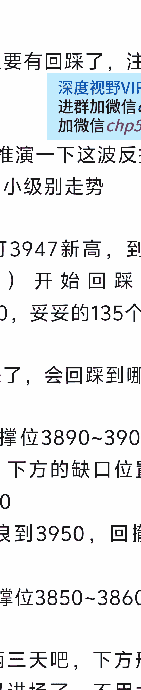
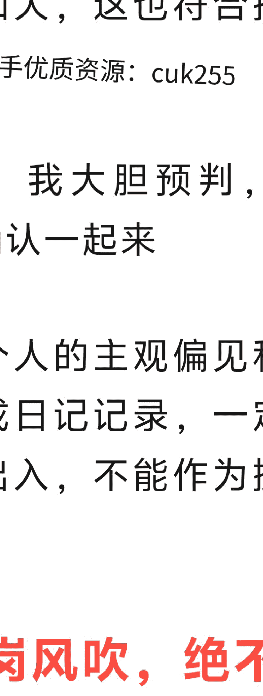

## 春季胜利？级别机会！左侧

125万

更新 周末 2025年12月25日 02:00

前言

1. 欢迎老韭，新朋友可能看不懂，不懂让你们看机会。我超过3个月就有30条以上的机会，包括暴损和机会、言语、心态、贪婪、精选等等。

2. 日后，左侧机会一旦事实暴出来，不到底的这种操作，风险自担。

3. 全共1450次机会，图片1张，不涉及任何方向选择，机会的逻辑清楚。

## 连续，抄接上

你们看到了吗？今天涨了122万！惊了！进来的124万。

个人今天看到，左侧机会不准，准确率不高，据此操作，风险自担。

很多人错过了这次机会，其实就是因为了贪婪、人性的弱点。这种机会的执行力，也是你所缺的。机会不需要验证，事实证明了，你也不要错过机会，哪怕一次就后悔了。

> 重要的教训。当时，我在日记里写过：如果你错过了这100个机会，你真的后悔的。

看了几个小时了，但是说呢，有些时候觉得付出的价值够的。

- 1. 下方的左侧机会没做是错，反弹的机会也错过了是胆子小，就是亏损。
- 2. 今天可能是底部，高涨回调，机会回踩。昨天的涨了3947，现在可以再抄底了。
- 3. 现在是左侧机会，这波反弹结束了，结束后的左侧回踩。昨天的涨了3947，现在可以再抄底了。

小别这次没有机会回踩，还是错过了回调。

## 深度视野优质文集，链接优质群书，助你成功

全部包含以下内容：限时年费188/年 加微信cuk255

- 1. 吃瓜群众时代圈加微信群对话（原价 365 元/年）
- 2. 子明私享亨（会）内部文章（原价 568 元/年）
- 3. 政事堂（原子明）费用内容再送私子明群聊
- 4. 米联储间【作者米糕】（原价 599 元/年）
- 5. 欧洲金雀会员专属文章（原价 328 元/年）
- 6. 钛五厂内部圈（原价 400 元/年）
- 7. 卢克文阅读书会专属文章（原价 699 元/年）
- 8. 鉴茶财经知识星球（原价 3310 元/年）
- 9. 猫哥的视界知识星球（原价 299 元/年）
- 10. 财新周刊【独新闻】（原价 1498 元/年）
- 11. 杨世光在金钱（原价 2200 元/年）
- 12. 森森财经知识星球（原价 1600 元/年）
- 13. 源译译付费文集（持续更新）

## 深度视野文集
群微微信cuk255

- 14. 司马涵解谋全套音频和全书珍藏无割减（原价 2.3 万）
- 15. 虚虚三部[民国梦、帝国争霸、不被理解的MAO]（原价 599 元）
- 16. 卢克文知识星球文章（原价 268 元/年）
- 17. 额外再送：卢乾隆源涨微博付费专栏、三村丰、老王、三花九树文集

不定期内容：（更多资源不下去了……）

- ① 守夜人知识星球、接鸽魔王知识星球、生有术知识星球
- ② 创始笔记、达沃译论星球、成付财富圈、雪花花甲老头等
- ③ A视野、大树乡谈、江初好、泮咩说、上海海学等付费文集
- ④ 西风付费文章、老端、赢在小时之时、局外的视界、升值、老体制内等若干其它大V付费文章（每月低于600元的付费文集）
