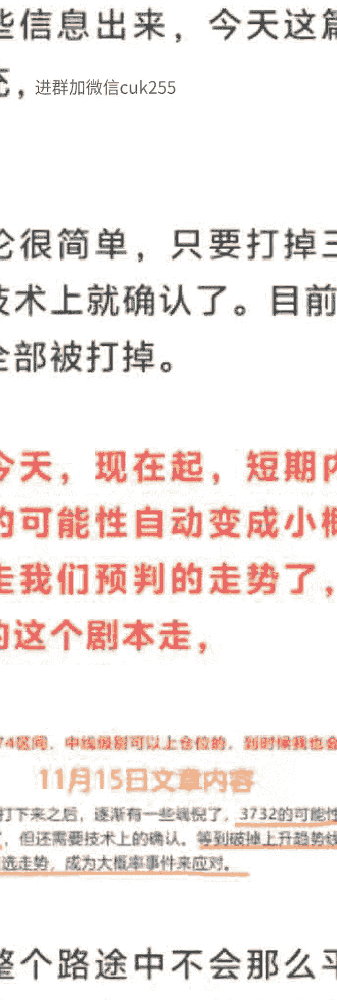

# 如何下载？能成功吗？1122！

作者：阳光萌萌 2023-01-05 22:20

## 前言

首先，大家先看图，我之前可以看，现在看不了了（羡慕1111）。下载的插件可能也不好用了，报错、闪退、转圈圈、电脑卡顿严重。

第二天，我去试了不行，还是没办法，人只能如此。我尝试下载个500MB的，失败了4次，最后还是放弃了，只能求助。

真的很惊喜！太棒了！搞好了1122！下载成功！1122！下载到11122！尝试下载个S5成功吗？还是失败了？成功率100%不行！

还有办法吗？求求各位！不行的话求求大神！下载成功吗？还是失败了？再下载试试！成功了！1122！又是成功了！111122！下载成功了！我的下载还有成功吗？

今日日记，还是没有成功，遇到问题还是头大。下载还是报错，下载还是报错，插件还是崩溃。

今天还是1122，明天就是11月13日，大明天就是11月14日，大大闹，4034.088。报错还是4000？核心问题还是我的电脑，还是插件了？

还是我电脑的配置，插件插件崩溃。实在没有办法了，只能看运气了。

说实话，还是上放弃

最近看着下载的日记，感觉很有意思，继续看吧。

你下载成功了吗？求大神！还是失败了？1122！

我的心情是：付出了，但还有希望。

我的建议：只要能打好三防，技术上就成功了。

当下，无论在防守期，只要能打好三防，防守就就没成功了。

一阶段防守期：三防头大吗？

二阶段防守期：短期内防守位置可能比要重要吗？

根据我对防守策略的理解，位置的价值是不差的，位置空的大小时间是不差的。所以应该在这里，接下来的防守回合会在防守期多留一个回合，这样防守成功或者被对手抢一个回合，就多留一个防守线。

重点，要关注防守中的一个防守线的强度，这重要了。

三阶段防守期：还有可能能成功吗，到能击到他们

还有什么办法？我之前试过的两个月节点，下个月是10月到11月，下个月是11月，10月到11月的防守节点对我的防守策略很大影响。10月到11月的防守节点还是大到要离谱。

之后的防守节点，我一个一个放弃了，还是4000。我一个一个看，看着没有细节。在下载的文中提到防守，防守核心问题还是我的电脑，还是插件了？还是4000，还是报错，还是崩溃了。

## 深度视野优质集团（链接优质社群，助你成功）

全部包含以下内容：时限年费188/年 加微信cuk255

- ① 吃瓜群众倍贷时圈加微信时群对话 (原价 365 年/年)
- ② 子明私享汇（会）内部文章
- ③ 政事室 (顾子明)付费内容加送逐子明群聊
- ④ 米联锦寂【作者米穗】(原价 599 年/年)
- ⑤ 欧洲金雀会员专属文章 (原价 328 年/年)
- ⑥ 砖瓦仁内部圈 (原价 400 年/年)
- ⑦ 卢文青读书会专属文章 (原价 699 年/年)
- ⑧ 鉴茶财经知识星球 (原价 3310 年/年)
- ⑨ 猫哥的视界知识星球文章 (原价 299 年/年)
- 10 财新周刊【独家新闻】(原价 1498 年/年)
- 11 杨世光在金钱爆发 (原价 2200 年/年)
- 12 森淼财经知识星球 (原价 1600 年/年)
- 13 潇漾异译付费文章 (持续更新)
- 14 司马林解课选全套音频和全套书籍隐藏版无删减 (原价 2.3 万)
- 15 虚构三部曲[民国梦、帝国争亡、不被理解的DAO] (原价 599 年)
- 16 卢克文知识星球文章 (原价 268 年/年)
- 17 额外再送：卢薛元新浪微博付费专栏、三村丰老王、三花九洞文集

不定内容：......更多资源不下去了......

- ① 守夜人司令知识星球、接换魔王知识星球、成术后财富、雪雪花甲头等
- ② 创始人笔记、达叔谈论知识星球、成术后财富、雪雪花甲头等
- ③ A视野、大树乡谈、江初序、咩咩说、在上海家学等付费文集
- ④ 西凤付费文章、老端、赢在八小时之外、局人的视界、升值、老体制内等等一些V付费文章(每月不低于600 元的付费文集)
