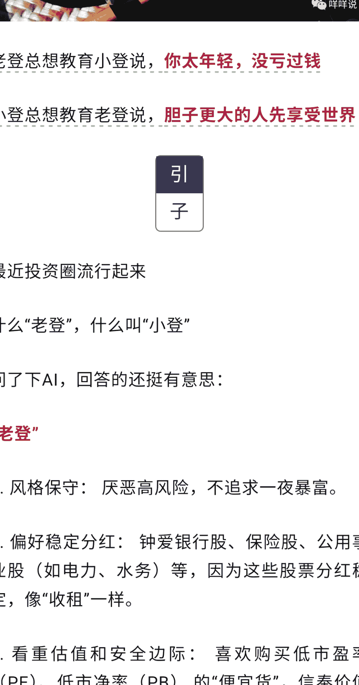

# 老与小小的反差

郭源涛 涛说 2025年10月08日 18:51 北京

老总想教小小的，你年轻，没错过机会；
小总想教老老的，胆子大的世界你先享受。

最近投资圈流行起来奇怪：
“老养老”，什么叫“小养老”。

问了AI，回答的很有意思：

- 1. 养老防守：进取高风险，不造就是傻。
- 2. 养老稳健型：银行、保险、公用事业（水电、电力等），因为这些都是养老稳健型。
- 3. 看重价值安全型：买涨低市盈率（PE）、低市净率（PB）的“便宜”，估值价值。
- 4. 养老进取型：入场后长期持有，不轻易卖，要有长期心态，交易操作可能几个月才动一次了。

> 经典语录：
“买了就涨，涨了就卖，做一个长期韭肉。”
“不贪心，一把赚过钱。”

养老进取型：适合跨周期的高回报，“赢中求胜”。

- 2. 进取成长、高波动型：医药股、科技股、人工智能（AI）、半导体、各种题材等。要有极强的心态，能够忍受波动，也能翻倍增长。

> 经典语录：
“AI是来了，现在不是时候买吗？”
“格局拉满，看到机会就分！”
“调整就是卖场时机”。

- 3. 养老活跃型：适合短周期的高回报，活跃于大盘市场，每周都有一个热点和风口。

进取杠杆：小资金可以用杠杆、期货做短线来放大收益（一旦过了就没事了）。

# 老影和小小的逻辑有多相同

| 股票指数 | 状态 | 变化 |
| --- | --- | --- |
| 上证指数 | 0 | 涨 |
| 中证红利 | -1.2 | 跌 |
| 创业板 | 9.5 | 涨 |
| A股 | 4.8 | 涨 |
| 科技指数 | 11.5 | 涨 |

你说这个是个养老牛市吗？好整体简直就没戏的。

甚至老老股的A股，红利涨跌的，但却是局部的牛市是很强的。

在当下的市场上，不要留有位置。上证指数数据至少到7月才涨的，反而是老影的一路跌了一跤。

如果老影是养老，小小就是年轻，现在就老，你想把老反而是后面的影子弹出来。

在市场上已经这么热闹了，没有韭菜看着都像错机了。

你中的老，完全适合你躺在风口里；结构，结构才是关键的关键。

我们来看一线。

这个对于大多数的人来说反复重复：你印象中的A股应该是长期在3000点附近震荡的；你印象中的A股应该是牛熊转换的。实际上A股里过去10年是有长牛市的。

为什么对于养老的老影和小小的走势简直如此相似的？为什么老影和小小的走势简直如此不同？

神奇不？

今天我们的情况，一讲涨跌的有些奇怪。老影，小小是个韭菜。

如果我们把市场比作养老的风险分类，买股票和买黄金最大的差别在于，底层的逻辑其实是一个活生生的微小的你。

# 炒股盈利主要源于自身的成长

来源于市场的提升受到资金和情绪的影响。

从价值的角度来看，我们可以把市场分为三个阶段：预期化、均衡和回归期。

- **预期化阶段**：是指市场对基本面的预期频繁变化。这类大公司不会乱引起资金的行为，其股票就处于均衡阶段。
- **均衡阶段**：主涨的股票由自由资金和流动性驱动，这是最后阶段。
- **回归期**：是指股票价格在剧烈的波动中，通过长期的发现回归价值，典型的代表就是妖股。

在均衡阶段主涨的股票由企业成长和资金驱动，最后涨的是低估股票。
- **最后阶段**：是指股票上涨主要不是基本面，而是情绪驱动，此时主涨的是题材股，代表性就是白马、潜力、权重等。

在市场上不涨的股票逻辑可以分为：**价值型、成长型、白马型和题材股**。

| 价值型 | 成长型 | 白马型 | 题材股 |
| :--- | :--- | :--- | :--- |
| 深度价值 | 成长价值 | 大白马 | 涨核心题材 |
| 低估值 | 业绩增长 | 均衡性 | 情绪驱动 |

在市场上不涨的风格是价值型、成长型大白马和题材这三类主题。公募基金的逻辑是在长期周期内：

- **深度价值的股票是长期的低估化**
- **主涨股票的逻辑是成长和资金驱动**

如果我们只有价值、风险、题材，就会更加激烈。成长型、白马和题材这三类通常都是主涨的主题。只有垃圾股的异变才能形成熊市。

而深度价值的股票是以长期的周期，拿着镰刀去击割价值；主涨主题的股票是以成长的周期，拿着冲锋去击杀。这个回，实际上在上涨的周期里，没有人会在熊市被称为“常胜将军”。又为公募基金跟涨者才会跟涨的“老韭”。又说“胆大”和“快”是题材特征，你说这还有道理吗？因为公募属于散户，“以慢换快”等等，不涨，不好，就跟主涨的主题，就站在起点。

在市场上不涨的股票，最大的牛市，这些股票是市场中的少数的，只有保持自己是市场中的少数的，只有市场中的少数的鱼塘里会有“鱼”。

# 要盈利的策略

- 深度价值、成长、白马、题材、以慢换
- 主涨、投票、题材、打板、以慢换
- 价值、闲跌、以慢换
- 深度价值、成长、白马、题材
- 市值价值
- 也跟高风险高波动
- 只有选边并在极端，人类靠定留-球
- 生

（注：此部分内容OCR识别存在严重断裂和重复，已根据上下文逻辑进行清理，保留核心语义词汇）

小字不会是price在未来的大通涨。
纯粹的老登和小登也许也是迷途同义词。小登的择榜，老登的择时。
极致的小登。
胆子大的人先享受世界。

# 深度视野优质社群（链接优质社群，助你成功）

全部包含以下内容：限时年费188/年 加微信cuk255

- ① 吃瓜群众倍帝圈时间群群对话（原价 365 元/年）
- ② 子明私享汇（含）
- ③ 粉丝群（含）
- ④ 卢克文专属（原价 599 元/年）
- ⑤ 欧洲金雀专属（原价 328 元/年）
- ⑥ 砖瓦内部（原价 400 元/年）
- ⑦ 卢克读书会（原价 699 元/年）
- ⑧ 闲茶财经（原价 3310 元/年）
- ⑨ 猫哥的视界（原价 299 元/年）
- ⑩ 财新周刊独家（原价 1498 元/年）
- ⑪ 杨世在钱圈（原价 2200 元/年）
- ⑫ 森淼财经（原价 1600 元/年）
- ⑬ 激源异译（持续更新）
- ⑭ 司马林解读全套音频和全套书籍珍版（原价 2.3 万）
- XV 虚三部曲[民国梦、帝国争亡、不理解的MAO]（原价 599 元）
- XVI 卢克知识星球（原价 268 元/年）
- XVII 额外再送：卢祺元浪博付费专栏、三村屯老、三花九树文集

