# 哈弗品牌第二季度(5-6月份的)广州市场提升方案

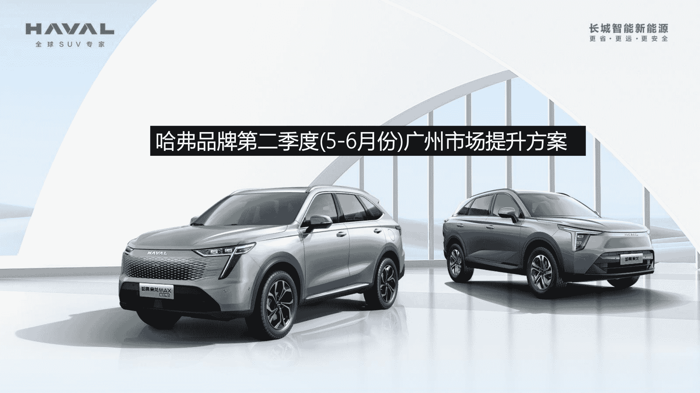

# 知识星球TOP 资源分享社群

公众号：知识星球TOP

让更多人获取高价值信息

汇聚网付费资源

微信信号：jntsg8

添加微信免费进群

- ◆付费文章、◆付费社群
- ◆付费课程、◆副业&搞钱
- ◆财经&股市、◆行业报告

时政·历史·职场·体制·自媒体
学习·军事·软件·影音·社会学

微信信号：jntsg2

> 虽经历波折，但对自我的超越，从未止步

哈弗发力全新赛道，以竞逐领航新能源之势，哈弗品牌为消费者带来了全新的枭龙MAX及效拓龙。
这也标志着哈弗新征程正式开启。

虽汹涌重围，但对追寻卓越的渴望，依然澎湃

哈弗龙，代表了主动出击、战无不胜的强者之姿，象征着哈弗在新领域勇往直前的雄心壮志

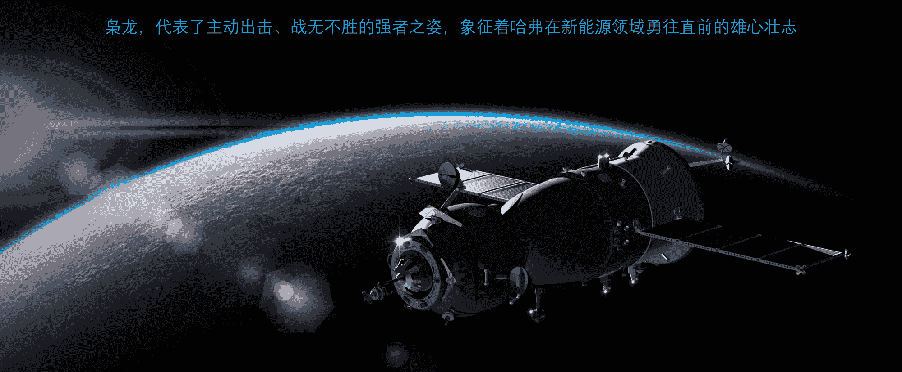

虽道阻且长，但一颗炙热初心，愈加赤诚

# 哈弗汽车10周年，坚持“以客户为中心”，致敬 700 万哈弗车主，一起进入绝妙时代

## 2023 聚龙崛起起 动力十足

区域提升专项，以此为起点，借品牌势能，成区域胜势

## 广州区域营销分析

## 区域市场提升策略

## 5 - 6 双月营销规划

## 终端提升计划

## 哈弗莱龙 战略使命

- 品牌主角：代表着品牌的起手式和新高度，承载品牌价值向上
- 销售主力：有销售才有品牌，成为爆款，才能为品牌筑根基

# 01 # 广州区域营销分析

STRATEGY

# CONTENTS

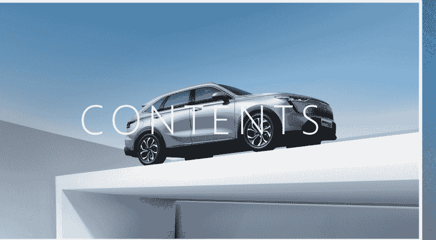

## 市场环境分析

### 新能源汽车市场热度高涨, 汽车行业“绿色消费”趋势明朗

当中国结构与产业结构的调整加上低碳时代使命，新能源汽车行业近两年开始迎来了快速发展。2020年，在全球范围内汽车销量同比下降20%的情况下，新能源汽车销量同比增长43%，这一良好态势已延续至今。

2021年，新能源汽车销量达352.1万辆，同比增长1.6倍，渗透率提升至13.4%，相比2020年提升8个百分点。2022年趋势更为迅猛，1-8月，新能源汽车渗透率逐月提高，已经超过28%。从分种类来看，目前新能源汽车主要为纯电动汽车、插电混合动力汽车以及燃料电池汽车，其中纯电动汽车的销量超过7成。

### 近期新能源汽车销量情况

### 2022年新能源汽车市场趋势

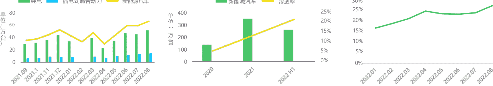

数据来源：中国汽车工业协会
数据周期：2021.09-2022.08
数据来源：中国汽车工业协会
数据周期：2020.01-2022.06
数据来源：中国汽车工业协会
数据周期：2022.01-2022.08

## 广州：2022年国内前6份新能源销量排名及占比（单位：辆）

| 省份 | 销量 | 占比 |
| :--- | :--- | :--- |
| 广东 | 756,852 | 15.2% |
| 浙江 | 619,646 | 22.5% |
| 江苏 | 479,697 | 22.1% |
| 山东 | 349,111 | 26.9% |
| 上海 | 332,330 | 20.9% |
| 河南 | 312,724 | 9.6% |

## 广州：作为全省新能源产业链核心城市

| 城市 | 销量 | 占比 |
| :--- | :--- | :--- |
| 广州 | 50,107 | 9.4% |
| 深圳市 | 42,754 | 4.5% |
| 东莞市 | 33,707 | 6.4% |
| 佛山市 | 27,166 | 10.8% |
| 中山市 | 15,046 | 23.3% |
| 州州市 | 11,601 | 20.4% |
| 江门市 | 8,148 | 31.1% |
| 珠海 | 6,891 | 21.6% |
| 北海市 | 5,643 | 25.7% |
| 华 | 4,087 | 12.5% |

## 市场环境分析

从2022年销量TOP10企业的分布来看，比亚迪在广东地区覆盖广，加速推进纯电市场。广汽在广S系统后，发布了全面混动策略，在广东也是领先；吉利、长安、奇瑞等品牌，在混动领域无疑逐渐加码。在混动领域，多家自主品牌已经像比亚迪一样，具备真正的混动技术和产品力和性价比。

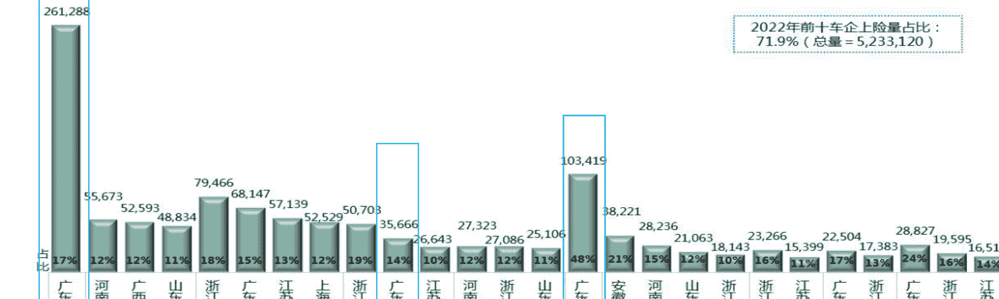

| 车企 | 比亚迪 | 上汽 | 通用汽车 | 特斯拉 | 吉利 | 长安 | 广汽 | 奇瑞 | 零跑 | 理想 | 小鹏 |
| :--- | :--- | :--- | :--- | :--- | :--- | :--- | :--- | :--- | :--- | :--- |
| 销量占比 | 1,583,168 | 450,738 | 441,651 | 263,998 | 289,195 | 220,170 | 214,196 | 182,806 | 111,224 | 146,150 | 135,283 | 120,526 |
| 同比 | 201.27% | 5.85% | | 37.24% | | | 118.90% | 73.96% | | 125.85% | 48.17% | 24.66% |

## 市场环境分析

### 新能源汽车进驻购物中心，一线及新一线城市仍是首要目标

观察十大典型新能源汽车品牌的门店数据，可以发现上海、北京、重庆为热门城市TOP3，北广新能源品牌在购物中心的入驻为常见。以特斯拉及宝莱为例，目前品牌在一线及新一线城市的分布较多，在门店选址方面，购物场所占比超过60%，其余分布在办公商场及住宅区。区别于众多建在郊区的传统车4S门店，新能源汽车在购物场所的覆盖是快速打开市场、提升消费者认知度的重要途径。

### 2022年新能源汽车门店数量TOP10城市 特斯拉、宝莱线下门店等级分布情况

| 城市 | 数量 |
| :--- | :--- |
| 天津 | 64 |
| 郑州 | 59 |
| 西安 | 69 |
| 深圳 | 106 |
| 杭州 | 80 |
| 广州 | 95 |
| 成都 | 104 |
| 重庆 | 95 |
| 北京 | 128 |
| 上海 | 215 |

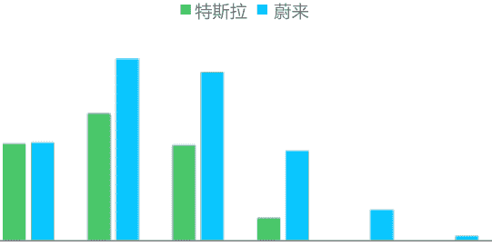

## 广州作为新能源销量的重点城市

哈弗必须完成的攻坚战，红海突围，平权面对比亚迪、自主品牌、新势力品牌，抢占市场。

### 细分市场格局，SUV的头部品牌

| 吉利 | 长安 | 广汽 | 奇瑞 | 比亚迪 |
| :--- | :--- | :--- | :--- | :--- |
| 12-15万 | 博越PRO 11.68万-13.88万 | UNI-K 15.49万-18.49万 | 浩达电擎 14.98万-18.49万 | 瑞虎8PRO 15.99万-17.99万 |
| 10-12万 | 博越运版 9.18万-10.88万 | UNI-T 11.59万-13.99万 | 埃安-AION 11.98万-19.76万 | 瑞虎8鲲峦版 9.89万-12.49万 |
| 8-10万 | 博越百万 8.98万-10.68万 | 2023款瑞虎5x 6.99万-9.59万 | | |

## 竞品市场表现分析 对比“自主三强”比亚迪、吉利、长安的混动

- 宋Pro DM-i 燃油SUV领先者：核心推广综合续航1090km，快速充电，搭载比亚迪DM混动技术，指导价：¥140,800 - ¥165,800
- 星越L 雷神智擎Hi·X油电混动：核心推广综合续航1279km，超低油耗，搭载雷神Hi·X混动技术，指导价：¥171,700 - ¥183,700
- UNI-K iDD 全程焦虑电混SUV：核心推广综合续航1230km，0焦虑，纯电续航130km，搭载长安蓝瀚iDD混动技术，指导价：¥182,900起

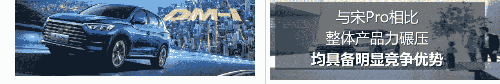
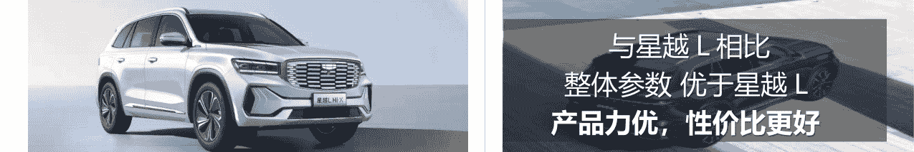
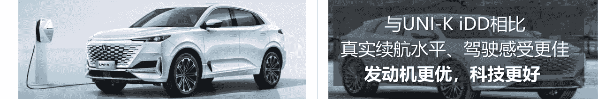

## 竞市营销分析

吉利·多场上+试打造营销矩阵，利用大数据与用户交互，营造私域流量。
比亚迪·打造粉丝盛宴、国潮文化以及车主互动，促进品牌连接。

- 吉利·蓝牌天界·银河上市6月
- 星越&银河星空试驾活动#3月IV6
- 星越不比特上市会，活动4月
- 吉利新款全国试驾点3月结合爱文化(国潮专享会)
- 3月·比亚迪·寻跑·寻云魔试驾活动
- 5月—PLUS 广州版试驾活动
- 5月—PLUS 春季游驾体验活动
- 吉利新款星越SUV4月（大豪华）
- 吉利新款星越SUV4月大豪华
- 吉利银湖越巡游达成3月
- 星瑞新款四城试驾巅峰之旅
- 星瑞3月签到
- 3月·比亚迪·上下发布会
- 五省爱联动购5月
- 长安五好新季5月
- UNI-K联动购5月
- UNI星球体验空间3月
- UNI-K全国试驾5月
- 新品焕蜀会3月
- 未来博主的来Pro DM深度报告
- 欧享聚、途通UP p粉丝盛会
- 4月—线上直播以试购/测评为主

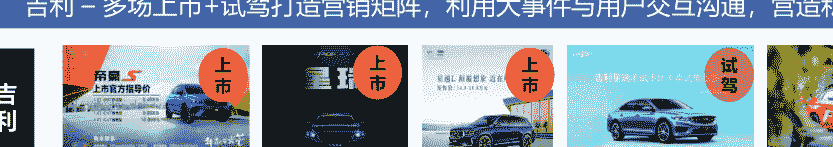
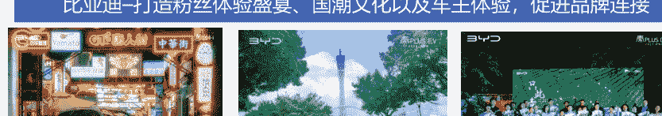
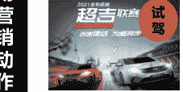

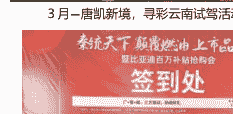
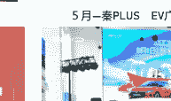
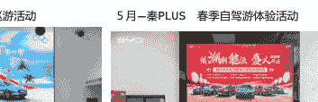

## 从竞争营销上看

哈弗在营销动作上面，善学而功倍。紧抓智能化市场趋势，深占差异化市场定位，大搞出营销抢占心智。借用他山之石，攻新营销势头。

## 所以我们首要做就是因地制宜，因势利导，兴趣点，差异化的营销模式找到“族群”同频信号吸引点。

## 广州用户环境分析

广州用户多推崇“创新、挑战、务实、新潮”的泛岭文化。结合南方消费者特征，开展营销活动，引发兴趣和关注，更容易集客。

- 创新氛围浓厚、创新技术的应用非常快速
- 强烈的进取精神，挑战困难的韧性和毅力
- 理性消费者，需要考虑“划算”：对“物美价廉”的认知
- 对“新潮”的，“新鲜”事物有踪趣味

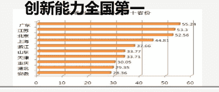
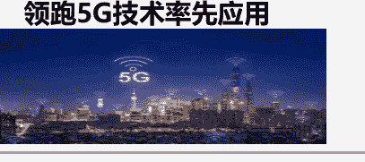

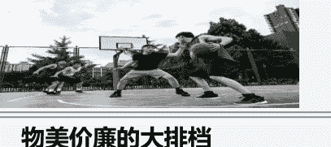
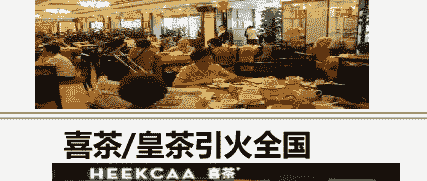
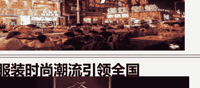
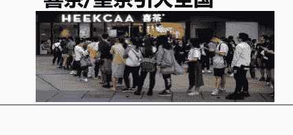
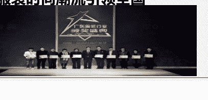

# 广州消费者特征

在平淡生活之余，追求“燃”的生活态度：热爱生活享受乐趣，热爱极客户外挑战，进取。

### 事业：稳定进取 | 生活：爱户外、爱运动 | 用车观：喜爱驾出游

- 人群：收入在1万-2.5万之间的中高层管理人员，工作稳定，稳中求进，轻松应对工作状况。
- 人群走访：28-40岁之间，已婚有子，文化素质较高，以80后中坚力量为主，多为公司白领，换购用户较多。

他们爱体育运动、户外休闲，活力奔放。

| 体育运动(羽毛球、网球、游泳、器械等) | 37.6% |
| 逛街/购物 | 37.6% |
| 室内休闲活动(打牌、打将等) | 34.8% |
| 社交活动(如聚会、酒会) | 32.9% |
| 户外休闲活动(钓鱼、露营等) | 21.4% |
| 户外运动(滑雪、登山等) | 12.9% |
| 摄影 | 10.0% |

- 25岁-28岁
- 28岁-30岁
- 30岁-35岁
- 35岁-40岁

潜车主专业热爱。

# 哈弗目标人群分析

### 他们是
### 成长在互联背景下的
### 新一代

- 开放的一代，视野开阔，不盲从，更具智慧感知力。
- 独立的一代，更加独立自信，拒绝标签，相信自己的标准和判断。
- 享受的一代，品质要求高，注重享受。

### 这群85-90后多数已婚已育
### 角色的转化
### 影响他们的内心追求

> 独生子女负重担，想让人过得更好，是成就感的来源。
> 人生进入中场，更加务实，希望对自己更好。
> 面对后浪的成长，担心被时代超越，对智能化更有需求。

# 哈弗目标人群特点

### 用户画像概述——都市新锐精英

务实、理性、且具有探究精神的典型“理工男”，对自己自信，对民族文化有自信力。

### 85-90年都市新锐精英
- 事业上升期
- 科技潮咖
- 注重品牌口碑
- 家庭支柱、热爱生活、爱护家庭
- 年轻个性有主见
- 高性价比的追求者
- 注重外观兼顾质感
- 对于混动车型了解
- 对驾驶的实用性和经济性有较高期望

### 形象强势人群
年轻化、潮流感、趋势化，代表品牌和用户形象。

### 实际需求人群
实操性、性价比、技术含量，能够满足幸福生活的车辆。

## 目标人群分析小结

1、目标人群特征：
哈弗主要车型的目标人群，热爱生活，追求“务实、品质”的生活态度。他们不喜欢单一的生活方式，内心渴望能挑战自己，接触新鲜潮流不一样的东西。

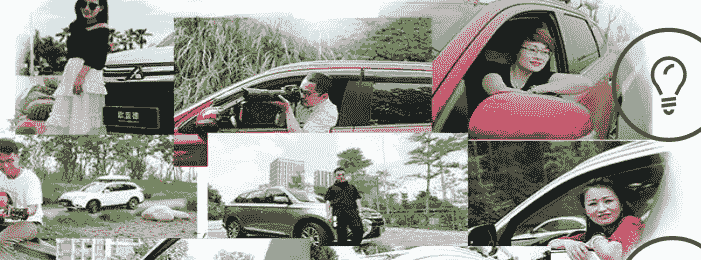

2、南区（广州）本土型特征：
喜欢创新实力挑战，更喜欢新鲜潮流事物，尝试一样的体验，平衡理性消费者。

### 车型目标人群特点：
- 一、强化产品的“物超值”价值点。
- 二、开展挑战潮流营销活动。
- 三、以短视频+长图等素材进行高效传播。

## 背景小结
- 与时俱进攻破敌
- 品类品牌发展
- 市场攻坚
- 受众意识发展
- 竞争优势
- 哈弗品牌发展迅速
- 南区新能源发展快速占领核心
- 大众侧重民族文化、性价比
- 车型销售转向用户

# 广州区域市场策略 STRATEGY

## 目标产品
明确核心竞品，哈弗产品如何进攻？
- 线上端口强调产品卖点：成熟的混动DHT、全智能四驱，加深目标群体。
- 线下端口增强产品体验：将核心卖点贯穿在5-6月营销活动中，加强消费者对哈弗产品的认知。

## 营销策略推导
明确核心武器，哈弗如何分配？
- 立足1+5级别市场：将1个核心（广州）、5个下沉城市（番禺区、花都区、增城区、南沙区）作为6-8月战略市场突破；同时带6个提升市场（深圳、东莞、佛山、中山、江门、惠州）以及一个空白城市（珠海）。
- 不同级别市场：结合不同级别的区域特色，进行营销活动的形式组合。

## 目标用户
找到目标消费者的兴趣点，引起其情感共鸣，提升营销的效果率。
- 海陆空立体进攻：
  - “海”利用广州本土文化，举办龙舟赛事，通过营造民俗主题活动让哈弗品牌温度。
  - “陆”借助独家篮球资源，打透运动圈层，以点带面，全面覆盖主城区+二级城区，赋予产品文化属性。
  - “空”618感恩粉丝特别策划，南区线下跨城联动，打造绝无二的年中盛宴。

## 2023年，哈弗南部地区 5-6月
——核心策略——
### “势而上，属地而行”
通过充足区域资源、圈层偏好、车型分支进行属地化营销，引君入瓮，抢占市场先机。

## 哈弗5月营销动作
以哈弗豪龙上市契机，结合广州区域用户对篮球文化的偏好，开展运动潮流活动，全面吸睛引流促销。

### 锁定人群
- 哈弗豪龙核心用户群体为主
- 追求时尚潮流
- 注重经济适用
- 易接受新事物
- 开放个性

### 明确形式
- 以哈弗豪龙上市为核心
- 以篮球文化为营销主线
- 城市3V3挑战赛
- 豪龙上市发布会
- 豪龙潮流都会

### 选择渠道
- 导向软性传达
- 打造话题多渠道传播
- 媒体综合覆盖
- 运动平台合作裂变渠道融合

## 智感全能 潮趣玩家——哈弗5月份营销主题

# 哈弗6月营销动作
延续哈弗豪龙上市温度，深度结合区域特色，高度贴合产品卖点。我们要比本地品牌更加本地化，拓展影响力，提升终端集客转化。

### 锁定人群
- 以核心竞品用户人群为主
- 抢吸收入入门合资的核心用户
- 占领燃油车市场用户
- 抢长、吉自主品牌潜在客户

### 明确形式
- 众龙杯国际龙舟赛事为流量吸入
- 以618年中“感恩百万车主”为割
- 哈弗“聚龙杯”龙舟赛事
- 618感恩百万车主特别策划
- 节日营销活动

### 选择渠道
- 导向软性传播
- 打造话题多渠道传播
- 媒体综合覆盖
- KOL、KOC裂变新媒体平台

踏浪寻龙，百舸争流，哈弗赛龙杯国际龙舟竞赛竞技

### 核心事件
智享618狂欢盛宴，致敬哈弗700万车主十年热爱。

## 双月营销规划

| 时间 | W1 | W2 | W3 | W4 | W1 | W2 | W3 | W4 | W5 |
| :--- | :--- | :--- | :--- | :--- | :--- | :--- | :--- | :--- | :--- |
| 节日节点 | 5月 | | | | 6月 | | | | |
| | | 母亲节(14) | | 豪龙上市(7) | 儿童节(18) | 父亲节(19) | 端午节(22) | |
| 营销主题 | 智感全能潮趣玩家 | | | 618狂欢盛宴致敬哈弗700万车主热爱 | 踏浪寻龙哈龙国际跨界竞技 | | |
| 形式 | 陆战 | | | | 空作战 | 海作战 | | |
| 区域动作 | 下线活动 | 参考哈龙上市专案 | | | 智享618狂欢盛宴致敬哈弗700万车主热爱 | | | |
| | 线上传播 | | | 哈龙上市系列传播 | | | | |
| 广州专项动作 | 下线活动 | 城市3V3挑战赛覆盖主城区+5大区域 | 活动海报传播 | | | | | |
| | 线上传播 | | | 短视频传播 | | | | | |
| | 运营平台制作素材 | KOL助力 短视频传播 | | | | | |
| | 全体活动 | 结合大区素材，充分利用店全媒体渠道 | 配合宣传及线上策划 | | | | | |
| | 终端营销 | 母亲节营销活动 | 哈龙上市品鉴 | 呆龙潮流都会 | | | | |
| | | | | 驾控体验活动 | 端午节营销活动 | | | |

# 03 5-6月营销规划 STRATEGY

# CONTENTS

## 5月营销规划
## 广州城市专项
-经销商营销活动
- 智感全能潮趣玩家
- 3V3城市挑战赛
- 哈龙上市品鉴会（参考哈龙上市专案）
- 哈龙潮流都会

## 智感全能潮趣玩家
### 3V3城市篮球挑战赛

### 深化品牌精神
深化哈弗龙的极致精神，举办“智感全能潮趣玩家”3V3篮球对抗赛，助力新车上市影响力为后续产品铺路造势。

### 玩转圈层口碑
强化品牌受众形象，传递年轻运动理念，助力圈层营销助力品牌提升。
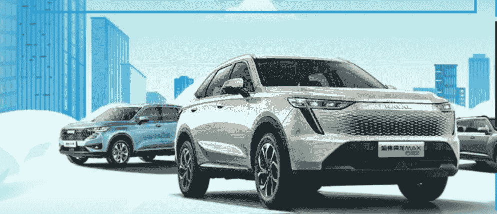

## 传播目标：承接引发区域关注
1 在广州实施1+5落地形式，由点及面，深化传播，提升区域内品牌以及品牌的传播声量，引发区域市场关注。

## 营销目标：找到目标消费者的兴趣点，投入所需
2 借此活动全面覆盖广州核心地区，将持续带动品牌的话题热度，并以年轻化的形象持续引众。

## 销售目标：促进集客，提升销量
3 通过现场车型的品鉴、车型互动体验，以及后续终端的延伸活动，促进高意向潜客的到店体验，扩大客户基盘，实现销量的提升。

## 智感全能潮趣玩家
### 3V3城市篮球挑战赛
5月中旬（哈弗豪龙上市前）

- 开赛·在核心商圈
- 开赛·在大学篮球场
- 开赛·在夜间篮球场
- 开赛·在周边城区

广州核心商圈日均客流1W+，将比赛开展在核心商圈广场，聚集人群，提升影响力。与南方华南教育联动，将比赛进行进校园，助力活动提升品牌温度，唤醒潮流车人群。5月天气炎热，使得夜间篮球场异常火爆，我们将赛事开在夜间篮球场，强吸引流量关注，场地物展示提升关注，助力引流。

广州周边大小约有28个镇、580个村，我们将赛事覆盖至每个镇，引发关注。

## 活动宣传：预热
在运动上发起主题活动，通过线上挑战赛+线下，将用户引流到门店。
- 线上端口：强调产品卖点：成熟的混动DHT、全智能四驱，加深目标群体对5-6月哈弗豪产品的认知。
- 线下端口：增强产品体验：将核心卖点贯穿在5-6月营销活动中，加强消费者对哈龙产品的认知。

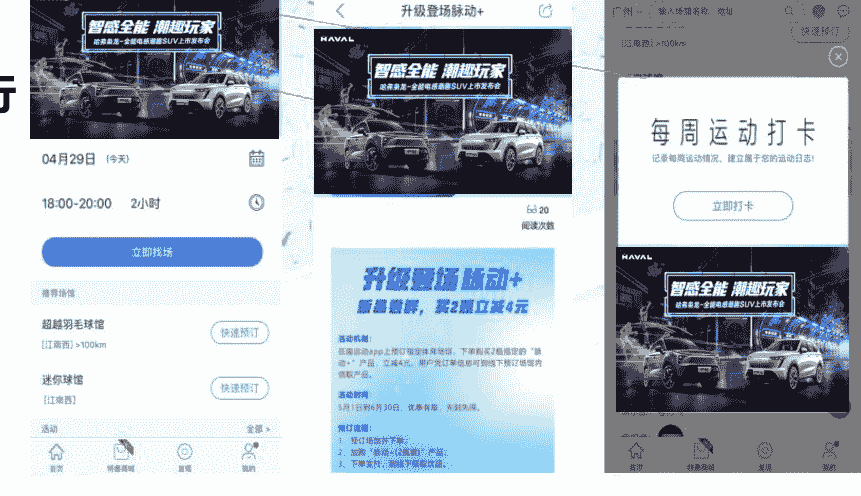

## 活动宣传：传递
- 形式：海报
- 内容：提前制作活动海报，露出赛事信息，吸引潜客。
- 投放时间：赛事前周
- 渠道：微信公众号、朋友圈、销售顾问。

- 形式：风暴海报
- 内容：通过人物形象积累老车主等潜客。
- 投放时间：赛事前3天。

- 形式：倒计时海报
- 内容：通过人物形象积累老车主等参赛选手。
- 投放时间：赛事前3天
- 渠道：微信公众号、朋友圈、销售顾问。
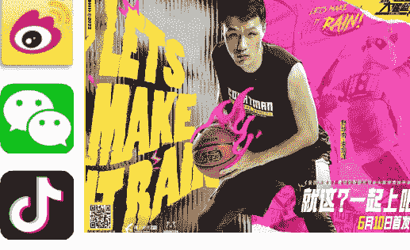
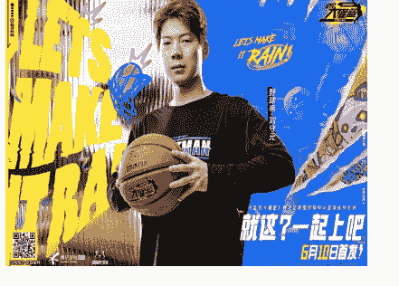

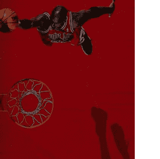

## 活动传播：一起上场
### 篮球明星合作
### 崔永熙

中国男子篮球运动员，司职锋效力于广州龙狮篮球俱乐部。2022-23赛季CBA常规赛国内第二阵容，获得年度最佳新锐。2022-2023中国男子篮球职业联赛。

合作方式：视频采访&抖音挑战赛，将自己对篮球的想法和态度融入品牌的调性，并透露自己参加本次活动，呼吁粉丝来场互动交流。
传播渠道：视频平台、网红转发、官微转发。

## 活动宣传：赛事后续宣传
活动结束后形成素材，在各个平台以及论坛进行扩散传播，解读品牌调性及产品力，持续强化活动影响。

| 图片素材 | 现场氛围图、现场体验圈、现场比赛赛、冠军团队、人物特写 | 传播渠道：经销商双微、媒体稿配图、工作人员发圈 |
| 视频素材 | 空镜视频、15秒视频剪辑、爆点环节视频、KOL视频 | 传播渠道：经销商双微、抖音、论坛、工作人员分享 |

## 活动内容：活动布展
### 篮球元素+车型元素充分融合
- 篮球区 + 互动区 + 启动区

- 场景展示
- 打卡互动
- 区域布局

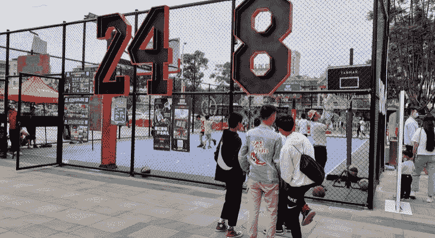

## 整合营销方案-主题类

## 她，正在酝酿—母亲节主题活动

DGC/UGC内容建议

## 活动前期

## 活动中期

## 活动后期

## 招募DGC内容建议

## UGC/DGC内容建议

## 二次创作DGC内容建议

### 微信打卡短视频

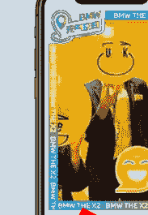
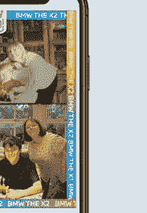
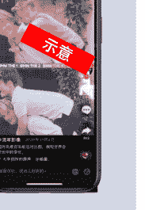

发起天天微信打卡活动，吸引客户参与微信打卡活动，增加客户粘性，刺激客户产出UGC内容，并引导客户参与互动。

### 元气微信打卡合集视频
选取优质UGC内容制作打卡合集，并发布至视频号、朋友圈等视频社交平台。

### 时光照片合集视频
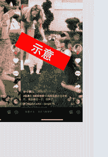
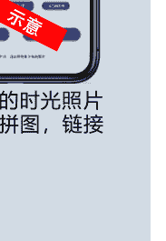
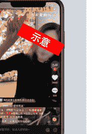

在抖音发起征集活动，以“#元气妈妈的日常#”为主题。刺激客户产出UGC内容，并引导客户参与互动。

- 客户使用微信表情后进行拍照，将收集的照片拼成“微信大圈”，传递微笑的力量。
- 将收集到的照片制作成时光拼图，传递情感。
- 选取优质UGC时光照片，制作视频，发到抖音、朋友圈等视频社交平台。

### 传播渠道建议

## 整合营销方案-主题类

## 泉龙潮流都会
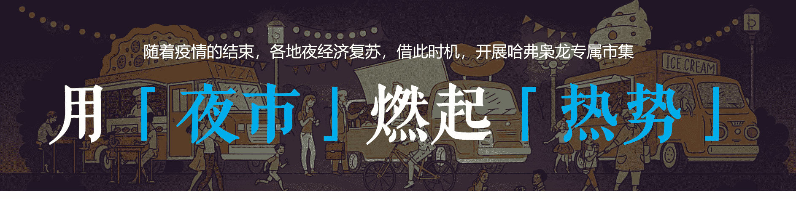

| 人气聚集 | 潮趣表达 | 升级体验 | 集客赋能 |
| --- | --- | --- | --- |
| 打造城市夜生活中心点 | 年轻潮玩一站式集合 | 产品形象多维度体验 | 终端借势集客新平台 |

## 泉龙潮流都会
- 区域圈层KOL场景化预热短视频

整合区域圈层KOL资源，进驻哈弗铂端，化身夜市美食家，录制、发布短视频预热泉龙共创巡展集市。

| KOL圈层类型 | 科技 | 运动 | 时尚 | 音乐/舞蹈 |
| --- | --- | --- | --- | --- |
| 录制内容方向 | 奶茶配方奥妙分享 | 健身穿搭分享 | 潮流配色粤菜 | 会唱歌的棒棒糖 |

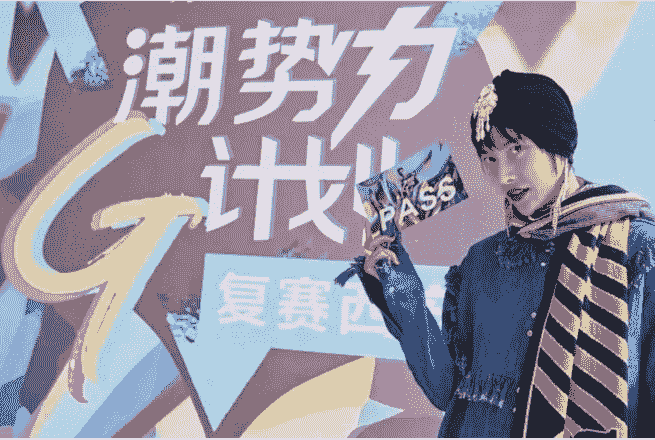

## 哈弗泉龙 潮流都会 集结令
- KOL进驻城市经销商，结合夜市特点，录制视频参与夜市盲盒；
- 以泉龙潮流都会集结令为噱头，发布专属流量，参与夜市互动；
- 粉丝群体凭借集结令，抵达现场，获得免费抽盒机会。

## 整合营销方案-主题类

## 泉龙潮流都会 终端联合预热
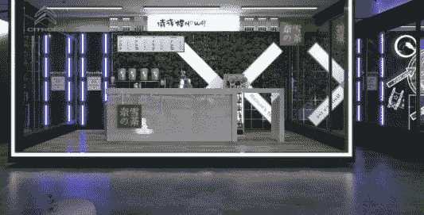
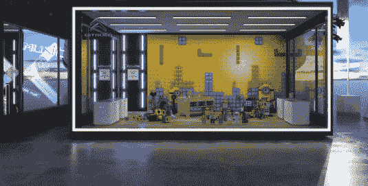

- 整合行业合作资源，打造终端氛围氛围场；
- 以潮流商品衬托终端个性；
- 进店客户参与互动，获得夜市互动券；
- 绑定集客政策，提升受众定向。

## 哈弗潮流龙 X
## 哈弗潮流龙 X

## 6月营销规划
| 区域联动专项 | 广州城市专项 | 经销商营销 |
| ------|---|---|
| 智享68狂欢盛宴 | 踏浪寻龙 | 驾控体验专项 |
| 致敬哈弗70万车主十载热爱 | 哈弗潮流龙舟竞技 | 端午节营销活动 (注：最后一行文字为端午节活动) |

## 智享68狂欢盛宴
致敬哈弗70万车主十载热爱
抓住68年中电商节节点，充分利用平台资源，实现销量和声量双重收割！以哈弗全车系联合新品出击势，打造宠粉的话题，实现品牌力和用户力共振！

## 智享68狂欢盛宴
致敬哈弗70万车主十载热爱
以68为营销爆点，以宠粉共创为核心理念，南区经销商出击，借助超级福利放送、超级BOSS助阵，实现粉丝宠粉触达，打造哈弗汽车超级宠粉大事，实现品销合一。车主共创渗透价值，福利宠粉热情互动，覆盖南区合作，全网声量统一发布，资源强推释放，技术助推订单收割。

## 智享68狂欢
## 潮流龙热爱
- 1场品牌狂欢+5大城市联动助力+5大定制场景
- 深化用户共创+南区资源加持+全新技术应用

以品牌式奔粉狂欢节奏，深圳、长沙、厦门、南宁、三亚五大城市联合启动，用户共创为主线，技术场景创燃点，打通线上线下全链曝光，深化用户共创心智，打造哈弗十年热爱，百万信赖的68大事。

### 厦门现场
游艇不眠夜狂欢盛宴
### 长沙现场
演播厅宠粉狂欢盛宴
### 深圳现场
燃情欢乐谷狂欢盛宴
### 三亚现场
沙滩派对狂欢盛宴
### 南宁现场
青芒之地狂欢盛宴

## 智享68狂欢盛宴
### 打造汽车行业首个“科技宠粉秀”借助粉丝级盛典BIG DAY
品牌平台用户多方联动，树立汽车行业国货NO.1；通过用户共创全面促活，品牌提振，售后政策、精准营销促进用户转化爆发收割，形成闭环。

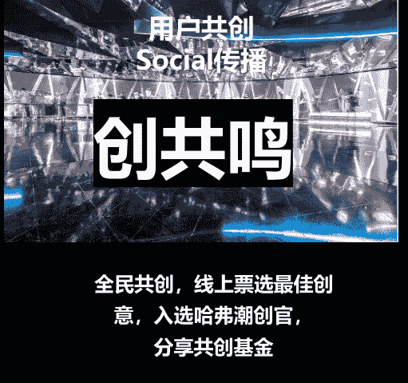
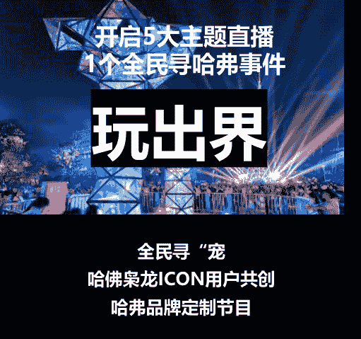
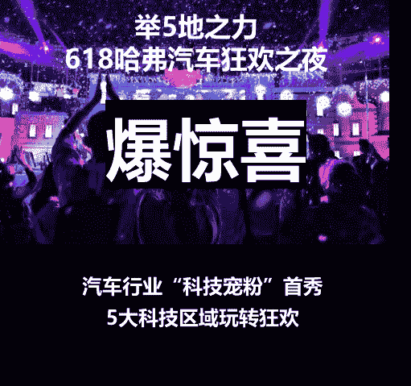

## 智享68狂盛宴
## 哈弗潮流龙ICON用户共创活动
策略：通过哈弗潮流龙ICON用户共创计划邀请用户参与精品共创，线上以H5小程序载用户作品奖选，以奖金的形式授予作品分成，强化品牌和用户粉丝的互动与连接，将营销理念融入实际行动。

### 哈弗潮流龙ICON用户共创计划引爆全民宠粉实现利益共享
廖向荣：广州美术学院视觉艺术设计学院副教授，冰墩主创人
联合50名广州美术学院学生，基于哈弗潮流龙品牌调性设计创意精品作品，实现品牌价值的持续提升和客户生态闭建设。

- 线上引爆宠粉大赏：通过H5小程序载美术学院学生的设计，邀请全民参与投票，评选出3名最佳作品。
- 线下落地共创利益共享：选取精品作品进行线上销售，以“共创基金”形式授予获奖者。

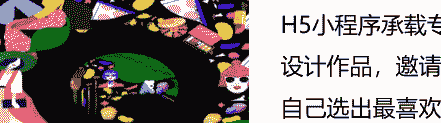

## 智享68狂欢盛宴
## 哈弗潮流龙南区超级狂欢
打造宠粉盛宴：开展大主题合体，丰富用户体验，深度参与，创等创新玩法，加深用户认知，提升品牌传播量及品牌影响力。

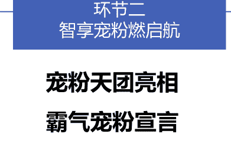
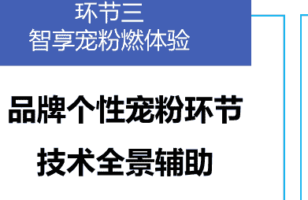
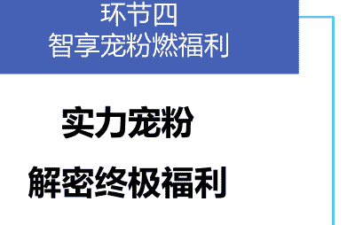

| 实力宠粉区 | 超萌宠粉区 | 科技灯光秀 | 总总裁焰 |
| ------|---|---|---|
| 未来体验 | 手作体验 | 燃爆开场 | 总裁发言 |
| 花样宠粉区 | 雾气宠粉区 | 宠粉天团 | 神秘嘉宾 |
| 极客空间 | 超物理互动 | 亮相 | 助力 |
| 能量补给区 | | 共创活动 | |
| 国潮宠 | | | |
| 车主街粉+福利 | | | |
| 科技宠 | | | |
| 潮流粉+科技宠 | | | |
| 雾气宠 | | | |
| 车主团队+硬核福利 | | | |
| 宠粉开启盲盒 | | | |
| 终极宠粉福利 | | | |
| 品牌宠粉天团 | | | |
| 终极宠粉环节 | | | |
| 共创宠粉天团 | | | |
| 终极宠粉环节 | | | |

## 广州城市专项
## 踏浪寻龙 百舸争流
## 哈弗潮流杯国际龙舟竞技赛

## 广州·哈弗枭龙杯国际龙舟竞技赛
热点借势、文化融合
外观、操控、精神 vs 端午时节 广州龙舟文化
民族品牌标杆硬核国货 vs 千年传统文化
百公里加速6.9秒 vs 龙舟竞技速度感
哈弗枭龙设计与品牌精神 vs 龙型视觉强化感知

## 踏浪寻龙 百舸争流
——2023年广州哈弗潮流国际龙舟竞技赛——

## 踏浪寻龙 百波争流
龙舟作为中华优秀传统文化之一，凝聚了深厚的历史沉淀人文精神，根植于岭南血脉之中传承了两千多年的龙舟竞渡，今天已由一项中国民间活动演化成国际性的体育赛事和文化盛事。

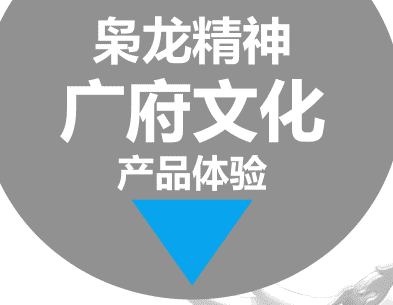

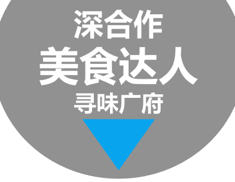
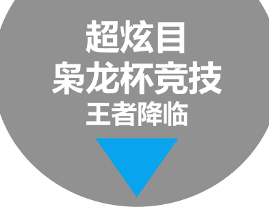

粤龙驾控所向拨舵
非遗竞技智感粤龙
金牌饭局食货指南
炫目开赛粤龙独家冠名

## 踏浪寻龙 百波争流
## 哈弗潮流 驾控随心

## 广府文化
- 试探探寻特色文艺村，深度探寻特色文化区域。
- 结合哈弗潮流设计和传统文化区域，实测超哈弗驾控感。
- 永庆坊、东山口、黄埔古镇

## 踏浪寻龙 百科争流
## 非遗大师设计
- 契合品牌理念，助力非遗竞技走向世界。
- 此次活动作为非遗传承人，宣传潮流等。
- 水上，拍摄车型大片，用于后期传播强化产品形象内涵。

## 踏浪寻龙 百波争流
## 金牌饭局
- 跨界KOL，本地化、生活化场景化粉丝喜爱。
- 金牌司仪带领品尝当地传统民俗饮食，寄托了人民美好愿望，让味蕾跟随极致。

## 踏浪寻龙 百波争流
## 广州·哈弗潮流杯龙舟大赛
- 邀请7个历史文化村、15个传统村落，每个参赛村都带有潮流标识。
- 广州自然村之合作，制作专属元素。
- 现场媒体分组进行迷你挑战赛。
- 骆剑锋队长带领，让媒体朋友参与龙舟训练，了解文化并参与迷你赛。

| 时间 | 耗时 | 环节 | 内容 |
| --- | --- | --- | --- |
| 10:00-10:30 | 30min | 嘉宾签到 | 嘉宾抵达广州品牌经销商集中签到 |
| 10:30-10:45 | 15min | 活动说明会 | 技术专家讲解车型亮点及试驾注意事项 |
| 10:45-10:55 | 10min | 发车仪式 | 所有贵宾进行车队列阵并举行简单重型发车仪式 |
| 10:55-11:25 | 90min | 道路试驾 | 哈弗潮流队广州文化打卡活动地点 |
| 11:25-12:25 | 60min | 金牌饭局 | 金牌宾位“非遗”美味龙舟饭，龙舟历史课堂&赛艇安全知识讲解 |
| 12:25-16:25 | 240min | 龙舟互动 | 专业龙舟赛艇热身训练、划龙舟基础动作训练、互动互动比赛、龙舟团体赛颁奖 |
| 16:25-18:00 | 90min | 哈弗潮流品鉴 | 现场贵宾共同开启大合仪式 |
| 19:30- | - | 结束 | 嘉宾自行返程 |

## 活动内容
## 哈弗潮流网全新经销商签到
嘉宾来到哈弗潮流网全新经销商（待定）进行活动签到，工作人员为各位嘉宾安排摄影师为客户们拍摄合照，合照后进入店内参与活动说明会。

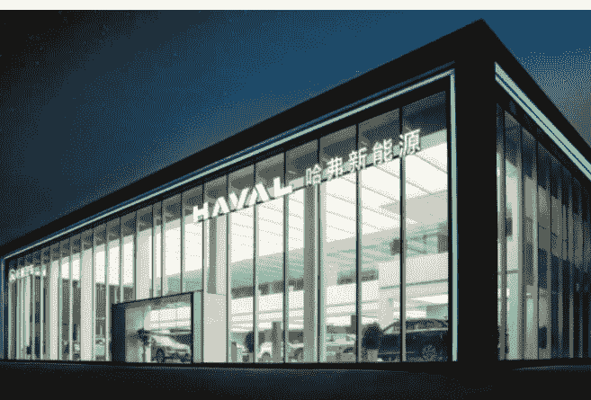

## 活动内容
## 哈弗潮流网全新经销商

## 活动传递

## 美食达人在线打call
受邀媒体输出创意图文和话题稿件，视频打call，引发圈层粉丝关注，实现圈内曝光。

## 官方与美食达人联合宣传
官方平台与kol双重联动，采用热点话题、软文、海报、视频等内容多样形式触达用户，突出活动亮点，为吸睛。

## 本地电台口碑宣传
主持人通过幽默风趣的脱口秀形式，与观众节目互动抽奖形式，融合互动交流，用车场景话题+端午话题，提高听众参与积极性。

# OLD WAY
经销商营销动作
- 驾控体验专项活动
- 端午节营销活动

# NEW WAY

## 整合营销方案-主题类
开展驾控挑战赛，通过挑战赛的方式，打造【不将就 新选择 豪龙联盟挑战赛】。适用车主的既有口碑，具体诉求品质保值、四驾智控，深用用户对豪龙的理解。

这是一场面向大众的热血竞速体验之行，深度挖掘【全能电感 四驾智控】的驾驶魅力。以实证形式，直观呈现更高效、强劲动力、柠檬橘平台先进技术综合优势，强化豪龙汽车的品牌价值。

- 阶段一 驾逐集结
- 阶段二 【联盟精英】挑战赛
- 阶段三 竞逐【终极极限航王】
- 阶段四 赛后声量延续

进行混动车主+高意向用户招募
通过【四驾联挑战赛】比拼，角逐【混动联盟精英】
用户与垂直媒体终端集结站，全路产出最优数据
赛后产出各种图文、视频素材，深度普及驾驶魅力，引发大众全关注

## 整合营销方案-主题类
结合端午节点进行店端氛围布置，并设置端午传统活动以及产品体验供客户互动，传递品牌情感温度及产品价值，让客户感受到品牌给予的人文关怀，提升客户购车级别。

### 端午氛围+互动
### 产品价值提升体验
店端布置营造端午氛围，并设置粽子、系五彩绳等端午传统文化互动。设置卖点体验互动：静谧性分测试、车内寻找宝等互动内容，加深产品记忆，提升客户认同。

> 深海静谧空间
> 32处丰富储空间

## 哈友分享会
### 品牌关怀，丰富豪礼
邀请专业讲师为客户车主开展“哈友分享会”讲解车型卖点，让客户深入了解品牌魅力，全面认知车辆性能，提升对品牌的认可。

为了让客户充分感受到品牌关怀，当天到店的客户即可获得幸运礼品，订购品更加丰富。

## 空白市场提升专项行动

## 哈弗豪龙次日达 专享计划
时效解决空白地区购车顾虑，以“次日达”为政策核心包装，代表服务品质同时满足空白地区客群及及时提车期待，并以超出空白地区服务水准政策赢得空白地区受众认可。

- A 补贴激励政策
- B 城市移动展厅
- C 城市创意巡展
- D 车展销售阵地
- E KOC销售助力

### A - 补贴激励政策

#### 空白地区客户异地购车专项补贴政策设置
- 看车双倍补贴：成功订购，凭路费凭证，享双倍路费补贴
- 专属车服务：设置专属车管家，陪伴式服务，专属远程答疑服务
- 提车专家通道：空白地区异地购车客户，享优提车特权，及定制精品礼包

### B-城市移动展厅

空白地区就近城市经销商定期驾车互动，提升曝光。
- 高调交车仪式
- 驾车城市巡游，开启直播
- 开启送福利，直播间预约
- 开启送福利，直播间
- 为受众上门交车，提升品牌好感

### C-城市创意巡展
结合当下热点形式后备箱改装，空白地区定展。
- 创意改装后备箱咖啡
- 潮流热点后备箱咖啡
- 商业街定展后备箱咖啡
- 免费饮料后备箱咖啡
- 集客线收集

### D-车展销售阵地
积极进驻空白地区车展活动，借助车展销售阵地，提振当地销量。
- 车展超时包装
- 车展专项服务支持
- 车展产品互动包装
- 车展创意展示

### E-KOC销售助力
建立空白地区KOC矩阵，开发销售网点。
- KOC养成计划
- 优选KOC，选择意向强烈的车主
- 给予购车政策支持，通过任务设置进行激励

# 04 CONTENTS
## STRATEGY

### 内外兼修
立足品牌持续发展目标，结合哈弗汽车当前阶段：

| 内 | 外 |
| :--- | :--- |
| 终端信心激活 | 渠道拓展加力 |
| 渠道建设、传播 | 终端矩阵建立 |
| 快速蜕变 | 线索获效力 |
| 全面发力 | 厂家战力、管控能力 |

## 「1,2,3,4」信心工程
实现渠道建设、传播实效强化，助力品牌认知、集客转化全面提升。

- 终端战力、强化
- A“哈弗星”明星店长招募
- B 针对性专项辅导
- C 内部管理机制建立

- 增效效果
- 建立路径指引
- 促增长
- 商务政策优化

- 人员信心
- 渠道信心
- 销量信心
- 传播信心

### 哈弗之星明星店长招募
优秀店长招募进驻终端控提升
- 选择优秀厂家、社会销售管理人才，面向终端进行派驻
- 以“哈弗星”明星店长身份，开展终端销售工作，提升终端业务水平。

| 方式一： | 方式二： | 方式三： |
| :--- | :--- | :--- |
| 内部选拔推荐 | 竞品人才吸引 | 社招赛事态势 |
| √ 优势: | √ 优势: | √ 优势: |
| 1. 借助于优秀战力，提升终端战力； | 1. 最快效率吸引优秀人才加盟； | 1. 面向社会公开招聘，影响力较大； |
| 2. 竞赛形式选拔，战力氛围活跃； | 2. 竞品品牌人才吸引，较为精准； | 2. 社招赛事噱头打造，极具传播效果； |
| √ 不足: | √ 不足: | √ 不足: |
| 1. 占用较多内部人才资源； | 1. 人力成本增加； | 1. 运营周期长； |
| 2. 难以引起广泛社会影响； | 2. 渠道单一，影响范围有限； | 2. 赛事运营压力较大； |

效果预测：
- 选出明星店长50人
- 周期性对终端考核，季度通过率90%

### 一专多能 终端强心
强化终端培训，战力迅速提升。
- 结合终端首要需求，开展针对性专项辅导；
- 解决终端人员问题，快速提升；
- 对“集客能力”“营销能力”“线索管理能力”进行针对性提升。
- 终端规范化。

| DCC规范化辅导 | DCC线索管理 | 标准化辅导 |
| :--- | :--- | :--- |
| 提升终端效率 | 线索梳理 | 提升直播效果 |
| 方式一：驻店辅导 | 方式二：远程辅导 | |
| √ 优势：店端对1到位，具有针对性； | √ 优势：全面覆盖，效率较高； | |
| √ 不足：周期较长，难以形成全面覆盖； | √ 不足：缺少管控，实际效果提升； | |

- 终端线下化
- 终端线上化
- 终端直播化
- 终端视频号化。

效果预测：
- 6月覆盖50%

## 1 一专多能 终端强心
强化终端奖励机制，充分调动人员工作热情，内部管理强化实现市场竞争力。
- 建立周期性、长效奖励及管理机制，强化终端管理，形成良性氛围。
- 不断完善激励制度，以管理实现人员能力有序长期发展。

| 销售激励 | 服务激励 | 传播激励 | 直播激励 |
| :--- | :--- | :--- | :--- |
| 单店销售奖励 | 服务满意度评 | 媒体传播标准 | 业务重点强化 |
| 销售顾问奖励 | 服务调研落实 | 自媒体传播效果 | 直播频次、内容评价 |

- 方式一：建立考核标准，定期评
- √ 优势：便于规范终端执行，提升业务掌握情况；
- √ 不足：执行效果难以一贯，影响力不足；

- 方式二：建立激励制度
- √ 优势：渠道关注注意力，极易形成影响；
- √ 不足：运营占人力；

效果预期：
- 形成周期性、长效考核标准

## 2 两极精进 渠道拓展
科学优化建店路径，提升渠道效率。
- 通过科学分析及数据结果，确定品牌建店路径，及渠道布局；
- 多维度、针对性布局，助力渠道开拓效果提升。

| 渠道拓展方向一：二线城市展厅 | 渠道拓展方向二：发达城市渠道比重增加 |
| :--- | :--- |
| 选择一线城市，进行城市核心商圈展厅设置 | 面向发达城市，增加终端建店比 |
| 快速渗透品牌影响力，凝聚蓝青客群购买关注 | 关注核心城市客户群影响效果，提前布局实施 |
| 渠道拓展方向三：新能源市场权重增加 | 渠道拓展方向四：广义网络销售渠道运营 |
| 在新能源发展爆发阶段，布局新能源优势城市 | 结合当下电商热潮，积极布局网络化销售渠道 |
| 提前布局，为品牌销量做好铺垫 | 发挥网络渠道覆盖、快捷的特点，助力渠道开拓 |

效果预测：
营销周期内渠道增长30+

# 稳坚强化、渠道拓开

### B 促意愿 商务政策优化
优化渠道商务政策，提升渠道开发意愿。
- 从实际出发，结合当前渠道目标，优化渠道商务政策；
- 在积极激励新建渠道开发意愿的基础上，激活现有渠道运营活力。

| 序号 | 描述 |
| :--- | :--- |
| 1 | 加大可见完成目标的折扣力度，设立基础目标及挑战目标，加大激励 |
| 2 | 提高首选比例，对新经销商首选比例及单车售后点阶梯激励 |
| 3 | 丰富二网类别及支持力度，多种二网模式纳入，二网支持力度增加 |
| 4 | 强化金融政策群策影响力，开放多种业务合作 |
| 5 | 增加经营平台支持，对线下宣传、营销活动等 |
| 6 | 提升售后服务能力，对售后体系建设支持 |

效果预测：
营销周期内拓展30+

### A 线索渠道
锁定空白地区，获取精准流量。
- 借助丰富的渠道线下巡展、联络点，针对空白地区区域，进行精准拦截。
- 丰富的渠道下沉，针对空白地区，进行精准拦截。
- 丰富的渠道线下形式，进行精准拦截。

| 方式一：县级巡展 | 方式二：镇联络点 | 方式三：下沉渠道 |
| :--- | :--- | :--- |
| √ 优势：下沉渠道充分分，精准收集 | √ 优势：行业领先，异业精准高 | √ 优势：成熟模式，广泛的供给 |
| √ 不足：运营要求较高，资源占用 | √ 不足：样本不实，数据精准差 | √ 不足：深度合作 |

- 终端线下化
- 终端线上化
- 终端视频化
- 终端互动化，精准筛选。
- 终端互动化，精准筛选。

### 三 线索转化提升
强化终端线索转化能力。
- 借助科技技术手段，对终端线索转化进行辅助；
- 针对终端转化过程，进行针对性话术提炼及辅助物料植入。

| 方式一：终端话术、物料辅助 | 方式二：技术手段辅助 |
| :--- | :--- |
| √ 优势: 1. 便于终端覆盖开展； 2. 提升终端转化效果，提升线索效率； | √ 优势: 1. 大数据统计，精准语义分析，提升针对性效果； 2. 销售环节整体监控，转化能力显著； |
| √ 不足: 1. 缺少统一考核； 2. 终端能力差异、难以全面提升； | √ 不足: 1. 需周期化运营； 2. 具有一定的门槛； |

### 3 线索平台提升
提升线索平台使用效率，线索量。
- 丰富终端线索聚，对终端多样化平台使用支持；
- 针对性选择品牌平台，提升线索精准性及覆盖。

| 方式一：垂直媒索 | 方式二：线索平台 | 方式三：互动集 |
| :--- | :--- | :--- |
| 汽车之家、易垂直媒 | 大数据精准平台 | 互动形式筛选 |
| √ 优势: 成熟模式，广泛的供给 | √ 优势: 大数据对接，线索高 | √ 优势: 互动形式+大数据筛选 |
| √ 不足: 样本不实，数据精准差 | √ 不足: 深度合作 | √ 不足: 绑定运营 |

效果预测：
终端线索提升30%

## 四大阵营 传播强化
终端自媒体矩阵建立，强化检核与评审标准。终端自媒体运营：
- 借助科技技术手段，对终端线索转化进行辅助；
- 针对终端销售转化过程，进行针对性话术提炼及辅助物料植入。

| 微视频矩阵建立 | 朋友圈内容常规传播 | 核心垂直平台入驻 | 直播平台号运营 |
| :--- | :--- | :--- | :--- |
| 终端营销方自媒体 | 精准客户交流平台 | 购车意向受群众聚集 | 热门车型、传播平台 |
| 品牌标准形象输出 | 品牌形象直观高触达 | 品牌产品曝光增加 | 终端销售能力拓展 |

> 建立检核评审机制，确保长效实效运营，激发终端运营热情

检核标准建立，常态化检核汇报，设立评审机制，开通奖励通道

效果预判：
终端媒体矩阵100%建立

长效传播 认知提升

# 感谢观看
