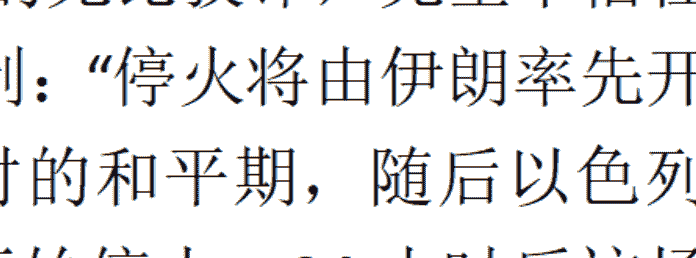
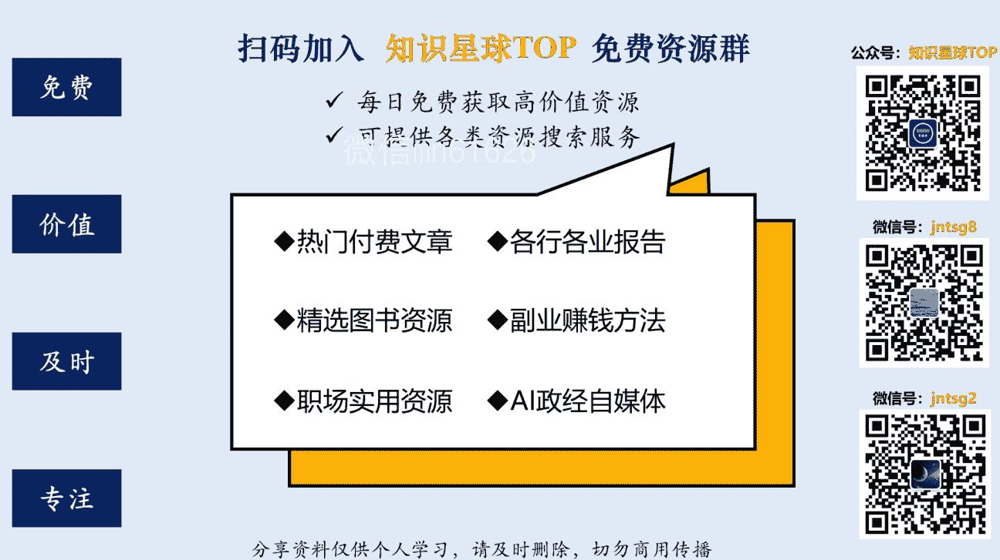

# 唐朝

2025-06-24 11:26
西方人现在学的也无比狡诈，完全不信任何承诺，要搞达成对标：“停火将由伊朗率先开始，进行首个 12 小时的和平期，随以后以色列将在第 12 小时后开始停火，24 小时后这场战争正式结束。”

# 唐朝

2025-06-24 13:16
看到一条网络留言笑死：在山东，禁酒令已经影响到所有人了。一开始只是体制内的人不能去酒店，现在连体制外的人也不意思去酒店了。因为你只要在酒店里一坐下，就等于告诉所有人，你是个没有编制的人。

# 唐朝

2025-06-24 14:27
几首压箱底的诗，找出来发一下：

咏雪
什么东西西天飞，东一堆西一堆。
莫非玉盖金殿，蹄石灰碎石灰。

大明湖
大明湖，明湖大，大明湖里有荷花。
荷花上面有螃蝌，一截一蹦跶。

## 一截一蹦跶。

闪电
突然天上上一火链，莫非玉帝想抽烟。
如果不是想抽烟，怎么又是一火链？

## 咏泰山
远看泰山黑乎乎，上面细来下粗。
有朝一日翻过来，下面细来上粗头。

唐朝
2025-06-24 16:16

2025 年 4 月 7 号，上证指数:-7.34%；深圳成指:-9.66%；创业指：-12.50%；恒生指数:-13.32%。小企鹅当天暴跌 12.5%，当日下跌六十多家。沪深 A 股共计 5414 家上市公司，当日跌幅等于或大于 9%的有 4543 家，占比 84%。香港交所所有 2744 家上市公司，当日跌幅等于或大于 9%的有 1128 家，占比 41%。考试你，不翻资料，十秒内，不能起来当天是哈作。

## 致股东信 2000-23

各位朋友，朋友们早上好。

今天这段是巴菲特的一个提醒，有点长，但胜在好懂，不需要太多解释。巴菲特说：“查理和我始终认为，CEO 公开预测自己公司增长率的做法，既充满误导，又暗藏风险。当然，他们通常是在分析师和投资者关系部门的推动或诱惑才这么干的。但我们认为，CEO 应该主动抵抗这种推动和诱惑，这类预测往往会留下祸根。”

CEO 为自己设定内部目标时不可或；在我们看来，若能以理性的风险提示为前提，表达对未来的期望也合情合理。但如果一家公司宣称每股盈利将长期保持每年 15%的增长率，那简直就是给自己埋雷。

原因很简单：这么高的增长率，只有极少数公司能长期维持。我们可以去翻翻 1970 年或 1980 年全美利润排名前 200 的公司，并逐一统计其中有多少家公司自此以后，能保持每股盈利每年 15%的增长。你会发现，符合条件的公司屈指可柯。我敢和你打赌，2000 年全球最富钱的 200 大家公司里，未来 20 年能实现每股盈利增长 15%的，可能最多有不超过 10 家。

这种预测的危害，并不只是不切实际的乐观情绪。更麻烦的是，它会腐蚀 CEO 的行为。多年来，查和我见证了太多案例：为了达成前提宣布的盈利目标，CEO 们会采取顾头不顾臀的短视经营手段。更糟糕的是，当所有的经营手段起不起作用时，他们会玩弄财技“制造”所需的数据。

这些财技，往往会产生滚雪效应：一旦今天用了明天的，明天就得不加倍挪用后天的最终，财技往往演变成彻头彻尾的欺诈——话说得好：靠笔杆偷钱，比持枪劫劫容易的。

对那些利用漂亮的增长预测来吸引投资者的 CEO，查和我倾向对于他管理的公司保持警惕。这些 CEO 里，最终会有很少一部分人能够预言成真，但大部分最终会被证明是过于乐观，要么可能就是江湖骗子。遗憾的是，想提前分辨自己所面对的究竟是哪种人，对于投资者来说不是容易的事。

2000 年，美国 SEC 主席莱维特，推动打击企业的“选择性信息披露”，尤其是企业高管倾向向前投资或关系人士释放盈利预测（最终往往基本吻合），让普通投资者处于信息劣势的行为。这种打击效果很好——包括巴菲特自己的某些交易披露被拒绝，所以巴菲特倾向于整体收购。这是在莱维特之后，分享对此的看法。在本段开头“查和我开始认为”之前，本来有一句引导语。

One further thought while I'm on soapbox: 大概意思就是，既然提到这个话题（站上讲台，大概意思就是，既然提到这个话题，只有一句引导语）。

巴菲特的观点：“对于大公司而言，长期保持高速增长是非常大的。”逐一统计其中有多少家公司自此以后，能保持每股盈利每年 15%的增长。你会发现，符合条件的公司屈指可柯。我敢和你打赌，2000 年全球最富钱的 200 大家公司里，未来 20 年能实现每股盈利增长 15%的，可能最多有不超过 10 家。

这种预测的危害，并不只是不切实际的乐观情绪。更麻烦的是，它会腐蚀 CEO 的行为。多年来，查和我见证了太多案例：为了达成前提宣布的盈利目标，CEO 们会采取顾头不顾臀的短视经营手段。更糟糕的是，当所有的经营手段起不起作用时，他们会玩弄财技“制造”所需的数据。

这些财技，往往会产生滚雪效应：一旦今天用了明天的，明天就得不加倍挪用后天的最终，财技往往演变成彻头彻尾的欺诈——话说得好：靠笔杆偷钱，比持枪劫劫容易的。

对那些利用漂亮的增长预测来吸引投资者的 CEO，查和我倾向对于他管理的公司保持警惕。这些 CEO 里，最终会有很少一部分人能够预言成真，但大部分最终会被证明是过于乐观，要么可能就是江湖骗子。遗憾的是，想提前分辨自己所面对的究竟是哪种人，对于投资者来说不是容易的事。

2000 年，美国 SEC 主席莱维特，推动打击企业的“选择性信息披露”，尤其是企业高管倾向向前投资或关系人士释放盈利预测（最终往往基本吻合），让普通投资者处于信息劣势的行为。这种打击效果很好——包括巴菲特自己的某些交易披露被拒绝，所以巴菲特倾向于整体收购。这是在莱维特之后，分享对此的看法。在本段开头“查和我开始认为”之前，本来有一句引导语。

巴菲特的观点：“对于大公司而言，长期保持高速增长是非常大的。”逐一统计其中有多少家公司自此以后，能保持每股盈利每年 15%的增长。你会发现，符合条件的公司屈指可柯。我敢和你打赌，2000 年全球最富钱的 200 大家公司里，未来 20 年能实现每股盈利增长 15%的，可能最多有不超过 10 家。

这种预测的危害，并不只是不切实际的乐观情绪。更麻烦的是，它会腐蚀 CEO 的行为。多年来，查和我见证了太多案例：为了达成前提宣布的盈利目标，CEO 们会采取顾头不顾臀的短视经营手段。更糟糕的是，当所有的经营手段起不起作用时，他们会玩弄财技“制造”所需的数据。

- “对于大公司而言，长期保持高速增长是非常大的。”
- ……和“沃尔玛型”、“银行型”的企业在利用高杠杆就会获得惊人的净资产回报，这块回报率是不稳定的，只要轻微经营恶化，快速吞噬企业的利润和净资产，并且对银行来说，大量的资产（应收账款），是否计提坏账取决于管理层是否坦诚的意愿。理论上，银行可以通过再放一笔贷款掩盖不良资产，所以不符合“老唐估值法”的“利润是否为真的前提；对于我们来说，尽量投资茅台型的高毛利率企业，确定性是我们“第一性”。
- (2023-01-13)

- 这种预测的危害，并不只是不切实际的乐观情绪。

对那些利用漂亮的增长预测来吸引投资者的 CEO，查和我倾向对于他管理的公司保持警惕。
- ……是江湖骗子。

- 这些财技，往往会产生滚雪效应：一旦今天用了明天的，明天就得不加倍挪用后天的最终，财技往往演变成彻头彻尾的欺诈——话说得好：靠笔杆偷钱，比持枪劫劫容易的。

- 这些 CEO 里，最终会有很少一部分人能够预言成真，但大部分最终会被证明是过于乐观，要么可能就是江湖骗子。遗憾的是，想提前分辨自己所面对的究竟是哪种人，对于投资者来说不是容易的事。

2000 年，美国 SEC 主席莱维特，推动打击企业的“选择性信息披露”，尤其是企业高管倾向向前投资或关系人士释放盈利预测（最终往往基本吻合），让普通投资者处于信息劣势的行为。这种打击效果很好——包括巴菲特自己的某些交易披露被拒绝，所以巴菲特倾向于整体收购。这是在莱维特之后，分享对此的看法。在本段开头“查和我开始认为”之前，本来有一句引导语。

- 这种预测的危害，并不只是不切实际的乐观情绪。

- ……是江湖骗子。

- ……是江湖骗子。

## 知识星球
添加微信 付费资源群免费入群
微信:jnts2

| 序号 | 公号/星球/社群 | 原价 | 领域 |
| --- | --- | --- | --- |
| 1 | 生态有木 | 2765/年 | 副业、搞钱 |
| 2 | 怂众从群众 | 365/年 | 时政、历史 |
| 3 | 记忆承载/雯树西风 | 365元/年 | 成长、搞钱 |
| 4 | 欧洲金靴 | 328/年 | 时政、历史 |
| 5 | 卢克文青会 | 699/年 | 时政、社会 |
| 6 | 体内主任 | 599/年 | 体制；职场 |
| 7 | 外局人的视角 | 669/年 | 金融，时政 |
| 8 | 濑泽异谈 | 4166/年 | 财富、成长 |
| 9 | 守夜人总令 | 599/年 | 时政、经济 |
| 10 | 江宁知府 | 365/篇 | 时政、国际 |
| 11 | 政堂/顾子明 | 568/年 | 时政、经济 |
| 12 | 唐书院 | 1399/篇 | 金融、财富 |
| 13 | 大树乡谈 | 199/年 | 时政、成长 |
| 14 | 水库欧大 | 10000远 | 房产、经济 |
| 15 | 洪灏的宏观策略 | 4376/年 | 经济、搞钱 |
| 16 | 金政通鉴/北海道山 | 4576/年 | 股票、行研 |
| 17 | 猫留的世界 | 299/年 | 时政、社会 |
| 18 | 飞沫 | 3600/年 | 股市、经济 |
| 19 | 米联储见闻 | 599/年 | 经济、金融 |
| 20 | 鉴茶财经院 | 330/年 | 房产、股票 |

