社会学译丛理论前沿系列

# The State and the Life Chances in Urban China Redistribution and Stratification, 1949-1994

周雪光 著
郝大海 等 译

中国人民大学出版社

# 国家与生活机遇
中国城市中的再分配与分层 1949 – 1994

社会学译丛理论前沿系列

# 国家与生活机遇

# 中国城市中的再分配与分层
1949 – 1994

周雪光 著
郝大海 等 译

Life Chances and Redistribution and Stratification in Urban China Spatialization (1949-1994)

中国人民大学出版社

## 图书在版目(CIP)数据

国家与生活机遇：中国城市中的再分配与分层 1949~1994/周雪光著；郝大海等译。北京：中国人民大学出版社，2014.12。

(社会学译丛·理论前沿系列)

ISBN 978-7-300-18990-1

I. 图国……II. 周都……III. 社会阶层-研究-中国-1949~1994 IV. 图D663

中国版图书CIP数据核字(2014)第303479号

## 社会学译丛·理论前沿系列

# 国家与生活机遇

——中国城市中的再分配与分层 1949—1994

周雪光 著

Guojia yu Shenghuo Jiyu

| 出版发行 中国人民大学出版社 | 邮政码 100080 |
| :--- | :--- |
| 址 北京市中关村大街31号 | |
| 电 话 010-62512242(总编辑) | 010-62511770(质检部) |
| 010-82501766(邮部) | 010-62514148(门市部) |
| 010-62515195(发行公司) | 010-62515275(盗版报告) |
| 网址 http://www.crpr.com.cn | |
| http://www.trnnet.com(人大教研网) | |
| 经销 新华书店 | |
| 印刷 北京京丰丰彩印有限公司 | 版次 2015年2月第1版 |
| 规格 155mm×230mm 16开本 | 印次 2015年2月第1次印刷 |
| 张 26.5页 22页 | |
| 数 382 000 | 定价 65.00元 |

版权所有 慎必印刷 印刷错误 责任调试

献给昭慧和凯蒂

## 中文版序言

如书名所示，这本书着眼于中华人民共和国成立后45年（1949—1994）间中国城市社会分层状况，特别是国家政策对民众生活机遇的影响。这是由于我在1993—2013年间在这个主题上的系列研究结果集结而成的。我很高兴这本关于中国当代社会分层的著作有机会以中文与国内读者见面。我借用中文版序言向读者介绍一下此项研究的背景和我在英文版出版十年后对这一主题的感受。

这个研究课题因为一个偶然机会而来。1991年我来到康奈尔大学社会学系，开始了博士毕业后学术生涯的第一工作。学校鼓励教师申请科学项目，特别是由高学术声望的国家科学基金（National Science Foundation, NSF）资助的项目。于是，我向NSF提交了研究中国社会分层的报告。在向同事寻求意见时，两位同事菲利斯·莫思（Phyllis Moen）和南希·布兰登·图玛（Nancy Brandon Tuma）都表示极大兴趣，主动提出愿意参加到这个项目中。莫思是研究生生命历程（life course）的著名学者，图玛则是事件史统计方法的重要贡献者。她们人的加盟使得这个项目非常有吸引力。我们在1993年进行了调查，后1994年得到了NSF的资助。

我的研究生训练和博士论文是在组织社会学领域，涉及到中国研究。之所以选择中国分层这个层面，一方面是我对中国社会转型有着极大兴趣，另一方面是因为我自己在中国成长的经历。记得在读博期间学习事件史统计模型时就想到这个模型对于研究民众生命历程非常有意义。这个项目所收集的资料内容与信息是如此丰富和富有，以至于在这个领域中耕耘了十年，同事们先后写了十几篇文章，大多在美国社会学期刊上发表了。于是无意间我发掘了自己从学术训练闯入过的分层领域，成就了自己博士生涯的近十年。

在学术旅程上，我是一个探索者，因为总是有令人兴奋的研究。这本书于2000年在剑桥大学出版时，我已经开始了新的研究计划，从过去的量化研究转向以野观察为基础的质化研究，从分层领域转向组织社会学。从那时开始，我在学术旅程上不断回顾过去过去从事社会分层的这段经历。邵海教授告诉我们在组织这本书时，对我中国民众是否会对此感兴趣有些疑问。到2013年暑，中文译稿给了我回顾了自己这段研究历程和重新评估了这些研究工作。

十年前出版的著作使我意识到，这一研究工作有着低估或未发现的意义。首先，这项研究所依托的资料极为宝贵。在改革开放前，中国社会学研究几乎停滞，虽有宏观层面的统计资料，但在微观、个体层面生命历程各个阶段的资料收集、整理和分析方面是一个空白。我们在1993—1994年收集城市居民生命历史信息时，调查人年龄限定在18至65岁。那些高年龄的调查人恰好在成立初期进入劳动力市场，到1994年收集资料时，他们的生活经历了40多年转型，记录了中国社会分层的微观过程。

在我们资料收集结束之前，郭德尔（Andrew G. Walder）和特需要（Donald J. Treiman）进行了一项全范围的生命史抽样。与我们的城市样本不同，他们的资料包含了城市和农村样本。许多学者在此基础上发表了一系列重要的研究工作。本书的结果与文中许多分领域的研究相比，独特之处在于它追踪了一个全国性城市样本中城市居民在生命史上各个阶段的大事件及其之间的关系，并将这些生命事件在中华人民共和国历史变的背景和过程中加以解读，从而提供了一个关于国家与社会分层关系的整体分析。从这一角度来看，不同的部分对此关联集成，其意义超越了这些简单的相加。

最后，这项研究工作在理论解释和操作上有创新和突破。

在理论上，我提出的社会分层动态过程的模式——即国家政策和政治过程可以打断或改变传统的传承机制和资源——是不同于传统社会分层理论的新理论思路，并将延伸至分析权力体制中的升和代际流动。与优佳夫关于“市场转型期”的争论中，我提出了“政治与市场协同演化”的理论模型。可以说，近年来中国社会分层趋势与我提出的基本立论是一致的。另外，在“同期期”构建、跨越历史时期比较的操作及分析方法上均均衡和推进，体现了我们将量化研究与当代制度安排及历史过程进行实质性结合的努力。

这项研究的资料直到1994年，本书报告的发现和结论也反映了当时的社会分层动态过程。对照后20年间中国社会分层的变化状况和趋势，我对本书研究发现的解法有所修正。这一对比也提出了新的研究问题。借此机会与读者分享一下我的近来感受。

第一，我从今天开放背景的状况来看，毛泽时代的社会不平等状况在阶层间差距、利益分化等方面仍然明显而显著，这一点在本书呈现的资料是可以确认的。不要忘记，毛泽时代“去阶层化”的状况是以整个国家发展的低水平近乎停滞。本书详细描述了毛泽时代政治过程震荡导致了阶层内部的利益分化，这种调整了民众的历史历程，其影响范围之大。在近年来学术界和意识形态界的有关争论中，在这里再次强调：城乡二元结构是中国社会公平最为重要的限制，请读者注意。

第二，我在书中提出由于政治过程的影响和冲击，代际流动机制和资源在社会分层过程中的作用是有限。从发展趋势来看，这一观点显然过于乐观了。近期研究显示当今社会分层的固化程度、代际流动速度有着加速态势。教育曾经是中国向上流动的重要渠道，这一机制的变化具有重要意义。今天我们看到，一方面教育机会很大程度上扩大，另一方面分层机制的作用依然存在。在宏观层次教育教学持续，在微观层次资源流动在获得地位和职业中的作用更为有待细致解析。

第三，在我国社会转型过程中，分层机制和过程呈现出复杂乃至矛盾的格局。例如，毛泽时代单位结构和以职业基础的群体（如工人）差异有限，在改革初期曾一度弱化。随着政府权力和地位的增强，随着国有企业的建立，传统的社会平等并不是从根本改变，而是在新时期以新的方式再生、延续。

第四，改革开放时代带来了资源匮乏的状况。在这个过程中，分层机制与新利益、市场交易结合相互作用，导致了社会群体的急剧分化和边界日益明晰，体现在性别、年龄、阶层、职业、工作组织和居住空间等维度的强化。这些“范畴基础上的不平等”（categorical inequality）正在重塑中国不平等的格局。

怎样认识、解读这些历史趋势，特别是毛泽时代和之后30年的对比？也许历史轨迹可以帮助我们注意到历史过程背后的机制。许多历史研究注意到，在一个新王朝（如汉、明）建立的，对旧势力的清理为新势力（特别是平民）的向上流动提供了巨大机会。但随着权力巩固，新的利益集团存在，社会结构固化，流动机会减少，阶层之间边界越高。以此观之，毛泽时代的向上流动趋势反映了历史趋势的第一阶段，而今天的中国似乎在进入第二个阶段。我希望这本书的研究工作可以帮助读者思考、探究中国社会分层和社会演变的宏大过程，也希望中国正经历的社会转型可以跳出历史的迷白。

这本书是我与多位学术同仁合作的结果，他们的贡献体现在我们合著的文章中。资料收集也得益于国内几个学术机构同仁的组织，以及许多学生的辛苦劳动。我在英文版序言中有感谢之言，不再赘述。在这里，特别感谢大海教授组织翻译本书，如果没有他和学生们认真辛苦的翻译工作，这本书将会失去与许多中国读者交流的机会。对此我深存感激。

周雪光
2014年3月13日于斯坦福

序言

中华人民共和国的1949—1994年期间，国家及其政策对普通公民产生了重大影响，个人生活轨迹被政治态度起伏波动所塑造和再塑造。国家政策在不同历史时期多样影响了个人机遇轨迹，这正是本书的主题。

在本书的数据、统计和学术用语背后，我想讲述的是成千上万真实人的故事，他们所经历的政治环境见证了中华人民共和国45年历史上重大且反复无常的变动。我的学术训练教我将抽象的理论转化为严谨的统计分析和经验证据呈现。

遗憾的是，这一学术倾向通常要以抹去生活的个人生活为代价。我在进行本书的各项研究时，脑海经常呈现出不同的影像。这些影像源自我在中国的成长经历和对许多熟悉的人经历的回忆。正是这些的人生故事构成了本书报告的统计发现。

我想与读者分享其中的一些故事，以此作为研究背景的引言。让我从2世纪80年代遇到的一位中国学者开始吧。他在2世纪50年代曾是北京一所大学的一位才华的学生。在百花时期，他应该呼召所有的大学官员是不堪的行为。世事莫诡，出于无人知晓的理由，他被入监狱整整二十年。直到今天，无论多久，他的妻子长期在床边睡。

读研究生时，有一位老同学一起去了一个偏远地区的劳改农场，由于他父亲在政治运动中遭到逮捕，他被送到了那里。在那个2世纪初期的劳改农场，我看到了许多人的景象：由于劳改，他们的腿也是摇晃的。几年后，他离开了那里，只剩下了几十人。

他的妻子昭慧是一个小女孩了。“文革”期间，她的母亲因为“剥削阶级”背景被红卫兵接到我家。昭慧在夜很晚的时候独自来到房间，捂着脸说道：“好，妈妈也回来了。”我最初开始写书时，她的女儿才八岁。看着她无辜的眼睛，我不自主地想到那个政治满是年代。在文化大革命期间，她感受到的屈辱和绝望，至今记忆如那天回家的路上。这些故事打动人心。

在书中，我们可以观察到社会主义在中华人民共和国45年以来的历史中，见证了人们职业轨迹的上升与下降、机会的失去、家庭的离散。书中致力于描述、分析这些复杂的政治和社会状况以及它们对个人生活的深刻影响。

在本报告的研究过程中，我得到了同事和朋友们的诸多帮助。我尤其感谢菲莉斯·莫思（Phyllis Moen）和南希·布兰登·图玛（Nancy Brandon Tuma），她们从一开始就在这一研究项目中和我合作，并在书中改稿了几篇论文。我从莫思学习了统计方法，从图玛学习了生命历程，她们在本书的许多地方留下了印记。她们对我的影响超出了研究项目。在多年的合作中，她们一直教导我，帮助我的专业发展，并推动我清醒地思考书中探索的理论和分析。

还要感谢候立仁、林朴、Alice Suhomlinova和赵伟。作为我的研究助理、朋友和同事，他们不仅感谢我的研究支持，还有贯穿整个过程的珍贵谊。奥纳格·布鲁格（Ronald Breiger）、劳迪·布克曼（Claude Buchmann）、戴比·戴维森（Debbie Davis）、扬·迪普雷特（Tom Diprete）、肯·兰（Ken Land）、林凯（Victor Nee）、安吉·奥兰德（Angelo O'Rand）、毕·朴尔里什（Bill Paris）、肯·斯潘纳（Ken Jenner）、戴维·达维克（David Stark）、锐维·奥瑞、怀普、怀锐、约翰·威尔逊（John Wilson）和谢许，他们多年来的意见和帮助改进了我的工作。特别感谢谢薇·格鲁基（David Grusky），正是他最初的鼓励促成了我写作本书的决心。这本书关注的是中国研究，但我的学术基础是詹姆斯·马考（Jim March）、约翰·迈耶（John Meyer）、理奎斯特·斯科特（Dick Stock）和布哲·泽尔迪（Buzz Zelditch）。

还要感谢本书的编辑，剑桥大学出版社的阿莉亚·温斯特（Alias Winters）女士，她的指导和帮助使得本书的出版过程十分顺畅！

这个研究起于康奈尔大学社会学体系期间，我随后任职的杜克大学及其社会学系在这些年来为我提供了慷慨的支持。研究始于一项探索式研究，为此我在1993年在北京和上海收集数据。探索式研究是由美国社会学学会/国家科学基金（ASA/NSF）学科发展支持基金、拉姆（Lam）基金和康奈尔大学东亚研究项目的哈尔彭（Halpern）基金所资助的。这个研究项目主要的数据是1994年6月至12月间收集成的，由NSF（SBR—94113540）拨款资助，并由天津市科学院社会学研究所、复旦大学社会学系和中国人民大学社会学系完成的。我要感谢冯伟、张宪、彭哲和王辉，以及以上机构中的许多学生和研究人员，他们为收集数据提供了极大帮助。美国教育研究院（National Academy of Education）的斯宾塞基金（Spencer Fellowship）使我能从杜克大学假期去实地调查。我感谢这些资助机构对研究项目的支持。

## 对转载授权的致谢

我对几家出版社允许使用其出版物中相关材料的版权许可表示感谢：

- 第11章11—2部分内容自 Economic Transformation in Eastern Europe and the Distribution of Income, edited by Anthony Barnes Atkinson and John Micklewright. ©1992, 创桥大学出版社（Cambridge University Press）授权，第81页4—1。
- 第11章11—2部分内容自 Changing Patterns in the Distribution of Economic Welfare, edited by Peter Gottschalk, Bjorn A. Gustafsson, and Edward E. Palmer. ©1997, 创桥大学出版社（Cambridge University Press）授权，第39页3—1。
- 第11章11—2部分内容自 Retreat from Equality, edited by Carl Riskin, Zhao Renwei, and Li Shi. ©2001, M. E. 夏普出版社（M. E. Sharpe, Inc）授权，第28页2—1和表2—2。

第1章开始对舒尔曼（Franz Schurmann）的引用


# 国家与生活机遇

转载自 Ideology and Organization in Communist China, by Franz Schurann. 

© 1968, 加利福尼亚大学出版社 (University of California Press) 授权，第xxx页。

第 1 章对宰林林 (Ivan Szelényi) 的引用转自 International Journal of Comparative Sociology, 16, Ivan Szelényi, “Social Inequalities under State Socialism” © 1978, 布林学术出版社 (Brill Academic Publishers) 授权，第 1 章。

第 5 章对韦伯 (Max Weber) 的引用转自 Economy and Society. 2 vols. edited by Guenter Roth and Claus Wittich. 1968, 加利福尼亚大学出版社 (University of California Press) 授权，第 975 页。

xiv

我还要对几家出版社和学术协会对于本书列表部分中的转载或内容的版权许可可表示感谢：

- 美国社会学协会 (American Sociological Association), 1999, Xueguang Zhou and Linen Hou. “Children of the Cultural Revolution; The State and the Life Course in the People’s Republic of China.” American Sociological Review. 64: 12–36.

- 北卡罗纳大学出版社 (University of North Carolina Press), 1996. Xueguang Zhou, Nancy B. Tuma, and Phyllis Moen. “Stratification Dynamics Under State Socialism: The Case of Urban China, 1949–1993.” Social Forces 74: 759–96.

- 赛奇出版公司 (Sage Publications, Inc.), 2001, Xueguang Zhou. “Political Dynamics and Bureaucratic Career Patterns in the People’s China.” Comparative Political Studies 34 (9); 1036–62.

- 学术出版社 (Academic Press), 2001, Xueguang Zhou and Phyllis Moen. “Explaining Life Chances in China’s Economic Transformation; A Life Approach.” Social Science Research 30 (4); 552–77.

- 芝加哥大学 (University of Chicago Press), 2000, Xueguang Zhou. “Economic Transformation and Income Inequality in Urban China; Evidence from a Panel Data.” American Journal of Sociology 105: 1135–74.

最后，需要指出的是，当我改写这些已出版的作品并纳入本书时，使用更新的数据和统计模型重新进行了分析，大多数图表也因此更新了。另外，第 3 章和第 9 章也是基于已发表的作品，但在本书书中已被重新修订了。

## 目录

序言......................................................................1

对转载授权的致谢......................................5

- 第1章 国家社会主义再分配与分层动态过程......11
- 1.1 引言..................................................1
- 1.2 比较视角下的社会分层..............................4
- 1.3 国家社会主义再分配与分层动态过程......6
- 1.4 改革时期的制度转型与分层过程......23
- 1.5 本书的内容简介......................30
- 第2章 概述：历史背景和研究设计......32
- 2.1 中国城市历史背景的变迁................33
- 2.2 再分配体制与生活机遇的演变................36
- 2.3 来自“国家与生活机遇”项目的生活史......44
- 资料....................................................
- 2.4 研究设计的思路......................48
- 2.5 统计分析：模型与方法..............53
- 2.6 本章总结..........................57

# 第一部分 再分配与分层动态过程：验证证据

第3章 教育分层...................................................................... 61

3.1 教育和社会分层：研究问题...................................................................... 62
3.2 教育机会的历史演变................................................................................ 66
3.3 国家政策、社会出身与教育获得：进一步分析................................................ 71
3.4 本章总结................................................................................................ 84

第4章 劳动就业：首个工作的获得模式................................................................ 87

4.1 比较视角的“工作”概念...................................................................... 88
4.2 劳动就业模式的描述...................................................................................... 92
4.3 对进入首个工作的解释：总体模式...................................................................... 95
4.4 不同时期获得获得的模式...................................................................... 99
4.5 本章总结...................................................................................................... 107

第5章 “文化革命”的孩子们：“上山下乡”经历...................................................... 109

5.1 研究问题...................................................................................................... 111
5.2 “上山下乡”经历的历史背景...................................................................... 113
5.3 “上山下乡”事件的历史模式...................................................................... 116
5.4 国家政策对社会群体的不同影响...................................................... 117
5.5 “上山下乡”经历的后果...................................................................... 123
5.6 本章总结...................................................................................................... 132

第6章 攀升政治阶梯：官僚的职业模式...................................................... 135

6.1 引言：中国官僚的人事制度...................................................... 137
6.2 中国城市中官僚职业模式的解释：两种模型.............................. 142
6.3 不同历史时期的描述...................................................................... 149
6.4 进入行政和专业职业...................................................................... 151
6.5 官僚层...................................................................... 155
6.6 中国官僚体系的晋升模式...................................................... 159
6.7 本章总结...................................................................................... 167

# 第二部分 对毛泽东时代制度变迁的评估

第7章 经济转型与不平等的变化...................................................... 171

- 7.1 再分配与市场化：对不平等的意义...................................... 173
- 7.2 收入决定因素的截面分析................................................................ 176
- 7.3 两个时期变化的比较：追踪数据的模型............................... 182
- 7.4 地区差异的考察...................................................................... 188
- 7.5 OLS结果及其他研究............................................................... 192
- 7.6 本章总结...................................................... 193

第8章 再分配与隐性收益...................................................... 196

- 8.1 再分配与隐性收益...................................................... 197
- 8.2 隐性收益的历史回顾...................................................... 200
- 8.3 案例分析：住房分配的因素...................................................... 203
- 8.4 本章总结...................................................................... 213

第9章 制度转型与工作转换...................................................... 216

- 9.1 作为研究重点的工作转换模式...................................................... 217
- 9.2 工作转换的历史趋势...................................................................... 222
- 9.3 解释各时期的工作转换模式...................................................... 224
- 9.4 本章总结...................................................................... 237

第10章 经济转型与生活遭遇：一个生命程的视角...................................................... 240

- 10.1 制度转型与生命程的意义...................................................... 242
- 10.2 实证意义...................................................................... 245
- 10.3 历史背景、群体质性与演变中的机会结构...................................................... 248
- 10.4 对机会和风险变化的反应：工作转换中的群体差异...................................................... 252
- 10.5 经济回报的群体差异...................................................... 257
- 10.6 本章总结...................................................................... 260

# 第三部分 总结与结论

第11 章 国家社会主义社会分层：总结与评估...................................... 265

- 11.1 官僚阶级命题的再思考......................................... 266
- 11.2 人力资本和政治资本............................................................ 274
- 11.3 社会分层中的再分配制度...................................................... 276
- 11.4 国家社会主义动态过程：理论意义........................................ 277
- 11.5 进一步的问题............................................................... 279

第12章 分层动态过程与制度转型............................................... 281

- 12.1 对国家社会主义条件下国家与社会关系的反思............................ 282
- 12.2 中国体制改革的社会基础................................................... 287
- 12.3 从社会分层到制度转型............................................... 292
- 12.4 中国经验的比较意义............................................... 295

- 参考文献................................................................ 298
- 索引................................................................... 321
- 译后记................................................................ 393

# 图目录

- 图 2—1a 1952—1994 年间不同部门城市劳动力构成的官方统计 ...... 37
- 图 2—1b 1951—1991 年间（按每 5 年的平均值）样本中不同部门城市劳动力的构成 ...... 38
- 图 2—2a 1951—1991 年间（按每 5 年的平均值）国有部门组织类型的构成 ...... 39
- 图 2—2b 1951—1991 年间（按每 5 年的平均值）非国有部门组织类型的构成 ...... 40
- 图 2—3a 1951—1991 年间（按每 5 年的平均值）干部、专业人员和办事员的构成 ...... 40
- 图 2—3b 1951—1991 年间（按每 5 年的平均值）工人和自雇者的构成 ...... 41
- 图 2—4 1952—1994 年间不同部门工业产出的构成 ...... 42
- 图 2—5 1949—1994 年间三个教育水平人学率的官方统计 ...... 43
- 图 2—6 1951—1991 年间（按每 5 年的平均值）样本中不同教育水平的分布 ...... 44


图 3—1 1953—1988年（按每 5 年的平均值）样本中升入4个教育水平的比例 ....................................................................... 67

图 3—2 1949—1994年间高等教育机构的数量 ....................................................................................................................... 69

图 3—3a 根据父亲职业分组（按每 5 年的平均值）升入高中的比例 ................................................................................ 70

图 3—3b 根据父亲职业分组（按每 5 年的平均值）升入大学的比例 ................................................................................ 71

图 3—4 根据时期和性别的转换率 ....................................................................................................................... 79

图 3—5a 根据时期和父亲教育水平的高中转换率 ...................................................................................................... 81

图 3—5b 根据时期和父亲教育水平的大学转换率 .......................................................................................... 82

图 3—6a 根据时期和阶级标签的高中转换率 .......................................................................................... 84

图 3—6b 根据时期和阶级标签的大学转换率 .......................................................................................... 84

图 4—1 1949—1992年间进入初职的风险率 ................................................................................................ 93

图 4—2a 1949—1992年间进入第一个工作组织的风险率（国家或集体部门）...................................................................................................... 94

图 4—2b 1949—1992年间进入第一个工作组织的风险率（混合所有制企业或农场）......................................................................... 95

图 4—3 不同时期大学毕业生进入不同类型职业的比例 ....................................................................... 103

图 4—4 不同时期大学毕业生进入不同类型组织的比例 ....................................................................................... 105

图 5—1 1967—1978年间获得第一个工作的风险率 ....................................................................................... 116

图 5—2 1967—1987年间返城的风险率 ....................................................................................... 117

图 5—3 结婚年龄在三组中的分布 ....................................................................................... 125

图 5—4 初次生育年龄在三组中的分布 ....................................................................................... 125

图 6—1 行政级别体系 ....................................................................................................................... 139

图 6—2 职业级别体系 ....................................................................................................... 140

图 6—3 加入中国共产党、进入行政和专业职业的风险率（1950—1993）................................150

图 6—4 国家官僚体系中晋升的风险率 ................................................................. 151

图 6—5 年龄对加入中国共产党、进入行政和专业职业的影响（1980—1994）...................................................... 154

图 6—6 年龄对晋升率的影响（1980—1994）...................................................................... 162

图 7—1 收入数据的官方统计与样本统计对比 ....................................................... 177

图 7—2 在选定年份，具有大学学历的女性收入比率的对数值 .................................................... 179

图 7—3 在选定年份，干部和专业人员收入比率的对数值 ................................................... 180

图 7—4 在选定年份，不同类型组织收入比率的数值 ....................................................... 181

图 9—1 转入国有部门的工作转换风险率 ................................................................ 223

图 9—2 转入集体和非国有部门的工作转换风险率 ................................................ 223

图 10—1 各同期群首个目标工作的分布 .......................................................................... 249

图 10—2 1993年各同期群目标工作的分布 ....................................................................... 250

## 表目录

- 表 1—1 1949—1994 年间中国部分政治运动目录...................... 16
- 表 2—1 各省、市样本规模分布 ................................. 46
- 表 3—1 模型拟合改进的似然比检验 ................................ 74
- 表 3—2 不同历史时期升入三个教育水平的概率的 logistic 回归模型的参数估计............................... 76
- 表 3—3 不同历史阶级背景对升入三个教育水平的概率的影响的参数估计................................................ 83
- 表 4—1 进入初职的 logistic 模型参数估计（参照类别：工人）...................................... 96
- 表 4—2 进入第一个工作组织的 logistic 模型参数估计（参照类别：集体企业）.................................. 98
- 表 4—3 不同时期进入初职的 logistic 模型参数估计（参照类别：工人）...................................... 100
- 表 4—4 不同时期进入第一个工作组织的 logistic 模型参数估计（参照类别：集体企业）...................... 103
- 表 4—5 使用“家庭阶级背景”，不同时期进入第一个工作组织的 logistic 模型参数估计...................... 106
- 表 5—1 1967—1978年下乡概率的 logistic 模型估计，下乡=1
- 表 5—2 1967—1979年返城概率的 logistic 模型估计，返城=1
- 表 5—3 各组经历历程事件的差异与统计检验
- 表 5—4 选定年份收入决定因素的 OLS估计……
- 表 6—1 不同时期进入干部职业的 logistic 模型估计……
- 表 6—2 选定时期加入中国党的 logistic 模型估计……
- 表 6—3 中国官僚晋升模式决定因素的 GEE估计
- 表 6—4 工作组织内提升决定因素的 GEE估计
- 表 7—1 选定年份，收入决定因素的 OLS估计……
- 表 7—2 完全混合模型中收入决定因素的参数估计……
- 表 7—3 不同区域混合模型中收入决定因素的参数估计……
- 表 8—1 各类组织福利支出……
- 表 8—2 各类组织住房支出……
- 表 8—3 选定年份，居住决定因素的 OLS估计……
- 表 8—4 选定年份，设施数量泊松模型的估计……
- 表 9—1 不同时期不同类型工作组织间转换的 logistic 模型……
- 表 9—2 不同时期不同类型工作组织内转换的 logistic 模型……
- 表 9—3 不同时期经济部门间转换的 logistic 模型估计……
- 表 10—1 1993年中国城市三个同期群的统计描述
- 表 10—2 转型时期各同期群中不同类型组织内转换的 logistic 模型估计
- 表 10—3 1993年中国城市三个同期群收入决定因素的 OLS估计
- 表 1—1 官僚职位汇报的小结...................................................... 267
- 表 1—2 各国家收入平等的基尼系数................................................269
- 表 1—3 地位代际传承研究结果................................................ 272
- 表 1—4 教育回报研究的小结...................................................... 275
- 表 1—5 国有部门回报研究的小结..............................................276

# 第一章 国家社会主义再分配与分层动态

20世纪后半期的中国革命与20世纪前半期的中国革命一样非凡。中国革命通过变革社会造就了一个强国，它自身是世界贫穷国家和发展的典范。——舒尔曼（Schurmann, Franz 1968, p. xxxvi）

在社会主义社会中，社会不平等主要由再分配机制产生和构造的。——泽林（Szelényi, Ivan 1978, p.1）

## 1.1 引言

1985年的晚上，在加利福尼亚，我与从事中国研究的著名人类学家沃尔夫（Arthur Wolf）以及其他的学生围坐在桌旁。交谈中，沃尔夫教授了一个问题：“在中国历史上，自从人口数据记载来，中国人口就在持续增长。但从20世纪50年代未60年代，它却有一个急剧的下降，我们应该怎样解释这一现象呢？”当我随着沃尔夫注视那条长的上升陡然大幅下跌时，我的心情也跌入谷底。许多景象和故事入我的脑海——在成长的过程中，从我的父母、祖父母、朋友的父母以及我去劳动过的那个村庄的农民家里，我曾一遍一遍听到他们说“大跃进”事件以及之后饥荒时期的回忆。

确实，在漫长的历史中，中国经历了许多灾难，王朝的更替、战争、饥荒和许多灾难，但是为什么1959年—1961年的饥荒对国民的打击是如此无情，以至于短短几年内许多人死亡？（Banister 1987; Yang 1996）正如我们现在所知道的，这绝不仅仅是什么“自然灾害”，而且是高层领导者政策失误造成的“人祸”！在中华人民共和国过去50年的历史中，这不过是国家政策冲突、极端的方式干预个人生活机遇的众多事实中的一例。在这个更大的课题是：“为何会有如此大的影响？”

要探究这个问题和相关绩效，我们必须考察国家社会主义阶层结构——社会阶层结构和社会位置结构，以及这些机制和位置分配个人的过程——为我们提供了一个理解国家社会主义条件下国家与个人生活机遇间相互联系的重要视角。理解社会阶层制度是如何构造和维持的呢？个人占据这些位置和资源的分配机制是什么？不同的社会阶层模式为何存在明显的差异？通过这些路径寻找答案的，我们意识到制度安排的重要性，它界和构造了资源在社会群体之间分配和传递的过程。20世纪二战以后，工业化市场社会和国家社会主义出现了两种不同的社会阶层模式。

本书旨在研究中华人民共和国成立后，机遇和个人生活机遇在不同历史时期的演变，尤其是国家在这一过程中的作用。我们追踪1944—1994年国家社会主义历史进程中的，在城市中社会主义制度的历史演变。


## 第一章 社会主义再分配与分层动态过程

放置：“市场行为是一种决定力量，它为个体的命运提供了一个普遍性条件。这个意义上的阶级地位最终也是市场地位。”因此，不理解工业化市场社会中的社会流动与分层，起初源于资源禀赋的稳固优势为特征的。众多研究发现，这些社会中的社会流动主要是通过个人的和基于家庭的社会整合和实现的。社会经济地位的改善主要来源于工业化及其相伴的结构性变化带来的新机会（Featherman, Jones and Hauser 1975; Treiman 1970）。这些与西欧和北美底层阶层级的公民权和社会权利逐步扩展的历史模式是一致的（Bendixson 1964; Marshall 1950）。

个体市场地位重要性引发了人们对工业化社会中代际、代内流动以及地位获得的理论关注（Blau and Duncan 1967; Goldthorpe 1987; Hauser and Featherman 1977; Sørensen 1977）。社会流动通道——从父亲继承的地位相对于社会资本对社会向流动的相对性——得到了广泛研究（例如，Coleman 1988; Hout 1988; Yamaguchi 1983）。对于如此社会和社会职业地位等结构性条件的关注了这种假设：分层机制在代际流动及个人生命过程中是相对相关的。事实上，阶层流动明显存在跨区域的差异，且在工业化市场社会中，社会流动模式在不同时间和空间中是相对的（参见 Erikson and Goldthorpe 1992; Grusky and Hauser 1984; Hauser and Grusky 1992）。例如，父亲的社会地位和儿子的教育在流动中随着时间的变化而有了明显的正面作用（参见 DiPrete and Grusky 1990; Featherman and Hauser 1977; Hout 1908）。针对这些研究的理论上的评价，参见甘泽布姆、特雷曼和乌利（Ganzeboom, Treiman, and Ullee 1991）以及索伦森（Sørensen 1986）的著作。

即使工业化市场社会中的社会群体利益团体开展自身利益时，他们也常常采用类似于市场竞争的策略。例如 Larson（1977）曾描述过，在美国，大的专业团体如何通过建立保护性边界和封闭的“集体项目”来维护他们的共同利益。这些利益团体在“构建劳动力市场场所、社会封闭或其成员在劳动力市场中拥有舒适位置且报酬厚厚的职位”的过程中扮演了重要角色（Freidson 1986, p. 59），而且它们利益表达的集体行动提供了基础（Grusky and Sørensen 1998）。它们可能会使用手中的资源竞争优势，采取政治手段获取有利于自己的立法（Zhou 1993a）。但是，不同于国家社会主义社会的是，社会群体和阶级的相对地位可以恰当地被视为拥有不同经济、政治资源的群体通过类似市场上横向竞争的努力结果。① 梯利（Tilly 1998）基于社会关系和社会封闭对于持久不平等状况的理论阐述，强调了市场社会中社会分层制度的稳定状态。

工业化市场的分层模型为比较研究提供了一个有益的出发点，但它们并不适用于理解国家社会主义社会中的社会分层。在这些社会中，分层是围绕国家社会主义再分配而非市场组织起来的，依靠的是政治权威而非市场机制。我们将注意力从工业化市场中的社会分层模式转向国家社会主义的模式，需要解释的议题也相应地改变了。首先，我们必须分析的重点从个体的“市场位置”转向更为广泛的再分配；其次，从结构性位置，为了解释个人生活机遇，我们还必须关注动态过程。

### 1.3.3 国家社会主义再分配与分层动态过程

再分配通过中央权威再分配资源成为人类历史上一种独特的经济形式（Polanyi 1965），并在苏联模式的国家社会主义社会中演变为一种成熟的形式，即几乎所有资源都由国家来分配。要理解国家社会主义社会分层，我们必须明确把国家与其再分配制度扮演的角色置于理论解释中心。我们首先考察国家社会主义再分配制度决定的社会分层制度的主要特征。

### 1.3.1 再分配的政治逻辑

国家无所不包的角色是国家社会主义政治结构的一个特征。正如林德布洛姆（Lindblom 1977, pp. 238–239）描述的：

> ① 这里所描绘的状况大抵受到北美社会分层配置的影响。在西欧的政府结构中，国家在群体与组织之间的关系构建中扮演着非常积极的角色，因而限制了社会分层中类似市场机制的作用（参见 Espensen-Andersen 1990）。然而，就国家支配和控制组织与群体的角色而言，即使欧洲社会中的社团治理也并不如国家社会主义社会。政府几乎无不包——规模远远远于其他任何一个政治经济体系。政府掌控了大部分社会生产资料——生产方式中的私有产权不再一般性原则——政府迅速而直接管理着经济。与此同时，政府控制着宗教、教育、家庭、工会、个人行为的细节，而这些方面在他们社会中都在政府职能之外。

如果资本主义社会中的分层调度是市场逻辑，那么国家社会主义再分配是由政治逻辑支配的。在此意义上，国家社会主义再分配的政治逻辑意味着不同类型的劳动力工资水平和不平等程度首先由政治决定（Szelényi 1978）。在这种制度背景下，中央政府的权威在资源分配中扮演着决定性的角色。分配是由国家构建的政治逻辑决定的。这些观察提供了许多关于国家社会主义分析的起点。

再分配的逻辑有助于理解国家社会主义制度设置中的权力关系。在经济领域，基于政治逻辑导致了资源转移模式（Koranyi 1989; Szelényi 1992; Beck and King 1994）。例如，在政府部门每一层级，组织（如行政部门）都具有权力。同样地，在工作场所，那些阶层排列的职业（如干部）被赋予的权力高于管理者和技术专家。理解的是，在国家社会主义社会中，上述逻辑导致了独特的分层模式。泽林尼（Szelényi 1978）详细分析了职业经济地位：“在社会主义制度下，国家对剩余的再分配不是通过个人收入的增加，而是通过国家直接进行。”尽管许多职业类别与市场形态相似（如专家、经理、技术工人），二者的分层模式有本质差异。各类社会群体的特权都系统依赖于它们与国家的关系（Bauman 1974; Konrad and Szelényi 1979）。其后果是，这些社会与市场社会相比，劳动力市场结构截然不同（Away and Luckacks 1985; Connor 1979; Stark 1986）。

再分配的政治逻辑导致了国家社会主义资源分配的一种特殊机制。仔细考虑社会阶层中政治资本与人力资本的区别。在市场经济中，生产要素通过竞争性市场分配，经济学家指出人力资本在个人经济回报中扮演了重要角色。相反，再分配的政治逻辑建立了一个本质不同的报酬体系：中央政权奖励拥有政治地位和政治忠诚的人。与此相对的是，那些拥有人力资本（如教育资历）的人属于政治权力。这一理论在中国研究中得到了巨大的关注。许多学者观察，在中国的工业官僚体制中，普遍实践是对政治忠诚而非能力的回报（Hardee 1981; Lee 1992; Nee 1989; Walder 1986; Zhou 2005）。

### 1.3.2 官僚阶级

沿着社会主义条件下不平等的政治逻辑，人们经常提到官僚（干部）一方与其他群体一方之间的社会壁垒。依据杰拉斯（Djilas 1957）有关官僚阶级的观点，研究社会主义的学者强调“再分配者”与“直接生产者”（Szelényi 1978）之间的差异，以及官僚的政治地位在获取经济利益上的重要性。其主要观点是，在计划经济中，官僚的特权地位使其能够在资源再分配中有效地获取利益。类似的观点在非市场场合下也经常出现。特别是 Nee（1989, 1991）强调了中国分层秩序的核心：通过中央计划再分配资源导致了工业、经济部门乃至所有组织中出现了官僚组织和等级阶层。干部包括行政官僚、管理人员或属于官僚机构的人——在政治地位、晋迁以及经济利益方面都占有优势。

如果定义的官僚阶级是，那么又不是属于这个阶级的人呢？我们能以什么方式来定义官僚阶级呢？韦伯思想的一个洞见强调同一社会阶层成员中社会经济状况的相似性。在当代韦伯视角关于社会阶级的讨论中，一般的“市场地位”的概念占据了核心位置。从一般的意义来说，这些市场地位反映了个人生活机遇。按照这个观点，我们预期当官僚阶级为一方与其他群体为另一方之间，在生活中的重要方面有着显著差异。

马克思视角的阶级理论提供了第二个观点：社会阶级植根于生产过程的权力关系之中。对资本、不动产以及生产工具的所有权是剥削阶级与被剥削阶级的主要区别。然而，在国家社会主义社会中，对这一观点的应用存在着根本性困难，因为所有的生产工具都属于国家。这一认识导致马克思观点的一个重要参照：关注从所有权向工作环境中的“权威关系”。赖特（Wright 1989, pp. 16-17）曾说道：“在国内官僚社会主义中，组织资产占据着相当的位置。对于劳动技术分工的控制——同一以及不同生产过程中的生产协调——成为社会的中心任务。对组织资产的控制不仅是企业管理者的任务，而是延伸到国家计划的核心。对组织资产的控制规定了官僚权力的基础，规定了阶级关系的物质基础。”

由此可见，在组织中的“权威关系”是理解官僚阶级的另一类关键焦点。我们希望揭示工作场所中人的地位权力被赋予的优势系统。最后，第三种观点与“阶级再生”有关，即资源传递，这是阶级分析和分层研究的核心。阶级是稳定的社会群体，其再生极其重要。在资本主义社会中，阶级再生原则由文化优势和国家支持（Parkin 1979）。在社会流动中，只有代际资源传递是可能的，这对阶级再生极其重要。

运用这些标准，我们可以形成一个关于国家社会主义官僚阶级的定义：
- 官僚阶级的成员相对于其他群体享有显著更好的社会利益；
- 在组织中的“权威关系”中行使权力并控制组织资产；
- 通过代际继承来实现阶级再生。

这三点为评价官僚阶级题提供了基本标准。正如帕金（Parkin 1979, p. 53）简单指出的：“这里的问题不在于剩余产品的获取是否发生，而在国家是否将权力赋予一个限定的小圈子，并拒绝其他成员获得生活手段”。在经验层次上，官僚阶级的概念变得模糊。在苏联和东欧官僚级的早期批判中（Djilas 1957），高层党和国家领导的概念被视为实质上的官僚阶级。尽管我们知道系统性的经验研究似乎与这一观点一致，也就是说，这些社会中的高层领导者拥有无限权力，拥有经济利益和特权（享有优质商品和交通工具），他们的孩子也能通过赞助晋升。

但是，如果官僚阶级仅限定为国家的最高领导层，那么大多数官僚排除在外的理论其有效性极大地削弱了官僚阶级层面的重要性，因为我们仍然面临最高领导层是如何有效地垄断资源并实施权力的问题。康洛德和泽林敏（Konrad and Selenyi 1995）指出在这些国家中，知识分子被纳入政治精英。这些观点在逻辑上关注中间层级的官僚，他们负责日常工作流程、管理生产过程和工作场所。在实际处理过程中，那些关于官僚阶级的理论观点和经验研究大多聚焦于中层、下层官僚（组织中的领导及干部）。例如，泽林尼对于再分配权力在国家社会主义分层作用中的主要理论观点，建立在对广泛职业群体——包括高级工人、学者、技术人员、技术工人、非技术工人、农业劳动者等——在住房条件和收入差异方面的经验研究基础上（Selenyi 1987）。

在中国背景下，关于“地位权力”和“再分配利益”的许多经验证据都是通过分析社会经济状况得到的，已有城市工作单位中的干部（政治领导、行政管理者和经理）（Bian and Logan 1996; Walder 1992; Li and Treiman 2001; Zhou 2000a），也有农村的农民工人（Nee 1989, 1992, 1996; Parish and Michelson 1996; Walder 2002）。所有的这些研究中，有关官僚阶级的经验证据都基于官僚体系中的低层干部和专家。在最近的文献中，许多研究者在文中不再明确使用“官僚阶级”这一概念，但这一形象化描述仍然流行，存在着一个基于地位权力拥有稳定边界的特权阶级群体。

如果说文献中有官僚阶级的起源颇有争议。一些学者把专家看成一个明显的区别于再分配者的群体，再分配者被认定为党和政府高层官员、国有企业的管理者（Djilas 1957; Katz 1972; Moore 1987）。另一些学者则主张，社会主义体制的理性化提升了专家在经济、政治过程中的作用，知识被纳入官僚阶级（Chirot 1978; Konrad and Senyi 1979; Zukin 1978）。但赖特（Wright 1984）指出专家的地位是模糊的，他认为知识分子在国家社会主义的阶级结构中处于“矛盾之地”。也有学者认为，将与官僚紧密相关的专家群体与那些并未享有特权的普通专家离开（Watkins 1984）。

最近几年，魏德的工作（Li and Walder 2001; Walder, Li and Treiman 2000）提出了一个二元路径模型，用以解释国家社会主义中部门和专家的职业轨迹。魏德的模型在回答国家社会主义生活中机会中有一个明显的矛盾：一方面，国家依赖不同的系统构成的机构来实现政治控制和政策制定，政治忠诚作为权威的标准通常是以牺牲能力和效率为代价（Harding 1986; Lee 1991; Walder 1986）。另一方面，源于东欧背景下的“新阶级”理论（Konrad and Szelényi 1979）认为知识分子在向上流动中发挥了重要作用。在国家社会主义中，如果教育匮乏，就会给中权威造成直接威胁。魏德（Walder 1995）认为二元路径试图通过关注官僚效用和提升制度来调和这些方面。国家社会主义中的阶层包括政治忠诚注重教育程度。在它提出的二元路径中：
- 一条路径强调专业技能和教育（而非政治），它指向专业职位（不涉及决策权力）；
- 另一条路径强调政治忠诚（而非教育），它指向有影响力的领导（Walder, Li, and Treiman 2001）。

所以，这两条路径在录用和晋升过程中使用一样的标准。本书中遵循经验传统，把官僚阶层定位于组织或基层机构中任职的官员。长期以来，“干部”制度并未区分行政干部与专家——他们都属于“干部”类别。由于这一事实，以及有关专家在多数主义秩序中的理论解释，本研究也考察了专家的角色。在书中，官僚阶级的大多数被标识为“高级干部”（相当于“干部”级），在官僚制度中处于中层及下层的级，例如工作场所的管理、政府部门管理者。正如前文提到的，中、低层官僚构成了中国社会的大多数成员。很难想象一个有关官僚阶级的理论能把他们排除之外。另外，官僚与专家之间的关系是热烈讨论。学界指出苏联社会中社会群体之间存在巨大的鸿沟，特别是在城乡之间（Macauley 1979; Parish and White 1978; Wyte 1995）和体力劳动者与体力劳动者之间（Asselin 1987; Connor 1979），但这些差异作为群体范围的主要界线从理论上得到充分讨论。

### 1.3.3 社会再分配

国家社会主义的研究关注政治/经济部门、工作组织的重要性。研究者早就注意到，在国家社会中，国家并非基于职业群体而是基于不同的产业或工作组织，并主要通过诸如住房、福利项目等隐性利益的形式分配大部分资源。国家的传统发展战略侧重于工业和“物质生产”部门（制造、建筑、运输），与轻工业（食品、服装）或是“非物质生产部门”（服务和公共部门）相比，这些部门对于快速工业化国家财富积累更为重要。这些考虑意味着，在制造业工作的人比其他经济部门的人更容易获得较大的经济报酬。

中国社会分层制度的一个理论贡献是指国家社会主义条件下分层的另一结构性特征——基于产权的工作组织制度。在中国，工作组织与国家之间的关系是通过权力等级安排的。在产权上与国家联系的企业比其他企业具有更优的政治待遇、更好的经济利益和更高的回报。林南（Bian and 1991）把工作组织分成三个部分：
- （1）政府机构、公共组织和国有企业，它们构成政府部门并享有大部分的再分配利益；
- （2）集体企业，从国家或对政府分配，在资源的再分配中拥有较少的特殊；
- （3）私营企业，它们被排除在国家分配的利益之外。

国内部门的企业和部门的雇员享有更好的福利。组织阶层制度是实现国家社会主义合法化的关键因素。正如魏德（Walder 1968, p. 248）所观察到的：“国有企业超常的就业保障和福利，以及由其直接分配的产品和服务，使得这些企业的短缺情况不像不像其他劳动力部门那么严重，这成为一种利益被接受的重要因素。”上述观点推动了大量的经验研究。怀霍和威藩（White and Parish 1984）的研究最早尝试区分这些不同类型的工作组织。边彦燕（Bian 1994）第一次对中国城市的工作组织和再分配体制做了综合性的讨论。边彦杰与罗根（Bian and Logan 1996）、周晓光（Zhou 2000a）系统地考察了改革期工作组织在收入分配中的作用。一些研究根据不同序列，考察了工作组织间的流动机制（Blau and Ruan 1990; Davis 1990b; Lin and Bian 1991; Tuma, and Moen 1996）。


# 国家与生活机遇

值得一提的是，这些对中国社会及其分层过程的研究，在一定程度上受英文文献中关于劳动力市场及其在市场社会的社会分层过程中起作用的分析的启发，也在一定程度上与这些分析同步进展。劳动力市场隔离的论题关注市场在把男性和女性配置到不同职业生涯和不同经济利益行业时的视（Bielby and Baron 1984, Jacobs 1989; Reskin and Roos 1990）。这些研究强调调整安排对工作组织、行业、民族和国家中构建权威和资源配置的重要性。在过去的二十年里，越多的文献强调组织环境和国家在工业化市场社会分层中的作用。关于组织环境的作用参见奥尔赛和卡莱伯（Althauser and Kalleberg 1981）、巴伦和比尔伯（Bielby and Bielibo 1980）的研究以及奥德兰（O'Rand 1986）；关于国家的意见参见普普特格和格鲁斯基（DiPrete and Grusky 1990）、迈耶和肖伯林（Mayer and Schoepflin 1989）的研究。

回过如此，我们可以比较信心地地说，自二战以来，通过辨别国家社会主义社会分层的特殊结构与过程，关于国家社会主义条件下分层的讨论已经比比较分层研究做出了重要进展（有关中国的最新参照对比Bian 2002）。然而，关于国家社会主义条件下分层的认识还不能让人满意。周泽光和萨蕾娜·诸诺（Zhou and Sukholminova 2000）对已有文献进行梳理后，得出结论：已有文献对这些多再分配渠道几乎没有系统的研究，很少有研究对这些争议结论的经验检验具有详细索引。这在一定程度上是因为，在20世纪80年代以来苏联国家社会主义政体制建立后，这些社会中有关社会地位和利益方面的个人层次信息难以获得；另一个关键的因素是不同社会背景下从事研究的学者间缺乏学术对抗。结果是，我们在国家社会主义分层领域中没有看到系统的、积极性的研究，或者理论和经验研究上的演进。这些方面与西方社会分层领域的发展形成了清晰的对比。

### 1.3.4 国家社会主义分层动态过程

虽然国家社会主义的制度结构十分重要，但仅强调这些结构条件对于理解这些社会中的分层过程是不够的。与工业化市场社会形成的对比的是，在中国，结构性条件——职业与组织位置——处于不断变动的过程中，受于国家和国家政策主导的政治过程的影响。

本研究的核心课题是分层动态过程在理解国家主义再分配对个人生活机遇中的重要性。我们使用分层动态过程这一概念来描述中国分层结构和分层过程中特有的变化模式，它们通常都是自上而下施加的，经常会给个人生活带来非累积性、破坏性的影响。我们的核心观点可能如下：与工业化市场相比，国家主义与个人生活机遇即便只受到国家再分配体制符合特定条件（例如，在组织制度中的位置）的影响，而且在很大程度上受到政治动态过程与此相应的国家政策转向的影响，这些变化直接而迅速地变化机制，并重新评估个人生活中各类机遇的资源。我们通过第一部分阐述这一理论，我们需要解释此类动态过程影响生活机遇和社会层结果模式的机制，并在基础上提出了经验论与检验的有效性说明。

让我们从一个经验观察开始：中国的政治史，由国家政策引起的政治波动和转折成为一个显著的社会事实。评价一个现象的起点是考察中华人民共和国和历史上发生的政治/经济活动（见表1—1）。这里的政治/经济活动是指那些国家为了实施新的政策而发起的动员。这些动员通常以规模群众参与政治、经济过程的方式实施，它出了国家官僚组织的常规活动。这些运动的几个特点与我们这里的讨论密切有关。

第一，政治经济活动是中国政治经济体的一个重要组成部分，而不是临时解决方案。正如表1—1所示，这些运作作为政治动员和资源分配的重要制度化形式贯穿了中华人民共和国的整个历史。它们通常由于国家政策转向引起的，例如优先权的变化、新的计划或者对危机的组织化反应。在“后毛泽东时代”，政治动态的运用方式具有了显著的改变，反映出国家与社会关系的重要转变。我们将在第12章讨论这一议题。

第二，由于这些政治动员的性质，它们常常让很多群体个人卷入一个非常规的过程，经常带有破坏性力量，直接影响人们的生命终途。每一个运动会产生不同的政治机会，与与之伴的这些运动的受益者与受害者。紧跟运动路线的积极分子能够获得晋升回报，获得政治地位和经济利益。而运动的受害者常常被频繁清理原有的位置，失去这些地位相关的再分配利益（Rosen 1982; Shirk 1982; Walder 1986）。例如，反左派势力争夺了5万“右翼分子”，占当时知识分子的10%，他们20年后才得到反（Shao 1998）。“大跃进”和“文化革命”的影响更为广泛。

### 表1—1 1949—1994年中国部分政治运动目录

| 时间 | 运动/事件 | 影响领域 |
| --- | --- | --- |
| 1950.05—1950.12 | 中国共产党整党运动 | 政治 |
| 1950.12—1951.10 | 镇压反阶级运动 | 政治 |
| 1951.05 | 批判电影《武训传》 | 文化 |
| 1951.10 | 增产节约 | 经济 |
| 1951.09—1951年秋 | 思想改造运动 | 教育，文化 |
| 1951.09 | 互斗运动 | 农村 |
| 1951.12—1952.10 | “三反”运动 | 政治，经济 |
| 1952.01—1952.10 | “五反”运动 | 政治，经济 |
| 1953.03—1954年春 | 中国共产党的整党运动 | 政治 |
| 1953.01 | “新三反”运动 | 政治 |
| 1955.03 | 反“高阶级”运动 | 政治 |
| 1954.10 | 批判《红楼梦》 | 文化 |
| 1955.01 | 反“胡风”运动 | 文化 |
| 1955.07—1957.12 | 肃反风运动 | 政治 |
| 1957.04 | 中国共产党整风运动 | 政治 |
| 1957.06 | 反右运动 | 政治，文化 |
| 1957.08 | 社会主义教育运动 | 政治，经济 |
| 1958.05—1960年冬 | “大跃进”运动 | 经济 |
| 1958.08 | 人民公社运动 | 经济 |
| 1959.07—1959.08 | 反“反右集团”运动 | 政治 |
| 1960.11 | 农村整风运动 | 农村 |
| 1963.02 | “五反”运动 | 政治，经济（城市） |
| 1963.09 | 社会主义教育运动 | 农村 |
| 1963.12 | 文化整风运动 | 文化 |
| 1963.02 | “四清”运动 | 农村 |
| 1966—1976 | “文化革命” | 所有领域 |
| 1978.05 | “实践与真理”讨论 | 政治 |
| 1982.12 | 清理“三反”运动 | 政治 |
| 1983.08—1983.11 | “严厉打击刑事活动”运动 | 经济，社会 |
| 1983—1987 | 整党运动 | 政治 |
| 1988.10 | 反污染运动 | 政治，文化 |
| 1989 | 反反化运动 | 政治，文化 |
| 1992 | 确立市场经济体制 | 经济 |

*英文书中时间有误，已据实正。资料来源：信息来源于中共史研究室（Research Office 1991），冯刚和刘锋（Feng and Liu 1992）。

第三，这些运动并不局限于政治领域，而是涉及各个领域。例如，20世纪50年代发生在中国领域的国有化与“大跃进”，如同政治运动一样，以一种剧烈的方式在广泛的领域中影响着个人的生活轨迹。这些运动的时间跨度和变不变，不同的社会群体——资本家、知识分子甚至官员——成为政治运动的目标。

有关中国政治和社会的研究已经认识到国家政策对个人生活有着直接和迅速的影响。哈威·帕里什（Parish 1984）特别指出，20世纪50年代以来，激进的分层化国家政策剧烈地改变了分层模式和个人机遇。怀特（White 1975）详细转述了国家政策如何极大地改变了社会结构。慧逊（Davis 1992）系统地研究了先进的国家政策对城市居民生活的影响，并发现这些政策严重地打击了城市青年的生活轨迹。艾（Gold 1991）在国家对青年生命轨迹的影响的研究也提到了同样的命题。在这一点上，中国并不是唯一的——同样的政策循环和政治动态也存在于苏联和东欧的文献中，且以政治继承（Bunce 1980）、社会性循环（Hiss 1989）、群众循环或源于政治清洗的向流动（White 1987）的形式出现。

泽林尼和曼钦（Szelényi and Manchin 1987）指出，国家压制性的集体化政策中断了意大利乡村早期出现的资产阶级化趋势。

尽管上述研究涉及了政治动态，但这一文献中的主要理论模型和观点仍然聚焦于国家社会主义的再分配结构，而非动态过程方面。一方面，我们不难以认识到宏观政治事件对个人生活的深远影响；另一方面，至今尚没有系统的理论和经验分析来解释宏观政治进程对社会层的影响。虽说这些政治动态过程如此特殊、情景各异，对社会的影响不过无法进行社会学的解释。

恰恰相反，我们认为社会层动态过程源于国家社会主义形成和实施中的多重失败。这些组织失败和随而来的政策灾难结合在一起，导致国家领导者形成巨大规模的、通常无法预测的、自下而上的压力。这些压力引发冲击，导致国家政策剧烈转型，引起政治轨迹从转向，而转换时注意到政治动态过程和宏观进程的剧烈改变，它们与我们讨论的政治动态通常反映于政策波动和周期性转变，如权力与分享（Lardy 1975）、政治控制与经济（Nathan 1976; Zhou 2092）。

在上述中讨论了两个重要要素：第一，基于国家社会主义制度的积累使得我们认识到了中央政府资源的分配、国家与个人之间的紧密联系，以及对于实施国家政策的破坏性特征等；第二，通过观察国家社会主义制度中的有力，我们可以识别出那些引起国家政策预期转变和破坏性转型对个人产生的结果。这要求我们关注在政治环境下，社会层地位演化的过程中。

我们在这一基础上提出一系列命题，用以指导本书的经验研究。我们的第一个命题是，无论不同群体的社会地位如何，国家政策都能激烈改变他们的机会结构和生活机遇。在任何一个社会里，冲击（如经济危机、战争和自然灾害）无例外会影响所有群体，对各群体的影响程度却有所不同（Elder 1974）。理解这一议题在中国境中的意义，我们要认识到分层转型过程是国家政策在其他领域衍变的后果。也就是说，国家政策转换通常是对政治议程中的危机或变化做出的组织回应，它们对于已有的分层结构产生影响。这些政策转换迅速且直接影响着个人的生活机遇，因为这些转换可能会改变其社会结构以及已有的途径。我们，因此应该注意到机制分布随国家政策发生的转换。也就是说，国家政策转换通常是以扩大或减少社会的方式对所有群体产生相似的影响。早期研究将政策变革看作环境因素而不重视，而是关注基于群体特殊因素的生活机遇的变化（由于权力位置和获得资源的差异）。然而，考虑到社会主义国家通过国家政策实现社会整合的主导地位，我们需要国家政策和宏观治理作为解决个人社会机遇的关键机制。由于这些政策变化的转型通常对于分层结构，那些处于位的个人或群体冲击这些政策以保护自身利益的能力是有限的；结果是，在中央集权的社会主义国家，政策影响比其他环境下要大、更频繁，而且对不同群体的影响更为相似。在讨论中国“生活机遇”时，怀怀（White）追踪了国家社会主义中国的四个历史时期，发现国家政策以类似的方式影响了所有群体。国家政策会有时帮助经济发展和机会水平，在20世纪50年代所发生的，国家和经济创造了大量的机遇和广泛的流动。相反，政策灾难（例如，1958—1963年的“大跃进”及其后果）会导致生活标准降低、经济发展倒并跨越组织和边界对个人机遇产生负面影响。相对于国家政策转换引起的环境和机制的剧烈变化来说，多数民众在社会结构中所处地位的变化，以及这些地位相关的经济利益的变化是次要的。所以，要解释社会主义分层模式，我们需要超越分层领域来关注如流动、地位获得等过程的狭窄视野，对宏观政治进程和广阔的历史背景给予了特别关注。

我们的第二个命题是，国家能够大幅度地重新评价社会群体的资源价值和移动政治选择标准来改变社会群体的相对经济地位。在国家社会主义中期，资源转移通常是基于意识形态和政治的考虑而非市场供需。在社会主义中国中经历过的六十多年中，国家政策在频繁和巨大变化，强调能力与政治忠诚变动，行政机构在集权与分权之间交替。例如，政策的优先考虑在政治控制与发展经济之间。社会群体的相对地位也因此急剧变化。例如，毛泽东时期阶级因素与流动机制的变化（如规模较高的组织、工人和人类）大幅改变了流动模式（Parish 1984）。

以上路径及其观点是基于这一逻辑，即国家社会主义社会形态是一个动态的过程。在这一背景下，社会群体的边界——职业类别——不是通过市场竞争而是借助国家构建。在毛泽东时代，通过职业，特别是工人、农民和知识分子，系统地构建了阶级（White 1989）。例如，毛泽东时代长期的政策是在教育获得、升迁官僚政治立场向阶级倾斜（Lee 1991）。通过国家隔离和社会之间的群体，每一个与国家直接联系起来，此位置上的国有企业、工人的工资等、升迁机会、住房补贴和医疗保险是由中央政府决定的。尽管地方企业并不直接接受国家控制，它们仍然受到国家政策和部门的影响。因此，社会群体（阶级）、组织和区域边界对国家政策敏感。跨部门的大规模流动和资源转移使得不同社会群体不受国家政策的影响（Zhou 1993）。

恰恰相反，我们认为社会层动态过程源于国家社会主义形成和实施中的多重失败。这些组织失败和随而来的政策灾难结合在一起，导致国家领导者形成巨大规模的、通常无法预测的、自上而上的压力。这些压力引发冲击，导致国家政策剧烈转型，引起政治轨迹从转向，而转换时注意到政治动态过程和宏观进程的剧烈改变，它们与我们讨论的政治动态通常反映于政策波动和周期性转变，如权力与分享（Lardy 1975）、政治控制与经济（Nathan 1976; Zhou 2092）。

我们的第一个命题是，无论不同群体的社会地位如何，国家政策都能激烈改变他们的机会结构和生活机遇。在任何一个社会里，冲击（如经济危机、战争和自然灾害）无例外会影响所有群体，对各群体的影响却有所不同（Elder 1974）。理解这一议题在中国境中的意义，我们要认识到分层转型过程是国家政策在其他领域衍变的后果。也就是说，国家政策转换通常是对政治议程中的危机或变化做出的组织回应，它们对于已有的分层结构产生影响。这些政策转换迅速且直接影响着个人的生活机遇，因为这些转换可能会改变其社会结构以及已有的途径。我们，因此应该注意到机制分布随国家政策发生的转换。也就是说，国家政策转换通常是以扩大或减少社会的方式对所有群体产生相似的影响。早期研究将政策变革看作环境因素而不重视，而是关注基于群体特殊因素的生活机遇的变化（由于权力位置和获得资源的差异）。然而，考虑到社会主义国家通过国家政策实现社会整合的主导地位，我们需要国家政策和宏观治理作为解决个人社会机遇的关键机制。由于这些政策变化的转型通常对于分层结构，那些处于位的个人或群体冲击这些政策以保护自身的能力是有限的；结果是，在中央集权的社会主义国家，政策影响比其他环境下要大、更频繁，而且对不同群体的影响更为相似。在讨论中国“生活机遇”时，怀（White）追踪了国家社会主义中国的四个历史时期，发现国家政策以类似的方式影响了所有群体。国家政策会有时帮助经济发展和机会水平，在20世纪50年代所发生的，国家和经济创造了大量的机遇和广泛的流动。相反，政策灾难（例如，1958—1963年的“大跃进”及其后果）会导致生活标准降低、经济发展倒并跨越组织和边界对个人机遇产生负面影响。相对于国家政策转换引起的环境和机制的剧烈变化来说，多数民众在社会结构中所处地位的变化，以及这些地位相关的经济利益的变化是次要的。所以，要解释社会主义分层模式，我们需要超越分层领域来关注如流动、地位获得等过程的狭窄视野，对宏观政治进程和广阔的历史背景给予了特别关注。

我们的第二个命题是，国家能够大幅度地重新评价社会群体的资源价值和移动政治选择标准来改变社会群体的相对经济地位。在国家社会主义中期，资源转移通常是基于意识形态和政治的考虑而非市场供需。在社会主义中国中经历过的六十多年中，国家政策在频繁和巨大变化，进入经济变化，强调能力与政治忠诚变动，行政机构在集权与分权之间交替。例如，政策的优先考虑在政治控制与发展经济之间。社会群体的相对地位也因此急剧变化。例如，毛泽东时期阶级因素与流动机制的变化（如规模较高的组织、工人和人类）大幅改变了流动模式（Parish 1984）。

以上路径及其观点是基于这一逻辑，即国家社会主义社会形态是一个动态的过程。在这一背景下，社会群体的边界——职业类别——不是通过市场竞争而是借助国家构建。在毛泽东时代，通过职业，特别是工人、农民和知识分子，系统地构建了阶级（White 1989）。例如，毛泽东时代长期的政策是在教育获得、升迁官僚政治立场向阶级倾斜（Lee 1991）。通过国家隔离和社会之间的群体，每一个与国家直接联系起来，此位置上的国有企业、工人的工资等、升迁机会、住房补贴和医疗保险是由中央政府决定的。尽管地方企业并不直接接受国家控制，它们仍然受到国家政策和部门的影响。因此，社会群体（阶级）、组织和区域边界对国家政策敏感。跨部门的大规模流动和资源转移使得不同社会群体不受国家政策的影响（Zhou 1993）。

第二个经验意义是职业和组织层级的结构性地位对生活机遇的影响随时间而变动。在中国，职业和组织层级是由政治建构的，而国家政策的改变经常剧烈影响社会群体的生活机遇。例如，群众群体的社会地位是从政治上建构起来，以保持与共产主义意识形态下的官僚阶级认相同。产业工人的政治地位并非基于他们的望求或收入，而是基于社会主义国家的意识形态。但是作为一种政治建构，群众群体的地位对国家政策是非常敏感的。毛泽东时代受到重视，但在改革时期，他们的政治地位会立刻滑落，甚至被逆转。反之，毛泽东时代地位低的知识分子在改革时期却获得了更高的位置。在历史时期的这些剧烈变化揭示了下述模式：结构性变对个人机遇的影响时间变化不变。

对分层动态过程的关注是社会层次的比较研究提出了一系列重要的理论课题。第一，对分层模式能令人满意的解释，我们必须仔细辨析特定的背景下的政治过程。事实上，这些考虑对国家社会主义条件下社会过程的过程引起了一系列理论问题，其实只是关注稳定的结构位置及其相应的优势与劣。例如，如果分层动态是由独立于传统机制的政治进程引起的，社会主义抗拒这些的力量可能是有限的。

另一个具有的观察是，中国的政治制度倾向于回报那些政治忠诚和作为权力者的代理人（Lee 1991；Walder 1986）。国家政策的频繁变化意味着，在某一历史环境里忠于高层领导路线的政治积极分子，能变成后续政策逆转的清洗目标。精英的密切关系这些精英失败后就变成了不利条件而非有利条件。例如，那些积极随毛泽东政策的人在毛泽东时代都遭到了怀疑。那些在“文化革命”时期受到上大学报的政治分子（工农兵学员），在毛泽东时代受到歧视。


## 第1章 国家社会主义再分配与分层动态过程

众所周知，在国家社会主义中，政治忠诚是向上流动的一个重要机制。然而，考虑到国家政策的改变，某一项政策框架下的政治忠诚可能会因政策改变而失效。在同时，随着派别冲突，官僚阶级急于培养和晋升不同的政治积极分子。这可能导致政治的不稳定性，并为政治变化提供了动力。更重要的是，国家社会主义转型的最新研究发现，制度转型具有路径依赖特征（Rona-Tas 1994; 1996; Stark and Brusch 1998）。个人的经历可能是触发前途路径与新生制度重组的一个重要机制。

对分层动态过程的认识说明了国家社会主义条件下分层层动态过程的研究的方法论问题。显而易见，在这些社会中，限于某一特定时期或局部的均衡观察是远远不够的，可能会误导对社会主义分层过程的把握。我们需要一种历史过程的视角来理解社会主义分层模式和个人生活轨迹的变化，也就是说，我们要考察不同时期的历史背景及其变化。更重要的是，对个体而言，国家政策改变对生活机遇的影响在不同生命阶段是不同的。因此，在分析分层动态过程后，我们既要考虑历史周期，又要关注生命过程的不同阶段。在本研究中，我们通过分析个人生活历史数据，并采用不同时间变化的分析策略来处理这些问题。

最后，我们对以上提出的分层动态过程的一系列命题只是一个理论假设，需要在研究中进行检验、修正或推覆。而且，在已出的理论假设中也存在一些需要考虑的不确定性。例如，当再分配制度与分层动态过程不一致时，新的再分配在多大程度上能缓冲分层动态过程的影响？官僚阶级在多大程度上能成功抵抗那些威胁他们生活机遇的国家政策？这些都是对以上提出的理论观点具有启发性的经验问题，我们将在随后的几研究中针对这些问题进行实证研究。

## 1.4 改革时期的制度转型与分层过程

自 20 世纪 80 年代以来，中国一直处于有关国家社会主义转型的社会科学研究的中心。对中国经济转型的极大的学术兴趣有以下几个原因：当然，最重要的原因是中国自身独特的中国经验——二十多年来令人印象深刻的持续性增长、社会主义国家权力不断的核心作用——为转型经济的研究提供了一个重要的个案。其次，在社会学中关于转型经济的重要理论观点——倪益伟的市场转型理论和魏韬对地方政府角色的观点都是在中国背景下提出的，激发了学者们的极大的研究兴趣。

在有关社会主义国家转新的最新研究中，一个争论焦点是如何解释（并预测）大规模转型的过程和机制，以及它们对这些社会的社会分层的影响。争论的主要问题与一直以来注重解释社会转型和社会分层过程的社会学趣味密切相关。它们反映了社会学家对社会和政治制度在经济活动中的角色，以及社会制度如何维持、改变和发现的兴趣。社会分层过程的研究为我们讨论制度变迁及其连续性的原因提供了一个重要视角。也就是说，国家主义转型中的基本制度转型应当反映在社会分层过程的变化中。因此，理解，比较社会学抓住这次机会，出现了大量引起这些问题的研究（Bian and Roan 1996; 2001; Gerber and Tuma 1998; Lee 1995; Nee 1989, 1991, 1992, 1996; Peng 1992; Rona-Tas 1994; Stark 1996; Tang and Parish 2000; Welder 1995a, 1996b; Xie and Hannum 1996; Zhou 2002a, 2002b; Zhou and Moen 2001; Zhou, Tuma, and Moen 1997）。

这样的背景下，本书的第二个疑问是解析中国在毛泽东时代制度转型的渊源、方向和程度。为了实现这一目标，我们分析并比较早期过程的变化和连续性。在本第二部分，我们报告了一系列考察改革前的分配过程和个人生活轨迹演变的经验性研究。我们的研究聚焦在我国城市，在这个国家的再分配经济达到了最成熟完整的形式，比农村分层研究来说，城市场景恰为国家主义再分配的变化提供了合适的经验检验。在这一部分，我们将对该领域的主要议题进行一述，以此指导本书第二部分的经验性研究。

### 1.4.1 理论争议

冒着简化的风险，我们可以把市场争论中的观点描述为两条基本线索。一方面，倪益伟（Nee 1989）的市场转型论强调新兴市场的作用，它不仅与国家主义再分配经济竞争并逐渐削弱后者，并且因此此变化了分层秩序。另一方面，其他学者则强调转型过程层面的政治经济学，即转型中现存的政治和制度形态形成新兴的经济制度。

基于中国农村收入不平等的一系列研究，倪益伟的市场转型论（Nee 1989, 1991, 1992）是对国家社会主义转型中社会分层秩序变化的原因，以及社会分层秩序变化进行理论化的尝试之一。倪益伟大胆的理论论述和对自己立场的持续捍卫引发了关于不同理论解释思路和对不同理论观点的经验评估和争论。市场转型论的核心是强调新兴经济的重要性。在倪益伟看来，市场和国家再分配代表了两种不同的资源分配逻辑。新兴经济引起了新的分配机制，它逐渐削弱了国家再分配。倪益伟的早期理论（Nee 1989, 1991）解释了两种根本变化：第一，新兴经济改变了再分配形态的结构；第二，分配机制的变化导致了社会分层。

另一方面，其他学者提出了不同的解释。这些观点反映了以下观点：强调地方权力的作用（Walder 1995）、政治权力的持续（Bian and Logan 1996）、政治权力向资源的转换（Rona-Tas 1994）、市场政治的变化（Parish and Michelson 1996）、制度的重配置（Stark 1996）以及组织的制度安排（Zhou et al. 1997）。尽管侧重点不同，但这些观点都认同一个命题，即正在转型过程中新兴制度受到现存政治、经济制度的限制。因此，转型原因和方向必须认真考察现存制度安排它们如何作用和塑造新兴制度。

这场争论中的核心议题是在转型过程中制度的作用。倪益伟关注的是新兴市场的发展形成了新的利益，即使不是摧毁“老的”经济和政治制度。因此，他的批评者认为他过于强调国家的持续性，而且关注“只有国家行为机制”。然而，他们也可以从市场转型论引出类似的批评：倪益伟的工作试图“将国家作为一种动力结合进来”，却没有考虑现存经济制度与新兴制度的互动怎样影响社会分层模式。例如，倪益伟（Nee 1996）对中国市场进行制度分析，但他强调的变化路径是一个“权力对资源的控制从政治安排逐渐转向市场”的过程。倪益伟的观点是，尽管有“旧”制度的抵抗，但制度转型的全部结果通过市场经济的发展来解释。

争论的另一个要点涉及主体利益的作用。倪益伟强调新兴利益的重要性。正如倪益伟（Nee 1996）强调的：

> 鉴于以前仅仅取决于再分配权威所决定，在原来的经济控制范围内，市场通过新兴的企业和劳动力市场开启了替代通道。”随着这些变化，“通过非正式安排和正式的制度规则，经济活动与权力竞争确保了自己的利益”。

相反，对政治制度的关注使得一些学者认识到转型过程中既得利益的重要性。一些研究和评论已经提到无处不在的政治权力、政府政策和利益干预（Bian 1997; Bian and Logan 1996; Naughton 2002; Oberschall 1996; Oi 1992; Parish and Michelson 1996; Shirk 1993; Walder 1995, 1996）。权威者可以利用他们的地位权力和接近决策过程的优先影响国家政策和政府规则有利于自身利益，或者他们可以在市场和经济利益相对于其他社会群体中处于优势地位。因此，即使市场的作用有所提高，他们的地位权力和优势在转型过程中也可以持续（东欧背景下的情况，请参见 Gerber 2000; Rona-Tas and Guseva 2001）。

倪益伟已经修正了自己的观点，在理论中加入了国家、地方主义、网络的作用和政治权力的持续性（Nee and Cao 1999, 2002; Lee and Lian 1994）。然而，在我们看来，市场转型的核心在于它首先关注市场的制度逻辑。正如倪益伟和马修斯（Nee and Mathews 1996）指出的：“根据市场转型，导致改革和后共产主义社会分层机制产生的原因与市场扩张的扩张密不可地在一起。”

随着时间的推移，学者们对中国经济转型中新兴市场不断增长的作用给予了肯定，正如倪益伟市场转型论所强调的，但是双方在新型市场影响下中国转型的特定方面仍然存在分歧。从实际意义上，这一争论部分源于学者对社会变迁的不同过程给予的不同侧重点。正如许多大规模的社会变迁一样，国家主义的转型涉及多层面过程，其中市场的扩张虽然是一个非常重要的过程，也只是其中一个过程。这些转型不可避免会产生不同的变迁模式，而不是通过一种逻辑。这样看来，这些不同解释中存在着理论融合的空间（Szélény and Costello 1996）。接下来，我们提出一个理论模型，用以强调政治和市场作为协同演变过程彼此交互的作用，我们关注制度基础而非为不同观点的理论融合提供基础。

### 1.4.2 政治和市场的互动演变

作为理论的基础，我们提出了一个理论模型，将变迁过程视为政治和市场演变的过程。我们所说的“政治”，指的是在政治领域中具有已有和新的政治制度限制相关的利益集团。我们所说的“市场”，指价格机制发挥作用并包含“自主性”经济体的资源分配和交易模式。最近的文献都强调了政治和市场在转型过程中的交互（如Bian and Logan 1996; Parish and Michelson 1996; Rona-Tas 1994; Stark 1996; Walder 1996）。

我们沿着这一思路试图描绘中国转型过程中政治与新兴市场之间的内在联系。在中国，经济改革与新兴市场是转型的两个主要动力。利益和市场在彼此作用中协同演变；在某些领域，它们彼此竞争和限制；而在另一些领域，它们彼此强化。上述模型提出的社会学和经济学理论观点，即政治和市场并不是对立的，国家在制定市场运行中扮演着关键角色（Campbell, Hollingsworth and Lindberg 1991; Esping-Andersen 1990; Rueschemmer and Scott 1985）。这些文献中的发现与市场扩张不是一个自我演变过程，经济活动是人类受环境历史路径的结果（Granovetter 1985; Hamilton and Brusart 1988; Stark and Brusch 1998）。

其次，在政治和市场的互动演变中，国家是一个有着利益偏好的积极参与者。因此，经济制度的变化不可避免地反映出利益和制度间的妥协。我们完全赞同新制度学的观点，把经济看作一个在历史中演变的开放的系统（Hodgson 1994）。影响这种协同演变过程的机制是什么？倪益伟的市场转型评论述了其中一种重要机制——现有和新的制度的竞争。这里的主要机制是市场竞争的效率。市场的扩张了新的分配机制和组织经济运作的方式。相反，再分配制度应该治理权力和有利政策，只要市场导向的经济活动优于传统再分配下的经济活动，它们就随着增长而增加自身。一个重要的机制是政治与经济制度都是组织相关的。任何制度改进最终依赖于各种利益如何在经济领域中运作。与新兴市场相关的新的利益相比，当前经济制度中的得利具有相当优势：（1）接近政治政策制定与实施过程；（2）拥有保护并增加自身利益的经营能力（Libertythal and Latham 1996）。Shirk 1993）指出：“未来的市场形式并不取决于某些经济活动，而且由于参与更强的政治制度的讨还价”。

我们认为在这个演变过程中的第三种机制——国家的核心运作包括市场中的经济活动都是由政治权力设立的制度决定的。根据市场逻辑，我们可以预期市场竞争优势将迫使国家政策向有利于市场以及这些制度相关的利益团体的方向演变。根据这一逻辑，由于国家在经济发展和财富方面有着自己的利益，更具竞争性的市场最终使得新的利益集团在掌控家中处于支配。然而，国家也有其自己的利益，而且与市场经济体一致。正如诺斯和托马斯（North and Thomas 1973）指出：“政府的财政需要导致对某些产权的保护，这会阻碍而非提高增长；因此，我们不能确保出现有效的制度安排。”确实，对政治稳定、合法性以及历史传统的关注会导致各种制度规则，它们在促进市场的同时限制市场，即使在市场化经济中也是如此。考虑到中国经济转型过程中普遍存在的既得利益，没有怀疑转型过程中制度规则的重新制定将大地受到既得利益与国家自身利益的影响。即使再分配逐步排除也不会与过去的断裂，既得利益与“旧”制度可能会继续实施它们的影响，正如我们对国家社会主义的验证证明所示（Gerber 2002; Hout 1998; Rona-Tas 1994; Stark 1996）。

结果是，市场与政治相互作用的过程中共同演变。由于制度限制和政治权的巨大作用，市场活动在中国经济转型采取了独特的形式：许多企业在改革时期都被装成了“集体社会”。各类经济主体培育与政治权力的关系导致（Parish and Michelson 1996）；即便通过价格体系进行经济交易，也经常由政治权力当介（Bois and Child 1996）。对政治权力的需求以及从政治权力中获的行为强化了政治权力在经济生活中的作用，同时也培养了政治和市场共同作用的利益团体。另一方面，非政府对国内收入日益增长的贡献也由国家鼓励市场扩张的政策产生；政府部门逐渐从再分配者转向调度者；尽管受到政治权力的限制，但有限企业也推动了市场扩张。在这个过程中，政治和市场相互改变。我们希望，市场与政治协同演变的过程模型有助于追踪这些过程之间的互动，并且我们应该在这些相关关联中认识。


# 第2章 概述：历史背景和研究设计

## 2.1 中国城市历史背景的变迁

1949年中华人民共和国成立，执政的中国共产党和新政府经过了与刚刚被推翻的国民政府几十年的武装战斗，具有半军事特质的组织特征，在国家、政治和经济管理方面仍然匮乏经验。到20世纪80年代初期，中国开始经济转型，社会主义国家权力体制，深入建立了在中国历史上前所未有的周密的政治、经济和社会生活集体体制，深入到了城市的每一个角落。这些无处不在的再分配体制为国家和社会稳定的提供了组织联系，并使得国家在政策中不同领域能够得以实施。

1949年以来，在很大程度上，中国的政治和经济结构都是以苏联式的“政党国家”体制为基础的。中国证明中央集权的不断扩张与再分配体制的发展（White and Paris 1984）。然而，这条道路并不是线性的。在50多年的历史里，中国经历了频繁的规模的政治和经济变迁，历次政治运动和急剧转换的国家政策就是明证的。通过把握政治和经济环境重大变迁的目标，我们需要国家政策和政治进程的特定特征，区分三个粗放型的历史时期：1949—1965年，1966—1979年和1980—1994年。

### 2.1.1 1949—1965年的变迁

第一个时期是1949年中华人民共和国成立至“文化大革命”前夕。对于来说，国家建设、集权化和经济发展的时期。国家政策主要是工业化和经济发展，通常带有“快速增长”的特点，这会导致结构性的整体扩张。但这一期间也有显著的政治波动和运动（White 1985）。在制度上，中央政府经历了一个国家建设的过程，其通过社会一体化和国有化资源配置和权力集中由中央组织实现，尤其是城市地区。1950年，政府对外国在华国有化。从1954年开始，私营企业被转成公私合企业。在同一时期，政府还开展了工业的集体化。是，零售行业的销售额从1952年的57.2%下降到1954年的25%。到1966年，99%的私营工业企业和85%的私人商店已经公私合营（Research Office 1991）。随着时间的推移，这些企业和商店逐渐转变为地方管理的集体企业。在农村地区，从1953年开始，政府通过采取农产品统购销体制，开始实施对国家人口分配的控制（Feng Liu 1992）。

与其他国家社会主义社会（Kornai 1992）相似的是，在中国在工业化过程中采取了“快速增长”战略，并在“大跃进”时期（1958—1960）达到顶点，当时政府为经济的快速增长动用了巨大资源。城市劳动力应对工业增长的需求快速扩张；同样在“快速增长”战略下，教育机构和工厂的数量也迅速增加。

“快速增长”战略导致了20世纪60年代的经济灾难。在1961—1965年间，中国经历了“经济调整”政策引发的经济收缩时期。在1961—1963年间，城市劳动力减少了1800万（Search Office 1991, p. 261）。经济灾难对国家的集体化进程产生了重大影响。作为对早期改革失败的反应，中央采取了鼓励地方积极性和允许一定程度去中国新的策略。例如，与苏联相比，中国的地方政府对其辖范围内的国家企业保留了一定的权力。而且，有相当比例的城市劳动力就业于中央部门直接控制的集体企业。

在政治领域，这一时期见证了频繁的政治动员，它改变了许多人的生活。最引注目的是1957—1958年间的反右斗争，它波及了55万名知识分子——大约占知识分子总数的10%——他们一直到20年后后获得平反。1960年，共产党将100万口“下放”到基层——大约占总数的15%（Zhao 1987）。虽然对普通人来说，知识分子以及基层的生活对国家政策的转变和政治运动更为敏感。

### 2.1.2 1966—1979 年时期

这是“文化大革命”及其结束后的一段时间。“文化大革命”期间，毛泽东和毛主义领导人采取了激进政策，并用政治运动来贯穿毛泽东主义的发展和破除官僚阶层的阻碍（Tsuoke 1987）。之来的大规模的政治清洗。估计，1700万中国中的17%和高级官员中的75%受到审查和清洗。其中包括那些遭受连坐导致社会地位下降的家庭成员在，估计有近一人人在在此期间受到政治冲击（Chen and Liu 1991）。鉴于在此期间城市人口占总人口的比例较小，这场政治清洗的程度是空前的！

政治动员和运动严重扰乱了经济活动和就业。粮食、食油、肉类、布匹，甚至品都实行配给，跨越不同行政管理范围（如县）的职业流动几乎不存在。尽管整个国家经历了不利的经济后果，但“文化大革命”期间的孩子——尤其是“文化大革命”期间的学生——遭遇了国家政策的影响。由于城市经济，大批高中生不能通过政府部门分配自己。结果，在1966—1979年间，政府实行“上山下乡”政策，使得1700万高中生毕业了农村。

这一时期的混乱一个直接后果是，就业和其他机会被高度政治化，极大地受到国家政策的影响。尤其是家庭背景（阶级标签）成为学校招生、工作分配和社区群体的资源分配的主要标准。例如，在1966—1970年间，大学停止了招生，“政治推荐”取代了入学标准。于是，“文化大革命”成为一段特殊的时期，国家政策对生活机会的影响达到了峰。

### 2.1.3 1980—1994时期

这是毛泽东时代后的改革时期，这时“文化大革命”期间采取的激进政策被废除，经济改革到20世纪70年代末，首先是在农村地区，20世纪初才开始到城市地区。现在可以比较地说，在许多方面，这一时期代表了对毛泽东时代社会主义再分配体制的根本性变化。这些变化是逐渐发生的并且继续。尽管这些变化的方向是模糊，但总体趋势很清晰；权力的集中逐渐下降，特别是在国家控制的经济部门、劳动力市场中。

到1994年，国有部门雇佣了城市劳动力的67%，集体部门和其他部门（包括私营部门、外资企业和混合产权企业）分别用了20%和13%。对于就业而言，国有部门、集体部门和非国有部门分别为34%、41%和25%（SSB 1995, pp. 84-87）。

在中国经济转型和制度变迁背后有着多重因素。其中市场化和市场机制的出现，导致了资源配置和机会分布两个方面的变化（Nee 1989）。不过，对于苏联和东欧相比，中国政府一直参与转型过程（Naughton 1996）；地方政府在构建多层次发展进程中扮演了重要角色（Oi 1989; Walev 1995）。

## 再分配体制的政治、生活机遇的演变

国家社会主义是由一系列特殊的政治、经济和社会制度支撑的。尽管不同国家有着相当大的差异，但这些制度都被概括为“苏联模式”，即作为政治权威为心的“政党国家”垄断和再分配资源（Kornai 1992）。所有人的生活轨迹都被编织到国家组织的网络中；农民进入工厂，工人进入国有企业，教师和学生纳入教育组织，一切都在国家机构的控制下。为了维持这种社会的全面对国家政策的执行，一个巨大的官僚机构随之出现。

为了展示再分配体制在中国经济中的演变，我们现在转向分层市场中的一系列趋势。其目的是让读者对不同历史时期生活机遇的巨大变化有所认识，并邀请读者跟随我们在旅行途上去理解国家政策对个人生活机遇的影响。为了这一目的，我们同时使用了国家统计数据和研究的城市样本历史统计数据，用以明晰不同群体生活机遇随时间的变化。我们的样本从全国220个城市中抽取的居民构成，样本的技术细节将在后面部分介绍。

- 因为我们会以回溯方式收集样本居民的生活机遇，被访者在经历特定事件（如升学、劳动等）时进入我们样本。因此，我们的数据被视为一个随时间推移而变化的样本，其中反映了历史背景和样本人口特征的变化（如年龄增长）。

## 2.2 设计

### 2.2.1 劳动力的构成

在中国城市，根据工作单位与国家之间不同的产权关系，有以下几种不同类型：
（1）国有部门，包括政府机构、公共组织和国有企业；（22）集体部门，那些并不直接由中央计划部门管理或拨款，但通常属于地方（如县或城镇）政府的企业；
（3）私人（自雇佣）部门；
（4）其他部门，包括外资企业、合资企业、混合所有制企业，即对于国家与集体，或集体与私人之间的企业。

劳动力构成这一维度需要特别关注，因为它提供了在劳队伍中国家与个人生活基于不同制度产生的不同联系的重要信息。经济资源、福利项目以及与工作单位类型相关的社会地位都存在明显的差异（Bian 1994; Wilber 1986）。组织类型的构成变化提供了不同时期国家对就业和经济福利承担责任变化的线索。图2—1a和图2—1b分别根据全国统计和我们的样本，显示了城市地区不同类型组织的分布。


全国统计数据来源于国家统计局（SSB 1990a, p. 3; SSB 1995, pp. 84-85）。1952以前的资料缺失。国有部门包括政府机构、公共组织和国有企业，其他部门包括混合所有制企业和私有企业。

国有部门（政府机构、公共组织和国有企业）、集体部门和非国有部门（私有或混合所有企业）的比例是对再分配经济程度的有效衡量。根据图2—1a，在20世纪50年代末国有化和集体化时期，国有部门劳动力比例急剧上升，而在非国有部门劳动力比例相应急剧下降。在20世纪50年代末达到最高后，国有部门占比稳定，仅在20世纪80年代小幅下降。自20世纪50年代中期以来，集体部门在我国经济中占据重要位置，容纳了20%~25%的劳动力。最后，自20世纪80年代以来，非国有部门显著增加。然而，根据国有和非国有部门比例的变化，城市市场经济趋势20世纪50年代中期直至90年代是。这些模式显示了自949以来，在中国城市劳动力构成中国有部门占优势。历史趋势显示这种随时间移动的重大变化，尤其是20世纪50年代末和60年代初的集体化和国有化时期的波动。


图2—1b 1951—1991年间（按5年的平均值）样本中不同部门城市劳力的构成

由于在我们的样本中包含了被访者位于哪类部门的详细信息，我们现在使用更细致的分类，检验我们的样本所反映的劳动力构成的一些趋势（见图2—2a和图2—2b）。


图2—2a 1951—1991年（按5年的平均值）政府部门组织类型的构成

国有部门包括三种类型的组织：政府机构、公共组织（如文化娱乐、传媒、科研机构、医院等非营利组织）和国有企业。对于国有企业，我们进一步将其划分为中央政府（省级政府）所属企业和地方（县）政府企业。这两类同为国有企业，却有着不同的福利待遇和利益。如图2—2a所示，在国有部门，政府机构的员工比例在逐渐减少，而公共组织和国有企业的比例在不断增长。然而，历史时期的影响显而易见，在20世纪50年代末的快速发展，国有企业的比例显著增长；而在“文化大革命”时期，保持稳定；在80年代初，当百万农民回归城市后，国有企业的比例又有了显著增长。

图2—2b表明了非国有部门劳动力的构成。这一部门雇用的劳动力明显比国有部门少。国家政策变化对集体和非公有组织的影响是最明显的。首先，在改革时代，在私领域自足和就业比例在下降后，20世纪70年代后期才出现增长。其次，集体部门自“文化大革命”以来的扩张为城市人口创造了就业机会。农村的非部门部分反映了我们中这些移居城市前曾生长和工作的他们，他们也被纳入了我们的采样框架。然而，“文化大革命”期间农村显著的高比例缘于1968—1979年间的“上山下乡”政策。自20世纪80年代以来，一种新型组织—“合资企业”（即境外资本与中国企业的合作企业）兴起于改革时代。


图2—2b 1951—1991年（按每5年的平均值）非国有部门组织类型的构成

总体而言，在我们所研究的这一时期，再分配经济是城市劳动力的主要就业渠道。直到20世纪90年代初，即我们所研究的时期的最后阶段，非国有部门的就业人数才有了显著增长，但从比例上看，这些改变仍然很小。

劳动力的另一个维度是职业构成。图2—3a和图2—3b分别显示了我们中国职业构成的变化。在白领职业中，我们区分了高级干部与高级专业人员、低级干部与低级专业人员，以及办公室人员（办事员）。在蓝领工人中，我们区分了服务人员、技术人和自雇佣者（私人）。


图2—3a 1951—1991年（按每5年的平均值）干部、专业人员和办事员的构成

图2—3a显示白领的比例随时间呈现总体增长。高级和低级的含义将在下一节给出精确的界定。这些职业在“文化大革命”期间没有任何增长甚至出现了下降。


图2—3b 1951—1991年（按5年的平均值）工人和自雇者的构成

如图2—3b所示，技术和非技术工人之间比例的波动也显示出中的非线性变化。这些模式在“文化大革命”期间明显，百万城市青年迁到农村。在改革开放时期，技术和非技术工人的比例均下降，相反，服务人员和自雇者在构成中有较高的比例。这一趋势显示了随时间移动的结构性变化，但从工业化进程和经济增长的角度，对这些波动模式提出满意的解释。它们反映了政治立场和政策转型的重大影响。

### 2.2.2 各部门工业值的构成

衡量国家再分配经济的影响的另一个是考察他们在经济活动中的作用。图2—4显示了全国各部门工业值的比例。这些模式在经济活动中不同部门随时间的剧烈变化。与劳动构成模式类似，国有部门的突出在20世纪50年代达到了顶峰，那时中国政府推动经济的快速增长，却失败了。从那时开始，国有部门工业生产比例逐年下降，而且在20世纪90年代呈现加速下降。相反，集体部门的工业生产随2世纪80年代中期以来显著增长。到20世纪90年代后期，国有部门的贡献不到工业总值的半。


图2—4 1949—1994各部门工业值的比例

### 2.2.3 教育机会

从对世界其他地区的研究中，我们可以了解到不同社会教育获得的一般趋势呈现教育机会随着工业化和经济发展而逐渐增加的模式。也就是说，尽管教育机会会有特权阶级控制，但由于不断增加的教育机会逐渐扩展到下层阶级，下层阶级随着时间推移也发生了大量的流动。中国的经验展示了一个不同的故事，即教育机会随时间产生了巨大的非线性变化。让我们根据官方统计数据（SSB 1999；见图2—5），通过不同历史时期三个教育水平的入学率来说明这一点。首先2世纪50年代初期，极高的大学入学率（超过100%）是因为政府调了大量在职人员进入大学。结果这一期间大学的人数大大超过毕业生。20世纪50年代末，在快速增长的“大跃进”时期这一比例达到了第二个高峰。然而，在整个“文化大革命”时期，激进的国家政策严重扰了教育部门，大学入学率非常低。


图2—5 1949—1994三个教育水平的官方统计

初中和高中的入学率也呈现大幅波动和非线性特征。例如，20世纪60年代初期，当经济困难严重干扰了很多人的教育时，这两个教育水平都明显的低的入学率。这些变化反映了机会随时间变动的不同历史背景。

教育水平的构成随时间演变。图2—6显示了我们样本中教育水平的构成。正如我们所看到的，被访者小学教育程度或教育百分比下降、较高教育水平（中期及以上）百分比上升，城市人口教育程度越来越越。20世纪70年代初期以来，择校已成为教育体系中的一个部分。“非正式大学”（大专）类似于美国的社区，是一种人们接受某种大学级的专业培训，学制少于4 年一些干部送回学校接受大学。


图2—6 1951—1991年（按5年的平均值）不同教育水平的分布


# 第2章 概述：历史背景和研究设计

何联系？
所有这些题都需要分析过程随时间的演变。理论上，一种理想的方法是采用前瞻式设计，追踪一个具有代表性的个体样本，在从1949年现在的整个观察期间，记录他们随时间推移的生活经历。或者，使用时间重复的样本，测量个人生活随时间的变化和持续性的信息，并通过潜在社会分层过程的分析解释这些模型。

不幸的是，在我们国家社会主义中，由于政府对信息的严格控制，以及科学研究的停滞，系统的、历史的、个体层次的社会分层和流动的资料非常匮乏。到20世纪80年代，这些国家经历了根本变革后，科学研究的资料收集成为可能。因此，研究者可用的唯一的研究策略就是采用回溯方法收集资料，通过个人访谈，回溯记录其生命程中的生活细节，以便利用这些资料来考察这些结果。本研究采用了这种方法。

本研究使用的材料包含了来自中国6个省的2个直市（北京和上海）的5522名被访者的生活。资料收集包括1994年的一项大规模调查（4071名被访者）和1993夏天在北京和上海进行的调查（1041名被访者）。这些资料是由经过培训的访问员使用调查的问卷，通过面对面收集的。资料包括被访者的职业、行业以及在不同时期的家庭、结构、政治地位以及相关资料的回溯式信息。

此外，如果被访者已婚，我们就使用相同的样本从被访者配偶收集了相同的信息。由于我们的被访者在访谈时年龄在25~65岁之间，因此我们中的大多数已经婚了。我们的资料总共有4562名配偶信息。许多被访者是从一个随机抽样框中抽取的，但配偶是基于与其被访者的关系。因此，将配偶样本处理为随机样本是不恰当的。在大多数分析中，我们关注被访者样本。在个别分析中，我们包含了配偶增加统计功效，我们认为在这些分析中，配偶婚姻不会产生重要的统计偏差。

### 2.3.1 抽样

我们共选择了6个省份来收集资料，每个省份都代表了一个传统的地区区域。根据对中国各个区域政治、经济和社会环境的知识，我们采用了意立选取了这些省份，并且我们在这些省份进行访谈所需的研究工具和人力资源咨询了我们的合作作者。

在每个省份，我们选择作为大城市（人口超过 100 万的）的代表；另外，根据《1990年中国城市年鉴》（SSB 1990）随机抽样一个中等城市（人口在 20 万~100 万之间）和一个小城市（人口少于 20 万）。每个城市的样本规模与该城市相应的城市规模相同。①我们的样本还包括了中国的首都北京和中国最大的城市上海。这20个城市涵盖了不同位置和各种城市经济类型。

我们对每个城市居民采用分层随机抽样。在中国，每个大城市都是由居住区组成的。每个区由居住街道组成，街道又是居住区（居委会）。②我们在每个城市采用系统抽样方案抽取居委会。也就是说，我们根据居住人口统计，抽取 n 个居委会；然后采用类似的抽样方案在每个被抽中的居委会中抽取出住户。最后，我们随机抽取一个年龄在 25~65 岁的家庭成员进行访问。

表2—1 报告了中省市中的样本分布。这组数据的一个显著特点是大城市样本抽出比例：我们的样本中只有 60%是从人口超过百万的城市中抽取的。这部分是因为1993年试点调查所反映的大城市在北京和上海这两个大城市中收集的数据。所以，本书发现大城市、大都市的情况要比小城市更多。

#### 表2—1 各省、样本规模分布

| 省/市 | N | % | N | 配偶% |
| :--- | :--- | :--- | :--- | :--- |
| 北京 | 1000 | 19.6 | | 20.4 |
| 上海 | 975 | 19.1 | 899 | 19.5 |
| 河北 | 467 | 9.1 | 455 | 10.0 |
| 石家庄 | 103 | | 100 | |
| 沧州 | 264 | | 256 | |
| 衡市 | 100 | | 99 | |

① 数据收集过程中每个省的样本有所调整。

| 省/市 | N | % | N | % |
| :--- | :--- | :--- | :--- | :--- |
| 黑龙江 | 516 | 10.1 | 465 | 10.2 |
| 哈尔滨 | 217 | | 193 | |
| 牡丹江 | 190 | | 171 | |
| 安达 | 109 | | 101 | |
| 江苏 | 529 | | 453 | 10.0 |
| 南京 | 195 | | 169 | |
| 苏州 | 188 | | 157 | |
| 淮安 | 146 | | 127 | |
| 广东 | 642 | 12.6 | 498 | 11.0 |
| 广州 | 277 | | 188 | |
| 湖州 | 256 | | 209 | |
| 惠州 | 109 | | 101 | |
| 四川 | 510 | 10.0 | 451 | 9.9 |
| 成都 | 150 | | 136 | |
| 内江 | 185 | | 158 | |
| 广汉 | 175 | | 157 | |
| 甘肃 | 473 | 9.3 | 411 | 9.0 |
| 兰州 | 205 | | 172 | |
| 天水 | 105 | | 90 | |
| 嘉岭 | 163 | | 149 | |
| 总数 | 5112 | 100.0 | 4562 | 100.0 |

注：本样本包含了1994年的调查和1993年测试中收集的数据。

对于我们的研究目的来说，大城市不等比例也有其优点：大城市更代表再分配体系，且对国家政策的转变更为敏感，有利于我们对相关问题的探索。而且，在改革时代大城市更容易变革，有利于我们观察城市在经济转型中的变化。值得注意的是，尽管城市之间存在显著差异，但中国的城市在国家官僚机构的严格控制之下。在此意义上，不同区域城市的变革节奏和分层模式是相同的。

以此方法，我们得到了城市构成随时间的变化。被访者在开始接受教育就开始进入我们的数据，当他离开军队时离开了我们的样本。我们抽样方案中的一个潜在问题是，没有将1993—1994年期间20个城市中死亡或迁移的居民包括我们的抽样框中，但是没有理由认为缺陷会导致我们的研究产生系统性偏差。

### 2.4 研究设计的思路

本书接下来的章将阐述1949—1994年间城市社会分层主要领域生活中机遇的经验模式。待检验的特定议题——教育获得、职业流动、升迁模式或收入分配——我们需要不同的研究设计和分析策略，当我们讨论这些具体议题时进一步讨论相关研究设计。在这一节中，我们将针对本文所述的内容，指出研究设计的总体思路。

### 2.4.1 分析热点：分层制度的不同方面

在后的章节中，我们将关注分层结构的几个方面：
（1）教育分层；（2）获得第一份工作以及后期工作变动两个方面的方面的模式；（3）工作场所的升迁；
（4）经济利益的分配（如个人收入和住房）；
（5）分层动态过程与生命程因素之间的相互作用。

研究这些领域彼此的关联具有以下优点。

首先，这些领域是按个人生命程的顺序连接的。例如，教育获得引导个人形成的工作模式，进而导致了升迁的机遇和经济利益。这些方面领域有着相互的内在联系。更重要的是，由于宏观政治环境和再分配过程都受到集权化国家的控制，产生这些模式的过程也是相互连接的。所以，后续研究特定分层领域的章节只是一个整体的组成部分，但从侧面反映了中国城市的分层模式。

研究设计的另一个方面是考虑多层分层。在市场社会中，社会出生——母亲的经济地位和资源——往往是社会分层最重要的途径。个人的获得地位，即教育或工作经验，也许会对生命程主要阶段的社会流动有所贡献。而在中国的情境下，这些微观层次的关联可能会被宏观政治政策建构和形塑。例如，社会出生和地位获得的联系可能不同或强度不同，教育对个人来的作用也可能取决于国家政策如何评估其价值。这一认识要求我们关注已复制的模式背后的多层分层过程。

### 2.4.2 理论关注的主要变量

我们现在描述分析中所用到的理论所关注的主要变量。在一些分析中，为了特定目的设定了一些额外的协变量，我们将放在这些特定分析的背景里引入。

**人力资本和政治变量**

遵循惯例，我们采用了两种人力资本：教育和工作经验。在大多数情况下，前者采用教育程度的虚拟变量：小学或以下（包括未受教育）、初中、高中、大学（或以上）。由于性质和案例少，我们将“技”（中专）归入“高中”，“大专”归入“大学”。工作经验由被访者的年龄来测量。在大多数情况下，我们考虑到了年龄和工作年限。少数情况下，当数据允许时，我们采用公式计算工作年限近似值：工作年限 = 年龄 - 教育年龄。

在一些分析中，为了测量政治变量，我们使用了党员身份作为个人政治地位的指标。

### 2.5 统计分析：模型与方法

鉴于我们的理论基于于再分配和分层动态过程随时间推移的历史式，我们的大多数分析都涉及依据数据动态过程进行建模。接下来，我们将概述研究期间与统计建模和分析相关的主要议题。

### 2.5.1 “风险集”的概念

为了检验国家政策对生活机遇的影响，一个重要的关系建立一个共同基础。我们采用了“风险集”的概念——源于事件分析（Tuma and Hannan 1984）的概念。一个风险集是指那些可能经历特定事件的个体。在我们的分析中，主要考虑的是个人是否相似的方式经历了相同的事件。例如，“文化革命”期间停止招生的学生产生了严重影响，这件事并没有对劳动力就业的人造成影响。由于由于共产党对年龄的限制，这一事实仅对那些18岁及以上的人有意义。

在我们的分析中，每次只使用两种替代量中的一种。一种是基于父亲的职业。我们收集了特定年份（1965年、1975年、1978年、1986年和1993年）父亲职业的信息。作为随时间变化的变量，我们随着时间不断更新父亲的具体职业。尽管在当时的社会主义研究中使用了类似于西方社会的阶层分类来测量父母的职业（Gerber and Hout 1995；Selényi and Asphalenburg），但我们根据国家社会主义分层的政治权力对干部和专业人员进行了区分。在中国，由于政府与知识分子之间的紧张关系，与专业人员的父亲相同，身为干部（经理、管理）的父亲在决定子女职业选择上具有优势。正如我们先对干部和专业人员地位的详细描述，我们将某些（或以上）的干部归为高级干部，科级（或以下）的干部归为低级干部；将某些工程师（或以上）的专业人员归为高级专业人员，助理工程师（或以下）的专业人员归为低级专业人员。此外，我们对于工农民类别的父亲职业进行了编码。对于一个特定的目的，我们可能会合并这些类别。

作为进一步检验选择机制，在一些分析中，我们还使用了社会出来的替代测量，它是依据家庭阶级背景（家庭出身）的官方标签确定的。这种阶级标签是个人的阶级分层，它依据他或她的父母或祖父1949以前的阶级划分。在毛时代，这个官方标签的阶级背景作为一项关键的政治区分因素，直接由国家政策制定者，可能与父亲当年的职业并不一致。在1979年被废除之前，人在申请入学、就业并升迁时经常性被要求填写这一标签。我们采用了如下家庭阶级背景的虚拟变量（百分是各类类别在我们样本中的相对比例）：（1）工人/贫农，69.5%；（2）农村背景（包括工人），9%；（3）中产阶级（小业主、富裕中农）、14.4%；（4）知识分子，2%；（5）剥削阶级（大企业主、地主、“坏分子”等），2.6%。由于知识分子背景的数量很少，我们在分析中将其与中产阶级进行了合并。

### 工作组织的类型

我们现在描述中国经济和各经济部门中的工作组织类型。组织类型是指那些明确确认的有关工作场所的官方分类，也经常被学术研究所所及。

- 国有部门中的组织：政府机构（政府部门）包括国家和国家官僚体系中的部、局和各种处。共产机构和行政机构（二者在每个层级相互交流）属于这一类。
- 公共组织（事业单位）：是指公共领域的非盈利组织，包括教育研究机构，以及医疗、出版、传媒和娱乐行业的组织。虽然它们不是行政机构，但这些组织的大部分由中央政府或地方政府整体体系联系紧密。
- 国家的企业（国有企业）：属于中央或地方政府所有的生产（如制造、加工等）或服务领域的企业。类似于公共组织，它们由国家政府部门和国家政策管控，在住房、医疗和福利补助方面享有较多优势。在一些分析中，我们对中央政府（包括省级政府）所属企业和地方政府（市或区）所属企业进行了区分。
- 半有非国有部门中的组织：集体的企业（集体企业）指的是并不直接由中央计划管理和拨款的企业，但它们通常受到地方政府（区县或政府）的赞助。它们享有的再分配比国有企业少得多。
- 私营企业：包括个人或私有组织形成的合伙人所拥有的企业。它们大部分基于家庭或个人组成，不受普通分配。在有关资产、资源分配和工作保障方面，受到国家体制和国家政策保护最少。
- 混合制企业：产权混合的企业，如中央政府和私人主或集体和私人主共同拥有的。这种混合形式是50年代以来的一体化进程的产物，在80年代以来的经济转型中发展。
- 合资企业（外企）：属于改革时代的一种新的企业类型。这一类别包括中外及外企业。由于此类类别的员工比例较小，我们在分析时将其与所有企业归类，因为代表了新的组织形式，并在改革时代被重视。
- 农村：指的是中国农村。在70年代末以前，农村是以公司组织起来的。尽管研究重点是中国城市，但被访者也是城市选取的，其中是从城市去农村的，另一些是从农村成为城市劳动力。
- 农民：他或她可能曾被放到农村地区当过农民；或某些被访者在农村出生，但在后来的生命程中到了城市地区。因此，我们的抽框也包括了农民类。

经济部门分类：
- 工业：包括采矿、钢铁和能源工业。
- 轻工业：包括纺织和其他消费品行业，如食品生产等。
- 服务业：包括批发、零售服务、餐饮服务、运输和通信。

职业等级分类：
- 高级干部：部、局、处。
- 低级干部：科级。
- 高级专业人员：医生、工程师、教授。
- 低级专业人员：助理工程师、技术员、护士、大学助教等。


## 2章 概述：历史背景和研究设计

调整国家政策或其他背景维度的更为具体的。然而，考虑到样本规模太细，很可能会造成统计功效的损失，将样本细化可能会失去统计的可行性。因此，三个时期设计的选择能够捕捉国家政策的主要变动，同时能考虑到合理的样本规模以便具有意义的统计分析。在少数情况下，我们因特定的目的而采用不同的历史时期分期。例如，在我们的教育获得分析中（第3章），1977年是一个新时期开始的标志，因为在“文化大革命”这一年后我们恢复了高考。这些情况在介绍这些特定章节中可以描述。

### 2.5.3 早期

大多数分析题都关注个人的改进，如何教育水平、工作组织或等级等方面的变化。这些变化通常体现在变量变化上。且对于变化建模，需要考虑到数据的若干特定潜在过程。首先，样本的构成是时间变化的。例如，由于生命程具有阶段性，只有某些特定年龄的人才可能接受水平的教育，因此，年龄应该包含在这些教育水平的分析中，协变量的取值也随时间而变化。例如，个人的职业可能会随时间而变动，从而影响其经历事件（如成为干部）的概率。这些考虑要求一个连续的、离散事件过程的动态建模（Tuma and Hannan 1984）。事件分析的一个优势在于，在人以前的生活以及时变变量的信息可以纳入到对各种生活事件的时间依赖风险的分析中。

针对不同模型的风险率，或不同的参数或半参数假设，有很多事件模型可选择。在本研究中，我们主要采用了针对离散事件过程的 Logistic 模型（Allison, 1992）。我们决定此基于以下因素：首先，根据我们使用各项事件分析模型的经验，在大多数情况下，这些模型会产生相似的结果。其次，对于参数模型来说，这些模型所包含的参数设置都是仔细的。再次，尽管 logistic 模型并没有说明风险率的任何形式，但风险率的变化可以通过时变变量捕捉，时间趋势也能通过纳入趋势变量来准确建模。此外，离散事件模型允许在组合时变变量和跨历史时期比较方面有更大的弹性。最后，在我们的数据中，大多数变量是基于年度测量的，因此离散时间的事件模型是恰恰的。

事件史分析的逻辑回归模型可以如下：

```
$\log\left(\frac{P_i}{1-P_i}\right) = \alpha_i + \beta_1 X_{i1} + \cdots + \beta_k X_{ik}$
```

在公式中，$P_i$是个体，$i$ 在时间上正经历一个事件（升迁或工作变动）的概率。该概率可以假定为离散时间风险。在大多数情况下，通过分析各个事件时期的这些转换，就可以将历史背景纳入考虑之中。在 logistic 回归模型中，估计系数是经历某事件与没有经历这一事件的对数发生比（log-odds）。某个结果或事件被假定为协变量的线性函数，其回归系数表示对结果的对数发生比影响。

logistic 模型的优点在于对影响变量的估计接近边缘分布的变化。换言之，模型中的事件数据统计得到的结果与相应变量的关联，使得能够反映机械结构变引发的边缘变化。对数发生比的参数统计可以转化为“发生比”（odds）或“概率”。在动态事件史建模中，“对数比”和“发生比”通常被辨析为“对数比率”（log-rate）和关联事件发生的“比率”（rate）。在这些转换（除了除指数）下，参数变化的相对大小方向保持不变。因此，我们可以按照这些系数一直观察呈现的趋势来对结果的解释。对数发生比有一些特性：比率的对数（logit）与比率具有相同的趋势，即对数比的增长就意味着比率的增长，反之然。当对数发生比为0时，意味着被研究的群体（女性）与参照群体（男性）之间没有差异；当对数发生比大于0时，对数发生比（比率）增大；当对数发生比小于0时，对数发生比逐渐下降。

对于那些可能重复发生的异化事件，需要考虑到重复事件的复杂性。例如，在我们在升迁模式（第6章）的研究中，干部（管理者）在职业生涯中可能会经历多次升迁，而这些重复事件有可能在时间上存在相互关联。对于此类分类，我们采用了广义估计方程（GEE）的方法。GEE 方法具有的优点是不需要对若干事件中的差异结构进行参数假设（Diggle, Liang, and Zeger 1994）。$\beta$ 可以可以通过 $\beta$ 下的估计方程进行估计：

$U(\beta) = \sum\left(\frac{\partial Q}{\partial a}\right)[V_i(a)]^{-1}(y, \mu_i) = O_p$

这里，$\mu_y$(如升迁事件)的期望通过对数发生方程与协变量以及对应的估计值的线性组合相连接。估计差异对于重复测量是稳定的。我们还采用了其他模型来解决特定的分析议题。例如，收入分布的检验需要对连续结果的纵贯数据分析。我们将在使用这些分析的章节中讨论这些模型。

### 2.5.4 缺失

由于调查收集是一个个人生命程的信息，因此不可避免会有一些信息缺失，尤其是在不同时期父母的信息。统计分析中，处理缺失的决策则是“删除”。在具体统计分析中，若某一项协变量缺失，则从分析中删除。在某些情况下，当特定变量值较大且这些变量具有理论重要性，我们采取的策略是在模型中包含这些变量，利用指示控制那些缺失的影响。

## 2.6 总结

同苏联一样，中国的再分配制度控制了资源分配。再分配的主要通道是中央政府控制城市（国有或集体企业），工资和教育机会、福利、保健和生育计划控制着农村（Parish 1984）。随着市场化进程，依照国家政策将资源分配给各个地区（省、县、镇）以及由政府控制（国有企业）或地方政府（集体企业）。

另一方面来看，中国存在几个特殊的历史轨迹。首先，国家对农业部门的控制在程度上达到了苏联。其次，在城市地区，相当比例（约25%）的劳动在集体企业中就业，尽管集体企业也要遵守国家法规和行政干预，但它们不是行政系统的主要部分，因此它们的决策很少受到中央政府控制。最后，在人口流动方面，中国的政治控制比苏联更彻底。

从一个军事化的政党到一个成熟的官僚统治结构，从土地改革到一个精致的再分配体系，中国制度在过去的半世纪中发生了巨大的变化。在这个过程中，我们遇到了一系列的问题：中国公民的生活机遇是如何受到政治动荡的影响？在这个政治动荡的环境里，究竟什么样的社会分层在分层过程中，人在生命程中将其重新定位在不同的社会位置？社会分层结构中的位置如何传递政治动态？我们将在后续章节中回答这些议题。

# 第一部分 再分配和分层动态：经验证据

各章节将聚焦于第一个主题：中华人民共和国历史中的再分配与分层动态过程。

# 第3章 教育分层

 第3章 教育分层

> 学而优则优。
> ——孔子

> 知识越高越反动。
> “文化大革命”中的口号

为了考察国家与生活机遇之间的联系，我们从教育获得领域入手，首先探讨各社会群体在不同时间阶段、在正规教育的不同层次上机会获得的模式。从每一个角度来看，教育获得都是本研究的一个恰当的开端。正如本章开始孔子所言，在漫长中国历史上，教育和知识都能赢得尊、获得地位和官晋。正如许多生动的民间传说和正式的经典文献记载的，从隋朝（公元581年）开始，中国的科举考试制度就已经提供了最有效和直接的向上流动渠道，尤其是那些较低社会阶层的个人。这种观念在今天的中国依然根深蒂固，偏远地区的农村孩子们仍然通过上大学视为彻底摆脱农民身份的唯一可行途径。

这一情形并非只发生在中国。在现代社会，教育已成为向上流动和致富最重要的渠道。在不同的现代社会，教育帮助人们开启一扇通往社会、获得更高工资和在组织中更好提升机会的大门。由于教育在社会流动中的关键作用，教育获得模式揭示了社会分层制度的运作过程——教育机会是怎样样的，以及分层机制是如何塑造那些观察到的教育获得模式的。特别因为正规教育通常处于个人生命程的早期阶段，深受家庭相关的经济和文化资源的影响，使得教育出身与教育成就之间的联系变得尤为易见。代际教育获得还讲述了社会分层制度的开放程度。

但是，在人民共和国的政治历史上，受过教育的政治条件。与其他社会主义国家一样，中国政府有意识地在使用教育机构对于各个社会群体分配机会。另一方面，毛泽东时期对知识分子的有一定的怀疑和不信任。从1967年“文革”开始之后，在毛泽东时代，教育对个人职业的发展产生了不利影响。本章追溯了国家再分配体制的演变，尤其是中华人民共和国历史上与国家政策相伴的政治曲折和转向。

## 3.1 教育与社会分层

在现代社会，教育出身与教育获得之间有着强联系（Psacharopoulos 1994）。在科学研究中，社会身份是由父母的教育、职业地位或家庭背景确定的。雷富瑞利和霍斯特（Raftery and Hout 1993）提出“最大维持的不平等”理论命题解释了这一模式：除了入学率提高所引发的变化，升学率和不平等仍然持续存在。雷富瑞提出了一种性解释，认为这一不平等可以被解释为在衡量教育机会的成本和收益后做出选择。其他学者则强调社会分层在推动再生产过程中“利益链”的作用。布劳和邓肯（Blau and Duncan 1967）地位获得模型明确将教育作为阶级传递的关键机制，评估父母的经济、社会和文化资本在推动子女获得和向上流动中的作用。在这种情况下，阶级的再生产是“自发的”，是个人或家庭在市场场中各自决定的结果。在市场社会中，家庭出身（特别是父母的社会经济地位）是个人社会资本和文化资本很好的指标；那些帮助子女在昂贵学校就读的父母，能够帮助子女积累社会资本和文化资本，进而促进子女在教育和职业上的发展。

在宏观层次，社会学建立了两个教育分层模型。一个建立在“工业化”议题上，随着产业化过程的发展，教育机会将逐渐呈现一个长期趋势（Treiman 1970）。也就是随着发展，教育机会的扩张使得社会出身与教育获得的联系逐渐变得松散，因为在任何教育水平上都有越来越多的底层阶级在接受教育（Hout 1988）。我们可以看到入学率和教育水平将会随着时间而逐步提高。

与此相反，另一个模型提出了教育分层的持续不平等。在一个对13个国家教育过程的大型研究中，研究者发现在不同的社会背景下，教育获得过程中存在“持续的不平等”（Shavit and Blissyland 2003）。基于贵族制、种制或族群隔离的制度中，统治集团的家庭期望他们的独特地位传递给下一代，这是这种规则的直接后果，无论这些家庭缺乏社会活力。相反，资产阶级家庭不是阶级自动继承的幻想，它必须付出相当的社会权力。正式的资格和证书看来是便宜的工具，可以确保那些拥有“文化资本”的人拥有最好的机会，把专业技术地位的优势传递给自己的。布尔迪厄和帕塞罗（Bourdieu and Passeron 1977）代表了这一思路，他们认为教育系统被制度化为分层工具，通过分配文化资本。在这里，文化资本是编码和解码的能力，有利于市场的竞争。从一个观点来看，教育不再是一个有关市场的中立的事业；相反，教育被设计成阶级再生产的分类机制。学者对于地位代际传递机制有着不同的意见。以地位模型为代表的派强调个人基础的家庭资源的作用——通过教育市场对子女的投资，父母（消费者）实现了效用最大化。其他学者强调利益群体通过集体行动、教育机构和监控寻求共同的目标。两个模型指向不同的机制：一种建立在机会结构变化上，另一个建立在再生产机制上。

本章的下部分将着重讨论上述理论的经验证。我们将利用数据的详细信息，包括父母的社会经济地位、历史背景和个人教育时间的序列，来验证中国城市的分层动态演变，特别是国家政策变化与再分配如何影响了出身与教育获得的联系。我们的分析将以下面的问题为主：(1)中国的制度安排和政治进程怎样塑造了出身与教育获得的联系？(2)变动的国家政策和政治动态随着推移怎样影响了教育机会？

## 3.2 教育机会的历史演变

> 1963年，姚媛，一位著名女演员的女儿，从上海音乐学院附毕业。她没有上过上海音乐学院钢琴。她的家庭背景不是工农兵出身，保送的名额不会给她。学校送姚媛到新疆的军垦农垦农场去，把自己的青春献给祖国的边疆。姚媛没有去……过了几个个月，她妈妈进入了上海音乐学院声乐系……(D. Chen 2000, p. 82)


# 第3章 教育分层

“文化革命”前夕，政治空气已经那么烟熏味了。那时我们阶级斗争，讲成分分论，讲脱胎换骨，我正因为家庭出身不好，高考结束后，不能升入高等学校，不能分配工作回到家里。17岁的大伙，还要养亲养活……基于这种情况，我自发参加上了山下乡知识培训班，最终去了农村[待了9年]。——一个普通公民的回忆（Yang 1992, p.66）

工业化使命描述了伴随教育系统的扩张，下层阶级的机会逐渐增加的过程。但是，就像上两个例子揭示的，中国1949年后历史的一个特点是，教育机会受到政治波动的影响（如“文化”浪荡）而在不同时间段发生大幅波动。为了说明这一点，让我们首先看看中国城市中教育机会的历史趋势。根据我们的样本数据，图3—1显示了不同时间升四种教育水平——小学、初中、高中和大学——风险集的人数比例。注意这个图与第二图2—5不同——图2—5报告的国家统计数据（包括农村地区），而图3—1显示的是我们样本中的城市居民模式。

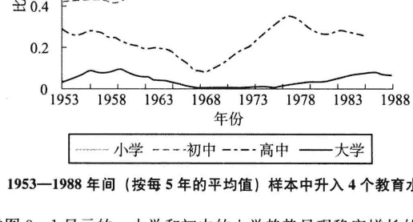

图3—1 1953—1988年（按5年的平均值）样本中升入4个教育水平的比例

就像图3—1显示的，小学和初中的趋势呈现出稳定增长的轨迹：这

> ①为了避免某一特定年份样本随机变动的影响，图3—1中的教育水平比例是5年的动态平均值。

# 国家与生活机遇

两个较低层次水平的入学率随时间而增长。在此相反，高中和大学的入学比例随呈现明显波动。高中入学率在“大跃进”紧密联系的经济收缩期和“文化革命”的最初几年（1962—1968）持续下降。大学层次的入学模式与之类似。而且，由于激烈的国家政策引发的教育系统的混乱（例如，“文革”期间大学关停若干），大学的入学比例在整个“文化革命”期间（1966—1976）比“大跃进”和“文化革命”后要低得多。①

我们用转换率这一术语来描述那些具备规格的人（如，那些从低教育水平的人）上升到高教育水平的比例。显然，不同教育水平的转换率在历史趋势中明显不同，存在着相互区别的模式。首先，对于城市农村的孩子，两个较低层次教育水平（小学和中学）的转换率遵循了一条逐渐接近的轨迹，而且在国家政策变化中也没有容易改变。其次，比世界上其他国家教育机会随演化扩张的整体相比，在中国城市，高中和大学的转换率有着急剧波动；更是地，有证据显示中国教育机会巨大的、非线性的变化，表明在不同历史时期，个人在青少年期和成年初期的教育机会有很大。转换率的波动也对MMI指数提出的持续不平衡导致了质性。

国家政策的构型教育分层中扮演了决定性作用，这直接产生或间接引起教育机会的巨大变化。作为一个范例，让我们看看不同时期高等教育机构的数量（见图3—2）。建国初期（1949—1955）由于于推动国家建设和经济发展的政策带来了教育机会的极大扩张。在这一时期，中国的基本目标就是通过国有化和集体化巩固集团、推动经济发展，直到“大跃进”（1958—1959）。作为“高增长”战略的一部分，政府极大扩张了各个水平的教育机构，以满足对受教育劳动力不断增长的需求，此导致了教育机会指数的扩张。例如，1957年，中国有229所规范大学，但是到1960年，增加到1280所，三年时间里增加了5倍（SSB 1999, p.75）。

> ① 20世纪50年代后期明显较高的大学入学比例的部分原因是，由于政府从高中毕业生之外录取一些大学生，包括已经工作的干部和职工。

# 第3章 教育分层

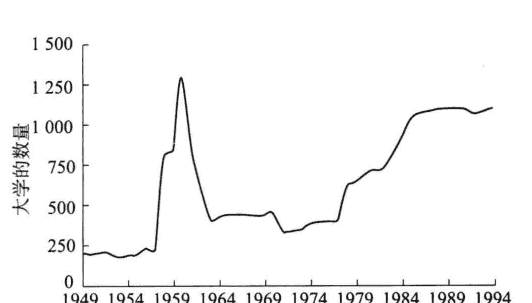

图3—2 1949—1994年高等教育机构的数量

“文化革命”期间（1966—1977）与“大跃进”时期的模式相反，在这一时期中许多高中和大学都关闭了。一部分初中、高中毕业生被下放到农村（见第5章）。结果，高中和大学的入学率在1968年间大幅下降。尽管这个时期大学的数量保持平稳（见图3—2），但实在在“文化革命”期间所有的大学都被关闭了。1972年，一些大学重新招生，只有少数经过筛选的学生得以。而且，在这一时期（1968—1977），大学生都是从劳动力当中选出的，高中大学的正常路径被阻断了。

不仅教育机会随着时间下降，筛选的标准也不不断变化。在早期，按照优先选择标准，有利于那些拥有经济和文化资源的家庭。相反，在“文化革命”期间，政治决定了教育，受益的是工农子女。

这些人们关注的状况变化提出了几个重要的问题：国家政策是以种方式影响不同社会群体的教育获得的？在不同的历史背景下，社会身份与教育获得之间的关系是怎样的？具体来说，地位较高的群体能保护其子女免遭政策的影响吗？如果地位高的群体能够保护子女，我们可以预期，阶级生活机会在不同时期的波动。

# 国家与生活机遇

我们绘制了两个群体的高中和大学入学率（见图3—3a和3—3b）：
1）父亲为干部或专业人员的群体（地位较高的群体）；
2）父亲是工人或农民的群体。

我们观察到几个特点：首先，基于社会出身的教育不平等贯穿了整个历史时期。在高中和大学层次，父亲为干部或专业人员的孩子接受教育的比例比是工人或农民的孩子要高。其次，不平等程度随着时间发生了变化。早期60年代中期以前的不平等程度很高，“文化革命”时期降低了很多，到了毛泽东时代（1977以后）又有所升高。有趣的是，尽管所有社会群体都受到国家政策的影响，但那些拥有高地位的社会地位波动最大。例如，在60年代，父亲在较高地位的人中，升入高中的超过30%，然而到了60年代中期，只有10%；阶层层次也出现了类似的变化。国家政策在每个历史时期的改变改变了各个群体的教育机会，同时也在每个群体内重新分配了教育机会。干部和专业人员子女急剧下降意味着，国家政策可能重新定义了特权群体的构成（例如，有利于工农阶级背景的家庭），由此导致了不同社会群体子女的生活机遇巨大变化。

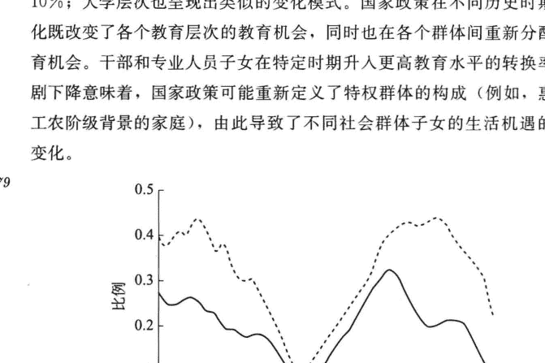

图3—3a 根据父亲职业分组（按5年的平均值）升入高中的比例


——父亲为工人/农民 —— 父亲为干部/专业人员

图3—3b 根据父亲职业分组（按5年的平均值）升入大学的比例

## 3.3 国家政策、社会出身与教育获得：进一步的分析

上一节，我们讨论并呈现了国家和政策在教育机会分配中发挥巨大作用的描述性证据。现在我们看一看教育获得的历史性过程。这一节的主要任务是检视国家政策在影响社会出身与教育获得之间联系的作用。遵循第2章提出的分析框架，我们在统计分析中引入不同的历史时期背景，以捕捉政策的变化在不同时间点的影响。在这里，我们关注于分析不同历史时期和不同的政策，社会出身与教育获得之间联系的变化。

为了达到目的，我们采用统计模型能够以更严格的方式检验数据，以提高分析的力度。引入统计分析有考虑：首先，一项教育分层研究（由Marie指出），学生在不同层次的教育获得可能反映了两个过程：一个是教育机会的扩张产生的边际变化；另一个是分配机制的变化，例如，社会出身与教育获得之间的关系。我们真实关注的是分配机制的问题。采用统计模型能够将其分为两种不同的过程。将其重点放在社会出身与教育获得之间的联系上，仍然需要考虑各种影响因素。例如，一个家庭的子女数可能会影响家庭资源分配，从而影响了子女的教育发展。所以，我们需要通过建立统计模型来控制其他的因素。下面，我们要概括一下研究设计的一些考虑，以便后面的统计结果的报告和讨论。

①我们对于教育获得的经验研究，关注点集中在升入不同水平的转换率（如初中、高中或大学），而不是各个教育水平的毕业率或退学率。这是因为，国家的教育政策主要在入境的限制或选择标准上进行拦截和甄别，因此分析入学率与我们的研究是一致的。而且在不同的历史时期，教育项目的长度因政策变化而不中断。许多学生由于政策的变化而推迟或提前毕业。因此评估背景和家庭出身对教育获得的影响，入学点更为确凿。按照惯例，父母的教育水平和职业地位是衡量社会出身的标准。在毛泽东时代，家庭出身当作政策选择的主要指标，所以在一些分析中，我们也使用“家庭出身”作为另一个身份测量。

为了描述不同时期政策的变化和巨大波动，特别以中国居民的实际经验为主划分了四个历史时期。在四个历史时期，教育机会和筛选标准均变化：

第一个时期（1949—1959）是建设和经济发展时期，伴随着教育机会的扩张和加速。如图3—1所示，这一时期教育发展在各个水平上都是增长的。

第二个时期（1960—1966）是紧跟早期经济灾难之后的经济衰退时期。在这一时期，经济发展被严重破坏，高中和大学层次的教育机会萎缩。随着政策的推进，干预在这一时间内有意识地消除社会群体的不平等。

第三个时期（1966—1976）是“文化革命”及其延续时期，期间教育机构遭到打断，许多适龄年的教育进程。在这个时期，在教育转换的分析中我们包含了涵盖者及其对应的数据。这样做是基于观察：大多数涵盖者在时期前已经完成了教育。在模型估计中，不同历史时期不同教育水平的转换力。

第四个时期（1978—1994）是后毛泽东时代。1977年恢复了高考，这标志着中国教育系统的开始；教育程度成为入学和向上流动的首要因素。在这个时期，技校、职业学院等类型的高等教育快速发展，以历史上未有的速度。

结束研究设计的讨论之前，我们要指出，关于历史时期的重点分析与之前同一时期分类的研究。在中国这样的社会环境中，同期研究有时会导致误导教育机会的确定。我们之前看到，许多教育机会（特别是）在“文化革命”期间被关闭了，这一时期初、高中生在时期结束被推迟了继续学习的机会。鉴于此，我们在研究设计上将个人教育转换的统计基于历史时期，我们将教育获得的模式与政策直接联系起来。

因此，我们在构建聚焦（那些有资格进入更高教育的人），将升教育的中断（初、高中）的学习年限因素考虑进来。具体来说，我们在聚焦中包含了所有低级教育水平的毕业生，他们成为当前和未来接受教育的候选人。在这一基础上，我们检验在某一时期升入相同教育水平的可能性。例如，那些“文化革命”期间毕业的人他们处于“文化革命”或之后升大学。

对于上述风险构建的规则，大学事件的做法是一个例外。我们把样本中1966—1968年初的高中毕业生也放在“文化革命”后升大学的风险之中。这个做法是基于我们对历史背景的理解。尽管该群体在“文化革命”期间被剥夺了机会，他们中的很多人直接参加了高考，因此他们应该是聚焦成员。（更多研究设计信息参见 Zhou, Moen, and Tuma 1998。）

### 3.3.1 概述：社会出身作用

让我们从这个基本问题开始；在中国城市中，父亲教育水平和职业地位（或家庭阶级背景）对于其子女在各个教育水平的入学机会

## 国家与生活机遇有用吗？

回答这个问题的一种方式是另一种调试法：如果社会出身与教育获得之间在样本中没有联系，那么我们在样本中应该观察到什么样的状况？如果我们从这个暂时性的“假设”开始，就能用常规的统计检验（技术上，即基于估计模型的类似检验）来观测数据并详细检验这一个假设。如果社会出身与教育获得之间没有联系，那么社会出身变量对教育水平的影响就没有统计显著性。我们对中、高中和大学层次的转换率进行了这种常规检验。主要结果如下：对三个转换而言，由父亲教育、父亲职业或家庭阶级背景测量的社会身份对三个教育水平的转换率都有显著影响。模型和居住地显著影响个人获得这水平上的教育机会（见表3—1）

# 表 3—1 升入初中 升入高中 升入大学 χ²统计量 自由度 χ²统计量 自由度 χ²统计量 自由度

| | χ²统计量 | 自由度 | χ²统计量 | 自由度 | χ²统计量 | 自由度 |
| :--- | :--- | :--- | :--- | :--- | :--- | :--- |
| (1): 截断，持续时间，兄弟数量 | (2)+女性 | 124.1** | 4 | 31.6** | 4 | 51.7** | 4 |
| (3): (2)+父亲教育水平 | 353.3** | 16 | 289.2** | 16 | 193.5** | 16 |
| (4a): (3)+父亲职业 | 160.3** | 26 | 71.0** | 26 | 72.5** | 26 |
| (4b): (3)+家庭级背景 | 87.3** | 16 | 120.0** | 16 | 101.3** | 16 |
| (5): (4a)+居住地 | 255.0** | 16 | 137.7** | 16 | 135.8** | 16 |

** p < 0.01
* p < 0.05

如表3—1技术细节，我们包含了总体均值、从较低层次水平毕业后的持续时间和兄弟数量。模型(2)增加了性别。模型(3)包含了教育水平。模型(4a)和(4b)分别采用了职业地位或阶级背景。因为父亲职业和阶级背景在很大程度上重叠，所以没有在同一模型加入两个变量。最后，模型（5）增加了居住地。所有这些变量都显著改善了模型的拟合。然而，注意的是，家庭层背景对升高中模型的改善程度大于职业变量。加入家庭层背景后，高中和大学模型的χ²分别达到了120.0和101.3，自由度为16。这一模型启示，升入高中更依赖于家庭背景而非职业地位。

我们得到的一结论是，在升初、高中和大学这三个水平，社会出身（由教育水平、父亲职业或家庭层背景）与获得的回报之间存在显著关联。尽管如此第一步确认了社会出身在获得中的作用，但并没有提供有关影响的具体信息，也没有检验这些影响经历历史时期的变化。为了回答这些问题，我们需要通过统计数据细分获得模型。

### 3.3.2 性别与社会地位在不同时期对转换效率的影响

为了把社会出身对转换效率的具体影响以及其他因素，我们采用了离散数据的logistic回归模型来估计变量的影响。在这些分析中，结果假定某人已完成之前的教育升了某一特定的水平。表3—2报告了统计结果。我们将这些分析放入历史背景来考虑，例如，在2世纪80年以前，对于大多数城市青年，大学的机会很少，高中可能是他们获得的最高水平。

我们用更直观的图来来说结论。为了更好地理解呈现的图形和统计模型，让我们从一些基本信息开始。我们用logit测量转换率，即参照群体来说，某个群体经历的转换水平的对数发生。例如，在升入大学的转换率中，与“女性”变量给出了女性对男性（参照群体）经历升入事件的对数。

> ① 因为父亲为干部或专业人员的比例在早期年份中很小，在第一个历史时期（1949—1959），我们将低级和高级人员合成一个特殊类别，合并为一个人员类别。

生比（发生对数的对）。在时间变化的背景下（如同这里的案例），我们经常把对数发生解释成对数转换率。因此，logit的重要性在于对数转化形式对于特定群体某一教育水平的转换率给出了直观的解释。现在我们可以仔细一看3—2呈现的结果。

# 表 3—2 不同时期升升某一教育水平的概率 logistic回归模型的估计

| 历史时期 | 1949—1959 | 1960—1965 | 1966—1977 | 1978—1994 |
|---|---|---|---|---|
| 升入初中 | | | | |
| 女性 | -0.873* | -0.628* | -0.376* | -0.069 |
| 自上一次毕业的年 | -1.387* | -2.519* | -2.379* | -0.997* |
| 父亲教育水平 | | | | |
| 小学 | 0.390* | 0.768* | 0.266* | 0.287 |
| 初中 | 0.511* | 1.179* | 0.722* | 0.635* |
| 高中 | 1.319* | 2.216* | 0.445* | 1.561* |
| 缺失 | | | | |
| 父亲职业 | | | | |
| 高级干部 | 0.639a | -0.014 | 0.395* | 0.170 |
| 低级干部 | | 0.024 | |
| 高级专业人员 | 1.392a | -0.575 | 0.317 | 2.699* |
| 低级专业人员 | | -0.125 | | |
| 农民 | -0.092 | -0.627* | -0.326* | -0.668* |
| 其他 | 0.494* | -0.239 | | |
| 缺失 | -0.051 | -0.297 | -0.404* | |
| 居住地 | | | | |
| 中等城市 | -0.794* | -0.883* | -1.132* | -0.427* |
| 小城镇 | -0.510* | -0.839* | -1.382* | -0.626* |
| 农村 | -0.682* | -0.733* | -1.453* | 0.399* |
| 缺失 | 0.516* | 0.956* | -0.833* | |
| 兄弟姐妹数量 | 0.006 | -0.044 | -0.082* | -0.084* |
| 观测 | 0.749* | 1.678* | 2.975 | 2.107 |


# 第3章 教育分层

续前表

| 协变量 | 1949—1959 | 1960—1965 | 1966—1977 | 1978—1994 |
| :--- | :--- | :--- | :--- | :--- |
| 高中 | 0.716** | 1.182** | 0.432** | 1.053** |
| 缺失值 | —0.181 | 0.613* | 0.371* | 0.530** |
| 父亲职业地位 | | | | |
| 高级干部 | 0.728***a | 0.350 | 0.571** | 0.876** |
| 低级干部 | | 0.177 | 0.198 | 0.402** |
| 高级专业人员 | —0.417* | 0.850 | 0.115 | 0.520** |
| 低级专业人员 | | 0.400 | 0.064 | 0.404** |
| 农民 | 0.073 | 0.180 | 0.172 | 0.180 |
| 其他 | 0.025 | 0.305 | —0.078 | 0.225** |
| 缺失值 | 0.341 | 0.048 | 0.156 | 0.395** |
| 居住地 | | | | |
| 中等城市 | —0.329 | —0.220 | 0.051 | 0.452** |
| 小城镇 | —0.078 | —0.207 | 0.138 | —0.493** |
| 农村 | —0.974** | —1.087** | —0.209 | —0.437** |
| 缺失值 | 0.200 | 0.074 | —0.296* | 0.016 |
| 兄弟姐妹数量 | —0.059+ | —0.029 | —0.105* | —0.085** |
| 截留 | —0.040 | —0.517* | —0.648** | —0.642** |
| 入人大学 | | | | |
| 女性 | —0.994** | —0.398+ | 0.709** | —0.408** |
| 自上一次毕业的年 | —0.858** | —0.769** | —0.114** | —0.109** |
| 教育水平 | | | | |
| 小学 | 0.508 | 0.605+ | —0.120 | 0.226 |
| 初中 | 0.170 | 0.874* | 0.154 | 0.665** |
| 高中 | 0.728 | 1.354** | —0.226 | 1.010** |
| 缺失值 | 0.382 | 0.620 | 0.171 | 0.566** |
| 父亲职业地位 | | | | |
| 高级干部 | 0.615* | 0.658 | 1.012* | 0.790** |
| 低级干部 | | —0.332 | 0.271 | 0.555** |
| 高级专业人员 | 0.509* | —0.041 | 1.052+ | 0.928** |
| 低级专业人员 | | 0.298 | 0.767+ | 0.617** |
| 农民 | 0.120 | 0.634+ | 0.588 | 0.973** |
| 其他 | —0.218 | 0.339 | —0.048 | 0.240 |
| 缺失值 | —0.154 | 0.364 | 0.455 | 0.539** |

## 国家与生活轨迹

综前表

| 协变量 | 1949—1959 | 1960—1965 | 1966—1977 | 1978—1994 |
| :--- | :--- | :--- | :--- | :--- |
| 小城镇 | -0.721* | -0.069 | -0.836* | -0.022 |
| 农村 | -1.970** | -0.546 | -1.105** | -1.173** |
| 缺失值 | 1.099** | 0.731** | 0.003 | 0.140 |
| 初毕业 | -2.327** | -3.018** | -0.754** | -1.224** |
| 兄弟姐妹数量 | 0.097* | -0.010 | 0.071 | -0.053* |
| 截留 | -1.455** | -2.482** | 4.686*** | -3.784*** |

** p<01
* p<05
** p<10
由于早期时期专业人员类别中样本较少，我们将高级干部和低级人员进行了合并。
注：以父亲教育水平为参照类，父亲职业地位为参照类，城市居住地为参照类。

我们关注的课题是社会出身与教育获得的关系，以及这一关系如何随不同时期国家政策的变化。在考虑社会出身之前，先来看一个普遍的事实——性别不平等。通过统计方法，性别不平等的作用是有实质意义的。以往的研究发现，在苏联和东欧社会主义国家，妇女的教育获得明显改善（Gerber and Hot 1995; Szelényi 1998）。同样在中国，女孩初中的入学随时间明显提高（Hannum and Xie 1994; Xiao, Li and Freeman 1990）。但是也有一些关于性别平等的发现与上述研究一致（Whyte 1984; Wolf 1985）。如果我们强调国家政策的影响，那么可以预期性别不平等也会随时期的变化的变化。

让我们从一个与工业化使命相合的“理想”情景开始。假设我们观察到一个状态：工业化的推进逐渐扩张教育范围，进而缩小性别鸿沟。如果如此，我们就会观测到不同教育水平的转换率（以对数形式表示）将提升，并且性别影响趋于（例如，没有性别差异）。而且我们也可以预期在不同教育水平上有同样的变化，较低教育水平上的性别差异将以更快的速度缩小。

我们基于表3-2性别系数绘制了图34。如图所示，不同阶段性别平等的模式呈现出一个更为复杂的情况。四个时期如：1949—1959、1960—1965、1966—1977和1978—1994。我们观察到几个有趣的模式：首先，女性入初中的转换率遵循了一个类似理想情况的轨迹，女性转换率在四个时期平稳上升并接近零点，即性别之间没有差异的状态。这个模式表明，较低教育水平的教育获得遵循了工业化假设提出的轨迹。也就是说，教育转换率的加速源于教育机会的扩张，而非教育分层机制的变化。


图3—4 根据时期和性别的转换率

相反，入高中和大学的转换率性别差异存在截然不同的模式。在第一个时期，高中和大学层次都存在初始性别差异，在这个时期性别差异都有降低；以初始差异为准，大学层的性别差异比高中低。然而到了第三个时期（文化革命），高中层次性别差异达到最小值，而在大学层次达到了最大值。第四个时期（改革开放时期），高中转换率的性别差异又出现了，而大学转换率的性别差异反倒下降了。

为了解释不同时期转换率的形态变化，我们需要了解相关的历史背景和时期国家政策的变化。回顾历史，第一个时期见证了国家建设过程中教育机会的巨大扩张。而第二个时期处于经济衰退中，导致教育机会在这段时间内急剧减少（历史趋势见3—1），奇怪的是，性别差异（特别在大中层级以上）也在减小。这一事实与MMI命题并不一致，MMI预测教育机会减少会增大有利于男性的性别差异。一个可能的解释是此时的国家政策坚持男女平等，对于提升女性地位起到了关键作用。这个时期还实行过“红女专”的政策（Yao 1984）。一方面，高增长政策的失败使得择优录取和正规课程更加得到重视；另一方面，毛泽东不断地呼唤教育制度的改革，这种性别差异的提升是对国家教育进程的强烈干预。

“文化大革命”时期（第三时期）显示出强烈的反差。一方面，由于阶层政策化，高中层的性别平等并没有实质性的降低；另一方面，这种平等是以所有女性的教育机会被普遍剥夺为代价的（见图3—1）。在这一时期，大学入学机会匮乏，选择教育更具男性色彩。即使在“文化大革命”时期平等被宣布为国家政策，它也没有得到前后一致的执行。在第四时期，性别差异在高中层以上重新出现，回到了“文化大革命”前的模式。教育机会的扩展和国家政策在不同时期的影响，初中和大学的增长主要是前一个时期引起的。

现在我们回到最初的分析：社会出身与转换率的关系是如何随时间变化的？我们从不同时期的分析中发现：父亲教育水平对子女获得的影响。在中国，在毛泽东时代，国家对知识分子极不信任，因此文凭的价值多变。我们预期教育获得与其父亲教育水平并不是正相关。图35显示了不同时期父亲教育水平的子女入学机会。除了第三个时期外，父亲教育水平普遍较低的子女转换率反而高。然而，这段时期仍有一些现象是工业化议题和MMI命题无法解释的。


图3—5 根据时期和父亲教育水平的高中转换率

# 第3章 教育分层

---

例如，在毛泽东时代（前三个时期），基于父亲教育水平的性别不平等在第二时期最大。时期时期机会急剧减少，政府采取了政治素质和阶级背景为标准，重视考试成绩。

### 3.3.3 家庭背景的影响

在以上的统计分析中，作为社会出身指标的父亲职业在不同时期作用似乎并不大，所以在这里不再讨论它的影响。相反，用父母的另一个指标——家庭阶级却有着显著的变化。在毛泽东时代，国家政策将家庭阶级背景作为政治选择的明确标准。家庭阶级的判定依据个人的父亲或祖先在1949年中国成立后所属的阶级类别，这类类别是由官方规定的。由于阶级背景一旦确定就无法更改，不像父亲的职业类型那样可以随时间变化（例如，从专业人员变成干部）。那么，阶级背景这个政治标签与教育获得之间是否有联系？如果有，这种关系随时间变化了吗？

我们估计了家庭背景对升三个教育水平转换率的影响（表3—3）。由于阶级背景与父亲的职业和教育水平的影响权重权重，我们在模型中已经纳入了“阶级背景”变量，加入了控制省份以及城市规模的控制变量。

图3—6a和图3—6b显示了在两个时期中考虑的关系。图3—6a表的是各种家庭阶级背景中的转换率，“工人/农民”为参照类别。这里筛选机制在每个不同时期有明显变化。在前两个时期，干部和技术人员、“剥削阶级”背景的子女有着类似的优势；相反，工人/农民背景（参照类）的子女处于劣势。在第二个时期这一趋势日益明显，对工人/农民子女的所有三个群体都被证明拥有更高的转换率，其中干部子女在这一时期获益最大。但在“文化大革命”期间，政治选择越来越严格，导致中产阶级和“剥削阶级”背景的子女转换率急剧下降，而干部子女在这一教育机会缩减的时期仍然能够保持自身的优势。换言，工人/农民子女在这个时候收益最大。在改革开放时期，干部背景的子女重新获得了优势，而其他群体的子女并没有显著差异。

表3—3 不同历史时期阶级背景对升三个教育水平概率的估计

| 历史时期 | 1949—1960 | 1960—1965 | 1966—1977 | 1978—1994 |
| :--- | :--- | :--- | :--- | :--- |
| 变量阶级背景 | | | | |
| 干部 | 1.895* | 2.490* | 1.920* | 2.394* |
| 中间阶级 | 0.710* | 0.320* | -0.244* | -0.282* |
| “剥削阶级” | 0.748* | -0.394* | -0.888* | -0.926* |
| 升高中阶级背景 | | | | |
| 干部 | 0.597* | 1.425* | 0.932* | 1.322* |
| 中间阶级 | 0.513* | 0.758* | -0.314* | 0.026 |
| “剥削阶级” | 0.550* | 0.704* | -0.986* | -0.073 |
| 升大学阶级背景 | | | | |
| 干部 | 0.941* | 0.627* | 0.034* | 1.598* |
| 中间阶级 | 0.618* | 0.577* | 0.008 | 0.662* |
| “剥削阶级” | 0.820* | 0.119 | -1.075 | 0.376 |

* p<01
* p<05
注：工人/农民为阶级背景参照类；中间阶级包括小业主、知识分子，“剥削阶级”包括资本家、地主、右派。估计因素时控制了省份和城市规模。大学转换显示了更戏剧性的模式（见图3—6）。


图3—6a 根据时期和阶级标签的高中转换率


图3—6b 根据时期和阶级标签的大学转换率

这些结果清楚地显示出不同历史时期教育分层标准的改变。这些随时间变化的发现意味着社会文化资本（由父亲教育水平代表的）对教育获得的作用对政策的变化十分敏感。

3.4 本章总结

在英文文献中，大量关于工业化社会教育获得的研究阐释了了持续的不平等（参见 Hallinan 1988）。梅尔（Mare 1981）通过区域边界变化的影响，发现对于在美国出生到20世纪上半叶的群体中，社会出身与教育发展之间的联系日益明显。谢维特和布洛斯费德（Shavit and Blossfield 1993）揭示了在各种制度下持续的教育不平等（同样可见 Treiman 和 Yip 1989）。

在以上研究背景下，本章报告了不同的中国经验，展示了社会与教育获得之间关系的新机制。我们考虑了三种理论来指导中国教育分层的解释：第一个是工业化命题，假设教育机会将逐渐对所有群体开放；第二个是MMI命题，它预言阶层精英可以维持平等；第三种重点强调政策的作用，能够超越跨境边界并在同时形成非单一化的趋势。

前面的论述证明了教育有两种方式：对于较低水平的学生和初中人，我们观察到教育机会的逐渐使得社会出身不再重要；另一方面，对于教育机会匮乏的高中和大学，选择过程呈现出明显的非线性趋势。显然，在中华人民共和国的历史上，无论教育机会还是社会出身与教育获得的关系，二者在不同历史时期都有显著的变化，这表明政策在机会改变和升学分层中都有积极的作用。

我们在分层动态过程的讨论中提到的另一个问题是官僚阶层在子女优先争取教育机会的作用。苏联与俄罗斯的比较研究已经指出如何利用社会政策改变不同群体的教育机会，特别是他们如何为子女提供更好的教育。我们在中国城市的发现，从家庭阶层调查的社会出身与教育升学之间显而易见，但它引起了政策的变化。一方面，对于其他社会群体，中国的官僚阶级在子女入学上具有优势，中间阶级或“剥削阶级”家庭背景的人容易受到歧视性政策的伤害。另一方面，官僚的特殊有时会受到政策的限制。“文化大革命”期间，尽管父亲的高干部对于子女入学大学会有显著的正向作用，但阶层间的教育却十分破碎，以至于大学的总体机会对各个阶层来说都很小。“在文化大革命”中，风险集中在只有3%的人能上大学。在这个收缩时期，所有的社会群体都受到政策的影响，优势群体（高干群体）遭受了更大程度的损失。


# 第 4 章
劳动就业：第一个工作的获得模式

在第3章中，我们分析了中国的城市中，国家政策对教育经历模式的影响。当城里的年轻人结束了他们的教育生涯时（无论是延迟、提前毕业，还是中断学业或者以其他方式结束学业），他们都将面临生命历程中下一个重要阶段：劳动就业。这是一个关键阶段，因为直到20世纪90年代，在中国城市中工作组织的工作流动仍然是很低的（见第9章）。对于多数雇员而言，他们最初的工作场所意义意味着他们毕业后第一次的工作往往是归宿。而且，即使有工作流动，它对于前面的工作位置也可能具有路径依赖。例如，从一个国家企业转到另一个国家企业比从一个非国家企业转到国家企业要容易得多。正如我们在第2章中讨论的，不同类型的工作组织有着明显不同的经济利益、福利项目、职业选择预期。因此，首个工作的劳动就业通常会对一个人生命历程的后续事件产生影响，而且第一个工作的获得模式能够解释生活机遇分配中的分层过程。

本章的核心是第一个工作的获得模式——一个人进

# 国家与生活机遇

第一部分讨论了一般分析策略，我们将以及这些过程中潜在的分配机制。依照之前所述的一般分析策略，我们将分析工作机会、社会身份和首个获得之间关系在不同历史时期的变化，以及这些变化如何受到国家政策波动的影响。我们在分析实证模式之前，有必要先要考察一下中国场景的“工作”概念及其比较分析。

### 9.4 比较视下的“工作”概念

在《制度如何思考》（How Institutions Think）一书中，道格·拉斯（Douglas 1986, p.69）评论道：“制度制造出一个阴影地带，在其中什么东西看不见，而且提不出任何问题。同时，制度使得其他区域显得清楚可辨的细节，这些细节被精心关注和有安排。”一个制度注意力的分布有助于我们理解制度的运作方式。社会科学研究已经记录了经济活动关于人口和身份的分析、讨论和斗争，例如美国普普（Alonso and Starr 1987; Anderson 1988），工业统计（Stone 1973）以及职业和组织统计（Baron and Biele 1986; Strang and Baron 1990）。

《中国统计年鉴》是国家统计局（SSB）出版的有关统计数据的官方出版物，可以在其中看到有各种劳动力的统计。如果有人考察劳动力和经济活动的官方统计数据，就会惊奇发现几乎没有关于各类职业类别的分布。例如，在《中国统计年鉴（1995）》（SSB 1995），没有按职业群体（如管理人员、专业人员、机器操控人员等）的劳动力分类。相反，该年鉴中包含中间领域或行业（如工业、运输、邮信等）、与国家的所有关系决定的组织类型（如国有部门、部门或其他非部门）以及管理主体（例如，省管、直市等）的详细劳动力分布情况。中国的人口普查也使用定义的职业类别。这与行业劳动力市场的职业分类形成鲜明对比。

这种经济资料的编制模式提示了我们中国“视”和“审视”劳动力的方式。这些官方分类突出了官方的视角，国家如何组织和实施经济活动，以及中央政府制定有关劳动力的经济政策的方式。简而言之，经济部门和各类工作组织在中国计划经济中占据重要地位，而职业扮演了不太重要的角色。

# 第4章 劳动就业：首个获得的模式

这一分类的背后逻辑并不难理解。在计划经济中，中央政府组织生产，以经济部门和工作组织作为非职业类别为基础的来源。从中央计划者的角度来看，前者的信息比后者更相关。

那么，这种官方结构影响着人们寻找工作的行为，并影响着社会分层制度的结构，这一判断是符合逻辑的。由于这种官方的组织和职业结构与跨经济部门和工作组织之间的资源流动密切，它还创造出一种工作和工作场所的层级结构，根据经济利益或政治地位选择相应的社会行为来追踪这些角色和社会地位。为了分析和了解城市市场中的获得模式，首先需要在这种特定的背景下工作的意义意味着共享，以及官方结构如何影响工作组织的社会分层结构中员工与位置之间的匹配过程。让我们从职业地位这个大家更熟悉的领域开始。

## 4.1.1 职业地位

在工业化市场中，“工作”这个概念通常指个人的职业，而职业与社会地位、经济利益以及不同的流动模式密切相关。在分层结构中，个人从事的职业类型是社会经济地位最重要的指标。社会生活的理想模型在很大程度上是在这种背景下开展起来的。对工作角色的解释关注劳动力市场的供给方。如人力资本理论（Becker 1964）将技能视为和其他形式的资本通过市场过程进行分配，从而实现其可能的最高价值。从正规教育和职业训练中获得的技能是最重要的人力因素，它引导人们进入不同的职业生涯，进而决定个人的经济收入和社会地位。在这一视角下，工作重要性涉及到对价值的人力资源进行回报的市场交易。个人所从事（工作类型）被视为职业地位，进而成为个人在社会分层结构中的最终决定因素。

在很长一段时间里，这种视角影响了市场中社会分层结构的研究。考虑下一层文献中虽有影响的获得模型（Blau and Duncan 1967）。模型的基本结构——父亲的教育水平和职业地位对子代的教育水平和后期职业地位的影响——关注的是家庭的资源与市场技能相关的特性。在这个模型中，社会经济地位是以教育和职业水平衡量的，无论在实践中，两个因素都与个人的职业地位密切。有关代际流动的整个文献都以职业类别的各种分类概念化，以此作为社会群体的一种测量（Erikson and Goldthorpe 1992; Featherman and Hauser 1978）。总之，工作很大程度上是由职业定义的，而在工业化市场中，劳动力也是在这个维度上分离的（e.g., Althauser 1989）。

最近，这两个原因使得职业类别在中国城市中的劳动就业里重要：首先，国家政策决定的职业群体定义十分宽泛（如工人、干部和专业人员）；结果是特定职业之间的差异影响市场社会。其次，在同一个工作场所内，相同职业之间的壁垒较低，与市场社会相比职业转换要容易一些（例如从干部转换为专业人员），而在市场社会中由组织利益形成的职业壁垒则是。由于这些原因，研究使用的职业类别是宽泛而非固定的，具有意义。

但是，并不是意味着在中国背景下这种定义的职业（工人、干部和专业人员）仍然是某种方式与国家政策的联系。大多数工人是政策的主要参与者，他们控制着资源的配置，而专业人员则是生产中的重要力量。虽然国家的政策在不同的经济社会中有所不同，但在一定程度上它也是根据宽泛的职业类别划分的。例如，政府干部和专业人员层级特别考虑到了工作类型（职业）和职业生活的差异（Walder 1992）。更为重要的是，国家政策和政治过程在使用职业类别来区分不同的社会群体。例如，在毛泽东时代，人口阶级首先被称为“领导阶级”；结果，国家政策在教育获得和工作机会方面给予这些群体的多。相反，那些处于“白领”职业的人——在教育和文化部门的成员——经常成为政治治理的对象。

### 4.1.2 工作组织的层级

自2世纪80年代起，在工业化社会劳动力市场越来越认识到工作组织在社会分层过程中的重要性。这些研究显示，工作机会和经济利益的分配在核心和边缘领域的企业中，在初级和次级劳动力市场中有序地表现（Althauser and Kalleberg 1981; Donner and Piore 1971; Hodson and Kaufman 1992）。正式组织在社会分层过程中也扮演着重要的角色（Baron 1984; Rosenbaum 1984; Sørensen 1994; Kalleberg 1981）。

由此看来，我们的生活模型如果忽略了工作组织的作用，将会造成严重的误认或漏掉分层的重要机制。在中华人民共和国的历史上，工作组织的作用不仅是史无前例的，而且是其他社会无法比拟的。部分对于组织在资源配置中的重要性由于中国经济转型对跨组织工作的限制。在第1章中我们总结了所有组织层级的理论讨论，在第2章中我们概述了中国城市中的组织类型。简而言之，在中国，工作组织根据它与国家的所有关系而形成层级结构（Bian 1994; Lin and Bin 1991; Walther 1992; Zhou, Tu, and Moon 1997）。国家社会主义的主要特征就是大部分的经济收益是通过工作组织而不是市场实现的。那些接近再分配权力的组织（政府机关、企业）容易获取资源，拥有较高的地位并提供优好的经济利益。相反，集体企业特别是私企业被排除在中央计划体系之外，因此没有再分配利益。在各类工作组织中的位置是一个个人社会经济的重要指标，进入组织层级的模式反映了重要的社会分层机制。

场所和职业的双重结构和它的相对重要性与城市青年的经历是一致的。在毛泽东时代，初中或大学毕业其居住地的政府（通常是县或市政府）为其分配劳动力。大多数未来的职业候选人被分配到不同类型的工作组织中，在广义的“工人”下并没有特定的工作（职业）。工作组织的主管部门后再决定新员工的特定工作和职业生涯，使得基层部门在个人生活中变得愈重要。主要的例子是大学毕业生群体。根据他们的人事政策，大学毕业生无论被分配到哪种工作组织中，将作为干部或专业人员（这两种工作被广泛地称为“国家干部”）进入组织人事制度。

最后，我们强调的国家社会主义条件下社会分层的政治优势也将将个人分配到不同类型工作（职业和各类工作组织）的国家政策随着时间系统性变化。各类工作组织和职业所有的层级是由国家构建的，国家指导将资源和生活机会在不同工作之间的分配，结果使得工作的含义和地位对于这些国家政策的变化往往足够敏感。国家政策会直接将个人分配到各类不同的工作组织或职业，而国家政策的变化是否能够衔接跨经济部门之间的资源转移，也可能在不同的组织和职业形成不同的机会。例如，在毛泽东时代，经济发展强调工业优先，使得资源高比例流向企业。在此类工作组织中的成员享受更好的福利项目和其他福利。相反，在毛泽东时代，忽视了那些服务领域大量的集体企业的员工有着显著的福利。

## 4.2 劳动就业模式的描述

为了描述历史性第一个工作获得的整体模式，我们首先报告不同时期不同职业和工作组织的风险。风险测量了那些处于重心的人（例如那些最高教育水平的人）每年在特定类型工作的比例。这些模式提供了中国劳动力发展的状况，同时也反映了社会经济的历史变化。如前所述，直到2世纪90年代，中国城市中大部分工作是由政府机构分配的。因此，获得模式与国家政策的历史变化紧密相关。

### 4.2.1 进入初职

图4-1显示了1949年至1992年进入初职的风险。由于其案件的数量少，通过工程建模4-1的曲线波动反映了风险固有的敏感性。这些变化也可能源自抽样的不同时间点；但它们反映出国家政策对人们生活机会的重大影响。首先考虑进入职业的风险的历史变化。20世纪后期，风险急剧下降反映了国有化和一体化的历史时期，许多部门变为国有企业。与此同时，政府也引用了大量农村劳动力城市劳动力。20世纪初期，随之来的下降标志着一个经济收缩时期，其期间600万居民迁移到农村，反而减少了城市劳动力。

![img/c2c2c87842a7b29a7dd73dc64f79ac_19_0.png]
图4—1 1949—1992年进入初职的风险

1979年间的低风险及其波动趋势反映了“文化革命”的影响，这一时期的大量毕业生被送到农村地区（见图4-2b）。20世纪70年代后期，风险的增长主要源于下乡知青的返城以及吸收了大量的城市待业青年。20世纪80年代后期风险下降显示了一个更灵活的劳动力构成，干部和专业人员的变化趋势是相似的，反映了这样一个事实：中国制度对这两种职业的管理是类似的。在毛泽东时代，进入这两种职业的风险相对较低且比较稳定，但在改革时期趋势开始增长。20世纪80年代中期，专业人员的风险大幅增长，这反映了高等教育的扩展以及城市劳动力构成的演变。

### 4.2.2 进入工作组织

我们注意到进入各类工作组织的过程有着更为显著和系统的波动。如前所述，这是因为进入工作组织对国家政策和政治进程更加敏感。图4-2a显示了首次进入集体部门的不同工作组织的风险。从图中可以看出大部分劳动力都受雇于国有企业。正如我们看到的，进入国有企业的风险与工人的风险（见表4-1）相似，因为大多数人都受雇于国有企业。而且，图4-2a清楚地显示出这四类工作组织随时间波动的轨迹彼此相随，这暗示它们都面临和应对着相似的宏观环境变化。总的来说，有两种城市劳动力的浪潮。第一次出现在20世纪50年代的后半期，当时国有化、集体化和高增长趋向的工业化同时。第二次浪潮出现在20世纪80年代，当时国有部门扩张吸收了城市失业人员和“文化革命”后一段时间内的返城青年。进入政府机构和公共组织的风险显然是相似的，自20世纪80年代都有明显的增长。尤其是20世纪80年代，进入集体企业的风险表明体制部门在城市劳动力中占据了重要地位。

![img/c2c2c87842a7b29a7dd73dc64f79ac_120_0.png]
图2-4a 1942—1999进入第一个工作组织的风险率（国有或集体部门）

图2-4b显示了进入混合所有企业和农村的风险。在20世纪60年代以前，进入农村劳动力队伍的风险率较低。大多数情况下，这反映了我们样本中的很小一部分，他们生在农村并在农村开始工作，后来又转为了城市劳动力（通过大学教育、工作机会或城市化）。但风险率也反映了国家政策的影响：在20年代初，风险率突然增长，显示国家政策通过部分城市回到农村。农民的风险在1968年达到顶峰，这是第一次实施“上山下乡”政策，共有700万城市去了农村。20世纪70年代末，风险急剧下降，此时放弃了“上山下乡”政策。在毛泽东时代，进入混合企业的风险率是低的。自2世纪80年代，进入混合企业的风险率明显增加，这与改革时期私人部门的扩张一致。

![img/c2c2c87842a7b29a7dd73dc64f79ac_121.png]
图 4-2 1949—1992年进入第一个工作的风险率（混合所有企业或农村）

风险率的变化了显著波动，但它并没有反映工业化而逐渐扩张，而是与各时期国家政策的变化相同。

## 4.3 进入第一个工作的解释

在给定不同职业和各类工作组织的前提下，自然的问题是：什么决定了最终获得第一个工作？我们的中心引起国家政策与个人生活的关系。为了探讨这种关系，我们采用了与上一章相似的策略。我们要分析身份与最终获得之间的关系，以及这种关系是如何随着政策变化变化的。我们在分析中增加具体类别分析。第一步将不考虑历史的总体模式，建立基准；下一步分析特定时期的模型。为了说明这个问题，我们对身份和第一个工作位置之间的相关性进行了统计分析。这里理论上感兴趣的变量（如社会出身）在各时期是相同的。我们在模型中包含了三个时期的截（见表4-1），从而为比较和评估特定时期中国政策变化的影响提供了基础。为了进行统计分析，我们采用了与第3章教育分析相似的离散事件模型logistic，该模型可以考虑风险构成以及随时间变化的变量。与教育分析类似，我们使用父亲教育水平和父亲职业地位来测量社会出身。除此之外，模型还包括性别、年龄和居住地等控制变量。

表 4—1 教育 logistic模型的参数估计（参照类别：工人）

| 截 | 教育 logistic | 干部 | 专业人员 | 农民 |
| :--- | :--- | :--- | :--- |
| 1949—1965 | -4.158** | -4.490** | 1.748** |
| 1966—1979 | -5.069** | -5.468** | 2.881** |
| 1980—1994 | -5.153** | -5.842** | 0.085 |
| 年龄 | 0.045* | 0.053* | -0.242** |
| 女性 | -0.236** | 0.310** | 0.372 |
| 教育水平 | | | | |
| 初中 | 0.761** | 1.182** | 0.249** |
| 高中 | 1.592** | 2.848** | 0.425** |
| 大学 | 3.924** | 5.514** | 1.205** |
| 父亲的教育水平 | | | | |
| 初中 | 0.455** | 0.153 | -0.165 |
| 高中 | 0.657** | 0.262 | 0.009 |
| 大学 | 0.471* | 0.549** | 0.352 |
| 父亲的职业地位 | | | | |
| 高级干部 | 0.557** | 0.391 | 0.222 |
| 低级干部 | 0.431* | 0.401* | -0.191 |
| 高级专业人员 | -0.189 | 0.657** | 0.371 |
| 低级专业人员 | 0.129 | 1.143** | 0.351* |
| 农民 | 0.612** | 0.899** | 1.267** |
| χ² | 3338.2 | 3276.6 | 2657.5 |
| 自由度 | 27 | 27 | 27 |
| 事件数目 | 533 | 1 | 995 |

** p<0.01
* p<0.05
+ p<0.10
注：小学教育水平或没受教育是被访者和父亲教育水平的参照类别，工人是父亲职业地位的参照类别。所有模型都包含了缺失父亲和教育信息的案的指示变量。


# 第4章 劳动就业：首个工作的获得模式

表4—1 报告了进入初职的总体模式 logistic 模型的参数估计。这里分析的参照类别是“工人”——城市青年的主要类别。对于进入工人这个参照类别的可能性，为了方便解释，我们将职业类别设置为层级顺序，即从干部、专业人员、工人到农民排序。因此，对于这些进入工人职业的大部分人而言，流向干部或专业技术职业可以视为上流动，而流向农民这个职业则是向下流。

表4—1的截面反映了作为参照的大城市中较低教育水平男性的阶升率，这些男性的父亲是低教育水平的工人。毫不奇怪，统计信息说明，与一名工人相比，这个群体成为干部或专业人员的风险更低。在前两个时期，成为农民的概率是高的，主要是在毛泽东时代，国家政策使百万城市转为农村（第5章）。

尽管这些变化，但如果我们关注较高的干部和专业人员职业所在的序列，则表4—1描绘了一幅与其他社会常规的社会流动模型没有太大差异的图表。首先，教育在进入这两个高地位职业的过程中扮演了重要色彩。其次，由父亲教育和职业地位决定的家庭子女在劳动力队列中的初始位置是有益的。具有大学学位的父亲增加了子女成为专业人员的可能性，但对子女成为干部并不重要。这里也有地位传承的证据，即干部子女更有可能成为干部，而专业人员的子女没有可能成为专业人员。

但是当我们观察农民这一序列时，出现了一些反常的情况。在这里，较高的教育培养增加了向下流动的风险，有利的家庭背景也无法阻止这种趋势。①

我们现在转向各类工作组织的总体模式（见表4—2），在这里参照类别是“进入集体就业”这一这件事。一般来说，政府机构、机构、公共组织、

① 我们在我们之前所指出的，“农民的父亲”的指示量变换拟合了抽样设计，并在这里被用来统计控制。对于农民职业作为工作组织类型的农场是等等，我们报告了其中的一项分析。请注意，由于工作界限在模糊性中（例如，一些被受访者认为在自有农场是“工人”职业），在将农民作为职业和农场作为工作组织类型编码时存在一些差异。

# 国家与生活标准

国有企业属于国有部门，在上述等级等级中或或少是地位高的组织。而集体企业和混合所有企业属于非国有部门，是地位低的企业，而毛泽东时代尤其如。

## 表4—2 进入首个工作组织的 logistic 模型的参数估计（参照同类：集体企业）

| 政府机构 | 公共组织 | 国有企业 | 混合所有企业 |
| :--- | :--- | :--- | :--- |
| 截距 | 1949—1965 | 1.082* | -0.988** | 2.713** | -0.381 |
| | 1966—1979 | 0.643 | -2.019** | 2.367** | -0.381 |
| | 1980—1994 | 0.617 | -1.819** | 2.420** | 0.124 |
| 年龄 | 0.072** | 0.029 | -0.063** | -0.021 |
| 女性 | -1.513** | 0.261* | -0.505** | -0.452 |
| 教育水平 | | | | |
| 初中 | 0.330* | 0.961* | 0.164 | -0.257 |
| 高中 | 0.879** | 2.220** | 0.480** | -0.412** |
| 大学 | 2.278** | 4.031** | 1.193** | -0.030 |
| 父亲的教育水平 | | | | |
| 初中 | 0.227 | 0.161 | 0.007 | 0.415* |
| 高中 | 0.273 | 0.559* | 0.279* | 0.518* |
| 大学 | 0.266 | 0.634* | 0.011 | 0.736* |
| 父亲的职业地位 | | | | |
| 高级干部 | 1.239** | 0.718* | 0.754** | 0.327 |
| 低级干部 | 0.293 | 0.266 | -0.136 | -0.244 |
| 高级专业人员 | 0.981* | 0.513 | 0.058 | -0.269 |
| 供销专业人员 | 0.886** | 0.912** | 0.528* | 0.141 |
| 农民 | 1.260** | 0.522** | -0.058 | 0.155 |
| χ² | 826.0 | 1118.4 | 1163.3 | 740.4 |
| 自由度 | 27 | 27 | 27 | |
| 事件数目 | 736 | 654 | 2901 | 463 |

** p < 0.01
* p < 0.05
注：小学教育水平作为父亲教育水平的参照变量；工人为父亲职业地位的参照类别。

# 第4章 劳动就业：首个工作的获得模式

观察到的模式相似。首先，教育在进入这两个高地位职业的过程中扮演了重要色彩。其次，由父亲教育和职业地位决定的家庭子女在劳动力队列中的初始位置是有益的。具有大学学位的父亲增加了子女成为专业人员的可能性，但对子女成为干部并不重要。这里也有地位传承的证据，即干部子女更有可能成为干部，而专业人员的子女没有可能成为专业人员。

但是当我们观察农民这一序列时，出现了一些反常的情况。在这里，较高的教育培养增加了向下流动的风险，有利的家庭背景也无法阻止这种趋势。①

我们现在转向各类工作组织的总体模式（见表4—2），在这里参照类别是“进入集体就业”这一件事。一般来说，政府机构、机构、公共组织、

## 4.4 不同时期获得的模式

为了考察分配的历时变化，现在我们来检验各个时期（1945—1969，1966—1979，1980—1994）进入首职和工作组织的模式。如果我们关于国家历时变化的观点是具有解释力的，那么我们将观察到各个时期，教育和社会因素对人在劳动力队伍中的位置在不同时期变化，而且这些变化与国家政策和政治相关。这是下一节的关注点。

### 4.4.1 进入初职

表4—3给出了变量对进入初职的影响。有必要评估之一模型的拟合度。虽然每个模型的相似性并不直接比较，但是表4—1中的均值相比，特定时期模型的大幅下降表明特定模型极大地改进了拟合度。从实质性意义来说，这意味着人们被分配到标准的三个时期是不同的。因为表4—3的结果反映了中国社会主义实践中的社会层过程过程我们将仔细讨论这些结果。在这里，参照类别是“工人”。

# 不同时期进入初期的 logistic 模型参数估计（参照类别：工人）

| | | | 1949—1965 | 1966—1969 | 1970—1979 | 1980—1984 | 1989—1992 | 1994—1996 | 1996—1979 |
| :--- | :--- | :--- | :--- | :--- | :--- | :--- | :--- | :--- | :--- |
| | | | | | | | | | |
| 农民 | | | -4.005 | -0.018 | 0.808 | 0.376 | 0.471 | 0.709 | 0.154 |
| | | | -5.156 | -0.240 | 1.767 | 0.140 | 0.498 | 198.5 | |
| | | | -0.067 | -0.292 | 1.180 | 0.314 | 0.624 | 0.079 | |
| 教育水平 | | | 0.687 | | 1.199 | | 0.473 | 0.533 | 0.094 | |
| | | | | -5.370 | -0.180 | 2.973 | 4.028 | 0.896 | 0.540 |
| | | | | -3.756 | 0.413 | 3.645 | 6.338 | 0.493 | 0.583 | 0.775 |
| 初中 | | | | 0.008 | | 0.088 | 0.18 | 0.231 | 0.624 | |
| | | | | -0.209 | | -0.111 | -0.14 | -0.248 | 0.774 |
| 高中 | | | | 0.054 | | 0.506 | 0.316 | 0.380 | 0.903 | |
| | | | | -5.210 | 1.923 | 4.355 | 1.533 | 0.685 | 1.725 |
| 大学 | | | | | 0.377 | | 0.410 | 1.382 | 1.141 | |
| | | | | -0.187 | 0.184 | 0.685 | 0.916 | 0.563 | |
| 父亲的教育水平 | | | | | | | | | | |
| 高级专业人员 | | | | 0.444 | 0.069 | 0.024 | 0.717 | 2.209 | |
| | | | | 1.687 | 3.808 | 4.376 | -0.025 | 0.626 | |
| 低级人员 | | | | 0.249 | 0.458 | 0.593 | -0.150 | 0.783 | |
| | | | | -4.637 | -0.337 | -0.209 | -0.23 | 0.222 | |
| 高级 | | | | | 1.227 | 0.38 | 0.817 | 0.491 | |
| | | | | | 0.15 | 0.212 | 0.683 | -1.471 | |
| 低级 | | | | | | | | | | | |
| 城市 | | | | | | | | | | | |
| 农民 | | | | | | | | | | | |
| 自由 | | | | | | | | | | | |
| 事件次数 | | | | | | | | | | | |

*** p < 0.01
** p < 0.05
† p < 0.10
注：由于一个时期将农村和城市合并少，我们将两个时期将农村和城市合并为类，将高级和低级专业人员合并为工人类。由于农村教育水平的缺失，以及农村教育和职业缺失。

# 第4章 劳动就业：首个工作的获得模式

进入干部职业在这三个时期干部或工人（参照类别）并没有显著的性别差异。我们怀疑这种模式部分由于男女平等政策，部分由于中国经济中的性别限制，女性劳动倾向于非体力的工作（如办事员或技术员）。

政治动态过程的影响在教育中得到反映。在第二时期，教育水平在进入干部职业中显然扮演了一个较小的角色。但在1980年到1994年，大学或高中教育的培养十分明显，这表明毛泽东时代教育文凭的重要性是在不断增加。我们也“文化革命”时期，教育进入干部职业中的作用异常显著，对这一发现需要谨慎。在中国的官僚制度中，尤其是后毛泽东时代，所有的毕业生都被分配到干部职业中，这些工作并非必然与再分配权力。

毛泽东时代（前两个时期），父亲的教育水平或职业地位并没有系统性的影响，这表明在控制教育的情况下社会身份与工作之间的关系是微弱的。毛泽东时代，具有教育水平的人的和低层的子女进入干部的风险率显著更高。这些重要位置而言，在总体上地位传承的证据也微弱。

我们对进入干部职业在1980年到1994间的趋势的观察是，这个职业最重要的选拔标准是拥有较高的教育水平。这种模式与后毛泽东时代强调教育的新政策一致。

## 进入技术职业

作为工人的一员，在两个时期女性进入专业职业的风险率更高。正如我们前面提到的，专业职业包含了半专业工作（护士、教师、技术员），女性就倾向于集中在这些工作中。值得注意的是，在改革时期，随着劳动力的变化，女性失去了自身优势。

与其他工业化市场一样，在中国，教育水平对进入专业职业是非常重要的。表4—3显示在三个时期，拥有更高的教育水平（尤其是拥有大学或至少拥有高中教育水平）都显著增加了成为专业人员的风险率。“文化革命”之后，高中和大学教育的影响有所增长，但是其影响程度没有像“文化革命”前那么高。

# 国家与生活机遇

这种结果反映了变化的教育构成；随着时间的推演，具有较高水平的青年数量不断增多，因此减小了教育水平的影响。在第二个时期，教育水平的弱化反映了“文化革命”的破坏。在这一时期，教育文化明显不再受到重视。

在“文化革命”时期，干部和低级人员的子女成为专业人员的风险更高。与当时数万农村的城市青年相比，这种机会极其少。在改革时期，教育家庭的子女成为专业人员的风险显著较高，这是地位传承有力的证据。

## 进入农民职业

请注意，因为在改革时期，很少进入农民这种职业，我们只报告前两个时期的发现。在第一个时期，有一些从城市到农村的迁移，其是在20世纪60年代的早期。表4—3显示，大学毕业后可能还有农村的向下流动，这可能是“文化革命”时期上山下乡政策有关。第一个时期，早期，很多家庭都在农村，他们的子女通常从农村开始工作的，后来才进入城市的。在“文化革命”时期，成为一个农民主要是上山下乡政策的影响。我们推测，早期，很多家庭的子女为农民风险较高。这里发现了有关个人生活机遇影响的不一致的最显著证据。小学水平或没有过教育的参照类别中，每个教育水平都具有显著的农民风险。国家政策下，一些学生在毕业前就被送到了农村，这也许导致这一群体两个时期都具有高风险。在“文化革命”时期，低教育家庭的子女，受过教育的高水平子女送到农村的风险更大。此外，不同社会出身之间并没有显著差异。干部、专业人员和工人的子女拥有相似的命运。这些结果显示这一时期国家政策的强大压力，抑制了代际传承的影响。在下一章我们将详细检验这一事实。将分配到不同类型的工作时，教育水平扮演了一个重要角色。教育影响是非线性的。图4—3显示了。

### 4.4.2 进入第一个工作组

| | | 1949—1965 | 1966—1979 | 1980—1994 | 1949—1965 | 1966—1979 | 1980—1994 |
| :--- | :--- | :--- | :--- | :--- | :--- | :--- |
| 截距 | | | | | | |
| 年龄 | 1.439* | 0.915 | 0.253 | 0.765 | -2.534** | -2.665+ |
| | | -0.061* | -0.087* | -0.065 | -0.075+ | 0.008 | -0.005 |
| 女性 | -1.755** | -1.720** | -1.222** | -0.348 | -0.274 | -0.428+ |
| 教育水平 | | | | | | |
| 初中 | 0.623** | 0.317 | -0.375 | 0.849* | 0.936* | 0.984 |
| 高中 | 0.907** | 0.868** | 0.614 | 2.726** | 2.213** | 1.979+ |
| 大学 | 2.181** | 1.839** | 2.175** | 4.076** | 3.158** | 4.403** |
| 父亲的教育水平 | | | | | | |
| 初中 | | -0.225 | 0.315 | 0.492* | 0.115 | 0.304 | 0.146 |
| 大学 | | 0.034 | 0.483 | 0.180 | 0.215 | | 1.064** |
| 大学 | | 0.853 | -0.098 | 0.222 | 0.642 | | 0.893 |
| 父亲的职业地位 | | | | | | | |
| 高级干部 | | 0.371* | 2.086** | 0.574 | -0.080* | 2.087 | 0.155 |
| 低级干部 | | | -0.155 | 0.788* | -0.295 | -0.654* | -0.075 |
| 高级专业人员 | | 0.089* | -0.012 | 0.438 | -0.295* | -0.311 | 0.143 |
| 低级专业人员 | | | 0.632 | 1.049** | | -0.087 | 0.446 |
| 农民 | | -0.022 | -0.014 | -0.294 | 0.092 | -0.012 | 0.555 |
| χ² | | 163.9 | 245.6 | 256.7 | 106.1 | 147.4 | | 103.5 |
| 自由度 | | | 22 | 24 | | 22 | 24 | | 24 |
| 事件目数 | | 929 | 1100 | 872 | 128 | 149 | | 186 |

*** p < 0.01
** p < 0.05
* p < 0.10

由于第一个类样本数较少，我们将高级干部和低级干部合并为这一类，将高级专业人员和低级专业人员合并为这一类人员。


## 第四章 劳动就业：首个工作的获得模式

对数似比统计显示，表 4—4 特定时期模型的拟合度得到明显改进。这一结果与进入初职的情况相似。因此，有较强的证据表明，在三个历史时期，城市青年发现到首个工作组织的标准是不同的，我们将主要发现如下：

首先，对于高地组织——政府机构、公共组织和国有企业，教育水平扮演了一个重要角色。图 4—4 显示，与那些小学教育水平和没有受过教育人的相比，大学教育在一定程度上优于初中，对于进入高地组织具有显著的。但在第二个时期，教育水平的作用明显较低，这反映了那时期激进的国家政策对教育的轻视。在改革时期，教育水平对进入混合所有企业的负面效应表明，这一类型企业作为参照的集体企业相比，通常拥有较低的地位。

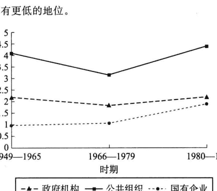

图 4—4 不同大学毕业生进入不同类型组织的比例

其次，在这三个历史时期，父亲的教育水平对对于进入各类组织没有系统性的影响。有关社会出身最强力的证据就是，在“文化大革命”时期，与工人阶级的子女相比，高子女的子女进入政府机构、公共组织或国有企业的风险率更高，这说明了官员在他们阻止进程程负效应方面具有一定的优势。

### 4.4.3 社会出身的另一个测量变量

以上分析所示的结果却有些令人惊讶，政治选择过程并没有表现出我们所预期的强烈的非线性模式。我们怀疑部分原因是由于在建立模型的变量中含有多少“噪声”——在一切模型中涉及很多过程，有些过程是相互重叠的。例如，局部的优势可能被反官运动的不利影响所抵消。为了从另一个角度看这个问题，我们现在聚焦于另一个替代变量，即毛泽东时代用于政治选择的家庭阶级标签。正如我们在教育获得分析中所注意的，毛泽东时代，阶级标签在机会分配中起着重要作用。这也适用于分配机会的情形。在四个类别中——工人/农民、干部、中间阶级、“剥削阶级”背景，这些政策在“文化大革命”时期表现为奏效。表 4-5报告了家庭阶级背景作为指标显示的首次获得的决定因素。

## 表 4-5 使用“家庭阶级背景”，不同时期进入首次工作组的 logistic模型的参数估计

| 家庭阶级背景 | 政府机构 | 公共职工 |
| :--- | :--- | :--- |
| | 1949—1965 | 1965—1979 | 1979—1980 | 1980—1994 | 1949—1965 | 1965—1979 | 1979—1980 | 1980—1990 | 1990—1994 |
| 干部 | 1.182* | -0.155 | 1.054** | 0.718 | 0.791* | 1.337** | | | | |
| 中间阶级 | 0.149 | 0.244 | 0.201 | 0.897** | 0.461 | 0.589* | | | | |
| “剥削阶级” | -1.314 | 0.288 | 0.329 | 1.501** | 0.819 | -0.207 | | | | |
| 工人/农民 | 1949—1965 | 1965—1979 | 1979—1980 | 1980—1994 | 1949—1965 | 1965—1979 | 1979—1980 | 1980—1990 | 1990—1994 |
| 干部 | 0.072 | 0.608* | 0.874 | 1.091** | 0.652** | 1.176** | | | | |
| 中间阶级 | 0.377* | 0.028 | 0.324 | 0.877** | 0.757** | 0.852** | | | | |
| “剥削阶级” | 0.476 | | 1.578* | 1.396** | -0.015 | 1.721** | | | | |
| 专业人员 | | | | | | | | | | |
| 家庭阶级背景 | | | 0.292 | 0.615** | | | -0.394 | -0.109 | | |
| 干部 | | | -0.589 | | | | | | | |
| 中间阶级 | | | 0.066 | 0.050 | 0.009 | | -0.262 | 0.143 | | |
| “剥削阶级” | | | 0.031 | | -0.203 | -0.728 | 0.682* | | |

注：** p < 0.01 * p < 0.05 + p < 0.1。工人/农民为参照类别。中间阶级包括小业主、中农和知识分子。“剥削阶级”包括资本家、富人和商人。所有模型估计都包含了一系列指示访者的省份和城市规模。

以上分析所示的结果却有些令人惊讶，政治选择过程并没有表现出我们所预期的强烈的非线性模式。我们怀疑部分原因是由于在建立模型的变量中含有多少“噪声”——在一切模型中涉及很多过程，有些过程是相互重叠的。例如，局部的优势可能被反官运动的不利影响所抵消。为了从另一个角度看这个问题，我们现在聚焦于另一个替代变量，即毛泽东时代用于政治选择的家庭阶级标签。正如我们在教育获得分析中所注意的，毛泽东时代，阶级标签在机会分配中起着重要作用。这适用于分配机会的情形。在四个类别中——工人/农民、干部、中间阶级、“剥削阶级”背景，这些政策在“文化大革命”时期表现为奏效。

在这三个历史时期，父亲的教育水平对对于进入各类组织没有系统性的影响。有关社会出身最强力的证据就是，在“文化大革命”时期，与工人阶级的子女相比，高子女的子女进入政府机构、公共组织或国有企业的风险率更高，这说明了官员在他们阻止进程程负效应方面具有一定的优势。

在第二个时期，教育水平的作用明显较低，这反映了那时期激进的国家政策对教育的轻视。此时，对于参照类别的工人/农民相比，在毛泽东时代，阶级背景在进入干部和专业人员之间并没有明显的政治选择：显著差异，进入专业技术职业的风险都很高。这意味着专业技术职业很少受到政治筛选的影响。但在“文化大革命”时期，出现了政治筛选，此时干部背景在两种职业中都有优势。第一个时期，在进入工作组织中，进入政府机构具有歧视，干部子女拥有更高的风险，而“剥削阶级”子女很少。在这个时期，中间阶级和“剥削阶级”子女进入公共组织的风险较高，这主要源于他们的教育程度。在“文化大革命”中，他们的优势消失了，干部子女取得了优势。在这一时期，进入工作时，总对干部背景具有显著的歧视。但是，在生活中，中间阶级的子女与工人/农民的子女并没有统计差异。

## 4.5 章总结

在本章中，我们检验了不同历史时期城市中首个工作——各类职业和组织——获得的模式。正如我们所看到的，由于较大的流动性，首工作的获得对于个人在国家条件下的生活机会具有持久的影响；尤其是在毛泽东时代。

我们在这一组中所观察到的，教育水平在首个获得过程中扮演一个重要角色，即使在激进的国家政策下“文化大革命”时期也是如此。这一分析让我们有机会反思上一章教育获得的研究的意义。家庭阶级背景基础的政治选择。现在来总结本章的主要发现。

### 4.5.1 职业层级和组织层级

本章从这样一个观点开始：在中国中，有两个与工作的社会结构相关的制度：（1）职业层级；（2）以国家分配为基础的组织层级。我们的统计分析表明，总体上，职业位与工作类型显示出两种运行模式。进入干部和专业职业的模式，类似于进入政府机构和公共组织的模式，因为二者之间有很多重叠；大部分干部集中在政府部门，而大部分专业人员集中在公共组织。

### 4.5.2 阶层动态演变

有证据表明阶层过程在各历史时期都有重大变化。国家政策的变化以两种方式影响个人生活机遇：首先，国家政策可能会极大地放大或缩小机遇，在个人生命程的特定阶段对其影响。例如，“文化大革命”严重破坏了城市，迫使学生离开农村。另一方面，近期的经济改革扩大了就业机会，使得工作机会多样化。

其次，国家政策的变化也会使阶层机制发生变化，其证据就是各历史时期教育和社会出身的影响。例如，在“文化大革命”时期，父母受过高等教育的子女加入劳动力市场的概率较低。另一方面，干部子女则拥有优势。但是，关于个人工作获得的研究发现显示，最稳定的因素是个人的教育水平。但是，我们前面的研究发现，教育获得对国家的变化和阶层动态过程影响的结果十分清晰。因此，在阶层动态过程对个人生活机遇遭遇的加剧影响的过程中，教育水平获得得到起着作用。

社会青年在进入工作组织中的初始阶段后，开始了自己在工作背景下生活的经历以及与工作部门有关的住房分配等事件的新阶段。升职、转型、收入分配等将成为后面章节讨论的重点。我们在关注了这些方面之前，我们在下一章希望对特殊的这一代——“文化大革命”的孩子们的劳动就业情况进行深入分析。我们会看到，“文革中的国家政策对中国家庭尤其是这一代产生了持续的影响。

# 第五章 “文化革命”的孩子们：“上山下乡”经历

回顾以往，知识青年来到农村，接受贫下中农教育，很有必要。要说服城里干部和其他人，把自己初中、高中、大学毕业的子女送到乡下下去，来动员。各地农村的同志应当欢迎他们去。

> 毛泽东(1968)

回望，1968年可以被称为“学生运动年”。那一年，巴黎的大学生走上街头抗议法国教育体系的弊端；在美国加州大学伯克利分校和其他校园中，爆发了反对越南战争的学生抗议。然而在同一年，中国学生和大学生处于混乱之中。就在这一年前发生在大学和中学校里的红卫兵造反，席卷全国，引发了全世界的关注。在红卫兵的冲击下，政府机关和教育机构陷入瘫痪；政府办公室被红卫兵占领，学校也不再开。1968年，冰冷的现实可见：学生不能从大学毕业或在城市里分配到工作。

这种背景下，本章开头引用的毛泽东指示，在中国被称为“上山下乡”政策正式开始了，“文化革命”时期力度最大的政治、社会动员之一（Bernstein 1977）。十年里，超过700万被称为“上乡青年”的学生——多数是初中或高中毕业——从城市来到农村生活。“上山下乡”政策对一代青年的产生了远的影响。“文化革命”的孩子们，即1967年至1968年间开始工作的城市青年，其中三分之一被送到了农村，许多人在那里留了年以上。

## 5.1 研究问题

埃尔德（Glen Elder 1974）在其具有里程意义的研究著作《大萧条的孩子》（Children of the Great Depression）书中，对以下议题进行了详尽的考察：大萧条如何影响了不同社会群体的孩子们以及他们以后的生命程？社会分层结构中的位置如何调节这一重大的政策的影响？埃尔德的研究开创了一场大规模的社会变和生命程联系起来的社会学方法，并提出了新的研究议程，即通过社会变迁对个人的人生经历来理解变迁。自此，社会变迁和生命程的相互关系在社会学文献中得到了极大关注（Elder 1985; George 1993; Hogan 1981）。

近年来，关注国家在塑造生命过程方面扮演的角色的研究日益增加。在工业化的社会中，正如罗斯和马穆指出的，“国家对个人的生活承担着越来越重的责任”（Mayer and Muller 1986）。他们讨论了三种对个人生命程有影响的国家行为：法律（如义务教育）、财政政策（如社会保障）和提供服务（如老年人的社会计划）。通过这些政策，福利国家倾向于工业市场社会中形成一种制度化的生命程。从这个角度，罗斯和舒伯林（Mayer and Schoepflin 1989）观察到：福利国家通过医疗和职业保险避免个人遭遇突然下降，通过社会保险使此生命程具有连贯性。同时，福利国家为人们提供具体教育与职业的公共部门的工作，以及稳定的就业和收入增加的有序就业。

研究中国以及其他社会学者很快就意识到，社会群体的生活机会明显受到国家政策的影响，这些政策同时塑造着机会结构和社会群体的地位。然而，与福利国家在工业市场社会中的角色相反，在中国，国家政策的变化经常突然地中断和改变人的生命程（Davis 1992; Gold 1991; Whyte 1985; see Szelenyi and Mach 1987 in the Hungarian context）。

沿着埃尔德的思想，我们的第一个目标是分析现存的社会分层过程使得如何调节国家政策对生命程的影响。剧烈的社会和政治事件（如经济衰退、战争和社会运动）通常对不同社会群体产生不同的影响。例如，埃尔德（Elder 1974）发现，大萧条对工人阶级和中产阶级的影响存在显著差异。拥有社会地位或更多资源的群体能够保护自己免受灾难性事件的影响，或者负面影响降至最低。

这些影响清晰地显示出社会分层结构及其调节过程。“上山下乡”政策对“文革”中的孩子们产生了不同的影响。一方面，作为国家规模的一部分，上山下乡事件影响了所有社会群体（Parish 1984）。另一方面，上山下乡政策并没有立即实施。在政策实施的前几年，大部分城市青年留在了城市。一些下乡青年比其他人早到了城市。因此，“上山下乡”事件引发了一系列有趣的问题：国家政策如何改变个人生命程？如果有影响，哪一类群体能够保护他们的免受国家政策的不利影响？

在前面的章节中，我们探讨的核心是在剧烈政治动荡时期生命过程中扮演的角色。在社会主义中，官僚阶层处于政治权力和资源分配中心。我们预测，对于优势的官僚能够保护他们的孩子们免受国家政策的负面影响。正如我们所知的文革期间，高层人员保留了现有的官僚体制。这一时期，相当比例的官员（行政人员）被清除并替换。在这种环境中，官员能够保护他们的孩子们免受国家政策的影响。这些考虑告诉我们，国家政策在生命程中的作用被限制了。

我们的第二个目标是评估“上山下乡”经历对“文化革命”孩子们的影响。大规模社会变迁必然影响个人的生命程，并对他们的观念和行为产生持续影响（Alwin and Newcomb 1991; Elder and Cliff 1988; McAdam 1989）。青少年阶段发生的事件似乎特别关键，正如埃尔德所观察到的：“成年后过渡在随后的生命程留下持久的印记”。对于下乡青年来说，他们在农村停留中断了教育过程，剥夺了他们作为城市劳动力的技术和工作经验积累。因此，他们在后期生活中经历了结婚和生育等事件可能因此中断或推迟。在农村停留可能会夺了下乡青年作为城市居民得到的机会，例如分配到较好的职业和工作中。我们假设上山下乡经历对个人的生命程具有显著的负面影响，并且这种负面影响随着在农村时间的延长而增长。由此，我们的分析聚焦于1967—1978年间的劳动力市场。具体来说，我们比较这一时期拥有上山下乡经历和留城的群体。我们首先考虑国家政策如何对这些社会群体产生不同的影响，对影响方面进行了检验：哪些因素影响了下乡，以及下乡青年在农村的长度。

## 5.2 “上山下乡”经历的历史背景

“上山下乡”政策植根于华人民共和国独特的历史背景。“文化大革命严重扰乱了各行业特别是教育领域的正常进程。从1966年开始，大部分政府机构瘫痪、教育机构被关闭，红卫兵在校园中的数量不断增加，无处不是。

尽管毛泽东的1968年标志着正式开始并引发了中国各个城市的大规模动员，类似事件在年前就已经开始了。1967年，一些红卫兵学生志愿到农村参加劳动。中央领导抓住这个机会，迅速下达了一份文件，正式认可了他们的做法（Deng 1993, p.55）。到1967年底，一些负责运的政府机构开始参与组织安排跨区域的“上山下乡”工作。

国家“上山下乡”政策的实施过程中，“文化革命的过程不断变化。在最初几年的密集动员后，政府允许更大比例的中学生进入城市劳动队伍。在后几年，“上山下乡”政策做出了调整，允许每个家庭有一个孩子留在了城市。政府也当时招收下乡青年到大学或军队中，或招一些下乡青年转向城市劳动。当时也有这样的政策，即下乡青年如果能够出医院的证明，表明自己已经失了在农村承担体力劳动的能力，就可以返回城市。1977年底，基于国家重新开放的大学扩展了许多下乡青年返城的机会。此不再执行“上山下乡”政策。

基于这个原因，我们将对“上山下乡”事件的关注限定在1967—1977年这一段时间。

在中国，政策引导的城市向农村的大规模移民在“文化大革命”之前早存在。在20世纪60年代早期的经济困难中，政府在1961—1963间减少了2600万人口。但是，那些政策主要针对刚从农村入城市的家庭。由于农村入城市的人口比例较小。然而，在“上山下乡”动员中，有小子学的城市家庭都被要求照毛泽东的指示。


## 第5章“文化大革命的孩子们：“上山下乡”经历

在下乡知青的生命过程中，“上山下乡”过程是一个极其重大的经历。对许多人来说，这段经历可以是刻骨铭心的。在中国，城乡之间生活环境存在巨大差异。大多数城市青年在下乡之前未在农村生活过。他们被送到指定的远离城的农村地区，在很多情况下，他们每三年才能允许回家探亲聚聚。他们还得得忍受严酷的农田体力劳动，经常是一周7天，每天超过12小时（Jiang, Li and Shi 1996; Yang Yu Wang 1993）。大多数下乡青年在农村地区生活和劳动了相当长的时间。在我们的样本中，下乡青年在农村的经历平均为6年，其中19%的人在农村超过10年，39%为5年至10年，41%为5年以下。在这一背景下，留在城市或下乡后返回城的较少且珍贵。不同群体获得这些机会的差异显示了社会分层机制，尤其是政治资源在不同社会群体的分布情况。我们有证据表明，高级干部通过各种“走后门”的渠道成功让自己的孩子进入城市（Shi 1996）。估计，1972—1976年间，

1979年，也是毛泽东去世后几年，由于下乡青年持续不断的中断和抗议的压力，有改革意识的高层领导人废除了“上山下乡”政策，允许有下乡青年回到他们的家乡所在城市（那些与当地居民结婚或在当地从事非农业工作的除外）。这标志着“上山下乡”的正式结束。

“上山下乡”的结束也是我国国家社会主义经济改革时代的开始。社会经济方面的重要变化重新塑造了城市经济的面貌，下乡青年在其中寻求着自身的社会身份。经济改革显著改变了机会结构，并产出了许多的工作类别。特别需要提到的是，从20世纪70年代后期开始，城市住房压力迫使政府将个体企业合法化，因此产生了一个新的私营经营领域（Bureau of Policies and Regulations 1990, Lo Yi, p. 159）。而且，在新的市场经济中，不同职业和工作组织相关的经济利益也开始有所改变。与在国有部门工作的人相比，私营企业和在非国有企业的人拥有显著更高的收入。我们正是在这一历史背景下探讨“上山下乡”经历带来的后果。

> (Deng, 1993, p. 16).

# 国家与生活机遇

## 5.3 “上山下乡”事件的历史模式

我们首先描述“文化大革命”时期在1979年获得首份工作的风险率。图5—1描述了1966—1978年间获得首份工作的风险率。回顾前述，风险率这一统计技术测量的是那些处在风险集中的人（如完成教育、将进入劳动力市场的人）获得某个特定类型工作的的时间比率。正如我们前面描述的，尽管官方“上山下乡”政策在1968年年底并没有提出实施，但“上山下乡”运动在1967年就已经开始并获得了官方的认可。大规模的“上山下乡”运动开始于1968年，1968—1969年间风险率的峰值反映了其他工作的风险率表明了留城青年在城市地区的各种工作机会。

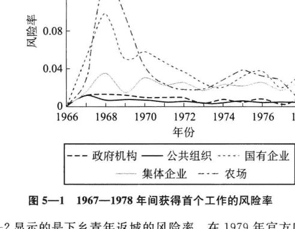

图5—2显示了下乡青年返回城的风险率。在1979年废除“上山下乡”政策后，一些下乡青年就已经通过各种渠道返回城市。1979年的峰值反映了“上山下乡”政策的结束，大部分下乡青年在20世纪80年代早期回到了城市。风险率在20世纪80年代中期的增长与中国城市改革的启动时间吻合，当时国家对城市劳动力的控制有所消减。城市改革可能因为那些还在农村等待返回的青年创造了新的机会。请注意，尽管20世纪80年代出现的第二次峰值很高，但这是因为那时仍处于风险中（如仍在农村中）的个体个数相对较小。

## 第5章 “文化革命”的孩子们：“上山下乡”历程

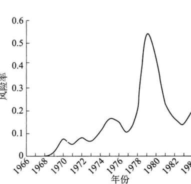

这一时期人们获得各类工作的风险率和返城的风险率在不同时点的变化表明，“上山下乡”政策的实施在不同时间和各个社会群体并不完全相同。我们现在转向相同原因和解释这些差异。

## 5.4 国家政策对社会群的不同影响

### 5.4.1 谁更有可能下乡?

“文革”时期，城市青年的职能可能性可能是他们是如何被分配到这两类工作中去的。我们首先检验“文化革命”的后们测量社会出身和性别以及教育程度等有关个人属性的变量。我们在这一模型中加入了测量社会出身。通过两个章节的样本分析，我们将父亲的职业地位和家庭阶级背景作为社会出身的另一种替换变量。此外，我们还将测量城市就业机会的。

> ① 在某种程度上，“上山下乡”政策是面对外界压力做出的。我们认为“上山下乡”事件发生随着不同地区的经济和就业状况变化。对于上山下乡和返城的经历，最重要的背景是城市就业机会的变化。在研究中，使用城市层次信息作为测量。但是我们无法获得所有不同年份的数据。我们使用了省信息作为替代。测量机会的方法如下：

$\Delta N_{i,t} = (N_{i,t} - N_{i,t-1}) / N_{i,t-1}$

其中，$N_{i,t}$是指第 $i$ 省城市就业数量，$N_{i,t-1}$是前一年$(t-1)$。$\Delta N_{i,t}$测量了某省相邻年份 $(t-1)$ 和 $t$ 之间城市动力百分比的变化。

变量和家庭姐妹数量为控制变量，由于因素的可能性。我们对1967—1978年“上山下乡”事件的可能性进行了分析，同时对967—1971年和1972—1978年两个时段做了进一步分析，以便检验特定时段的变化。在文献中，第一个阶段的下乡青年通常被称为老下乡青年，而在第二个阶段的下乡青年被命名为新下乡青年。大的政策从一段到后一段确实发生了一些变化。大学在1972年有限地开放；在第二个时段，“上山下乡”政策允许更多的下乡青年进入大学或录用到城市动力队伍的机会。社会分层调节对个人机遇的影响，针对这两个时段有助于我们发现分层结构的变化。下乡的可能性随着年龄增长而降低，但没有显著的性别差异。也就是说，不利的“上山下乡”政策以一种的方式影响了男性和女性。教育程度的影响如此，高中毕业生发生比例比初中更低教育水平的人（参照类别）高出80%（exp 1.80）。而大学毕业生与之间没有统计学差异，这表明“上山下乡”政策对于高中毕业的城市青年产生影响。表5—1报告了下乡可能性（对数形式）的估计。模型A使用父亲职业地位作为出身变量，模型B使用家庭阶级背景作为出身变量。表5—1 1967—1978年间概率的logistic估计，下乡为一

| | 1967—1971 | 1972—1978 |
|---|---|---|---|
| | A | B | A | B |
| 截距 | 0.790** | 0.775** | -2.322*** | -2.353*** | 0.637* | 0.713* |
| 年龄 | -0.221** | -0.222** | -0.009 | -0.012 | -0.238** | -0.241** |
| 女性 | 0.049 | 0.050 | 0.043 | 0.033 | 0.049 | 0.060 |

教育水平
***在1%的水平上显著，**在5%的水平上显著，*在10%的水平上显著。

## 第5章“文化大革命的孩子：“上山下乡”经历

| | 1967—1978 | | 1967—1971 | | 1972—1978 | |
|---|---|---|---|---|---|
| | A | B | A | B | A | B |
| 高中 | 0.586** | 0.587** | -0.011 | -0.019 | -0.913** | -0.926** |
| 大学 | 0.304 | 0.294 | -1.093* | -1.128* | 1.075 | 1.126** |
| 父亲职业地位 | | -0.051 | | 0.115 | | 0.117 |
| 高级干部 | | -0.079 | | -0.302* | | 0.183 |
| 高级专业人员 | | | -0.043 | | 0.242 |
| 低级专业人员 | 0.071 | | -0.167 | | 0.315 |
| 家庭阶级背景 | | | -0.024 | | 0.197 | -0.277 |
| 干部 | | | -0.124 | | -0.071 |
| 中间阶级 | | 0.110 | | 0.372 | | 0.516 |
| “削削阶级” | | 0.636* | | | | |
| 兄弟姐妹 | 0.445 | 0.443 | 0.015 | 0.013 | 0.076* | 0.070 |
| 姐妹数目 | 0.448* | 0.448* | 0.035 | 0.036 | 0.050 | 0.045 |
| 城市动力 | | | | | | |
| 比变化 | -0.117* | -0.117* | -0.120* | -0.156* | -0.052 |
| 父亲教育缺失 | | -0.042 | -0.161 | | -0.215 | -0.238 | -0.362 |
| 父亲职业缺失 | | -0.213* | | -0.288 | | -0.347 |
| 家庭阶级缺失 | | -0.196 | | -0.075 | | -0.542 |
| χ(有没有变量) | | 1.001* | 1.004* | 89.1* | 85.4* | 320* | 317.8* |
| 自由度 | 16 | 15 | 16 | 15 | 16 | 15 |
| 事件数目 | 765 | 765 | 425 | 425 | 340 | 340 |

** p<.001
*p<.05
*p<.10

我们关注的一个重要问题是父亲职业地位在调整不利政策时的作用。模型A中，我们将父亲的教育水平和职业地位作为父亲职业地位的指标。对于教育选择最直接的证据就是：如果父亲受过大学教育，子女只有小学教育水平或没受教育的参照相比，这一发生的概率高出40%。该结果与这一时期视家庭背景是一致的。在国家社会主义政治秩序下，父亲的职业地位（如干部部位）与其政治紧密相关。然而这一时期，我们并没有发现父亲的职业地位对经历“上山下乡”事件可能的影响具有统计上的差异。因此，并没有证据表明高级干部有助于避免政策的影响，他们大部分在“文革”期间都成为了清洗的对象。不足的，经历，“上山下乡”事件可能与城市工作机会紧密相关，城市就业机会的增加降低了下乡的可能性。兄弟姐妹的数量有着显著的影响。模型B中，我们评估了家庭阶级背景对上山下乡事件的影响。结果表明，“割除阶级”的子女的影响可能高于，与工人阶级的孩子（参照模型）相比，他们的发生概率高了89%。这一结果与标签来区分不同群体的政策是一致。其他变量显示与模型A中的影响。

两个时期的变化

我们在检验两个时期之间可能存在的变化。表5—1中的第二和第三分析报告了我们两个细分段（1967—1971，1972—1978）中，对协变量影响的参数估计。对比这两个时段，父母背景的影响差异显著。父亲职业地位或家庭背景在这两个时期对上山下乡都没有显著的影响。在早期的阶段（1967—1971）“上山下乡”政策被严格执行，那些父亲具有高中或中学教育水平的子女更可能下乡（模型A）。在第二个时期，父亲教育水平的影响没有差异，而一旦限制了家庭阶级背景（模型B），那些父亲具有大学教育程度的子女就具有更高的下乡概率。在两个时期，大学毕业生的比例更高。推测主要是20世纪70年代改革政策的影响，其提到“新教育体系”的大学毕业生参与到工厂和农村的过程中。另一个发现是，在第二个时期城市就业机会的影响很小，而且没有统计显著性。这意味着，当“上山下乡”政策随着时间逐渐制度化后，它便变成了一种政治仪式，在实施过程中不再考虑城乡就业机会。

总之，尽管有一些证据表明在上山下乡事件中存在政治选择，但总体趋势是所有社会群体都有相似的经历，而且干部层的子女们他们也无法规避政策的负面影响。

### 5.4.2 返城

1979年大多数下乡青年被迫待在农村。但我们前边提到的，这时就允许一些返城的渠道。获得返城许可的那些事件提供了不同社会群体用降低政策负面影响的政治和社会资源的信息。我们对1967—1977年总体及其两个细分阶段的返城事件比例进行了分析。表5—2报告了这些分析的logit模型估计。

表 5—2 1967—1969 1967—1971 1972—1979
| | A | B | A | B | A | B |
| 截距 | -4.707*** | -4.563*** | -7.146*** | -7.045*** | -4.234*** | -4.067*** |
| 年龄 | 0.028 | 0.029 | 0.145 | 0.145 | 0.017 | 0.015 |
| 在农村时间 | 0.307*** | 0.288*** | 0.567*** | 0.522*** | 0.258*** | 0.243*** |
| 女性 | -0.055 | -0.072 | -0.894*** | -0.892*** | -0.058 | -0.038 |
| 教育水平 | | 0.660*** | 0.696*** | 0.728*** | 0.584*** | 0.602*** |
| 大学 | 1.757*** | 1.733*** | 3.888*** | 3.173*** | 1.520*** | 1.535*** |
| 父亲教育水平 | | -0.234 | -0.117 | -0.701 | -0.329 | -0.156 |
| 高中 | -0.523 | -0.327 | 0.178 | 0.686 | -0.697*** | -0.502 |
| 大学 | 0.005 | 0.008 | -0.129 | -0.174 | -0.006 | 0.071 |
| 父亲职业地位 | | 0.711*** | | 0.327 | | 0.767*** |
| 高级干部 | 0.680*** | | 1.347*** | 0.515*** | | |
| 高级专业人员 | -0.533 | | -1.517 | | -0.418 | |
| 低级专业人员 | -0.228 | | -a* | | 0.106 | |
| 家庭背景 | | -0.098 | 0.228 | | -0.189 | |
| 中间阶级 | | -0.151 | -1.477 | | 0.001 | |
| “割除阶级” | | -0.381 | -1.009 | | 0.282 | |

| 1967—1977 | | 1967—1971 | | 1972—1977 | |
| A | B | A | B | A | B |
| 兄弟数目 | -0.068 | -0.079 | -0.270* | -0.266* | -0.037 | -0.045 |
| 姐妹数目 | 0.025 | -0.013 | 0.041 | 0.075 | 0.025 | 0.012 |
| 城市流占比 | 0.085* | -0.029* | 0.068 | 0.076* | 0.083* | 0.088* |
| 父亲教育缺失 | -0.156 | -0.203 | -a | -a | -0.039 | -0.069 |
| 父亲职业缺失 | -0.361 | | -1.337 | | -0.323 | |
| 家庭背景缺失 | | -0.268 | | -a | | -0.043 |
| (与没有协变量) | 220.7* | 197.4* | 68.7* | 61.1* | 114.6* | 100.0* |
| 自由度 | 17 | 16 | 15 | 14 | 17 | 16 |
| 事件数目 | 273 | 273 | 41 | 41 | 232 | 232 |

** p < 0.01
* p < 0.10
* 该类别没有被计入是因为这个时间没有变化(即没有返城事件)。
注：中国教育水平及以下为被访教育水平的参照类别，小学教育水平的参照类别，工人为父亲职业地位的参照类别，中间阶级为家庭背景的参照类别。

我们的样本是在城市，所以我们对返城事件的分析主要关注返城市的下乡青年。根据，大多数下乡青年返回了自己家乡所在城市。仍然留在农村的比例较小，对我们的分析结果产生影响。


# 国家与生活机遇

在农村待了很长时间（我们的样本中平均为6年），我们预期这一事件对这个群体具有持续的影响。现在我们转向第二个分析主题——评估“上山下乡”经历的后果。

### 5.5.1 后续生命历程事件的经历

为了验证“上山下乡”经历对后续生命历程产生的结果，我们首先对比了留在了城市和乡下知青在以下几个重要生命历程事件中的经历：（1）婚姻年龄；（2）初次生育年龄；（3）教育（大学）获得；（4）首次城市的工作组织和职业类别。

如上所述，知青在农村的影响很可能会随着个人在农村的时间的长短而变化。对于那些较早到城市的知青，“上山下乡”经历产生的负面影响可能会被减小到最低。而对于那些在农村待了很久的人，消极的后果可能会加重。基于这样的考虑，我们将进一步将知青分为：（①）下乡时间少于6年的群体。（②）下乡时间在6年和初次生育年龄之间的群体。

- ① 婚姻年龄和初次生育年龄

为了探索“上山下乡”经历的影响，我们将把一次调查对象分为三个组（18~25岁、26~30岁、31岁及以上）。图5—3和图5—4所示的是结婚年龄和初次生育年龄在三个组（根据表5所示）的分布情况。值得注意的是，留在城市和乡下经历少于6年的人之间差异显著。但是，对于农村人工过去的少于6年的人，他们中很大比例的人将结婚和生育年龄推迟到了30岁以后。值得注意的是，20世纪70年代以来，为政府计划生育政策的结果，所以城市青年都推迟了他们结婚和生育年龄。我们推测，如果没有这些政策，那么观察到的这些组别的差异会更显著的。

## 教育获得

由于“文革”期间城市青年是中学毕业，所以我们将重点放在大学教育的获得上。我们对比了1977年全国一高考恢复以后不同组别的大学入学人数的均值。1977年以来，大量“文化革命”的孩子（包括初中和高中毕业的）：为了继续他们被中断的教育而参加了大学入学考试。这个组别之间具有显著差异（见表5—3）：下乡时间较短的青年具有大学教育的比例最高（14.1%）。但是对于那些下乡时间超过6年的一些人而言，1977年高考恢复太快了，他们的入学率（9.4%）明显低于那些下乡时间较短的。有趣的是，留在城市的青年只有8.6%的人在1977年后上了大学。这可能是因为下乡的负面经历激发了下乡青年利用教育获得重新安排自己地位的决心受到大学教育的事实。

- ① 选择6为界是因为这个数值是我们下乡知青群体在农村停留的时间和中值。

# 第5章 “文化革命”的孩子：“上山下乡”历程

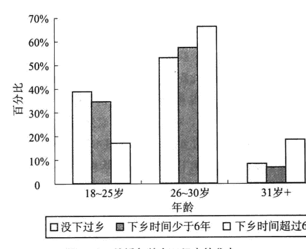

图5—3 结婚年龄在三组中的分布

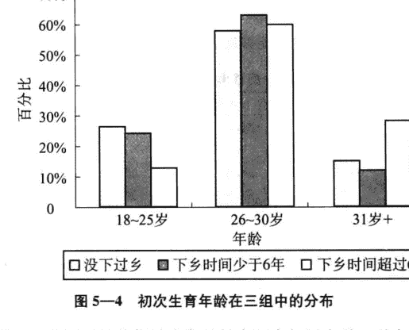

图5—4 初次生育年龄在三组中的分布

### 首个城市工作的组织类型和职业类别

在劳动力队伍中的位置对于获取经济利益有着重要作用。由于个人的工作位点会随着时间而变化，因此我们对比三个组别的首个城市工作类型。对于下乡青年来说，这个工作是他们返城后的首个工作。令人惊讶的是，表5－3中的描述性数据表明，在政府机构或公共组织中，与城市的人所占的比例极为相似。这允许许多归于政府具有较大比例的下乡青年，正是因为教育背景将其转为更有利的组织和职业。这可能也是20世纪80年代早期国家对下乡青年采取优惠政策的结果。

总之，验证结果显示“上山下乡”经历对于后期生命历程中的生命事件具有显著影响。一个人在农村时间越长，这个经历对后期生命历程的影响越严重。然而，同样值得的是，下乡经历可能引发下乡青年改变自己社会状况的决心。这部分体现在该群体中具有较高的教育背景比例，这也使得他们能够在高地位的工作组织和职业中。

### 表5－3 各组经历生命历程事件差异的描述与统计检验

| 变量 | 没有下乡经历 | 下乡时间少于6年 | 下乡时间超过6年 |
|---|---|---|---|
| 结婚年龄（均值）年龄分组（%） | 26.5 | 26.6 | 28.1 |
| 18～25 | 38.6 | 36.1 | 16.5 |
| 26～30 | 52.9 | 56.5 | 65.6 |
| 31+ | 8.4 | 7.4 | 18.0 |
| 样本量 | 1623 | 407 | 401 |
| 皮尔迪卡的独立性检验 | | $\chi^2=88.1, d.f.=4, p<0.01$ | |
| 初次教育（均值）年龄分组（%） | 27.4 | 27.4 | 28.9 |
| 18～25 | 27.1 | 25.0 | 13.2 |
| 26～30 | 57.7 | 63.3 | 59.5 |
| 31+ | 15.2 | 11.7 | 27.3 |
| 样本量 | 1403 | 376 | 363 |
| 皮尔迪卡的独立性检验 | | $\chi^2=56.4, d.f.=4, p<0.01$ | |
| 1977年后获得大学的百分比 | 8.6 | 14.1 | 9.4 |

| 协变量 | 没有下乡经历 | 下乡时间少于6年 | 下乡时间超过6年 |
|---|---|---|---|
| 样本量 | 1612 | 403 | 404 |
| 皮尔逊方的独立性检验 | | $\chi^2=11.6, d.f.=2, p<0.01$ | |
| 首个城市的工作组织 | | | |
| 政府机构 | 10.4 | 11.6 | 4.9 |
| 公共组织 | 6.7 | 8.1 | 11.7 |
| 国有企业 | 50.3 | 52.8 | 45.3 |
| 集体企业 | 28.1 | 25.5 | 32.4 |
| 混合所有制企业 | 1.0 | 0.5 | 2.6 |
| 私营企业 | 3.8 | 1.5 | 3.1 |
| 样本量 | 1967 | 396 | 386 |
| 皮尔逊方的独立性检验 | | $\chi^2=41.8, d.f.=10, p<0.01$ | |
| 职业类别 (%) | | | |
| 干部 | 3.1 | 5.9 | 9.2 |
| 专业人员 | 13.8 | 11.3 | 10.3 |
| 办事员 | 3.6 | 5.7 | 6.2 |
| 服务人员 | 11.1 | 13.1 | 12.7 |
| 产业工人 | 62.8 | 58.1 | 61.0 |
| 军人，警察 | 5.7 | 5.9 | 0.5 |
| 样本量 | 1805 | 389 | 369 |
| 皮尔逊方的独立性检验 | | $\chi^2=59.7, d.f.=10, p<0.01$ | |

### 5.5.2 收入的决定因素

为了评估重大生命事件对个人经济状况的影响，我们现在检验“上山下乡”经历在后毛泽东时代对个人收入的影响。不同时间、不同社会群体收入的系统分析会在第7章报告；在这里，我们只是从生命程视角来看特殊的群体。我们把被调查的总体收入——基本收入、奖金以及其他收入的总和——作为因变量。我们将性别、工作经历、教育水平、职业地位、工作组织以及居住地纳入模型。为检验这些影响随时间的变化，我们分别对1978年、1987年和1993年这三个年的收入模型进行了评估。为了对比有下乡经历和无下乡经历的两个群体，我们设计了交互变量来说明“上山下乡”经历的副作用。使用交互作用让我们发现“上山下乡”经历了一个收入的具体渠道。

### 1978 年收入的决定因素

官方废除了“上山下乡”政策之前。当时的背景是，这一年是后毛泽东时代的开端，仍然受到“文革”激进政策的影响。我们在分析中有304个在1978年以前的城市进行了调查。在检验我们通过交互作用所示的“上山下乡”经历的特殊影响，我们首先描述了在“后毛泽东时代”开始时整个同期人群的决定因素的一般模型，它由这一模型中第一区域变量的“主效应”来评估。女性的收入比男性低12%。正如城市劳动就业年数的一级条件应当测量的、持续时间的影响下降趋势。对于这个组，当其他条件相似时，劳动就业越早，收入水平越低。在1978年，没有教育程度的回报没有显著的差异。由于我们的样本中只包括一个同期，所以工作和教育回报上的差异相对受限。

在考虑不同类型工作组织和职业的影响，在政府机构、国有企业、混合所有制企业员工的收入都比在集体企业中没有下经历的人（参照组）有显著更高的收入。各职业组别之间的收入差别很小。仅是服务人员比没有下乡经历的产业人员（参照组）具有显著更高的收入。这些结果或许反映了改革初期领域商业的活跃性。由于私营企业主数量较少，我们在分析中统计了这个组别。

我们的研究关注集中在“上山下乡”经历对收入的影响。显示结果，一般来说，“上山下乡”经历没有显著影响，这点由sd的哑变量表明；同样，在农村留时间也没有显著影响。考虑到交互作用，工作组织和职业类别对收入的影响都是负面的，且没有统计显著性。废除前，较早迁入的人中有较大比例有较高教育程度。我们在模型中包含了集体企业与下乡经历的交互，而有些没有下乡经历的就业者是职业类别的参照。而且，许多都是高级干部（见表5—2）。人力资本和政治资源让他们便利地重新定位。

### 表5—4 收入决定因素的OLS估计

| 变量 | 1978年 | 1987年 | 1993年 |
|---|---|---|---|
| 截距 | 3.416 | 4.66** | 4.466** |
| 女性 | -0.123** | -0.186** | -0.208** |
| 参加工作年限 | -0.033 | 0.013 | 0.014 |
| 参加工作年限*/100 | -0.059* | -0.042 | -0.019 |
| 教育水平 | | | |
| 高中 | -0.026 | 0.003 | 0.036 |
| 大学 | 0.003 | 0.048 | 0.070* |
| 工作组织 | | | |
| 政府机构 | 0.106* | 0.052 | 0.218** |
| 公共组织 | 0.109* | 0.071 | 0.260** |
| 中央直属企业 | 0.179** | 0.136** | 0.255** |
| 地方政府 | 0.149** | 0.130** | 0.127** |
| 混合所有制企业 | 0.270** | 0.152** | 0.184** |
| 私营企业 | | 0.593** | 0.647** |
| 职业地位 | | | |
| 干部 | 0.037 | 0.141** | 0.204** |
| 专业人员 | 0.072+ | 0.094** | 0.111** |
| 办事员 | 0.012 | 0.084 | 0.050 |
| 服务人员 | 0.109** | 0.082* | 0.046 |
| sd（哑差：下乡=1） | -1.995 | -0.762 | -0.098 |
| sd持续时间（年） | -0.007 | -0.004 | -0.007 |
| 与下乡经历的 | | | |
| 交互作用 | | | |
| 女性*sd | 0.103+ | 0.073 | 0.076+ |
| 参加工作年限*sd | -0.074+ | -0.034 | 0.016 |
| 参加工作年限**/sd/100 | -0.059 | -0.042 | -0.019 |
| 教育水平 | | | |
| 高中*sd | 0.007 | -0.063 | 0.022 |
| 大学*sd | 0.086 | 0.025 | 0.033 |
| 工作组织 | | | |
| 政府机构*sd | -0.289 | 0.231+ | -0.288** |
| 公共组织*sd | -0.013 | 0.087 | -0.246 |

| 协调变量 | 1987 年 | 1993 年 |
|---|---|---|---|
| 中央直属企业 *sd | -0.156 | 0.093 | -0.172* |
| 地方政府企业 *sd | -0.226 | 0.080 | -0.139 |
| 集体企业 *sd | -0.140 | 0.070 | -0.207* |
| 混合所有制企业 *sd | -0.235 | 0.162 | 0.020 |
| 私营企业 *sd | | -0.002 | -0.301* |
| 职业地位 | | | |
| 干部 *sd | 0.151 | -0.034 | -0.059 |
| 专业人员 *sd | -0.285 | 0.032 | 0.024 |
| 办事员 *sd | -0.182 | -0.046 | 0.116 |
| 服务人员 *sd | -0.119 | -0.020 | -0.004 |
| 产业工人 *sd | 0.003 | -0.065 | 0.003 |
| 调整 R² | 0.24 | 0.26 | 0.43 |
| N (总数/有下乡经历) | 220/304 | 407/683 | 738/773 |

** p < 0.01
* p < 0.05
+ p < 0.10
注：初中教育水平及以下教育水平为参照类，没有下乡经历的集体企业作为工作参照类，没有下乡经历的产业工人作为职业参照类。模型还包含了居住地和城市规模的变量。

### 1993年1993年，影响收入的决定因素有了显著变化（见表5—4的第三列）。总来说，性别更为扩大了收入差距。值得注意的是，女性下乡青年对她们的收入有显著正面影响。这也表明，相对于那些留在城市的女性员工，对于下乡的女性员工更加积极地改变自己的社会地位。1993年，大学教育显著增加了个人什么样的类型组织对收入的影响越发重要。对于返城青年而言，在政府机构、公共组织、国有企业和混合制企业工作，要比集体工作中没有下乡经历的人有更高的收入。但是对于下乡青年来说，在政府机构、公共组织、中央直属企业和集体企业工作，要比在同一类型组织中没有下乡经历的人有较低的收入。甚至对于私营企业来说，有下乡经历的也比没有下乡经历的收入要低。然而，“上山下乡”经历并没有引起显著的职业收入差距。

# 国家与生活机遇

人的决定因素在这些年的变化表明，中国城市在后毛泽时代发生了显著的变化。在“文化大革命”的孩子们，大学教育在近几年开始成为一个重要的因素。干部和专业人员现在的收入比以前更多了。更重要的是，工作组织的类型在决定一个人的经济状况中的作用更为突出了。私人部门的兴起对收入分配有深远的影响。与此同时，私人企业主在城市居民中的收入最高。这些模式反映了再分配制度和市场机制并存的多层次的改革进程。

这些变化从多方面影响了下年的经济状况。对下青年而言，“上山下乡”经历直到最近都没有引起显著的收入差距。新经济制度的出现和市场经济的扩张创造了多种工作机会和获取资源的渠道，从而面上弱了“上山下乡”事件的影响。在20世纪80年代，国家也出台了一系列政策，旨在消除下青年在城市的障碍，使其在工作场所有充分的机会。

### 5.6 本章总结

现在回到这一章中试图回答的核心议题：国家如何影响历程？社会分层过程如何调节这些历程？大规模变迁对个人后续历程和经济状况的后果是什么？

这一章和前面章节的发现表明，国家和国家政策变化对个人历程的中断和重建有着关键性影响。中国12年的“上山下乡”运动从根本上改变了一代城市青年的历程。劳动就业和城镇规模的证据表明，当一个集权化国家动员起来实施它的政策时，没有任何一个社会群体可以阻止其。


## 第5章“文化大革命”的孩子们：“上山下乡”经历

对自下生活的干涉。这可以用以下事实来说，不同社会出身的群体的下乡可能没有显著的差异。在这个意义上，“上山下乡”政策对所有社会阶层有着无别的负面影响。官僚阶级反国家政策的程度的确得到了限制。所有社会群体中，父母没有受过高等教育或具有“下层”背景的孩子受到影响最为直接，这与当时的国家政策是一致的。

然而，社会对这种可能性的影响是显著的。随着逐渐迁过去，在帮助女运上城以减少国家政策的负面影响这一方面，高级干部确实有一定优势。这种能够这些的机会是极为宝贵的，正如这里的结果所示，与那些在农村留更久的人相比，下乡时间较短的人在经历后的生命历程方面有着优势。这再次提醒了我们，即便在一个高活跃度的政治环境中，国家高压力强度减弱后，现有的社会分层结构和过程可能会继续在国家和个人生活机遇之间发挥作用。

国家政策的社会改变对这些后人的生命经历以及他们的行为模式都产生了持续的影响。没有经历和那些下乡时间长短的一类群体在主要社会事件上有着显著不同。“上山下乡”事实对这些下乡时间短的知识青年产生了特别大的负面影响：与下乡时间较短的人相比，他们结婚和生育子女的显著推迟了；他们在城市劳动力队伍中（对于某些职业和工作组织而言）也较少有有利的位置。关于个人的决定因素，来说，“上山下乡”经历在三个份中没有表现出显著的影响。然而，1993工作场所类型和“上山下乡”经历的交互作用的显著表明“上山下乡”经历的负面后果开始显，并可能在随后的家里变得更加突出。

具有特殊意义的是，中央集权应对“上山下乡”经历近几年来的负面影响负责。在政策之后，后毛泽时代的政府采取了一系列政策来稳定和缓解农村青年的后期生命历程。没有收入差异的证据与这些政策是一致的。然而，经济改革后的发展，特别是工作组织经济自主权的增加，或许这些政府政策多或少变得不再重要。

我们的发现显示了“上山下乡”经历的一些正面影响。例如，有关1977年后大学教育获得的分析表明，下乡知青更有可能有较高的教育程度，由于他们的教育背景，下乡知青正是那些时间较短的知青，尽管他们在城市的工作相对较短，但在城市劳动队伍中占有一定位置（职业和工作组织类型）。下乡的女性也比留在城市的女性有着更高的收入。有两个主要因素可以解释这些正面效果。首先，经济改革时期的社会会对下乡青年返城后历程的重塑有着巨大影响。大学入学考试的恢复和城市经济的扩张减少了下乡青年在城市重新定位定的困难。市场的出现也开放了新的工作机会和经济部门（服务业的发展），这些因素减轻了“上山下乡”经历的负面影响。

在后毛泽时代初期，“上山下乡”经历在中国经济转型中扮演了关键角色。下乡知青的返城潮对城市经济需求产生了冲击，他们寻找工作时的抗议甚至冲突对政府产生了巨大的压力。20世纪80年代早期推出的国家政策，将私有领域合法化并鼓励其发展。下乡青年返城后产生的压力引发了这一有着重大意义的国家政策。在本书最后一章，我们将再次回到这些议题，重新审视变动不居的人生机遇在推动社会变迁中的有益作用。

## 第6章 攀爬政治阶梯：官僚的职业模式

只有官僚制度提供了现代法律的基础实施。

> ——韦伯 (Weber, Max 1978, p. 975)

政治路线确定之后，干部就是决定的因素。

> ——毛泽东 (1938)

在国家社会主义分层研究中，没有任何概念比官僚阶级占据更为核心的位置。从杰拉斯 (Djilas 1957) 对东欧国家社会主义中出现的“新阶级”的早期批判开始，一个强大并享有特权的官僚阶级的概念成为国家社会主义的研究者所广接受的形象化描述，并且成为这些社会的分层研究的起点。学者们之间的这一共识并非非无理的，因为官僚和官僚机构已经成为国家社会主义中政治秩序的基石。他们担当着共产主义国家的“组织武器”（Bauman 1974; Schurmann 1968; Selznick 1952），并且是具有差异权力和特权的统治阶级（Szelényi 1978）。他们为计划经济中实现经济目标提供了制度基础，并且是国家再分生活机遇和隐性的经济利益的主要渠道。归根到底，社会主义国家是通过过官僚和官僚机构控制社会的。因此，国家社会主义条件下下社会分层的众多研究始于并聚焦于对官僚阶层分层阶级形成阶段的击击。例如

但是，这里有一个问题。我们对官僚阶级的形成过程至少了解个人是如何进入组织阶层体系的，又是如何获得晋升的。让我们尝试这样解决一个简单的问题：官僚阶级是通过当代化或层式运动进行自身再生和恒久维持，还是通过其他准则（如资历、功勋等）形成？显然，针对这一个问题和其他相关问题的回答，阶级形成和社会层过程的内涵具有实质差异。长期以来，研究中国国家级级的精英学者们对官僚职业模式有敏感感，大多数研究集中于国家级级的精英（Barnett 1969; Barnett and Vogel 1976; Lee 1991; Li and Bachman 1992; Benn 1972）。虽然低等的官僚构成了官僚组织中的大多数成员，但直到最近，对于他们的职业模式系统性研究难以。

近年来，对官僚职业模式的理论解释有着显著进展，推动了对官僚阶级的形成和转变的阐述。在社会学文献中，二路径模型（Li and Walder 2001; Walder 1995; Walder and Treiman 2000）强调了政治和专业人员职业路径的基础。另一个视角强调宏观政治进程和国家政策变动对官僚职业模式的影响（Zhou 1995; Zhou, and Mo 1996）。这一章报告了对中国官僚职业模式历史演变的阐述，关注下列一系列问题：
1）政治获得身份；
2）中国政府机构录用模式；
3）中国政府机构内部晋升模式。

到20世纪90年代初开始的大变迁，中国大多数工作组织仍属于行政机构。进入这些组织以及组织内晋升与获得分配利益的模式相似，是由政府机构或权威性控制的。这种政治控制并不反映在宏观机制干预上，也反映在直接配备有权的执行干部（即单位中党委领导）上。结果是，国家政策对官僚职业模式的影响，不仅体现在中央或地方机构中，而且体现在公共组织和企业中。此，我们给中国官僚职业这一概念提出了宽泛的定义，同时包括政府机构以及企业工作组织。如此，直到最近几年，行政官员、经理和专家等被认定为“官僚”，两者之间的区别并没有严格界定。我们用“官僚”这一概念来指行政官员、公共领域的干部（作为组织中党委领导）和专业干部，因为这些专业干部也是体系中的正式组成。

### 6.1 中国：官僚机构的人事制度

仔细考察中国官僚体系多重、平行的等级结构条例，以及相关的录用、升迁和工资政策，我们对于官僚体系有了精细、详尽的认知。它几乎无遗漏地触及每一角落，包括所有官员的类型、规模，上达最高领导，下至政府办公室的打字员，只要属于政府系统（包括中央和地方政府）管理的正式官员，就会无遗漏被这一一套系统涵盖和控制。而且这只是开始，只要属于政府工作组织中的干部或专业人员——无论你是专业（如大学记者、工程师或图书馆员），无论在哪个部门（制造业、服务业、教育部门或监管部门））就被属于这一体系。

中国的官僚体系是一个由行政等级和专业等级构成的独特的官僚体系。根据《现代汉语词典》，这一概念泛泛触及“国家、军事、人员团体中的公职人员（士兵、群众员除外）”。到了20世纪80年代后期，这两个体系中的行政官员和专业人员被认定为官僚体系中有两个职业路径：一个是行政阶级，另一个是专业级，有着各自的升迁职业级别和层级。在官僚体系的最低一级，所有的官员通常被视为干部；而干部专业人员之间的区别并不是十分严格。例如，根据政策和标准惯例，一个分配到研究所的大学毕业生会自动被赋予干部身份，但通常没有任何行政级别。如果是技术者则升迁路径取决于他在工作单位具体工作的性质。许多管理人员拥有双重头衔，如一个公司的领导可能同时拥有行政头衔和专业头衔（如高级工程师）。

> ① 有关于中华人民共和国劳动法和劳动法规全面的资料来源是三本的《中华人民共和国劳动法法规》，由劳动部政策委员会编制（Bureau of Policies and Regulations 1990），陈少平和张臻（Xu and Zhang 1992）提供了有关政府部门和公共组织干部体系变迁帮助。徐涛和张杨梅提供了改革时期人事管理政策与实践所需的参考资料。我们在这一部分的描述了这些资料。

#### 6.1.1

尽管官僚体系在我们研究覆盖的45年间有了相当的发展，但它的基本构成形成于中华人民共和国成立初期。1995年，国务院正式确立了一套适用于所有政府人员的工资体系。该工资体系的基础是一个涵盖了中国国家机构所有行政职权的基本结构，有着30个行政（工资）等级的等级体系。图6-1展现了这一等级体系。首先，这些等级体系按行政阶梯划分：
- 办事员（属于干部）
- 无级别干部
- 科级（科室领导）
- 处级（处室领导）
- 局级（司领导）
- 部级（部领导）
- 高级官员（总理和国家最高领导）

为了对这些行政别的含义有所把握，我们讨论一下通常做法：中国行政体系的中长是处级。例如，如果一个大城市行政级别为省级（如上海），那么这个领导就像省长一样。另一方面，许多大城市行政级别为局级，大部分干部都是处级或以下。其次，为了差异化和晋升的需要，每一个等级中设置了更详细的等级，这非常常见。例如，一个科级干部等级可能在14到18级之间，而一个一级干部可能位于12到16级（数字越小越高）。中央集权倾向于在社会生活中复制其垂直体系，这一体系被用于具体的专业领域——工程师、教授、作家、运动员等。值得一提的是，中国的专业体系包括专业人员（工程师、图书馆员等）和“技术员”、“助理技术员”。“助理技术员”这一类别通常是“半专业人员”。专业人员的宽泛定义源于中国强调内部竞争的历史传统，这一体系在随后的许多中有所修正，但其基本结构仍完整保持着。例如，在1985年的一次对工资级体系的改革中，就采用了1955年完全相同的体系（参见Chen and Zhang 1992）。

**图6—1 行政级别体系**

| 等级 | 类别 |
| :--- | :--- |
| 1 | 一等 |
| 2 | 工程师 |
| 3 | 二等 |
| 4 | 工程师 |
| 5 | 三等 |
| 6 | 工程师 |
| 7 | 四等 |
| 8 | 工程师 |
| 技术员 | 1, 2, 3, 4, 5 |
| 助理技术员 | 1, 2, 3, 4 |
| 实习生 | 1, 2 |

资料来源：Chen and Zhang 1992, p. 54, 表2—2。

在我们的样本中，不同等级的干部随时间演变。在1993年，行政级别分布如下：
- 科级以下：329人
- 科级：256人
- 处级和副处级：55人和53人
- 局级：12人
在专业人员中：
- 技术员：191人
- 助理工程师及同级：189人
- 工程师：190人
- 高级工程师：72人

### 6.1.2 录用和晋升的政策及实践

录用和晋升标准由中央和地方各级政府严格管制，通过政策和行政令颁达，由各级官僚机构的人事部门负责实施。通常，国家政策指示会对录用、晋升至某一级别的配额以及工资增长数量做出明确规定。下面一个例子，摘自1987由劳动人事部、中央组织部发布的《关于实行计划管理的意见》(Xu and Zhang 1992, pp. 606-608)：

各部门、各单位所辖干部，应在编制定员以内，首先从现有干部中调解决。确实解决不了的，应在增加干部计划指标，从毕业生和军队专门干部中补充吸收，原则上不从社会上吸纳……

事业单位原则上不从中吸纳干部。少量需要的干部，应在干部定员和专业技术职务的比例限制内，实行聘用制。

负责管理干部和专业人员选用、晋升和工资变动的中央政府部，每每年发布数以百计的指令。这些指令在下级的地方政府机构形成更具体的文件，以解贯彻这些政策。

中国官僚体系内的晋升通常沿着国家体系中的行政阶梯；就行政阶梯划分，一个人从干部到科级、处级、局级、部级、高级级。类似，拥有大学文凭的专业人员通常沿着助理工程师、工程师到高级工程师。这些级别在全国范围内通用。在各类组织中，除了行政体系外，另一种晋升路径是组织内从低级到中级的管理和专业的晋升。这些路径基于特定的企业设置。它们在很大程度上与国家官僚体系密切相关，但两者并不完全一致。这些组织的官僚级别取决于其地点、规模和所有权情况。

## 6.2 中国城市官僚职业模式的两种模型

要理解官僚阶级的形成，就需要关注官僚职业模式，同时包含了官僚体系内部的录用和晋升两个方面。此外，考虑到作为政治资本的党员身份，党员身份的获得也对政治选择过程做出解释。我们首先考虑两个相关的理论模型，如下：

### 6.2.1 魏德的二路径模型

魏德及其同事（Li and Walder 2000; Walder 1995; Walder, Li and Treiman 2000）提出一个二路径模型来解释国家社会主义社会中的官僚职业模式。魏德的模型致力于论述这些社会中政治生活的一个明显的矛盾：一方面是为了实现政治控制和执行政策，国家必须强制吸收行政体系中的各层级官。正如魏德（1995a, p. 309）观察到的刻：

- 政治路径：无论是作为一种社会控制体系（对忠诚的奖励），还是作为促进进阶社会化（至少在层面）意识形态的一种手段，提供职业机会的权力长期认为是统治的核心支柱。国家主义的政治逻辑意味着，奖励政治忠诚以确保国家政策的有效性。官僚体系作为国家的组织武器导致了官僚职业模式最显著的特点，即进入官僚体系并获得政治进程和执行标准（Burns 1987）。用官僚职位的特权和利益作为激励，确保政治忠诚和对国家政策的落实。因此，执行国家政策是中国官僚忠诚体系录用和晋升重要的标准，而往往以往政治能力和效率为代价：政治筛选，如招收党员是政治选择中的一个重要的（Harding 1981; Lee 1991; Walder 1986）。另一方面，源自东欧背景的“新阶级”理论（Konrád and Szelényi 1979），国家社会主义政府积极地吸收分子到统治结构中，因此教育文凭对于一个人的向上流动中发挥着作用。

魏德的二元路径模型（Walder 1995）认为国家社会主义的政治选择过程涉及政治忠诚和教育程度两个方面。他提出了二元职业路径模型，其中一个路径强调“专门技能和教育（非政治），向专业职业（几乎没有决策权），另一条路径强调“政治忠诚（更高水平），向重要的领导职位”（Walder, Li and Treiman 2001, p. 194）。

魏德的模型可以泛化及其他国家社会主义，但该模型是在国家背景下予以阐述和经验分析。魏德等人（Walder et al. 2001）利用一个被访者1949—1996年的生命历史数据的全国样本，对二元路径模型进行了全面的检验。他们的经验发现，干部和专业人士有着两条特色和分裂的职业路径。而且沿着这两条职业路径的职位获得也有着显著差异。前者受到诸如党员身份等政治选择的影响，并且并不受教育文凭（如大学教育）的影响，但专业职业的获得则恰相反（参见 Li and Walder 2001）。

### 6.2.2 分层动态过程模型

我与同事（Zhou 2005; Zhou, Tuma, and Moen 1996）提出了分层动态过程模型，这一模型强调宏观政治进程和国家政策波动的作用，这些过程和作用使得官僚职业模式随时间和个人生命轨迹的不同阶段产生不同的机会和分配机制。社会分层动态过程有两个基本来源。第一个是从国家政策变化反映出来的政治动态过程。这些动态过程通过改变官员选用和晋升的标准显著了官僚职业模式。第二个是中央集权国家和官僚利益固有的紧张，导致了频繁的官制改革和政治运动，从而导致乱职业模式，重塑官员的生活。


## 政治动态过程和官僚职业模式

官僚职业模式的变化的一个主要来源是体现在变动的国家政策上的。明显的政治动态过程，这一动态过程与稳定的官僚组织同时存在。这些政治动态过程随着时间的推移对官僚职业模式的变化具有重大影响。首先，国家政策的变化导致不同经济领域、地区、工作组织和地区的官员机会分配发生显著变化。例如，最高领导人强调遵从，如在毛泽东时代，诸如党委书记的政治官员（政工干部）在工作组织中就被赋予了最高权力。相反，后毛泽东时代的政治官员负责经济的“总经理负责制”政策（厂长负责制）政治干部获得了更多的机会。政策变化改变了不同类型的官员的职位和政治经济方面的生活机遇。

其次，国家依赖官僚组织，尤其是官员个人的性格和他们对最高领导政治目标的认同，以确保有效的政策实施。如格普林（Lampton 1987, p.9）观察到的：“政治官员的主要任务就是建立一种制度和人事环境，使其利用其具体的政策目标。”魏勃在讨论中国的传统主义权威模型中也提到这一点：“[政治的]客观标准要求优待政治忠诚和意识形态拥护者，而不是常规的官员忠实实践在所有社会场景中培养了这些积极分子的稳定网络。（Walter 1986, p.6）。

具有忠诚意义的是，官僚忠诚的重要性意味着，在国家政策和工作重心发生变化时，认同“从前目标”的官员的忠诚和能力成为官僚包袱。随着国家政策的变化或官员的更替，最高领导者通过筛选招募和晋升那些新入的官员，以人人为本。在中华人民共和国早期，早期共产党候选人的家庭背景和他们的“革命经历”（Lee 1991）。在1962年的共产组织部会议上指出，吸收党员标准的则是“吸收那些有着良好党员素质、坚定政治立场和符合必要条件的积极分子（Chen and Liu 1991, p. 864）。但在“文化大革命”期间，激进的毛主义领导者强调的是“吸收那些有着强烈革命精神、积极参加阶级斗争的无经验积极分子”（Chen and Liu 1996, p. 824）。改革时期，选择标准通过教育文化以及对改革进程的政治忠诚来衡量的能力。结果，作为政治动态过程间接结果，不同时期官员的生活轨迹也随之发生了改变。

## 第6章 官僚政治转型：官僚的职业模式

### “组织的武器”和官僚的利益：一种困境

官僚职业模式化的第二个主要来源是“组织的武器”的官僚体系和作为一个阶级的官僚集团之固有的困境。稳定的官僚制度培养了以为基础的官僚利益、官僚谈判模式和政治进程中的派系冲突（Harding 1981; Leberthal and Lambert 1990; Shirk 1993）。这些利益削弱了最高领导者的权威并威胁着国家政策实施的效率。

因此，中央政府和官僚体制在政策制定、地方自主性和资源分配方面的竞争持续着。这些谈判和妥协协调是暗中进行的。但当出现剧烈的政策变化，在20世纪60年代初期“文化革命”时期的权力下，显现出这些斗争背后的潜能。随着时间的推移，我们看到正在纠正“官僚问题”和加强官僚控制的政治清洗频繁，这种政治运动干扰了官僚职业发展并导致了生活的变化。“文化革命”是这种斗争的巅峰，不同层级的机构结构陷入瘫滞状态，官员们也成为被清洗的目标。由国家政策化和与官僚利益引发的斗争态势导致了官僚职业机会的变化。在此意义上，中国官僚体系的发展从官员的变化中得到证明，并通过官僚体系内和晋升政策的改变得到调整。

为说明以上观点，我们将看到三个特定政策选择标准相关的历史时期。

**1945—1969年。**在早期阶段，共产党强调将“跟党的路线”作为吸收新成员入党和官僚体系的主要标准。例如，在1957年那场清洗了大量33000名党员（大多数是知识分子）的右派反肃后，共产党又吸收了“斗争中没有良好表现”的高级分子（Zhao 1987; Harding 1981, p. 96）所指出的，“官员之间的高度一致，不愿独立，低水平的技术和管理能力，以及对频繁清洗的怀疑”成为这种政治环境下中国官员的特征。

**1966—1979年。**“文化革命”期间，所有的地方组织和行政组织在1967—1971年瘫痪和重组，大量干部被清洗。同时，毛主义领导者积极录用和晋升他们的政治忠诚以确保政策的实施。选择标准强调录用和晋升那些具有“革命精神”的人。结果，“一批具有革命精神的人进入党内成为后来长期不变的因素”（Zhao 1987, p. 87）。

**1980—1994年。**1980年，新的领导层开始了“国家的改革”，这标志着官僚体系大变化的开始。新的选择标准强调能力（教育文凭）和年轻（年龄限制）。新标准强调政治忠诚，但如今有了新的意义——从那时开始，中央政府通过一系列制度改革使得官僚体系合理化。自1980年起录用和晋升年轻和受教育的干部。1982年，政府正式建立了退休制度，因此老干部都从职位上退下来。

### 权力政治阶梯：官僚的职业模式

为检验分层动态过程的影响，我们仍然按照这种策略利用历史时期比较和对比变量随时间推移的影响。接下来，我们将从这个角度给出一个经验意义。

国家政策和机构随着时间推移的变化。由于国家官僚体系对人事管理有严格的控制，政策变化有着直接实质性的影响。国家政策的变化经常引起机遇在规模和结构两个面的剧烈变化，在不同历史期间改变官员的生活机会。所以，我们预期国家政策的变化使得时期政治机会的获得显著差异，使得官员生活机会显著不同。

选择标准的变化。前期讨论的一个重要意义在于，魏德二元路径模型和周光模型强调制度基础，这种基础使得官僚体系中存在分裂的两条职业路径；然而，周光的模型强调宏观政治动态过程，它经常打破和重建制度基础。两个模型在中国官僚体系建模不同方面具有互补性。然而，我们可能会观察到这两个模型都符合经验模型。另一方面，这两个模型对于官僚职业模式有着不同的经验意义。我们现在考虑一下这两个模型的经验意义。魏德二元路径模型提出了关于两条官僚职业路径的明确假设，正如魏德（Walder 1995）所说，中国官僚体系中有不同生涯机遇相关的职业路径：行政职业路径和专业职业路径。

我们预期在行政职业路径（如行政官员）的选用与晋升中，政治筛选被特别要求，而教育文凭则在专业职业路径的晋升中发挥更大的作用。因此，我们预期政策标准（如党员身份）在行政选用中发挥着更为重要的作用，教育文凭则在专业职业路径的选用与晋升更为重要。而且，行政职业路径是两条路径中晋升快的路径，反映了更高的晋升率。

# 国家与生活机遇

不同的选择标准也会反映在不同历史时期性别变化中。主义意识形态长以来都在倡导性别平等，而在“文革”期间，激进的毛主义领导人更有力的推行这一政策，以及其他类似的去层化政策。

相比之下，改革时期促进性别平等的政策随着中央权力的削弱受到限制。所以，我们期望随着时间的推移，政治机会的获得中性别不等显著的变化。尤其是性别不等在“文革”时期最突出，而在改革时期最为突然。

获得政治地位的时期。录用标准的变化使得不同的官员在同期选入官僚体系时获得不同的生活机遇。由于资源分配均衡，实行精英制，一旦进入官僚体系，大多数人一辈子留在此职业中。

当然，官僚体系的政治清洗曾发生，但时期并不相同。在另一时期，“坏人”的职业生涯可能会由于晋升标准的改变而停滞，老迅速被淘汰。例如，“文革”期间的激进政策淘汰了一批具有“革命精神”的年轻干部。在毛泽东时代，新政策晋了年轻和受教育的干部（Zhou 1995）。考虑到时间的变化使得不同官员群体在获得党员身份和晋升方面有不同的可能性。尤其是对于较早录用的官员群体，特定的政策对当时录用的群体更为有利。尤其在改革时期，“文革”中录用的干部其职业发展轨迹比其他的同期群体更加复杂，因为“文革”期间的激进政策与改革政策完全对立。

跨际流动的阶级。“阶级再生产”是解释阶级形成的核心议题。阶层流动实现的阶级再生产成为社会分层研究的核心议题，考虑到其因果过程是有益的。为了这个目的，在检验阶层流动是否为阶级再生产提供机制的经验分析中，包含了对教育和职业状况的测量。

最后，正如之前提到的，政治动态过程的一个重要来源是官僚们对自身利益的国家政策的抵制。“主义”关系的盛行示着在时期时期……

### 6.3 历史不同时期的描述模式

我们首先考虑官僚职业机会的分布状况。图6—3显示了入党以及从事行政和专业职业的风险率。我们讨论这些模式需要对数据的一些方面强调。首先，该图（以及以后部分其他图）所用的信息都是基于仍在劳动中的从业员。由于我们样本中的被访者限定在25~65岁之间，年龄越长的人损失率越高（早期时期很大比例并没有落入我们的框架）。由于回归数据集的性质，我们样本中有更多随时间推移而加入就业，所以就业人口随时间有所增加。早期年份的高波动大多源于相对较少的事件和较小的样本规模。

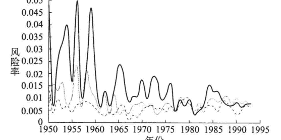
图 6—3 加入中国共产党、进入行政和专业职业的风险率（1950—1993）

虽然这些潜在的样本问题值得注意，但图6—3中的风险率提供了有用的信息。这些曲线为每个时间段的分布提供了信息。首先，显示三个风险率的起伏变化是彼此关联的，说明它们都对相同的宏观政治进程做出反应。尤其是入党率与行政职业的吸收率在多数情况下是对应的，表明这两类事件是由同一个过程控制的。然而，风险率的波动随时间显著变化。例如，在20世纪50年代初，由于官僚体系的膨胀，机会会有明显的增加。在20世纪80年代初的繁盛时期，机会会有明显的减少。在“文革”早期（1966—1969），在后泽东时代由于新领导层实施改革而采用了程序，这三个风险率在（1978—1981）较低。随后在20世纪80年代观察到明显高风险时期。我们需要强调的是，图6—4显示了国家僚体系中的行政和专业阶层的风险率。这里的风险定义为当时处于某一类中的。总来说，可以看到改革时期这两条路径的晋升风险增长最大，而在“文革”时期则是最低，因为职业模式受到了严重的干扰。与图6—3类似，这种趋势在跨越历史时期非常相似。


图 6—4 僚体系中晋升的风险率

这些数据描述的跨越历史时期显示出职业机会遭遇的变化。那么，是什么过程引起人们进入这些职业路径？不同类型通常是个人生命历程中最遇到的事件，所以我们的分析……

我们在分析不同时期进入官僚体系的模式——行政者和专业者被归类为干部。在劳动力中较高地位，只有很比例的就业者能够这些职业。在很多情况下，干部始于第一份工作。因此，我们关注的分组不同。首先，对于进入事件，进入变量（行政或专业职业）没有发生进入事件的职业。其次，在这一章中，我们的分析……

在这一章中，如果一个人成为劳动力，那么他可能进入行政性（或专业性）的职业，仍然在当前的职业中是不必要的。许许多已经就业的其他职业人员进行行政和专业的性的。最后，在第四章中，我们的分析同时包含了配偶（在某些工作类别中样本少），而在本章中关注自己。这组分析允许我们发现中国体系是广泛的人才来源以及潜在的录用标准。表6—1报告了三个时期进入行政职业（左半部分）和专业职业（右半部分）决定因素的logistic回归系数。我们通过对比两种职业模式下分析结果。表中的各项显示了相关变量对经历事件的对数发生的影响。总体结论。对于截距来说是有意义的，我们将以25岁作为年龄中位点。因此，截距代表一个时期在大城市的集体企业工作中、具有中学及以下水平年龄为25岁的男性职工总体的对数发生。这些时期截距说明，第一个时期进入这两个职业的比例比较较高，第二个时期没有明显的趋势走向。第三个时期，有明显高的行政职业的比例，但专业职业并非如此。性别，男女进入这两个职业的比例差异是明显的。在这个时期，女性进入行政职业的比例都较低，但进入专业职业的比例比较较高。要注意的是，由于我们将半专业（如护士、技术人员）也包括在“专业”类别中，女性进入专业职业比例高并不意味着女性在一点上有性别优势。相反，女性雇员可能更集中在了依照性别分类的工作中。

### 表6—1 不同时期进入职业的 logistic 模型

| 变量 | 进入行政职业 | 1945—1966 | 1966—1979 | 1980—1993 | 进入专业职业 | 1966—1979 | 1980—1993 |
| :--- | --- | --- | --- | --- | --- | --- | --- |
| 截距 | -4.357*** | 1.322*** | -4.137*** | 1.049 | 1.479 |
| 女性 | -0.623*** | -0.538*** | -0.774*** | 0.255* | 0.405*** | 0.338*** |
| 年龄 | -0.050*** | 0.018 | 0.100 | -0.163*** | -0.093** | 0.010*** |
| 年龄²/100 | 0.414 | 0.017 | -0.441*** | 0.153 | 0.060 | -0.258*** |
| 教育水平 | | | | | | | |
| 高中 | 1.149*** | 0.743*** | 0.789*** | 1.531*** | 1.586*** |
| 大学 | 0.890*** | 0.676*** | -0.538*** | 2.415*** | 0.830*** | 2.195*** |
| 职业地位 | | | | | | | |
| 专业人员 | -1.045** | -0.314 | -0.277 | -3.079*** | -0.731*** | -0.821*** |
| 办事员 | -0.104 | 0.762*** | 1.015*** | -0.733*** | -0.436 | -0.894*** |

注：** p < 0.01，* p < 0.05，+ p < 0.10

| 变量 | 进入行政职业 | 1945—1965 | 1966—1979 | 1980—1993 | 进入专业职业 | 1945—1965 | 1966—1979 | 1980—1993 |
| --- | --- | --- | --- | --- | --- | --- | --- |
| 服务人员 | -0.582* | -0.156 | 0.066 | -0.492* | -0.649* | -0.798* | |
| 军 | -0.953** | 0.741** | 1.715** | -2.011** | -0.508 | -0.657 | |
| 学生 | 1.584** | 2.398** | 3.256** | 2.15** | 2.777** | 2.952** | |
| 农民 | -1.255** | 0.538* | -0.727 | -0.21 | | | |
| 工作类型 | | | | | | | |
| 政府机构 | 0.959** | 0.711** | 0.422* | 0.492* | 0.436* | 0.156 | |
| 公共组织 | 0.099 | 0.174 | 0.093 | 1.311** | 1.277** | 1.053** | |
| 国有企业 | 0.930** | | 0.080 | -0.847** | -0.148 | | |
| 父亲教育水平 | | | | | | | |
| 初中 | 0.562* | -0.036 | 0.267* | -0.083 | -0.064 | 0.222* | |
| 高中/大学 | -0.127 | 0.027 | 0.151 | 0.469** | 0.140 | 0.341** | |
| 缺失值 | 0.007 | 0.288 | 0.055 | -0.257 | -0.044 | 0.149 | |
| 父亲职业地点 | | | | | | | |
| 干部 | 0.504 | 0.445* | 0.385** | 0.022 | 0.268 | 0.178 | |
| 专业人员 | 0.176 | -0.074 | -0.300 | 0.157 | 0.498* | 0.651** | |
| 农民 | 0.545** | -0.004 | 0.283* | 0.326* | 0.337* | 0.178 | |
| 缺失值 | 0.519* | -0.255 | 0.048 | 0.343* | 0.351 | | |
| 居住地 | | | | | | | |
| 中等城市 | -0.042 | 0.017 | -0.124 | 0.207 | 0.061 | -0.018 | |
| 小城市 | -0.106 | 0.059 | -0.259* | 0.200 | 0.176 | 0.209 | |
| 事件数目 | 206 | 269 | 473 | 364 | 356 | 572 | |
| Log-likelihood | -923.8 | -1.479 | -2.084 | -956.2 | -1.567 | -1932.9 | |
| 自由度 | 23 | 23 | 23 | 23 | 23 | 23 | |

魏德，选择标准强调录用和晋升那些具有“革命精神”的人。结果，“一批具有革命精神的人进入党内成为后来长期不变的因素”。


# 国家与生活机遇

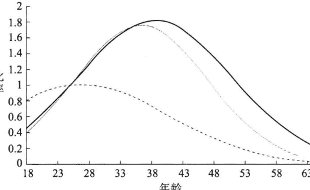

图 6—5 年龄加入中国共产党、进入行政和专业职业的影响（1980—1994）

职业中的年龄限制更强，其峰值在二十八九岁时；然而进入行政职业的年龄效应则应在 35 岁左右。也就是说，进入专业职业对年龄限制更为敏感。那些教育水平对两种类型的职业的假设都有显著影响。在三个时期中，那些拥有高学历文凭或大学学力的人进入行政职业的比率明显更高。这种模式某种反映了中国官僚体系的制约机制，将即将毕业的学生常规地分配到干部岗位上。与二元路径模型的假设的发现是，与进入行政职业相比，教育水平在进入专业职业中扮演了更为重要的作用。

政治动态的影响也是明显的：在“文革”中，教育水平的影响明显较小，而在毛泽东时代，大学教育的影响，特别是对行政职业而言具有实质性的提高。这些模式与“文革”中对知识分子的歧视和后毛泽东时代对教育的强调对干部政策的变化是一致的。

其他职业对行政和专业职业的供给有几个重要特点。首先，二元路径一致，专业和行政职业转换效率较低，表明两者是两个分类的职业。另一方面，在第二和第三时期，从专业转入行政工作，与从参照类别工人转入的情况没有统计上的结论。换言之，在干部和专业人员之间存在着界限，但这些界限并不是严格划分的。正如实践中经常观察到的，从专业向行政性工作的流动存在，反之则不然。其次，办事员、军事人员和高中毕业生是中国官僚体系中系列最大的供给源，尤其是在毛泽东时代。相比之下，在所有的职业供给源中，大学毕业生是专业职业的唯一供给源。第三，尽量意识形态主张工人阶级的重要性，但除第一个时期外，对于其他职业，无论是服务人员还是产业工人，在成为干部上都没有任何优势。①

在三个时期中，政府机构具有更具的干部比例；类似，与其类型组织的职业比例相比，我们发现公共组织具有更大的专业人员比例。这些特点是不好理解的。

代际传承，最后，我们从代流动的角度检验职业模式的影响。我们考察了父亲教育水平和职业的影响。的确存在“继承”的影响，干部子女能够追随父亲的足迹从事相同的职业。这种影响出现在“文革”时期，就是分配政策最为严厉的时候。另一方面，父亲教育水平在职业路径中的作用受到“文革”时期政策的消极影响，那时高学历由资源变成了累赘。这也解释了为何父亲的高教育地位在第一和第三时期有利于个人进入专业性工作，而在第二个时期则无显著影响。

# 第6章 权力政治转型：官僚的职业模式

## 6.5 入党

在国家社会主义中，党员身份是一项重要的政治资源。如我们提到的，在不同历史时期，党员选择标准有显著的变化。随着时间的推移，党员吸收捕捉到了政治机会分配的演变过程。由于18岁是人的最低年龄，所以我们的分析包括18岁及以上的访问者。

- ① 在两个时期之前（以及进入干部队伍的第一个和最后一个时期），那些来自农村地区（农场）的人有更高比例进入专业职业，但是我们的抽样本。那些居住在农村区域的人是通过大学教育进城城市的，这一过程将他们输送到农村来，这种转变并不是农村农民的一般模式。
- ② 我们没有统计江苏和这两个省中城市的党员身份，这大约占总样本的20%。在分析中排除了这两个省份的样本，在研究中包含具有代表性样本的所有被访问者，我们在分析媒体体的录用和普及，没有包括党员身份。在探索性分析中，我们曾包含党员身份的14城市的样本，同样一组包含党员身份的模型进行了检验。其他协变量的系数与样本的发现相似。

# 国家与生活机遇

表 6—2报告了入党的 logistic 回归模型中的变量的参数估计值。①

性别。在所有历史时期，女性所占的比重都低于男性。性别差异在“文革”期间达到最小，而在改革时期最大，这暗示着不同历史时期的显著变化，它们与政策的变化是一致的。

资历和教育。我们曾推测，年龄的影响随着历史时期而变化。在前两个时期，比较年轻的入党可能较大。第三个时期，我们观察到 U 形，峰值在三十八九（图6—5）。年龄对入党率和干部率具有相似影响，这一事实显示这两类事件的过程相似。发现，年龄限制政治机会在改革时期最明显。年龄在早期的负效应反映了扩张时期，那时年轻的人被吸入。教育影响讲述了一个故事。第一个时期，教育水平无影响；第二个时期只有高中具有显著差异。改革时期（第三个时期），与那些初中的人相比，高中及大学毕业生具有更高的入党率。结果与毛泽东时代是一致的。表明，在改革时期，能力（教育程度）成为一项重要的标准。我们看到了毛泽东时代和后毛泽东时代选择的变化。

表 6—2 不同时期加入中国党的 logistic 模型参数估计

| 变量 | 1949—1965 | 1966—1979 | 1980—1994 |
| :--- | :--- | :--- | :--- |
| 截距 | 1.818 | 6.212 | |
| 女性 | -0.320 | -0.234* | -0.653* |
| 年龄 | -0.036* | 0.005 | -0.088* |
| 年龄²/100 | -0.938* | -0.157* | -0.324* |
| 教育水平 | 0.003 | 0.299* | 0.469* |
| 高中 | | | |
| 大学 | 0.050 | 0.165 | 1.031* |
| 职业地位 | | | |

① 我们样本中党员身份的百分比优于事实；我们样本中城市居民占大的比例，他们更容易成为党员。这也反映了这样的事实，中国中党员有显著增长。根据官方统计（Zhao 1987, p.446），1981年，在制造业和运输业的国有企业中，有17.7%的员工都是党员。在商业和金融业的国有企业中，这一比例为18.4%。

# 权力阶层：官僚的职业模式

表前表

| 协变量 | 1949—1965 | 1966—1979 | 1980—1994 |
| :--- | :--- | :--- | :--- |
| 干部同期群 1949—1965 | 1.781* | 1.348** | 1.452** |
| 干部同期群 1966—1979 | | 1.928** | 0.991** |
| 干部同期群 1980—1994 | | | 1.354** |
| 专业同期群 1949—1965 | 0.273 | 0.186 | 0.871** |
| 专业同期群 1966—1979 | | 1.025** | 0.662** |
| 专业同期群 1980—1994 | | | 0.921** |
| 办事员 | 1.006* | 0.691* | 0.518+ |
| 服务业人员 | 0.653* | 0.295 | 0.093 |
|Military人 | 1.632** | 2.379** | 2.270** |
| 学生 | 0.313 | 0.669 | 1.070** |
| 農民 | 0.428 | 0.485+ | 0.051 |
| 工作组织类型 | | | |
| 政府机构 | 0.515+ | 1.063** | 0.490* |
| 公共组织 | -0.052 | 0.620* | -0.209 |
| 现有企业 | 0.180 | 0.472* | 0.001 |
| 父亲的教育水平 | | | |
| 初中 | -0.393 | -0.220 | 0.111 |
| 高中/大学 | -0.475 | -0.405 | -0.062 |
| 缺失值 | 0.211 | -0.058 | 0.206 |
| 父亲的职业地位 | | | |
| 干部 | 0.577+ | 0.274 | 0.137 |
| 专业人员 | -0.238 | -0.375 | -0.214 |
| 農民 | 0.239 | 0.525** | 0.348* |
| 缺失值 | -0.124 | 0.241 | |
| 居住地 | | | |
| 等等城市 | 0.026 | 0.28 | 0.370* |
| 小城市 | 0.038 | 0.36* | 0.085 |
| 事件数 | 10 | 301 | 12 |
| Log-likelihood | -912.1 | -1395.6 | -1632.6 |

** p < 01
* p < 05
+ p < 10

注：初中水平以下教育水平为参照类，工人职业参照类，国有企业为工作组织参照类，城市居住为参照类。

# 国家与生活机遇

同期效应。进一步探讨国家政策产生的影响，根据员工吸收的历史时期，纳入了一组虚拟变量与干部和专业人员同期群体相关的生活机遇。

第一个同期群体由1949—1965年进入的干部构成。第二个同期群体由“文革”及随后，即1966—1979年进入的干部构成。第三个同期群体由1980年后进入的干部构成。

我们的经验假设，政治选择的变化在同期效应与假设吻合。与工人（参照类）相比，正如不同时期干部同期效应显著的所示，在改革期间，成为一名干部明显有助于个人入党。然而，在三个同期期间，这种影响的大小是有变化的。在“文革”期间，与第一个同期群体相比，第二个同期（1966—1979）被入党的可能性更高。相比之下，在改革时期，“文革”同期在三个同期中入党的可能性最低。这与新的政策是一致的。

我们在三个时期的专业同期群体中观察到了类似的模式。尽管教育在“文革”期间入党没有发挥显著作用，而第二个同期群体专业人员成为党员的比例却是高的。一种解释是在这一时期，主要领导人积极提升他们的政治追随，而这些人大多是大学或专业性部门。相比之下，过程没有青睐第一个同期群体。

其他职业。关于职业地位的影响，有几个发现值得期待。首先，办事人员有更高的人党率，他们通常是干部的力量。众所周知，在中国，与工人类别相比，获得党员身份提供了更好的机会。最后，同样注意的是，教育程度在改革时期特别受到青睐：在第三个时期，相对于其他职业，具有大学文凭的人是最大的受益者。

工作组织类型，不足的是是在三个时期中，与参照类别相比，政府机构的职工有着明显更高的人员率。公共组织和国有企业的职工在“文革”期间有较高的人员率。这一发现可能的解释是，这一时期的激进政策主要利用红卫兵（他们中的大多数集中在公共组织）和工人阶级成员（他们中的大多数集中在中国企业）。

社会出身。没有证据显示父亲教育水平和职业地位标志的社会出身与个人有关任何性质的影响。

# 6.6 中国官僚体系的晋升模式

在国家社会主义下，权力最终归于一个人的官僚职位。由于职位提供了再分配权力和利益，所以晋升事务尤为重要。下面的分析考察了中国官僚体系的晋升模式。体系来说，我考虑了两种类型的晋升。首先，在建立的官僚阶梯上的正式晋升在不同的单位和地方具有区别。虽然这些晋升事件发生在单位内部，但机会和标准是由国家政策实施的。在这组分析中，我包含了这些在某些数据集中已占行政或专业人员的。

其次，我考察工作单位内的晋升模式，具体地说，是工作单位向低级管理人员的晋升。与正式官僚晋升相比，单位特定组织管理职位的晋升更为灵活，对当地环境更为敏感。在这个分析中，我们涵盖了工作组织的所有人员，由于工作单位员是否拥有国家公布的行政级别，他们都可能晋升到管理职位。

在一个职业生涯中，官僚晋升可能不止次，这些重复可能是相互相关的。由于这个原因，我们采用了广估计方程（GEE）模型，这一模型允许重复晋升的分析（关于模型的细节见第2章）。我们检验了党员身份在晋升中的作用。由于6个城市流失党员信息，我们可以获得14个城市的党员身份作为样本，分别估计了党员身份的影响。但是为了方便说明，我们用与整体一样的图表来报告身份的影响。

## 6.6.1 正式官僚级别的晋升

表 6—3报告了正式或专业级别的晋升的GEE模型参数估计。第一组报告了行政路径晋升模式，第二组报告了专业路径晋升模式。我们关注了三个时期的策略，都吻合。在1949—1965年时期，案例多，因此我们合并了前两个时期。

# 表 6—3 中国惯性晋升决定因素的 GEE估计

| 变量 | 正式行政路径晋升 | 专业职业路径晋升 |
| :--- | :--- | :--- |
| | 1949—1965 | 1966—1979 | 1980—1994 |
| 截距 | -0.671 | -7.447** | 10.376** | -7.139** |
| 女性 | -0.435 | -0.691* | -0.684** | -0.299** |
| 年龄 | -0.012 | 0.092* | 0.132** | 0.046** |
| 年龄²/100 | -0.974 | -0.306** | -0.383** | -0.232 |
| 教育水平 | | | |
| | 0.274 | 0.168 | 0.231 | 1.104* | 0.776** |
| 大学 | 1.352** | 0.902** | 1.067* | 2.386** |
| 党员* | 1.287** | 0.680** | 1.072** | 0.451* | 0.460** |
| 任期持续 | 0.078* | 0.032 | -0.046** | -0.027 | -0.017* |
| 级别 2 | | | -0.981** | -1.159** | -0.123 |
| 级别 3 | | | -0.636 | -1.604** | -2.739** | -1.341** |
| 级别 4 | | | -2.156** | -2.531** | |
| 干部/专业人员 | | | | | |
| 1949—1965同期群 | | | | | |
| 1966—1979同期群 | | 0.246 | -0.767** | -0.128 | -0.482** |
| 1980—1994同期群 | | | -1.457** | | -0.659** |
| 父亲的职业水平 | | | | | |
| 初中 | -0.152 | -0.073 | 0.106 | -0.944** | -0.273** |
| 高中/大学 | 0.862 | 0.323 | -0.143 | -0.693* | -0.102 |
| 缺失值 | 0.607 | 0.315 | -0.295 | 0.495 | -0.085 |
| 父亲的职业地位 | | | | | |
| 干部 | | -0.750 | 0.080 | 0.244 | -0.023 | -0.100 |
| 专业人员 | 0.776 | -0.241 | 0.216 | 0.370 | -0.609* | -0.114 |
| 农民 | | 0.278 | 0.090 | | -0.625* | |
| 缺失值 | | 0.282 | -0.387 | -0.227 | -1.036 | -0.530** |
| 工作组织类型 | | | | | | |
| 政府机构 | | 0.516 | 0.456 | 0.759** | -0.216 | 0.489** |
| 公共组织 | 1.104* | 0.254 | 0.035 | 0.216 | 0.689** |
| 国有企业 | 1.340* | 0.190 | 0.009 | 0.301 | 0.530** |


# 国家与生活机遇

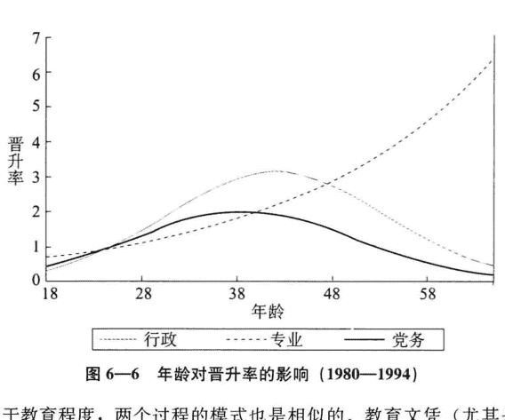

对于教育程度，两个过程的模式也是相似的。教育文凭（尤其是大学教育）在三个时期中的晋升中都有明显的正面影响，与教育对行政和专业职业录用率的影响相似。在所有三个时期中，大学教育对更高的晋升率有所贡献。值得注意的是，与魏德二元路径模型吻合的发现，教育对高等的晋升率有显著的影响。教育对专业级别晋升率比行政级别晋升更为重要。对于行政级别的晋升，大学教育在“文凭”期间影响最小。

在三个时期中，党员身份对两条路径的晋升率都有正向影响。正如我们预期的，党员身份在行政职业路径的晋升中发挥了更加显著的作用。在“文凭”期间，党员身份的影响较小。一个可能的解释是，那段时期许多老干部成为晋升清单的成员。

在当前职位上的时长对晋升的影响也随时间变化。对于行政职位，较长的教育在第一个时期中提高了晋升率。在第二个时期中则无此影响，在第三个时期中则降低了晋升率。这一模式意味着，资历在早期有助于晋升，在改革时期中却失去了一个条件。在专业晋升中，我们观察到相似的模式。这种模式与三个时期的国家政策相一致，即晋升利于更年轻的、更高教育水平的干部和专业人员。

与级别等级相关的晋升率提供了有关官体系内部流动和壁垒的信息。我们利用虚拟变量来测量行政/专业领域间不同别的转换率。

## 第6章 攀爬阶级：官僚的职业模式

类别一级——由最低级别到紧靠的上一级的转变（行政路径中从各级别到科级，专业路径中从技术员到助理工程师级别）。二级是指行政路径中从副级到处级、专业路径中从助理工程师到工程师的转变。三级是从副级到处级、从工程师到高级工程师的转换。四级是指行政路径中从处级到局级或局级以上上级的转变。

层级与层级之间相关的参数表示了从某一级别到紧靠的高级别的晋升率，但控制了模型中其他变量的影响，与基线相似的晋升率，所谓基线是从最低级别到次最低级别的晋升率（行政路径中由普通干部到科级，专业路径中由技术员到助理工程师级别）。晋升率随着行政级别的上升而降低，呈现金字塔形，一个人向上，空间越越小。处级向上（第四级）晋升的壁垒是最大的。在专业路径中，助理工程师和工程师之间存在明显的壁垒，从工程师级到高级工程师级（三级）的晋升存在明显的壁垒。

干部/专业群体。在这些时期，行政和专业晋升的同期效应是相似的。与同一个群体（参照列表）相比，“文革”期间第二个群体的晋升率并没有显著的。在毛泽东时代后期，虽然有显著的同步效应，但这种模式与我们的晋升规律并不一致；控制其他变量的影响后，我们第一个群体晋升率最高，第三个群体晋升率最低。这一发现意味着，尽管与毛泽东时代的新政策相符，但基于同期的资历原则在中国官僚体系中晋升无系统性影响仍然是重要的。

### 6.6.2 工作组织的晋升机制

我们在关注另一种职业晋升类型——工作组织内管理阶梯（低、中、高）的晋升事件。这种类型的晋升关键是因为它与具体的组织的实际权力职位相联系。我们包括的变量与之前的分析模型类似。由于单位内的晋升可能不仅包括已处于行政和专业职业的人，而且包括那些普通职员，所以后者也包含在风险集中。进一步地，由于干部和专业人员可能在单位中晋升到管理职位，我们在模型中还考虑了干部和专业人员。

## 国家与生活适应。①

同期效应。我们报告了三个时期晋升模式的参数估计值。我们围绕前面提出的主要研究议题来组织对结果的讨论。

#### 表 6—4 工作组织内提升晋升决定因素的 GEE 估计

| 协变量 | 1949—1966 | 1966—1979 | 1980—1994 |
| --- | --- | --- | --- |
| 截离 | -7.673* | -0.562 | 3.263* |
| 女性 | -0.872* | -0.731* | -0.729* |
| 年龄 | 0.008 | 0.056* | 0.097* |
| 年龄/100 | -0.926* | -0.109 | -0.354* |
| 教育水平 | | -0.132 | 0.316* | 0.454* |
| 高中 | | 0.690* | 0.906* | 0.914* |
| 大学 | | 0.886* | 0.710* | 0.834* |
| 党员* | | | | |
| 任职持续期 | | 0.034 | 0.022 | -0.006 |
| 低级 | | -1.213* | -0.956* | -0.846* |
| 中级 | | -2.099* | -1.663* | -1.368* |
| 干部 | | | |
| 1949—1965时期群体 | 3.387* | 2.396* | 2.547* |
| 1966—1979时期群体 | | 3.621* | 1.979* |
| 1980—1994时期群体 | | | 2.985* |
| 专业人员 | | | |
| 1949—1965时期群体 | 0.654* | 0.528* | 1.330* |
| 1966—1979时期群体 | | 1.414* | 1.083* |
| 1980—1994时期群体 | | | 1.643* |
| 父亲的教育水平 | | | |
| 初中 | 0.194 | 0.064 | 0.090 |
| 高中/大学 | -0.053 | 0.381 | -0.026 |
| 缺失值 | 0.123 | -0.268 | 0.200 |
| 父亲的职业地位 | | | |
| 干部 | -0.798 | -0.049 | 0.052 |
| 专业人员 | -0.263 | -0.478 | 0.17 |
| 农民 | -0.442 | -0.311 | -0.039 |
| 缺失值 | -0.156 | 0.148 | -0.313 |
| 工作组织类型 | | | |

① 有一些晋升和工作变动同时发生的。在这些情形中，我们的统计分析使用了新入组织的信息，假设单位特征对晋升机会更重要。

#### 表 6—5 官僚晋升：官僚的职业模式（续）

| 协变量 | 1949—1965 | 1966—1979 | 1980—1994 |
| --- | --- | --- | --- |
| 政府机构 | -0.410 | 0.129 | -0.067 |
| 公共组织 | -0.314 | 0.058 | -0.107 |
| 国有企业 | 0.070 | 0.439* | 0.066 |
| 居住 | | | |
| 中城市 | -0.379 | 0.144 | -0.611* |
| 小城市 | -0.765* | -0.218 | -0.390* |
| 事件数 | 143 | 275 | 634 |
| 案件数 | 1380 | 2984 | 4200 |
| Log-likelihood | -604.1 | -1243.3 | -2805.8 |
| 自由度 | 22 | 23 | 26 |

** p<0.01
* p<0.05
** p<0.1
* 与参与身份相关的统计了14个城市的数据。

注：初中教育水平以下为参照类别，工人为父亲职业地的参照类别，集体企业为工作组织的参照类别，大城市为居住地类别。

宏观治理进程与组织特点相同。我们假设官僚治理进程在官僚晋升的作用更为重要，且官僚选择的影响由不同的时期效应反映出来。

年龄的影响在不同历史时期有所不同。在第三个时期，工作场所内官僚晋升相关性与早期限制在组织体系中更加加强。大学学位在三个时期都助于晋升。在每个时期官僚体系中教育水平的影响相比（比较表6—3），似乎工作组织内的官僚晋升很大程度上遮蔽了国家政策的剧烈变动。

我们还发现三个时期中党员身份对工作组织内的晋升有显著的贡献。与行政身份类似，党员身份在“文革”期间的影响较小。

# 国家与生活机遇

另一个鲜明对比与同期效应相关。对于国家官僚体系晋升模式的回顾，越早的同期晋升率越高。换言，资历原则在国家官僚体系中普遍存在。与此相反，工作组织内的晋升事实表明，不同的部门和专业人员存在不同的、一致的生活机遇。在第二个时期，那些在“文革”中成为干部的人（1966—1979年群体）比在时期成为干部的人（1949—1965年群体）有更高的晋升率。相比之下，在改革时期，1980—1994年的干部和专业人员群体（改革时期被录用为两种职业的人）具有最高的晋升机会。相反，那些在“文革”中被录用的人（1966—1979年群体）在三个同期中有着最低的晋升机会。同期效应的变化说明时期路径选择标准具有显著的变化。

这种模式意味着在官僚体系和以工作单位为中心的管理中，管理层的构成更多反映了过去的持续性，而一般组织倾向于由更年轻的干部担任职责。正如我们将在之后讨论这些，这些发现对中国未来的政治变化具有重要意义。

也有支持两个互为隔离的官僚职业路径的观点。同期效应在早期中的影响力大于人员群体，这表明与专业职业路径相比，行政职业路径与领导接触更为密切。总之，干部群体在两个时期的晋升率都高于人员群体，表明对于组织内部的职位，行政职位是一个更为快捷的职业发展路径。

另一个例外是，在任何时期，组织结构特点都没有显示出对组织内部晋升的影响。政府机构、公共组织以及中央和地方企业没有显示出显著的模式。在当前时期，时间没有显著的作用，表明在相同的情况下不存在路径依赖。与管理级别相关的变量不断增加，晋升率随着级别上升而下降。

① 注意这些系数很大。因为许多普通人（参照类别）晋升到管理层，但与行政或专业领域的人相比，这样的例子却是罕见的。这个模式说明行政和专业人员之间存在坚固的差别。

## 第六章 官僚阶层：官僚的职业模式

### 6.7 本章总结

本章报告了官僚职业生涯模式方面的考察。我们的经验分析是由两个模型引导的：一个强调路径的稳定基础，另一个强调政治趋势与官僚职业模式的关系。在我们的分析中，还考虑了代际流动的影响。总结一下主要的发现：

首先，研究与魏德二元路径模型一致。正如进入行政和专业领域的发现，存在不同的选择标准。正如魏德提出的，对于晋升而言，教育文凭在专业路径的重要性比行政职业更重要。干部群体比专业人员对历史背景的变化更为敏感。

其次，不同时期国家政策的波动导致了生活轨迹的巨大差异。例如，“文革”期间大学被关闭了很多年，使得时期的毕业生无法进行进一步的职业发展。毛泽东时代和转型时代之间，教育文凭的重要性发生了显著变化，与政策的变化相合。最后，政治过程的影响在干部群体中最为明显。在工作组织的晋升中，我们看到不同群体机会明显的差异，这些差异与设的政治选择是一致的。尤其在改革时期，第二个群体在工作组织内行政职位的晋升率出现了政治选择的强烈影响。

本研究意外和有趣的发现是不同干部和专业人员期间的晋升模式。早期期的较高晋升率显示，在国家官僚体系中，资历原则即使在改革时期仍然发挥主要作用。然而，工作单位晋升却显示出不同的模式：在三个时期中，第三个时期晋升率最高，第二个时期最低。解释这两种模式可能的解释是，官僚机构内部的政策实施受到那些者的反对。

## 第二部分：对毛泽东时代制度变迁的评估

# 国家与生活机遇

自20世纪80年代以来，中国上了经济转型的之旅，导致了社会景观的深刻变化。在改革开放时期，中国取得了令人印象的进步。中国经验的独特方面（特别是）激发了许多国际科学家对中国制度转型的极大兴趣。

在下面四章中，我们将注意力转向研究的第二个主题——考察与评估经济转型时代制度变迁的内容和来源。以下章节将围绕着特定理论话题的组织。与之前的章节类似，我们也呈现出1949—1994年间各个时期的证据，继续我们关于社会分层的讨论。但这些讨论的重点将主要是评估毛泽东时代（1949—1979）和转型时代（1980—1994）的变迁和持续性。第7章解释个人收入——这一经济利益的影响因素在不同时期的变化。第8章强调了再分配制度下隐性经济利益的重要性，并报告了针对中国城市住房分配——隐性经济利益的一个重要方面的细致分析。第9章中，我们基于不同类型组织和经济部门间的工作转换，评估了制度转型程度。最后，第10章从生命历程视角比较了生活机遇分布群体的差异。

## 第7章 经济转型与收入不平等模式的变化

这一部分将通过对比改革后的社会分层模式，进行一系列评估中国制度转型的变化与连续性的研究。正如我们在第1章中讨论的，自20世纪80年代起，社会科学家对国家社会主义变革中的中国经验的研究兴趣大幅增长（Guthrie 1997, 1998, 1999; Keister 1998; Oi 1999; Walder 1995c, 1996a）。在第1章，我们讨论了主要的理论模型，并强调了在研究国家社会主义转型的社会学家当中正在进行的争论。其中，倪志伟（Nee 1989, 1991, 1996）的市场转型理论强调新出现的市场在弱国家社会主义再分配体制上的重要性。


# 国家与生活机遇

利益受损。但是，一旦我们考虑到这些过程中，与改革以前相比，改革时期再分配者对于生产者争取利益的优势在总体水平上可能并没有降低。

这一文献中的一个重要的经验问题是怎样定义再分配者和生产者。倪志华将“管理精英”定义为再分配者，同时将普通工人以及“企业家、经营和技术人员”定义为生产者（1996, p. 916）。本章我们提出了两种干部（管理者）地位的替代方案。方案一使用了中国中央政府部门的干部甄别。方案二将公共部门（政府部门和公共组织）与经济部门（企业）的干部进行了区分。在国家社会主义中国，一个干部的行政级别越高，它就远离再分配权力越远。此类干部，公共部门的经济部门的干部更接近政治权力。因此，前者接近再分配者的概念，后者则接近企业经营的概念。我们用类似的测量方法专业人员，考察这些利益与其所处的职业（专业等级）或他们市场的紧密程度变化的可能性。

# 政治资本 vs. 人力资本

在市场中，生产要素通过竞争性市场活动得到配置，这表表示人力资本在决定一个人的经济回报中起着重要作用（Becker, 1989）。与相反，以往研究指出，社会主义国家回报对政治忠诚而非能力。遵循这样的要求的，倪志伟（1989）认为，当再分配的政治权力被限制时，与改革以前相比，改革时期政治回报下降，人力资本回报上升。在以往文中，党员身份通常用作政治资本的指标，而正规教育和工作作为人力资本的指标。

在考虑经济转型中其他配置和回报政治与人力资本的共存。首先，对于政治资本，我们之前提到的一个直接意味着：只要政治权力在官员选拔和晋升中扮演重要角色，对政治地位给予持续和重要的回报在逻辑上似乎是合理的。

其次，对于人力资本的回报，我们认识到中国中人力资本的配置具有多样性和竞争性。倪志伟的论点表明，配置人力资本的劳动市场的出现，使得回报上升。这也是，国家社会主义再分配体制并没有强制性低回报的内在属性。尽管中国政府强调政治忠诚，国家对知识分子的政策也经常变化，但教育并没有被完全忽视。相反，正如“红又专”这一标签所

# 第7章 经济转型与人不平等模式的变化

所概述的，同时具有政治调试和较高教育水平的这个政治环境所期望的。

正如霍德德和泽林尼（Konrád and Selynin 1979）指出的，社会计划制度虽重视知识和教育，也将知识吸纳为政治精英。魏魏、李、博柏和雷曼（Walder, Li, and Treiman 2001）针对中国的背景提出了一个相似的观点。最近一个关于苏联和中国再分配模式的比较研究发现，苏联对教育的回馈大大高于中国。政府已经且正在积极参与人力资源的配置。即使是在改革时期，拥有如此高人力资本的个人大部分都进入了政府部门，特别是政府机构和公共组织（参文本书第4章、第9章）。更重要的是，在2世纪世纪80年代初——城市开始实施性市场改革后国家建设将强调教育文化作为获得政治权力的依据（党员身份和干部晋升）最重要的标准之一。从这个角度看，教育的重要性可能随着国家结构的改变而增强，而这种增强与市场机制的作用是相反的。

工作组织的制度性安排。在国家社会主义中国背景下，学者们特别强调重视工作组织之一主要的再分配模式（Bian 1994; Lin and Bian 1992; Walder 1982; Whyte and Parish 1984; Zhou et al. 1996）。这些研究发现，在各类工作组织中存在层级化的程度，而这些工作组织的利益则随着国家政策以及它们与国家的产权关系而系统地发生变化。与非政府部门的工作组织（集体企业、私营企业混合所有企业）相比，政府部门的工作组织（政府机构、公共组织和国有企业）从再分配体制和国家政策中受益更多。

市场扩张如何影响工作组织的分配安排？根据市场转型的逻辑（Nee 1992）可以期待，在收益进入模式下，对于国有部门的工作组织，那些与市场活动有更紧密联系的企业已经经历较多的改变。由于同类型工作组织的控制程度有着显著不同，那些国家控制较少的工作组织更有可能从再分配体制中维持。因此，随着市场化进程的推进，市场转型预测：与再分配相关的组织层级将会改变；同样，工作类型与之相关的收益模式也会改变。那些与市场活动有更紧密联系、且少受到再分配控制的组织（集体、私营和混合所有企业）。

然而，我们发现一些重要的竞争过程，市场过程相对。国有部门的工作组织为政治等级提供了合法性（Walder 1986）。与市场的新兴利益相比，与正式体制联系的既得利益有着更好的组织。因此，这些考虑意味着国家在资源配置上的干预。根据这种观点，在改革时期，嵌入正式体制的既得利益的政治活动将延续。

#7.2 决定因素的截面分析

图7—1是两个统计所呈现的两种收入间的模式。如图7—1所示，在1955—1975年间，得到的平均收入与官方统计非常接近。二者的差异在1978—1994年间有所增加。更重要的是，样本值与官方统计值的差异并不突出。这种来源可能源自这样一个事实：样本中有很大比例的大城市居民（包括北京、上海和各省）。观察这种差异可以通过统计分析来进行。我们首先利用多元回归模型检验了选定年份的收入。我们的目标包括两个方面：首先，组分析的结果有助于考察不同时期收入的变化；其次，追踪分析建立了一个比较基准。这些估计也包括了一组被访者居住城市的指示变量。我们感兴趣的是，在控制了总收入水平后，社会资源分配的模式。

| 变量 | 在设定年份、收入决定因素的OLS估计 | 1960年 | 1975年 | 1978年 | 1981年 | 1987年 | 1991年 | 1993年 |
| :--- | :--- | :--- | :--- | :--- | :--- | :--- | :--- |
| 截距 | 1.983* | 2.258* | 2.421* | 3.773* | 3.774* | 3.364* | 3.345* |
| 女性 | -0.250* | -0.179* | -0.162* | -0.016* | -0.188* | -0.187* | -0.182* |
| 年龄 | -0.111 | -0.078* | -0.068* | -0.040* | -0.022* | -0.044* | -0.043* |
| 教育水平/100 | 0.041 | 0.040 | 0.038 | 0.054* | 0.072*† | 0.089* | 0.106* |
| 初中 | 0.102* | 0.053* | 0.028 | 0.039 | 0.157 | 0.157* | 0.176* |
| 高中 | 0.178* | 0.149* | 0.062 | | | | | |
| 大学 | | | | | | | | |
| 职业类型 | 0.408* | 0.285* | 0.406* | 0.266* | 0.079* | 0.342*† | 0.242* |
| 低技能人员 | 0.356* | 0.131 | 0.166* | 0.121* | 0.089* | 0.103* | 0.207* |
| 高技能人员 | 0.163 | 0.074 | 0.075* | 0.019 | 0.096* | 0.160* | 0.154* |
| 专业人员 | 0.249 | 0.253* | 0.180 | 0.045* | 0.138* | 0.211* | 0.020* |
| 服务人员 | 0.158* | 0.196* | 0.015 | 0.157* | 0.141* | 0.071 | 0.072* |
| 办事人员 | -0.194 | -0.034 | -0.023 | 0.036 | 0.209* | 0.213* | 0.076* |
| 熟练工人 | -0.038 | 0.074 | 0.058 | 0.007 | -0.010 | -0.007 | 0.029 |
| 工作组 | 0.061 | 0.016 | 0.073* | 0.067* | 0.096* | 0.166* |
| 政府机构 | 0.187* | 0.110* | 0.077* | 0.157* | 0.166* | |
| 公共企业 | | | | | | 0.172* |
| 中央政府 | 0.202* | 0.118* | 0.164* | 0.121* | 0.141* | 0.150 |
| 地方政府 | 0.164* | 0.113* | 0.070* | -0.008 | 0.013 | 0.110* |
| 私营企业 | 0.067 | 0.093*† | 0.207* | 0.319* | 0.055* | 0.098* | 0.557* |
| 所有企业 | | | | | | | 0.44 |
| 调整的R | .778 | .133 | .213 | .325 | .347 | .359 | .362 |

表7-1
*** p < 0.01, ** p < 0.05, † p < 0.10
注：小学教育及以下为教育职业的参照类别，非教育职业为教育水平的参照类别。每个城市包含19个城市变量。

178

如表7—1 底部所示，样本在这些选定年份都不相同，这反映了不同时期样本构成的变化。调整后的尺度：针对这些选定年份的模型具有相当的解释力。模型解释了这些年份变异的24%到44%。

在讨论结论所取的这种协变量的影响，我们关注的是不同年份相同变量的系数所反映的历史趋势。为了更好地表明历史变化，我们在图上抽出这些系数在选定年份的变化。1960年和1965年处于第一个时期——“文化大革命”之前的时期；1970年和1975年，某种程度上包括1978年，“文化大革命”时期；1978年之后的时期属于毛泽东时代。

图7—2显示选定收入的性别差异以及大学教育回报率的变化。可以看到，改革前收入的性别差异在减少，如图所示，在1960—1984年间，对于男性、女性的工资逐渐上升。在20世纪60年代后的毛泽东时代，特别是在经济改革的早期，与那些初或没有受教育（参照类别的）的人相比，大学教育的回报是下降的。而在20世纪80年代中期城市地区经济改革开始后，大学教育的回报快速上升，回到“文革”前的水平。


图7—2 在选定年份的数值

- ① 较高部分都包含了城市指示变量，它们捕捉到了不同城市实质的收入变化。
② 这里值得指出的是：职业位的构成（若干干部和专业人员）可能会抵消教育影响的强度，因为后期可能会被归入职业地位，但是即便将职业变量从模型估计中移除，此处报告的总体趋势是相同的。

图 7—3 报告了不同时期，干部和专业人员相对于非此类工人（参照类别）收入率的变化。首先，所有干部和专业人员的收入在毛泽东时代经历了一个下降的趋势，然后反映出国家分层化政策的影响。在改革早期（1978年），该群体的收入有了显著的提升。这很大程度上反映出“文革”后对缩减的薪水/工资的重新调整。在1978—1980年间，该群体的收入下降。在20世纪80年代中期之后，受到体制改革以及市场化过程的推动，这个群体的收入再次上升。


图 7—3 在选定年份，干部和专业人员收入率的数值：

最后，相对于集体企业（参照类别），国有部门的职工在1960—1965年间经历了下降，而在“文革”期间有所增长（见图7—4）。他们在改革早期经历了一段下降，但自20世纪90年代起，他们的优势显现。值得注意的是，在不同时期，国有部门三种类型显示出了相似的模式，反映出经济分配的过程。相反，变化最剧烈的混合企业中的职工。在改革时期，这个群体的收入飙升，获得了最大的收益。


图 7—4 在选定年份，不同类型组织收入率的数值：

这些图显示出几种模式。首先，在不同时期，经济资源的分配具有显著变化，与其国家政策和过程的变化是一致的。其次，可以大致发现不同时期两个收入体制之间的转换。在毛泽东时代（1949—1977）期间，存在收入平均化的趋势，反映出国家分层政策。在整个三个年代内（1960年、1965年和1975年），存在性别差异、职业地位差异（包括干部和专业人员）。同样，不同类型工作组织的收入差异减小。

1978年和1980年的决定模式反映了改革前和改革时期的转变。在1978年，作为“文化大革命”激进政策的延续，毛泽东时代采取了一系列工资增长政策，1978年干部和专业人员回报的增长可以体现（见表7—1）。在某些方面，1978年的模式与“文革”前的回报相似，此时城市地区还没有开始体制转换。20世纪80年代中期，国家在城市地区进行大规模的经济改革。20世纪80年代早期，中央也尝试在工业企业的资源配置中降低计划。这些政策对收入建立显著的效果是企业开始决定工资制度之外的奖金发放。1984年的模式反映了这些变化，在其他情况下，政府机构和公共组织职工在平均水平上没有明显的优势。1987年、1991年和1993年的模式为新收入体制提供了证据。总体来看，变量的影响这一时期具有一致性。尤其是，我们观察到教育、干部和专业回报的增长。这一时期组织类型的重要性依然依赖，而且的影响似乎在不断增强。私营或混合所有企业在这一转型期获得了收益最大。

总的，此报告的结果与有关中国城市再分配历史转变的文献（Whyte and Parish 1984）以及其他研究发现有着广泛的一致性。一般模式反映出两种不同的体制。在毛泽东时代（1949—1977），随着教育水平和职业地位的下降，收入差异呈现下降趋势。这可以很明确地归于这一时期的阶层化国家政策（Parish 1984）。然而，在城市改革时期，由于教育水平、职业地位和组织要素的增长，我们观察到不平等扩大的趋势。

1978—1984年转型期的变化很大程度是国家政策诱导的，与城市经济制度安排的改变有关，也非私营和混合企业显著增长这一值得关注的例外。我们考察中国城市制度转变的目的是，这两个更接近改革前期而非改革时期。

7.3 两个时期的比较：追踪数据的混合模型

我们现在对追踪数据进行分析。基于前文的分析发现，我们用1985年来划分了中国城市的改革时期和转型期。1985年标志着城市改革和新的收入体制的开始。它也见证了国家启动的工资制度改革。新的工资制度是基于员工职位和级别的原则，这与原有工资制度有着根本的不同。考虑到我们收集信息的选定年份，1955—1984年、1987—1994年是我们数据所包含的与两个时期对应的时间段。为了考察这两个时期的变化模式，我们比较了变量的“主效应”以及这些与时期虚拟变量p（如果年份>1985年，p=1；否则，p=0）之间的“交互效应”。粗略地，在此表述中，主效应是指变量在毛泽东时代的影响，而交互效应捕捉的是改革时期的变化。

表7—2 混合模型收入对数值的参数估计

| 变量 | 在设定年份的OLS估计 | 1960年 | 1975年 | 1978年 | 1981年 | 1987年 | 1991年 | 1993年 |
| :--- | :--- | :--- | :--- | :--- | :--- | :--- | :--- |
| 截距 | 1.983* | 2.258* | 2.421* | 3.773* | 3.774* | 3.364* | 3.345* |
| 女性 | -0.250* | -0.179* | -0.162* | -0.016* | -0.188* | -0.187* | -0.182* |
| 年龄 | -0.111 | -0.078* | -0.068* | -0.040* | -0.022* | -0.044* | -0.043* |
| 教育水平/100 | 0.041 | 0.040 | 0.038 | 0.054* | 0.072*† | 0.089* | 0.106* |
| 初中 | 0.102* | 0.053* | 0.028 | 0.039 | 0.157 | 0.157* | 0.176* |
| 高中 | 0.178* | 0.149* | 0.062 | | | | | |
| 大学 | | | | | | | | |
| 职业类型 | 0.408* | 0.285* | 0.406* | 0.266* | 0.079* | 0.342*† | 0.242* |
| 低技能人员 | 0.356* | 0.131 | 0.166* | 0.121* | 0.089* | 0.103* | 0.207* |
| 高技能人员 | 0.163 | 0.074 | 0.075* | 0.019 | 0.096* | 0.160* | 0.154* |
| 专业人员 | 0.249 | 0.253* | 0.180 | 0.045* | 0.138* | 0.211* | 0.020* |
| 服务人员 | 0.158* | 0.196* | 0.015 | 0.157* | 0.141* | 0.071 | 0.072* |
| 办事人员 | -0.194 | -0.034 | -0.023 | 0.036 | 0.209* | 0.213* | 0.076* |
| 熟练工人 | -0.038 | 0.074 | 0.058 | 0.007 | -0.010 | -0.007 | 0.029 |
| 工作组 | 0.061 | 0.016 | 0.073* | 0.067* | 0.096* | 0.166* | |
| 政府机构 | 0.187* | 0.110* | 0.077* | 0.157* | 0.166* | | |
| 公共企业 | | | | | | | 0.172* |
| 中央政府 | 0.202* | 0.118* | 0.164* | 0.121* | 0.141* | 0.150 |
| 地方政府 | 0.164* | 0.113* | 0.070* | -0.008 | 0.013 | 0.110* | |
| 私营企业 | 0.067 | 0.093*† | 0.207* | 0.319* | 0.055* | 0.098* | 0.557* |
| 所有企业 | | | | | | | 0.44 |
| 调整的R | .778 | .133 | .213 | .325 | .347 | .359 | .362 |

表7-1
*** p < 0.01, ** p < 0.05, † p < 0.10
注：小学教育及以下为教育职业的参照类别，非教育职业为教育水平的参照类别。每个城市包含19个变量。

> ①模型的技术细节请参见周光雪（2000a）。
②这两个模型还估计了城市和年份这两个指标变量随机效应的系数。由于我们感兴趣的是理论相关的变量的混合影响，因此所有在报表中报告的对于这些随机效应的参数估计。


## 国家与生活机理

见前表

| 协变量 | 模型 1 主效应 | 模型 1 交互效应 | 模型 2 主效应 | 模型 2 交互效应 |
| :--- | :--- | :--- | :--- | :--- |
| 经济部门中的专业人员 | | | | |
| 办事员 | 0.028 | 0.011 | 0.035 | 0.006 |
| 服务业人员 | 0.020 | 0.017 | 0.021 | 0.017 |
| 熟练工人 | 0.018 | -0.016 | 0.017 | -0.017 |
| 工作组织 | | | | |
| 政府机构 | 0.100*** | 0.026 | 0.070*** | 0.047 |
| 公共组织 | 0.083*** | 0.044*** | 0.061*** | 0.052*** |
| 中央直属企业 | 0.144*** | 0.006 | 0.143*** | 0.006 |
| 地方政府企业 | 0.075*** | 0.024 | 0.076*** | 0.024 |
| 私域/混合所有制企业 | 0.235*** | 0.226*** | 0.233*** | 0.228*** |
| G 协变量结构 | | | | |
| 城市 | 0.042*** | 0.017*** | 0.042*** | 0.017*** |
| 年份 | 0.016*** | | | 0.016*** |
| R 协变量结构 | | | | |
| σ | 0.212*** | | | 0.212*** |
| ρ | -0.00007*** | | | 0.00008*** |
| | 0.024*** | | | 0.024*** |
| N | 4731 | | | 4731 |
| N×T | 27417 | | | 27392 |

*** p < 0.01
** p < 0.05
+ p < 0.10

*交互效应影响了从 1987—1994 年特定协变量影响的变化。
注：对于小学教育水平以下为教育水平的参照类，非熟练工人为职业岗位的参照类，集体企业为工作组织的参照类。两个模型还估计了城市和选定年份影响的影响的一组系数。

表 7—2 第 1 列和第 2 列显示模型 1 中变量的主效应和交互效应。截距和相关的交互效应体现了改革时期的“总体”收入水平及其变化。
交互项为正的显著影响表明改革时期总体收入出现了具有统计学显著性的幅幅增加（exp [0.85]-1=134%）。

性别。在改革前，女工的收入相当于男工收入的 84%（exp [-0.176]=0.84）。在改革时期，“女性”特征具有负面影响，这表明女工工作的收入在这一时期相对于男职工下降了。但是，其交互效应并不具有系统性的显著性。换言之，在这两个时期观察到的性别效应差异可能是源于抽样变异。

工作经历和教育水平。传统上采用正规教育和工作经历衡量人力资本。正如此年龄的一阶和二阶效应进行的测量显示，工作经历的影响在两个时期均有显著变化。在改革过程中，工作经历的影响呈现出一种熟悉的倒U 形。然而，在第二个时期，我们观察到年龄的一阶和二阶效应没有改变。正是在改革时期，工作经历的回报急剧下降了，这是因为传统的组织层级分配机制未得衰减。

至正规教育，在改革前，对所有教育水平都有显著的回报，这些回报在改革时期进一步增长。正如此要效应所表明的，在改革前，与那些小学水平或没有受教育（参照惯例）的人相比，大学教育可以将个人收入提高 11%，高中教育可以提高 8%。交互效应的估计在改革时期对这些教育水平的回报显著提高。在改革时期，与那些小学水平或没有受教育的人相比，大学教育可以使收入提高 23% (exp [0.106+0.102-1]=23)，高中教育可以使收入提高 17%。如前所述，这个发现可能反映了市场力量和国家政策的共同影响。①总的来说，我们与这些工业化社会相比，对所有教育水平的回报是相当等的(Pasarchagopoulos 1994)。

职业类型。辩论中主要的选题是转型过程中权力配置的作用。对于职业群体的参数估计显示出各种职业类型的回报。其主要效应显示，在改革前，若其他情况相同，高级职工进入最高——对比非熟练工人（同类别）26%。专业人员（包括高级与低级）和低级部也有显著的高收入，但就业规模看起来比高级部多得多。

## 第7章 经济转型与女性不平等模式的变化

（此处由于OCR文本存在大量重复和乱码，已根据语义逻辑合并并清理）


# 第7章 经济转型与不平等模式的变化

在这两组分析中，关键变量的作用方向在很大程度上是一致的。这一证据是令人欣叹的，这表明基于之前研究中截面数据分析的结论与基于追踪数据分析的结论是类似的。与其他发现的研究结论是类似的。尽管这些研究采用了不同的模型形式和数据，但本研究中对党员身份和权力回报的估计，与边彦燕和罗根（Bian and Logan 1996）、刘哲和杨梅梅、魏巍（1995a）研究所所得的结果是类似的。

表 7—1中组织层级的影响同样与边彦燕和罗根（1996）研究中基于“工作单位特征”的发现相一致。对于改革时期回报的估计（见表 7—2）显示其他研究所报告的结果。这可能是多种原因所致：追踪数据分析能够更好地还原历史变化、教育转型、职业以及组织分工情况；我们的数据涵盖了经济转型过程中更近期的变化。

表 7—1显示的变量影响的一些值得关注的变量可能反映了改革时期的实际变化、对国家政策转变的暂时性变化和样本变异性的综合效应。正如我们在表 7—1中所看到的，选择不同的年份会导致随机的时间化和稳定性的不同结论。由于可以控制随机机动和不同时间无法观测的特征，这里设定的追踪数据和混合模型具有回答核心理论问题的优势。

## 7.6 本章总结

本书第二主题侧重是中国经济转型，本章是关于这一主题的研究。基于以往研究中思路的路径，我们主张将制度概念为政治与市场的互动转变、强调多重过程的相互作用来理解经济转型中收入决定因素的转变。在这个基础上，我们考察了不同时期收入不平等的变化及来源，特别针对国家社会主义转型过程中的近期变化。我们使用追踪数据分析关键变量的改进了以往的研究设计。

应当指出，对改革以前决定模式中关键理论模型的参数估计（对于职位权力和组织类型的回报）与文献有关国家社会主义分层秩序的主要理论观点是一致的。这是本研究关键概念的操作与理论阐述相相同的重要证据，而且经验发现（实效应）为比较这些变量的影响在不同时期国家与生活机遇的变化强调了改革前与改革时期之间一些值得关注的变化。与市场转型理论一致的最有力证据是收入制度中私营和混合企业的重要作用。这些组织形式反映了从传统的再分配经济中脱出来的制度变迁。考虑到这种类型的工作组织与市场活动联系最为紧密，我们推断市场化过程已经改变了中国城市的资源分配。同样，经济回报的增长可能部分源自新出现的劳动力市场，它比过去更可能实现人力资本的价值。

另一方面，验证这些也显示了强力的制度连续性。首先，考虑到政治资本和职权影响力，没有证据可以显示对党员或干部（在两种测量下）的回报有“显著下降”。也就是说，我们并没有观察到对“再分配者”（高级—低级干部）的回报相对于“生产者”（非熟练工人）有显著变化。其次，除了私营和混合所有企业的职工受影响之外，两个时期的组织层级没有显著变化。集体企业中的职工与部门中的职工更接近市场活动，但其收入相对于后者却并没有得到（参见 Wu and Xie 2003）。

将这些发现置于一个更大的背景下，我注意到决定因素对经济活动的变化尤为敏感，而且它捕捉到了中国城市经济型的最显著方面。此外，我们的样本框中具有很大比例的大城市，而在大城市中经济改革中比其他类型城市倾向于更的变化。所有这些变化应该被捕捉到城市扩张带的更新的、新的变化的。在此意义上，它们应该更源于市场转型理论的假设。然而，我们应该指出，我们的观察截止到1994年。从那时起，特别是在资源配置的市场化方向上，中国的经济和组织都发生了巨大变化。

最后，比较观察有助于将我们的发现放在一个更大的背景下理解。即使在改革时期，教育的回报与工业化水平相比是低矮的。

> ① 本报告的研究结论早发表在《美国社会学》（Zhou 2000a），引发了曹洋和倪需的论文回应（Cao and Nee 2000）以及周清的回应（Zhou 2000b）。感兴趣的读者可以在这里发现更多未解决的学术争论。上分析中一个尚未解决的问题有关不同时期各社会群体教育回报的变化（Zhao and Zhou 2002）更具体地解释了这个问题。

例如，利用1960年人口普查数据，明哲（Mincer 1974）估计在美国每增加一年教育，教育回报增加10%（See also Sasarkagopoulos 1994; Zhao and Zhou 2002）。相反，鉴于女性工资是男性的85%，中国的性别不平等与工业化社会社会主义比较是很低的。例如，至20世纪90年代，美国女性的工资收入不足男性的70%（Blau and Ferfer 1992）。中国的社会不平等等与其国家社会主义社会比较是很低的。周岗光和萨尔穆莉兹洼（Zhou and Suhomomlinova 2000）比较了中国城市与苏联的各个国家社会主义转型前夕的收入分配（中国城市为1978年，苏联为1991年）。结果显示两个最大的国家社会主义社会有很多相似性，高级官员和专业人员有显著高的薪水。然而，也有令人关注的差异。苏联的性别不平等突出，女性收入不足男性的70%。对教育水平、官员和专业人员职位的回报在苏联中更为突出。按基尼系数传统测量方法来测量，结果表明20世纪80年代中期，苏联的许多社会主义社会中收入不平等是最大的（Gotschalk, Gustafsson and Palmer 1997）。相反，20世纪80年代中期，中国城市在国家社会主义社会中收入不平等最低。遗憾的是，我们没有将城乡差异纳入，整个中国基尼系数比单独城市地区要许多。

# 第8章 再分配与隐性收益

我们在前一章考察了收入分配的决定因素。这一章将继续这一研究线索，但转向考察国家社会主义有关经济利益的一个独特和重要的方面，即补贴和福利项目，如住房、医疗和退休。我们这些称为“隐性收益”，因为它们并不总是与个人收入相关。通常情况下，无论个人收入如何，其属于某的工作组织或部门就为取得隐性收益提供了最重要的。在许多方面，隐性收益的分配比个人收入重要；理论上，隐性收益的分配与国家社会主义结构密切相关。

这一章安排如下：我们首先概述隐性收益的几个概念，以便理解国家社会主义再分配现象。在此基础上，我们回顾国家社会主义下福利制度的发展。最后，我们分析住房分配模式，以及中国城市中隐性收益分配的变化和连续性的一个经验论证。

## 8.1 再分配与隐性收益

为什么要关注国家社会主义制度下的隐性收益？在探讨具体问题前，让我们先考虑一个社会中人们熟悉的例子——工作单位产假政策。

### 8.1.1 产假政策：一个例子

《中华人民共和国劳动保险条例》明确规定的产假政策如下（Bureau of Policies and Regulations 1990, Vol. 2）：

- 女工生育，产前后给工资五十六日，产假期间工资照发。
- 女工怀孕不满个月时，根据医师的意见给予三十日以内产假，产假期间工资照发。
- 女工流产或双产，增加产假十四日，工资照发。
- 女工怀孕，在该企业诊、医院检查或分娩，其检查费与接生费由企业行政费用或工资负担，其他费用均按第十三条款的规定处理。
- 产假期间（不能生产或劳动）医院医院证明后，十三条关于疾病待遇的规定处理。
- 女工生育，由劳动基金项给予生育补助四万元¹（指旧人民币，折合新人民币四万元）。

自20世纪50年代以来，这一政策不断细化和改进，但基本框架并没有改变。1965年，劳动部工局部门发布了一项指导性意见：

> 女工非婚生育，不能按照劳动保险条例的规定享受生育待遇。其需要休养的时间不应发工资。对于生活有困难的，可以由企业行政策方面酌情给予补助。

产假政策于1988年被再次修订，其中针对生育合国家计划政策的女工规定如下：

- 女工产假为九十天，其中产前假十五天。
- 难产的，增加产假十五天。
- 多胞胎生的，每生育一个婴儿，增加产假十五天。
- 女工怀孕流产的，其所在单位应当根据医学部门的证明，给予一定的产假。
- 有满婴儿的女工，其所在单位应当在每周劳动时间内给予其两次哺乳（含人工喂养）时间，每次三十分分钟。多胞胎生的，每多哺乳一个婴儿，每次哺乳时间增加三十分分钟。女工上班时间内的两次哺乳时间，可以合并使用。哺乳时间和在单位内哺乳返途的时间，可以算作劳动时间。

### 8.1.2 研究问题

在中国社会科学文献中，对隐性的再分配经济利益维度尚未被认真研究。大部分关于中国经济转型中社会阶层变化的研究却都盯着收入差异，并通过收入决定因素的变化来评估分层机制的变化。正如前一发现的，在经济转型期，收入分配发生了重大变化，特别是教育回报以及国有企业员工的收入逐渐增长。

但是，评价社会主义体制下的不平等模式，仅关注个人收入不能完全满意，因为个人收入只是国家再分配收益的小部分。要理解社会主义社会分层，需要在概念上区分“明显的”与“隐性的”经济酬。

在中国，至少有两个原因使得明显的货币酬（特别是收入）作为经济地位测量并不有效：

1. 由于国家意的“去层化”政策，特别是在改革开放后，社会群体、职业之间的收入差距压缩。
2. 许多经济酬是以隐性收益的形式（如医疗、福利、住房等）存在的，而这些酬又依赖于单位以及国家的关系。对于许多城市居民来说，各单位福利的差别大于个人内的差异。如果只关注收入差距而不考虑通过政策获得的隐性收益，就忽略了中国再分配的关键组成部分。

事实上，隐性收益的重要性与再分配规则一致。国家社会主义条件下，再分配的作用通过市场、组织化的渠道调节资源的能力通过中央计划对经济领域的行政干预。如泽林（Zeleniny 1978）指出的，在国家社会主义条件下，国家对剩余的再分配从未现在个人的收入增加，而是通过国家预算直接收集。此外，只关注个人收入也许误理解国家的资源分配规则。

从之前的讨论中得出一个一般结论：首先，如苏联，为了引导劳动力有助于政治和经济目标的达成，国家在很大程度上调控劳动力有助于政治和经济目标的达成，“行业内”使得收入水平偏离任何其他因素。研究者还发现，部门或行业的差距跨越职业，结果出现了“消费部门收入”（Corny 1979）或者“雇员或清洁工能够比工程师多，工资比工厂多……如果在一个平均工资高的企业中”（Flalierski 1993）。魏巍（Walder 1992）针对中国的情况提出了相似的观点：他指出，在中国，经济利益主要通过工作组织进行分配，而隐性收益的多寡取决于工作组织与国家的产权关系。在中国城市中，这些模式与所有成员紧密相连。国有部门的员工集体或非国有员工享有更好的福利项目——更全面的医疗保健、更宽泛的病假制度、更优条件的。近年来，中国的社会学家也详细考察了“工作单位”（参见 Li and Zhang 2000）。

最后，正如财经变化这一件事情所表明的，这些待遇可能被用来奖励人们遵循家庭道德（不鼓励非婚生育）和国家计划生育政策。因此，隐性收益是分配体制不可忽视的组成部分，它反映了国家社会主义的原则。

## 8.2 隐性经济效益的分配：历史回顾

在这一部分，我们对国家再分配中隐性收益的分配进行了历史回顾。由于农村在很大程度上被排除在中央计划和再分配体系之外，因此隐性收益的再分配实际上分配给城市部门员工，另外涉及半国有企业（如集体企业）。

1953年，国务院颁布命令建立劳动保险条例，旨在“保护职工的健康，减轻生活中的困难”（Bureau of Policies and Regulations 1990, Vol. 2, p. 3）。该条例涵盖了工资、病假、休假、养老等方面项目，并在所有百人以上的企业中实行，包括国有企业、集体企业、混合所有制企业和重点行业内的私营企业。每企业缴纳的劳动保险金额相当于其员工工资总额的3%。劳动保险金“全部由实行劳动的企业的行政方或资方负担，部分由行政方直接缴纳，另一部分由工会组织办理”（pp. 3-4）。后又对该保险加以详细阐述和规范。在后若干年后，该条例又被修改、改变和搁置，总体上而言，在过去的几十年中，这一条例对于中国城市的劳动保险和福利政策提供了基本框架。

在经济改革时期，这些福利项目和政策得到了严重破坏。不，这些福利项目和政策得到了严重破坏。随着国有企业在资源分配中获得了更多的自主，许多企业都削减甚至取消了福利支出。根据1983年由几个部门联合颁布的意见（p. 24）：

- 有些国有商业、餐饮服务和小型企业，在实行经营承包制中，不适当降低退休职工的劳动保险福利待遇。
- 例如，有的减少或停发闲工资、产工工资、退休。
- 有的企业减少了公伤、食堂、办公室。
- 有的企业采取绩效工资、冬季暖补、食品价格补贴、取消了等等。

研究显示（O' Rand 1986），在工业化市场，社会收益也是重要的，如体现在福利国家的社会政策和隐性溢付。

### 表 8—1 各类职工福利支出

| 组织类型 | 国有 | 集体 | 其他* |
| :--- | :--- | :--- | :--- |
| (1) 劳动力数量（百万） | 112.1 | 32.9 | 7.6 |
| (2) 退休职工数量（百万） | 22.5 | 6.2 | 0.6 |
| (3) 在职员工和退休的数量（1+2） | 134.6 | 39.1 | 8.2 |
| (4) 平均年收入（人民币） | 4797 | 3245 | 303 |
| (5) 的福利（人民币） | 164.6 | 24.8 | 6.4 |
| (6) 每个员工的年福利（人民币）（5/3） | 222.8 | 634.3 | 780.5 |
| (7) 平均福利占平均收入的百分比（6/4） | 25.5% | 19.6% | 12.4% |

* “其他”组织包括：“联营”、“外资”和“其他所有制”，但不包括私募企业。
资料来源：自源 SSB (1995)。参见84—85页行1，112页行2，149页行17，188页行4。

### 表 8—2 各类组织住房建设支出

| 组织类型 | 国有 | 集体 | 其他 |
| :--- | :--- | :--- | :--- |
| (1) 动力数量（百万） | 112.1 | 32.9 | |
| (2) 年平均收入（人民币） | 4797 | 3245 | |
| (3) 每年的住宅投入（百万/平方米） | 169.8 | 13.6 | |
| (4) 成本（人民币/平方米） | 797.0 | 797.0 | |
| (5) 每个员工住宅住房（人民币，3乘4除以1） | 1207.2 | 329.5 | |
| (6) 每个类型员工住房占平均收入的百分比 | 25.2% | 10.2% | |

资料来源：自源 SSB (1995)。参见84—85页行1，112页行2。


# 国家与生活机遇

隐性收益——津贴、医疗保健和退休金——缺乏完善的档案记录，难以控制，又不易测量，尤其是在个人层面。相反，住房情况很容易通过回溯性收集到。

更重要的是，住房分配是城市社会不平等重要的一个方面。在有国家社会主义的匈牙住房分配的研究中，泽林尼（Szelenyi 1983）指出，考虑到城市资源的稀缺性，住房空间已成为许多社会社会主义中最宝贵的资源之一。在拥有大量人口的城市中。因此，住房分配可能反映稀缺资源分配的基本原则。卡斯和里斯金（Khan and Riskin 2001）的研究也显示在改革时期，尽管住房补助下降了，但它占据了城市居民的很大一部分，且自住房的价值和住房补助成为中国城市社会不平等的最重要的来源，可解释城市基系数的37%（p. 36）。

对住房分配的详尽研究可以探讨国家社会主义再分配的一些基本议题。首先，直到近几年，住房的建设与分配是由中央政府牢牢控制的，作为“基本建设”资金，住房投资是通过中央计划实施的一个项目配置分配类。住房建设的政府预算是住房供给的主要来源。直到20世纪90年代，住房市场的缺失意味着住房空间的分配完全由政府部门进行再分配控制。因此，对住房分配的详尽研究可以揭示住房资源的分配过程。

住房的建设和分配在再分配过程中涉及许多官方渠道。除了一部分新中国成立前就拥有住房的城市居民，住房是通过各种方案进行分配的，由地方政府（市政的住房部门）或个人所属工作单位。对于大部分城市的住房建设和分配依靠其所属的工作单位，所以住房分配反映了阶级化工作组织的再分配模式。

在报告影响住房空间的模式之前，我们将依次简述一下中国城市房屋的模式。在城市，住房供给有几种：一种是继承1949年前就拥有所有权的私有住房。由于毛泽东时代住房建设有限，相当比例的城市居民，尤其是那些政治地位较低的，直到20世纪80年代，仍然住在他们新中国成立前的房屋中。一般来说，这个群体的住房条件比较简陋，缺乏基本的住房设施，自来水和卫生。第二主要的住房供给来源是政府所辖的房屋管理部门，在其辖权范围内城市居民分配住宅或其他住宅。第三种来源是个人所属的工作组织，住房条件主要取决于其组织在等级体制中的类型。

从历史的角度，我们应该关注城市住房分配中的两项重要约束条款。首先，20世纪60年代中期至1970年，中国城市的住房建设缓慢。如此，1994年我们收集数据时，相当量的城市居民仍然继承自新中国成立前的房子。其次，在城市空间匮缺的大城市（如上海）中，住房建设一直被政府严格控制，进而限制了住房组织向员工提供住房的角色。在对这些经验的发现后，我们必须考虑到这两个条件。在本部分的底部，我们将基于本书的样本，对于中国城市住房分配模式的分析。

# 8.3.1 住房空间的决定因素

我们将被安置者住宅/房屋的居住面积（以平方米）作为住房空间的指标。若安置者被安置，则其夫妇的任何一方都可能分配住房。如良好住房是被安置者的配偶的，分析时我们将使用其配偶的任何特征。遵循研究结论，在统计分析中将对住房面积取数某些具有极端变动的个案的影响。

与收入相比，城市居民或其家庭是住房质量的决定因素。因此，我们选择了一些份作为住房和居住质量的决定因素。为了方便与不同时间的收入决定因素进行比较，我们选择了收入研究相同的年份（1960年，1965年，1975年，1978年，1984年，1987年，1991年和1993年）。表8－3报告了选定年份住房影响因素的参数估计。

> ①由于住房匮乏，青年住房往往没有拥有自己的公寓，而是在工作单位提供的宿舍里。一些员工完全没有住房。我们在分析中包含了这些被安置者。另一些人是与父母、亲戚或朋友在一起。我们包含了这些被安置者。另外我们在分析中排除了那些住在农村中的样本，因为这些群体的住房分配具有不同的性质。

表8-3 选定年份住房决定因素的 OLS系数（/平方米）

| 变量 | 1960 | 1965 | 1975 | 1978 | 1984 | 1987 | 1991 | 1993 |
| :--- | :--- | :--- | :--- | :--- | :--- | :--- | :--- | :--- |
| 解释 | 2.97** | 2.149** | 2.963** | 2.687** | 2.889** | 2.759** | 2.625** | 2.482** |
| 女性 | 0.088** | 0.085 | 0.031 | 0.037** | 0.046** | 0.032** | 0.039 |
| 居住人口 | 0.098** | 0.116** | 0.089** | 0.097** | 0.098** | 0.108** | 0.117** | 0.123** |
| 年龄/100 | 0.063 | -0.029 | 0.041** | -0.026** | -0.012 | 0.036** | 0.028** | -0.006** |
| 教育水平 | 0.042 | 0.018 | 0.003 | 0.021 | 0.054** | 0.038** | 0.018 | 0.027 |
| 大学 | 0.121 | 0.182** | 0.021 | 0.007 | 0.008 | 0.050 | 0.075 | 0.098** |
| 职业地位 | | | | | | | | |
| 高级干部 | 0.065 | 0.257** | 0.443** | 0.357** | 0.338** | 0.314** | 0.270** | 0.243** |
| 低级干部 | 0.040 | 0.061 | 0.093** | 0.087** | 0.049 | 0.087** | 0.113** | 0.107** |
| 高级专业人员 | -0.028 | 0.120 | 0.175 | 0.114** | 0.176** | 0.117** | 0.125 | 0.067** |
| 低级专业人员 | 0.147** | -0.010 | 0.028 | 0.072 | 0.064 | 0.050 | 0.061** | 0.047 |
| 办事员 | -0.028** | -0.005 | 0.061 | 0.020 | 0.066 | 0.039 | 0.079** | 0.078** |
| 服务人员 | -0.120 | -0.070 | -0.040 | -0.022 | -0.056** | 0.039 | 0.030 | 0.002 |
| 熟练工人 | -0.115** | -0.062 | -0.035 | -0.031 | -0.023 | -0.037 | -0.020 | -0.044** |
| 工作组 | 0.120 | 0.059 | 0.058 | 0.028 | 0.099** | 0.082** | 0.134** | 0.125** |
| 政府机构 | | | | | | | | |

# 第8章 再分配与弹性经济收益

| 动量 | 1960 | 1965 | 1975 | 1978 | 1984 | 1987 | 1991 | 1993 |
| :--- | :--- | :--- | :--- | :--- | :--- | :--- | :--- | :--- |
| 公共组织 | 0.205* | -0.002 | 0.005 | 0.034 | 0.024 | 0.062* | 0.054* | 0.057* |
| 中央政府 | -0.012 | -0.029 | 0.007 | -0.009 | 0.038 | 0.039 | 0.021 | 0.032 |
| 地方政府 | 0.061 | 0.028 | 0.070 | 0.042 | 0.048 | 0.046* | 0.026 | |
| 私营/混合企业 | 0.017 | 0.155 | 0.012 | -0.032 | -0.008 | 0.080* | 0.088* |
| 工作单位 | -0.040 | 0.012 | 0.004 | 0.015 | 0.076* | 0.082* | 0.246* |
| 住房产权 | | | | | | | | |
| 个人 | -0.250** | -0.219** | -0.265** | 0.244** | 0.226** | 0.240** | 0.229** | -0.18 |
| 其他 | -0.040 | -0.418** | -0.133** | -0.107** | -0.117** | -0.045 | 0.36 |
| 调整的R² | 0.205** | 0.30 | 0.23 | 0.29 | -0.023 | 0.35 | 0.36 |
| N | 701 | 994 | 1979 | 2363 | 3113 | 3257 | 3368 |

前表动量：不同职业地的参照类、非职业人士的参照类、住房管理部门的参照类、集体企业为工作组的参照类。这里的城市收入增长模型分析之中。
**p<0.01
*p<0.05
注：样本采用弹性模型分析。

# 国家与生活机遇

这些选定的年份对不同时期的住房分配有个大致的解释。正如表显示的，不同年份的样本量是变化的。考虑到较早年份的样本量较小，对这些系数的解释要格外小心。调整决定系数（调整的R²表明，给出的模型有相当好的解释力，能够解释居住面积变化的23%~36%。然而，值得注意的是，大部分的变化为城市位置的指标变量（作为模型的一部分未被估计，但没在表中报告）。

尽管在大多数年份里性别别有显著的影响，我们不必对此结果太在意，因为在中国城市住房分配体系中，夫妻任何一方都有可能从自己所属工作单位或政府部门分住房，前者还是后者取决于便利性。一些城市政府规定了夫妻住房分配由男女某一一方的工作单位负责。通常的做法，夫妻选择从提供更好住房条件的一方的工作单位。

家庭规模。通过居住公寓内的居民数量来测量，它对住房面积有着持续的负向影响。该影响近年来在增强，这部分反映了住房空间扩大，部分反映了家庭规模变化。这一发现捕捉到一个重要特征，即住房分配遵循“按需”原则实施的。这一发现我们与苏联的模式相一致（Zhou and Souhoulimova 2000）。

工作经历。以年龄的一阶项和二阶项作为测量指标，在毛泽东时代（1960—1978）它没有显著，可能是因为住房建设几乎没有变化；另一种可能是住房分配是“按需”，受年龄影响较小。改革开放时期，年资成为一个重要因素，但其影响是“U”型分布。在一个35岁左右，年资增加住房空间。影响随着年龄增长而增长，部分反映了城市住房状况时间的总体改善。

与教育程度对收入有持续影响的发现形成对照，直到最近，教育水平对住房并没有系统的正向影响。从20世纪90年代初期以来，大学教育对住房空间有显著的贡献，其程度相对较小，受过中学或更低教育的人比出来高大约10%。这个发现，住房空间分配遵循的原则与个人

# 第8章 再分配与均衡性收益

收入分配原则显著不同：住房分配更符合传统的平均主义政策，至少在经济改革初如此。

对职业地位的回报与稀缺资源在社会群体间的再分配紧密相关。发现表明，高级别的可能比非劳动工人（参照类别）更容易获取住房资源。在不同年份，这两个群体的差异为30%~40%。而最后三个年份连续较小的差异说明，自1984年以来，高级干部部位的回报似乎在下降。然而，应注意8-3中近年来政府部门和工作单位所有权的重要性在增强。由于高级干部多数政府机关，并从工作单位分配，故高级部的综合影响在近年来实际是增加的。从20世纪70年代中期以来，非劳动工人程度是非常小的。很明显，这两个群体与高级干部之间是有区别的。在1991、1993两个年份，办事员有了较大的住房面积。有些意外的是，工作类型对住房分配没有系统性的影响。这可能被“房屋产权”解释了。与政府部门分配的人（参照类别）相比，自1987年以来，从工作单位获得的人有了更大的空间。

我们采用公寓的设施数量来表示住房质量。这些设施包括：（1）自来；（2）厨房；（3）卫生间。在我们研究的几十年，中国城市处于一种生活水平，这些基本设施是个人或家庭的重要指标。变量取值在0~3。表8-4报告了估计结果与前面的发现相似，个人对住房分配的是有不同的。家庭规模和工作经历在各个时期都没有显著影响。在经济转型时期，教育水平对住房质量显得有正面贡献。

相比之下，职业地位的影响与前面的发现相似。自20世纪70年代以来，就住房设施而言，高级干部具有更好的住房质量，低级干部和高级专业人员如此。与前面的发现相似，在20世纪90年代，办事员也是从中获益。相反，其他职业群体中没有任何差异。

# 第8章 再分配与隐性收益

| 协变量 | 1960 | 1965 | 1975 | 1978 | 1984 | 1987 | 1991 | 1993 |
| :--- | :--- | :--- | :--- | :--- | :--- | :--- | :--- | :--- |
| 截距 | -18.85** | -0.841 | 1.377 | 0.848 | 2.614** | 3.111** | 3.729** | 3.644** |
| 女性 | 0.183*** | 0.203** | 0.085* | 0.058 | 0.055 | 0.024 | 0.037* | 0.034* |
| 住人口 | 0.013 | 0.018 | -0.004 | 0.001 | 0.005 | 0.006 | 0.007 | 0.007 |
| 年龄 | -0.092 | -0.060 | -0.008 | -0.020 | -0.008 | -0.006 | -0.006 | -0.009 |
| 年龄/100 | 0.179 | -0.090 | 0.018 | -0.018 | 0.014 | -0.006 | -0.009 | -0.008 |
| 教育水平 | 0.033 | 0.008 | 0.041 | 0.053 | 0.064* | 0.063* | 0.040+ | 0.044+ |
| 高中 | 0.345* | 0.158 | 0.110 | 0.089 | 0.094 | 0.092 | 0.093** |
| 职业地位 | -0.131 | 0.150 | 0.265* | 0.200** | 0.253** | 0.272** | 0.263** | 0.182** |
| 低级干部 | 0.163 | 0.202** | 0.209** | 0.161 | 0.119 | 0.127** | 0.130** | 0.166** |
| 高级干部 | 0.346 | 0.399** | 0.349** | 0.207** | 0.192** | 0.221** | 0.108 | 0.151* |
| 低级专业人员 | 0.111 | 0.105 | 0.064 | 0.094 | 0.084 | 0.204** | 0.056 | 0.024 |
| 办事员 | 0.044 | -0.093 | 0.185*** | 0.174*** | 0.085 | 0.085 | 0.045 | 0.091* |
| 服务人员 | -0.078 | -0.010 | 0.004 | 0.051 | 0.053 | 0.051 | 0.055 | 0.042 |
| 熟练工 | -0.017 | -0.062 | 0.003 | 0.023 | 0.006 | 0.039 | 0.054* | 0.038 |
| 工作组 | 0.317** | 0.254** | 0.058 | 0.069 | 0.069 | 0.121* | 0.108* | 0.043 |
| 政府机构 | | | | | | | 0.055 | 0.055 |

表8-4 财富弹性模型的参数估计

| 变量 | 1960 | 1965 | 1975 | 1978 | 1984 | 1987 | 1991 | 1993 |
| :--- | :--- | :--- | :--- | :--- | :--- | :--- | :--- | :--- |
| 连续前 | | | | | | | | |
| 公共组织 | 0.257* | 0.234* | 0.038 | 0.092 | 0.094* | 0.096* | 0.080* | 0.066 |
| 中央直属企业 | | 0.114 | 0.013 | 0.017 | 0.071* | 0.074* | 0.038 | 0.044 |
| 地方政府企业 | 0.088 | 0.100* | | 0.070 | 0.066* | 0.070* | 0.035 | 0.012 |
| 私营/合作所有 | 0.087 | 0.046 | 0.075 | 0.005 | 0.022 | -0.018 | 0.029 | -0.007 |
| 住房权 | | | | | | | | |
| 工作单位 | | 0.134 | 0.176* | 0.201* | 0.225* | 0.207* | 0.200* | 0.208* |
| 个人 | | 0.129 | 0.159* | 0.099 | 0.057 | 0.043 | 0.05* | 0.058* |
| 其他 | -0.319 | -0.534* | -0.088 | -0.046 | 0.128 | 0.065 | 0.122 | 0.153* |
| Log-likelihood | -546.9 | -792.5 | -1623.9 | -1909.0 | -2606.4 | -2696.4 | -2657.2 | -2489.0 |
| 自由度 | 40 | 40 | 40 | 40 | 40 | 40 | | 40 |
| N | 702 | 994 | 1979 | 2363 | 3113 | 3257 | 3368 | 3301 |

**p<0.01
*p<0.05
++p<0.10
注：样本采用弹性模型分析。


## 第8章 再分配与隐性经济收益

### 8.4 本章总结

住房分配决定因素的模式与第7章所示的收入决定因素的模式形成了有趣的对比。正如我们之前所言，住房分配是隐性经济收益的表现，而收入则与隐性经济利益有关。这两种经济报酬的分配过程是完全不同的。我们现在讨论其中的理论意义。

### 8.4.1 理解再分配与分层动态的意义

对住房分配的分析显示出隐性收益没有再分配的模式。一方面，在社会主义中国，尤其是毛泽东时代，住房分配作为福利项目更倾向于遵循平均主义原则。在毛泽东时代，教育、年龄、职业地位和组织类型对于获得更好的居住面积和更好的住房都没有系统性的影响。这与最近几十年来的收入不平等形成了强性的反差。另一方面，在改革时期，随着平均主义政策的终结和，住房分配中的不平等差异突出了。

类似，20世纪70年代以来，高中级干部在较大住房空间和住房分配方面有着明显的优势。低级干部和高级专业人员也从中获得了收益。但是，社会群体间的差距和家庭规模的重要性被示于地方权力的不平等没有被控制的。

住房的决定因素占据了工作组织在中国再分配过程中的重要性，这正是住房权的色彩所说明的。这并不令人惊讶，实际上，几乎所有的隐性经济收益，如福利、劳动保险、医疗保健以及其他补贴都是通过个人所属的工作组织来分配的。与工作单位类型相关的隐性收益是中国社会不平等的重要来源。

更值得关注的事实是，就住房关注注，直到经济改革时期，工作组织的作用变得重要了。例如，在住房方面，20世纪80年代以来，政府和工作单位的所有具有显著的优势（见表8—3）。这些结果意味着，由工作单位类型标识的个人在社会分层结构中的位置并不必然带来利益。更明确地说，对这些组织身份的回报是随着国家政策而变化的。正如在毛泽东时代，当国家实行分层化的平均主义政策时，即使是有部门的工作组织在住房条件下也没有明显的优势。但是，在改革时期，当社会不平等合法化时，正如此住房分配情况所表明的，基于工作单位的明显差异显著增加了。这些模式为我们整个研究所所调研的分层动态过程提供了进一步的支持。

### 8.4.2 理解当前经济改革的意义

收入和住房决定因素的变化也有助于我们认识经济转型时期的制度变过程。如前一章所表现的，自20世纪80年代以来，收入的决定因素的确定发生了显著的变化，私营或混合所有制企业、教育回报等因素引起关注巨大增长。相反，房屋分配模式描绘了一幅不同的景况。虽然有一些教育回报增长的证据，但自20世纪80年代以来，工作组织类型重要性的增长是主要的，许多部门在住房的分配中获利最多。

自1992年以来，中央政府开始在城市实行住房产权合法化。20世纪90年代末，大部分住房项目都被卖给了城市居民。住房私有化标志着住房市场的出现。这里大量的“商品房”是市场购买的（Davis 1999）。然而，住房私化的意义并不如此简单。首先，现有住房居民在购买自己的公寓获得了高额的补贴，这通常与其其职位和岗位挂钩的，住房私有化实现了住房不平等的永久住宅合法化。还有许多城市买不起住房，因为他们不属于那些能够提供充足住房补贴的高级别组织。还有证据显示，当一个干部被晋升后，他也可以通过补贴获得一套更优的住宅，继续工作单位提供的福利。所以，工作组织在住房市场出现后继续扮演着关键的角色（Ban et al. 1997; Logan, an and 1999）。我们据一项统计显示，北京在1995年通过市场购买的住宅公寓中，约76%被政府机构、大型企业和军事机关购买，再以补贴缴给自己的员工。工作组织购买的住宅公寓中的88%位于北京市好的住宅。相反，个人购买的73%则位于不便利的区域。这些由工作组织购买的住房中，国有企业和集体企业占了38%和33%，政府机构和公共组织占了29%（Li and Li 2000, p. 39）。同样，凯和里斯金（Khan and Riskin 2001）发现，高度平均化的净补贴体系和住房改革的推行显著增加了住房资产分配的不平等（p. 50）。与住房市场的不平等（如房租和住房补贴）已经成为近年来城市不平等的一个重要因素。这些相径的模式描绘了一幅大规模社会变迁的多面过程，正如我们在前一章发现的那样的。与个人收入的变化相比，在改革的前期阶段，住房空间和其他补贴的不平等相对平稳。再分配体制在住房空间的分配中扮演了重要角色，那些接近再分配权力的人维持着，甚至增加了收益。

## 第9章 制度变迁与工作转换模式

自20世纪80年代以来，越来越多的社会学研究检验了国家社会主义转型的过程和结果，中国经济改革的经验引起了特别的关注。这些最近的研究中心是制度变革以及这些变革对社会分层机制的意义。正如我们前面指出的，一个显著的事实是，这些文献中的大多数研究都直接经济收益（如收入）决定社会分层制度和机制的变化（例如，Bian and Logan 1996; Nee 1989,1991,1996; Walden 1995; Zhou2000）。那些仅关注个人收入的研究是有局限性的。在市场，资源转移过程中，个人收入是资源获得最重要的媒介，是对于经济收益的一个很好的测量。因此，主要聚焦于个人收入收益和社会地位的差异在很大程度上是合理的。但是，在社会学和经济学贡献中，积累了大量工业化市场的研究、分析模型和设计。国家社会主义社会不平等时，自然倾向于采用类似的分析模型和研究来研究。

### 9.1 作为重点的工作转换模式

本书的第二章是评估时期中国制度变的程度和方向。这些变化的核心是资源分配制度和机制，尤其是再分配经济与市场经济之间的比较。就此而言，资源通过市场交易而非行政政策进行分配的程度为测量制度变的程度提供了一个有用的指标。正如我们在前两章中看到的，在我们研究的这段历史时期内，传统的再分配机制和新兴的市场机制相互作用。关注不同类型组织和各经济部门的工作转换，为评估中国城市转型提供了一个极好的研究视角。工作转换模式在中国不仅反映了人的偏好以及工作单位的选择性，更重要的是它反映了相互竞争的经济制度间的相对影响。在中国，由于工作单位的等级制与政治权力结构紧密相连，工作转换模式反映了中国的经济和政治安排。所以，工作转换的变化应该显示出这些制度的显著变化（Zhou et al. 1997）。

我们的研究重点侧重于不同类型组织的工作转换。在中国，组织类型是指基于工作单位与国家的产权关系的官方分类。这种关系是再分配经济的基础，是社会再分配经济的基础。组织的很大程度上取决于工作单位中的雇佣关系，以及行政干预和政府保护的程度。不同类型的组织随着不同经济系统的演化，国有部门是再分配经济的一部分，集体和私营企业与市场联系在一起。所以，不同类型组织的工作转换提供了关于不同类型组织相对有价值的信息。在国有部门中，我们区分政府机构、公共组织和国有企业。企业属于半国有组织；私营和混合所有企业（即具有混合所有的企业或外企业）是非国有部门。

我们将检验中国经济部门的工作转换作为评价转型进程的另一种方法。经济部门的类型在中国，它们也与再分配经济和市场状况有不同的联系。我们区分了工业、服务业、公共组织和政府机构。部门结构也反映了差异指令性经济与市场经济的比较优势。在这些部门中，政府机构和公共组织是再分配体制的中心。在产业中，重工业在强调快速成长的毛泽时代直到特别优待，而轻工业以及服务业很大程度上则被忽视。在改革时期，不同经济部门的经历增长并经历了从计划到市场化的过程。与国家支持的经济相比，轻工业和服务业急剧扩张并变得更加市场为导向。服务行业最为分散化和私有化。例如，截至1994年，在私营企业的员工和企业家中，有62.5%的人在“批发、零售贸易和餐饮服务”部门（SSB 1995）。明显，经济部门的转换转换也提供了有关不同经济制度的扩展和衰落的信息。

考虑到中国城市中的组织层级制度，一个人在给定类型的工作单位中位置也暗示了他层级结构中的位置。因此，转换既揭示了各类组织（和部门）不断变化的位置，也可能显示于制度变革和演化机制。如果再分配经济资源而市场竞争，则再分配收益变得更加困难，由于国家政策支持的类型制度为基础。那么，国有部门中就业的吸引力将变弱，半国有和非国有部门中就业将变得比过去更有吸引力。如果存在有效的市场竞争，在改革时代，具有较高人力资本和更多质量的员工将放弃国有部门，寻求更有可靠的非国有部门。总之，之前的研究在范围（仅两个城市的样本）或时间跨度上存在局限。本报告在很大程度上克服了这些局限性。

### 9.1.2 解释转换机制：一些观点

我们借鉴文献中有关不同转换机制的讨论来指导我们的分析。考虑到国家机构在中国经济转型期中持续的支配地位，再分配制度成为转换最重要的限制性。正如前几章观察到的多年以来，政府重心构建了一个组织体系来调度和迁移资源。在毛泽东时代，进入或离开工作单位，不同工作单位间的转换必须得到地方政府批准。在后毛泽东时代，越来越多的经济事务发生在市场上，但中央或地方政治权力在经济过程中的作用并没有根本的变化（Naughton 1996; Shirk 1993; Walden 1995）。

国家政策和行政权力对工作转换具有更为直接的影响。在传统的再分配体系中，国家对劳动流动施加了牢固的控制，而且组织和部门的工作转换在强强的制度壁垒中。例如，在2世纪80年代早期，对于国内部门想辞职非国内部门的员工（尤其是中层和专业人员），政府对其诸多限制（Dai 1990; 1992）认为改革早期国内企业中只有有限的工作流动，将其归于限制的国家劳动政策，以及国内部门有着较大的收益。

正如我们之前所示，在再分配经济的组织层级中，那些国内部门中的员工要比非部门中的员工更多。由于持续存在的制度壁垒和国家政策，直到我们数据收集的1994为止，国家与非部门之间的结构性不平等并没有实质性的改变。基于这些考虑，我们可以得出若干项检验的假设：第一，如果这些论都是合理的，那么在整个人民共和国的历史中，从国家单位集体或非国家的企业转换率应该保持该水平，并且改革时期（1980—1994）与毛泽东时期（1949—1979）之间也不应该有实质性差异。第二，分层机制应该有实质性变化。尤其是，拥有较多权力和较多资本（具有较高教育水平）的个人，应该可能在国内部门而离开。

另一方面，20世纪80年代以来出现的市场经济也发展成不断增长的力量，与国内部门有了竞争关系。正如正华（Nee, 1989）指出，市场提供了不同于再分配经济的激励。市场经济的出现增加了生产者对于再分配者的权力。相应，当市场经济出现而再分配经济衰落时，对于提供更具市场倾向的非国内企业的经济回拨，以前政治权力及国内部门中的有利位置相关的利益有所减少。所以，在中国，市场经济的兴起增加了那些在指令性经济中处于最不利地位的人（生产者）的机会。因此，依据市场转型的逻辑，市场的效率超过再分配经济的效率。流动和经济交换应该越来越多被市场控制。相应地，市场中高的经济回报会使人离开国家再分配体系的工作单位，加入市场经济活动中。这个使命引导我们假设在改革时期将会转换工作，他们将从再分配为基础的国有部门转入市场的半国有或非国有部门。而且，在国有部门内部，我们期待此类转换的增加，从即接近再分配经济的组织（政府机构和公共组织）转更多从事市场活动的组织（国有企业）。

此外，工作转换机制也将发生变化。如果市场机制在资源分配中占据优势，我们预期会发现，在改革时期，那些能够使其在竞争市场中处于更好位置的人力资本（如大学教育）的个人，应当其离开再分配经济中的组织而与市场活动联系更紧密的。相反，在改革时期，政治权力对工作转换（如成为或离开政府机构）的应用比以前更重要了。对于正在转型下的这些竞争性机制和过程的认识意味着，我们很可能会观察到一种混合结果，同时在工作转换随着时间的推移变化。这种状况与我们之前观察到的模式相似。

### 9.1.3 工作转换策略

我们的分析侧重于一个人获得第一份工作后的转换。直到20世纪90年代，第一份工作通常是由政府机构分配的，不能反映人的选择（参阅第4章）。我们假设第一份工作的吸引力比想象中，特别是在改革时期。本研究涉及跨25年样本的数据（1949—1994），一个人可能一直在同一个工作单位。因此这个假设是合理的。我们区分两种类型的工作转换：外部工作转换是转换到不同类型的组织或经济部门；内部工作转换是转换到同一类型的组织或经济部门中。工作转换与晋升不同（第6章有详细分析），前者涉及工作单位的变化，而后者涉及人的职位或行政。某些国家政策（例如，20世纪50年代后期的国有化和集体化，“文化革命”期间结束后的青年）能引起大量的工作转换。我的设计通过模型包含“组织隶属”和历史时间变量，控制这些大规模转换效应。

## 9.2 工作转换模式的历史趋势

为了提供对中国城市转换模式时间变化的概性认识，我们首先对全部人力（即给定定份的所有人力）在不同类型组织和经济部门的工作转换估计（包括外部和内部转换）。风险率衡量了危险瞬时变化率。图9—1呈现了转入政府机构、公共组织、国有企业和集体企业的转换率，图9—2呈现了转入私营企业和混合所有制企业的转换率。（注意，为了增强可读性，我们放大了y轴的比例。）

![img/c2c2c7842a7b29a7dd73dc6c2f79ac_249_0.png] 图9—1 转入国有部门的工作转换风险率

![img/c2c2c7842a7b29a7dd73dc6c2f79ac_249_1.png] 图9—2 转入集体和非国有部门的工作转换风险率

由于事件数量少，在一些年份，无法估计转换到私营企业和混合所有制企业的风险率，此，图9—2中的曲线有大幅度跃。

图9—1和9—2的趋势揭示了国家政策对劳动力波动的影响。20世纪50年代后期，转入国有企业的转换率显著增长，反映了国有化（“快速增长”（在“大跃进”时期被采纳）的国家政策。之后转换率的下降是20世纪60年代初期经济收缩的结果。另一个转入国有部门的工作转换率的显著下降标志着1966年“文化革命”的开始。20世纪70年代后期，工作转换率的急剧上升源于将千万上万“文化革命”期间下乡的城市安置转进城市中。

值得注意的是，在大多数年份里，转入国有企业、集体企业，以及在较低程度转混合企业的风险模式大致遵循相似的轨迹。也就是说，这些不同类型的组织对宏观政治环境有着类似的应对。这些不同时间点的剧烈波动说明，不同类型转型中的工作转换率可以直接指向国家政策和发展策略的转变。

在毛泽东时代（1980—1994），转入非国有部门的工作转换率（见图9—2）大幅增长，而转入国有部门的工作转换率下降了。这些模式反映了一个国有部门收缩和非国有部门扩张的普遍趋势。


分层机制在何种程度上发生了变化？为了回答这个问题，我们比较了不同时期期间具有理论意义的协变量的影响。

## 9.3 外部工作转换：不同类型组织的流动

我们估计了一组离散事件的 logistic 模型研究了以下三个时期不同类型组织的工作转换：1949—1956 年，1966—1979 年，1980—1994 年。
表 9—1报告了结果。序列显示为目标组织的各类组织，而起点工作作为独立变量纳入分析。② 参数计量显示了相应变量对个人离开当前工作进入新目标的影响比例。

我们从历史的总体趋势开始，考虑到时期和不同目标转换为我们提供了向不同类型组织工作转换的历史轨迹大致图。对私人营和所有合制企业的工作转换率的统计只包含了 1980—1994 年时期，在 1980 年以前，这些转换率极小，可以忽略不计。加载的负值系数表明中国城市的转换率非常均衡。工作转换率在“文化革命”时期是最低的，这反映了在该时期机会的减少。相反，在改革时期，转换率是最高的（正如较小的负债距项所示），这表明劳动力市场的扩张以及中国在改革初期的经济转型中的推进已经引起了结构性变化。

下面，我们考虑人力资本在工作转换决策中的作用。在改革之初之后，大多数情况下，受过高中或大学教育的人比受过少教育的人，转入机构和公共组织的工作转换明显更明显。即使在最早的时候，大学教育也是较高的转入政府机构的工作转换率相关的，这表明教育水平在中国国家建设中的突出。然而，大学教育对转入这两类组织的影响在改革时期比之前更早时期。这些模式表明对于受大学教育的个人来说，政府机构和公共组织随着时间的推移仍然他们转换的主目标。

> ① 在这一分析中，由于改革前期的私营数据和混合所有制企业的观测规模较小，我们将这两类组织合并为原工作这一变量。

# 国家与生活机遇

### 不同时期不同类型组织转换工作logistic模型的参数估计

### 国有企业
### 政府机构
### 公共组织

| | 1945-1966 | 1966-1979 | 1979-1980 | 1980-1989 | 1989-1994 | 1994-1995 | 1995-1996 | 1996-1979 | 1979-1980 | 1980-1994 |
| --- | --- | --- | --- | --- | --- | --- | --- | --- | --- | --- | --- |
| 截距 | -2.129** | -4.811** | -5.491 | -5.487* | -4.886** | -0.134* | -5.976*** | -6.366*** | -0.075 | -0.381** | -3.544*** |
| 女性 | -1.494** | -0.637** | -0.170 | 0.298 | -0.134 | -0.480** | -0.016 | -0.069 | 0.015 | -0.020* | -0.06*** |
| 年龄 | -1.107** | -0.022* | -0.040 | -0.031 | -0.029* | 0.011 | 0.210 | 0.395** | -0.120 | -0.267* | 0.134 |
| 教育水平 | 0.520* | 0.798** | 0.465 | 0.222 | 0.550** | 1.583** | 1.913*** | 0.085 | 0.236 | -0.230 | 0.113 |
| 职业水平 | 1.267** | 2.093*** | 0.721* | 0.053 | -1.244 | 0.036 | -0.269 | -0.717*** | -0.337*** | 1.642** | 0.13 |
| 大学 | -0.321 | -0.672* | 0.084 | 0.288 | 0.899 | 0.040 | 0.036 | -0.424 | 0.137 | -0.081 | -0.081 |
| 干部 | 0.601* | -1.175 | -0.551 | -1.065 | 1.235* | 1.113 | 0.974** | 1.292** | -0.524 | 0.710** | 0.235 |
| 专业人员 | -0.683 | -0.626* | 0.190 | 0.582 | -0.190 | 0.517* | 0.299 | -0.098 | 0.179 | 0.727** | 0.549 |
| 军人 | -0.117 | 0.226 | 0.060 | 0.242 | -1.420 | 0.545 | 1.280 | 2.493 | -0.549 | -0.081 | 0.391 |
| 服务人员 | 0.551* | 1.519** | 1.944** | 1.346** | 1.114** | | | | | | |
| 政府机构 | | | | | | | | | | | |
| 私营/合所有制 | | | | | | | | | | | |
| 国有企业 | | | | | | | | | | | |
| 农场 | | | | | | | | | | | |
| 频率 | | | | | | | | | | | |

表 9—1

| | 1980-1994 | 1949-1954 | 1945-1966 | 1966-1979 | 1965-1985 | 1979-1980 | 1979-1980 | 1980-1994 | 1979-1994 |
| --- | --- | --- | --- | --- | --- | --- | --- | --- | --- | --- |
| 国有企业 | | | | 0.071** | 0.216** | 782.4 | 23 | 25 | 437.8 | -0.204 | 0.016 |
| 私营企业 | | | | 0.049** | 0.017** | 143.8 | 23 | 23 | 196 | -6.511* | -0.606* | -0.031* | -0.229 | -0.888* | 0.101 |
| 公共组织 | | | | 0.043 | 189.3 | 190.7 | 25 | 25 | 128 | -0.063 | -0.034 | -0.032 | |
| 混合所有制企业 | | | | 0.033 | 0.014* | 89.9 | 23 | 22 | 67 | -6.17* | -5.990* | -0.550* | 0.355 | 0.836* | -0.204 | -0.381 | 0.379 | -0.113 |
| 政府机构 | | | | | -0.027 | 0.334** | 194.8 | 24 | 25 | 158 | -0.001 | 0.002 | 101.1 | 94 | |
| 集体企业 | | | | | | -6.250** | -7.064** | 0.152 | 0.199 | -0.006 | -0.027* | -0.095 | 0.051 | 0.153 | -0.204 | 0.331 | -0.598 | -0.35 | -0.418 | -0.723* | -1.101 | -0.774* | 0.263 |

续前表

| | 集体企业 | 混合所有制企业 | 私营企业 |
|---|---|---|---|
| | 1949—1965 | 1965—1979 | 1979—1980 | 1980—1994 | 1994—1995 | 1965—1966 | 1966—1979 | 1979—1980 | 1980—1994 | 1994—1995 | 1965—1966 | 1966—1979 | 1979—1980 | 1980—1994 | 1994—1995 |
| 政府机构 | 0.207 | 0.754* | -0.174 | -1.608 | 0.237 | 0.085 | | | | -0.066 | -1.024** | -0.336 | 1.302** | 0.558* | 0.803* | -0.450** | -1.458** | -0.795** |
| 公共组织 | 0.376 | 0.387 | | | | | 0.294 | 0.891* | 0.023 | 121.2 | 24 | 202.5 | 166 |
| 国有企业 | | | | 1.025* | 1.969** | 0.397* | 0.330 | 0.678* | | 0.011 | -0.042** | 26 | 304.0 | 179 | 25 |
| 私营/混合所有企业 | -0.382 | | | | | | | 0.012 | 0.072** | 0.005 | 0.110 | 60.1 | 362.4 | 111 | 12 |
| 农场 | | | | | | | | | | | | | |
| 这种趋势 | | | | | | | | | | | | | |
| 1966—1979 | | | | | | | | | | | | | | | |
| 1980—1994 | | | | | | | | | | | | | | | | |
| 集体企业 | | | | | | | | | | | | | | | | |
| 私营/混合企业 | | | | | | | | | | | | | | | | |
| $\chi^2$ | | | | | | | | | | | | | | | | |
| 自由度 | | | | | | | | | | | | | | | | |
| 事件数目 | | | | | | | | | | | | | | | | |

**p<0.01
*p<0.05
***p

注：技术特征是指第一个工作后改变职业的参照类别。所有所有制企业：集体企业为农村的参照类别，私营企业为工人的参照类别，城市中显示流动者包括1949—1965城市规模。

## 第9章 制度转变与工作模式

在改革时期，对于再分配体系中较高的组织（如政府机构和公共组织）和更多市场向的组织（如混合所有制企业和私营企业），大学毕业生都有显著更高的转换率。也就是说，人力资本在引导人们转向更大激励的工作中了关键角色，包括那些市场向的企业。但与转向政府机构和公共组织的影响较小，教育水平对转向混合所有制企业和私营企业的影响程度较小。这种模式我们推断，对于拥有高人才的个人，国有部门提供的灵活至少混合制和私营企业提供的具有吸引力。总的来说，在改革时期，这些发现对于：具有高人力资本的员工更有可能转换工作到最近的组织类型（私营/混合所有制企业）和最依赖于再分配体制的组织类型（政府机构/公共组织）。相反，处于其中的组织，诸如国有和集体企业则被转换有较小影响。一方面，这些企业被视为与市场竞争。同时从政府获得的再分配收益减少。另一方面，在税赋、退休福利和政府领先的市场竞争中处于不利地位。

职业是再分配利益和政治权力的重要标准。例如，在国家社会主义下，由于受益最多且权力最大。因此，我们预期转换效率会随着初职的不同而改变，而1979年则是与其再分配制度之间的关系的定的。初职效应的估计显示，初职对不同类型组织的转换没有影响，而且的影响在改革时期与较早期相比有明显差异。

对于我们讨论有关工作转换来源的主要问题，我们不需要考虑转换来源，而是还要考虑初职位置。对于理解转变的过程，两种类型的转换尤为重要：1）那些离开组织（政府机构、公共组织和国有企业）转向半所有（集体）和非国有（私营/混合所有制企业）部门的；2）那些离开政府机构和公共组织（这些企业中市场活动非常重要）。两者都离开了核心的再分配机制转向市场向的。

最为意外的发现是关于“农场”作为初始工作单位的这个变量。在1949—1965年农村兴起在统计上的显著趋势主要反映了快速经济时期高水平的农村—城市迁移。在另外两个时期，“农场”的影响很可能反映了先前被下乡工厂的年轻人迁城。1979年，国家政策允许青年返回居住地之后，所有类型的城市都大幅度扩张了。①与人均集体和国有企业的影响一样，农村对于转入私营和混合所有企业的强烈影响，暗示着这些非国有部门的扩张是对20世纪80年代后期初期国有部门用工包的回应。

相反，除了农村地区外，没有系统性证据表明改革时期转入政府机构、公共组织、集体企业依赖初始组织。②然而，在改革时期，起点集体企业（参照类别）的比国有部门转入私营企业的工作率显著更高。在最后的两个时期，从政府机构转入国有企业的比例高于集体企业（参照类别），而且在1966—1979年间从集体组织转入国有企业的比例也是③这可能说明国有部门内部流动的壁垒少。需要注意的是，改革时期从政府机构和公共组织转入国有企业的比例比1975年。换言，与之前时期那些接近充分分配的组织类型（政府机构和公共组织）员工不太转向国有企业。这可能是由于改革的最初几年，国有企业特别有的福利和收入收益在改革时期被重新弱了。

总的来说，我们在研究中没有发现国有部门到非国有部门转换的清晰证据。在改革时期，那些从国家再分配中获得最多、在集体企业工作的更为能够转入市场的组织。工作转换模式强调了他们的命运，即工作转换直到1994年，国有部门仍提供了许多的好处。在结束这个组织前，我们需要评价一下初职对工作的决定。我们使用第一次入的历史经历来评估历史背景如何塑造他们之后的工作转换。跨度意味着年龄以及与工资高度相似（即劳动力就业经历）。难以理解，工作转换概率的增长趋于下降，这反映了下乡青年遍了整个“文化革命”，最大的是在1979年“上山下乡”政策之时。一个可能的解释是，是在1949—1965年间，从集体企业转入政府机构和公共组织的高转换率反映了当时的国家化进程。③由表9-1属于外部部门的。

### 9.3.2 内部工作转换：同类型组织间的流动

不同同类型组织间的工作转换，还指在相同类型组织之间的转换事件。例如，一个干部从一个政府机构转向另一个政府机构，或者一个员工从一个国有企业转向另一个国有企业。我们称这些事件为“内部工作转换”，因为它们并不涉及工作单位与国家之间权力关系的转换。然而，这种内部工作转换信息丰富，是在转型时期，因为奖励（如金和机会）在相同类型部门和非同类型组织之间都有相当的变化。

表9－2报告了内部工作转换模型的最大估计。我们分析了私营和混合制企业，因为这些类型组织内部的工作转换在我们的数据中事件太少，无法分析。

正如前所示，政府机构和公共组织的总体工作转换率远高于国有企业和集体企业内的转换率。在改革时期，政府机构和公共组织内部有着改革前相对更高的转换率（正相反于较小的系数所示），国有企业和集体企业内部的转换较改革前要低。这似乎说明，在改革时期，不同类型的组织经历了不同的内部动态。

### 不同时期不同工作内部工作转换的 logistic 模型

| 项目 | 1949-1965 | 1966-1975 | 1976-1978 | 1979-1980 | 1980-1989 | 1990-1994 | 1994-1995 | 1995-1996 | 1996-1997 | 1997-1998 | 1998-1999 | 国有企业 | 集合企业 |
| --- | --- | --- | --- | --- | --- | --- | --- | --- | --- | --- | --- | --- | --- |
| 距离 | -4.118*|-5.126*|-6.181*|-5.833*|-4.623*|-4.070| | | | | | | | |
| 女性 | | | | | | | | | | | | | |
| 教育水平 | | | | | | | | | | | | | |
| 高中 | | | | | | | | | | | | | |
| 大学 | | | | | | | | | | | | | |
| 职业 | | | | | | | | | | | | | |
| 人员 | | | | | | | | | | | | | |
| 服务人员 | | | | | | | | | | | | | |


## 第9章 制度转变与工作转换模式

对于不同类型的组织内部工作转换，人力资源再次发挥了重要但不均衡的作用。除了“文化革命”时期，大学毕业生在政府机构和公共组织内部的工作转换显著高于那些只有中学或更少教育的人。在最近的两个时期，是高中生和非大学生在国有企业中的工作转换显著显著较高。

最初，我们观察到了与之前相似的模式。总的来说，没有各类组织内部的不同职业群体之间工作转换的系统性差异，也没有最初的影响在改革时期和更早时期具有实质性不同的证据。换言之，个人工作转换的决定没有受到当前工作（职业）位置的显著影响。

我们观察到生命历程因素的影响。对于所有企业内部工作转换具有很小的影响，年龄对内部工作转换没有显著影响。也就是说，年龄对内部工作转换的影响比外部工作转换的影响要小（比较9—1）。这个发现并不理想。在组织内部，国家政策清楚地确定了个人的经历（资历），而且这种资历可以被转到不同部门内的一个工作单位。结果，对于相同类型的组织内部进行工作转换的决定，个人年龄似乎没有不利影响。

总而言之，在大多数历史时期，具有高中或大学学历的员工倾向于受过教育的员工有更高的内部工作转换。这些发现暗示了这些群体可以通过内部工作转换来改变他们的工作。注意的是，这些模式在改革时期没有实质性的变化。我们没有发现工作转换模式有下降层级在我们研究时期具有实质性变化的证据。

### 9.3.3 外部工作转换：跨越部门的流动

在改革时期，经济改革和市场化的速度和程度在中国不同的经济部门间很大差异。因此，跨越部门的转换可以为这些部门中再分配和市场机构提供的激励提供更多选择。

表9—3报告了跨越部门工作转换模型的最大似估计值。这一结果与表9—1中跨组织类型的工作转换结果相似，每一行都指示了特定的组织类型。我们的分析包含政府机构和公共组织，而且，正如前文所注，这两个部门与相同命名的组织类型有所交叠，并不完全相同。经济部门由其中工作场所提供的产品或服务来界定，而组织类型则由工作单位与国家的权力关系来界定。政府机构和公共组织的结果与9—1报告的结果类似，所以，在9—3中省略了。

我们首先考虑人力资本的作用。通过跨组织类型的工作转换结果发现（见表9—1），在改革时期，受过高中或大学教育的员工转入政府和公共组织的比例（在表9—3中没有报告）显著高于那些受教育较少的员工。在改革时期，我们在重工业中观察到了类似的模式。而且大学教育转入这三个部门（都是与再分配体制联系紧密的部门）的工作转换的影响在改革时期得到了加强。相反，教育水平越转入工业和服务的市场激励最大的（在改革时期这些部门的）工作转换几乎没有影响。也就是说，那些再分配经济仍处于主导地位的部门能够吸引更高人力资源的人。

至于行业的应用，与产业类型（参照类别）相比，行业和专业人士往往都具有较低的外部工作转换。也就是说，尽管部门间差异的持续扩大，但由于部门和专业人员似乎有更大的激励而继续在目前的经济部门。在三个历史时期以内或三个时期期间，服务人员和产业工人之间没有系统性或值得的差异。

然后，我们考虑了工作转换决定的初始部门因素。与参照类别（重工业）相比，这些转换在改革时期政府机构的有显著较高的转换率在三个产品生产部门中的两个部门（重工业和服务业，但不包括轻工业）。要注意的是，这一模式始于第一或第二时期，即经济改革开始之前。后两个时期影响的相对大小并暗示改革时期发生了显著的变化。在全部三个时期，来自农村的农民（大多数是青年）都持续着较高的转入所经济部门的比例，这主要由于城市化和青年返城（在前两个时期）所致。在改革时期，除了工业（这里再分配收益的）工人具有明显更高的转入服务业的工作转换率外，初始部门对外部工作转换率没有其他系统性的影响。

## 不同时期经济部门工作转换的 logistic 模型的估计

| | 1949-1965 | 1965-1969 | 1969-1978 | 1978-1980 | 1980-1984 | 1984-1989 | 1989-1994 | 1994-1995 | 1995-1996 | 1996-1979 | 1979-1984 | 1984-1990 | 1990-1994 |
|---|---|---|---|---|---|---|---|---|---|---|---|---|
| **重工业** | -0.575* | -0.533* | -1.021* | -0.604* | -0.720* | -1.183* | 1.078* | -0.429 | 0.847* | 1.121* | 1.91* | |
| | 0.002 | | -0.818* | -0.031* | -0.055* | -0.298* | 0.103 | 0.053 | 0.020 | 0.147 | | |
| | -0.380 | | 0.159 | 0.353* | 0.581* | -0.870 | -0.280 | 0.262 | 0.179 | 0.180 | | |
| **轻工业** | -5.113* | -0.228* | -0.476* | -0.586* | -0.014* | -0.183* | 0.532 | 0.373 | 0.159 | 0.895* | 1.117* | 2.349* |
| | -0.229 | -0.223 | -0.016* | -0.032* | -0.041* | -0.041* | -0.214* | -0.209 | 0.236 | 0.033 | -0.362 | | |
| | -0.003 | -0.062* | -0.816* | -0.449* | -0.499* | 0.341 | -0.639 | -0.284 | -0.007 | 1.326* | 2.121* | | |
| | | | | | | -8.129* | 0.326* | -0.182* | 0.753 | 0.236 | -0.706* | 0.146 | 0.311 |
| **服务业** | -0.779* | -0.611* | -0.739* | -0.611* | -0.324* | 1.557* | 1.503 | 0.335 | -0.540 | -0.545 | 0.438* | 0.266 | 0.665* |
| | -0.020* | -0.020* | 0.110 | 0.234 | -0.065 | -0.065 | 0.672* | -0.16* | -0.30* | -0.184 | | | |
| | | | | | 0.114 | 0.082 | 0.019 | -0.036* | -0.019 | | | | |

 表 9-3 跨越部门工作转换模型估计值

| | 1949—1965 | 1966—1979 | 1980—1994 | 1949—1965 | 1966—1979 | 1980—1994 | 1949—1994 |
|---|---|---|---|---|---|---|---|
| **重工业** | 0.043* | 0.010* | 0.042* | 0.127 | 532.8 | 318.6 | -0.020 | -0.032* |
| **集体企业** | 104.8 | 24.4 | 23 | 387 | 214 | 220 | 69 |
| **轻工业** | 0.010 | 0.050 | 0.121* | 337.8 | 24 | 23 | 0.045* | -0.072* |
| **服务业** | -0.001 | -0.001 | 37.6 | 198.7 | 25 | 23 | 0.098** | 0.356** | 362.2 | 370.4 | 24 | 25 | -0.015

注：事项检验个人是否有一个工作后每一个工作组的参照类变换，中学或以下教育水平的变换，职业类为工作组的参照类，1949—1965期间的工作组为同一期间的参照类，所有模型计划指示的省份、企业规模。

## 9.4 章总结

本章关注两个相关的研究问题：首先，我们通过测量后续转换来检验获得模式。工作转换模式阐明了将个人分配到社会分层结构各个位置的分层机制和过程。正如不同类型和部门间工作转换分析结果表明的，对个人进入工作的关注也阐明了我国制度转变的方向和程度。正如我们在本章开头所开始的，此类工作转换模式比经济效益（如收入）的明显差异可以更好地测量我国经济体制转变的性质和程度。三个时期（1949—1965、1970—1980）的工作转换率反映与竞争性人力资源配置相关的各类组织的相对上升和下降趋势，因此我们研究经济体制以及分层机制的变化过程提供了线索。

对于我们关于分层动态过程的讨论，本报告的工作转换模式在各个时期显示的明显差异，作为国家政策变化的就业机会随着时间发生了相当的变化。教育水平和地位（职业位置）的影响也反映了国家政策的变化在历史时期发生变化。也有证据表明不同类型的工作流动存在阻碍。这些发现与我们以前对中国再分配经济的分层过程的发现是一致的。

# 国家与生活机遇

我们对工作转换模式的分析表明，直到1994年，中国经济改革仍趋于有限。另一方面，不同类型的国有部门的转换模式在改革前和改革时期是相似的。改革时期，离开最近再分配经济（政府机构、公共组织和国有企业）的比例并没有改革前高。这些模式暗示在改革时期，政府机构和公共组织保持了它们的优势仍然受到青睐。市场经济的增长（正如私营企业、混合所有制企业和服务业增长）似乎并不是国有部门的结束。然而，私营企业的主要动力源于非部门。自20世纪80年代以来，分层机制的延续和变动非常明显。人力资本政府机构和公共组织以及混合所有制企业的工作转换中作用巨大。然而，在早期教育水平对政府机构的影响也有小。那些拥有更高人力（如大学毕业）的人倾向于留在再分配经济，而非接近市场经济的部门。

改革时期出现显著的变化就是私营企业和混合所有制企业的增加，随着时间的推移，私营企业和混合所有制企业提高了自身地位。然而，值得注意的是，受教育的人和年轻的人倾向于转换到这些市场导向的企业。在行业类型中（混合所有制企业和集体企业）从国有部门出来并没有明显的可能性。

我们所使用的历史回顾方法使得我们可以通过比较时期工作转换来评估程度，有助于我们避免可能的错误解释。在改革时期，政府机构中工作转换的显著影响（见表9—1）可以被解释为反映了市场激励。然而，由于同样的模式在改革前的时期也存在，这一解释就遭到了质疑。如果没有注意到重工业的工作转换随着时间持续低（见表9—3），可能将这一转换率在改革时期的显著低地解释为反映了分层机制的性质。

制度转变与转换模式的变化。我们在研究中所提供的历时证据确实聚焦聚焦改革时期。观察到的转换模式反映了一个由中央逐渐向地方管理的体制转型过程。罗纳-塔斯（Rona-Tas 1994）发现20世纪90年代，一批“再分配者”通过转入有利的市场工作单位，建立了自己的持续性收益。相反，那些从再分配中获得最多的人（政府机构中的员工和职工）倾向于再分配经济的组织类型和部门。尽管国有部门的平均资本比非部门低（见表7—1），但正如我们在第8章中看到的，部门提供的再分配收益（如住房）帮助我们理解为什么在改革时期这些员工不愿意放弃公共组织的工作。持续的再分配收益和国家的持续干预使得政府员工获得激励，也形成了他们在某些部门以外的结构性转变。此外，国家对私营企业的政策不确定性由此阻碍了员工离开国有部门。工作转换模式帮助我们理解了中国的制度转变，但这二者并不相等。地方关系、人力管理关系、组织壁垒和市场活动，甚至国有部门内部（如医院、研究机构）已经积极参与到市场活动中，这有助于为其留在目前的工作单位提供激励。因此，某些国有部门的工作吸引力可能无法反映出持续再分配收益，而且反映了这些工作单位从市场活动中的收益。最后，我们应当注意到，自从20世纪90年代初期以来，国有部门转型和小型企业私有化的重大进展，迫使大量国有部门员工非国有部门。这些近期变化及其性机制超出了我们研究的范围，留待一步探索。

正如我们在本章的分析中所注意到的，生命经历因素在形成工作转换差异中发挥重要作用。确实，在大规模社会转型时期，个人生活机遇中有许多显著的差异。一下我们将探讨这一主题。

# 第10章 经济转型与生活机遇：一个生命历程视角

前几章我们关注了一个城市居民样本以及他们在生命历程不同阶段的生活经历。正如我们所展示的，他们的成长伴随着中华人民共和国历史上剧烈的政治和经济事件，其生活机遇也随着时间发生了变化。前面的分析中，我们含蓄或明确地（如第4章）采用生命历程视角，追踪生活机遇在历史时期中以及个人生命历程中的变化。我们现在明确提出这个问题：生命历程的不同阶段对于个人生活机遇的意义的，尤其在大规模社会变迁和经济转型的时代？

这是这一章的核心议题。大规模转型不可避免地对个人的生活机遇产生根本影响。这些影响通常是由资源分配和社会分层过程及机制的剧烈变化引起的，包括机遇和风险在社会群体间的再分配。然而，常为人所忽视或忽略的，这些影响通常是由重要的情境因素塑造的，而这些情境并不是社会学的传统理论解释的组成部分。在这一章里，我们提出并讨论生命历程的时间性就是一种情境建构：在重大社会经济变动中，特定时期的生命历程...


## 制度变迁与生命历程的意义

我们的出发点是生命历程因素在社会变迁对个人生活机遇稳定的影响中发挥了关键作用；也就是说，剧烈制度变迁对于不同生命阶段的个体有着不同的影响（参见 Elder 1974, 1985a, 1995）。在当代社会，生命历程自身已经越来越倾向被国家加以制度化（Mayer and Muller 1986; Mayer and Schoepflin 1989）。社会与经济的大动荡会重组不同生命历程阶段相关的制度资源、约束和差异，而这些动荡通常是国家政策转型所引发。因此，考虑到同群体成员的相同以及在当前社会结构中的包容性，生命阶段（年龄）体现的历史事件的时间性，对于受到社会变迁的影响和相应的回应产生的群体差异有着重要意义。同群体（基于出生年龄或是毕业、结婚或劳动力就业等主要角色转换时的年龄）捕捉到两个相关的维度跨度：历史性经历和经历的生命阶段（除生理年龄之外）。我们要考察特定的生命阶段的变化（如工作转换），需要同时考虑制度性选择和限制，以及当事人的行动策略。

生命历程分析中的一个隐含主题是累积优势（或劣势）的概念，即在其实生早期阶段处于优势的个人从其社会位置体验着后续利益（例如，Merton 1968）。正正如埃尔德（Elder 1974）在大动荡中的经典著作中所指出的，剧烈社会变迁可能会造成同群体之间和同群体内部的变化。我们相信两种变化在中国转型中同时存在。不同的同群体的人们在职业发展和分层结构中不同的位置，因此在跟随规模社会变迁发生的社会活动面对，他们遭受打击的程度各有不同。所以，不同同群体的个体体会受到历史转型的独特影响，这一影响至少局部地来源于他们在社会结构中的优势（或劣势）地位。因此，生命阶段可以同时作为两个方面的标志：（1）不同年龄等级的风险和选择；（2）在机会结构基于同群期的不同社会位置。在中国背景下，埃尔德（Gold 1991）和戴慧圣（Davis 1992b）的研究工作明确地提出了相关观点。

# 第10章 经济转型与生活契机：一个生命历程的视角

这些观点对于我们理解中国经济转型中的生活机遇遭遇变化的过程大有其用。在社会动荡时期，广泛的场所和组织的过程影响着人的生活机遇。第一个一个是机会结构的变化。随着大规模的经济转型，原有的制度安排被削弱，新的制度安排兴起。这些变化改变了社会结构中不同位置个体的机会结构。第二个过程反映了社会转型在改变职业路径和获得机制上的影响。在中国环境下，市场的扩张提供了再分配之外的新契机，并且改变了社会分层机制（Nee 1989, 1991, 1996）。然而，正如前面的研究所所示，这些变化可能以不同的方式影响着不同的社会群体（Bian and Logan 1996; Wu and Xie 2003; Xie and Hannum 1999; Zhou 2000a; Zhou, Tuma, and Moen 1997）。换言之，这些在国家体系中拥有权力的人同时从他们的政治权力和市场机遇中获益，反映了财富分层中积累优势的倾向。我们应该如何解释这些模式和异常呢？

我们将生命视为过程有助于人们理解这些议题。为了说明我们的主论点，我考虑中国改革过程中制度变革、个人生活机遇与生命历程作用期间的相关关系。

首先，为了强调生命历程的关键作用，我们需要在新机遇中做出区分。社会变迁是那些旧的机制改变并创造新的机遇的过程。然而，这些机遇的获得并没有在社会成员中平均分配，意识到这一点是非常重要的。这些机遇的获得在很多重要方面被放在生命历程中的位置。在这方面，我们应该注意到社会变迁给每个人带来了机遇和风险。考虑一下经济转型中市场机遇的兴起。对外企业和其他非国有企业（私营企业）提供的工作机遇改变了原有的国家社会主义机制结构。但是，新的工作类型可能带来了机遇和风险。例如，外企业和私营企业基于在市场上相对于国有企业的竞争优势而倾向于获得。但是，这些工作没有政府的补贴，因此更多地暴露在市场波动和经济周期带来的更高风险中。重要的是，国家的持续意味着国家政策的波动使得那些依赖市场机遇的企业具有脆弱性。

在这种情况下，我们预期不同的同期群体对这些机遇的行为是有显着的差异，行为心理学家指出，不确定条件的个人判断反映了直觉和偏见，而不是理性计算（Kahnman, Slovic and Tversky 1982）。考虑到市场机会和政策稳定性的不确定性，个人与职业发展相关的决定很大程度上取决于其对过去经历的解释。因此，个人经历提供了评估选择可能存在的隐性风险和收益的依据。那些经历了极端动荡的人主要考虑（未来）不利的国家政策的代价，采取规避风险的态度。正如我们前几章所讨论到的中国政策的波动和宽松以及对其生活机遇的影响，我们看一下具有特殊的意义。例如，由于某些部门的累积利益，年龄较大的个人更可能规避风险的行为应对部门外部的新型工作，更多地将它们视为风险而不是机会。是动荡的生活经历培养了他们规避冒险的态度，正如我们在第五章从“上山下乡”那一代的生活经历中所观察到的。

其次，分配机制的影响也与同期群形成的生命程密切相关并影响其周期。在快速变化的社会中尤为突出。由于结构随时间变化，不同同期的个体都进入了国家组织。1966年以前劳动的大多数是在国有和集体部门。1978年以前劳动的大多数是在国有和集体部门。1980年以前返回城市地区，城市动力市场结构也发生了巨大变化。1966年至1979年间的青少年，即“文化革命”的孩子，被迫回到农村地区。1980年以来劳动就业的人，面临着不同的职业选择（Li 1999）。

在此处，在中国的经济转型过程中，不同的社会体制为同期群体提供了不同的激励。例如，在中国的组织中，至1990年代中期，国有企业一直比集体和私营企业提供更好的保障保障和福利（ 1994; Wang 1996; Zhou 199997，1966年以前的的群体通常聚集在国有企业中，从再分配体制获取获取更多积利益。同时，考虑到较年轻的同期群体缺乏教育和训练，他们在私有部门市场环境中是脆弱的。

 ，，机制在在再分配与市场的对对结构中不同位置的人有不同的影响，这与个人在这些变化时所生命历阶段密切密切。

## 实证意义

为了理解生命历程社会结构模式的影响，我们在考虑以上观点的实证意义。我们的讨论聚焦于实证模型。首，为了分析各具职业路径，我们聚焦工作转换模式以评估同期群在应对社会结构上的差异，基于生命程的机会和风险。具体来说，我们检验了经济转型时期（1980—1994）不同类型工作组间工作转换的影响，在第九章中我们同期群效应应为明显。然而，我们检验了经济收益（如个人收入）同期群差异。我们的目标是检验经济收益在发生重大社会变迁时获取不同来源的同期群差异，以及不同的分配机制如何以不同的方式影响不同时期。

### 工作转换模式：应对社会机会

近期经济转型对中国居民的生活产生了深远的影响。随着私人部门的兴起，包括竞争企业和外资企业的出现，工作机会比传统的部门更加多样化了。与社会结构这些变化相致的，各种资源收入的分配发生了变化。正如我们在第七章中提到的，新兴部门的工作机会倾向于提供更优渥的经济报酬。然而，这些变化在工作保障方面产生了更大的风险；社会相关的福利和其他利益也将不再被认为是当然了。尽管某些部门的工作可能提供更高的工资，但是工作保障、额外福利、医疗保障和一些其他福利收益的缺失，可能会降低它对于国有部门拥有一份稳定工作的人的吸引力。各种相互竞争的制度和刺激对不同同期群有着不同的意义。在现在的再分配制度下，较年轻的同期群体一般得到相对于较好的。

### 生活机遇

年轻的同期群体由于他们劳动时间较短和最近的福利制度改革，即使在国有企业也享有相对较少的利益。相反，市场导向的机会基于以下原因往往优于处于生命程早期的人：首先，年轻的工作者往往拥有更好的教育机会。这在中国尤其，因为自经济转型以来，接受高等教育和职业培训都有了巨大的扩张（Zhou, Moen, and Tuba 1991）。其次，年轻的同期群体可以有较少的个人经历，他们在应对机会变化时更加能够灵活和流动。一些的争论都倾向于一个一般性假设；对于较年老的同期群体来说，新兴经济带来了更大的风险（观念上或实际上的），因此，较年老的同期群体的成员太可能利用这些机会。所以，我们预期发现同期群体在应对机会和风险上有着显著的差异；在中国市场改革时期，在控制了其他因素影响的条件下，跨同期群体的工作转换率是下降的。具体来说，年轻的同期群体具有更好的转换率，尤其是从国有部门到市场部门。

我们也预期，分配机制的影响对同期群体有着显著的回应个人的社会地位决定；相反，社会地位又被历史和生命阶段所塑造，二者都反映了同期群体身份。例如，与那些处于地位相同组织中的人相比，那些具有相同权利和地位的组织中的人更容易从他们当前的工作中更多收益。看到年轻群体（与较年老的同期群体相比）更多地被限定在国家社会主义的再分配体制中，我们预期在这些再分配机制的影响中存在着显著的差异。也就是说，老一代工作者（与较早同期群体）的行为更有可能被再分配制度的分配机制所控制；另一方面，年轻的同期群体更可能利用市场导向的优势（如教育水平），并且少到了他们在再分配经济中的地位的限制。所以，年轻的同期群体的行为表现为对与市场相关的分配机制更加敏感，我们预期发现：在市场改革时期，那些具有地位权力（如政府部门）和更接近再分配权力的工作组织（如政府机构）的人往往具有更低的转换率。与较年轻的同期群体相比，这种模式对于较老的群体往往对市场机制更加敏感。

### 个人决定的因素：经济资源的差异

如果社会分层过程受生命程因素调节，我们也会发现生命程阶段与经济资源的来源之间关联是显著不同的。如前所述，中国规模经济转型体现了相互竞争的制度和激励，同期群体对于这些机会和风险有着不同的反应。那么逻辑上经济资源影响因素的模式也应该在同期群体之间不同。首先，正如上面讨论的，身份与他们在国家社会主义体制中的密度密切。每个同期群体是在特殊的背景下劳动。在中国，国家社会主义的发展规模使得较老的同期群体可能纳入现在的再分配体制中。相反，正如前几章所示，过去的二十年重大变迁（“文化革命”）使得年轻群体面临更多样化的配置。其次，在改革前的中国，资历被用来作为利益分配和晋升的重要原则（Zhou and Liu 2000）。较老的同期群体在工作组织中的资历往往比年轻同期群体享有更多的经济利益。也就是说，再分配体制相关的地位权力对于较老的群体太明显。与此相关的，个人在特定类型工作组织中的位置在群体间也应该是显著不同的。这些结构——处于最老的群体中的少数人是在国有部门，他们有动力和机会在非国有部门寻找——导致年轻群体更加均衡。这些考虑意味着，在经济改革时期，年轻群体从教育回报中获得的更多。而且，地位权力使得较老的群体往往比年轻同期群体更接近市场（如私营或混合所有制企业）而获得。

### 历史背景、群体属性和机遇结构的演变

在本章的分析中，我们描述了三个历史时期捕捉某个特定时间点被访者的生命轨迹。所谓“历史群体”是指那些在同一时期劳动的个体，而不一定是相同年龄的。由于中国的政治变动，人们有明显的差异。例如，“文化革命”期间大学关闭，高中生没有继续上学，教育课程的周期性变化导致的变化。重要的是，基于劳动的历史时期捕捉了在我们研究的45年中群体对宏观政治和经济变迁的特殊体验。

为了我们的目的，我们确定了三个群体：（1）1949—1965年间劳动的群体；（2）“文化革命”（1966—1979）劳动的群体；（3）经济转型时期（1980—1994）劳动的群体。通过将年龄纳入我们的分析，我们还考虑了群体内不同的差异。

为了理解这些变化对处于生命周期不同阶段的个人机遇的影响，我们来仔细看看不同群体劳动时所处的特殊历史背景。我们的论点是，考虑到宏观政治环境的剧烈变化和国家政策的频繁变动，不同历史时期劳动的群体经历了不同的机遇目标。

如图10—1所示，群体内部存在着特色的机遇结构，反映了不同历史时期结构的变化。最早群体进入政府机构的比例最高，在公共组织和企业方面比第二个群体具有明显优势。然而，图10—1也启示了结构的变化并不是线性的方式发展。最年轻群体进入公共组织和企业的比例最高。比较而言，第二个群体，即“文化革命”时期劳动的，有着显著不同的工作机会。他们进入政府部门的比例最低，大部分被派到了农村地区。

然后，进入第一阶段的优势并不一定在后后的生命程中持续不变。如图10—2所示，到了1993年（我们样本中拥有所有访者完整信息的最近年份），这三个群体之间仍有显著的差异和相似之处。尽管三个群体中在政府工作的人的比例持续相似，最早群体中更大比例的人仍然是男性并在公共组织中（与其他两个群体相比）。

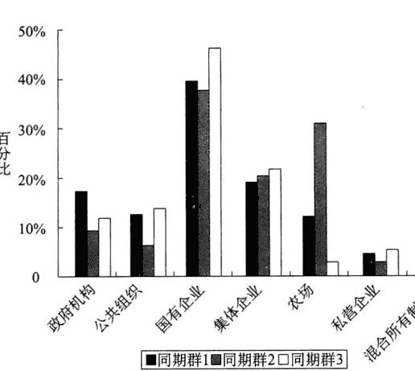

图10—1 各群体首目标工作的分布

总来说，在国有部门中最早群体占的比例最大（包括政府机构、公共组织和国有企业）。然而，值得注意的是，第二个群体在政府机构和公共组织中的比例比第三个要低。这主要是由于“文化革命”中的社会混乱，当时大城市青年被送往农村地区，他们大多在20世纪70年代末返回城市（参见第5章；也可参见Davis 1990, 1992）。那些在私营企业（包括个体）和混合所有企业的分布反映出不同群体的特征。总之，这些模式与以上讨论是一致的，最早群体更多限定在国家再分配体制中（国有部门），而最近群体可能位于国家之外。然而，这些群体间的差异并不遵循趋势。特别是，第二个群体的组织位置是个反例。正如前面章节讨论过的，这些变化表明，剧烈的政策变动对生命程产生了严重的干扰。

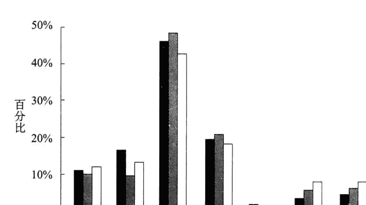

图10—2 1993年各群体目标工作的分布

比较三个群体的特征。差异部分源于变异。例如，较早（1949—1965）群体中女性者比例较少反映了女性不在我们的样本中。注意到三个群体在规范上有显著差异。在最早群体中，超过1/4接受小学教育，相比，最晚群体只有4%，反映出随着时间增大（Zhou, Moen, and Tuba 1991）。大学教育的人数比例也有显著的变化。到1991年，第一个群体中有18%的人有大学文凭，相比之下，第二个群体中有14%的人接受过大学。这个反例可以由“文化革命”时期被关闭来解释；大学教育的百分比比全国平均值高。部分由于我们的样本中有较大比例是从大城市取的，大城市的平均教育水平较高。另外，低教育水平的员工更早。另一个因素我们将“大专”（二级学位）并入了“大学”类别。

### 表10—1 1993年中国三个群体*统计描述

| 同期群体1 | 同期群体2 | 同期群体3 |
| --- | --- | --- |
| (1949—1965 同期群体) | (1966—1979 同期群体) | (1980—1994 同期群体) |
| 女性 | 0.33 | 0.44 | | |
| 年龄 | 52.50 | 39.5 | 28.73 |
| 教育水平 | | | |
| 小学 | 0.28 | 0.10 | 0.04 |
| 初中 | 0.29 | 0.40 | 0.24 |
| 高中 | 0.25 | 0.36 | 0.46 |
| 大学 | 0.18 | 0.14 | 0.26 |
| 职业地位 | | | |
| 高级干部 | 0.08 | 0.02 | 0.005 |
| 低级干部 | 0.18 | 0.13 | 0.08 |
| 高级专业人员 | 0.17 | 0.06 | 0.04 |
| 低级专业人员 | 0.10 | 0.13 | 0.20 |
| 办事员 | 0.05 | 0.06 | 0.09 |
| 服务人员 | 0.09 | 0.13 | 0.15 |
| 技术工人 | 0.21 | 0.28 | 0.26 |
| 非技术工人 | 0.10 | 0.16 | 0.13 |
| 私人企业 | 0.02 | 0.03 | 0.05 |
| 工作组织 | | | |
| 政府机构 | 0.11 | 0.09 | 0.11 |
| 公共组织 | 0.17 | 0.10 | 0.13 |
| 中央直属企业 | 0.28 | 0.26 | 0.24 |
| 地方所属企业 | 0.18 | 0.23 | 0.21 |
| 集体企业 | 0.21 | 0.23 | 0.21 |
| 私营/混合所有制企业 | 0.05 | 0.08 | 0.12 |
| 总计 N | 847 | 1746 | 1078 |

> *同期基于进入劳动队伍的历史时期。


# 国家与生活机遇

在这些观察到的人力资本以及职业和组织结构位置特定同期群的差异基础上，我们在检验职业模式（关于工作转换）和经济福利（个人收入）中的同期群差异。

## 10.4 机会和风险变化的反应: 工作转换模式中的同期群差异

与中国经济转型相关的一个显著的结构化变化是非国有部门的兴起和扩大。由于在历史上经济利益与个人的工作组织捆绑在一起，所以工作转换模式提供了个人机会和风险变化的重要信息。例如，前一章显示，尽管经营了大规模的改革，但工作转换模式仍然反映出本部门的重要性，体现在流向国有部门的转换率高于流向非国有部门的转换率。前一章未能清楚的问题是：(1)个人在应对不同类型组织的工作机会时，是否存在显著的同期群差异？(2)在社会分层过程中，这些观察到的模式是如何反映出生命历程因素的调节作用的？

为了论述这些，我们针对所定义的三个同期群，估计了他们在1980—1994年间流向不同类型组织的工作转换率。①我们只关注那些发生在不同类型组织之间的工作转换。例如，在分析流向政府机构的工作转换中，只包括源于非政府（包括公共组织）、企业集体和非国有企业的事。我们也考虑了他们的组织位置，在模型中一组“工作组织”变量来获得。通过此操作，我们就能估计不同类型工作组织职业模式的趋势。表10—2报告了转换分析中的数据估计。

> ①在这样的分析中，我们包含了这一时期劳动的被访者以及/她的配偶。是因为工作转换是经常发生的，或许应该包括，但无法统计某些类型组织的工作转换类型。将夫妻双方都包括在分析中，引出了本样本统计独立性问题。一种可能是，夫妻在对方的工作转换中相互关联的。周光和摩恩（Zhou and Moon 2001b）比较丈夫工作转换的作用对丈夫有显著的影响。我猜测，这是因为在中国城市中，丈夫和妻子在自己的生命历程中就就业这些城市，他们的生活事件以一种平行的而非依赖的方式发生变化。正文报告的发现与只基于被访者的分析结果一致。不过，如果只有被访者，那么有几个类型的单位则案例目多于无法进行统计统计。

# 第10章 经济转型与生活机遇：一个生命历程的视角

## 时期中同类型工作组转换的logistic模型的参数估计

| 政府机构 | 同期 1 | 同期 2 | 同期 3 | 同期 4 | 同期 5 | 同期 6 | 同期 7 | 同期 8 | 同期 9 | 同期 10 | 同期 11 | 同期 12 |
| :--- | :--- | :--- | :--- | :--- | :--- | :--- | :--- | :--- | :--- | :--- | :--- | :--- |
| 同期 1 | -10.142** | -7.456** | -0.067** | 1.270** | 1.751** | 0.577 | 0.941** | 1.141* | 3.189** | 3.202** | -0.318 | 71.8 / 8.2 |
| 同期 2 | 0.443 | 0.594** | -0.080** | 2.592** | 2.216** | -0.270 | 0.063 | 0.082* | 1.342** | 0.481 | 1.041 | 161.2 / 8.1 |
| 同期 3 | -2.112 | -5.176** | -0.044** | 0.627* | 3.360** | -0.558 | -0.470 | -0.876** | 1.233* | -1.154 | 104 | 140 |
| 同期 4 | | -6.876** | -0.305 | -0.027** | 0.980** | -0.445 | -0.232 | 0.331 | 0.033 | -0.689 | 1.681 | 1.884 | -1.884 | 116.5 / 8.1 |
| 同期 5 | | -9.118** | -0.046** | 1.976** | 2.652** | 0.329 | 0.971* | 0.526 | 2.627** | 2.385 | -2.196 | 33 |
| 同期 6 | | -7.337** | -0.054** | -0.139 | -0.217 | 0.689** | 2.062** | 0.300 | -0.175 | 2.920** | -0.578 | 85 |
| 同期 7 | | -0.384** | -0.043** | 0.249 | 0.277 | -0.415* | -0.594** | 0.853 | -1.009* | 2.436** | 0.329 | 250 |
| 同期 8 | | | -0.113 | 0.432* | 0.716* | -1.280** | -0.743 | -1.170* | -0.851* | 0.889* | -2.058** | 169 |
| 同期 9 | | | | | | | | | | | | |
| 同期 10 | -0.102** | | | | | | | | | | 255.1 / 1.2 | 177.7 / 1.2 |

| 女性 | 同期 1 | 同期 2 | 同期 3 | 国有企业 | 同期 1 | 同期 2 | 同期 3 | 公共组织 | 同期 1 | 同期 2 | 同期 3 | 政府机构 | 同期 1 | 同期 2 | 同期 3 | 工作组织 | 同期 1 | 同期 2 | 同期 3 | 私营/混合企业 | 同期 1 | 同期 2 | 同期 3 | 农业 | 同期 1 | 同期 2 | 同期 3 | 混合部门 | 同期 1 | 同期 2 | 同期 3 |
| :--- | :--- | :--- | :--- | :--- | :--- | :--- | :--- | :--- | :--- | :--- | :--- | :--- | :--- | :--- | :--- | :--- | :--- | :--- | :--- | :--- | :--- | :--- | :--- | :--- | :--- | :--- | :--- | :--- | :--- | :--- |
| 政府机构 | | -7.835* | -6.949* | -5.090* | -0.212* | -7.126* | -6.493* | 0.212 | 0.394 | -0.069 | -0.824 | -0.702 | -0.453 | 1.467* | 1.172 | 1.258 | 2.360* | 80 | 70 | 28.7/12 | | | | | | | | | | | |
| 私营/混合企业 | | 0.253 | -0.114 | -0.011* | -0.648 | -0.074* | -0.019* | 0.565* | 0.197 | -0.683 | -0.785 | -0.492 | -0.616* | 0.441 | 2.598* | 35.8/12 | | | | | | | | | | | | | | |
| 工作组织 | 0.842* | -0.042 | 0.232 | 0.312 | 0.175 | -1.804* | 1.059 | 3.119* | 1.748 | 1.172* | -0.842* | -1.238* | 1.504* | -0.310 | 2.741* | 71.4/12 | 178.7/12 | 34.3/12 | | | | | | | | | | | | | | |
| 专业人员 | -0.303 | -0.188 | -0.072 | -0.640 | -0.505 | 0.172 | 1.922* | -1.376 | -1.404* | -1.174* | -0.692* | 0.950 | 2.403* | 1.516 | 1.337 | 4.381* | 40 | 105 | 57.6/11 | | | | | | | | | | | | | | | | |
| 政府机构 | -0.403 | -0.215 | -0.292 | -1.209* | -0.936* | 1.001 | -0.039 | -0.205 | 0.214 | 1.719* | | | | | | | | | | | | | | | | | | | | | | | | |
| 公共组织 | 0.476 | 0.068 | | | | | | | | | | | | | | | | | | | | | | | | | | | | | | | |
| 农业 | | | | | | | | | | | | | | | | | | | | | | | | | | | | | | | | | |
| 混合部门 | 3.309* | 2.835* | 1.635 | -2.446 | -0.916 | | | | | | | | | | | | | | | | | | | | | | | | | | | | |
| 混合部门 | 0.59 | 1.50 | 1.52 | | | | | | | | | | | | | | | | | | | | | | | | | | | | | | |

## 表 10—3 1993 年城市三个同期群*收入的决定因素的 OLS 参数估计

| | 同期群 1 | 同期群 2 | 同期群 3 |
| :--- | :--- | :--- | :--- |
| 截距 | 4.313** | 4.280** | 4.184** |
| 女性 | -0.255** | -0.172** | -0.124** |
| 年龄 | -0.015** | 0.003 | 0.009* |
| 年龄²/100 | -0.127** | -0.095** | -0.101** |
| 教育水平 | | | |
| 高中 | 0.038 | 0.070** | 0.166** |
| 大学 | 0.044 | 0.092* | 0.162** |
| 职业地位 | | | |
| 高级干部 | 0.362** | 0.313** | |
| 低级干部 | 0.251** | 0.253** | |
| 高级专业人员 | 0.249** | 0.249** | 0.259** |
| 低级专业人员 | 0.348** | 0.161** | 0.143** |
| 办事员 | 0.082 | 0.138* | 0.138* |
| 服务业人员 | -0.023 | 0.096* | 0.181** |
| 技术工人 | 0.125* | 0.043 | 0.061 |
| 私人企业主 | 0.338** | 0.154** | 0.347** |
| 工作组织 | | | |
| 政府机构 | 0.308** | 0.127** | 0.099 |
| 公共组织 | 0.141** | 0.189** | 0.085 |
| 中央直属企业 | 0.172** | 0.195** | 0.108** |
| 地方所属企业 | 0.126* | 0.105* | 0.085* |
| 私营/混合制企业 | 0.245** | 0.476** | 0.496** |
| 总计 N | 841 | 1715 | 1057 |

## 第10章 经济转型与生活机遇：一个生命历程的视角

我们的实证提出，生命历程因素的调节作用反映在各同期期间不同的转换率上；具体来说，各同期期间存在一个下降的工作转换率。我们检验了三个同期相关的截距的大小。为了给出一个更有意义的解释，我们将年龄变量控制在每个期的平均年龄上。因此，第一个同期期的截距是指具有第一个同期平均年龄、初中或以下教育水平、集体企业的普通人，并在1966年就业的男性被访者这类员工“总体上”的工作转换发生对数变化。类似的，第二个同期期的截距是指具有第二个同期平均年龄、在1966—1979年就业，而其他特征与第一个同期相同的人的对数变化发生。第三同期期的截距是指具有三个同期平均年龄、在1980年后就业，且其他特征与两个同期相同的被访者的对数变化发生。

在表10—2中，所有的截距为负值，表明了工作转换在排除了模型中其他变量的影响，同期期间存在一个下降的工作转换率，第三同期转换率最高，第一个同期最低。例如，第三同期中政府目标的转换率是0.006 (exp [-0.176] = 0.006)，但第一个和第二个同期的转换则是0.004和0.006。考虑到单位转换的成本、机会的缺乏和就业路径中对就业依赖一般的过程，这并不令人惊讶。工作转换率的这些同期差异可能反映了更早的同期在社会地位上具有优势的态势。然而，在剧烈的过程中，较早同期中较低的工作转换率可能反映了他们被安排在新机会中，这导致了基于机会的重新分配。

我们同时推测，由于不同同期限定在现有制度安排中的程度的差异，同期在地位和市场价值对他们转换模式的影响应该有显著差异。可以通过考察表10—2中协变量的影响来检验。我们在此关注那些直接影响社会的变量。某些目标（如私营企业和混合制企业）中与第一个同期相关的协变量不显著的影响，这一发现的部分可能是因为在同期期的事件数目和样本规模较小。因此，在解释这些发现时，我们应当谨慎小心。

国家的作用。总体来说，学历，尤其是大学教育，增加了对国有部门（政府机构、公共组织和国有企业）工作组织的工作转换率。但是，除了大学教育对第二个和第三个时期混合所有制企业的转换率具有显著、明显的影响，教育水平对非国有部门的影响并不突出。我们的理论兴趣在于同期期的变异模式。总体的模式表明，大学教育，尤其是在国有部门和混合所有企业的工作转换中，对于第二个和第三个同期群有益，体现在它对这两个同期的正面的显著影响。这些发现与我的预期是一致的，在同期群影响，教育工作者应对新机遇的影响有显著差异。

职业的作用。职业位的出现一种越来越复杂的转换。总体来说，干部和专业人员具有很强的惯性，也就是说，干部和专业人员倾向于留在他们的工作组织（尽管大多数工作转换分析中与这些因素相关的仍然存在同期差异，但这些模式与我的预期相反）。似乎较年轻的同期（第二个和第三），并不是老的同期更容易遭遇最大的惯性，特别是在公共组织、国有企业政府部门。一种推测是由于80年代以来的新政策对于年轻、良好教育的干部和专业人员，年轻一代在他们的工作中可能得到了期待。此外，第三同期中的干部和专业人员可能已经有了理想的工作，而降低了工作转换。

组织的作用。针对“工作组织”一组变量表明了工作转换单位级别的差异让我们能够识别改革时期具体的方向和路径。与第十章证据一致，组织位置的影响显示出中国市场的某些类型组织（政府机构、公共组织和国有企业）的转换跨越国有和非部门界限更加流畅。相反，那些在国有部门的人往往不愿意转换到非国有部门（集团企业、私营企业）。不同类型存在明显的同期差异。例如，两个同期中具有更高的政府向国有企业的转换率。在改革早期阶段，国有企业往往向政府机构提供更高的收入。这些模式表明，较早同期中的就业者与他们更年轻的同事相比，可能能够更好利用部门的位置。首先，那些拥有权力和高等组织中的人利益可能得到保护或加强。其次，大学学历对不同同期中的个体有不同的影响，特别是在促进他们向高等部门的转换。注意的是，大学教育增加了第二个和第三同期混合制企业的转换率，表明年轻的同期在人力资源配置上可能利用新兴市场机会。

10.5 经济转型的差异

我们接下来分析经济增长长期（80年代和90年代早期）经济收益的差异。表10—3报告了1990年收入变量普通的最小二乘法（OLS）识别。为了控制城市位置差异，我们包括了一组虚拟变量，用来控制特定的工资水平（以北京作为参照类别）。参数相关的性别水平表明了同期内部差异。我们共同讨论同期内部和同期间的差异。年龄。每个同期的数据显示，具有中或以下教育水平和同期平均年龄的男性收入差异是可以比较的。女性在三个同期中的收入较低，年龄的影响在同期间却是显著变化的。

> ① 注意，年龄变量是通过减去同期中每个被访者的平均年龄得到的。同期内部的年龄效应显示了一个人在职业生命历程不同阶段经历过的。在各同期间，它们不能比较的。


## 第10章 经济转型与生活机遇：一个生命历程的视角

反，第二个和第三个时期中的那些收入随教育水平提高而增长。教育报告对于第三个时期中的那些收入明显（尽管大学教育似乎比高中教育更有优势）。第三个时期中拥有大学教育的人比其他两个时期中拥有教育的人有显著更高的收入。这个发现表明，与较早期时期相比，第三个时期的成员从他们的人力资本中获取了更多的经济收益。

对于观察到的模式有几种最近的解释：首先，可能由于他们最近的正规教育，第三个时期的人在劳动力市场中有了特别吸引力的依据。其次，与较早期时期，教育的回报很大程度上是通过当前的社会地位（干部或专业人员等）传递的。我们估计包含教育转型的模型对于第一个时期，教育的贡献巨大。对于第一个时期，这就是通过他们的职业地位调整教育影响的证据。考虑到样本模型允许更详细的职业类别来分析转换因素，由于第三个时期中高级干部很少，我们把低级干部结合起来。正如我们假设，在第一个时期中职业效力（高级干部）收入最高。回想一下，第一个时期中高级干部的比例高达85%，这一发现意味着与政治权的关联。

对于低级干部和高级人员的回报，在第一个时期中与第二个时期相似。第一个时期中的低级人员比私营企业享有更高的收入。还要到第一个和第三个时期，私营企业具有更高的收入。（参照类别）有更高的收入，对最年轻时期中的人如此。组织位置回报对于第一个时期，政府人员报告了最高的收入（其他条件），国内部门也比集体企业有显著更高。这也是第三个时期中的情况，那么对于我国的人在集体企业中有显著更高的收入。但是，在第三个时期中，我国的人的优势并不明显。私营或混合企业的集团表现更高。与我们的预期一致的，我们在组织位置对收入的影响中发现了独特的时期。在同一期间，第一个时期在政府机构工作的成员收入最高。相反，对于私营或混合企业的人，在后两个时期国家社会主义制度具有显著高的收入。这两个极端情况显示了市场和国家制度对不同群体有着独特刺激。在其他类型的组织位置中，同期时期差异最有力的证据体现在教育和组织位置的回报上。具体来说，第一个（最老的）同期时期通常由于接近分配权威中工作而获益，而最年轻的同期期则更多由于接近市场中工作而获益。

## 第10章 总结

社会学研究的一项任务就是解释社会过程中引起生活机遇的差异。这项任务在理解后国家社会主义当前社会变迁中尤为重要。社会变迁涉及影响生活机遇的双重过程：(1)机制结构；(2)改变社会分配的机制。连接历史与个人经历的生命历程视角关注同期在形成这两个过程中的重要性，所以生命历程研究提供了一种独特的角度来认识差异，社会变迁对个体社会机遇的影响是如何通过个人经历中所经历的时间性来加以加剧的，不同的生命历程阶段与不同的机会以及个人在社会结构中的位置密切。

这一章的主题是提出有关生命历程因素在形成生活机遇中重要的观点，并在大规模社会变化的背景下这些历程的影响。使用生命历程视角和相应的设计的意义是什么？通过把握机会获得的独特差异，我们可以识别调节社会变迁与生活机遇之间的作用。例如，在第9章我们发现，改革时期（1980—1994），拥有大学教育的人有较高比例转入政府机构和混合所有企业。但是我们的研究设计隐含地规定，在控制了模型其他变量的影响后，适用于已经工作的从业人员。相反，本章报告对于特定同期影响的检验结果显示，事实上不同同期群体有着不同的。我们发现，虽然三个同期群体中大学毕业生都有显著的更高的政府机构转入率，但在他们向混合制企业转换时有着显著差异，那些较老同期中的人（1949—1965年间就业者）完全没有优势。而且，我们对收入人的分析一步步揭示出这一发现背后的道理：那些在政府机构中的较老同期比起混合所有制企业中的员工有着更多的再分配利益，而年轻同期期的情况恰恰相反。教育支出特别有助于年轻员工（第二个和第三个同期）利用新兴市场的机会以及从收入分配中获得更多教育回报的能力。

生命历程视角展现出了一系列特定的有关社会变化与生活机遇的学术议题。我们把关注从整体传统的视角（如职业群体）转向考虑特定同期的生命历程阶段，我们发现了一个关于差异和变化更加动态的图景，认识到生命历程因素调节了社会变迁对社会转型的影响。

生命历程方法也有助于分配机制在不同同期之间影响的评估。我们发现了不同同期的显著差异和相应的理论逻辑。为人们关注的发现是，同期差异与组织位置的影响相关，体现在第一个同期与其两个同期的显著差异，特别是在政府机构和国有企业的工作和收入的决定因素方面。首先，干部制导致了这种模式。最老的同期更多地限制在现有的社会结构中，更加接近再分配经济（比例更多的是高级干部和在国有部门的作者）。他们由于他们往更多从再分配过程中获得益，对20世纪80年代和90年代早期引起的市场机制不太敏感。其次，第二个同期生命历程被严重扰乱（“文化大革命”）的结果，可能使他们更倾向于进入市场的机遇，使这个时期的特点与最老的同期相似。

然而，本章分析也有意料的发现。例如，大多数与普通工人相比，第二个和第三个同期的干部和人员进入政府部门（公共组织国有企业）比较少（表现为相关系数负值）。解释这个发现，我们注意到第三个同期有较高的工作转换率，正如他们进入或重新进入劳动力队伍时具有更广泛的选择。这些干部和专业人员低转换率可能部分属于他们动力队伍中占有的有利位置。更重要的是，我们在这一章中强调生命历程仅仅说是社会分层过程的一部分。其他的“推力”和“拉力”因素导致观察到的模式。市场上更多的报酬让年轻同期期向非国有部门转换。另一方面，国有部门机会收缩也使得员工离开了。例如，我们发现，第一同期和第二同期群有较高的转换率从政府机构转入国有企业。为了解释这个模式，我们注意到在改革早期阶段，政府机构和公共职工在经济利益方面有了显著提高（见第第七章）。因此，这种转换模式可能暗示那些在政府中的人试图到更合理的组织得到了这些利益。生命历程视角有助于强调一些社会变化的重要问题（Hogan 1981）。首先，我们对同期差异对于中国的社会主义转型提供了线索。与之前非洲东欧的“休克疗法”不同，中国有着国有和非国有部门共存和双重结构。我们的分析表明，中国制度转型的许多方面通过：最老的同期（经济转型时四十五多年）第二同期（改革转型时三十多年）第三同期（改革转型时二十多年）经历了不同的劳动力市场。

对于不同同期群的生命阶段和社会位置考虑使我们对于经济转型对社会群体的影响，以及机会和风险在社会群体间的重新分配有了更细的评估。研究分析上，历程构建了宏观层面的事件和微观层面的个人经历之间的桥梁，为我们理解生活机遇差异提供了新的洞见，同时也提供了未来社会分层的轨迹。在我们的样本中，第一同期在改革时期经历了7.5%的工作变动，第二和第三同期分别出现时工作变动20.3%和25.7%。

# 第三部分
## 总结与结论

我们下面的两章作为全书的总结。在第11章，我们总结本书第一个主题——国家社会主义再分配和分层动态过程的主要发现，并讨论这些发现对于国家社会主义分层理论模式的意义。在第12章，我们转向与研究第二个主题相关的讨论——中国制度变迁的原因和方向，探讨社会分层动态过程对于国家社会主义转型的意义。我们运用比较的视角，讨论中国经验对于理解国家与社会关系的意义，对本研究进行总结。

# 第11章 国家社会主义分层：总结与评估

目前重新讨论国家社会主义以及这一体制发现的潜力可能尚早。尽管如此，对这段历史的修正版本会应运生，这一修正版本能认识到社会主义的潜力。
——布洛维（Buraoy 2001, p. 118）

我们与读者一道走过了考察中华人民共和国历史上的国家与生活机遇的旅程。基于一个城市居民样本，我们追踪了他们的教育、就业、职业升迁、在不同位置转换工作等经历，以及与这些生活机会相关的经济利益。或许可以说，我们“观察”到了他们在历史时期和生命周期中不同阶段上生活机会的戏剧性变化。我们围绕两个主题组织我们的观察、分析与讨论：第一，国家社会主义再分配与分层动态过程对个人生活机会的影响；第二，20世纪80年代以来中国转型中社会分层过程的变化与连贯性。这些经验发现对于已有国家社会主义再分配与社会分层的理论模型有什么意义？中国经验对于我们理解国家社会主义制度转型的有什么意义？

在本章中，我们将总结第一个主题相关的研究发现，即国家社会主义条件下，中国的再分配与分层适应动态过程。我们围绕第一章的主要理论议题框架进行讨论，即国家官僚阶级命题、政治阶级命题、再分配制度命题和分层动态过程命题。我们将在下一章总结讨论第二个主题：对中国制度转型的评价。

## 11.1 官僚阶级命题的再思考

正如我们前面所指出的，在国家社会主义社会分层研究中，没有一个概念像官僚阶级那样居于中心地位。自20世纪50年代以来，新官僚阶级的观念一直是指导该研究的重要主题。社会分层过程将社会位置进行层级结构化，并在不同的群体中分配资源和机会。社会主义国家及其官僚机构在再分配过程中起到了核心作用。只要关注社会，官僚阶级就可以被重构为我们理论与经验研究的焦点。

在第一章中，我们提出了国家社会主义社会官僚阶级的操作定义，将其作为一个群体，其成员：(1)对于其他社会群体享有更好的社会利益；(2)在工作组织中行使权力并控制生产和“权威”；(3)通过地位来实现自身阶级的再生产。我们在第一章指出的有关官僚阶级的论点大多是在假设性基础上开展的，尚未经过经验验证。今天，随着规模化调查、政府文件和公共统计资料开放，我们可以在更完善的实证基础上重新认识和评估这些问题。下面我们得出一个简单的结论：在中国背景下，关于官僚阶级拥有特权和无限力的理论支撑十分弱。当然，这一结论需要谨慎说明和限定。

### 11.1 社会经济地位与官僚特权及其他生活

在国家社会主义中国中，不同社会群体在接受、住房等方面的差异显著吗？基于本书的经验证，答案是肯定的。是的。我们在研究中，社会经济利益是从以下方面衡量的：个人收入、住房待遇、组织中的职业升迁（晋升）、政治地位（党员身份）获得。在大多数情况下，高级干部（处级及以上行政级别）在政府体系中相当于县级，尽管他们的实际权力很大变化。在一些不太合适的分类语境下，我们使用同期与官僚位置来推断社会经济利益。表1—1总结了前章节与官僚位置相关的发现。

**表1—1 官僚职位的回报**

| 收益/地位 | 干部职位的回报 | 随时间波动吗 | 参考 |
| :--- | :--- | :--- | :--- |
| 收入 | 是，24%~50% | 是弱 | 表7—1和7—2 |
| 居住空间 | 是，31%~56% | 是弱 | 表8—3 |
| 房屋设施 | 是，20%~31% | 是弱 | 表8—4 |
| 党员身份 | 正向（同期时期） | 是（同期时期） | 表6—2 |
| 组织内晋升 | 正向（同期时期） | 是（同期时期） | 表6—4 |
| 工作转换 | 否 | | 表9—1和9—2 |

*除非说明，干部类别是指高级干部，参考类别是非技术人员。

官僚阶级在社会经济方面是否为“高级干部”地位具有显著差异？我们可以从两个方面回答这个问题：(1)大多数职业群体在统计上确实存在分辨的差异，高级干部确实享有更具替代性的经济利益；但是(2)这些职业群体的这种差异对于构建官僚阶级阶层有力的证据很难。

首先考虑个人收入的经验证据。如第7章所示，在其他条件模型中其他变量的影响后，在整个1949—1994年间，高级官员的平均收入比非技术人高24%~50%，他们是城市动力中最低的群体。高级官员地位在住房分配上也具有正向回报。但差异同样小：一个高级官员的住房大约比普通人高30%~50%。

其次在获取党员身份与晋升等向上流动方面，官僚位置具有正向回报，但我们也发现干部群体间的显著差异，这表明这些官僚之间的生活机遇存在不容忽视的异质性，也就是说，把他们视为属于相似生活机遇的同一个阶级是有疑问的。

当然，任何对社会平等的评价都依赖于所选择的参照框架。在一个生存型经济中，住房上50%的差异已经具有实质性的差异，与以往文献中关于特权阶级形象的描述相甚远。分层功能理论或有关激励的典型经济学观点认为，居高位的管理者与普通工人在社会经济方面的如此差异不能提供足够大的激励前者具有积极动力。事实上，一个县级与非技术官员在个人与住房空间上只有50%左右的差异，研究者难以将其视为社会平等的实质性证据。

或许有人会辩，官僚利益是隐性的，无法通过个人收入甚至待遇反映出来。然而，对于那些熟悉毛泽东时代中国日常生活的人来说，这一说法难以有说服力。官僚（如车间）与普通工人的经济差距我们研究揭示的经验模型具有实质性。在毛泽东时代，大多数干部与他们所在工厂的普通工人享受着相似的居住住宅，他们的房屋只是简单房。本报告的结果与怀特和哈威廉（Whyte and Parish 1984）的观察是一致的，即毛泽东时代的追求某种平均主义政策。

事实上，中国在这方面不是独一无二。研究国家社会主义的学者们对其他国家社会主义已经研究过这件事。泽林尼（Szelényi 1978）将他对意大利社会主义的研究发现总结如下：

在现金津贴方面，不同社会阶层之间观察到显著差异；白领家庭的个人平均津贴比产业家庭高20%，白领家庭的个人平均津贴比产业工人高近50%，高层管理者和专业人员是劳动者的两倍以上。正如泽林尼（Szelényi 1978）进一步强调的：“我倾向于认为，即使在国家社会主义的东方存在一个统一的统治阶级”。

列举了与干部利益相关的物质利益后，科尔奈（Kornai 1992, p. 43）指出：“不要产生误解；尽管这些物质面的特征，其功能标准对于资本主义中富人的水平，这种特权也是巨大的，且一旦撤销”。比较视角能够阐明这一课题。表1—2报告了部分国家不平等的基尼系数。基尼系数说明从总人口中抽取的任意两个之间收入的绝对差异。系数越大，不平等程度越高。表1—2显示，与发达国家和东欧国家相比，中国在20世纪80年代期的不平等是最低的（对于整个中国来说，基尼系数更高）。显然，我们的发现与比较视角下致。

**表1—2 各国家不平等的基尼系数**

| 国家 | 基尼系数 | 年份 |
| :--- | :--- | :--- |
| 中国城市 | 0.19 | 1985 |
| | 0.28 | 1995 |
| 东欧国家 | | |
| 捷克斯洛克 | 0.20 | 1987 |
| 匈牙利 | 0.22 | 1986 |
| 波兰 | 0.24 | 1986 |
| 苏联 | 0.28 | 1986 |
| 发达国家 | | |
| 芬兰 | 0.20 | 1985 |
| 瑞典 | 0.21 | 1987 |
| 卢森堡 | 0.23 | 1985 |
| 西联邦德国 | 0.25 | 1984 |
| 荷兰 | 0.26 | 1987 |
| 加拿大 | 0.28 | 1987 |
| 英国 | 0.29 | 1986 |
| 法国 | 0.30 | 1984 |
| 新西兰 | 0.30 | 1985 |
| 意大利 | 0.31 | 1985 |
| 澳大利亚 | 0.31 | 1985 |
| 美国 | 0.34 | 1986 |

资料来源：中国城市数据源自里泉、赵伟和李实（Riskin, Zhao, and Li 2001, p. 28）。“东欧国家”数据源自阿金森和米克莱特（Atkinson and Mickleright 1992, p. 81），“发达国家”数据源自戈特沙尔克、古斯塔夫和帕默尔（Gottschalk, Gustafson and Palmer 1997, p. 39）。

在改革时期，中国社会群体的不不有了实质性的增长，但是这一过程对不同群体都有影响。官员之间，一些人运用他们的地位权力积累了大量财富；而另一些人的经济收益却在中央政府和执政党的某些功能被削弱变得（相对）更为低了。同样，一些非官僚群体由于自身的努力或与某一经济部门、经济行为的联系而比其他群体得更多。传统的官僚阶级模型又如此简单，无法解释转型过程中许多层面的变化。而且，改革时期增加的不平等与其源于国家社会主义的再分配。

### 11.1.2 工作组中的权威关系

锐（Whitney 1989）认为环境中的权威关系是判别社会阶级的重要维度，尤其是在国家社会主义社会中。尽管权威关系在这些社会中很重要，但是却少得惊人。（外参见Burawo and Krotov 1992; Burayow and Luckacks 1986。）

在中国背景下，德国对中国工作组中权威关系的收集已经是最好的研究。他批评共产主义政治的权力官主义形象，强调了传统保守主义权威的盛行，在工人与社会主义管理者之间形成一种依赖权威关系。而，管理者通常是通过正向鼓励和非政治压制来使政服从对党组织的依赖。在这个“新传统权威”模型中，地方层次的社会主义这是否意味着工作场所中的权威关系反映了官僚阶级的全能权力？在方面，这些地方官僚掌握的权力是非常大的，普通工人通常难以提出异议。


# 第11章 国家社会主义分层：总结与评估

国家政策决定。直到20世纪80年代后期，国有企业（或其他工作单位）的领导几乎没有开除工人的。随着体制的移动，国有企业的工人形成了一种强烈的权利意识，这为他们反抗管理者、试图夺剩余权利的行为提供了合法基础 (Cai 1996, 1998)。在许多情况下，甚至工人从企业的某个部门调到另一个部门都是极其困难的。因此，尽管工人不存在从权威关系中退出的选择，但管理者也不能抛弃他们不喜欢的人。例如，在1984年的改革浪潮中，福建省55个工厂的管理者联名上书，请求政府给予他们管理权和决定各自内部红利的权力（《人民日报》，1984-03-30）。在那一年，国务院发布了一个关于对工业组织中管理者主权的指示，其中一部分写道：“在考虑企业工资标准、地区分类和补贴的条件下，企业能够决定工资支付方式。总经理有权对那些企业做出特别贡献的员工提高工资等级；每一年提高的人数比例不能超过3%。”这篇广为宣传的标识恰恰反映了当时国家对工作场所的渗透，以及社会管理者对所有权利的限制性。

为了保护自己生产过程中的不确定性和集中管理的僵化，工人利用手中的资源，从他们操作的特定机器的性能知识。他们对于获取零件、物质以及信息的接触和联系。他们试图作为权威，换换位置的选择，这个位置也许不仅带来更高报酬的承诺，还能带来更多在其他工厂中建立信任、管理车间的机会，从长期来看，它能产生更高的回报。对管理者来说，他们会产生进入车间的目标，因为只有通过与工人群体合作才能实现生产目标。总之，这些群体不仅是个别的群体——基于共享的抽象特质而非被视为同一的聚集群体；他们是互动群体，其成员共享工资、信息和技术的经验，并通过借贷、工资与期望相互联系在一起（包括车间管理）。

在这些描述和形象中，很少见到组织权威关系中存在着一个强大官僚阶级的令人信服的证据。相反，社会主义管理者和工人似乎处于一种共生关系，管理权力既受上层权力结构的限制，也受下层平民主义文化的制约。在这幅图中，官员具有双重身份，一方面是国家的代表，另一方面又是他或她所管辖中国的保护人。工作场所的权威关系比阶级分析通常中的“剥割”关系复杂得多。

## 11.1.3 代际地位传承

阶级再生产是阶级形成的核心。代际地位传承的研究经常使用流动模式来分析与其的社会流动模式。在经验层面，代际的资源流动和流动模式是社会再生产的描述。两个社会相似的代际流动模式可能是非常不同的分层机制引起的。在市场中，社会和地位获得的正向关系可能是由于资源匮乏引起的，使得上层阶级能够获得优势的市场地位。另一方面，在社会中，这种正向关系可能是国家政策或再分配权力造成的，它一定不是为子女提供的传承相关。例如，在“文化革命”末期，政府采取了“顶替”政策，但城市居民的子女就能进入相同的工作单位。这项政策的设计是避免退休、解决年龄的问题。但是，起到了强化代际地位传承（以组织遗传的方式）的反向作用。显然这些代际传承并不是完全基于家庭的机制决定的。相反，我们需要从这种“顶替”政策的底层逻辑中寻找答案。当我们解释代际流动的证据时，需要这些考虑进去。尽管我们在这里的研究没有使用流动模型，但分析了资源传递和代际传承的作用，尤其是关于获得（第3章）、就业（第4章）、官僚晋升（第6章）和受国家政策的影响（第5章）。表1—3总结了这些结果。

### 表1—3 代际地位传承

| 收益/地位 | 对父亲干部 | 对父亲教育 | 随时间波动？ | 参考 |
| :--- | :--- | :--- | :--- | :--- |
| 教育获得 | 正向 | 正向 | 是 | 表3—2 |
| 进入劳动力队伍 | 正向、负向 | 正向、负向 | 是 | 表4—3 和表4—4 |
| “上山下乡”经历 | | 负向 | 是 | 表5—1 和表5—2 |
| 党员身份 | 否 | 否 | | 表6—2 |
| 组织的晋升 | 否 | 否 | | 表6—3 和表6—4 |

总之，证据表明社会出身（如父亲的教育水平、职业地位或家庭背景）对教育获得和就业有正向的作用。例如，父亲高子女在劳动力市场中的优势让他们更容易获得满意的职业或单位。政治地位高的父母可能受到国家政策的负面影响，如“文化革命”时期下乡的现象。证据表明中国和专业人员的子女在教育上更有可能跟随父亲。这些例子中，我观察到了社会出身与子女获得之间的关系，表明父母资源对子女向上流动有正作用。然而，这个结论必须受到两个方面的限制：首先，某些阶级中，父母资源对子女获得有正向作用，但随着时间推移，这种关联的变化很大。尤其是这种关联在“文化革命”时期被削弱的事实告诉我们，社会出身受到宏观政治的限制。更重要的是，正如我们观察到的，变动的国家政策对官僚阶级的子女有直接负面影响。正如教育分析（第3章）所示，激进政策没有影响干部和专业人士。在“上山下乡”时期，高级子女没有放到农村。

其次，如表1—3所示，大量观察到的代际传承证据是在就业之前（如升学）。一旦某人已经就业，父母资源在随后的领域，如党、官僚晋升或经济利益方面就不具有显著的作用。例如，晋升分析（第6章）发现父亲的教育水平或职业地位对组织中的生活机会没有系统性的影响。在之前的分析中，我们也考虑了父母资源在个人收入和住房方面的作用，没有发现显著的影响。这些证据表明，一旦个人进入再分配体系，父母资源和社会出身对个人生命的影响就会减弱，让组织和其他分层过程。

## 11.1.4 总结

中国的社会分层结构中存在一个官僚阶级吗？我们从三个维度考察这个问题：与阶级位置相关的经济利益、权力关系中的位置和代际传承。当仔细检查这些时，我们发现国家社会主义再分配的官员（干部）拥有地位权力并享有更好的经济利益，但他们的生活机会与其社会群体一样，也是波动的、脆弱的不稳定的。在中国背景下，关于官僚与其他阶级相比一直有更好的生活机会、工作单位中独立的权威资源或能有效地实现地位传承的图像并没有令人信服的相关证据。已有文献关于这一主题的研究虽只关注低层官员，将这些干部视为一个有着边界、利益受到社会屏蔽的、稳定的社会阶级是值得怀疑的。在发现令人信服的证据之前，我们将此官僚阶级命题视为一个暂时的假设，对于进一步的考察和检验。

## 11.2 人力资本与政治资本

长期以来学者都认为，国家社会主义再分配的一个重要特征是机会和经济利益的分配青拥有政治资本而非人力资本的人。这个观点背后的逻辑是大家所熟悉的：由于再分配的政治逻辑，政治地位与再分配权力紧密相连（Lee 1989），而且国家也运用“正面激励”来诱导服从（Walder 1986）。政治地位是对政治忠诚的回报，人力资本（如教育程度）通常是以教育为基础的竞争获得的。

在这里的分析报告中，我们全面研究了教育作为一种社会分层过程的作用。大多数情况下，在我们的统计分析中并没有考察“党员身份”，因为我们样本中相关的样本缺乏变量。然而，从逻辑上来说，政治资本的回报与前面章节讨论过的行政地位的回应应该是相似的。表11—4总结了前面章节涉及的分层在所有主要领域中。

本研究的检验结果显示教育的回报受到抑制，尤其是在毛泽东时代。一直到毛泽东时代，教育文凭对官僚体制中的晋升几乎没有用；在特定时期，关于党员身份和经济利益，对教育的回报也是意义不明的。另一方面，正如区域分析（第7章）所示，个人的决定因素表明党员身份并不总是产生正向回报。

### 表11—4 教育回报研究总结

| 收益/地位 | 对父亲干部 | 对父亲教育 | 随时间波动？ | 参考 |
| :--- | :--- | :--- | :--- | :--- |
| 进入劳动力队伍 | 正向 | 正向 | 是 | 表4—3 和表4—4 |
| “上山下乡”经历 | 负向 | 负向 | 是 | 表5—1 和表5—2 |
| 党员身份 | 是 | 转型时期 | 是 | 表6—2 |
| 组织的晋升 | 是 | 弱 | 是 | 表6—3 和表6—4 |
| 工作转换 | 是 | | | 表9—1 |
| 个人收入 | 是 | 是 | | 表7—1 |
| 住房空间/设施 | 是 | 弱 | 弱 | 表8—3 和表8—4 |

证据（见表11—4），表明社会流动的许多领域教育回报是正向的。正如我们在前面章节注意到的，尽管党员身份的作用似乎是稳定的，但实际上国家政策和领导层随着时间推移，政治忠诚也是变化的。这些发现还需要进一步的描述。首先，赋予政治地位（党员身份）的过程可能与赋予地位（教育）的过程是一样的。例如，在“文化革命”时期，国家确实让特定群体入党。同样，父母资源可能有利于子女获得党员身份。魏尔德（Walder 1995）的二路径模型的一个重要发现是，国家社会主义计划的“理性”导致了政治忠诚上的投入。其次，教育回报明显较低，与其说反映了国家再分配原则，不如确切说明中国的经费。在苏联和萨诸诺（Zhou and Sukhomlinova 2000）的研究中，教育水平在再分配模式中的作用有着显著差异。与中国相比，教育水平在再分配中的住房方面具有更大的影响。这一发现表明，国家社会主义制度下的政治逻辑对政治忠诚（党员身份）的回报超过了人力资本（教育水平）的回报理论观点需要谨慎。即使在中国背景下，教育回报在不同历史时期也变化很大（Zhao and Zhou 2002）。我们还需要统计相关性，检验人力资源的具体分配过程，尤其是人力资源是通过市场过程还是官僚机制来分配的，以及收入/住房的的分配是由市场竞争或国家政策决定的。

总之，尽管政治资本与人力资本这对理解国家社会主义再分配机制是有帮助的，但由于这些选择过程中的复杂相互作用，这种区分可能在国家社会主义的发展过程中变得模糊。因此，很难从经验上清楚这些过程。

## 11.3 社会阶层中的再分配制度

国家社会主义的再分配是通过官僚组织实施的。我们已经强调过，这些再分配制度在社会阶层分配过程中扮演着核心角色，既构建了等级结构，又会将资源和机会分配在不同的位置。由于这一认识，贯穿全书的分析中，我们考察了工作组织的前面。后章节的发现支持了这一点（见表11—5）。

有证据显示，经济改革开始以前，国有企业为员工提供了最好的经济利益，并比非国有部门员工有更高的利益，然而他们被排斥在再分配利益之外。国有企业员工享有较高的个人收入和更好的住房条件。而且，正如我们在第8章注意到的，国有部门员工通过这种工作模式获得了间接直接利益。例如，在有的部门中，获得党员身份的可能性较高，而且有的部门聚集着更优的位置和更好的人力资源。官僚阶级的晋升也高于没有部门的员工。这些发现与我们其他研究所示的模式是一致的（Bian 1994; Lin and Bian 1991; Walder 1986）。

### 表11—5 (国有部门) 组织回报结果的结论

| 收益/地位 | 组织内部回报 | 随时间波动吗？ | 参考 |
| :--- | :--- | :--- | :--- |
| 党员身份 | 是 | 是 | 表6—2 |
| 组织内部的晋升 | 是 | 弱 | 是 | 表6—3 和表6—4 |
| 工作转换 | 否 | | 表9—1 |
| 个人收入 | 是 | 是 | 表7—1 |
| 住房空间/设施 | 是 | 不清楚 | 表8—3 和表8—4 |

在中国，工作者的角色也强调了制度在再形成特定分层过程中及社会分层制度产生跨文化差异的重要性。在苏联，几乎所有的工作组织（包括农场）都是国家的，拥有不同产权的组织几乎是不存在的。结果是，产业类型一样，经济部门扮演了一个更重要的角色。相反，中国不太发达的国家社会主义却产生了各种各样的组织形式，从而为再分配和治理提供了基础。

## 11.4 国家社会主义分层动态：理论认识

本文的主题之一是我们强调从动态过程来解释中国社会分层模式。正如我们在前面讨论中所总结，尽管这些结构性（如职业等级和组织位置）是有意义的，但这些结构性影响在不同历史时期随着国家的转变而不断变化。社会分层的具体领域——教育获得、工作获得、经济利益分配——解释变化的关键。例如，正如第4章所示，在过去的50年里，中国城市在机会选择方面存在显著的变化。同样，父母获得和人力资源对子女获得的影响随时间变化的。更重要的是，正如获得模式（第4章）和晋升模式（第6章）所示，所有社会群体都受到宏观政治、经济政策的影响。

强调分层动态有助于我们理解国家社会主义如何再分配和社会分层过程具有重要贡献：首先，阐明了以往被忽视的国家社会主义条件下分层的动态过程。国家社会主义学者早就注意到国家政策在这些社会领域中的重要性。分层研究极大地受到工业化市场成果的影响，调整了基于家庭的社会流动结构。特别是中国背景下的流动过程，强调分层动态并不是转瞬即逝或者局部偶然状态，恰恰植于再分配和宏观政治进程，对于整个生命周期都是持续的影响。正如我们之前讨论的，分层过程通常是追求政治目标的国家政策间接后果。例如，“文化革命”中的“上山下乡”事件很大程度上是领导者对经济停滞做出的反应。同样，20世纪60年代，“大跃进”对个人生活遭遇产生了严重的后果，教育、工作机会萎缩以及标准下降。但这些影响都是领导者快速反应间接所致。正如李培林和张译（Li and Zhang 2000）所述，国家就业的发展很大程度上是对过去50年经济危机和失业的发展。重要意义在于，分层动态过程是由宏观政治进程引发的，社会群体很难执行或改变这些动态变化。例如，国家在居民中强制实行“上山下乡”政策，无论是干部、专业人士还是其他社会群体都遭受这一政策的负面影响。因此，要解释国家社会主义社会分层模式，我们需要更广泛的再分配政策与政治进程的交互作用。

最后，对国家背景下分层动态过程的思考指出了再分配逻辑的意义：（1）再分配的政治逻辑对不平等实施了一种限制。在工业化市场社会，福利对于生命过程中的每一个阶段通过再分配以确保安全及治理的合法性。基于国家社会主义的政治逻辑，国家采取政策抑制不平等以追求社会主义意识形态和快速增长。从总体来看，如同收入、住房和生活动态发现所示，经济不平等并不突出。在整个毛泽东时代，分层过程一直维持着一种平均主义政策（White and Parish 1984）。

2）再分配的政治逻辑对权力实施了一种限制。自上而下的宏观分层过程对代际资源传递或地位继承有着严格的制度限制。结果是，建立和维持稳定的阶级界限是很困难的。有关官僚阶级的研究得出两个主要结论：首先，质疑官僚阶级的稳定性，尤其是阶级再生产。变动的国家政策和晋升模式意味着官僚阶级是不稳定的。通过当代运作进行再生产的证明也是微弱的，对于中国官僚体制中大多数低层干部（和专业人员）来说是这样的。其次，考虑到党员录用和干部培养方面国家政策变动的影响（均衡效应的变化），质疑官僚阶级在不同时间段中的同质性。官僚可能是高度分化的，因为在各个历史时期他们对国家政策的忠诚是不一致的。而且，正如在本章第一部分所讨论的，对于企业或单位的管理者来说，权力的范围有着严格的制度限制，在传统的再分配制度下，管理者实施的权力是相当相同的。

## 11.5 引起的问题

中国在20世纪后期引发的政治、经济和社会转型引起了全世界的关注。中国社会主义曾被誉为国家争取经济发展和社会平等的样本。这一判断是有道理的：从1949年开始的很短时间内，中国经历了迅速的经济增长和工业化。数百万人消除了贫困，并拥有基本的生活标准和医疗保健。毛泽东时代很低的社会不平等给人深刻印象，对那些倡导社会工程的人有着巨大的吸引力。

但是，我们应该记得中国低低的社会不平等并不是通过同样的代价换取的。正如我们书所所示，机会与经济利益分配中的社会差距是以全人口范围内结构收缩和经济利益下降的结果换来的。值得指出的是，我们观察到危机时期（如教育获得和收入）平等化具有巨大成就，例如，“文化革命”时期。


# 第 12 章

# 分层动态过程与制度转型

> 祸兮福之所倚，福兮祸之所伏。——老子

在书中，我们已经考察了中华人民共和国从 1949 年到 1994 年长达 45 年的再分配和社会分层过程。我们强调国家及国家政策对个人生活机遇的深远影响，尤其是以分层动态过程为形式的影响。在这一最后一章中，我们希望达到两个目标。我们首先讨论中国背景下分层动态过程对于国家社会主义危机的意义，以及制度转型的社会基础的涵义。在此基础上，我们的第二项任务是讨论与本书相关的议题——中国在毛泽东时代制度转型的起因和方向。我们用比较的视角思考中国经验对于理解社会分层和制度变变的意义，以此作为本章和本书的总结。

## 12.1 对国家社会主义条件下国家与社会关系的反思

社会主义国家遭遇转型是 20 世纪的一个重大历史事件。有趣的是，几乎没有任何社会学理论曾预言过 20 世纪 80 年代末大规模的社会抗议，或苏联与东欧国家社会主义政权的突然崩溃分析。借助事件发生之后的后见之明，我可以说，造成这一现象的原因是因为国家和社会群体在社会主义国家政治的讨论中忽视了这一角色的缺失。在书中我们强调国家对个人生活机遇的作用，并不本意认为个人是这些政治动荡的被动接受者。相反，他一直是政治进程的积极参与者。由于中央集权的明显特色和国家社会主义结构，他们参与的形式及影响与其类型的社会相比有着许多不同的之处。在此处，中国经验重新思考国家与社会的关系，特别是社会角色的有益性。

### 12.1.1 对国家社会主义条件下的社会

对于国家社会主义政治进程中——民众和群体——的社会，社会学者们发展出各种概念和理论模型。在讨论中，我们讨论几个与我们的理论相关的议题。

阿伦特（Arendt 1951）最早剥离了苏联模式的集权主义政权。集权主义模式的一个显著特征是国家和社会的不对称关系。一方面，彼权国家依赖一套精心的设计的官僚机构掌握了巨大权力，拥有所有资源，并渗透到社会的每一个角落。所有公民都被归入分配体制中——城市里的国有企业和农村的农场。而且，它通过压制性措施平息一切反对意见，系统地消除了对其有组织的反抗（Brzezinski 1989）。另一方面，缺乏差异化基础的无差异大众恰是社会主义国家的特征。在中国，从大城市到农村，社会生活一直由国家官僚系统组织（Parsish and Whyte 1978；Whyte and Parrish 1984）。与国家组织机构相伴的是政治制裁、政治标签、监控和政治运动，它们压制并阻止了国家的反抗（White 1989）。因此，集权国家有效地阻断了社会成员的资源整合，并界定了其控制范围之外的合法性边界。

自 20 世纪 70 年代以来，对社会主义国家转型更加全面细致的研究工作导致许多学者质疑这些社会中全国家的形象。在亚洲政治的研究中，政治学家斯斯坦基林（Skilling 1966）首采用了利益政治的多元模型以强调派系冲突与官僚利益。在中国研究中，学者们也观察到了高层领导人的多元权力斗争，还有稳定的官僚利益集团（参见 Liebert和 Langton 1992）。这些研究指出了与高层领导者不一致的官僚机构和官僚利益的重要性，以及政策执行中人们关注的偏差。在这些概念中，社会的角色再次被忽略了。

魏巍德（Walder 1986）有关中国组织中权威的研究为毛主义时代的国家与社会关系提供了启示。基于中国大陆移民香港的详细访谈，魏巍德对日常生活的系统进行了阐述，以及对层权威关系和政治控制机制的深度分析。魏巍德的共产主义的新传统主义模型提出，强调国家权力的方法不仅是政治压制，而是发展一种精心的控制的权威关系使得社会关系成为基础的政治控制。尤其是，工作单位中“能够给予正面鼓励”（Walder 1986, p 6）将工人与其工作单位、农民与其单位连接在一起。工作单位不是政治控制的国家机器，且是个人的政治立场和忠诚与报酬和机制联系起来的再分配机构。

这一机构的后面是发展主义体制，“在非正式群体的成员们都在追求他们的利益均衡，是不靠联合来协调群体行动，而是依靠那些地方和有权力的建立个人，以忠诚好处”（Walder 1986, p. 47）。

此来说，社会利益是由国家集团及其官僚机构控制的制度体系组织起来的。各种类型的工作组织间不同的利益也产生民间分割的利益。与集权主义形式不同，国家社会主义社会中也有派系、群体和阶层，他们依然作为一种自发力量来实现的政治斗弈。

权威/威权模式、多元官僚利益模式和新传统主义模式体现了国家社会主义社会国家与社会的关系。但是这些模式都不能提供关于国家社会主义社会中集体行动的令人满意的解释。正如秩序利（Tilly 1978, p. 228）所指出的：“持续压抑的总体效果不是导致紧张积累直到爆发的临界，而是降低了集体行动的整体水平。”由此，集体政治体制中描绘的持续捍卫的利益联结将导致无所作为，而不是反抗和公开。同样，分散的利益不会培育出各类社会抗议和公民政治参与的浪潮。正如在中华人民共和国政治史中所看到的那样。要解释这些行动和社会活动，我们需要寻求适当的解释思路，重新考虑国家社会主义条件下国家与社会的关系。

## 12.2 非组织利益和集体行动的一个制度理论

周光（Zhou 1993b）提出了一个关于国家与社会关系的制度性理论分析这一问题。这一理论旨在在解释中国国家与社会关系的制度结构是如何将非组织利益转型为集体行动的。这一制度理论考虑到了模式下中国国家主导的政治；采取了郭斐的观点，即中国国家安排中的组织控制和对顺从的“正面鼓励”阻止了以组织利益为基础的集体行动。

这一制度基础的理论，指出了国家社会主义制度安排中非组织利益基础上的集体行动机制。我们的起始前提是国家的制度结构。这一制度结构在正式关系基础的稳定的互动格局中，规定了政治参与的合法性，也限制了政治参与的场所以及集体行动的性质。穆利（Tilly 1986）在研究社会运动形成时指出，现代主义的兴起和国家的扩张引发了社会的“阶级化”，造成了广泛的冲突，并将地方冲突转化为全国性的社会活动。社会主义国家条件下重新分配和国家结构的研究也指出了国家在塑造分层演进过程中的决定性作用。共识了国家的合法性。因此产生一个重要的结果就是，任何国家控制之外的行为被视为对敌。正如哈贝斯尔（Havel 1985）指出的：“任何对国家的事情会被系统地解读为攻击。”

在此基础上，周光（Zhou 1993b）提出了三个命题：
- 其一，国家社会主义的制度结构阻止了组织利益，从而促进了以非组织利益为基础的集体行动。
- 其二，将每一个公民和社会群体直接连接起来。结果是这些个体和社会群体往往有着相似的人生经历，滋生出相同的不满，采取类似的行为模式应对相似的政治环境。
- 其三，政策的变化不断产生“大批”具有相似经历和需求的个人，减少了社会行动的阻障，从而为群体、工作单位和地区提供了基础。

基于非组织行为的另一个方面是“集体作为”——消极抵抗、逃避公共责任等行为。当国家政策实行压制性措施或取消激励（如农村或私营企业的集体化），个人无法公开表达自己的不满；因此他们采取如消极抵抗或不合作等“弱者的武器”（Scott 1985）。由于不同领域的个人都有可能类似的方式采取行为，这些行为具有集体特征。然而，制度结构加强了不同的非组织利益之上，使它们有可能“共同行动”或集体作为以应对政策的变化。

## 12.3 分层动态过程与国家-社会关系的进一步思考

以上制度理论描述了制度安排及其产生政治机会的重要性。我们现在讨论书中所示的分层动态过程对进一步理论的意义。分层动态过程和“大数据”现象的核心是国家与社会关系引起不同领域个人之间相似的行为模式。在这里我们看到了分层动态过程的直接联系。首先，分层动态过程的一个重要后果是群体边界的脆弱性以及与政治体制中的既得利益受到冲击。频繁的政治运动导致了个人和社会群体发生剧性的命运逆转。正如我们之前指出的，一旦国家政策转向，某个政治分子可能成为受害者。“文革”期间频繁的政治运动会导致个人生活契机的戏剧性表现。换言之，政治地位以及身份随着时间很大变化，使得群体边界更加渗透。

其次，群体边界的脆弱性导致这一事实被进一步强化；即使群体所处的位置相对稳定，他们也有相似的人生经历。国家政策的实施会导致政治和经济环境剧变，而这些影响是跨界的。例如，在“文革”期间所有的官员都被赶出了办公室，很多人被送往农村。他们的家庭成员和孩子以相似的方式遭受损害，正如“上山下乡”事件（第5章）所示。“大跃进”运动之后的经济灾难使得所有群体都承受了极端的生存危机。因此，分层动态过程通过不同群体相似的人生经历把他们连接在一起，引发相似的行为模式，并为我们提供了“大数据”现实的重要契机。

分层动态过程与社会政治参与机制往往是政策优先变动以及政治斗争的间接后果。一旦国家采取了某些政策，所有的民众必须有所回应，从而为不同社会群体将其意见纳入政治过程提供了机会。分层动态过程的严重后果也使个人同时以相似的行为予以应对。这些反应不仅是指“紧跟路线”，他们往往利用此契机寻求或保护自己的利益。因此，分层动态过程为非组织化利益相关者提供了通过政策影响的自行契机来表自己利益的机会。

例如，在1987年，当政府发起对资产阶级化时，人们感受到了即将开始的政治压制和政策转型。农民私有财产会被政府没收，采取了相应的行动，砍伐已栽种的树，杀掉饲养的猪；限制了生产和投资，因为政府给他们的自主权可能会被收回（《争》，1985-03, pp. 19-21）。类似的反应可能在市场经济条件下发生，但不同的是，中国人对政治的不确定性做出反应，他们的行为直接变为政治压力。当时的代理记录这种政治会谈（《人民日报》，1987-10-10）清晰地反映出政府所采取的这种政治压力：“如果把改革政策说是自由化，人心惶惶，生产搞砸了，生意不做，砍树的砍树，杀猪的杀猪，谁负责？”

分层动态过程和集体作为行为。集体行动并非社会政治参与的唯一形式。频繁冲突的政策变动、个人生活机遇的剧烈变化以及个体或群体不能自保受国家政策的不良影响，不可避免地培养了相应的应对策略；理想破灭、幻不失效的政治动员中消极被。在这里，通过过去分层动态过程的机会——扩大和减少、生活机遇得失、职业晋升和中断——造就了对政策的高度敏感。尤其是当人们承受国家政策压力和强化国家控制时，他们可能采取集体作为的行为。因此，国家政策的变动为社会对应的行为提供了机会。分层动态过程中的重要参与力量。确切地说，是国家和社会间的互动了分层动态过程，并延续了我们观察到的分层。

### 12.2.1 中国改革的社会基础

舒尔曼（Schurmann 1968）提出，“组织和意识形态”是共产主义的两大支柱。然而随着时间的变化，分层动态过程逐渐削弱了再分配组织基础，引发了意识形态危机，导致社会主义理想和再分配的破产，并产生了政治运动的退出。制。然而，正是20世纪70年代末农村经济改革，实在地削弱了社会主义的功能，导致20世纪80年代以来巨大的制度转型进行了准备。

再分配组织基础在分层动态过程与交织在一起。首先，分层动态过程破坏了再分配的基础。对于某些挑选出来的社会群体，组织产权差异带来了重要作用（Walder 1986）。分层动态过程使得许多群体——无论在社会结构中处于何种位置，受到相似的人生经历影响。与国家政策相比，再分配的优势是非常低效的。其次，在国家的产权结构下，组织的多样性意味着社会结构从来不是一块。恰恰相反，正如面前章节所示，城市内部和隐性利益之间存在显著差异。体制部门作为中央计划组成部分，但国家的再分配能力成为重要存在。当制度转型的进程开始时，富有和半有国的组织是增长的强大驱动力。即使在国有部门内部，再分配也无法为政治控制提供灵活的基础。“文革”的破坏性过程给中国改革留下了巨大的真空。直到20世纪70年代末，经济改革，城市中的每个人为了自己重新定位，经历了“文革”后的清洗，“老厂”回到了以前的工作，“上山下乡”青年回到家所在城市寻找工作。1977年，国家劳动力报告，截至同年年底，城市经济为上山下乡青年单独创造了70万份工作。在此期间，回城青年在各个城市组织了多次活动，要求政府提供机会。

中国政府在中华人民共和国以来一直承担完全就业和工作的职责，“上山下乡”青年的返城带来了巨大的压力，导致国家劳动的重大转变。到1979年，逐渐增长的压力使得政府允许并鼓励非国有部门。1979年7月，中央政府下达指示，要求政府“开放所有就业渠道”（《人民日报》，1979-07-24）。1980年，中央政府采取了新的政策，开启了根本性的转变。新方指出，“在国家的规划和指导下，政府允许三种行的渠道：（一）政府分配；（二）基于自由组织创造的工作机会；（三）自雇。最后一种允许私有部门。2世纪50年代以来，这是社会主义国家官方认可和鼓励私有部门的存在和扩张。1981年10月，中央政府发布了解决失业问题最全面的指导文件。目前，城镇劳动者个体经济有了初步的恢复和发展，但不能适应经济发展的需要》。文件指示政府管理部门要充分认识私有经济在“发展生产、搞活经济、满足需要、扩大就业”中发挥了重要作用。文件还指出“需要清理干部、群众和待业青年”对城镇劳动者个体经济发展的态度（Bureau of Policies and Regulations 1990）。这开启了一个私经济浪潮发展的时代，当前经济已经成为中国经济和制度转变中最活力和快速增长的经济力量。多变的人生经历培养了人们承担风险和寻求机会的态度，这正促进了政府部门内部和私有部门的崛起。20世纪80年代后期部门的人中很大比例是失业和被排除在再分配体制（闲散居民）之外的人，他们茶水、摆小摊和长途运销，这些活动推动了市场的兴起。正是再分配的组织失败和失败动态削弱了计划经济的控制，为。


# 国家与生活机遇

国家压抑社会，学者放弃并不意味着民众百姓在政治舞台上足够轻重。相反，作为国家的对立面，社会从未停止过对国家的反制、反压抑。只要我们回首一四四十年中国大陆的历史就会发现，尽管上层领导人惯用“群众运动”的手段用以达到其政治目的，但结果却常常事与乖违。民众往往往“发而驱动”、“发而不动”、“大跃进”、“鸣放大反右运动、“文化大革命”、学生游行以及各种形式的消极情绪、引鬼精英、抢夺物资、抵制征购政策、逃避计划、出国热等，都不在相同范围内反映了中国社会以其独特的、往往是扭曲的形式强烈表达了自己的要求，并且要自觉或不自觉的集体行为为中国的政治运行冲击内部的矛盾、对中国共产党的统治基础、国家机器的演化、对中央政府的政策不稳定产生了不可低估的作用……从这个意义上，中国社会以其特定的塑造创造了中国的特点。

## 12.3 从社会分层到制度转型

在《抵抗的法法人》中，梯利（Tilly 1986,p.9）指出：“我们认识到一个新时代的到来，并并非始于一个新的执政精英或一部新的宪法的出现，而是民众的开始以新的方式争取自己的利益。”鉴于社会分层过程反映了社会的基本制度安排，我们可以提出类似的命题，即我们认识到一个新时代的到来，引发社会分层模式显示出不同于过去的显著的变化。本书的第二个主题是关于比较改革和改革时期社会分层模式的变化，我们评价这20年里中国城市转型范围和范围。

我们设计了一些经验性来考察社会分层模式在几个领域的变化，如收入（第7章）、住房（第8章）、工作转换模式（第9章）和劳动就业经历中的同期差异（第10章）。在前面的章节（第3~6章）中，我们对分层动态过程的分析也得出了社会分层过程随着时间而变化或延延的证据。在下面我们总结一下关于这一主题的主要结果。

> ① 对于本书写作时间（即2004年）而言，下同。——译注

# 第12章 分层动态过程与制度转型

正如此书所标识的，毛泽时代明显很低的不平等提出了以下相关问题，即再理解中国社会主义转型的基准参考，以及与国家社会主义转型文献的理论议题。例如，凯志伟的市场转型理论是基于这样的前提；在国家社会主义中存在实质性的不平等，引入市场机制将改变这种模式。他的理论模型的主要出发点是建立在再分配基础上的官僚阶级形象。与干部部门相关的特权阶级往往被制度转型比较变化。正如我们贯穿本文书所论述的，如果改革前不同职业群体的不平等事实非常高，那么放松国家控制和削弱再分配制度可能会增大不平等，非常危险，并提高教育和权力位置的。

的确，在改革时代，社会分层在几个主要领域都有了显著的变化。最重要的一个方面是中国私营企业、外企业和混合制企业的重要性。它们在资源配置方面正活跃着这些领域，并在重塑着社会群体的经济利益分布。直至1994年，那些私营企业人员的工资比企业高的75%，也有许多部门的入门明显许多（见7—1），这表明新的市场产生了引关注的新模式。另一个明显的证据是，在改革时代，大学毕业生，尤其是最年轻的同期的大学毕业生，与相比有更高的概率进入非公共部门（第9章），这也显示了新兴的市场对劳动力资源日益增长的竞争，削弱了国家的再分配制度的基础。同样，我们注意到，近年来投资的回报显著增加。所有这些变化标志着城市社会阶分层结构的显著变化。正如奥志非市场转型理论所强调的，促进这些变化的力量是新兴的市场经济和资源分配中的市场。

另一方面，从我们研究的模式来看，最后制度变迁到更大限制且不均衡。让我们仔细地确定和剖析这一判断。过去10年中国经济快速的增长是非凡的和史无前例的。对于经济领域的变化，我们发现在社会过程中持续并持续的。例如，与收入决定性的变化相比，直到1994年，住房的变化仍然有限的，且住房分配新的变化似乎是在强化时的社会不平等，而不是在改变它（见第8章的讨论）。截至1994年，职业流动性仍以向国有部门以及国有部门内部的流动为主。基于本文中我报告的一系列经验效验，干部和所有部门组织所享有的优势并没有显著的变化。

# 国家与生活机枢

这些结果及我们的解读并不意味着中国城市在过去 20 年里没有发生显的变化。相反，已经发生的变化深刻且广泛。自 20 世纪 80 年代以来，经济转型已经深刻影响了中国的经济和再分配体制。但更为重要的是，我们要意识到国家及其官僚机构依然显著塑造着变迁，并由此塑造着社会阶层模式。以工作转型模式为例，尽管部门的许多地方已发生变化，甚至一些再分配利益（如住房、福利部门）还是实质性的，它足以激励雇员留在国内部门。而且，国内部门即使积极参与了市场活动，也非国内部门所享受权威（通过银行贷款、资源分配）更多的保护，同时也受到政府政策某些规的（如在聘用、离雇、发放金利）。也就是说，与政治转型相关的再分配权力可能影响在改革时期，工作转型模式继续受到国家政策和官僚的影响。此，在中国转型经济中，国家扮演着制度变迁的关键要素。不仅如此，随着土地计划的削弱，地方政府的权威越来越重要。这由魏德（Wales 1995）指出的，那些自己管辖范围内的有着金融和非金融关系，中国的制度安排为类似于“公司层级制”的安排包含了许多直接干预（也可参见 1989）。

因此，我们观察到的制度变迁的过程是多面的。改革时期教育的增长显然反映了市场转型中人力资本重要性的提升。但是，与改革时期的人事管理政策是一致的。同样，当我观察到政府机构和基层权力的优势，这些利益的来源也部分与市场有关，很少在公共部门中的工作组织仅依靠再分配。在这个意义上，尽管国家的收入模式并未随时间发生变化，但表面上看仍然具有贯性的背后的过程已经发生了实质性的变化。本书的经验研究止1994年，邓小平谈话后，中国发生的重要变化在规模和范围上都是前所未有的。我们简短总结一下20世纪90年代以来的重大私有化，国有部门发生了转变。与此同时，福利体系的市场化和医疗大幅萎缩。随着转型型的进展，传统国有部门的新兴模式仍然发挥着重要作用。尤其是，改革时期见证了中国官方机构一系列政府改革。正如我们在前章节中所报告的，官员的晋升和职业路径更加制度化和稳定。

## 12.4 中国经济的比较

本书研究的45年只是中国漫长历史中的一个涟漪。但历史体现在个人生活经历和日常活动中通过这个透镜，我们观察到许多不同的、时代所常规律国家社会主义中国的画面。一方面，在这个时期，中国生活标准的诸多方面和社会群体的机会都有了令人印象的改进；另一方面，我们见证了个人职业轨迹的起伏、机会的失去与获得、家庭的围困与冲突、知识分子的政治清洗。经过半世纪的曲折后，中国现在走上了一条转型型的道路，启动了一场深刻的、前所未有的制度转变。在这样一个历史节点，人们自然会问：这段经历对于中国的未来有何含义？中国经验对于世界其他地方具有怎样的历史意义？

一个显而易见的分层动态过程和生活经历可能影响到中国人的行为模式。例如，当“文化大革命”的孩子现在已成为城市劳动力的组成部分，当这些经历期间的许多人已成为著名作家、知识分子，或在不同层级的政府和其他类型的工作组织中占据领导职位时，他们的人生经历不可避免地反映在国家政策、管理实践和个人行为中。最早的农村改革建议是由一群在“文化大革命”期间来到农村的年轻人提出的。他们的建议被国家政策采纳，开启了20世纪末那场非常成功的农村改革，并最终在20世纪80年代初的城市改革。被动乱的生活轨迹和农村严酷的人生经历，可能影响了他们对国家社会主义体制的认识，培养了一种异于社会政治秩序的物质化的趋向。中国人的人生经历或许培养了一种对于未来发展更具务实的态度。而且，历史过程也提供了丰富的经历资源，使得人在新时期可以从中获取策略和行为依据（Tang and Parrish 2000）。另一方面，中国已经远离了苏联模式的国家社会主义模式，开始了一段的发展历程，但它与社会主义的结合却可能产生深远的影响。问题的是，在中国，或者也许微妙却决的国家社会主义的遗产已经融入了新的世界视野。我们有一个拥有强大组织能力和国家权的强大大国——独立且强大的过去45年的经历，使中国人经历了一种热烈的国家认同和一种新的世界视野。中国正在进入一个从未过的时代，活跃在贸易、外交和国家利益竞争的舞台上，对于政治和经济的曾有过激活资源的、强大的中央集权国家的转型将是衡量未来领域的重要心理参照框架。而且，国家社会主义再分配的生产制度可能将各种形式继续延续，例如新的组织制度的形式，以及在中国的心理状态中继续延续。就此而言，对中国过去的认识帮助我们理解现在和预测未来。

## 参考文献

- Aluser, Paul D. 1982. “Discrete-Time Methods for the Analysis of Event Histories.” pp. 61–98 in Sociological Methodology, edited by S. Leinhardt. San Francisco, CA: Jossey-Bass.
- Aluser, 1995. Survival Analysis Using the SAS System. Cary, NC: SAS Institute.
- Alonso, William and Paul Starr (eds.). 1987. The Politics of Numbers. New York: Russell Sage Foundation.
- Aluser, Robert P. 1989. “Internal Labor Market.” Annual Review of Sociology 15; 143–161.
- Aluser, Robert P. and Anne L. Kalleberg. 1981. “Firms, Occupations, and the Structure of Labor Markets: A Conceptual Analysis and Research Agenda.” pp. 119–149 in Sociological Perspectives on Labor Markets, edited by I. Berg. New York: Academic Press.
- Alwin, Duana F., Ronald L. Cohen, and Theodore M. Newcomb. 1991. Political Attitudes over the Life Span. Madison: University of Wisconsin.
- Anderson, Margo J. 1988. The American Census; A Social History. New Haven: Yale University.
- Arendt, Hannah. 1951. The Origins of Totalitarianism. New York: World.
- Assain, Jean-Charles. 1987. "The Distribution of Incomes in East-Central Europe." pp. 21–62 in Equality and Inequality in Eastern Europe, edited by P. Kende and Z. Stmiska. New York: St. Martin’s Press.
- Atkinson, A. B., and John Micklewright. 1992. Economic Transformation in Eastern Europe and the Distribution of Income. London: Cambridge University Press.
- Banister, Judith. 1987. China’s Changing Population. Stanford: Stanford University Press.
- Barnett, A. Doak. 1969. Chinese Communist Politics in Action. Seattle: University of Washington Press.
- Barnett, A. Doak, and Ezra F. Vogel. 1967. Cadres, Bureaucracy, and Political Power in Communist China. New York: Columbia University Press.
- Baron, James N. 1984. "Organizational Perspectives on Stratification." Annual Review of Sociology 10; 37–69.
- Baron, James N., and William T. Bielby. 1980. “Bringing the Firm Back In; Stratification, Segmentation, and the Organization of Work." American Sociological Review 45; 737–765.
- 1986. "The Proliferation of Job Titles in Organizations." Administrative Science Quarterly 31; 561–576.
- Bauman, Zygmunt. 1974. "Officialdom and Class; Bases of Inequality in Socialist Society." pp. 129–148 in The Social Analysis of Class Structure, edited by F. Parkin. London: Tavistock Publications.
- Becker, Gary Stanley. 1964. Human Capital; A Theoretical and Empirical Analysis, with Special Reference to Education. New York: National Bureau of Economic Research; distributed by Columbia University Press.
- Bendix, Reinhard. 1964. Nation-Building and Citizenship: Studies of Our Changing Social Order. New York: Wiley.
- Bernstein, Thomas P. 1977. Up to the Mountains and Down to the Villages: The Transfer of Youth from Urban to Rural China. New Haven: Yale University Press.
- Bian, Yanjie. 1994. Work and Inequality in Urban China. Albany: State University of New York Press.
- 1997. "Bringing Strong Ties Back In: Indirect Connection, Job Search in China." American Sociological Review 62; 266–285.
- 2002. "Chinese Social Stratification." Annual Review of Sociology 28; 91–116.
- Bian, Yanjie, John R. Logan, Hanlong Lu, and Ying Guan. 1997. "Work Units and the Commodification of Housing; Observations on the Transition to Market Economy." Social Science in China XVIII; 28–35.
- Bian, Yanjie, and John R. Logan. 1996. "Market Transition and the Persistence of Power, The Changing Stratification System in China." American Sociological Review 61; 739–758.
- Bian, Yanjie, Xiaoling Shu, and John R. Logan. 2002. "Communist Party Membership and Regime Dynamics in China." Social Forces 79; 805–841.
- Bielby, William T., and James N. Baron. 1984. "A Woman’s Place Is Other; Sex Segregation within Organizations." pp. 27–55 in Sex Segregation in the workplace, edited by B. F. Reskin. Washington, DC: National Academy Press.
- 1986. "Men and Women at Work; Sex Segregation and Statistical Discrimination." American Journal of Sociology 91; 1031–1059.


Brzezinski, Zbigniew. 1989. The Grand Failure; The Birth and Death of Communism in the Twentieth Century. New York; Collier Books.

Bunce, Valerie Jane. 1980. "The Succession Connection; Policy Cycles and Political Change in the Soviet Union and Eastern Europe." American Political Science Review 74: 966–977.

Buraway, Michael. 2001. "Neoclassical Sociology; From the End of Communism to the End of Classes." American Journal of Sociology 106: 1099–1120.

Buraway, Michael, and Pavel Krotov. 1992. "The Soviet Transition to Socialism: Worker Control and Economic Bargaining in the Wood Industry." American Sociological Review 57: 16–38.

Buraway, Michael, and Janos Lukacs. 1985. "Mythologies of Work: A Comparison of Firms in State Socialism and Advanced Capitalism." American Sociological Review 50: 723–737.

Bureau of Policies and Regulations, Ministry of Labor and Bureau of Labor of Provincial Government. 1990. The Encyclopedia of Labor Policies and Regulations in the PRC. Changchun; Jinsheng Kishu Jishu Chubans.(劳动政策法规丛. 吉林省劳动厅.中华人民共和国劳动法规全书:第1、2卷，长春:吉林科学技术出版社，1990).

Burns, John F. 1987. "China’s Nomenklatura System." Problems of Communism 36: 36–51.

Cai, He. 1996. "The Role of Authority in State Firms." Shehuizue Yanjiu 6: 17–24.(蔡磊,论关于企业的权威问题,社会学研究,1996, 17–24).

1998. "Employee Rights Awareness and Informal Constraints Across Ownership Types." Guanli Shijie 5: 191–196.(蔡磊,从职工的权利看非正式约束的所有差别及其影响,管理世界,1998,5:191–196).

Campbell, John L., J. Rogers Hollingsworth, and Leon N. Lindberg. 1991. Governance of the American Economy. New York; Cambridge University Press.

Cao, Yang. 2001. "Careers inside Organizations: A Comparative Study of Promotion Determination in Refining China." Social Forces 80: 683–712.

Cao, Yang, and Victor Nee. 2000. "Comment; Controversies and Evidence in the Market Transition Debate." American Journal of Sociology 105: 1175–1189.

# 国家与生活机遇

Chen, Danyan. 2000. A Woman’s Story in Shanghai. Beijing: Zojia Chubanshe.
(陈丹彦，上上海的红颜遗事，北京：作家出版社，2000. )

Chen, Shaoping and Huiping Zhang. 1992. The History of the Salary System in Government and Public Organizations. Beijing; Zhoguo Renshi Chubanshe. (陈少平，张绘昂，国家机关和事业单位工资制度改革。北京：中国人事出版社，1992. )

Chen, Zhili, and Li Ji. 1991. The History of the Chinese Communist Party. Shanghai; Shanghai Renmin Chubanshe. (陈至立，刘吉，中国共产党建设史，上海：上海人民出版社，1991. )

Chirot, David. 1978. “Social Change in Communist Romania.” Social Forces 57: 457–499.

Coleman, James S. 1988. “Social Capital in the Creation of Human Capital.” American Journal of Sociology 94: S94–S120.

Connor, Walter D. 1979. “Socialism, Politics, and Equality; Hierarchy and Change in Eastern Europe and the USSR. New York: Columbia University Press.

Davis, Deborah. 1990. “Urban Job Mobility.” in Chinese Sociology on the Eve of Tianmen, Contemporary China Series, No. 7, edited by D. Davis and E. Vogel. Cambridge, MA; Council on East Asian Studies Publications, Harvard University.

—1992a. “Job Mobility in Post-Mao Cities.” China Quarterly 84: 1062–1085.

—1992b. “Skidding, Downward Mobility among Children of the Maoist Middle Class.” Modern China 18: 410–437.

—1995. Urban Spaces in Contemporary China; The Potential for Autonomy and Community in Post-Mao China. New York; Cambridge University Press.

Deng, Xian. 1993. The Dreams of the Sent-Down Youth. Beijing: Renmin Wenxue Chubanshe. (邓贤，中国青年梦，北京：人民文学出版社，1993. )

Deng, Zhong, and Donald J. Freeman. 1997. “The Impact of the Cultural Revolution on Trends in Educational Attainment in the People’s Republic of China.” American Journal of Sociology 103: 391–428.

Diggle, Peter, King-Yee Liang, and Scott L. Zeger. 1994. Analysis of Longitudinal Data. Oxford, UK; Clarendon Press.

Dietor, Thomas A. and David B. Grusky. 1990. “Structure and Trend in Social Stratification for American Men and Women." American Journal of Sociology 96: 107–143.

## 参考文献

Djelmas, Milovan. 1957. The New Class: An Analysis of Communist System. New York: Praeger.

Doering, Peter B., and Michael J. Piore. 1971. Internal Labor Markets and Manpower Analysis. Lexington, MA; Heath.

Douglas, Mary. 1986. How Institutions Think. Syracuse; Syracuse University Press.

Elder, Glen H. 1974. Children of the Great Depression; Social Change in Life Experience. Chicago: University of Chicago.

—1985a. Life Course Dynamics; Trajectories, 1968–1980, edited by Glen H. Elder, Jr. Ithaca, NY; Cornell University Press.

—1985b. "Perspectives on the Life Course." pp. 23–49 in Life Course Dynamics; Trajectories, 1968–1990, edited by Glen H. Elder Jr. Ithaca, NY; Cornell University Press.

—1995. The Life Course Paradigm; Individual Development." pp. 101–139 in Examining Lives in Context, edited by P. Moen, and K. Luscher. Washington: Psychological Association.

Elder, Glen H., Jr., and Elizabeth C. Cliff. 1988. "Wartime Losses and Social Bonding across 40 Years in Men’s Lives." 51: 177–198.

Erikson, Robert, and John H. Goldthorpe. 1992. The Constant Flux: A Study of Industrial Societies. Oxford: Clarendon Press.

Esping-Gersen, 1990. The Three Worlds of Welfare. Cambridge: Polity Press.

Evans, Peter B., Dietrich Rueseyer, and Theda Scott. 1985. Bringing the States In. New York: Academic Press.

Evans, Peter, and James E. Rauch. 1999. "Bureaucracy; A Cross-National Analysis of 'Weberian' State Structures." American Sociological Review 64: 748–765.

Featherman, David L., and Robert Mason. 1978. Opportunity and Change. New York: Academic Press.

Featherman, David L., F. Lancaster Jones, and Robert M. Hauser. 1975. "Occupational Status in the United States: The Case of." Social Science Research 4; 329–360.

Feng, Deng, and Lifeng Liu. 1992. Major Events in China. Jinan:山东出版社 (冯岗、刘峰、新中国大事：济南:山东出版社，1992).

Flakers, Henry. 1993. Income Inequalities in the Former Soviet Union and its Republics. Armonk, NY: M. E. Sharpe.

Fligstein, Neil. 1996. The Economic Sociology of Transitions. American Journal of Sociology 101: 1074–1081.

Freidson, Eliot. 1986. The Institutionalization of Formal Knowledge. Chicago: University of Chicago Press.

Ganz, Harry B., Donald J. Treiman, and Wootlee. 1991. “Comparative Intergenerational Stratification: Three Generations and Beyond.” Annual Review of Sociology 17: 277–302.

Gardiner, Karen. 1997. “A Survey of Economic Inequality over the Last Twenty Years — How Does the UK Compare.”. Changing Patterns in the Distribution of Economic Welfare; An International Perspective, edited by P. Gottschalk, B. Gustafsson, and E. Palmer. London: Cambridge University Press.

George, Linda. 1993. “Sociological Perspectives on Life Transitions.” Annual Review of Sociology 19: 353–373.

Gerber, Theodore P. 2000. “Membership Benefits of Selection? Why Former Party Members Do Better in Post-Soviet Russia.” Social Science Research 29: 25–50.

—2002. “Structural Change and Post-Social Stratification; Labor Market Transitions in Contemporary Russia.” American Sociological Review 67: 629–659.

Gerber, Theodore P., and Michael Hout. 1995 “Education Stratification in Russia during the Soviet Period.” American Journal of Sociology 101: 105–151.

—1998. “More Shock Therapy; Market Transition, Employment, and Income in Russia, 1991–1995.” American Journal of Sociology 104: 1–50.

Giele, Janet Zollinger, and Glen H. Elder (eds.). 1998. Methods of Life Course Research; Qualitative and Quantitative Approaches. Thousand Oaks, CA; Sage.

Gold, Thomas B. 1985. "After Comradeship: Personal Relations in China since the Cultural Revolution." China Quarterly No. 104: 657–675.

Gold, Thomas B. 1991. "Youth and the State," China Quarterly No. 127: 594–612.

Goldthorpe, John H. 1987. Social Mobility and Class Structure in Modern Britain. Oxford, UK: Clarendon Press.

Gottschalk, Peter, Bjorn Gustafsson, and Edward Palmer (eds.). 1997. Changing Patterns in the Distribution of Economic Welfare; An International Perspective. Cambridge, UK: Cambridge University Press.

Grusky, David B., and Robert M. Hauser. 1988. "Comparative Social Mobility Revisited; Models of Convergence and Divergence in Sixteen Countries." American Sociological Review 49: 19–38.

Grusky, David B., and Jesper Sørensen. 1998. "Can Class Analysis Be Salvaged?" American Journal of Sociology 102: 1258–1303.

Guthrie, Doug. 1997. "Between Markets and Politics; Organizational Response to Reform in China." American Journal of Sociology 102: 1258–1303.

—1998. "The Declining Significance of Guanxi in China’s Economic Transition." China Quarterly 154: 31–62.

1999. Dragon in a Three-Piece Suit; The Emergence of Capitalism in China. Princeton, NJ: Princeton University Press.

Guthrie, Doug, and Louise Marie Roth. 1999. "The State, Courts, and Maternity Policies in U.S. Organizations; Specifying Institutional Mechanisms." American Sociological Review 64: 41–63.

Hallinan, Maureen T. 1988. "Equality of Educational Opportunity." Annual Review of Sociology 14: 249–268.

Hamilton, Gary G., and Nicole Woolsey Biggart. 1988. "Market, Culture, and Authority; A Comparative Analysis of Management and Organization in the Far"

East.. "American Journal of Sociology; 94; S52 – S94.

Hankiss, Elemer. 1989. "Demobilization, Self-Mobilization and Quasi-Mobilization in Hungary, 1948–1987." Eastern European Politics and Societies: 3: 105 – 151.

Hanley, Eric, and Matthew McKeever. 1997. "The Persistence of Educational Inequalities in State-Socialist Hungary: Trajectory-Maintenance versus Counterselection." Sociology of Education 70; 1 – 18.

Hannum, Emily, and Yu Xie. 1994. "Trends in Educational Gender Inequality in China, 1949–1985" Research in Social Stratification and Mobility 13: 73 – 98.

Harding, Harry. 1981. Organizing China: The Problem of Bureaucracy, 1949–1976. Stanford, CA; Stanford University Press.

Hauser, Robert M., and David L. Featherman. 1977. The Process of Stratification; Trends and Analyses. New York; Academic Press.

Hauser, Robert M., and David B. Grusky. 1988. "Cross-National Variation in Occupational Distributions, Relative Mobility Changes, and Intergenerational Shifts in Occupational Distributions." American Sociological Review 53: 723 – 741.

Havel, Vaclav. 1985. The Power of the Powerless; Citizens against the State in Central-Eastern Europe. Armonk, NY; M. E. Sharpe.

Heyns, Barbara, and Ireneusz Bialecki. 1993 "Educational Inequalities in Post-war Poland." pp. 303 – 335 in Persistent Inequality, edited by Y. Shavit and H. P. Blossfield. Boulder, CO; Westview.

Hodgson, Geoffrey M. 1994. "The Return of Institutional Economics." pp. 58–76 in The Handbook of Economic Sociology, edited by N. J. Smelsher and R. Swedberg. Princeton, NJ; Princeton University Press.

Hodson, Randy, and Robert L. Kaufman. 1982. "Economic Dualism: A Critical Review." American Sociological Review 47; 727 – 739.

Hogan, Dennis P. 1981. Transitions and Social Change; The Early Lives of American Men. New York; Academic Press.

Hout, Michael. 1988. "More Universalism, Less Structural Mobility; The American Occupational Structure in the 1980s." American Journal of Sociology 93: 1358 – 1400.

Jacobs, Jerry A. 1989. Revolving Doors. Palo Alto, CA; Stanford University Press.

## 参考文献

Jermakowicz, Wladysław, and Jane Thompson Follis. 1988. Reform Cycles in Eastern Europe, 1944–1987. Berlin: Duncker & Humblot.

Jiang, Kun, Xiaohua Li, and Xiaoyan Shi. 1996. Recollections on the Sentdown Experience. Changchun: Jilin Remin Chubanshe. (姜昆,李晓华,石岩青.中国知青回忆,长春:吉林人民出版社,1996.)

Kahneman, Daniel, Pavlov, and Amos Tversky (eds.). 1982. Judgment under Uncertainty; Heuristics and Biases. New York; Cambridge University Press.

Katz, Zev. Patterns of Social Stratification in the USSR. Cambridge, MA; MIT, Center for International Studies.

Keister, Lisa. A. 1998. “Engineering Growth: Business Group Structure and Firm Performance in China’s Transition Economy.” American Journal of Sociology-104; 404–440.

—2001. “Exchange Structures in Transition; Lending and Trade Relations in Chinese Business Groups.” American Sociological Review 66; 326–360.

Kelly, Erin, and Frank Dobbin. 1999. “Civil Rights Law at Work; Sex Discrimination and the Role of Maternity Leave Policies.” American Journal of Sociology-105; 455–492.

Khan, Azizur Rahman, and Carl Riskin. 2001. Inequality and Poverty in China in the Age of Globalization. New York; Oxford University Press.

Kohli, Martin. 1986. “Social Organization and the Subjective Construction of the Life Course.” in Human Development and the Life Course; Multidisciplinary Perspectives, edited by A. Sørensen, F. E. Weinert, and L. R. Sherrod. Hillsdale, NJ; Erbaum.

Konrad, Yorgy, and Ivan Szelanyi. 1979. The Intellectuals on the Road to Power. New York: Harcourt Jovanovich.

Kornai, János. 1959. Overcentralization in Economic Administration; A Critical Analysis Based on Experience in Hungarian Light Industry. London: Oxford University Press.

1972. The Socialist System; The Theory of Economic Growth. Amsterdam: North-Holland Pub. Co.

Kraus, Richard. 1981. Conflict in Chinese Socialism. New York: Columbia University Press.

Lampton, David M. 1987. Policy Implementation in Post-Mao China. Berkeley, CA; University of California Press.

Lardy, Nicholas R. 1975. “Centralization and Decentralization in China’s Fiscal Management.” The China Quarterly 61; 25–60.

Larson, Magali Saffatti. 1977. The Rise of Professionalism. Berkeley, CA; University of California Press.

Lovely, William, Zhenyu Xiao, Bohua Li, and Ronald Freedman. 1990. “The Rise in Female Education in China; National and Regional Patterns.” China Quarterly 12; 61–93.

Lee, Ching Kwan. 1995. “Engendering the World of Labor.” American Sociological Review 60; 378–397.

Lee, Ching Kwan. 1998. “The Politics of Market Socialism; Collective Action among State Workers.” Modern China 24; 33.

Lee, Hong. 1991. From Revolutionary Cadres to Party Technocrats. Berkeley, CA; University of California Press.

Li, and Andrew G. Wilder. 2001. “Career Advancement as Patronage; Sponsored Mobility in the Chinese Administrative Elite,1949–1996.” American Journal of Sociology 106; 1371–1408.

Li, Cheng, and David Bachman. 1989. “Localism, Elitism, and Immobility: Social Change in Post-Mao China.” World Politics 42; 64–94.

Li, Guangping. 1993. The Life Experience of the Sentdown Youth. Guangzhou: Huacheng Chubanshe.(李平，中国知青录；广州：花城出版社，1993.)

Li, Lulu, Hanlin Li, and Feny Wang. 1994. “The Danwei Phenomenon and Institutional Reform.” Zhongguo Shehui Jikan.(李路，李汉林，王安宇，中国的单位现象与体制改革。中国科学季刊，1994.)

Li, Lulu, and Hanlin Li. 2000. Danwei Organizations: Resources, Power, and Exchange. Hangzhou: Zhejiang Renmin Chubanshe.(李路,李汉林.中国的单位组织：资源、权力与交换，杭州;浙江人民出版社，1996.)

Lin, Meng, Feizhou Zhou, and Kang Li. 1996. "Danwei; Internal Mechanisms in the Institutional Organizations." Zhongguo Shehui Jikan.(周飞杰,李康.单位：制度化组织的内部机制.中国科学期刊，1996.)

Li, Peelin(ed.). 1992. Chinese Enterprises in Transition. Jinan: Shandong Renmin Chubanshe.(李常林.转型中的中国企业.济南;山东出版社，1992.)

Li, Peelin, and Yi Zhou. The Social Costs of State-Owned Firms. Beijing Beijinghui Kexue Wenxian Chubanshe.(李常林，张翼.国有企业社会分析.北京:社会科学文献，2000.)

Li, Qiang. 1999. The Life Course. Hangzhou: Zhejiang Renmin Chubanshe.(李强.生命的历程.杭州;浙江人民出版社，1999.)

Lieberthal, Kenneth, and David M. Lampton, (eds.).1992. Bureaucracy, Politics and Decision Making in Post-Mao China. Berkeley, CA; University of California Press.

Lin, Nan. 1995 "Local Market Socialism; Local Corporatism in Action in Rural China." Theory and Society 24: 301–354.

Lin, Nan, and Yanjie Bian. 1991. "Getting Ahead in Urban China." American Journal of Sociology 97: 657–688.

Lindblom, Charles Edward. 1977. Politics and Markets: The World’s Political-Economic Systems. New York; Basic Books.

Logan, John R., Yanjie Bian, and Fuqin Bian. 1999. "Housing Inequality in Urban China in the 1990s." International Journal of Urban and Regional Research 23: 7–25.

McAley, Alastair. 1979. Economic Welfare in the Soviet Union: Poverty, Living Standards, and Inequality. Madison, WI; The University of Wisconsin Press.

Lu, Feng. 1989.Danwei; A Unique Form of Social Organization. Chinese Science 1:71–88.

MacFarhar, Roderick. 1960. The Hundred Flower Campaign. New York: Praeger.

Mao, Zedong. 1938."The Status of the CCP in the Anti-Japanese War." pp. 519–536 in Selected Work of Zedong. Beijing: Renmin Chubanshe.(毛泽东选集;2卷。北京:人民出版社，1991)

Mare, Robert D. 1981. ”Change and Stability in Educational Stratification.” American Sociological Review 46; 72–87.

Marshall, T. H. 1950. Citizenship and Social Class, and Other Essays. Cambridge, UK; Cambridge University Press.

Mateju, Peter. 1993. ”Who Won and Who Lost in Socialist Redistribution in Czechoslovakia.” pp. 251–271 in Persistent Inequality, edited by Y. Shavit and H. Blossfield. Boulder, CO; Westview.

Matthes, Mervyn. 1978. Privilege in the Soviet Union. London: Allen & Wind.

Mayer, Ulrich, and Walter Muller. 1986. ”The State and the Structure of the Life Course.” in Human Development and the Life Course; Mult-disciplinary Perspectives, edited by A. Sørensen, F. E. Weinert, and L. R. Sherrod. Hillsdale, NJ; Erbaum.

Mayer, Ulrich, and Urs Schoepflin. 1989. ”The State and the Life Course.” Annual Review of Sociology 15; 187–209.

Mayer, Ulrich, and Nancy Brandon Tuma. 1990. Event History Analysis in Life Course Research. Madison, WI; University of Wisconsin Press.

McAdam, Doug. 1989. ”The Biographical Consequences of Activism.” American Sociological Review 54; 744–760.

Merton, Robert. K. 1968. ”The Matthew Effect in Science; The Reward and Communication System on Science.” Science 199; 55–63.

Mincer, Jacob. 1974. Schooling, Experience, and Earnings. New York: National-Bureau of Economic Research; distributed by Columbia University Press.

Moen, Phyllis. 1985. ”Continuities and Discontinuities in Women’s Labor Activity,” in Life Course Dynamics: Trajectories and Transitions, 1968–1980,


# 參考文献

edited by G. H. Elder. Ithaca, NY; Cornell University Press.

Moen, Phyllis, Glen H. Elder, and Kurt Luscher. 1995. Examining Lives in Context: Perspectives on the Ecology of Human Development. Washington, DC; American Psychological Association.

Moore, Barrington. 1987. Authority and Inequality under Capitalism and Socialism. Oxford, UK; Clarendon Press.

Nathan, Andrew J. 1976. “Policy Oscillations in the People’s Republic of China.” The China Quarterly 68; 720 – 733.

Naughton, Barry. 1996. Growing out of the Plan. New York; Cambridge University Press.

Nee, Victor. 1989. “A Theory of Market Transition; From Redistribution to Markets in State Socialism.” American Sociological Review 54: 663 – 681.

—1991. “Social Inequality in Reforming State Socialism: Between Redistribution and Markets in State Socialism.” American Sociological Review 54: 663 – 681.

—1992. “Organizational Dynamics of Market Transition: Hybrid Forms, Property Rights, and Mixed Economy in China.” Administrative Science Quarterly 37; 1 – 27.

—1996. “The Emergence of a Market Society: Changing Mechanisms of Stratification in China.” American Journal of Sociology 101: 908 – 949.

Nee, Victor, and Yang Cao. 1999. “Path Dependent Societal Transformation: Stratification in Hybrid Mixed Economies.” Theory and Society 28; 799 – 834.

—2002. “Postsocialist Inequalities: The Causes of Continuity and Discontinuity.” Research in Social Stratification and Mobility 19; 3 – 39.

Nee, Victor, and Peng Lian. 1994. “Sleeping with the Enemy; A Dynamic Model of Declining Political Commitment in State Socialism.” Theory and Society 23; 253 – 296.

Nee, Victor, and Rebecca Matthews. 1996. “Market Transition and Societal Transformation in Reforming State Socialism.” Annual Review of Sociology 22; 401 – 435.

North, Douglass C., and Robert Thomas. 1973. The Rise of the Western World. Cambridge, UK; Cambridge University Press.

Oberschall, Anthony. 1996. “The Great Transition; China, Hungary, Germany, and Sociology Exit Socialism into the Market.” American Journal of Sociology 101; 1028 – 1041.

Office of Organization Committee, CCP Central Committee. 1993. The Grand Trend of Administrative Reform. Beijing: Jingji Xuesue Chubanshe.（中央机构编制委员会办公室，行政改革大趋势。北京：经济科学出版社，1993.）

Oi, Jean C. 1989. State and Peasant in Contemporary China; Berkeley, CA; University of California Press.

—1992. "Fiscal Reform and the Economic Foundations of Local State Corporatism in China." World Politics 45; 99–126.

—1999. Rural China Takes Off Institutional Foundations of Economic Reform. Berkeley, CA; University of California Press.

Oksenberg, Michel. 1968. “The Institutionalization of the Chinese Communist Revolution; The Ladder of Success on the Eve of the Cultural Revolution." China Quarterly 36; 61–92.

O’Rand, Angela M. 1986. "The Hidden Payroll; Employee Benefits and the Structure of Workplace Inequality." Sociological Forum 1; 657–683.

Parish, William L. 1984. "Destratification in China." pp. 84–120 in Class and Social Stratification in Post-Revolution China, edited by J. Watson. New York: Cambridge University Press.

Parish, William L., and Ethan Michelson. 1996. "Politics and Markets: Dual Transformation." American Journal of Sociology 101; 1042–1059.

Parish, William L., and Martin King Whyte. 1978. Village and Family in Contemporary China. Chicago; University of Chicago Press.

Parkin, Frank. 1979. Marxism and Class Theory: A Bourgeois Critique.

Peng, Yusheng. 1992. "Wage Determination in Rural and Urban China." American Sociological Review 57; 192–213.

Pepper, Suzanne. 1996. Radicalism and Education in 20th-Century China; The Search for an Ideal. Cambridge, UK; Cambridge University Press.

Polanyi, Karl. 1965. The Great Transformation. Boston: Beacon Press.

Psacharopoulos, George. 1994. "Returns to Investment in Education: A Global Update." World Development 22; 1325–1343.

After, Adrian E., and Michael Hout. 1993. “Maximally Maintained Inequality: Reform, and Opportunity in Education, 1921–1975.” Sociology of Education 66: 41–62.

Research Office, CCP Central Committee. 1991. Major Events in CCP History. Beijing: Renmin Chubanse.（中共历史研究室，中国历史大事记。北京：人民出版社，1991。）

Reskin, Barbara F. and Patricia A. Roos. 1990. Job Inequality, Gender Inequality: Inroads into Male Occupations. Philadelphia: Temple University.

Riskin, Carl, Zhao Renwei, and Li Shi. 2001. China’s Retreat from Equality. Armonk, NY; M. E. Sharpe.

Rona-Tas, Akos. 1994. “The First Shall Be Last? Entrepreneurship and Communist Cadres in the Transition from Socialism.” American Journal of Sociology 100: 908–949.

Rona-Tas, Akos, and Anya Guseva. 2001. “The Privileges of Past Communist Membership and Endogenous Switching.” Social Science Research 30: 641–652.

Rosen, Stanley. 1982. Red Guard Factionism and the Cultural Revolution in Guangzhou (Canton). Boulder, CO; Westview Press.

Rosenbaum, James E. 1984. Career Mobility in Corporate Hierarchy. New York: Academic Press.

Ryder, Norman B. 1965. “The Cohort as a Concept in the Study of Social Change.” American Sociological Review 30: 843–861.

Scalapino, Robert A., and Gordon A. Bennett. 1972. Elites in the People’s Republic of China. Seattle: University of Washington Press.

Schurmann, Franz. 1968. Ideology and Organization in Communist China. Berkeley, CA; University of California Press.

Scott, James C. 1985. Weapons of the Weak; Everyday Forms of Peasant Resistance. New Haven, CT; Yale University Press.

Selznick, Philip. 1952. The Organizational; A Study of Bolshevik Strategy and Tactics. Santa Monica, CA; Rand Corp.

# 国家与生活机遇

Setter, Richard A., Jr., and Karl Ulrich Mayer. 1997. “The Measurement of Age, Age Structuring, and the Life Course.” Annual Review of Sociology 23: 233–261.

Shao, Yanxiang. 1998. “Preface.” in The Summer in 1957; From Hundred Flowers to Struggle Between Two Sides. edited by Z. Zhu. Zhengzhou: Henan Renmin Chubanshe.（赵燕，序//朱正.1957年的夏季；从百花争到两家争）。郑州：河南人民出版社，1998。）

Shavit, Yossi and Hans-Peter Blossfeld. 1993. Persistent Inequality; Changing Educational Attainment in Three Countries. Boulder, CO: Westview Press.

Shi, Tianjian. 1997. Political Participation in Beijing. Cambridge, Mass: Harvard University Press.

Shi, Weimin (ed.). 1996. Selected Correspondence by Sentdown Youth. Beijing: Zhongguo Shehui Xueue Chubanshe.（史卫民译书信选，北京：中国科学出版社，1996。）

Shirk, Susan L. 1982. Competitive Comrades; Career Incentives and Student Strategies in China. Berkeley, CA; University of California Press.

—1993. The Political Logic of Economic Reform in China. Berkeley, CA; University of California Press.

Shue, Vivienne. 1988. The Reach of the State; Sketches of the Chinese Body Polit. Stanford, CA: Stanford University Press.

Simkus, Albert, and Rudolf Andorka. 1982. “Inequalities in Educational Attainment in Hungary, 1923–1973.” American Sociological Review 47: 740–751.

Skilling, H. Gordon. 1966. “Interest Groups and Communist Politics.” World Politics 18: 435–451.

Sørensen, Aage B. 1977. “The Structure of Inequality and the Process of Attainment.” American Sociological Review 47: 965–978.

—1986. “Theory and Methodology in Social Stratification.” pp. 69–95 in The Sociology of Structure and Action, edited by U. Himmelstrand. London: Sage.

Sørensen, Jesper. 1992. “Locating Cleavages in Intergenerational Mobility: Cross-National Commonalities and Variations in Mobility.” European Sociological Review 28: 799–834.

Sørensen, Aage B., and Arne L. Kalleberg. 1981. “An Outline of a Theory of the Matching of Persons to Jobs.” pp. 49–74 in Sociological Perspectives on Labor Markets, edited by I. Berg. New York: Academic Press.

SSB (State Statistics Bureau). 1990a. Historical Statistics of Provinces, Autonomous Regions, and Metropolises, 1949—1989. Beijing: Zhongguo Tongji Chuchanse（国家统计局, 各省、自治区、直市历史资料汇编（1949—1989）。 北京：中国统计出版社，1990。）

1990b. Statistical Yearbook of Chinese Cities 1990. Beijing: Zhongguo Tongji Chubanshe（国家统计局, 中国统计年鉴1990. 北京：中国统计出版社，1990。）

1995. China Statistical Yearbook 1995. Beijing: Zhongguo Tongji。（国家统计局. 中国统计年鉴1995. 北京：中国统计出版社，1995。）

1999. Comprehensive Statistical Data and Materials on 50 Years of China. Beijing: Zhongguo Tongji Chubanshe（国家统计局. 中国五十年资料汇编. 北京：中国统计出版社，1999。）

Stark, David. 1986. “Rethinking Internal Labor Markets: New Insights from a Comparative Perspective.” American Sociological Review 51: 492–504.

1996. “Recombinant Property in East European Capitalism.” American Journal of Sociology 101: 993–1027.

Stark, David, and Laszlo Bruszat. 1998. Postsocialist Pathways: Transforming Politics and Property in East Europe. New York: Cambridge University Press.

Stone, Katherine. 1973. “The Origins of Job Structures in the Steel Industry.” Radical America 7: 19–64.

Strang, David, and James N. Bon. 1990. “Categorical Imperatives; Structure of Job Titles in California State Agencies.” American Sociological Review 55: 479–485.

Szelényi, Ivan. 1978. “Social Inequalities in State Socialist Redistributive Economies.” International Journal of Comparative Sociology 16: 63–87.

1983. Urban Social Inequalities under State Socialism. New York: Oxford University Press.


# 国家与生活机遇

Selényi, Ivan, Katherine Beckett, and Lawrence P. King. 1994. "The Socialist Economic System." pp. 234–251 in The Handbook of Economic Sociology, edited by N. J. Smelser and R. Swedberg, NJ: Princeton University Press.

Selényi, Ivan, and Eric Kostello. 1996. "The Market Transition Debate: Toward a Synthesis?" American Journal of Sociology 101: 1082–1096.

Selényi, Ivan, and Robert Manchin. 1987. "Interrupted Bourgeoisement: Social Background and Life History of Family Agricultural Entrepreneurs in Socialist Hungary." Research in Social Stratification and Mobility 8: 253–278.

Selényi, Szonja. 1994. Equality by Design: The Grand Experiment in Distillation in Socialist Hungary. Stanford, CA; Stanford University Press.

Selényi, Szonja, and Karen Aschaffenberg. 1993. "Inequalities in Educational Opportunity in Hungary." pp. 273–302 in Persistent Inequality, edited by Y. Shavit and H. Blossfeld. Boulder, CO; Westview.

Teng, Wenfang, and William Paris. 2000. Chinese Urban Life under Reform: The Changing Social Contract. New York; Cambridge University Press.

Tilly, Charles. 1978. From Mobilization to Revolution. Reading, MA; Addison Wesley.

—1986. The Contentious French. Cambridge, MA; Belnap Press of Harvard University Press.

—1998. Double Inequality. Berkeley, CA; University of California Press.

Titma, Mikk, and Nancy Brandon Toma. 1993. "Stratification Research in a Changing World." pp. 225–254 in Eastern European Societies at the Threshold of Change, edited by J. Szmatka, Z. Mach, and J. Mucha; Edwin Mellen Press.

Treiman, Donald J. 1970. "Industrialization and Social Stratification." pp. 207–234 in Social Stratification; Research and Theory for the 1970s, edited by E. O. Laumann; Bobbs-Merrill.

Treiman, Donald J., and Kam-Bor Yip. 1989. "Educational and Occupational Attainment in Z Countries." pp. 373–394 in Cross-National Research in Sociology, edited by M. L. Kohn. Newbury Park; Sage.

Tsou, Tang. 1986. The Cultural Revolution and Post-Mao Reforms: A Historical Perspective. Chicago; University of Chicago Press.

Tuma, Nancy Brandon, and Michael T. Hannan. 1984. Social Dynamics; Models and Methods. Orlando; Academic Press.

Unger, Jonathan. 1982. Education under Mao; Class and Competition in Canton Schools, 1960–1980. New York; Columbia University Press.

Viola, Lynne. 1987. The Best Sons of the Fatherland; Workers in the Vanguard of Soviet Collectivization. New York; Oxford University Press.

Vogel, Ezra. 1967. “The” Regulation “of Cadres.” China Quarterly 29; 36–60. Voslensky, Michael. 1984. Nomenklatura; The Soviet Ruling Class. Garden City, NJ; Doubleday & Co.

Wade, Robert. 1990. Governing the Market; Economic Theory and the Role of Government in East Asian Industrialization. Princeton, NJ; Princeton University Press.

Walder, Andrew G. 1986. Communist Neo-Traditionalism; Work and Authority in Chinese Industry. Berkeley, CA; University of California Press.

—1992. “Property Rights and Stratification in Socialist Redistributive Economies.” American Sociological Review 57; 524–539.

—1995a. “Career Mobility and the Communist Political Order.” American Sociological Review 60; 309–321.

—1995b. “Local Governments as Industrial Firms.” American Journal of Sociology 101; 263–301.

— (ed.) 1995c. The Waning of the Communist State; Economic Origins of Political Decline in China and Hungary. Berkeley, CA; University of California Press.

— (ed.) 1996a. China’s Transitional Economy. New York; Oxford University.

—1996b. “Markets and Inequality in Transitional Economies; Toward Testable Theories.” American Journal of Sociology 106: 1060–1073.

—2002. “Markets and Inequality in Rural China; Political Advantage in an Expanding Economy.” American Sociological Review 67; 231–253.

Walder, Andrew G., Bobai Li, and Donald J. Treiman. 2000. “Politics and Life Chances in a State Socialist Regime; Dual Career Paths to the Urban Chinese Elite, 1949 to 1996.” American Sociological Review 65; 191–209.

Weber, Max. 1946. From Max Weber; Essays in Sociology. Translated by H. H. Gerth and C. W. Mills. New York; Oxford University Press.

—1978. Economy and Society; An Outline of Interpretive Sociology. Edited by Guent Roth and Claus Wittich. Berkeley, CA; University California Press.

Wesolowski, Wlodzimierz, and Edmund Lipinski. 1992. “Transformation of Social Order and Legitimatization of Inequalities.” pp. 83–95 in The Polish Road from Socialism; The Economics, Politics, and Transition. edited by W. D. Connor. Armonk, NY; M. Sharpe.

White, Lynn T. 1989. Politics of Chaos; The Organizational Causes of the Cultural Revolution. Princeton, NJ; Princeton University Press.

White, Martin King. 1973. “Bureaucracy and Modernization in China: A Maoist Critique.” American Sociological Review 38; 149–163.

—1984. “Sexual Inequality under Socialism; The Chinese Case in Perspective.” pp. 219–238 in Class and Social Stratification in Post-Revolutionary China, edited by J. Watson. New York; Cambridge Press.

—1985. “Life Changes in the People’s Republic of China.” pp. 244–265 in Power and Development, edited by Y. Shaver. Canberra; Australian National University.

White, Martin King, and William L. Parish. 1984. Urban Life in Contemporary China. Chicago; University of Chicago Press.

Wolf, Margery. 1985. Postponed Revolution. Stanford, CA; Stanford University Press.

Wright, Erik O. 1984. “A General Framework for the Analysis of Class Structure.” Society 13; 383–423.

—1989. The Debate. New York; Verso.

Wu, Xiaogang, and Yu Xie. 2003. “Does the Market Pay Off? Returns to Education in Urban China.” American Sociological Review 68; 425–442.

Xie, Yu, and Emily Hannum. 1996. “Regional Variation in Inequality in Reform Era.” American Journal of Sociology 101; 950–992.

Xu, Songtao and Linyang Zhang (eds.) 1992. Handbook of Personnel Management. Beijing: Zhongguo Caizheng (徐颂涛，杨林，管理工作手册，北京：中国财政出版社).

Xu, Xiao. 2000. Correspondence in Ordinary Lives. Hefei: Anhui Wenyi (徐峻，书信，合肥：安徽文出版社).

Yamaguchi, Kazuo. 1983. “The Structure of Intergenerational Occupational Mobility in Resources, Channels, and Barriers.” American Journal of Sociology 88; 718–745.

Yang, Dali L. 1996. Inequality and Reform in China. Palo Alto, CA: Stanford University Press.

Yang, Ziyun (ed.) 1992. Archive. Chengdu: Sichuan Wenyi (杨智云，档案，成都：四川出版社).

Yao, Ruoling. 1984. Education in China. Hong Kong: Huafeng (姚京，教育，香港：华凤书).

Yu, Fu, and Weihua Wang. 1993. Transition. Beijing: Tunjie (余富，汪卫华，北京：团结出版社).

Zhao, Shenghui. 1987. The Organizational History of the CCP. Hefei: Anhui Renmin (赵生辉，共产党组织史，合肥：安徽人民出版社).

Zhao, Wei, and Xueguang. 2002. “Institutional Changes and Education in Urban China; An Empirical Assessment.” Research in Social Stratification and Mobility 19: 337–373.

—2004. “Chinese Organizations in Transition; Changing Promotion Patterns in the Post-Mao Era.” Organization Science forthcoming.

Zhou, Xueguang. 1992a. “On Political Cycles in China.” pp. 149–169 in State and Society in Contemporary China, edited by X. Zhou. Taipei: Guigan (周雪光·论“管就乱，放就乱”中国的国家与社会关系，台北：桂冠出版社).

—(ed.) 1992b. State and Contemporary China. Taipei: Guigan (周雪光，当代中国的国家与社会关系，台北：桂冠出版社).

—1993a. “Occupational Power, State Capacities and the Diffusion of Licensing in the American States; 1890–1950.” American Sociological Review 58: 536–552.

—1993b. “Unorganized Interests and Collective Action in Communist China.” American Sociological Review 58; 54–73.

—1995. “Partial Reform and the Chinese Bureaucracy in the Post-Mao Era.” Comparative Political Studies 28: 440–468.

—2000a. “Economic Transformation and Income Inequality in Urban China; Evid from Panel Data.” American Journal of Sociology 105; 1135–1174.

—2000b. “Reply; Beyond the debate and toward Substantive Institutional Analysis.” American Journal of Sociology 105; 1190–1195.

—2001. “Political Dynamics and Bureaucratic Career Patterns in the People’s Republic of China, 1949–1994.” Comparative Political Studies 34: 1036–1062.

Zhou, Xueguang, and Linen Hou. 1999. “Children of the Cultural Revolution: The State and the Life Course in the People’s Republic of China.” American Sociological Review 54; 12–36.

Zhou, Xueguang, and Phyllis Moen. 2001a. “Explaining Life Chances in the Economic Transformation: A Life Course Approach.” Social Science Research 30; 552–577.

—2001b. “Job Shift Patterns of Husbands and Wives in Urban China.” pp. 333–367 in Careers of Couples Phyllis Moen, and Nancy B. Tuma. edited by H.-P. Blossfield and S. Drobnic. Oxford. UK; Oxford University Press.

Zhou, Xueguang, Phyllis Moen, and Nancy B. Tuma. 1998. “Educational Stratification in Urban China, 1949–1994.” Sociology of Education 71; 199–222.

Zhou, Xueguang, and Olga Suhomlinova. 2000. “Redistribution under State Socialism: A USSR and PRC Comparison.” Research in Social Stratification and Mobility 18; 163–204.

Zhou, Xueguang, Nancy B. Tuma, and Phyllis Moen. 1996. “Stratification Dynamics under State Socialism: The Case of Urban China, 1949–1993.” Social Forces 74; 759–796.

—1997. “Institutional Change and Patterns of Job Shifts in Urban China; 1994–1994.” American Sociological Review 62; 339–365.

Zukin, Sharon. 1978. “The Problem of Social Class under Socialism.” Theory and society 6; 391–427.


## 索引

本索引的页码系英文版页码，请按中文版边码检索

- administrative authorities, job shift impact of, 行政权力, 工作转换影响, 250
- administrative cadres, distinguished from professionals, 行政干部, 区别于专家, 13
- administrative career line, 行政职业路径, 168, 183
- administrative (salary) grades, 行政（工资）等等级, 157
- administrative hierarchy of the cadre system, 干部体系的行政等级, 156
- administrative ladder. See professional ladder, 行政阶梯, 参见专业阶梯
- administrative occupations, 行政职业, 171, 173–179
- administrative ranks, 行政级别
  - age-related promotion rate for, 与年龄相关的晋升率, 186
  - distribution of in 1993, 1993年……分布, 159
- age. See seniority, 年龄。参见资历
  - effects on 1993 income across cohorts, 对1993年各个时期同期收入的影响, 290
  - effects on formal promotion rates, 对正式晋升率的影响, 186
  - effects on internal job shifts, 对内部工作转换的影响, 262
  - effects on job-shift rates across sectors, 对各部门工作转换率的影响, 268

# 国家与生活机遇

- of entry into the workforce, 劳动就业, 280
- as an indicator of political allegiance, 作为政治忠诚的指标, 168
- rates of job shifts and, 工作转换率, 261
- restrictions on allocating political opportunities, 政治机会分配的限制, 181
- Allison, Paul D., 阿利森, 62
- allocative mechanisms, 分配机制
  - across cohorts, 跨时期群的, 278
  - changes in, ……的变化, 81
  - effects moderated by life course factors, 受生命历程因素调节的影响
- Alonso, William, 阿伦索, 99
- Althauser, Robert P., 奥尔索索, 15, 101, 102
- Alwin, Duane F., 阿尔温, 127, 328
- Anderson, Margo J., 安德森, 99
- Andorka, Rudolf, 安多卡, 73
- Arendt, Hannah, 阿伦特, 318
- Aschaffenburg, Karen, 阿沙芬堡, 59
- Asselain, Jean-Charles, 阿塞莱思, 13
- Atkinson, Anthony B., 阿特金森, 304
- authorities, access to, 权力，获得, 31
- authority relationships, 权威威关系
  - in organizations, 组织中的,
  - under state socialism, 在国家社会主义制度下, 8
  - in work environments, 工作环境中的, 10, 303-306
- Bachman, David, 巴克曼, 155
- Barnett, A. Doak, 贝内特, 155
- Baron, James N., 巴伦, 15, 99, 102
- Bauman, Zygmunt, 鲍曼, 8, 154
- Becker, Gary Stanley, 贝克尔, 8, 100, 200
- Beckett, Katherine, 贝克特, 8
- Beijing, 北京, 216
- Bendix, Reinhard, 本迪克莱斯坦, 5
- Bennett, Gordon A., 贝内特, 155
- Bernstein, Thomas P., 伯恩斯坦, 125
- Balecki, Ireneusz, 别亚莱基, 73
- Bian, Fuqin, 边福, 244
- Bian, Yanjie, 边燕杰, 11, 14, 15, 27, 28, 29, 30, 41, 64, 102, 164, 198, 200, 201, 221, 232, 244, 246, 249, 275, 277, 312
- Bielby, William T., 比尔贝, 15, 99
- Biggart, Nicole Woolsey, 比加特, 31
- biographical life stage, 履历生命阶段, 274
- Blau, Peter M., 布劳斯, 5, 15, 23, 71, 100, 223
- Blossfield, Hans-Peter, 布洛斯费尔德, 96
- Boisot, Max, 博伊索斯特尔, 32
- Bourdieu, Pierre, 布尔迪兹特, 72
- Bruszet, Laszlo, 布鲁斯兹特, 25, 31
- Brzezinski, Zbigniew, 布热津斯基, 318
- Bunce, Valerie Jane, 邦斯, 19
- Burawoy, Michael, 布洛落, 8, 299, 304, 316
- Bureau of Policies and Regulations, Ministry of Labor, 劳动部政策法规司, 131, 149, 156, 226, 229, 327
- bureaucracy, 官僚机构
  - advancement in, ……的升, 156–162, 173–179, 182–192
  - benefiting from political authority and market opportunities, 从政治权力和市场获益, 275
  - versus bureaucrats as a social class, 与作为一个阶层的官僚相对, 165
- career tracks in, 职业路径, 157
- identifying sources of personnel supply, 确认的人事供给, 174
- as an organizational weapon of the state, 作为国家的武器, 163
- bureaucratic allegiance, 官僚忠诚, 165
- bureaucratic career, 官僚职业, 171
- lines, 机会, 13, 191
- opportunities, 职业模式, 171-173
- bureaucratic career patterns, 官僚职业模式, 162-171
- dual path model for, ……的二元模型, 162-164
- historical evolution of, ……的历史演变, 155
- macro-political processes and shifting state policies, 宏观进程和变动的政策, 164
- theoretical models for, ……的理论模型, 167-171
- bureaucratic class, 官僚阶级, 154, 300
  - defining, 界定, 13, 300
  - dismantling during the Cultural Revolution, “文化革命”期间的废除, 127
  - in state societies, 国家社会主义中, 10
- bureaucratic class thesis, 官僚阶级问题, 9-16, 300-309
  - conclusions on, ……的结论, 314
- criteria to evaluate, 评价标准
- bureaucratic hierarchy, levels of, 官僚级的等级, 55
- bureaucratic privileges, socio-economic status and, 官僚特权, 社会经济地位和, 300-303
- bureaucratic promotions, 官僚晋升
  - distinctive patterns of, ……的不同模式, 193
  - institutional channels of, ……的制度渠道, 12
  - opportunity structures of, 机会结构, 189
- bureaucratic reforms, 政府改革, 333
- bureaucratic resistance, 官僚抵制, 170, 171
- bureaucratic system, evolution of, 官僚体系，……的演变, 157–159
- bureaucrats. See also cadres, 官僚, 13, 156
  - versus all social groups, 与其他社会群体, 9
  - authority of, ……的权力, 9
  - mid- and low-level, 中低级, 116
- reallocating opportunities among different cohorts of, 不同期间的机会分配, 169
- in the redistributive economy, 在再分配中, 101
- Burns, John F., 伯恩, 156
- cadre background, 干部背景, 60
- cadre career line. See also administrative occupations, 干部职业路径, 191
- cadre class background label, 干部阶级背景标签, 120
- cadre cohort effects, 同期群效应, 181
- cadre retirement system, 干部退休制度, 167
- cadre status, 干部地位
  - Alternative measures of, ……的替代性测量, 200
  - alternative specifications of, ……的替代性说明, 210
  - different operationalizations of, 不同的操作化, 197
  - measures of, ……的测量, 214
- regional findings, 区域性发现, 220
- regional returns to, 区域性回报, 219
- “cadre” system, 干部体系, 156
- cadres. See also bureaucrats; high-rank cadres, 干部, 9, 55, 157
- career lines for, ……的职业路径, 164
- composition of, ……的构成, 45, 159, 191
- differentiating between public sector and economic sector, 区分公共部门和经济部门, 210
- entry into, 进入, 112, 173-179
- “high-rank” and “low-rank” groups of, “高级”和“低级”群体, 210
- rate of becoming, 成为……的风险率, 105
- rates of income for, ……的收入比率, 200
- sending on-the-job to colleges, 调派在职人员上大学, 47
- socioeconomic conditions of, ……的社会经济条件, 11
- Cai, He, 蔡秉, 305
- campaigns. See political campaigns, 运动。参见政治运动
- Campbell, John L., 坎贝尔, 30
- Cao, Yang, 曹洋, 27, 29, 223
- capitalist societies. See market societies, 资本主义社会。参见市场社会
- capitals, impacts on life chances over time, 资本, 随时间对生活机遇的影响
- career tracks, 职业路径, 157
- Carroll, Glenn R., 卡罗尔, 253
- central government, 中央政府, 57
- centralization, 集权化, 32
- monopolizing resources, 垄断资源, 31
- Chen, Yan, 陈彦, 75
- Chen, Shaoping, 陈少平, 164
- Chen, Zhili, 陈至立, 36
- Chen, D, 丹尔, 33
- Cohen, Ronald L., 科索, 127, 328
- cohort effects, 同期群效应, 252
- for administrative and professional promotions, 行政和专业的晋升, 188
- in Communist Party membership, 对党员身份, 181-182
- in gaining political status, 获得政治地位, 169
- in job-shift rates across sectors, 跨部门的工作转换率, 268
- on work organization promotions, 工作组织内晋升, 189
- cohort variations, 同期群差异
- in access to the opportunity structure, 机会获取结构, 293
- among different types of organizations, 不同类型的组织之间, 289
- in economic benefits, 经济收益, 277-290
- in the effects of social positions on job shift patterns, 社会地位对工作转换模式影响, 290
- cohort-based seniority principle, 基于同期的资历原则, 188
- cohorts. See also historical cohorts; professional cohort results, 同期群, 274
- allocate mechanisms across, 分配机制在……间, 278
- analytical importance of, 分析……的重要性, 125
- characteristics of historical, 历史……的特征, 283
- competing incentives for different, 对不同的竞争性激励, 277
- differences in response to opportunities, 对应机会的差异, 276
- distinctive historical contexts, 特殊的历史背景, 281
- distinctive opportunities, 不同的机会, 294
- distribution of job destinations, 工作目标的分布, 282
- entering the work force, 劳动就业, 279
- exposure and response to social change, 显示和回应社会变迁, 274
- Coleman, James S., 科索, 5

collective action, 集体行动

opportunities in the state-society relationship, 收入国家与社会关系之中机会, 321

transforming unorganized interests into, 将非组织利益转变成, 320

collective firms (jiti qiye), 集体企业, 14, 57, 65

job shifts to, 工作转换到, 253

under local governments, 当地政府辖, 37

proportions employed in, ......的用工比例, 41

rates of first entry into, 首次进入比例, 106

collective inaction, 集体不作为

critical role of, …………的关键作用, 321

stratification dynamics and, 分层动态过程, 324

collective sector, 集体部门, 39, 40, 44

expansion of, …………的扩张, 44

industrial output by, …………的工业价值, 47

presence of, …………的存在, 325

rates of first entry into, 首次进入…………的比例, 105

collectivization of the craft industry, 手工业的集体化, 36

college education, 大学教育

effects in different cohorts, 对对不同群体的影响, 290

effects on entering high-status organizations, 对进入高地组织的影响, 116

effects on job shifts, 对工作转换的影响, 265, 288

rate of job shifts to government agencies, 到政府部门的工作转换, 258

rate of returns across selected years, 各选定年份的返城率, 206

college graduates, 大学毕业生

downward mobility experienced by, 经历向下流动, 114

entering the administrative system, 进入行政体系, 103

internal job shift rates, 内部工作转换率, 262

moving to the private sector, 进入私有部门, 331

# 国家与生活机遇

“college granting associate degree) (dazhuan), 大专, 55

colleges, 大学 停止招生, 38

enrollment rate into, 入学率, 47, 48

entry into, 进入, 83, 84

number of, ……的数目, 升入……的比率, 76, 77, 80

reopening of, 重新招生, 77, 129

transition rates to, ……转换率, 95

commune and collectivization movement, 人民公社集体化运动, 17

communist new traditionalism model, 共产主义的新传统主义模型, 319

Communist Party, 共产党

authority exercised by, 由……管辖, 8

interwoven with the administrative apparatus, 与行政机构相互交织, 57

recruitment into. 加入, 165, 179–182

Communist Party membership, 共产党身份, 179

acquisition of as a political status, 作为政治地位的获得,对正式晋升率的影响, 187

effects on promotions in work organizations, 对对工作组织内晋升的影响, 189

income advantages of,……的收入优势, 214

as an indicator of political capital, 被作为治理的指标, 55, 162, 200

rates of entry into, 入进……的比率, 171

regionalized income returns to, 地区性的收入回报, 216

role in administrative recruitment and promotion, 在行政选用和晋升中的作用, 168, 183

community college education, 社区学院教育, 49

competence. See also educational credentials, 能力。参见教育文凭

emphasized as a selection criteria, 作为选择标准强调, 167

## 索引

versus political loyalty,与政治忠诚相对, 12

Connor, Walter D., 康纳, 8, 13, 228

cultural capital, 文化资本, 72

Cultural Revolution (1962—1968). See also children of the Cultural Revolu-tion,“文化大革命”（1962—1968）, 17. 参见“文化大革命”的孩子们

disruption of educational progression, 教育进程的混乱, 82

effects on bureaucrats, 对官僚的影响, 323

elimination of gender equality, 消除性别平等, 90

impact on high school and college rates of entry, 对升高中和大学比率的影响, 76

“send-down” policies,“上山下乡”政策, 115

targeting and purging of bureaucrats, 官僚的批斗和清洗, 166

treatment of intellectuals, 对知识分子, 23

cumulative advantage (or disadvantage), 累积优势（或劣势）, 274

data collection for social science research, 用以社会科学研究的资料收集, 50

Davis, Deborah, 戴惠斯, 15, 19, 23, 126, 244, 249, 250, 282

Deng, Xian, 邓贤, 129, 130, 328

Deng, Xiaoping, 邓小平, 255, 332

Deng, Zhong, 邓中, 73

“destratification”, 去分层化

egalitarian policy of, 平等化政策, 65

policies during the 1960—1965 historical period, 1960—1965这一历史时期的政策, 82

state policies during the Mao era, 毛时代的国家政策, 209

Diggle, Peter, 迪格勒尔, 63

DiPrete, Thomas, 迪普雷雷, 5, 15, 335

directives, on recruitment, promotion and salary changes, 指令,有关录用、晋升和工资变化的, 161

discrete-time event history model, 离散事件史模型, 62, 108

Djilas, Milovan, 杰拉斯, 9, 10, 12, 73, 154

Dobbin, Frank, 多宾, 226

Doeringer, Peter B., 多埃林格, 102

Douglas, Mary, 道格拉斯, 99

dual path model, 二元路径模型, 155

compared to the stratification dynamics model, 与分层动态过程相比, 167

evidence consistent with, 相一致的证据, 192

explaining bureaucratic career patterns, 解释官职业模式, 162-164

explaining cadre and professional trajectories, 解释干部和专家的职业, 12

predictions regarding bureaucratic career lines, 关于官僚职业路径的预测, 168

dual structure of workplace and occupation, 工作单位和职业的二元结构, 103

Duncan, Otis Dudley, 邓肯, 5, 71, 100

durable inequality, based on social relations and closures, 持久不平等,基于社会关系和封闭, 6

dynamic aspects of state redistribution, 国家再分配的动态过程, 19

dynamic modeling, 动态建模, 60, 62

distribution of, ......的分布, 54, 228

low disparity in, ……方面低的差异, 315

economic resources, 经济资源cross-cohort variations, 跨同期群变化, 279

variations in distribution over time, 分配随时间的变化, 207

economic rewards, 经济回报cohort variations in, 同期群差异, 290-293

in the form of redistributive benefits, 以再分配的形式, 227

economic sectors. See also industries, 经济部门, 15, 265

external jobs shifting across, 外部工作转换, 265-268

importance in the distribution of resources, 在资源分配中的重要性, 13

tracked by official statistics, 官方统计数据的, 99

types of, 不同类型的, 248

variations in redistributive benefits across, 不同间再分配的收益, 228

education. See also “technical school” (jiao); college education; high schools; middle schools, 对住房分配的。“技”;大学教育; 高;中 in the sample, 在样本中的构成, 48

credentials emphasized in the reform era, 改革时期强调的文凭, 169

credentials important for professional career lines, 专业职业路径的重要性, 168

effect on 1993 income by cohort, 对1993 年各同期群的影响, 291

effect on Communist Party membership, 对党员的影响, 179

effect on entering cadre and professional occupations, 对干部和专业业进入 high-status organizations, 对进入高位组织, 116

effect on formal promotion rates, 对正式晋升率, 186

effect on housing allocation, 对住房分配的影响, 238

effect on individuals' life changes,对个人生活的影响, 23

effect on job shifts to work organizations,对工作组织的转换, 288

effect on upward mobility,对向流动的影响, 163

effect on work organization promotions,对工作内晋升的影响, 189

impact entry into jobs,对工作的影响, 177

impact on entry into a professional occupation,对进入专业职业的影响, 114

important for promotion along the professional ranks,对专业级别的晋升很重要, 187

low returns compared to industrialized societies,与工业化相比的低回报, 223

regionalized returns to, 地区性回报, 219

role in first-job destinations,在省内工作目标中的作用, 122

role in social mobility,在社会流动中的作用, 70

as a sorting mechanism for class reproduction,作为阶级生产的分类机制, 73

summary of findings on returns to,对有关发现的总结, 309

suppressed returns to,受到抑制的回, 309

value a socialist planning system,对社会主义计划体系的价值, 201

educational attainment,教育获得, 69

direct role of the state and state policies,对国家和国家政策的直接操作, 74

distinctive pattern of,……的不同模式, 96

industrialization hypothesis,工业化假设, 88

mediating effects of stratification dynamics,调整分层动态过程的影响, 123

role of social origins in,社会出身的作用, 85

educational credentials,教育证书/文凭, 201

educational examination system, 教育考试制度, 69

educational levels, 教育水平advanced, 较高的, 48

composition of, …………的构成, 48

distribution in the sample, 在样本中的分布, 49

probability of entering, 进入的的的可能性, 86-87

processes reflecting the attainment of, 反映……的获得过程, 81

transition rates of entry into, 入学转换率, 81

educational opportunities, 教育机会, 47-49

dramatic fluctuation over time, 时间的剧烈波动, 75

expansion during the early period, 早期的扩张, 77

historical evolution of, …………的历史演变, 75-80

historical trend of, …………的历史趋势, 75

increasing over time, 时间增加, 283

in socialist societies, 在社会主义社会, 53

educational qualifications, 教育程度/学长as indicators of political loyalty, 作为政治忠诚的指标, 168

treating as political liabilities, 被视为政治上的不利条件/政治包袱, 23

educational stratification, 教育分层, 53, 69-97

mechanisms of, …………的机制, 73

models of, …………的模型, 72

patterns of, …………的模式, 70

stability over time and across societies, 不同社会随时间变化的稳定性, 71

egalitarian policy in the Mao era, 毛泽时代的平等政策, 302

Elder, Glen H., Jr., 埃尔德, 20, 126, 127, 272, 274, 328

elementary or no education, 中小学或文昌, 48, 54

employees, distribution across types of organizations, 员工, 各类组织间的分配, 41

equalizing opportunities, periods of great achievement, 机会平等，有巨大成就的时期, 埃里克克松, 5, 101

Erikson, Robert, Gosta, 埃斯平, 6, 30, 335

Esping-Andersen, Peter B., 埃文斯, 30, 333

event history analysis, 事件史分析, 252

of continuous-time and discrete-state outcomes, 连续时间和离散事件结果, 61—64

logistic regression model, 逻辑斯蒂回归模型, 62

“exploiting class”, “剥削阶级”, 60, 120

children experiencing a declining rate, 孩子们经历了下降的比率, 95

children sent to rural areas, 孩子们被送往农村, 137

children systematically discriminated against, 孩子们受到乐系统性歧视, 120

external job shifts, 外部工作转换, 252

across economic sectors, 跨经济部门, 265—268

across types of organizations, 不同类型组织间, 255—261

family class background (jiating chushen), 家庭出身, 82

basis of, ……的基础, 93

class label of, ……的阶级标签, 38

effects of, ……的影响, 93—195, 141

labels, 标签, 59

official label of, ……的官方标签, 59, 120

variations with entries into first jobs, 首个工作获得的差异, 120

family resources, individual-based, 家庭资源,以个人为基础的, 72

famine (1959—1961), 饥荒 (1959—1961), 1

farms, 农场 (农村), 58

entry into, 获得, 107


occupation, 职业, 56, 114

origin, 出身, 259

sector, 部门, 44

fathers, 父亲

education, 教育, 59, 90, 110

occupation, 职业, 59, 138, 141

socio-political status, 社会政治地位, 59

Featherman, David L., 费甚要, 5, 6, 101

female employees, 女雇工

entry into administrative and professional occupations, 进入行政和专业职业, 174

lower promotion rate of, 更低的晋升比率, 186

maternity leave policy, 产假政策, 226 – 227

Feng, Denggong, 冯登登, 37

Ferber, Marianne A., 费博特, 223

first jobs, 首个工作

association with social origins, 与社会出身的关联, 108

distribution by cohort, 各同期群的分布, 281

entry into, 进入, 104, 108, 112 – 116, 131

patterns of attainment, 获得模式, 98 – 111, 123

role of education in, 教育在……的的作用, 122

shifts away from, 离开, 252

for urban youth during the Cultural Revolution, “文革”中的城市青年, 133

Flakierski, Henryk, 莱基塞尔尔斯基, 228

# 国家与生活机遇

Freedman, Ronald, 弗里德曼, 88

Freidson, Eliot, 弗莉森, 6

Ganzeboom, Harry B. G., 甘蓝色布姆, 6

GEE (generalized estimation equation) model, GEE (广义估计方程)模型, 63, 183

gender, 性别

- educational attainment transition rates by, 教育获得转换率, 89
- effects on formal promotion patterns, 对正式晋升模式的影响, 186
- effects on transition rates to educational levels, 对不同水平转换率的影响, 85–92
- rates of income differences over selected years, 在选定年份收入比率的差异, 206

gender gap in Communist Party membership, 共共产党中的性别差异, 179

gender inequality, 性别不平等

- in educational attainment over time, 不同时段教育获得的模式, 88
- patterns over time, 不同时段的模式, 88
- in the reform era, 在改革时期, 169

gendered jobs, 性别化就业, 112, 174

generalized estimation equation (GEE) model. See GEE model, 广义估计程(GEE)模型。参见 GEE模型

George, Linda, 乔达, 126

Gerber, Theodore P., 格伯, 27, 29, 32, 59, 73, 88

Giele, Janet Zollinger, 吉尔, 272

Gini coefficients, 基尼系数, 303

- in income inequality across countries, 现个国家的收入不平等, 303
- measuring the USSR’s income inequality, 测量苏联的收入不平等, 223
- for urban and rural China, 中国城乡, 224

Goldthorpe, John H., 戈德奈普, 5, 101

Gottschalk, Peter, 特殊沙尔克, 224, 335

government agencies (zhengfu bumen), 政府部门, 57

- analysis of cohorts entry, 各同期的等级体系进入……的分析, 281
- changing from redistributors to regulators, 从再分配者向调控者转变, 32
- downsizing in the reform era, 改革时期的规模缩减/截载, 295

- first entry into, 首次进入, 106

- higher rate of entry into the Communist Party, 更高的入党率, 182

job shifts to, 到……的工作转换, 253

government sector, 政府部门, 248

grade system for salaries, 工资的等级体系, 157

Granovetter, Mark, 格兰诺维特, 31

Great Depression in United States, 美国的大萧条, 126

Great-Leap-Forward, “大跃进”运动, 17, 313

extreme economic conditions, 极端的经济条件, 323

high enrollment rate, 大学入学率, 48

impact on high school and college rates of entry, 对高中和大学比率的影响, 76

group boundaries, 群体界限, 323, 335

Grusky, David B., 格鲁斯基, 5, 6, 15

Guan, Ying, 关颖, 244

Guseva, Alya, 古泽夫瓦, 29

Gustafsson, Bjorn, 古斯夫森, 224, 335

Guthrie, Doug, 格思里, 30, 197

Hallinan, Maureen T., 哈利南, 195

Hamilton, Gary G., 汉密顿, 31

Hankiss, Elmer, 汉基斯, 19

Hanley, Eric, 汉利, 73

Hannan, Michael T., 汉南, 60, 62

Hannum, Emily, 芙怡梅, 73, 88, 216, 221, 232, 275

Harding, Harry, 哈丁, 9, 12, 166

Hauser, Robert Mason, 豪泽, 5, 6, 101

Havel, Vaclav, 哈维尔, 131, 253

hazard rates, capturing variations in, 反映……的差异

- entry into advantageous positions, 进入优势职位, 171
- entry into different types of work organizations, 进入不同类型组织, 105
- entry into first jobs, 首个工作, 104, 131
- job shifts, 工作转换, 253
- promotion, 晋升, 172
- returning to urban areas (1967–1987), 返城的(1967–1987), 131

heavy industry, 工业, 58, 248

favored by state growth strategies, 国家的发展战略, 14

favored over consumer goods, 比消费更青睐, 7

Heyns, Barbara, 海思恩, 73

hierarchical order, 层级秩序

- among types of work organizations, 不同类型组织间的, 202
- of jobs and workplaces, 工作和单位的, 100

hierarchical system for salary grades, 工资别的层级体系, 157

hierarchies, 等级制度

- related to the social construction of jobs, 与工作的社会相关, 122
- of work organizations, 工作组织的, 14

high schools, 高中

enrollment rate into, 入学率, 48

entry into, 76, 77, 79, 84

transition rates to, 转换率, 93

## 索引

higher education institutions. See also colleges, 高等教育机构, 77, 78. 参见大学

high-rank cadres (chu or above), 高级干部（处级或以上）, 13, 44, 45, 55, 301

access to housing resources, 获取住房资源, 238

channeling children back earlier from rural areas, 将自己的孩子较早地送回城市, 152

children entering high-status organizations, 进入高地位的组织, 119

children returning to urban areas, 返孩子的, 138

Cultural Revolution's impact on the children of, “文化大革命”对孩子们的影响, 134

housing quality, 住房质量, 240

income in the pre-reform era, 改革前期的收入, 213

living space and facilities, 住房空间与设施, 240

high-rank professionals, 高级专家, 44, 45, 56

high-status groups, protecting children from state policies, 高地, 护孩子免国家政策影响, 78

historical approach, 历史的方法

- to analyses of job shift patterns, 工作转换模式分析, 270
- to patterns of social stratification, 社会分层模式, 25

historical cohorts. See also cohorts, 历史同期期, 280. 参见同期期群

1949—1965, 280, 281, 294

1966—1979, 281, 283, 289, 294

1980—1994, 281, 289

life course location, 生命程位置, 280

## 1966—1979, 38 - 39

1980—1994, 39

- for analyses of educational stratification, 教育分层的分析, 82

characterizing changes in policies and political processes, 国家政策和政治进程的独特变化特征, 36 - 39

criteria of political selection, 政治选择标准, 166

impacts of state policies on individual life chances, 国家政策对个体机会的影响, 61

job shift patterns across, 工作转换模式, 255

Hodgson, Geoffrey, 霍森, 31

Hodson, Randy, 霍德森, 102

Hogan, Dennis, 霍根, 295

Hollingsworth, J., 霍林斯, 22

household size, effect on living space, 家庭规模, 对居住空间的影响, 235

administration under metropolitan government, 市辖管理的, 234

distribution, 分布, 233

as a latent benefit, 作为一项隐性收益, 244

privatization of ownership, 权的私有化, 244

quality, 239

housing allocation, 住房分配, 233

“need-based” principle, “需”原则, 235

assessing the quality of data, 评估数据质量, 203

distribution in years of historical significance, 在具有历史意义的年份里的布, 203

of increasing educational opportunities, 增加教育机会, 72

as as an indicator of social inequality, 作为社会不平等的指标, 198

information collected in the sample, 样本所收集到的信息, 203

cross-sectional analyses of, 截面分析, 202–209

for the “sent-down” experience, “上山下乡”经历, 146–151

income determinants, 收入的因素, 203

changes among urban residents overtime, 不同时期城市居民的变化, 198

income regimes over time, 不同时间的收入体制, 207

individual mobility, 个人流动, 65

individual-based family resources, 以个人为基础的家庭资源, 72

individual-based skills, channeling into occupational careers, 个人技能, 进入职业生涯的通道, 100

industrial output, 工业产值, 46, 47

industrial workers, high political status of, 产业工人, ……的高政治地位, 24

industrialization thesis, 工业化命题, 96

“ideal” scenario consistent with, 符合……的理想机会, 88

industrialized market societies. See market societies, 工业化市场社会。参见

income. See also personal income, 收入。参见个人收入

 market societies. See market societies, 工业化市场社会。参见


## 市场社会

industrialized societies, work organizations in social stratification processes, 工业化社会, 社会分层过程中的工作组织, 102

industries, 工业

prioritized on political goals, 在政治目标上优先, 7

redistribution of resources and, 资源的再分配, 13

institutional arrangements, 制度安排

of urban economies, 城市经济的, 220

of work organizations, 工作组织的, 201 - 202

institutional changes, 制度变迁

assessments of large-scale, 大规模……的评估, 246

explaining outcomes by the advance of market economies, 通过市场经济的发展解释……的后果, 28

impacts on individuals at different life stages, 在不同生命阶段对个体的影响, 274

implications of, ……的意义, 333

life course implications and, 生命历程含义和, 274 - 277

multifaceted, 多层面的, 216, 332

path dependent characteristics of, ……路径依赖特征, 25

in the post-Mao era, 在后后时代, 195

processes of, ……的过程/进程, 30, 39

as processes of coevolution, 作为协同演变过程, 30 - 33

in the reform era, 在改革时期, 26 - 33

shaped by the state, 国家型塑造者, 332

social basis of, ……的社会基础, 324

from social stratification to, 从社会分层到, 330 - 333

through generational replacement, 通过代际顶替, 295

in the transformation of state socialism, 国家社会主义转型中, 3, 25

institutional economics, 制度经济学, 31

# 国家与生活机遇

institutional model of unorganized interests and collective action, 非组织化利益和集体行动的制度模式, 320 - 322

institutional persistence, 制度延续, 202, 222

institutions, 制度

distribution of attention in, 关注点的分布, 99

links between the state and individual life chances, 国家和个人生活机遇的联系, 41

role in the processes of social changes, 在社会转变过程中的作用, 28

intellectuals. See also professionals, 知识分子, 参见专业人员

incorporating into the political elites, 纳入政治精英, 11

as initiators of political disturbances, 作为政治风暴的发者, 70

intelligentsia, “contradictory location” in the class structure, 知识分子，在阶级结构中处于“矛盾地位”, 12

interactions, 互动

between existing and emerging institutions, 现存制度和新兴制度之间, 28

between stratification dynamics and life course factors, 分层动态过程和历程因素之间, 54

interest politics in the political arena, 政治领域中的利益政治, 31

intergenerational inheritance, 代际传承, 10, 58, 170, 306

education as a critical mechanism, 教育作为重要机制, 71

findings regards, 发现……的发展, 307

literature based on occupational categories, 基于职业类别的文献, 101

over time, 随时间的变化, 5

as a potential source of career patterns, 作为职业模式的一项潜在来源, 178

reinforced by the “replacement” policy, “顶替”政策强化了, 307

suppressed during the Cultural Revolution, 在“文革”受到压制, 115

internal job shifts, 内部工作转换, 252, 261–265

Jacobs, Jerry A., 雅各布斯, 15

Jermakowicz, Wladysław, 杰马科夫斯基, 19

Jiang, Kun, 姜旻, 130

job shift patterns, 工作转换模式, 247

across different types of work organizations, 不同类型工作组织间, 277

across historical cohorts, 各历史时期群之间, 288

across historical periods, 在各历史时期中, 255-268

across types of organizations, 不同类型组织间, 285-290

among types of economic sectors, 不同经济部门间, 248

among types of organizations, 不同类型组织间, 247,248

cohort difference in response to opportunities, 应对机会的时期群差异, 277-279

comparing over time, 比较各时期的, 270

as a focus of study, 作为研究重点的, 247-253

historical trends of, ……的历史趋势, 253

outside economic sectors by period, 不同时期经济部门间, 265-268

outside type of work organization by period, 不同时期不同类型组织间, 255-261

overall trends over time, 历史时的总体趋势, 258

patterns capturing distinctive career pathways, 获得具有特色的职业路径, 277

rates to private firms, 到私营企业的比率, 260

response to opportunities and risks, 应对机会和风险的反应, 284-290

to the state sector, 到国有部门, 253

within type of organization by period, 每个时期相同类型组织间, 262-265

jobs. See also occupations, 工作, 99-104, 255

destinations by cohort, 期期的目标, 282

# 国家与生活机遇

mobility, 流动, 53, 获得模式, 100,111, 269

patterns of entry, 进入……的模式, 104

social origins and, 社会出身和, 107

state policies allocating, 国家分配, 103

joint venture firms (sanzi), 三企业, 44, 58

junior high. See middle schools, 初中。参见中学

Kahneman, Daniel, 卡恩曼, 276

Kalleberg, Arne L., 卡伯格, 15, 102

Katz, Zev, 卡茨, 12

Kaufman, Robert L., 考夫曼, 102

Keister, Lisa A., 吉斯特, 197

Kelly, Erin, 凯利, 226

Khan, Azizur Rahman, 卡恩, 233, 244

King, Lawrence P., 金, 8

kitchen as a housing facility, 作为住房设施, 239

Kohli, Martin, 科利, 272, 274

Konrád, György, 科尔德, 8, 11, 163, 201

Kornai, János, 科尔奈, 8, 37, 303

Kostello, Eric, 科斯特罗, 30

Kraus, Richard Curt, 克劳斯, 73

Krotov, Pavel, 克罗肃, 304

labor force, 劳动力composition of, ……的的, 40-46

duration, 年限, 55

entry into, 进入, 98-107, 123

participation, 参与, 38

labor insurance, 劳动保险, 229, 231

labor statistics, 劳动力的统计, 99

Lampton, David M., 兰普顿, 31, 165, 319

Lardy, Nicholas R., 拉克迪, 20

large numbers phenomenon, 大数现象, 321

basis for, ……基础, 325

stratification dynamics and, 分层动态过程, 322-323

Larson, Magali Sarfatti, 萨法蒂, 6

latent benefits, 隐性收益, 225

allocated to industries or work organizations, 分配到工业或者工作组织, 14

compared to effects of education and political position, 与教育和政治地位相比, 232

distributed through work organizations, 通过工作组织来分配, 243

historical overview of the distribution of, ......的历史回顾, 229-233

Lovely, William, 威廉夫利, 88

Lee, Ching Kwan, 李, 27

Lee, Hong Yong, 李鸿永, 9, 12, 22, 24, 155, 163, 165

Li, Bobai, 李博柏, 11, 12, 13, 155, 162, 163, 164, 201

Li, Bohua, 李伯华, 88

Li, Cheng, 李成成, 155

Li, Guangping, 李广平, 328

Lian, Peng, 康鹏, 29

Liang, Kung-Yee, 梁宽义, 63

Lieberthal, Kenneth, 利伯奈尔, 31, 166, 319

life changes, 生活机遇

affected by political dynamics and shifts in state policies, 受到政治动态过程和国家政策转向的影响, 16

consequences of state socialist redistribution on individual, 个体的国家社会主义再分配的影响, 16

effect of education on, 教育对……的影响, 23

effects of individual or family-based attributes and capital on, 个人或家庭的特征和资本……的影响, 23

impacts of state and state policies on, 国家和国家政策对……的影响, 20, 40

impacts on individuals', 对个体的影响, 16

processes influencing, 进程影响, 293

re-valuing social resources for, 重估社会资源, 16

life course, 生命历程, 272

contextual constraints on the social stratification processes, 社会分层过程的背景约束, 295

effects of the “sent-down” experience, “上山下乡”的影响, 145

effects on internal job shifts, 内部工作转换的影响, 262

effects on job-shift rates across sectors, implications of institutional changes, 对各部门工作转换的影响, 制度变迁的含义, 274

moderating the impacts of social changes, 调节社会变迁的影响, 274

perspective, 视角, 272, 295

relationship to social change, 与社会变迁的关系, 126

role in job shifts, 在工作转换中的作用, 261

shaping individual life chances, 塑造个体生活机遇, 293

transformations experienced at different stages, 不同阶段经历, 296

bridging macro-level events and micro-level, 搭建起宏观事件和微观个人经历之间的桥梁, 294

life course approach, 生命历程方法, 277

recording over time, 记录的变化, 50

logistic model for event history analysis, 事件史分析的逻辑回归, 62

low social inequality, costs of, 较低的不等，以……为代价, 315

Lu, Feng, 路凤, 卢芬, 15

Luckacs, Jan, 卢卡斯, 8, 304

Lüscher, Kurt, 卢许尔, 274

MacFarquhar, Roderick, 麦法夸尔, 23

macro-institutional changes, links with individual life chances, 宏观制度变迁，与个体生活机遇的联系, 41

macro-political processes, 宏观政治进程affecting life chances of all social groups, 影响所有社会群体的生活机遇, 23

affecting the very notion of “capital”, 影响“资本”的定义, 74

association between social origin and social mobility determined by, 社会出身和社会流动流动的联系决定于……,308

highlighted by the stratification dynamics model, 分层动态过程模型强调, 167

impacting educational attainment, 影响教育获得, 74

versus organizational attributes in regard to work organization promotions, 与工作组织晋升相关的组织因素相对, 189

reshaping micro-level relationships between social origins and status attainment,重塑社会出身与地位获得之间宏观层次的关系, 54

for social stratification, 社会分层, 19

sustaining an egalitarian policy, 维持平等等化政策, 314

managerial autonomy, increasing in industrial organizations, 管理者的自主权,增加工作组织中的, 305

managerial positions, 管理职位

promotion within a workplace, 工作单位内部晋升, 183

promotions into, 晋升到, 183


## 索引

- "manager-in-charge” policy (Changzhang fuzhi), 厂长负责制, 165
- managers. See also political managerial positions, 经理。参见政治管理职位
- given more authority over political cadres, 赋予政治干部更多的权力, 165
- holding dual track titles, 拥有二元路径抬头, 157
- included with cadres, 包括干部, 55
- limited authority of, ……的有限权力, 305
- Manchin, Robert, 曼钦, 19, 126
- manual and non-manual workers, 体力劳动者和非体力劳动者, 13
- manufacturing industries (chanye gongren), 产业工人, 101
- Mao era. See also Post-Mao era, 毛时代。参见后毛时代
- “destratification” state policies, “去分层化”的国家政策, 209
- egalitarian policy, 平等化政策, 302
- income regime associated with, 收入体制与……相关联, 207
- seniority emphasized in, 实力在……中被强调, 169
- Mao Zedong, 毛东东, 124, 154
- “send-down” policy, “上山下乡”政策, 125
- implementing his vision of socialism, 实施他的社会主义主义, 38
- “send-down” 1968 instruction, “上山下乡”的 1968 年指示, 128
- suspicion and mistrust toward intellectuals, 对知识分子的怀疑和不信任, 70
- Mare, Robert D., 梅尔, 81, 95
- market economies, 市场经济, 39
- convergence of, ……的集合, 39
- emergence of, ……的出现, 27, 42, 131, 250
- market expansion, encouraged by the state, 市场扩张, 32
- market logic, reflected by market societies, 市场逻辑, 市场社会所反映, 7
- market mechanisms, 市场机制
- allocation of resources and, 资源分配和, 251
- convergence of, ……的集合, 39

# 国家与生活机遇

- market societies, 市场社会, 5
- inconsistent patterns of social mobility, 社会流动的一致模式, 5
- detailed classification of occupations in, 详细职业分类, 99
- family social origins as an indicator, 家庭社会出身作为指标, 72
- job concept referring to occupational status, 工作这一概念涉及及职业地位, 100
- labor markets role in social stratification processes, 劳动力市场在社会分层过程中的作用, 15
- role of the state in shaping life course, 国家在塑造生命历程中的作用, 126
- social mobility and status attainment, 社会流动和地位获得, 5
- social origins as channels of social stratification, 社会出身作为社会分层的渠道, 54
- market transition theory, 市场转型理论, 27, 197, 330
- competing explanations, 竞争性解释, 28
- importance of emerging market economies, 出现市场经济的重要, 27
- institutional logic of markets, 市场的制度逻辑, 29
- market uncertainty versus political uncertainty, 市场不确定性相对于政治不确定性, 323
- “marketable skills”, acquisition of、“市场技能”,获得, 71
- markets, 30
- emergence creating new opportunities, ……的出现创造了新的机会, 199
- expansion affecting different social groups, 扩张影响了不同的社会群体, 275
- expansion not self-evolving, 扩张而非自发演变, 30
- marriage age of the “sent-down” cohort, “上山下乡”同期群的结婚年龄, 142
- Marshall, T. H., 马马尔克斯, 5
- Marxian approach to social class, 马克思式的社会阶级, 9

## 索引

- mass mobilization. See also political mobilizations, 群众动员。参见政治动员
- consequences of, ……后果, 20, 329
- state-initiated to carry out new policy initiatives, 国家为了实施新的政策主动发起的, 16
- undermined by ideological crises, 意识形态危机破坏了, 329
- Mateju, Peter, 马特吉, 73
- maternity leave, 产假, 226 – 227
- Matthews, Mervyn, 马修斯, 12
- Matthews, Rebecca, 马艾佳达/马修斯, 29, 227
- “maximally maintained inequality” (MMI) hypothesis, “最大维持不平等”(MMI)假说, 72
- Mayer, Karl Ulrich, 15, 126, 253, 272, 274, 335
- McAdam, Doug, 迈克亚当, 120, 328
- Mcauley, Alastair, 考利, 301
- McKeever, Matthew, 麦基, 73
- membership. See Communist Party membership, 身份。参见共产党身份
- merit-based selection criteria for education, 教育的择化选择标准, 78
- Merton, Robert K., 默尔顿, 274
- Michelson, Ethan, 麦哲生/未切尔森, 11, 28, 29, 30, 31, 197, 202
- Micklewright, John, 迈克尔纳, 304
- middle class, 中产阶级, 60, 71, 120
- middle schools. See also education; high schools, 中学。参见教育;高中
- enrollment rate into, 入学, 48
- improvement in model fit for entry into, 关于进入……的模型拟度的改进, 84
- rates of entry into, 入升的比例, 76
- military personnel, 军人, 56, 178, 182
- Mincer, Jacob, 明明, 8, 213, 223
- mixed model, estimating panel data of income, 混合模型，估计收入的追溯, 210

# 国家与生活机遇

- mobility tables, 流动表, 306
- mobilization. See mass mobilization, 动员。参见群众动员
- Moen, Phyllis, 莫恩/摩恩, 15, 27, 83, 102, 126, 155, 164, 198, 247, 248, 274, 275, 283, 285
- Moore, Barrington, 穆尔, 12
- Muller, Walter, 马勒, 126, 274, 335
- multi-stage sampling scheme, 多阶段抽样设计, 51
- Nathan, Andrew J., 内森
- Naughton, Barry, 诺顿, 29, 39, 250
- Vee, Victor, 维特, 9, 11, 27, 28, 39, 197, 200, 216, 223, 227, 246, 250, 275, 309, 330
- negative consequences of the “sent-down” experience, “上山下乡”经历的不利后果, 128
- neo-traditionalist model, 传统主义模式, 165, 304, 319
- “new class”, 理论, 12
- Newcomb, Theodore M., 纽科姆, 127, 328
- monetary transfers, 非货币转移, 232
- nonprofit organizations in the public domain, 公共领域的营利组织, 57
- nonstate firms increasing status of, 非国有企业提升的地位, 261
- job shifts to, 到……的工作转换, 253
- proportions employed in, 用比例, 41
 versus the state sector, 与国有部门, 249
- nonstate sector, 与非国有部门, 39
- employment encouraged in, 鼓励在……就业, 326
- types of organizations in, 各类组织, 44
- work organizations in, 工作组织, 57
- North, Douglass C., 诺思, 32

- Oberschall, Anthony, 奥伯沙尔, 29, 198, 202
- occupational groups, 职业群体, 55
- constructed through deliberate policies, 协助人的政策构建, 22
- effect on housing allocation, 对住房的影响, 238
- inter-sector and inter-branch differentials, 部门或行业间的差异, 228
- in official statistics, 官方统计, 99
- selected by the “sent-down” cohort, “上山下乡”群体选择的, 145
- social status of, ……的社会地位, 24
- occupational hierarchies, 职业层级, based on state redistributive institutions, 基于国家再分配制度, 122
- constructed by political processes, 由政治进程构建, 24
- occupational status, 职业地位, 55, 100-102
- effect on 1993 income by cohort, 对1993同期收入的影响, 292
- effect on job shifts, 对职业转换的影响, 268, 289
- occupations. See also jobs broadly defined, 职业。参见广义的工作, 101
- composition of, ……的构成, 44
- high-status, 较高地位, 110, 173
- as indicators of political power, 作为政治权力的指标, 259
- low boundaries across within a workplace, 同一个工作场所内的壁垒, 101
- socioeconomic status of, ……的经济地位, 8, 101
- Office of Organization Committee, CCP Central Committee, 机构编制委员会办公室中国共产党中央委员会, 57
- office workers. See also clerks, 办事人员, 56。参见办事员
- composition of, ……的构成, 45
- in government agencies, 政府部门, 56
- higher rate of entry into the Communist Party, 更高的入党率, 182
- as a supply to administrative occupations, 作为行政职业的供给, 178

# 国家与生活机遇

- Oi, Jean C., 奥伊, 29, 40, 197, 332, 333
- Oksenberg, Michel, 奥克森伯格, 155
- “old sent-down youth,” “老下青年”, 133
- on-the-job training. *See* work experience, 在职培训参见工作经验
- opportunities, access to, 获得, 275
- changing, 改变, 293
- emergence of, ……的出现, 275
- mechanisms affecting, 影响机制, 293
- state policy shifts expanding or reducing, 国家政策变换扩大大减少, 21
- O’Rand, Angela M., 奥兰德, 15, 229, 246
- organizational hierarchy, 组织层级, based on state redistributive institutions, 基于国家再分配制度, 122
- constructed by political processes, 由政治进程构建, 24
- legitimating the state socialist system, 国家社会主义制度合法化, 14
- of the redistributive economy, 再分配经济的, 214, 250
- in urban economies, 城市经济, 215
- organizational locations, 组织位置
- effect on 1993 income, 对1993 年收入的影响, 292
- effect on job shifts to different organizations, 对不同组织的工作转换, 289
- organizational positions, official ranks, 职位的法定别, 161
- “organizational weapons” of the communist state, 共产主义国家的组织武器, 154
- organizations. See also work organizations entering high-status, 组织。进入高地位, 110, 116
- erosion of basis of redistribution, 对再分配基础的侵蚀, 325–327
- external job shifts moving across types, 不同类型间的工作转换, 255-261
- failures generated by inherent tensions, 国内张力产生了失败, 19
- internal job shifts moving within types, 在相同类型组织间的工作转换, 261-265
- ownership of, ……的所有权, 248
- promotion rates within, ……内的晋升率, 191
- stratification in market societies, 市场社会的分层, 15
- summary of findings on returns to, 对有关回报的总结, 311
- types of, 不同类型的, 248
- Palmer, Edward, 白伯勃, 224, 335
- panel data, 追踪数据, 分析, 209, 221, versus cross-sectional data, 与截面数据相, 198
- parental economic resources versus parental status, 父母经济资源对于父母地位, 74
- parental status, 父母地位, 58
- contributing to children's location in the labor force, 对孩子们在劳动力伍中的位置获得, 110
- impacts on life over time, 不同时期对生活机遇的影响, 234
- mediating the effects of the “sent-down” policy, 调节“上山下乡”政策的影响, 134
- Parish, William L, 白添康, 11, 13, 14, 19, 22, 27, 28, 29, 30, 31, 32, 36, 64, 65, 73, 126, 127, 197, 201, 202, 209, 302, 314, 318
- Parkin, Frank, 柏全, 10, 71
- party secretaries (zhenggang ganbu), 政工干部, 164
- Passeron, Jean Claude, 柏沃罗思, 72
- peasants. See also workers, 农民。参与工人


# 国家与生活机遇

children's rate of entry into high school or college, 孩子们升高中或大学的比率, 79

Peng, Yusheng, 彭玉生, 11, 27, 227, 232, 246

People's Republic of China (PRC), 中华人民共和国, 2

changes since the mid-1990s, 自20 世纪90年代中期以来的变化, 332

distinctive historical periods of, 独特的历史阶段, 35

founding of, ......的成立, 35

future of, ……......的未来, 334

labor policies and regulations in, 劳动政策与法规, 156

political/economic campaigns, 政治/经济运动, 16, 17-18

Pepper, Suzanne, 珀伯, 124

periodization, 分期, 61, 215

period-specific job attainment patterns, 特定时期工作的获得模式, 111-120

 period-specific models, 特定时期模型, 112

permanent employment. See also lifetime employment practice, 就业的铁饭碗, 333, 参见终身雇佣

persistent inequality, 持续的不平等, 96

for children with “cadre” background, 有“干部”背景的孩子, 95

in processes of educational attainment, 在教育获得过程中, 72

regarding educational attainment in industrialized societies, 工业化社会的教育获得, 95

personal income. See also income, 个人收入. 参见收入

cohort variations in economic resources, 经济资源的同步群类差异, 279-280

effects of the “sent-down” experience, “上山下乡”经历的影响, 146

empirical evidence, 经验证据, 301

increasing disparity for “sent-down” youth, “上山下乡”青年不断增长的差异, 151

as a small proportion of the redistributed economic benefits, 重新分配经济收益的一小部分, 227

personnel system in the Chinese bureaucracy, 中国官僚机构的人事制度, 156—162

Piore, Michael J., 皮奥里, 102

pluralist model of interest politics, 利益政治的多元模型, 318

Poisson model for housing facilities, 住房设施的泊松模型, 240

Polanyi, Karl, 波塔尼, 7

policy implementation, 政策实施, 165

policy shifts. See policy shifts, 政策转变. 参见国家政策转变

political activists, 政治积极分子

different cohorts of, 不同的同期同群, 25

effects of shifts in state policies on, 国家政策转变的影响, 24

political cadres in the workplace, 工作单位中的政治干部, 155

political campaigns, 政治运动

“4-Clean” campaign, “四清”运动, 17

“5-Anti” movement, “五反”运动, 17

during the 1949—1965 historical period, 在 1949—1965 年这一历史时期, 37

anti-bourgeois campaign, 反资产阶级运动, 323

anti-criminal activities campaign, “严厉打击罪犯活动”运动, 17

Anti-Gao-Rao Clique Campaign, 反“高缴反党集团”运动, 17

Anti-Hu Feng Clique Campaign, 反“彭怀反党集团”运动, 17

Anti-Rightist Campaign, 反右派运动, 17—166

anti-spiritual pollution campaign, 反精神污染运动, 17—329

anti-westernization campaign, 反西方化运动, 329

in the history of PRC, 在中华人民共和国的历史中, 16, 17—18

as an integral part of political and economic organization, 作为政治和经济组织所需的一部分, 18

thrift campaign, 增产节约运动, 17

“san fan” movement, “三反”运动, 17

thought reform movement, 通过改革运动, 19

“wu fan” movement, “五反”运动, 17

political capital, 政治资本

coexisting processes in allocating and rewarding, 配置和回报……的共存过程, 201

versus human capital, 与人力资本相对, 8, 200–201, 309–311

measure of, ……的衡量, 55

political control, 政治控制

exercising through elaborate authority relationships, 通过精心设计的权威关系来行使……, 319

weakened by ideological crises, 意识形态危机削弱, 327

political criterion in administrative recruitment and promotion, 行政用用和的政治标准, 168

political dynamics, 政治动态过程

bureaucratic career patterns and, 官僚职业模式和东欧, 164

in the former Soviet Union and Eastern Europe, 在苏联和东欧,以政策波动或动荡的形式, 20

underlying sources of, ……的基本来源, 164

political input from society, stratification dynamics and, 来自社会的政治投入,分层动态过程,和 323

political liability, education as, 不利的政治条件/政治包被, 教育作为, 70

political logic of redistribution, 再分配的政治逻辑, 7–9, 314

## 索引

as a mechanism for upward mobility, 作为为向上流动的机制, 25

premium placed on, 对…………给予奖励, 8

redefined as adherence to reform policies, 被重新界定为坚持改革政策, 167

rewarding, 嘉类, 163, 200

political managerial positions, 政治管理职位, 8

political mobilizations. See also mass mobilization, 政治动员, 18. 参见群众动员

political opportunities, 政治机会

of political/economic campaigns, 政治/经济运动, 18

varying significantly across historical periods, 各个历史时期的显著差异异, 192

political persecution during the 1966—1979 historical period, 在 1966—1979 历史时期的政治迫害, 38

political pressures, 政治压力

enforcing the “send-down” policy, 推行“上山下乡”政策, 129

generated by the return of the “send-down” youth, “上山下乡”青年的返回产生了, 326

initiated by responses to political uncertainty, 由应对政治的不确定性, 324

political processes, 政治进程

deciding allocative as well as redistributive policies, 决定分配和再分配的优先权, 20

inducing unexpected shifts in state policies, 包括国家政策预期, 38

political screening, 政治筛选的官员, 163

party membership as an indicator, 党员身份作为一项指标, 167

in the recruitment and promotion of political career, 政治职业路径的录和晋升中, 168

political selection, 政治选择, 对于……的标准, 78

historical periods associated with criteria of, 与特定标准关联的历史时期

processes under state socialism, 国家社会主义……过程, 114

political status, 政治地位, 74

cohort effects in gaining, 在获得中的同步效应, 169

contrast with human capital, 与人力资本相比, 310

political uncertainty versus market uncertainty, 政治不确定相对于市场不确定性, 323

political/economic campaigns. See political campaigns, 政治/经济运动。参见政治运动

positional power, 职位权力associated with the redistributive system, 与再分配体制相关, 280

income returns, 收入回报, 292

role in the second “send-down” period, 在“山下乡”的第二个时期中的, 141

role in the transformation processes, 在转型过程中的, 213

post-Mao era. See Mao era; reform era, 后毛时代。参见改革时期

cadre policies, 干部政策, 114

changes in income determinants, 收入决定因素, 150

education as a factor for upward mobility, 教育作为向上流动的因素, 24

ideological crises in, 意识形态危机, 327

## 索引

institutional changes, 制度变迁, 27, 197

job shifts to nonstate organizations, 到非国有组织的工作, 255

resumption of the college entrance examination, 大学入学考试的恢复, 82

“sent-down” experience effects, “山下乡”经历效应, 146

PRC. See People's Republic of China,“中华人民共和国”的缩写.参见中华人民共和国

private entrepreneurs. See self-employment, 私营企业.参见自雇

private firms, 私营企业, 14, 40, 57

disguised as “collective” firms, 伪装成“集体”企业, 32

expansion in response to employment pressures, 应对就业压力的扩, 153

higher returns to those working in, 对工作的人们更高的回报, 215

income for employees in, 员工收入, 214

job shifts to, 到……的工作, 253

largest income gains in the reform era, 在改革时期最大, 209

legitimized and encouraged in 1980, 在1980 年合法化并受到鼓励, 327

as nonstate organizations, 作为非国有组织, 248

presence of, ……的存在, 331

rise in employment in the reform era, 改革时期用工的增长, 270

role in the new income regime, 在新收入体制中的作用, 222

state policies opening in the early 1980s, 20 世纪80 年初政策开放, 326

private housing, 私住房, 234, 239, 240

private property rights in market societies, 市场社会中的私有产权, 5

privatization of housing, 住房私有化, 244

producers, 生产者

# 国家与生活机遇

production processes, property right relations, 生产过程,产权关系, 9

production workers, 生产工人, 56

professional cohort results, 专业同期结果, 182

professional groups, advancing common interests, 专业团体,提升共同利益, 6

professional hierarchy of the cadre system, 干部体系的专业层级, 156

professional jobs, shifts to administrative jobs, 专业工作,转换到行政工作, 178

professional ladder, 专业阶梯, 159, 168, 183

advancement in, ……的升, 161

rates of promotion. 升率, 172

professional occupations, entry into, 专业职业, 进入, 112, 171, 173-179

professionals. See also intellectuals, 专业人员, 56.参见知识分子

children’s rate of entry into high school or college, 孩子们升入高中或大学的比率, 79

class position of, ……的阶级地位, 12

composition of, ……的构成, 45

concentrated in public organizations, 集中在事业单位, 110

differentiating between public sector and economic sector, 区别公共部门与经济部门, 210

distinctive and segmented career lines for, 各具有特色和分割的职业路径, 164

distinguishing high-rank from rank-and-file, 与那些并未享有特权地位的区别, 12

high-rank, 高级, 44, 45, 56

integral to the Chinese “cadre” system, 中国“干部”体系不可缺的, 156

rate of becoming, 成为……的风险率, 105

rates of income for, ……的收入比率, 206

## 索引

specifying into “high-rank” and “low-rank” groups, 被分为“高级”和“低级”两组, 210

“proletarianization” of society, 社会的“无产阶级化”, 320

promotion patterns, 升模式, 53

in the Chinese bureaucracy, 在中国的官僚体制中, 182–192

comparing bureaucratic ladders with work organizations, 对比官僚阶梯与工作组织, 170

in formal bureaucratic ranks, 正式官僚阶别, 183–188

in work organizations, 工作组织中, 170, 188–192

promotions, 晋升

compared to job shifts, 与工作转换相比, 252

policies and practice of, ……的政策与实践, 159–162

within work organizations, 工作组织内, 161

property rights, 产权

firms closer to the state, 与国家联系紧密的企业, 14

in market societies, 在市场社会, 5

provinces, selected for data collection, 省份,为数据收集所选择的, 51

Psachargopoulos, George, 普哈洛洛斯, 71, 213,223

public organizations (shiyewei), 事业单位, 43, 57

job shifts to, 到……的工作转换, 253

rates of first entry into, 首次进入……的比例, 106

public sector, 公共部门, 248

“push” and “pull” factors, “推力”和“拉力”因素, 295

radical policies, 激进的政策, 19, 167

Raftery, Adrian E., 需夫特里, 72

rational choice explanation for maximally maintained inequality, 对最大维持不等等的理性选择解释, 72


# 国家与生活机遇

Rauch, James E., 劳赫, 333

“rebellions” during the Cultural Revolution, “文化大革命”中的“造反”, 167

“the rebellious spirits”, recruitment and promotion of, “违反精神”,录用和升升, 167

recruitment, 录用
- into the Communist Party, 入党, 179-182
- in early career stages, 在职业阶段早期, 177
- policies and practice of, ……的政策和实践, 159-162

rectification movement, 整风运动, 17
- in literary areas, 文化领域, 17
- in rural areas, 农村地区, 17

Red and Expert (youhong youzhan) slogan, “又红又专”口号, 90, 201

Red Guard Rebellion, “红卫兵造反”, 124, 328

redistribution, 再分配, 7
- bureaucratic channels in, ……的官方渠道, 233
- erosion of the organizational basis of, 组织基础的侵蚀, 325-327
- favoring political capital, 青睐于政治资本, 309
- institutional arrangements based on, 基于……的制度安排, 4
- institutional logic of, ……的政治逻辑, 7-9, 314
- political logic of, under state socialism, 在国家社会主义条件下, 299-316
- stratification dynamics and, 分层动态过程, 67
- through centralized authorities, 通过中央权力, 335
- work organizations as the major institutions of, 工作组织这一主要的制度, 201

redistributive economy, 再分配经济
- benefits offered by state organizations, 国有组织提供的利益, 271
- lifetime employment practice in, 终身雇佣, 169

## 索引

as the main employer of the urban labor force, 作为城市劳动力的主要就业渠道, 44
- measures of the extent of, 对……程度的衡量, 42
- organizational hierarchy of, ……的组织层级, 213, 250

redistributive institutions, 再分配制度, 3, 36
- as constraints on job shifts, 作为对工作转换的限制, 249
- evolution of, ……的演变, 40 – 99
- in social stratification, 社会分层中, 311
- thesis, 命题, 13 – 16

redistributive system, 再分配体制
- government and public sectors at the center of, 政府部门和公共部门居于……的中心, 248
- mobilizing resources through nonmarket channels, 通过非市场渠道调动资源, 228

redistributors, 再分配者, 9, 12
- conflict with producers, 与生产者冲突, 199
- defining, 语义, 200

refined periods, 精细的时期

return to urban areas of “sent-down” youth, “上山下乡”青年返域, 141
- for the “sent-down” analyses, “上山下乡”的分析, 137

- reform era. See also Post-Mao changes and continuity in, 改革时期, 39. 参阅后毛时代的变迁与持续, 195
- changes revealed by empirical evidence, 经验证据所得揭示的变化, 222
- comparing with pre-reform, 与改革相比, 209

- income regime, 收入体制, 208
- increase in economic inequality among social groups, 社会群体间经济不平等的增长, 303
- institutional transformation and stratification processes in, ……中的制度转型
- negative effect of education on entering hybrid firms, 教育对进入混合制企业时的负面影响, 119
- series of bureaucratic reforms, 一系列的政府改革, 333
- substantial increase in overall income, 总体收入的持续增长, 210

- “reform of the party and state”, “和国家的改革”, 167

- regional variations, 地区差异
- in the effects of education, 教育影响中, 219
- exploration of, …………的考察, 216–221

- regulations and laws, life course, 法规, 影响生命程, 126

Renwei, Zhao, 赵仁伟, 304

- “replacement” (dingti) policy., “顶替”政策, 307

- research design, general considerations, 研究设计, 52–60

Research Office, CCP Central Committee, 研究室, 中国共产党中央委员会, 37

- residential blocks (juweihui), 居委会, 55

- residential housing construction. See housing, 住房建设. 参见住宅建设

Reskin, Barbara F., 蕾斯肯, 15

resource allocation, 资源分配
- historical patterns, 历史模式, 3
- role of the Communist Party, 共产党的角色/作用, 7
- through market transactions, 通过市场交易, 247
- resource transfers in state socialist societies, 国家社会主义的资源转移, 22

resources, 资源
- reward system, favoring political status and loyalty, 报酬体系，奖励政治地位和忠诚, 8

- “rightist”, “右派”, 49

- “risk sets”, “风险集合”, 104
- concept of, …………的概念, 60
- constructing, 建构

- Raskin, Carl, 里斯金, 233, 244, 304
- risks, 风险
- involved in job shifts, 涉及工作转换, 252
- of new types of jobs, 新的工作类型, 275

Rona-Tas, Akos, 罗纳-塔斯, 25, 27, 29, 30, 249, 270

- Roos, Patricia A., 鲁斯, 15
- Rosen, Stanley, 罗森, 18, 73
- Rosenbaum, James E., 罗森鲍姆, 102

Roth, Louise Marie, 罗思, 226

Ruan, Danching, 阮丹青, 15

Rueschem, Dietrich, 鲁谢梅尔
- ruling class of the communist state, 国家的统治阶级, 154
- rural residents versus urban, 农村居民对于城市, 13
- rural township enterprises, 乡镇企业, 46
- rushed growth, “快速增长”
- during the 1949—1965 historical period, 1949—1965 年间, 36
- expansion of educational institutions, 教育机构的扩张, 77
- in industrialization, 工业化, 37
- resulting in economic disaster in the early 1960s, 导致20世纪60年代初经济灾难, 37

Ryder, Norman B., 赖德, 125

- salary system, 工资体系
- formally established in 1955, 在1955 年建立, 157
- state-initiated reform of, 国家起的起的, 209
- sampling, 抽样, 51–52
- cities selected for, 所选择的城市, 51
- distribution in selected provinces and cities, 在所选份和城市中的分布, 52, 53
- households selected for, 所选住户, 2
- missing values, 缺失值, 64
- spouses, 配偶, 51

Scalapino, Robert A., 斯卡皮诺, 155

Schoepflin, Urs, 舒普林, 26, 274

Schurmann, Franz, 舒尔曼, 1, 154, 324

Scott, James C., 斯科, 322
- secondary schools. See high schools, 中学。可见高中

- sectoral structure, 部门结构, 248
- segmented labor markets, evidence of, 分割的劳动力市场，……的证据, 289
- selection criteria, reflecting changes in gender roles, 选择标准，反映角色的变化, 169

- self-employment. See also private firms, 自雇佣, 44, 45. 参见私营企业
- encouraged in 1980, 在1980 年受到鼓励, 327
- legitimizing of, ……合法合法, 131

Selznick, Philip, 塞尔兹尼克, 154
- semi-professional jobs, 半专业技术工作, 114, 159, 174
- semi-state organizations, 半国有组织, 248
- semi-state sector. See nonstate sector, 半国有有部门
- “send-down” episode, “上山下乡”事件, 131, 152, 313
- “send-down” experience. See “sent-down” experience, “上山下乡”经历。

## 索引

- abandonment of, 废除, 326
- adverse effects on all social groups, 对所有社会群体的不利影响, 151
- affecting the life chances of youth, 影响年轻人的生活机会, 115
- during the Cultural Revolution, 在“文革”期间, 38
- denunciation of, 揭发, 130
- forcing urban youth to rural areas, 将城市青年放到农村, 107
- implementation of, ……的实施, 127, 129, 131
- institutionalization of over time, 不同时期的制度化, 137

Mao Zedong, 毛泽东,125
- targeted social groups, 目标社会群体, 129
- senior government officials, 政府高级官员, 157
- senior high. See high schools, 高中
- seniority. See also age, 资历。参见年龄

- effects on Communist Party membership, 对共产党员身份的影响, 179
- effects on formal promotion rates, 对正式升的影响, 186
- effects on work organization promotions, 对工作组织内的晋升影响, 189
- emphasized in the Mao era, 毛泽时代强调, 169
- factor on housing allocation in the reform era, 改革时期住房分配的因素, 238
- main principle in pre-reform China, 改革前中国的重要原则, 280
- rates of entry into administrative professional jobs, 进入行政专业工作的比例, 174
- “send-down” experience. See also “send-down” episode, “上山下乡” 经历。参见“上山下乡” 事件
- as cohort-specific, 作为同一群特征, 125
- consequence of, ……的结果, 142
- effects on life course, 对生命程的影响, 145

- effects on personal income in the post-Mao era,对后泽时代个人收入,146
- economic well-being affected in the reform era,影响改革期的经济状况,151
- opportunities to return to urban areas,返城的机会,130
- periods of time spent in rural areas,在农村的一段时间,130
- rates of entry into first jobs,首个工作获得率,131
- rates of returning to urban areas,返城率,131

- Simkus, Albert, 西库斯, 73
- skilled manual workers, 熟练的体力工人, 44, 45
- Skilling, H. Gordon, 斯林, 318
- Skocpol, Theda, 斯科波, 30
- Slovic, Paul, 斯洛维克, 276

- social basis of institutional transformation, 体制改革的社会基础, 324
- social boundaries, fluidity of, 社会群体界限, 不稳定, 22
- social changes, 社会变迁
- emphasizes given to different processes, 对不同过程的强调, 29
- relationship to life course, 与生命程的关系, 126

- social classes. See also classes; 社会阶级. 参见阶级;社会群体
- Marxian approach to, 马克主义的方法, 9
- promoting “collective projects” of class reproduction, 促进阶级再生的“集体项目”, 72
- Weberian approach to, 韦伯主义的方法, 9
- social groups. See also classes, 社会群体. 参见社会阶级

-ancing interests in market societies, 在市场社会提升自己的利益,6
- boundaries of, ……的界限, 22
- discriminating among occupational category, 使用职业类别区分, 101
- distribution of political resources among, 政治资源……间的分布, 130
- eliminating intermediate layers, 消除自治的中间层, 22
- impacts of state policies on, 国家政策对……的影响, 133–142
- shifts in status related to state policies, 与国家政策相关的地位变化, 22
- social inequality 社会不平等
- assessment of, 评估, 302
- legitimated in the reform era, 在改革时期被合法化, 243
- social mobility channels of, ……的社会流动渠道, 5

375


critical role of education in, 教育的关键作用, 70
in market societies, 在市场社会, 5
social origins, 社会出身
alternative specification of, ……的替代性说明, 119 - 120
association with educational attainment, 与教育获得的关联, 70, 85, 307
association with job destination, 与工作目标的关联, 107
effects on Communist Party membership, 对共产党员身份的影响, 182
effects on promotion, 对升的影响, 188
effects on promotion patterns, 对升升模式的影响, 192
effects on returning to urban areas, 对返城的影响, 152
effects on transition rates to educational levels, 对各教育水平转换率的影响, 85 - 92
impact of education entry rates, 对入学比率的影响, 79
impact of radical social policies, 激社会政策的影响, 79
measures of, ……的测量, 58, 82
role in children's educational attainment, 对孩子们教育获得的作用, 74, 83

## 社会政策

affecting life course in market societies, 在市场社会影响生命历程, 126
role in equalizing opportunities in the United States, 在美国机会平等化中的作用, 335
social positions, 社会地位
ability to resist macro-political processes, 抑制宏观政治进程的能力, 25
cohort variations in effects on job shift patterns, 对工作转换模式影响的同期差异, 290
scarcity of individual-level information on, 有关……的层次信息的缺乏, 15
variables directly measuring, 直接测量……的变量, 288
social stratification, 社会分层, 2

## 索引

bureaucratic class as the starting point for, 官僚阶级作为......的起点, 154
comparative, 比较的, 4, 5–6, 24
descriptions of the patterns of, 对......模式的描述, 306
dynamic processes under state socialism, 国家社会主义的动态过程, 313
historical approach to, 历史的方法, 25
including macro political processes and larger historical contexts, 包括宏观政治进程和更大的历史背景, 21
interaction between institutions affecting patterns of, 影响......模式的两项制度间的互动, 28
mechanisms of, ......的机制, 130
models of, ......的模式, 2
patterns reflecting institutional arrangements of a society, 反映一个社会制度的安排模式, 3
patterns showing significant changes, 模式显示显著变化, 330
redistributive institutions in, ......的再分配制度, 311
under state socialism, 在国家社会主义条件下, 299–316
social stratification processes, 社会分层过程
changes in response to state policies, 随国家政策而发生变化, 39
changing across historical periods, 在每个历史时期的变化, 122
distinctive patterns shaped during the Cultural Revolution, “文革”期......塑造的独特模式, 125
mediating role, 调节作用, 研究中的方法论议, 152
methodological issues in studying, 研究中的方法论议题, 25
socialist education movement, 社会主义教育运动, 17
socialist managers. See managers, 社会主义管理者. 参见管理者
socialist redistribution. See redistribution, 社会主义再分配. 参见再分配
socialist redistributive power, 社会主义再分配权力, 199
socialist state. See state, 社会主义国家. 参见国家
societal changes. See social changes, 社会的变迁。 参见社会变迁
societal transformations, impacts on careers, 社会的转型,对职业的影, 275
socioeconomic benefits, measuring, 社会经济利益，测量, 301
socioeconomic changes, shaping the urban economy, 社会经济变迁,型塑着城市经济, 130
socioeconomic status, 社会经济地位
bureaucratic privileges and, 官僚特权和, 300-303
as a function of income and education. 作为收入和教育的函数, 101
improvements in market societies, 市场社会的发展, 5
Sørensen, Aage B., 索伦森, 5, 6, 102, 253
Sørensen, Jesper, 索伦森, 联合模式, 7, 36, 40, 334
spouses, job shift patterns of, 夫妻, …………的工作转换模式, 285
SSB (State Statistics Bureau), 国家统计局, 39, 41, 46, 77, 99, 202, 230, 231, 249
stable institutional bases, emphasized by the dual path model, 稳定的制度基础, 二元路径模型强调的, 167
Stark, David, 斯塔克, 8, 25, 27, 28, 30, 31, 32, 304, 305, 333
Starr, Paul, 斯塔尔, 99
state, 国家
actions affecting individual life course, 影响个人生命程的行为, 126
claiming a monopoly of public goods, 主张垄断公共产品, 320
in the coevolution of politics and markets, 政治与市场的互动, 321
collective defiance against, ……的集体反抗, 321
critical role in setting up institutional rules, 在制定制度规则中扮演关键, 30
encompassing role of, 无所包的角色, 7
impact on the opportunity structure, 对机会结构, 73
life course institutionalized, 被制度化的生命, 274
organizational control, 组织控制, 325
reliance on bureaucratic organizations, 对僚组织的依赖, 165
role in shaping life course, 在塑造生命程方面扮演角色, 126
wage policies, 工资政策, 101
State and Life Chances, “国家与生活机会”项目, 50-52
state building process, 国家建设, 36
state bureaucracy, 国家官僚机构. 参见官僚机构
“state cadres” (guogan), 国家干部, 103
state organizations, 国家组织, 41, 248
compared to collective firms and “other” types, 与集体与其他类型相比, 231
enjoying advantages inherited from the past, 享有从过去继承的优势, 261
evidence of significant shifts to nonstate firms, 到非国有企业显著转换, 260
incentives to those with high human capital, 对拥有高人力资本的人激励, 259
newly developed market activities of, 新兴的市场活动, 271
proportions employed in, 用工比例, 41
protected by central and local authorities, 受到中央及地方政府保护, 332
redistributive benefits offered by, ……提供的再分配利益, 271
web of, ……网, 40
state policies, 国家政策
affecting all social groups, 影响所有社会群体, 21
altering opportunity structures and individual life chances, 改变机会结构和个人机遇, 20
bureaucratic resistance to, 对……的僚抵制, 170
changing the mechanisms of social stratification, 改变社会分层机制, 123
creating incentives to stay in state organizations, 创造留在组织中的激励, 271
effect on bureaucratic promotions, 对晋升的影响, 171
expanding or reducing opportunities, 扩大或减少机会, 192
identifying historical periods associated with, 确认与历史时期相关的, 61
impact on individual life chances, 对个人生活机遇的影响, 19
impacts on job shifts, 对工作转换的影响, 250
impacts on the labor force over time, 不同时期对劳动的影响, 253
implementing in regard to recruitment and promotion, 实施有关录用和升的, 162
opening the private sector in the early 1980s, 20世纪初开启了私部门, 326
promotion in work organizations shielded from, 工作组织内的晋升屏蔽了, 189
returns to work organizations varying with, 对工作组织的回, 243
sensitivity of the meanings and status of jobs to, 工作的含义和地位对……敏感性, 103
shaping educational stratification, 典型型教育分层, 77
significant impacts on bureaucratic career patterns, 对职业模式的重要影响, 192
on social groups, 对社会群体, 133–142
state policy shifts, 国家政策的转变, 18
consequences for individuals, 对个体的影响, 20
dynamics of, ……的动态过程, 20
effects on opportunities among bureaucrats, 对官间机会的影响, 164
generating variations in political opportunities, 产生政治机会的差异, 168
impact on political opportunities, 对政治机会的影响, 168
political dynamics reflecting, 政治动态过程反映, 164
redrawing symbolic boundaries, 重新划分象征性界限, 23
signaling struggles within the bureaucracy, 标志着机构内部的斗争, 166
state policy-induced social changes, 国家政策导向性的社会变迁, 152
state redistributive institutions, organizational hierarchy based on, 国家再分配, 基于……组织层级, 122
state sector, 国有部门, 14, 40
coexistence with nonstate, 和非国有部门的共存, 295
composition of type of organizations in, 各组织的构成比例, 43
employees enjoying better welfare programs, 工享有更好的福利项目, 229
gradual shrinking of, 逐步缩小, 39
industrial outputs by, 工业产, 46, 47
versus nonstate firms, 与非国有企业相对, 249
privatization, 私有化, 333
rates of first entry into, 首次进入……的比例, 105
rates of income for organizations, 各组织收入比率, 207
rates of job shifts to, 到……的工作转换, 253
shifts less likely to nonstate sector, 不愿意转换到非国有部门, 289
types of organizations in, 各类组织, 43
work organizations in, 工作组织, 57
state socialism, 国家社会主义
characteristics of, ……特征, 20
compared to the USSR, 与苏联相比, 312

# 国家与生活机遇

educational stratification under, ……下的教育分层, 73
evolution and decline as a political institution, 政治制度的演变与衰落, 3
institutional changes in the transformation of, 转型中的制度变迁, 3
interplay between redistribution and stratification dynamics, 再分配与分层动态过程之间的交互作用, 2
link between the state and life chances under, 国家与生活机遇的联系, 3
mechanisms in resource allocation under, 资源分配机制, 8
mechanisms leading to collective actions, 产生集体行为的机制, 320
political turbulence rooted in, 政治波动根于, 19
redistributing economic benefits, 再分配经济利益, 102
redistributing surplus centralized in the state budget, 对盈余的再分配于国家预算中, 228
redistribution and stratification dynamics under, ……条件下的再分配与分层动态过程, 7–26, 299–316
rethinking state-society relationships under, ……对国家与社会关系的反思, 317–330
role of society under, ……条件下社会的的角色, 318–320
social stratification under, ……下的社会分层, 2.7, 15, 16–27, 73, 299–315, 316
stratification as a top-down process, 作为自上而下过程的分层, 22
transformation involving multifaceted processes, 转型涉及到多层次过程, 29
transition from, ……转型, 295
state socialist China as a model for developing countries, 国家社会主义中国作为发展中国国家的样板, 315
state socialist countries, role of society in, 国家社会主义国家, 社会作用, 318
state socialist economy, stagnation of, 国家社会主义经济, ……的停

## 索引

滞, 315

state socialist institutional structure, direct citizen linkage to the state, 国家 社会主义制度结构, 与国家的直接公民联系, 22

state socialist model, movement away from, 国家社会主义模式, 远离, 334

state socialist planning, increasing emphasis on educational qualifications, 国家社会主义计划, 越来越看重教育程序, 310

state socialist redistribution, 国家社会主义再分配 evolution of, ……的演变, 35—65

fundamental break away from, ……的根本性变革

制度 legacies of, ……的制度遗产, 335

social stratification processes and, 社会分层过程, 313

state socialist societies, 国家社会主义社会 authority relationship in the work environment, 工作环境中的权威系, 303

bureaucrats and bureaucratic organizations as the cornerstone of, 官僚和官僚机构是……的基石, 154

distinctive stratification patterns in, 独特的分层模式, 8

education opportunities and labor “markets” state, 教育机会和劳动力“市场”情况, 73

explanations of collective actions in, 集体行动的解释, 319

factions, groups, and classes in, 派系、群体和阶级, 319

focusing exclusively on personal income, 单一关注收入, 246

greater and more uniform policy impacts, 更大均匀的政策影响, 21

political life changes in, 政治生活机遇, 12

resource transfers, 资源转移, 22

stratification in, ……的的分层, 6

transformation of, ……的转型, 26

state-owned firms (guoyou qiye), 国有企业, 57

job shifts to, 到……的工作转换, 253

# 国家与生活机遇

pushing into market competition, 推向市场竞争, 32

shifts to from government agencies, 从政府部门到……的转换, 260

state-society relationships, 国家一社会关系

institutional structures of, 制度结构, 4

stratification dynamics and, 分层动态过程和, 322–324

statistical analysis, models and methods, 统计分析、模型与方法, 60–64

status, modeling changes in, 地位，对……的变化建模, 61

status attainment model, 地位获得模型, 71, 100

status inheritance, evidence of, 地位继承……的证据, 114

Stone, Katherine, 斯, 99

Strang, David, 斯特朗, 99

stratification, 分层

empirical patterns in major areas of, 在主要领域的经验模式, 40

mechanisms, 机制, 270

order, 秩序, 13

outcomes, 结果, 55

in state socialist societies, 在国家社会主义社会, 6

as a top-down process under state socialism, 在国家社会主义自上而下过程, 22

stratification dynamics, 分层动态过程, 3

collective inaction and, 集体不作为和, 324

concept of, 概念, 16

examining the effects of, 检验……的影响, 168

institutional transformation and, 体制改革和, 335

large numbers phenomenon and, 大数现象和, 322–323

lasting impacts on individuals, 对个人的持续影响, 313

model of, ……的模型, 164–167

opportunities of political input from society, 来自社会的政治投入机会, 323

producing fluid group boundaries, 产生流动的群体边界, 322

as secondary consequences of state policies, 作为国家政策的间接后, 313

under state socialism, 在国家社会主义条件下, 16-26, 312-315

state-society relationships and, 和国家社会关系, 322-324

undermining the organizational basis of redistribution, 破坏了再分配的组基础, 325

stratified random sample, 分层随机抽样, 51

structural aspects of state socialist redistribution, 国家社会主义再分配的结构方面, 19

Sohomlinova, Olga, 萨霍穆莉诺娃, 15, 65, 201, 223, 238, 280, 311

survey, large-scale, 调查, 大规模的, 50

symbiotic relationship of socialist managers and workers, 社会主义管理者和人的共生关系, 306

symbolic boundaries, redrawing in a politicized society, 象征性界限, 在一个政治化的社会重新划分, 23

Szelényi, Ivan, 泽林尼, 1, 7, 8, 9, 11, 12, 19, 30, 126, 154, 163, 199, 201, 228, 233, 302, 303

Szelényi, Sonjaza, 泽林尼, 59, 73, 88

Tang, Wenfang, 唐文, 27

targets of political campaigns, 政治运动的目标, 18

"technical school" (jixiao), 绩效, 48, 54

tensions, inherent within state socialist institutions, 张力, 国家社会主义制度有的, 20

theoretical models for analyses of bureaucratic career patterns, 官僚职业模式分析的理论模型, 192

Thomas, Robert, 托马斯

Tilly, Charles, 梯利, 6, 319, 320

timing of historical events, 历史的时机, 274

Titma, Mikk, 帝特马, 15

totalitarian model, 极权主义和性别, 318

transformation processes, importance of incumbents and vested interests in, 转型过程当权者既得利益的重要性, 29

transition rates, 转换率, 77

to college at different levels of father's education, 不同父亲教育水平的大学, 91

to college by period and class label, 不同时期和阶级标签的大学, 95

for educational attainment by period and gender, 不同时期和性别获得的, 89

of entry into different levels, 进入不同教育水平, 81

fluctuations associated with high school and college, 与高中和大学相关的转换率, 77

to high school at different levels of father's education, 不同父亲教育水平的高中转换率, 90

to high school by period and class label, 不同时期和阶级标签的高中转换率, 94

into lower educational levels, 到更低教育水平, 77

measuring, 测量, 85

interplay between politics and markets, 政治和市场的相互作用, 30

study the unique Chinese experience, 研究独特的中国经验, 26

Treiman, Donald, 特, 5, 6, 11, 13, 72, 96, 155, 162, 201

Tsou, Tang, 楚, 23

Tuma, Nancy Brandon, 图玛, 15, 27, 60, 83, 102, 155, 164, 198, 247, 248, 253, 272, 275, 283

Tversky, Amos, 特舒尔基, 276

Ultee, Wout C., 乌尔蒂, 6

unemployment, “send-down” policy as a response to, 失业，“上山下乡”政策对……的回应, 133

unexpected findings, 非预期的发现, 295

Unger, Jonathan, 昂格尔, 73, 124

United States, 美国

Great Depression, 大萧条, 126

impacts of governmental policies, 政府的影响, 335

unorganized interests, transforming into collective action, 非组织利益变成集体行动, 320

unranked cadres, 没有级别的干部, 56

unskilled manual workers, 不熟练的体力工人, 44, 45

upward mobility, 向上的流动

educational attainment as a channel of, 教育获得作为……的渠道, 69

in occupational categories, 在职业类别中, 108

provided by educational opportunities, 教育机会提供, 47

urban employment opportunities, 城市就业机会增加 the probability of returning to urban areas, 增加返城的可能性, 141

increasing the return rate in the second “send-down” period, “上山下乡”的时期返回率的提高, 141

percentage change in, 百分变化, 133

urban job opportunities, measure of, 城市工作机会的措施, 133

urban labor force composition across sectors, 城市劳动力各部门的组成, 41, 42

waves of expansion of, 扩张浪潮, 107

USSR, redistribution patterns compared to China, 苏联再模式与中国比较, 310

utopian socialism, impacts of flirtation with, 乌托邦社会主义/空想社会主义，与……结合的影响, 334

vested interests, 既得利益 advantage of, ……的优势, 31

influence in the remaking of institutional rules, 对制度规则重新制定的影响, 32

institution-based bureaucratic bargaining protecting, 基于制度的官员协商保护, 202 in the transformation process, 在转型过程中, 29

victims of political campaigns, 政治运动的受害者, 18

“village” origin, 农村出身, 259

Viola, Lynne, 薇奥塔, 19

Vogel, Ezra F., 韦格尔, 155

Voslensky, Michael, 沃斯伦基, 12

Wade, Robert, 韦德, 30

Walder, Andrew G., 魏昂德, 8, 9, 11, 12, 13, 14, 15, 18, 24, 27, 29, 30, 40, 41, 64, 101, 102, 103, 144, 154, 163, 199, 201, 228, 233, 302, 303

Walder’s Dual Model, 魏昂德的二元模型

Wang, Weihua, 汪卫华, 130

Weberian approach to social classes, 韦伯主义社会阶级方法, 5, 154

Weberian characteristics of bureaucracies, 韦伯主义官僚机构的特征, 333

Weber, Max, 韦伯, 71, 54

White, T. III, 怀持, 22

White, Lynn, 怀, 24, 45, 102

Wesolowski, Wlodzim, 韦索洛基, 228

Wn-Lipinski, Edmund, 纳科平斯, 22

work experience, 工作经历, 1

work organizations. See also organizations, 工作组织. 参见 组织

urban job opportunities, measure of, 城市工作机会的措施, 133


- types of, 不同类型的, 40, 57 - 58
- variations in the effects of types across regions, 各份的不同类型影响的差异, 220
- "worker/peasant" class background label, "工农"阶级背景标签, 120
- Workers. See also peasants, 工人, 60. 参见农民
- concentrated in state or collective forms, 集中在国有或集体中, 110
- rate of becoming, 成为......的风险, 105
- rate of entry into high school or college for children of, 孩子们升高中或大学的比率, 79
- workforce, age of entry into, 劳动力, 进入......的年龄, 280
- workplace origins, 初始工作单位, 259
- workplaces, 工作单位
    - access to, 进入, 269
    - direct link with the state, 与国家之间的直接联系, 321
    - focusing on access to opportunities within and across, 关注内部及其之外的机会获得, 247
    - patterns of promotion within, ......内的晋升模式, 183
- promotion patterns in regard to seniority, 有关资历的晋升模式, 193
- “workunit (danwei), 单位, 229, 319
- worldview, new, 世界视野, 新的, 334
- Wright, Erik O., 赖特, 10, 12, 303
- Wu, Xiaogang, 吴晓刚, 222, 275
- “Wuxunzhuan” movie, 电影《武训传》, 17
- Xiao, Zhenyu, 肯振宇, 88
- Xie, Yu, 谢宇, 27, 73, 88, 216, 221, 222, 232, 275
- Xu, Songtao, 徐硕刚, 156, 161
- Xu, Xiao, 徐晓, 329

# 国家与生活机遇

- Yamaguchi, Kazuo, 山口和雄, 5
- Yang, Dali L., 杨云, 2
- Yang, Zhiyun, 智云, 75, 130
- Yao, Ruoping, 姚苦冰, 74, 90, 91
- Yip, Kam-Bor, 伊普普, 96
- youth (age restriction) as a selection criteria, 年轻（年龄限制）作为选择标准, 167
- youthfulness, emphasized in the reform era, 年轻，改革时期强调, 169
- Yu, Fu, 余夫, 130
- Zeger, Scott L., 张格, 63
- Zhang, Huiping, 张绘屏, 101, 156, 159
- Zhang, Linyang, 张林扬, 15, 156, 161
- Zhang, Yi, 张翼, 15, 229, 232, 313
- Zhao, Shenghui, 越卓晖, 37, 166, 167, 179
- Zhao, Wei, 越伟, 193, 223, 311
- Zhao, Ziyang, 赵紫阳, 323
- Zhou, Xueguang, 周雪光, 6, 9, 11, 15, 20, 22, 27, 28, 65, 73, 83, 102, 126, 155, 164, 167, 170, 173, 198, 191, 202, 210, 216, 216, 223, 237, 238, 246, 247, 248, 249, 275, 277, 280, 283, 285, 311, 320, 321, 329
- Zhou, Zeizhou, 15
- Zukin, Sharon, 祖金, 12

## 译后记

大约 2006 年，从友人处初见雪光这本专著，受到不少启发。借鉴阅读教载后，自感受益良多，发展翻译出版用于教学。一次又见雪光时，谈及翻译事宜，得以应允。

本书的翻译主要由笔者与自己指导的研究生共同完成，前后一共经历了初次翻译、初次校译、最终校译三个阶段。参与初次翻译的分别为：申艳芳（序言、对转校权的感谢、第6章、索引）、蒋莉芳（第1章、11章）、子戈（第2章、12章）、农雪（第3章）、朝天（第4章）、黄晓（第5章）、顾春节（第7章）、张若（第8章、10章）、王刚（第9章）；参与部分章节校译的分别为：王磊（第1、2、11章）、高洁（第5、6、10章）、徐李阳（第8章）；全部书稿的最终校译由本人完成。另外，书中插图的表、译文由本人与译文使用 Photoshop软件共同完成。书中自有中文译文的，也一查对照原书，还原为中文原文。同时，为了尽量减少误译之处，本人请周雪光审阅了全部书稿。即便如此，限于本人才学之疏，误译之在所难免，文字之责全在本人，尚请读者不吝指正。

最后，感谢中国人民大学出版社的冯宇博士、宋义平博士和黄超编辑为此书出版做出的努力。

邵大海谨识
