和君咨询“十五五”规划服务说明书 2025

# 国资国企的“十五五”高水准规划
面向未来，领跑“十五五”

HEJUN GROUP

## 免费 价值 及时 专注

## 扫码加入 知识星球TOP 免费资源群

- 每日免费获取有价值资源
- 可提供各类资源搜索服务

公众号:知识星球TOP 微信号:jntsg8 微信信号:jntsg2

分享资料仅供个人学习，请及时删除，切勿商用传播

## 迎接“十五五”，有备而来

### 前言

“十五五规划”作为国家经济和社会发展的治理工具，不仅是国家进行经济社会发展宏观调控不可或缺的重要手段，而且政府对市场进行监管和调控、为社会提供公共服务的重要依据，同时也是国有企业对未来五年发展的长期规划。

整体来看，我国已编制实施完成十三个五年规划，进入实现“十四五”规划目标任务的关键期，即将面临十五五规划收官，“十五五”规划编制被提上日程。“十五五”规划作为我国向百年第二个奋斗目标迈军的第二个五年规划，面临新的时期，结合国内外多变的经济发展态势，未来“十五五”规划的编制也有新的关注，为本文研究之意。

和君重述了五五年规划的历史起源、演进特征，探讨了剧变的“十五五”环境，并对“十五五”重要发展议题进行了瞻性探讨，形成本次（“更懂中国”——国资企业的十五五高质量规划），为“十五五”高质量发展提供借鉴参考。

和君研究 更懂中国

### 目录 CONTENTS

# 01 迎接中国特色五年规划
1.1 五年规划的历程与特色
1.2 发展转型连接新的时代

## 02 剧变的“十五五”环境
2.1 多重挑战交织叠加
2.2 国有经济在提质增效中攻坚难

## 03 关注10项重要发展议题
3.1 国有资本布局结构
3.2 多元化集团穿越周期
3.3 “两类公司”新使命
3.4 城市的市场化转型
3.5 产业金融的功能发挥
3.6 科技创新与成果转化
3.7 产业资本与基金群
3.8 整合重组与市值管理
3.9 体制改革监管深化
3.10 控和监管与供给供给

## 04 和君研究，更懂中国
4.1 和君集团成立25年，实力声誉卓越
4.2 拥有业内第一个真正组织化运作的国资研究体系

## 05 免责声明

# 01 迎接中国特色五年规划

### 五年规划的历程与特色

#### 1. 五年规划起源

20世纪30年代，苏联建立了第一个社会主义国家并实施五年规划。鉴于苏联取得的辉成就，很大程度上借鉴了其经验，迅速编制了各国的五年规划。

20世纪70年代后，已经实现工业化的国家或地区纷纷开始放弃指导性，而仍在坚持使用“规划”这一工具。中国五年规划对于国家建设项目、生产布局等方面为国民经济发展提供了远景目标和方向。

| 规划时间 | 实施效果 | 事件意义 |
|---|---|---|
| 1928-1932年 | 第一个五年计划的完成，苏联开始农业工业化，建立了比较完整的国民经济体系，为实现社会主义工业化奠定了基础 | 这是人类历史上第一次规划计划制定，是人类规模社会主义现代化事业的开端 |

资料来源：信息检索，北京国研信息中心

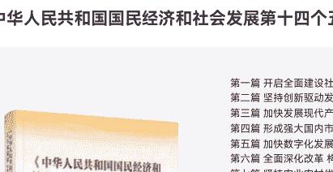

- 第一回开始建设社会主义现代化进程
- 第二次确立改革开放路线
- 第三次深化经济改革，确立中国社会主义基本经济基础
- 第四次中国进入社会主义市场经济时期
- 第五次基本完成社会主义市场经济建设
- 第六次科学发展社会主义市场经济导向格局
- 第七次确立社会主义和谐发展总体目标
- 第八次坚持科学发展新理念
- 第九次步入新发展阶段关键时期
- 十次推进协调式发展，实现人与自然和谐共生
- 十一次确立中小富裕目标
- 十二次全面规划高质量发展
- 十三进入新发展阶段
- 十四全面深化改革
- 十五持续深化中国特色体制改革
- 十六加强社会主义法治建设
- 十七新时代社会主义规划
- 十八推进规划实施

资料来源：国家政策研究院；北京国研信息中心

#### 2. 五年规划是实现超越的重要途程

我国从建国至今已历经了十四五年规划，作为后发发展国家，制定五年规划是实现超越的重要途程。其中，计划经济体制时期主要是“一五”到“五五”计划

# 图 “一五”计划到“五五”计划概况

| 阶段 | 五年规划 | 时间 | 核心内容 |
| :--- | :--- | :--- | :--- |
| 计划经济体制时期（四个化”阶段） | “一五”计划 | 1953-1957 | 奠定了我国工业化的基础，主要是学习苏联的建设经验，仿苏联建设了156个大型工程，重点进行工业建设 |
| | “二五”计划 | 1958-1962 | “大跃进”，在建国工业化的基础上，继续以工业为中心，但由于出现反复，调整方向，农业陷入低谷 |
| | “三五”计划 | 1966-1970 | 调整、巩固、恢复，在国防安全的基础上，由发展转向重点 |
| | “四五”计划 | 1971-1975 | 调整、恢复，我国经济遭受严重损失后，调整路线，重点发展农业，工业化正常 |
| | “五五”计划 | 1976-1980 | 建立独立的国民经济体系，鼓励多种形式活动，探索新的经济模式，使我国工业体系基本定型 |

一、二、“三”计划指的是我国战略布局，包括中西部以及南方，也经历了。改革开放时期是“六五”计划到“十二五”规划，该阶段是中国特色社会主义时期，是经济向市场经济转变的重要过渡期。

| 阶段 | 五年规划 | 时间 | 核心内容 |
| :--- | :--- | :--- | :--- |
| 改革开放初期（特殊阶段） | “六五”计划 | 1981-1985 | 调整、巩固、恢复，“八字方针”，开始建立现代化蓝图，坚持经济为中心 |
| | “七五”计划 | 1986-1990 | 加速经济体制改革，实行以经济为主的战略，逐步形成市场经济 |
| | “八五”计划 | 1991-1995 | 深化经济改革，加强科技攻关，扩大开放，可持续基础 |
| | “九五”计划 | 1996-2000 | 宏观调控，加强科技创新，注重资源的合理利用，促进可持续发展 |
| | “十一五”计划 | 2001-2005 | 巩固社会主义经济基础，坚持以人为本，实现现代化目标，跨越式增长 |
| | “十二五”计划 | 2006-2010 | 科学发展，坚持创新驱动，推进城镇化进程，实现协调发展 |
| | “十三五”计划 | 2011-2015 | 加快实现全面跨越，以经济为主，坚持科学发展，扩大开放，把生态文明放在重要的位置 |

资料来源：《五年规划》；中国国际研究中心

党的第十八大以后，中国进入社会主义新时代，开始了由大向全面建设，“十四五”规划强调以创新驱动高质量发展，以解决发展不足和不平衡的问题，致力于实现生产力的整体飞跃。

# 图5“十三五”规划到“十四五”概述

| 阶段 | 五年规划 | 时间 | 核心内容 |
| --- | --- | --- | --- |
| 中国特色社会主义时期（社会主义现代化阶段） | “十三五”规划 | 2016-2020 | 积极适应经济发展新常态，全面推进发展理念，确保高质量发展。聚焦五大发展战略和制度建设。首次提出数字强国、网络强国、大数据战略 |
| “十四五”规划 | 2021-2025 | 推进“五位一体”总体布局，开启新时代进程，推动高质量发展，立足新发展，兼筹发展理念，构建新格局。深化供给侧改革，以创新驱动高质量供给和创造新动力，首次提出构建“数字中国”的格局 |

资料来源：《五年规划》；和国际研究中心

## 发展变迁迎接新的时代

#### 1. 规划演进特征

从1953年“五五”计划实施以来，每一个五年规划的完成，都标志着中国现代化进程迈上了新的台阶。历年五年规划在规划性质、规划程序、规划目标和规划体系等方面不断完善，其演进特征也是描述的。

图 6 我国五年发展规划演进特征

| 指令性计划 | 指导性+约束性 |
|---|---|
| “五五”~“五五” | “七五”~“十四五” |

资料来源：《五年规划（内部报告）》；国际研究中心

#### 2. 大成就

以规划为统筹的途径证明成效。延续过往规划成效，目前我国已仅美国的第二大经济体，截至2023年，全国GDP总量17.88万亿美元（美元折算）。联合国（UN）与世界银行（WB）数据显示，2014年中国首次突破10万亿美元总量，继美国之后第二个跨越10万亿美元经济体。中国从1万亿美元增长到10万亿美元用了14年，美国则用了31年。中国在20年内已实现全面超越

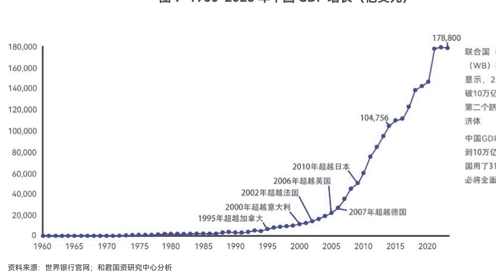

同时，我国已经进入中等收入阶段，根据国际货币基金组织（IMF）最新数据显示，2022年我国GDP排名位全球第63位，若按人均中位数计算则超过世界中位数较多。

#### 3. 产业发展趋势

作为后发发展国家，早期采取了工业赶超战略，后期侧重发展，服务业快速发展，目前从中期向后期转型，其中构建现代产业体系已成为当前发展的重心。

从“十四五”评估来看，现代产业体系加快发展，实体经济不断加强，持续发展，产业发展向高端稳步迈进。

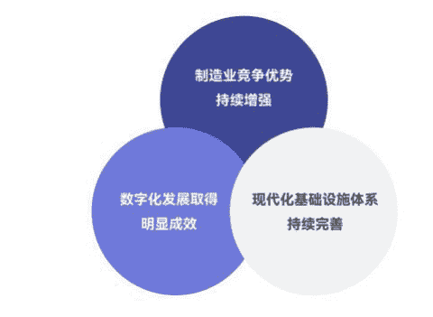

# 图10 1952-2023年我国产业变迁

创新驱动发展加快，侧重实体经济转型，创新驱动要素为核心，加速实现生产力跃迁，形成新生产力，“十五五”进入高质量发展阶段。

# 图12 2023年新兴产业

| 新兴产业 | 未来产业 |
|---|---|
| 新一代技术 | 宇宙信息 |
| 新能源 | 人形机器人 |
| 新材料 | 量子信息 |
| 高端装备 | 生物制造 |
| 新能源 | 未来显示 |
| 民用航空 | 未来网络 |
| 船舶与海洋装备 | 新型智能 |

资料来源：《关于新产业标准化工程方案（2023年）》

### 4. 区域发展

打破限制，促进区域经济协调。

图 13 “一五”到“十四五”区域转变

| “一五”到“五五”：区域均衡 | “六五”到“八五”：区域均衡 | “九五”到“十一”：区域协调 | “十一五”到“三五”：区域统筹 | “十四五”：优化布局，促进区域协调 |

资料来源：信息检索、国际研究中心

### 5. “十五五”，二十大后的新起点

面向“十五五”，面临新发展阶段的新矛盾、新机遇、新挑战和新任务，具有新时代特征。

图 14 “十五五”的时代特征和意义

| 方面 | 重要意义 |
|---|---|
| 指导思想 | “十五五”规划是深入贯彻党的思想的第一个五年规划。“十五五”规划以习近平时代特色社会主义思想和二十大精神为指导，对人口规模巨大的、全面推进经济结构转型、产业现代化、文明建设、生态环境保护等等 |
| 历史进程 | “十五五”规划将处于实现2035年基本建成社会主义目标的关键时期。“十五五”将继续深化社会主义制度，推进现代化经济体系、法治社会、文化、教育、人才、安全开放，为中华人民实现共同裕等方面 |
| 发展环境 | “十五五”规划是我国战略性发展重点期的第二个五年规划。全球分工和技术竞争为我国提升国际地位提供有利条件，但也面临国际竞争加剧、外部环境复杂严峻等形势向高质量发展的挑战增大、艰增加、空间的基本特征 |
| 空间布局 | “十五五”规划是落实二十大报告的一个五年规划。省（市）将实施区域协调发展战略、区域重点区域、主体功能区域、新型城镇化战略优化重大产业布局，构建优质优势、高质量发展的区域统筹布局和国土空间体系，推动西部形成新格局 |

数据来源：信息检索、国际研究中心

# 国有经济在提质增效中攻坚克难

## 1. 中国国有企业经营绩效呈现韧性增长

中国国有企业经营规模波动上升，国有经济运行质量明显改善，利润总额总体稳中升。

图 21 2012-2023 年国有企业利润总额变化情况（万元）

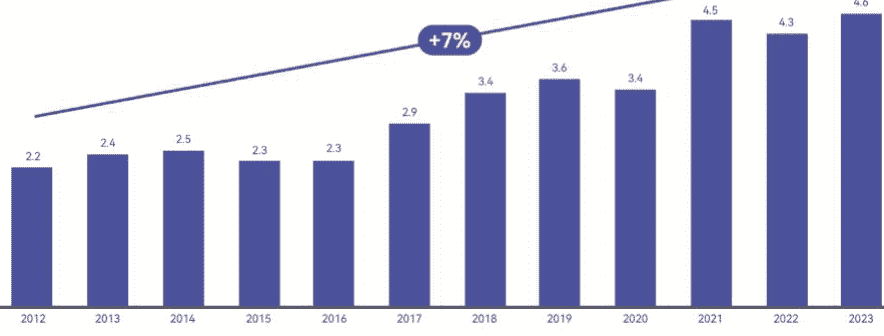

# 图 22 2012-2023年中央和地方企业利润总额对比（万亿元）

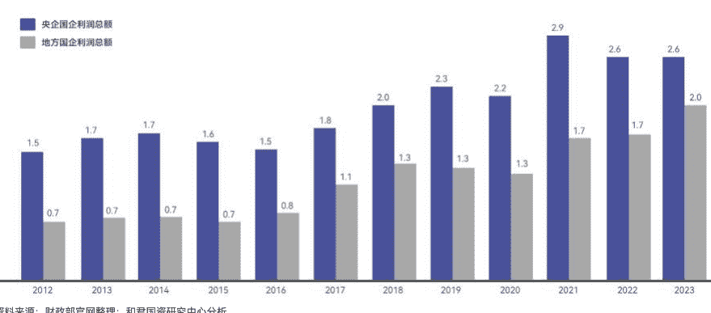

## 2.500 世界500强企业中的国有企业占比情况

从世界500强企业中的国有企业来看，共有16个国家的115家国有企业上榜，其中发展中国国家的国有企业数量较多。

# 图 23 不同国家世界500强中国国有企业占比（2024，%）

| 国家 | 国家性质 | 世界500强上榜企业 | 国有企业数量 | 占比 |
| :--- | :--- | :--- | :--- | :--- |
| 沙特阿拉伯 | 发展中国家 | 1 | 1 | 100% |
| 泰国 | 发展中国家 | 1 | 1 | 100% |
| 波兰 | 发展中国家 | 1 | 1 | 100% |
| 印度 | 发展中国家 | 1 | 1 | 100% |
| 埃塞俄比亚 | 发展中国家 | 1 | 1 | 100% |
| 马来西亚 | 发展中国家 | 1 | 1 | 100% |
| 中国 | 发展中国家 | 133 | 89 | 67% |
| 俄罗斯 | 发展中国家 | 5 | 3 | 60% |
| 印度 | 发展中国家 | 9 | 5 | 56% |
| 墨西哥 | 发展中国家 | 4 | 2 | 50% |
| 巴西 | 发展中国家 | 9 | 2 | 22% |
| 意大利 | 发达国家 | 5 | 1 | 20% |
| 韩国 | 发达国家 | 15 | 2 | 13% |
| 法国 | 发达国家 | 24 | 3 | 13% |
| 德国 | 发达国家 | 29 | 2 | 7% |
| 美国 | 发达国家 | 139 | 1 | 1% |

资料来源：《世界500强榜单看国企变化》和资研究中心

## 3. 中国企业改革进入关键阶段

基于二十届三中精神，更深入国有企业改革，不断增强核心功能，提升竞争力，更完善中国现代制度，打造世界一流企业。

图 二四 国大新图景

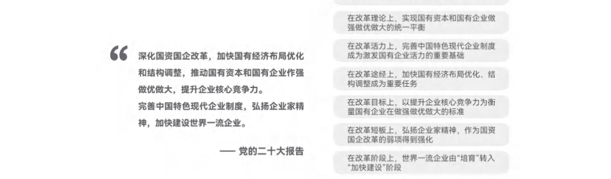

国资改革，加快经济布局和结构调整，推动国有企业核心功能增强，提升竞争力。加强现代制度，激发活力，加快建设一流企业。党的二十届三中提出增强管理协同，推进经济布局优化结构调整，推动国有企业做强，提升竞争力。

图 二五 对经济布局优化

资料来源：《中共中央关于深化改革的决定》、国资委

作为国企改革首位任务，是“十五五”国有企业改革的任务细化为六项任务：

| 六大任务 | 具体任务 |
| :--- | :--- |
| 增强国有企业核心功能，做一流 | 进一步完善治理机制，增强协调能力、完善高效治理机制 |
| 推进经济布局和结构调整 | 加强管理部门协同，推进经济布局优化结构调整 |
| 提升国有企业竞争力 | 增强核心功能，提升市场竞争力 |
| 推进中国企业现代化制度 | 建立健全市场退出机制，加快落后产能、低效企业退出 |
| 完善企业退出机制 | 优化资源配置，加快市场化退出 |
| 加强国有企业发展环境 | 完善安全保障 |

## 经营效率面临压力

资产负债水平下降。经过多年努力，“十五五”国有企业债务风险有所抬头。

图 二七 2012-2023年国有企业负债率变化

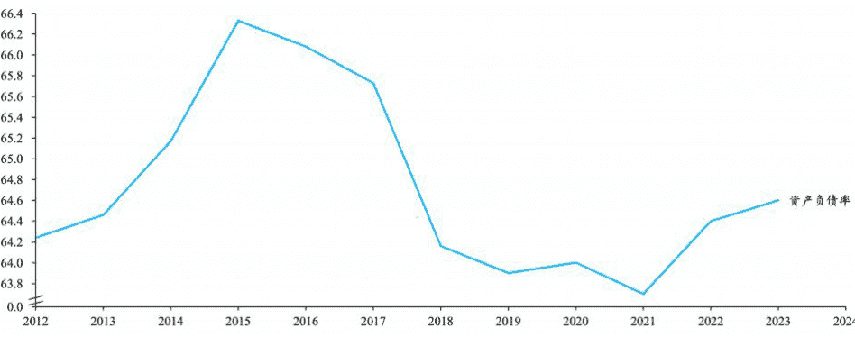

数据来源：财政部官网、国资研究中心

图 二八 2022年中央和地方国企负债率对比 (%)

数据来源：财政部官网、国资研究中心

## 5. 存在一系列问题

**我国经济效率待提升。** 当前企业资产收益率偏低，经济运行效率待提高。多年以来，随着经济增速由快速转向高速，国有净利润率和总收益持续低。

**我国产业引领有待加强。** 经济布局与战略安全、产业引领、公共服务等功能可能存在差距。

**我国区域调整的效果有限。** 从多年数据来看，企业数量在东部地区不均衡，西部地区占比升幅不大，增长不到1%。

**我国对创新支持力度待提升。** 与领先民营企业相比，特别是在R&D经费和新产品研发支出两个方面，国有资本未显示出对核心技术研发创新的巨大支持和配套力度不足。

五是国有海外布局待优化。“一带一路”倡议和“双循环”发展战略，国际布局优化从国内延伸到国际领域，但仍集中在高铁、核电等少数领域，对于战略性产业和高技术领先的其他布局缺少。此外，地方国资本布局还面临一系列个性化的挑战。

| 问题描述 | 主要表现 |
| :--- | :--- |
| 整体布局仍不均衡 | 在企业管理体制下，市、省、区的国有资本在海外布局有限，对产业支撑尚不够基础，布局错乱，资源浪费严重，输出重复，企业布局单一，难以形成产业响应和规模效应，资源配置匮乏 |
| 国资规模规模不够 | 地方国资企业规模较小，在海外城市布局少，对产业支撑尚不够基础，联动国际产业发展能力有限，缺乏差异化布局与海外产业对接，投融资平台等经营性支撑缺乏，带动能力不足，缺乏海外发展的有效渠道 |
| 产业结构不合理 | 产权结构比较大，海外链条短，企业在海外布局单一，且多数处于国际产业链中游，产业结构后滞，发展水平不高，现代新兴产业海外布局存在明显短板，在高技术领域新兴产业竞争力有待提升 |
| 核心功能不显现 | 活性企业表现较差，战略性企业占比少，自身“造血”能力弱，积累不足，主体结构单一，国资主体仍处于经营状态，资金筹措能力匮乏，在战略定位、国资、统计、公共服务等等方面地位不够 |
| 引领带动不明显 | 企业活跃度以及海外企业较少，布局分散，强度不够，联动核心竞争力弱，缺乏具有海外产业链的带动能力，企业国际化程度较为标准，自身“造血”能力弱，产业市场远，资本运营灵活不易，上市公司平台作用尚未具有有效渠道 |
| 竞争力不够 | 企业定位不准，普遍跨国经营，链条短，收益率低，在应用领域管理水平有限，驱动模式单一，可持续能力弱，财务负债率高，回报率少 |

资料来源：信息整理、国资研究中心

# 关注10项重要议题：国有资本布局

坚持问题导向，注重整体规划和顶层设计，优化国有资本布局，完善空间布局，统筹企业布局，更好发挥国有资本在社会发展中的作用。

| 优化功能布局 | 完善空间布局 | 统筹企业布局 | 丰富资本形态 |
| :--- | :--- | :--- | :--- |
| “领先期” | “分类” | “育优” | “拓” |
| 经营重组 | 深化国有企业改革 | 培育一流 | 构建灵活多元 |
| 更好发展“赛道” | | | |
| 国有投资公司 | 国有管理公司 | 产业集团 | |
| 协同机制 | | | |
| 保障机制 | 健全 | | |

| 主责要做 | 关键环节 | 创新引领 |
| :--- | :--- | :--- |
| 聚焦 | | |
| 推动 | | |
| 完善 | | |
| 能够 | | |
| 拓展 | | |
| 承担 | | |
| 优化 | | |
| 提升 | | |
| 聚焦 | | |
| 打造 | | |

## 3.3 “两类公司”新使命

以两类公司为抓手，重组或新建国有投资公司与运营公司，授权两者对范围内的国有资本履行投资职责，同时赋予国有投资公司、运营公司不同的功能定位。

图 34 国有资本投资、国有运营公司功能定位

| 国有资本投资 | | | | 国有资本运营公司 | | | |
| :--- | :--- | :--- | :--- | :--- | :--- | :--- |
| 产业调整 | 产业整合 | 产业培育 | 投资融资 | 持股管理 | 股权经营 | 资产经营 |
| 依据需求调整产业周期和配置结构、战略布局、重点发展核心产业 | 发起行业调整、引导行业培育 | 完善业务并股权投资、加强行业内资本运作 | 整合多元化、拓展培育链条、战略性使用 | 通过基金、股权等方式退出 | 对接市场、行政转型、资源整合、各项市场化改造 | 吸收企业、进行股份整合、退出 |

“两类公司”高质量发展模型涵盖各类业务，未来两类公司将围绕高质量发展理念，业务发展与产业化、资本深度化，并完善管理机制，提高核心竞争力与核心功能。

图 35 “两类公司”高质量发展模型

> 发展理念：以提高企业竞争力和增强核心功能为目标，高质量发展之路

业务方向与路径

| 产业化 | 资本化 |
| :--- | :--- |
| 纳入重大战略 | 重视无形资本实力 |
| 服务产业发展 | 创新资本退出路径 |

兼负责市场化运营机制完善价值创造体系，提升价值创造能力

## 3.4 城投的市场化再转型

基础设施为产业主体提供发展环境，通过产业投资发展产业纵深，为产业主体提供金融、策划等服务，通过资本运作与资产管理，实现资本层面的融合，获取资本增值。

图 36 城投市场化再转型

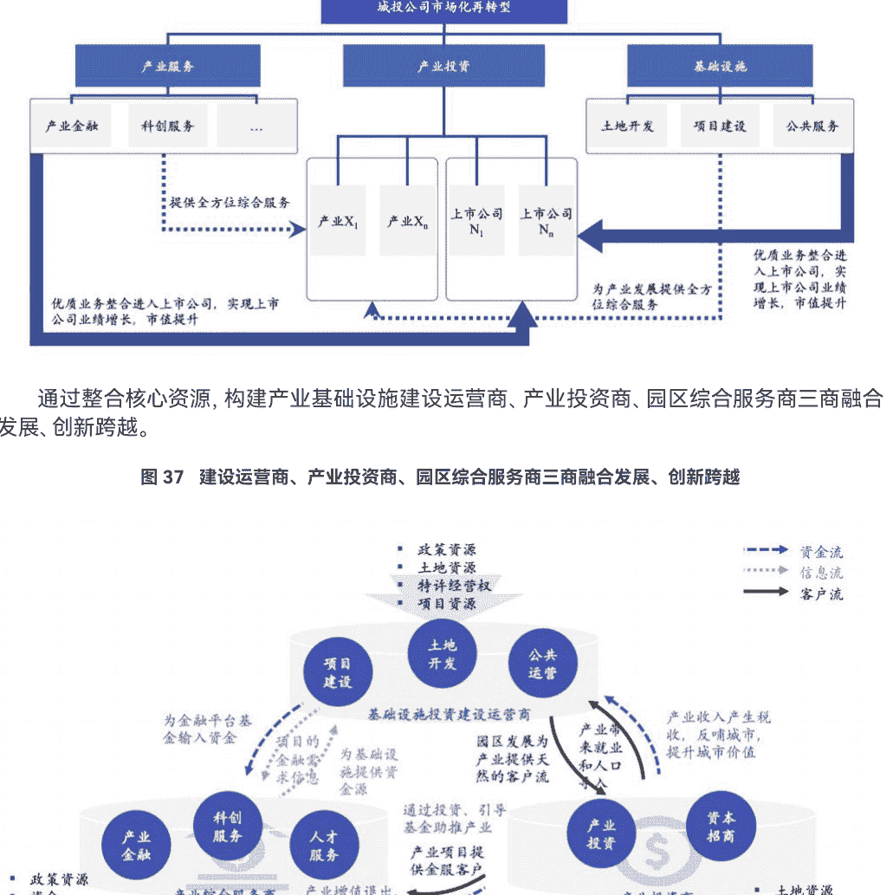

通过整合核心资源，构建基础基础设施运营商、产业投资商、园区综合服务商三商融合发展、创新跨越。

图 37 运营商、产业投资商、园区综合服务商三商融合发展、创新跨越

## 3.5 产业金融的功能发挥

大型国有企业从业务快速扩张的传统经验失效，进入新周期。

图 38 构建以闭环为核心的产融一体化示意

新时代，立足“产业-金融”循环，升级“产、融一体化”模式，充分发挥“产融互动”。

图 39 “产业-金融”循环与“产、融一体化”模式

| 产融互动 | 产融互动 | 产融互动 |
| :--- | :--- | :--- |
| 提供资金支持 | 提供投资平台 | 提供各类工具 |
| 帮助企业升级 | | |
| 需求引导 | 提供资金 | |
| 拓展业务 | | |
| 扩大市场 | | |
| 产融互动 | | |
| 提供资金支持 | 提供投资平台 | 提供各类工具 |
| 帮助企业升级 | | |
| 整合业务 | | |
| 优质资产 | | |
| 投资产业 | | |
| 收益提升 | | |
| 对接资金 | | |
| 加强行业 | | |
| 整合 | | |
| 来源：国资中心 | | |

## 3.6 科技创新与成果转化

战略力量各主体能力待持续提升，通过多方努力打造多元化主体、整合资源平台、开放灵活的环境等三级生态体系。

图 40 三级生态体系

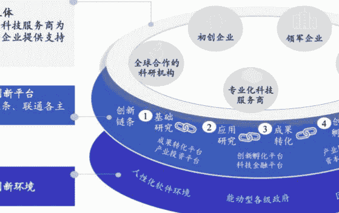

大型企业通过制定科技创新管理组织、项目管理体系、成果转化机制、激励机制，建设人才队伍以及创新文化。

图 41 全面系统的科技战略及管理框架

| 发展目标 | 聚焦相关行业 | 聚焦科技投资 | 加快转型 |
| :--- | :--- | :--- | :--- |
| 创新方向 | | | |
| 管理体系 | 科技管理组织 | 项目级体系 | 成果转化机制 | 激励机制 | 人才引进 |
| 资金保障 | 大资金投入 | 强化组织 | 定期跟踪 |

## 3.7 产业金融的功能发挥

大型集团灵活运用直接投资和间接投资方式，降低风险，建立复合投资能力和资源整合。产基金互动助力结构转型，世界级企业通过资本投资促进主业与产业链联动，推动产融融合，助力上市公司市值。

图 42 资本投资促进主业与产业链联动推动推动产融合

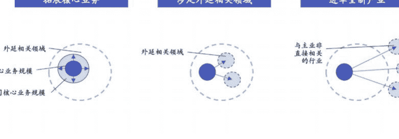

产业基金“全周期”联动，有助于形成成长的“投资+服务”。

图 43 股权基金全周期示意图

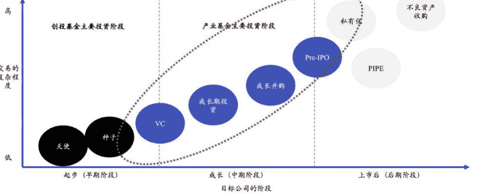

## 3.8 国有整合重组与市值管理

中央企业、地方企业、资本市场重组出现均衡布局和结构调整的趋势及显著成效。目前国企重组进入一个频发阶段，深化改革的迫切程度日益加深，分类推进国企整合业务重组。突破性完成“国有企业战略重组和专业化整合”是资本的重要基石，是发挥资本功能、提升效益的关键前提，取得突破性进展。

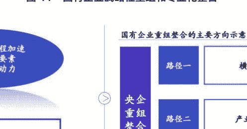

图 44 国有企业战略重组的主要方向示意

把握国有资本运营经验中的“投行”至“资管”价值，服务集团资产增值至集团旗下公司的市值。

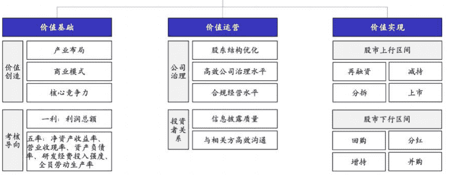

图 45 市值管理体系架构图

## 3.9 体制机制改革再深化

通过“战略-组织-机制”三位一体改革解决方案，为国企战略转型和管理改进的达成提供动力，推动发展、促进转型。

图 46 “战略 - 组织 - 机制”三位一体改革解决方案

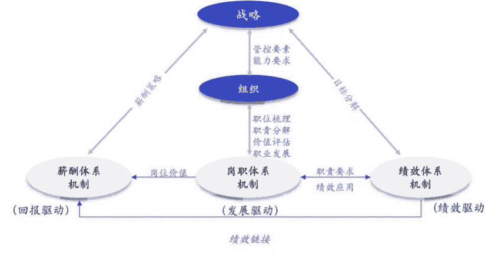

升级市场化的机制能力支撑，从人才到机制全面适配转型升级

| 企业战略 | | | | |
| :--- | :--- | :--- | :--- |
| **1 组织** | | | | |
| 1 董事会治理 | 2 战略和机制 | 3 决策控制 | 4 管理系统 |
| 董事会与经理色彩 | 职能定位与战略 | 总经理角色 | 战略统筹与光能 |
| 董事会与人员绩效 | 部门与组织色彩 | 授权与集权 | 预算与资源分配 |
| 董事会议事规则 | 绩效团队 | | 经营管理绩效 |
| **2 人才** | | | | |
| 5 选择 | 6 领导与文化 | 8 用 | 9 留 |

## 3.10 管控和监管与进步

针对大型国有企业，集团总部应从管理架构、管理关系、管理工具一体化对管控体系进行升级。

图 48 管控系统一体化升级

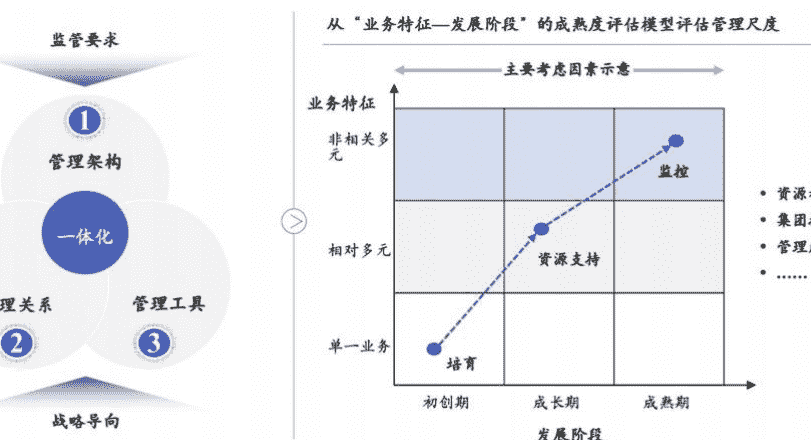

中国特色现代制度是时期集团管控的转型，基于外部环境的内在与国资监管监控，管控思想应应对风险大有助于发展，服务并增强效能。

图 49 中国特色现代制度

| 控制手段 | 对应的内控制度、流程路径、权责清单 |
| --- | --- |
| 2) 管理层 | * 公司管理制度 * 外派董事 * 外派董事/监事 * 外派财务总监 | 董事会会议制度 * 成员企业董事制度 * 外派监管制度 * 外派财务总监管理制度 * 投资与绩效监督分析制度 * 公司绩效管理制度 |
| 3) 职工管理 | 1) 执行层 * 执行制度 * 经理办会 * 业务权限 | 5) 审计监督 * 激励机制 * 考核 * 对下属公司不接受的审计权力 | |

# 04
和君研究 更懂中国

## 和君咨询成立 25 年，实力声誉卓越

和君创始于2000年，集团化发展架构，形成“一体两翼”业务格局。当前已成为亚洲大型规模的管理咨询机构，并以综合实力引领中国咨询业务发展。

图 50 和“一体两翼”业务格局与规模

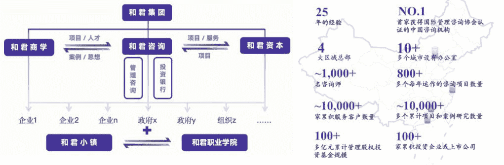

打造行业、专业、区域三条线的服务体系，针对客户需求，制定可实施的方案，为客户创造价值。

图 51 和君咨询三条线的服务体系

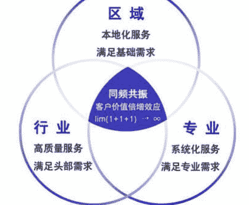

积累了众多奖项，以及领先客户群的口碑声。

图 52 和君咨询获得的奖项及口碑

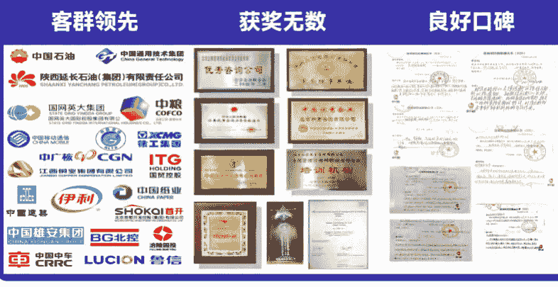

和君咨询重视总结原创商业的思想和方法论，以思想重构独特的商业见解。

图 53 和君咨询的专业论述

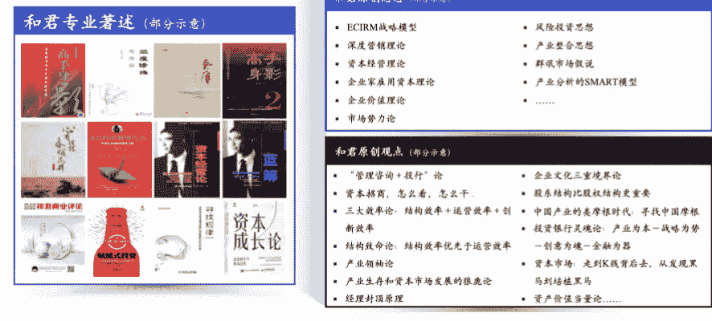

## 优秀党建就红色竞争力：300+党员，固本1+3党建模式获得高度认可。

图 54 和君集团党建活动与成就

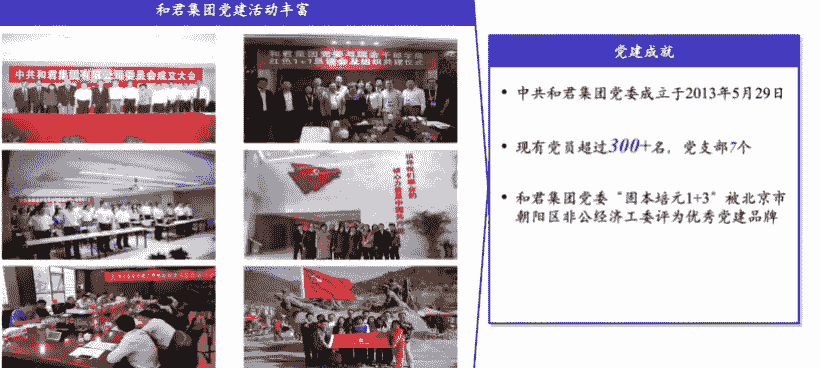

## 文化引领 造就中国底蕴

专业能力的发育固重要，但更重要的是催人向善的。和君必须秉持信念、坚持不懈地造就一种正道业、催人向善的企业文化，以文化的力量，打造世界咨询界的“中国队”，为用户提供有实效的思想、知识、方法和方案，成为代表中国智慧的专业服务和人才培养机构。

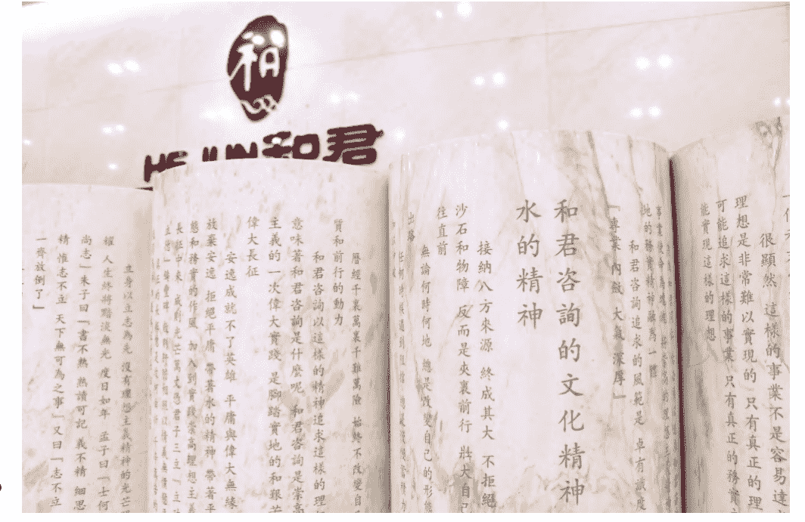

## 拥有业内第一真正组织运作的国资研究体系

面向“十四五”评估、“十五”规划与重大改革，君经验无与伦比。

图 55 和智咨询经过多年发展取得市场成就

| ~600+ | 100% | ~40% |
| --- | --- | --- |
| 个“二十五”、“十三五”、“十四五”规划及项目评估项的经营结果 | 直属省中市及地区规模最大的公司 | 客户资产规模超过1000亿 |
| 客户控股集团为多数上市公司 | | ~45% |
| | | 客户资产超过1000亿 |
| | 客户是高新技术企业 | ~200+ | ~100% |
| 项目涉及业务领域领先中国或国际领先水平 | | | |
| ~200+ | ~30+ | | |
| 地方政府与国资委发展项目 | 全国省及自治区和地区覆盖率 | | |
| | 100% 咨询师拥有国企战略与政策咨询经验 | 80% 咨询师拥有硕士以上学历 | |

## 长期研究更懂中国

在国资企业的一系列关键能力上发挥重要作用。

### 和智咨询提供“一揽子”解决方案

| 产业表现 | 国资布局 | 咨询模型 | 战略与管理 | 法律合务 |
| --- | --- | --- | --- | --- |
| 咨询服务达到国际领先 | 直属省市及自治区覆盖国企央 | 咨询模型转型型 | 咨询服务体系领先 | 全球法律服务网络 |
| 产业能力提升不断 | 与国企建立深度互动 | 业务转型与结构调整 | “管理型”的精细化运营 | 法律服务积累丰富 |
| 发展价值持续领先 | 建立人才培养可持续能力 | 核心需求与竞争力 | 投资设计经验 | 筹资策略领先 |
| | | 国有资本运作经验 | | 合规性审查领先 |

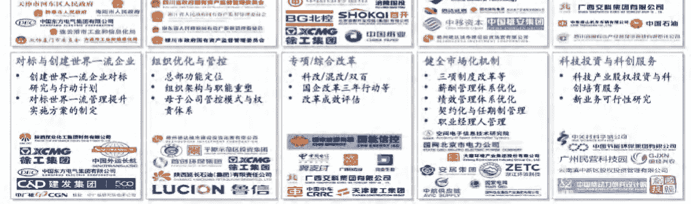

## 在国资政策领域的领先优势

持续合作已成为各类部门与国企的一致选择。

图 57 和君咨询服务各类客户

| 各行业 | 多国企业 | 大型企业 | 平台 |
| --- | --- | --- | --- |
| 汽车设备行业 | 中国重工 | 中信建设集团 | 中国海运有限公司 |
| 金融服务业 | 中国平安集团 | 中国金 | 招商有限公司 |
| 能源电力 | 中国石油 | 中石化集团 | 平安有限公司 |
| 建筑行业 | 中国华建集团 | 中国建集团 | 广发有限公司 |
| 医药健康 | 中国医药集团 | 中药集团 | 华信有限公司 |
| 制造业 | 中国联盈 | 中国航天 | 华信有限公司 |
| 交通运输 | 中国交建集团 | 中国铁建 | 交通通有限公司 |
| 农业 | 中国农业发展集团 | 中国国际证券 | 嘉农 |
| 消费品 | 中国华润集团 | 中信证券 | 嘉农银行 |

## 知识驱动

我们大力开发数据库，保持前沿洞察并发布领先报告。

图 58 和君咨询持续发布

## 科学方法

促进达成共识，充分与“自上下”贯穿式工作，才能更好地形成“共识、执行”。

图 59 和君咨询科学方法

| 第一步 | 第二步 | 三步 | 第四步 |
| --- | --- | --- | --- |
| 内部调研与评估 | 外部研究与专题 | “十五五”发展战略 | 严谨决策与实施 |
| 内部发展调研 | 外部环境研究 | 编制“十五五”规划 | 组织审议与决策 |
| 横向比较 | 短期重点发展专题 | 制定三年行动计划 | 支持落实与实施 |
| 综合评价“十四五” | 设计科技规划 | | |

## 两高一优势

和君咨询是各类企业和各级政府最信任的合作伙伴。

图 60 和君咨询服务“两高一”核心优势

| 更高水平 | 更高效 | 更创新 |
| --- | --- | --- |

- 20+年万个案例支撑
- 深厚的国资智库积累
- 优秀的复合型人才梯队
- 跨周期的全面视野
- 立体化咨询管理体系
- 理论与工具的研究能力
- 遍布全国的实践
- 严谨的工作执行标准
- 辅助研发的常态化机制

## 和君咨询企业服务架构

围绕“产业-战略-能力”提供“想清楚-说明白-到位”的一体化解决方案。

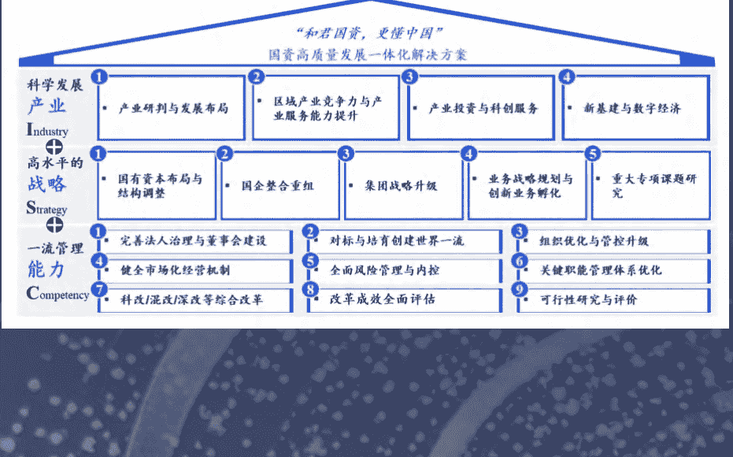

## 免责声明

本研究报告中所提供的信息仅供参考。报告根据国际和行业行的准则，以合法渠道获取这些信息，尽可能保证信息可靠、准确和完整，并不保证报告所述信息的准确性和完整性。本报告不能作为投资决策的依据，不能作为道义、法律的依据或者凭证，无论是否已经明示或者明确。

本报告所载内容反映的是和君咨询在最初发表本报告当日的判断，本机构可发出与其他本报告所载内容不一致或有不同结论的报告，但本机构没有义务和责任及时更新本报告涉及的内容。

## 和君咨询北京总部
地址：北京市朝阳区北苑路86号丰南院E区213栋
电话：010-84108866（总机）400-093-2688（免话费直接）

## 和君咨询上海总部
地址：上海市黄浦区汇聚路763号丰盛创建大厦6层
电话：021-63166999（总机）

## 和君咨询深圳总部
地址：深圳市南山区南光路286号水木一方大厦6层
电话：0755-89698520（总机）

## 和君教育小镇
地址：江西省赣州市会昌区和君教育小镇
电话：0797-5669955

宋斌

# START YOUR FINANCE

起点财经，网罗天下报告
