# 图解《数据安全技术 数据安全保护要求》（征求意见稿）

炼石网络
2025年11月

# 知识星球TOP 资源分享群

公众号：知识星球TOP

汇聚全球高价值资源

打造一流资源群

添加微信付费群


微信信号:top28688


微信信号:top28388


- ◆ 付费文章
- ◆ 付费社群
- ◆ 时政&国际
- ◆ 副业&搞钱
- ◆ 财经&市场
- ◆ 行业&科技

时政·历史·职场·体制·自媒体
学习·军事·软件·影音·社会学

## 01 图解《数据安全技术 数据安全保护要求（征）》

02 图解《中华人民共和国数据安全法》

03 图解《网络数据安全管理条例》

04 图解《GB/T 43697 数据安全技术 数据分类分级规则》

05 图解《GB/T 45577 数据安全技术 数据安全风险评估方法》

06 炼石数据安全应用实践


# 全国网络安全标准化技术委员会发布《数据安全技术 数据安全要求（征）》

2025年10月31日，全国网络安全标准化技术委员会发布《数据安全技术 数据安全要求（征求意见）》，并向社会公告征求意见。

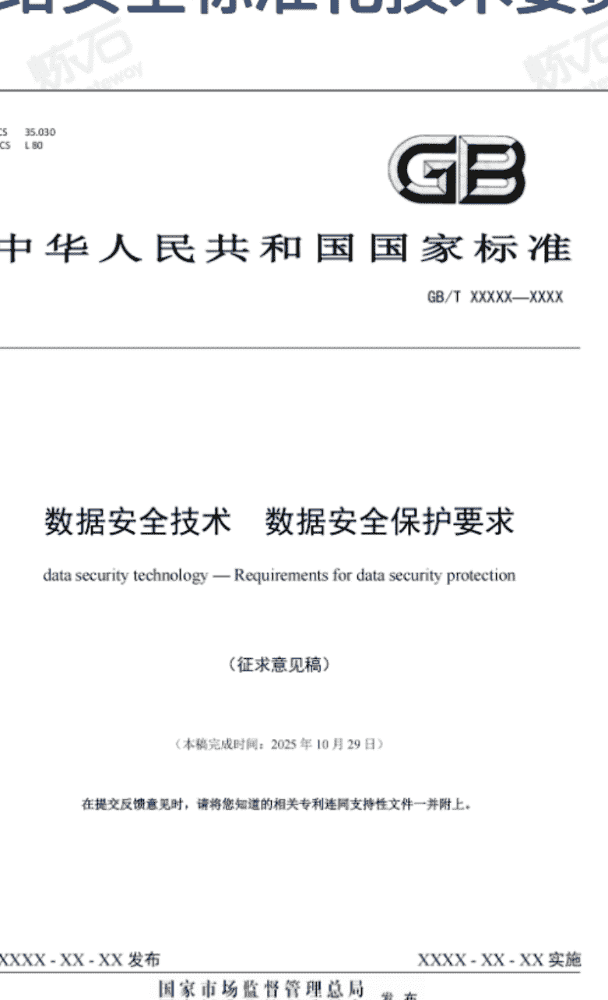

| 首页 | 工作动态 | 行业焦点 | 标准征求意见 | 标准解读 | 出版物 | 关于我们 | 平台登录 |
| :--- | :--- | :--- | :--- | :--- | :--- | :--- | :--- |

### 标准征求意见

#### 关于国家标准《数据安全技术 数据安全保护要求》征求意见的通知
2025-10-31

各相关单位和专家：

经标准起草单位的辛苦努力，现已形成国家标准《数据安全技术 数据安全保护要求》征求意见。为确保标准质量，安网标准秘书处将面向社会广泛征求意见。
恳恳希望您对该标准提出意见，并请于2025年12月30日前反馈给安网标准秘书处。

联系人：王越 13661025214 wunjiao@csi.cn

全国网络安全标准化技术委员会秘书处
2025年10月31日

# 《中华人民共和国数据安全法》

2021年9月1日，《中华人民共和国数据安全法》正式施行，明确规定“国家建立数据分类分级制度”。开展数据分类保护工作，首先需要对数据进行分类分级，识别涉及的重要数据和核心数据，然后建立相应的数据安全保护措施。

# 国家数据安全工作机制

指导

| 中华人民共和国网络安全 | 中华人民共和国数据安全 | 中华人民共和国个人信息保护 |
| :--- | :--- | :--- |
| GB/T 43697-2024《数据安全技术 数据分类分级规则》 | | |

# 《数据安全技术数据分类分级规则》

2024年3月15日，GB/T 43697-2024《数据安全分类分级规则》发布，规定了数据分类分级的原则、框架、方法和流程，给出了重要数据识别指南，可用于指导各行业领域、各地区、各部门和数据处理者开展数据分类分级工作。

# 《数据安全技术 数据安全保护要求（征）》

- 规定数据安全保护的通用要求和重要数据、核心数据专门保护要求
- 用于指导各行业领域、各地区、各部门和数据处理在数据分类分级的基础上开展数据安全保护工作

# 文件指导国家有关主管（监管）部门和数据管理者开展数据安全保护工作

# 国家有关主管（监管）部门

- 按照数据分类分级保护制度，确定部门以及主管（监管）行业领域的重要数据目录
- 建立健全全流程数据安全管理制度
- 指导重要数据和核心数据的处理器在遵循法律法规有关规定的基础上参考本文对列入目录的数据进行重点保护。

# 数据管理者

- 按照业务所属行业领域的数据分类分级标识规范，及时识别和报送本单位组织的重要数据目录信息
- 在遵循法律法规有关规定的基础上，参考本文对列入目录的数据进行重点保护。

## 参考文献

# 明确范围和规范引用文件

## 1.范围

## 2规范性引用文件

本文件提出了数据安全保护原则、目标和框架，规定了数据安全保护的通用要求，及重要数据、核心数据安全保护的专门要求。
下列文件中内容通过文中的规范性引用而构成文件必要条款。其中，规范性引用文件，仅对应版本适用于文件；规范性引用文件，其最新版本（包括修改版）适用于文件。

## 3.术语与定义

本文件适用于各行业领域、各地、部门和数据管理者开展数据分类分级工作，也可为主（监管）部门、第三方机构等对数据进行监督、管理和评估参考。

## 4.总则

| 规范性引用文件 | 术语 |
| :--- | :--- |
| GB/T 22239 信息安全等级保护 | GB/T 25069 术语 |
| GB/T 35273 信息安全 | GB/T 43697 数据分类分级规则 |
| GB/T 35396 数据安全处理 | GB/T 45574 敏感信息处理 |
| GB/T 45577 数据安全风险评估方法 | |

## 5.通用要求

本文件不涉及国家秘密。

## 6.重要数据保护要求

## 7.核心数据保护要求

# 明确范围和术语定义

## 1.范围

## 2.规范性引用文件

## 3.术语与定义

## 4.总则

## 5.通用要求

## 6.重要数据保护要求

## 7.核心数据保护要求

| 数据安全 | 数据处理活动 | 处理器 |
| :--- | :--- | :--- |
| data security | data processing | data |
| 通过采取必要措施，确保数据安全和合法利用。 | 数据的收集、存储、使用、加工、传输、公开等活动。 | 自主决定处理目的的组织、个人。 |

| 重要数据 | 核心数据 | 一般数据 |
| :--- | :--- | :--- |
| key data | core data | general data |
| 特定领域、特定群体、特定区域或达到规模的、一旦泄露或直接危害国家安全、经济运行、社会稳定、公共健康的数据。 | 对领域、群体具有较高覆盖度或达到较大规模的、一旦非法使用或共享，可能直接影响政治安全的数据。 | 核心数据、重要数据之外的数据。 |
| GB/T 43697-2024, 3.2 | 核心数据主要包括关系国家安全领域、关系经济命脉、重要民生、重大公共利益的数据、经国家有关部门评估的数据。 | GB/T 43697-2024, 3.3 |

# 明确范围和术语定义

## 1.范围

## 2.规范性引用文件

## 3.术语与定义

## 4.总则

## 5.通用要求

## 6.重要数据保护要求

## 7.核心数据保护要求

| 数据收集 | 数据存储 | 数据传输 | 数据使用 |
| :--- | :--- | :--- | :--- |
| data collection | data storage | data transmission | data use |
| 从一种或多种来源获取数据，或者产生新数据的过程或活动。 | 数据以任何格式存储在物理或虚拟存储环境中的过程或活动。 | 通过网络、通信设备或链路在不同时间点传输数据的过程或活动。 | 对数据进行操作和应用，以实现特定目的的过程或活动。 |

注：数据收集方式包括但不限于用户主动提交、系统自动记录、物联网收集、公开数据采集、业务数据产生、数据交换、第三方数据采集、汇总/汇聚等。
注：数据环境包括但不限于硬盘、U盘、固态硬盘、光带、闪存存储以及数据库、数据仓库、大数据平台、分布式文件系统（DFS）、并发存储系统。
注：节点可以是信息系统、计算机、网络设备、应用程序、移动终端、传感器、网络等。
注：数据使用的目的包括但不限于业务、生成报表、决策支持、数据分析、查询发现、可视化展示、运营管理、改进优化、安全措施等。

| 数据处理 | 数据提供 | 数据公开 | 数据删除 |
| :--- | :--- | :--- | :--- |
| data processing | data providing | data disclosure | data deletion |

对数据进行清洗、计算、整合、转换等分析处理，使其对于特定的目的或提取价值的过程或活动。将持有的数据传递给其他组织或个人的过程或活动。指向向社会公开或潜在的公众发布数据的过程或活动。指对存储在物理空间或介质中的数据进行技术处理，使数据不可读、访问或恢复的活动。

注：数据加工包括但不限于数据清洗、转换、整合、标注、建模、数据插值等。原始数据加工后，会产生衍生数据。
注：数据提供发生在非法人实体之间，不包括组织内部分部门（非法律实体）的数据共享。
注：公开数据指的是被公众可以自由获取和使用的数据，通常不需要用户登录或者其他形式的身份验证就能查看的数据。

# 有效性、合法性和持续性为目标进行数据安全保护

| 数据安全保护目标 | 数据安全保护原则 | 数据安全保护框架 |
| :--- | :--- | :--- |

数据安全保护以数据和数据处理活动为保护对象，重点实现以下目标:

| 目标 | 详情 |
| --- | --- |
| 有效保护 | 采取必要措施保障数据和全流程处理活动的保密性、完整性、可用性，确保数据处于有效状态，防范数据泄露、篡改、破坏、伪造、滥用等风险。 |
| 合法利用 | 数据处理活动遵守法律、行政法规等规定，尊重社会道德，不危害国家安全、公共利益，不损害个人、组织的合法权益。 |
| 持续安全 | 建立数据安全手段，确保数据处理可控性和持续性，具备保障数据安全的能力。 |

# 数据安全保护应遵循合法、分类分级、从严原则

| 数据安全保护目标 | 数据安全保护原则 | 数据安全保护框架 |
| :--- | :--- | :--- |
| 合法合规原则 | 开展数据处理活动根据法律规定，按照所属行业主管（监管）部门的要求，履行相应安全义务。 |
| 分类分级原则 | 数据实行分类分级，按照重要性、规模、安全风险等分为一般、重要、核心三级，对不同的数据采取相应的安全措施，一般数据在需要的基础上加强保护，核心数据严格管理。 |
| 从严原则 | 不同类别、级别数据同时处理且按照其中最高的要求实施保护，确保数据整体处于有效保护和合法利用的状态。 |
| 全程保护原则 | 安全措施覆盖数据收集、存储、传输、加工、处理、公开、删除等处理过程。 |
| 风险防范原则 | 综合考虑数据应用和风险，采取适配的安全措施，防范数据篡改、破坏、泄露或者非法获取、共享等风险。 |
| 责任明确原则 | 数据处理活动涉及多个，应明确数据安全主体及相关方自身的责任。 |

# 数据处理器应根据目标和原则，开展分类分级工作，并明确保护要求

## 1.范围

数据处理器根据数据安全目标和原则，首先开展分类分级、明确数据责任，对重要数据识别结果确定各级别对应的数据保护要求。各行业领域或数据处理器可在本文提出的保护要求基础上，根据自身分类分级和安全风险进行细化或提高要求。数据安全保护框架所示：

## 2.规范性引用文件

## 3.术语与定义

## 4.总则

## 5.通用要求

## 6.重要数据保护要求

## 7.核心数据保护要求

# 数据处理器对自身的数据安全主体责任

| 情况分类 | 关键关键词 | 安全保护制度 | 数据处理安全 | 风险监测 |
| :--- | :--- | :--- | :--- | :--- |
| 1.范围 | | | | 各主管（监管）部门按照“谁管业务，谁管数据，谁管安全”原则，对本行业领域数据安全负责任； |
| 2.规范性引用文件 | 谁管业务，谁管安全 | 主管（监管）部门应当落实数据安全责任，领导班子对本单位数据安全工作负主体责任，领导班子负责人是第一负责人，分管数据安全的班子成员是直接负责人，其他职责范围内的数据工作负指导责任； | | |
| 3.术语与定义 | 明确和落实数据安全责任制 | 明确主管部门负责人 | | |
| 4.总则 | | 数据处理器对自身安全主体责任，本单位组织法定代表人或者主要负责人是数据安全第一责任人，分管安全的安全的负责人是直接负责人； | |
  ..通用 | | 明确者负责人 | 委托他人处理或者与他人共同处理重要数据的，数据安全责任不因委托而改变； | |
| 6.重要数据保护 | 委托管理安全保护 | 数据接收方应当按照数据分级，对数据提供方所属行业领域有标准规范确定的数据，对数据进行有效保护； | |
| 7.核心数据保护 | | 转移数据安全保护 | 数据处理器因合并、分立、解散、破产等原因需要转移数据的，数据接收方应继续履行数据安全义务； | |
| 参考文献 | 数据利用安全保护 | 数据在供给、流通、利用过程中，相关方在享有数据要素流通收益的同时，应对各自的数据处理活动承担安全责任； | | |

# 按照数据重要性、精度、规模、安全风险等分为一般、重要、核心三级

| 数据安全责任 | 数据分类分级 | 安全保护制度 | 数据处理安全 | 风险处置 |
| :--- | :--- | :--- | :--- | :--- |
| 1.范围 | | | | |
| 2.规范性引用文件 | | | | |
| 3.术语与定义 | | | | |
| 4.总则 | | | | |

数据处理器对应数据进行分类分级，符合以下要求：

| 情况分类 | 关键词/情形 | 详情 |
| :--- | :--- | :--- |
| 数据等级 | | 按照重要性、规模、安全风险等分为一般、重要、核心三级，对不同的数据采取相应的安全措施，一般数据在需要的基础上加强保护，核心数据严格管理。 |
| 分类分级 | | 按照行业领域数据特征分类分级。 |
| 细细化 | | 根据自身分类分级和安全风险进行细化或提高要求。 |
```


## 重要数据的处理器在满足第5章要求的基础上，应该加强数据安全管理

| 数据安全管理 | 数据生命周期防护 | 数据安全风险评估 | 数据共享调用 | 数据委托处理 | 信息系统建设管理 | 日志管理 | 数据迁移和删除 | 数据输出 |
| :--- | :--- | :--- | :--- | :--- | :--- | :--- | :--- | :--- |

- 1. 范围
- 2. 规范性文件
- 3. 术语与定义
- 4. 总则
- 5. 通用要求
- 6. 重要数据保护要求
- 7. 核心数据保护要求
- 参考文献

### 1 建立体系
应建立数据安全工作体系，加强人员和经费保障，并配合有关监督检查工作；

### 2 明确责任
应明确数据安全负责人和管理机构，落实数据安全保护责任，数据安全负责人具备数据安全专业知识和相关管理工作经历；

### 3 数据安全管理机构，应履行下列数据安全保护责任
- 1) 制定实施数据安全管理制度、操作规程和网络安全事件应急预案；
- 2) 定期组织开展数据风险监测、风险评估、应急演练、宣传教育培训等活动，及时处置数据安全事件；
- 3) 受理处理数据安全投诉、举报。

## 重要数据的管理者应加强数据全生命周期安全防护，符合以下要求

### 1 范围
- 数据安全管理
- 数据全生命周期防护
- 数据安全风险评估
- 数据共享调用
- 数据委托处理
- 信息系统建设管理
- 日志管理
- 数据迁移和删除

### 2 规范性文件

### 3 技术手段进行安全防护
### 最小授权原则
- 应在重要数据的收集、存储、使用、加工、传输、提供、公开、删除等环节，综合运用加密、鉴权、认证、脱敏、校验、审计等技术手段进行安全防护；
- 应按照业务需要和最小授权原则，依据岗位职责设定数据处理权限，控制重要数据接触范围，发生人员变更及时调整权限；

### 4 术语与定义
### 网络安全等级保护
### 使用商用密码进行防护
### 符合国家保密规定
### 5 总则
### 6 通用要求
- 存储和处理重要数据的信息系统，应落实网络安全等级保护三级及以上防护要求；
- 应落实密码保护和保密制度要求，法律法规和国家有关规定使用商用密码进行防护的，还应当遵守密码保护有关规定；
- 数据汇集、关联后属于国家机密事项的，应当符合国家保密规定。

### 7 重要数据保护要求
### 核心数据保护要求
## 参考文献

## 重要数据的处理者应开展数据安全风险评估

### 1 范围
### 2 规范性文件
- 每年自行或委托第三方评估机构，对其数据处理活动至少开展一次风险评估，及时整改风险问题，并向有关部门（监管）部门报送风险评估报告；
- 风险评估报告包括处理数据的种类、数量，开展数据活动的情况，面临的数据安全风险及其应对措施等；
- 提供、委托处理、共同处理数据前，应进行风险评估，但是履行法定职责或者法定义务的除外；
### 3 术语与定义
### 4 总则
### 5 通用要求
- 在开展数据安全风险评估时，对其数据查询、下载、修改、删除等重点操作的日志开展审计分析，对违规或者异常行为采取相应的处置措施；
- 经发现存在可能危害国家安全的数据处理活动的，重要数据的处理者应按照要求立即采取整改或停止处理重要数据等措施。
### 6 重要数据保护要求
### 7 核心数据保护要求
## 参考文献

## 数据共享调用和数据委托处理

### 1 范围
### 2 规范性引用文件
### 3 术语与定义
### 4 总则
### 5 通用要求
### 6 重要数据保护要求
### 7 核心数据保护要求
## 参考文献


重要数据的数据者应对数据共享调用进行安全控管，符合以下要求：
- a) 加强数据共享、调用的安全控管，采取技术措施定期监测数据共享、调用情况；
- b) 配备风险隔离、认证校验、威胁告警等安全保护措施。


重要数据的管理者应加强委托处理安全管理，符合以下要求：
- a) 在委托他人处理或与他人共同处理数据时，严格审批并明确受托方的数据权限和责任，受托方履行保护义务；
- b) 涉及使用云服务处理数据的，应当通过云服务安全评估。

## 委托开展信息系统建设、运行或维护，应符合的要求

### 1 范围
### 2 规范性引用文件
### 3 术语与定义
### 4 总则
### 5 通用要求
### 6 重要数据保护要求
### 7 核心数据保护要求
## 参考文献

- 未经批准转包：未经委托方批准时，涉及数据系统建设、运维项目转包、分包；
- 未经授权处理：未经委托方授权，涉及数据系统建设、运维人员不处理重要数据；
- 未经同意提供：未经委托方同意，不得访问、获取、留存、使用或者向他人提供数据，应对关联分析。

## 日志管理与数据迁移删除

### 1 范围
### 2 规范性引用文件
### 3 术语与定义
- a) 记录维护配置所需的日志；
- b) 涉及安全处置、溯源的，相关日志保留不少于一年；
- c) 涉及向他人提供、委托处理、共同处理数据的，相关日志保留不少于三年。
### 4 总则
### 5 通用要求

### 数据迁移和删除
重要数据的处理者应对迁移和删除加强管理，符合以下要求：
- a) 因合并、分立、解散、破产等原因需要迁移、销毁数据的，应当采取必要的安全措施，并向省级以上主管（监管）部门报告处置方案；
### 6 重要数据保护要求
### 7 核心数据保护要求
### 参考参考文献

## 重要数据的处理者涉及出境的，应符合以下要求

### 1 范围
### 2 规范性引用文件
### 3 术语与定义
### 4 总则
### 5 通用要求
### 6 重要数据保护要求
### 7 核心数据保护要求
## 参考文献

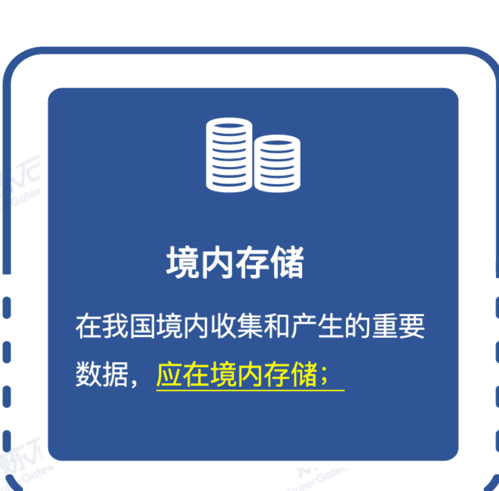
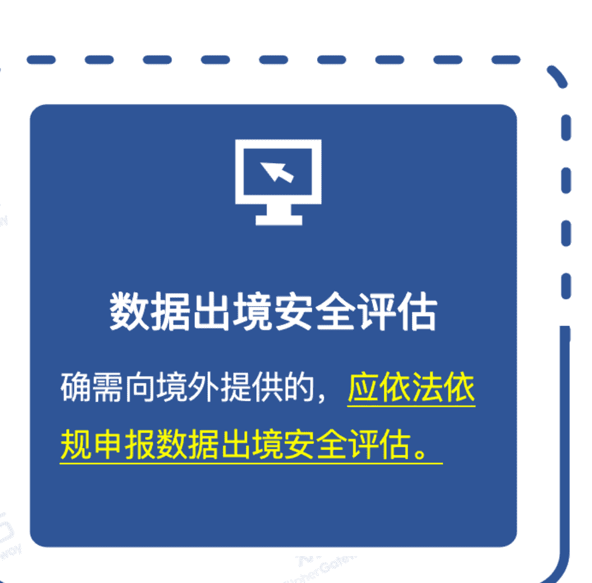

## 核心数据的处理者在满足第6章重要数据保护要求的基础上，符合以下要求

### 1 范围
### 2 规范性文件
### 3 术语与定义
### 4 总则
### 5 通用要求
### 6 重要数据保护要求
### 7 核心数据保护要求
## 参考文献


## 跨不同法人主体提供、转移、共享核心数据

存储和处理核心数据的信息系统，涉及关键信息基础设施的，在网络安全等级保护制度的基础上，落实关键信息基础设施安全保护要求，采取必要的安全措施。自当年度1月日起可能累积达到项核心数据总量30%及以上的，应当经有关主管（监管）部门报数据安全工作协调办公室组织风险评估；涉及关键信息基础设施的，应落实四级网络安全等级保护要求；未达到按照有关主管（监管）部门执行。

## 核心数据的处理器在满足第6章重要数据保护要求的基础上，符合以下要求

### 1 范围
### 2 规范性引用文件
### 3 术语与定义
### 4 总则
### 5 通用要求
### 6 重要数据保护要求
### 7 核心数据保护要求
## 参考文献

### 特殊情况
未明确国家有关主管（监管）部门的，应按照本地使用要求执行；注：涉及国家机关依法履职、国家机关或者事业单位内部流通的除外。

落实重要数据保护要求的基础上，应采取以下措施加强数据保护：
- 1) 优先使用商用密码进行保护；
- 2) 优先使用安全可信的产品和服务；
- 3) 优先使用第三方评估机构开展数据安全风险评估；
- 4) 涉及核心数据安全事件处置、溯源的相关日志，保留不少于三年；
- 5) 对相关关键岗位人员、涉及核心数据信息系统建设和运维单位等，依法依规提交公安机关、国家安全机关进行国家安全背景审查。

## 参考文献以顶层支撑

### 1 范围
### 2 规范性引用文件
### 3 术语与定义
### 4 总则
### 5 通用要求
### 6 重要数据保护要求
### 7 核心数据保护要求
## 参考文献


《数据安全法》：
- 第一章 总则
- 第二章 数据义务
- 第三章 数据风险
- 第四章 数据保护措施
- 第五章 数据监测与评估
- 第六章 法律责任
- 第七章 附则

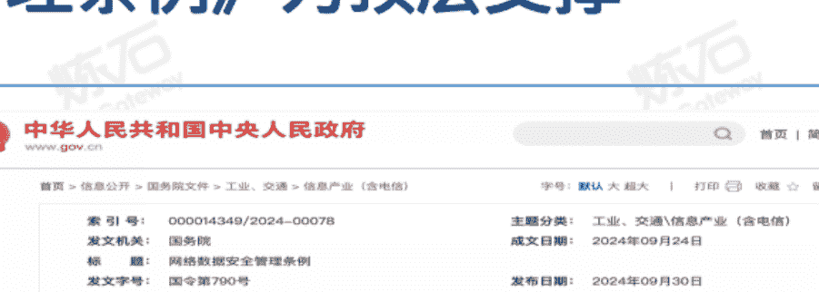
《数据安全管理条例》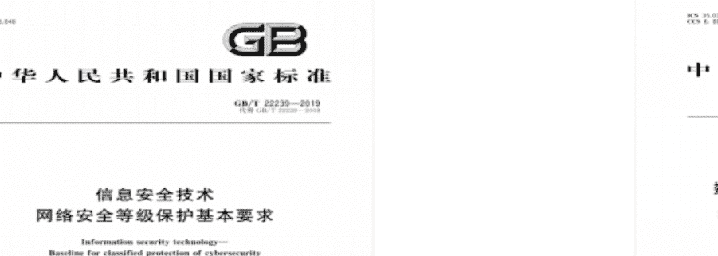
GB/T 22239 信息安全网络等级保护基本要求

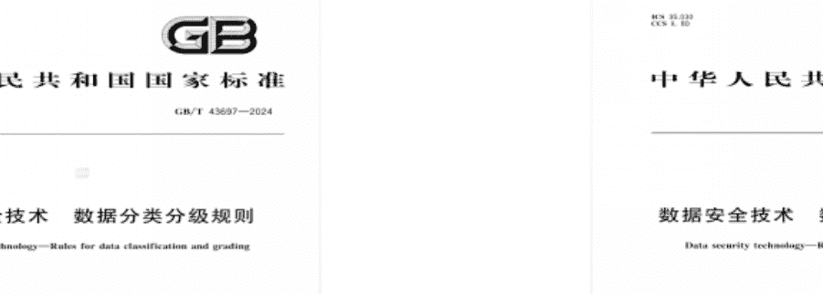
GB/T 43697 数据安全分类分级指南

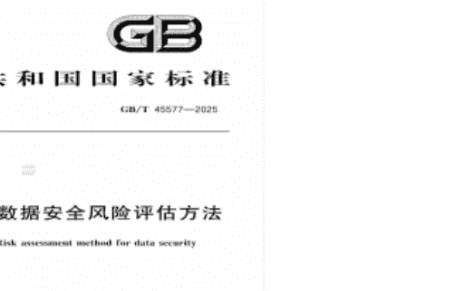
GB/T 45577 数据安全风险评估方法

- 01 图解《数据安全技术数据保护要求》
- 02 图解《中华人民共和国数据安全法》
- 03 图解《网络安全管理条例》
- 04 图解《GB/T 43697 数据安全分类分级规则》
- 05 图解《GB/T 45577 数据安全风险评估方法》
- 06 数据安全应用实践


## 适用范围兼顾境外效力


在中华人民共和国境内开展数据处理活动及其监管，适用本法。在中华人民共和国境外开展数据活动，损害中华人民共和国国家安全、公共利益或者组织合法权益的，依法追究法律责任。
《网络安全法》，《数据安全法》

## 数据相关概念权威界定

数据处理包括数据的收集、存储、使用、加工、传输、提供、公开等。


数据安全是指通过采取必要措施，确保数据处于有效保护和合法利用的状态，以及保障持续安全的能力。数据是指任何电子或其他方式对信息的记录。

## 坚持总体国家安全观，健全数据安全治理体系

### 中央国家安全领导机构
各地区、各部门对本地地区、本部门工作中收集和产生的数据安全负责。公安机关、工业、电信、交通、金融、国家网信部门统筹协调、自然资源、卫生健康、教育、科技...国家安全机关、国际交流与合作、有关部门、行业组织共同参与数据保护工作。个人、企业、科研机构。任何个人、组织有权向有关部门投诉、举报。

## 以数据安全保障数据开发利用和产业发展

### 数据基础设施
国家实施大数据战略，推进数据基础设施建设，鼓励和支持数据在各行业、各领域的创新应用。


### 数字经济发展
省级以上人民政府应当将数字经济发展纳入本级国民经济和社会发展规划，并根据需要制定数字经济发展规划。

## 统筹安全与发展

### 服务
提供智能化公共服务，应当充分考虑老年人、残疾人的需求……
### 评估
国家促进数据安全检测评估、认证等服务的发展，支持数据安全检测评估、认证……
### 技术
国家支持数据开发利用和数据安全技术研究，鼓励数据开发利用和数据安全等领域的技术推广和商业创新……
### 市场
国家建立健全数据交易管理制度，规范数据交易行为，培育数据交易市场……
### 标准
国家推进数据开发利用技术和数据安全标准体系建设……
### 教育
国家建立健全数据交易管理制度，规范数据交易行为，培育数据交易市场……

## 从国家层面建立安全制度

### 分类级
各地区、各部门按照数据分类分级，确定相关行业、领域的重要数据列入目录。

### 安全审查
国家建立数据审查制度，对影响或可能影响国家安全的数据活动进行审查，依法作出的结论。

### 风险管理
国家建立统一的数据风险评估、共享、监测机制，统筹各部门加强数据风险获取、分析、预警工作。

### 出口管制
国家对维护国家安全和利益、履行义务的数据出口管制。

### 应急响应
国家建立数据安全应急机制。发生数据安全事故，有关部门应当启动应急预案，采取相应的处置措施，防止危害扩大，消除隐患，并向社会公布。

### 数据贸易
任何国家或地区在数据开发利用、贸易等方面，可以根据实际情况采取措施。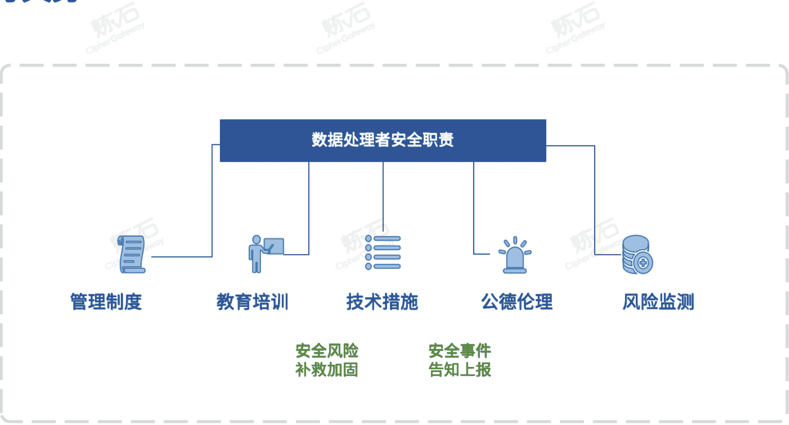

## 明确数据处理义务

### 数据处理主体
管理制度、教育培训、风险监控、安全事件告知上报。

### 数据处理者
数据处理者应当按照规定对其处理活动定期开展风险评估，并向有关部门报送风险评估报告。报告包含处理数据的种类、数量、开展数据活动的情况、面临的数据安全风险及其应对措施等。
- 关键信息基础设施的运营者在境内运营收集和产生的重要数据适用《网络安全法》；
- 其他数据处理器在中华人民共和国境内收集和产生的重要数据出境安全管理，由国家网信部门向国务院制定。

### 数据交易中介
从事数据中介服务的机构提供服务，应当提供数据来源、双方身份、存储、交易记录。

### 任何组织、个人
任何组织、个人收集数据应当采取合法、正当的方式，不得以非法方式获取数据。法律、行政法规对收集、使用数据的目的、范围有规定，应当在法律、行政法规规定的范围内收集使用。

## 执法调取执行严格批准手续

### 境内执法配合
公安机关、国家安全机关因维护国家安全或者侦查犯罪的需要调取数据，应当按照有关规定，经过严格的批准手续，依法进行，有关组织、个人应当予以配合


### 境外执法配合
中华人民共和国主管机关根据有关法律、缔结或参加的国际条约、协定，或者按照平等互惠原则，处理外国司法或者执法机关关于提供数据的请求。非中华人民共和国主管机关批准，境内的组织、个人不得向外国司法或者执法机关提供存储中华人民共和国境内的数据。

## 推进政务数据安全与开放

### 总体要求：高效服务
### 责任主体：国家机关
国家大力推进电子政务建设，提高政务数据的科学性、准确性、时效性，提升数据服务经济社会发展的竞争力。国家机关为履行法定职责的需要收集、使用数据，应当在其履行职责的范围之内依照法律、行政法规定的条件和程序进行。

### 安全义务：批准监管
### 安全职责：制度、责任
受托方应当依照法律、法规的规定和合同约定履行政务数据保护义务，不得擅自留存、使用、泄露或向他人提供政务数据……国家机关应当依照法律、行政法的规定，建立健全数据安全管理制度，落实数据安全保护责任，保障政务数据安全

## 安全违法处罚力度

| 责任主体 | 涉及内容 | 处罚追责 |
| :--- | :--- | :--- |
| 数据处理活动相关的组织、个人 | 发现数据处理活动存在较大安全风险 | 责谈整改 |
| | 建立全流程数据安全管理制度；在网络安全等级制度的基础上履行数据安全保护义务 | 不履行的：<br>• 整改、警告，并处以5-50万元罚款<br>• 对责任人员处1-10万元罚款 |
| | 加强风险监测；发生数据安全事故时，应当立即采取补救措施 | 不改正或造成数据泄露：<br>• 处50-200万元罚款，并停业整顿<br>• 对责任人员处5-20万元罚款 |
| | 违反国家核心数据管理制度 | 危害国家主权、安全和发展利益：处200-1000万元罚款，并可以令停止相关业务、停业整顿、吊销许可或吊销许可证<br>构成犯罪的：依法追究刑事责任 |
| | 因维护国家安全或者侦查犯罪的需要调取数据，按照国家有关规定，经过严格的批准手续，依法违反 | 违反规定，拒绝配合数据查询：令改正、给予警告，并处5-50万元罚款，对责任人员处1-10万元罚款 |
| 关键信息基础设施的运营者/其他数据处理器 | 向境外提供重要数据 | 违反规定：<br>• 改正、警告，并处10-100万元罚款，对责任人员处1-10万元罚款；<br>情节严重的：<br>• 处100-1000万元罚款，并令停止相关业务、停业整顿、吊销许可或吊销执照，对责任人员处10-100万元罚款。 |


# 大数据安全违法处罚力度

| 责任主体 | 涉及内容 | 处罚追责 |
| --- | --- | --- |
| 数据处理活动相关的组织、个人 | 发现数据处理活动存在较大风险 | 约谈整改 |
| | 健全流程数据安全管理制度；在网络等级保护制度的基础上履行数据安全义务 | 不履行：<br>• 整改、警告、并处以5-50万元罚款 |
| | 加强监控；发生数据安全事件时，应当立即采取处置措施 | • 对责任人员处1-10万元罚款 |
| | 对数据处理活动定期开展风险评估并报送 | 拒绝改正或造成数据泄露：<br>• 处50-200万元罚款，并停业整改<br>• 对责任人员处5-20万元罚款 |
| | 违反国家核心数据管理制度 | 危害国家主安全和发展利益：处200-1000万元罚款，并可以令暂停相关业务、停业、吊销许可或吊销执照 |
| | 因维护国家安全或侦查犯罪的需要数据，应当按照国家有关规定，经过严格的批准手续，依法进行 | 构成犯罪的追究刑事责任<br>违反规定，拒绝配合调取：令改正，给予警告，并处5-50万元罚款，对责任人员处1-10万元罚款 |
| 关键信息基础设施的运营者/其他数据处理器 | 向外提供重要数据 | 违反规定：<br>改正、警告，并处10-1000万元罚款，对责任人员可以以1-10万元罚款； |
| | | 情节严重：<br>处100-1000万元罚款，责令暂停相关业务、停业整顿、吊销许可或吊销执照，对责任人员处10-50万元罚款 |

01 图解《数据安全技术 数据安全保护要求（征求）》

02 图解《中华人民共和国数据安全法》

# 03 图解《网络数据安全管理条例》

04 图解《GB/T 43697 数据安全技术 数据分类分级规则》

05 图解《GB/T 45577 数据安全技术 数据安全风险评估方法》

06 炼石数据安全应用实践

## 网络数据安全管理条例

## 第一章 总则

- 1. 立法的目的
2. 适用范围
3. 基本原则
4. 鼓励支持
5. 分类分级
6. 国际交流合作
7. 行业自律

## 第二章 一般规定

- 8. 守法原则
9. 加密保护措施
10. 风险防范
11. 应急处置
12. 委托处理义务
13. 网络安全审查
14. 网络数据转移义务
15. 国家网络数据安全责任
16. 网络数据处理者义务
17. 电子数据安全管理
18. 自动化工具
19. 生成式人工智能服务
20. 社会监督监督

## 第三章 个人信息保护

- 21. 公告方式及内容
22. 个人同意处理要求
23. 个人信息请求
24. 匿名化处理
25. 个人信息转移路径
26. 境外网络数据处理者要求
27. 合规审计
28. 1000万人以上个人信息的要求

## 第章 重要数据安全

- 29. 重要数据目录
30. 网络数据安全义务及管理机构责任
31. 风险评估内容
32. 重要数据处置
33. 风险评估及风险评估报告内容

## 第五章 数据跨境安全管理

- 34. 数据出境安全管理机制
35. 向境外提供个人信息情形
36. 国际条约
37. 数据出境安全评估
38. 数据出境评估后要求
39. 防范数据跨境风险

## 第六章 网络平台提供者义务

- 40. 网络平台提供者义务
41. 应用分级服务的数据平台提供义务
42. 自动化监测信息推送要求
43. 网络身份认证公共服务建设
44. 大型网络平台提供者义务
45. 大型网络平台提供者跨境数据处理要求
46. 不从事活动

## 第七章 监管管理

- 47. 监管体制及职责
48. 有关主管部门职责
49. 国家网络数据部门
50. 监管检查内容
51. 客户端公正原则
52. 协同配合
53. 保密义务
54. 损害国家利益防措施

## 第章 法律责任

- 55. 网络数据处理者/网络平台提供者责任
56. 影响国家安全的处罚
57. 违反重要数据保护的责任
58. 法律责任违法惩
59. 免责情形
60. 国际法律适用
61. 民事/刑事责任

## 第章 附则

- 62. 定义
63. 他法违法
64. 施行日期

## 《网络数据安全管理条例》的定位

全国人民大会及其常委会：法律

国务院：行政法规

地方人大及常委会：地方性法规

地方人民政府：地方政府规章

部门规章

## 《网络数据安全管理条例》

《中华人民共和国网络安全法》
《中华人民共和国数据安全法》
《中华人民共和国个人信息保护法》
《网络数据安全管理条例》是为了维护网络数据安全，促进数据合法利用，保护个人、组织合法权益，维护国家安全和公共利益，根据《网络安全法》、《数据安全法》、《个人信息保护法》制定，2024年8月30日国务院常务会议通过，决定，自2025年1月日起施行。

## 第一章 总则

第一条 为规范网络数据处理活动，保障数据安全，促进数据合法利用，保护个人、组织权益，维护国家安全和公共利益。

## 第二章 一般规定

本条例对网络数据处理活动、网络数据者等进行了规定……（注：此处根据OCR原文逻辑，还原为正常章节结构）

- 1. 总则
- 2. 一般规定
- 3. 个人信息
- 4. 重要数据
- 5. 数据跨境
- 6. 网络平台
- 7. 监管管理
- 8. 法律责任
- 9. 附则

## 界定“网络数据”

（一）网络数据，是指通过网络收集、存储、传输、处理和产生的各种电子数据。

（二）本法所称数据，是指任何以电子或其他方式记录的信息。

（三）个人信息是以电子或其他方式记录的已识别或可识别的自然人有关的各种信息，不包括匿名化后的信息。

（四）网络数据，是指通过网络处理和产生的各种电子数据。

## 落实三部法上位要求细化路径

- 1. 总则
- 2. 一般规定
- 3. 个人信息
- 4. 重要数据
- 5. 数据跨境
- 6. 网络平台
- 7. 监管管理
- 8. 法律责任
- 9. 附则

《网络数据安全管理条例》落实三部法上位中提出的数据安全制度，明确实施路径。《网络数据安全管理条例》细化原则性要求，给出进一步明确规定补充重要数据处理者备案要求和年度报告要求、数据出境安全管理义务、互联网平台责任等。

## 延续属地原则，以保护主体为主界定标准

- 1. 总则
- 2. 一般规定
- 3. 个人信息
- 4. 重要数据
- 5. 数据跨境
- 6. 网络平台
- 7. 监管管理
- 8. 法律责任
- 9. 附则

## 强调“属地原则”

在中华人民共和国境内开展网络数据处理活动及其安全监督管理，适用本条例。

## 以“保护主体”为标准

在中华人民共和国境外处理中华人民共和国境内自然人个人信息的活动，符合《中华人民共和国个人信息保护法》第三条第二款规定，也适用本条例：

（一）向境内提供产品或者服务；
（二）分析境内自然人的行为；
（三）法律、法规规定的其他情形。在中华人民共和国境外开展网络数据处理活动，损害国家安全、公共利益或者公民、组织权益的，依法追究责任。

## 安全与发展

- 1. 总则
- 2. 一般规定
- 3. 个人信息
- 4. 重要数据
- 5. 数据跨境
- 6. 网络平台
- 7. 监管管理
- 8. 法律责任
- 9. 附则

## 落实数据分类保护

- 1. 总则
- 2. 一般规定
- 3. 个人信息
- 4. 重要数据
- 5. 数据跨境
- 6. 网络平台
- 7. 监管管理
- 8. 法律责任
- 9. 附则

## 采取加密等技术保障网络安全

应当依照法律、行政法规的规定和国家标准的强制性要求，在网络安全等级的基础上，加强网络数据安全防护，建立健全网络数据安全管理制度，采取加密、备份、访问控制、安全认证等技术措施和其他必要措施，确保网络数据安全，建立网络数据安全事件的处置机制，并对处理网络数据的安全承诺主体责任。

## 规范网络数据处理者安全缺陷、漏洞补救措施及安全风险报告流程

发生网络数据安全事件的，应当及时向有关主管部门报告，并采取补救措施减轻损害。

- 1. 总则
- 2. 一般规定
- 3. 个人信息
- 4. 重要数据
- 5. 数据跨境
- 6. 网络平台
- 7. 监管管理
- 8. 法律责任
- 9. 附则

第五十一条 个人信息处理者应当根据法律、行政法规的规定，并防止未经授权的访问以及个人信息泄露、毁改、丢失：

（一）制定内部管理制度和程序；
（二）对个人信息实施分类保护；
（三）采取加密、去标识化等安全措施。

## 建立网络数据应急机制

- 1. 总则
- 2. 一般规定
- 3. 个人信息
- 4. 重要数据
- 5. 数据跨境
- 6. 网络平台
- 7. 监管管理
- 8. 法律责任
- 9. 附则

网络数据处理者应当建立网络数据安全应急预案，发生网络数据安全事件时，应当立即启动预案，采取措施防止扩大、消除隐患，并按照规定向主管部门报告。

## 禁止非法数据处理活动

- 1. 总则
- 2. 一般规定
- 3. 个人信息
- 4. 重要数据
- 5. 数据跨境
- 6. 网络平台
- 7. 监管管理
- 8. 法律责任
- 9. 附则

任何个人、组织不得利用网络数据从事非法活动，不得从事窃取或者以其他方式获取网络数据、非法出售或者向他人提供网络数据等非法数据处理活动，不得提供专门用于从事非法活动的程序的工具。明知他人从事非法活动的，不得为其提供互联网络接入、服务器托管、网络存储、通讯传输等技术支持，或者提供广告推广、支付结算等帮助。

## 多个网络数据处理器共同处理

两个以上的网络数据处理器共同决定个人信息和重要数据的处理目的和处理方式的，应当约定各自的权利和义务。


# 四类场景下的数据处理规定

1. 总则
2. 一般规定
3. 个人信息
4. 重要数据
5. 数据跨境
6. 网络平台
7. 监督管理
8. 法律责任
9. 附则


## 网络数据处理器

# 网络数据接收方

因合并、分拆、解散、破产等原因需要转移网络数据的应当继续履行网络数据安全义务。

- 保护义务：网络数据处理器为国家机关、关键基础设施运营者提供服务，或者参与其他公共基础设施、公共服务建设、运行、维护的，应当按照法律、法规的规定和合同约定履行网络数据安全义务，提供安全、稳定、持续的服务。
- 未同意的禁止行为：前款规定的网络数据处理器未经对方同意，不得访问、获取、留存、使用、泄露或者向他人提供网络数据，不得对网络数据进行关联分析。
- 为国家机关提供服务的信息系统：应当参照电子政系统的要求加强网络数据安全管理，保障网络数据安全。

# 国家机关

# 委托他人建设、运行、维护电子政系统，存储、加工政务数据

# 监管受托方

应当按照国家规定经过严格的批准程序，明确委托的网络数据处理权限、保护责任等履行网络数据安全义务。

# 明确安全审查机制及社会监督投诉机制，规范自动化工具和生成式人工智能服务

1. 总则
2. 一般规定
3. 个人信息
4. 重要数据
5. 数据跨境
6. 网络平台
7. 监督管理
8. 法律责任
9. 附则

| 国家安全审查 | 自动化工具 |
| --- | --- |
| 网络数据处理者开展网络数据处理活动，影响或者可能影响国家安全的，应当按照国家有关规定进行国家安全审查。 | 网络数据处理者使用自动化工具访问、收集网络数据，应当评估对网络服务带来的影响，不得非法侵入他人网络，不得干扰网络服务正常运行。 |

| 生成式人工智能服务 | 社会监督投诉 |
| --- | --- |
| 提供生成式人工智能服务的网络数据处理者应当加强训练数据和训练数据处理活动的安全管理，采取有效措施防范和处置网络数据安全风险。 | 面向社会提供产品、服务的网络数据处理者应当接受社会监督，建立便捷的网络数据安全投诉、举报渠道，公布投诉、举报方式等信息，及时受理并处理网络数据安全投诉、举报。 |

# 明确个人信息的告知方式及内容，规范未成年个人信息处理规则

1. 总则
2. 一般规定

网络数据处理者在处理个人信息前，通过制定个人信息处理规则的方式依法向个人告知的，个人信息处理规则应当公开展示、易于访问并置于醒目位置，内容明确主体、清晰易懂，包括但不限于下列内容：

3. 个人信息
4. 重要数据
1. 网络数据处理者的名称或者姓名和联系方式；
2. 处理个人信息的目的、方式、种类、处理敏感个人信息的必要性以及对个人权益的影响；
3. 个人信息保存期限和到期后的处理方式，保存期限难以确定的，应当明确保存期限的确定方式；
4. 个人查询、复制、转移、更正、补充、删除、限制处理个人信息以及注销账号、撤回同意的方法和途径等
5. 数据跨境
6. 网络平台
7. 监督管理
8. 法律责任
9. 附则

网络数据处理者不适用于十四周岁未成年个人信息的，还应当制定专门的个人信息处理规则。

# 申请个人同意需遵守的规定

1. 总则
2. 一般规定

网络数据处理者基于个人同意处理个人信息的，应当遵守下列规定：

3. 个人信息
- 收集个人信息为提供产品或者服务所必需，不得超出范围收集个人信息，不得通过误导、欺诈、胁迫等方式取得个人同意；
4. 重要数据
- 处理生物识别、宗教信仰、特定身份、健康状况、金融账户、行踪轨迹敏感个人信息的，应当取得个人的单独同意；
5. 数据跨境
- 处理不满十四周岁未成年人个人信息的，应当取得未成年人的父母或者其他监护人的同意；
6. 网络平台
- 不得超出个人同意的个人信息处理目的、方式、种类和期限处理个人信息；
7. 监督管理
- 在个人明确表示不同意处理其个人信息后，频繁请求同意；
8. 法律责任
- 个人信息的处理目的、方式、种类发生变化的，应当重新取得个人同意。

法律、行政法规规定处理敏感信息应当取得书面同意的，从其规定。
9. 附则

# 明确使用自动化采集技术等采集个人信息的保护义务

# 个人信息合理请求的义务

**基本前提**：个人请求查阅、复制、更正、补充、删除、限制处理其个人信息，或者个人注销账号的、撤回同意的
网络数据处理者：应当及时受理，并提供便捷的个人行使权利的方法和途径，不得设置不合理条件限制个人的合理请求。

# 匿名处理义务

**基本前提**：因使用自动化采集技术等无法避免采集到非必要个人信息或未依法取得个人同意的个人信息，以及个人注销账号的
网络数据处理者：应当删除个人信息或者进行匿名化处理。

**基本前提**：法律、行政法规规定的保存期限未届满，或者删除、匿名处理个人信息从技术上难以实现的
网络数据处理者：应当停止除存储和采取必要的安全保护措施之外的处理。

1. 总则
2. 一般规定
3. 个人信息
4. 重要数据
5. 数据跨境
6. 网络平台
7. 监管管理
8. 法律责任
9. 附则

# 细化个人信息转移请求实现路径

1. 总则
2. 一般规定
3. 个人信息
4. 重要数据
5. 数据跨境
6. 网络平台
7. 监督管理
8. 法律责任
9. 附则

> 对符合下列条件的个人信息转移请求，网络数据处理器应当为个人指定的其他网络数据处理者访问、获取有关个人信息提供途径：
- 1. 能够验证请求人的真实身份；
- 2. 请求转移的是本人提供的或者基于合同收集的信息；
- 3. 转移个人信息具备技术可行性；
- 4. 转移个人信息不损害他人权益。转移个人信息次数等超出合理范围的，网络数据处理器可以根据个人信息的成本收取费用。

# 境外网络数据处理器处理境内信息《个人信息保护法》相关规定

1. 总则
2. 一般规定
3. 个人信息
4. 重要数据
5. 数据跨境
6. 网络平台
7. 监管管理
8. 法律责任
9. 附则

落实《个人信息保护法》第五十三条：境外网络数据处理器处理境内个人信息，依照《个人信息保护法》第五十三条规定在境内设立专门机构或者代表，负责个人信息保护事务，并将机构的名称或者代表的联系方式等报送所在地市级网信部门；网信部门及时通报有关主管部门。

# 明确合规审计与重要数据保护

1. 总则
2. 一般规定
3. 个人信息
4. 重要数据
5. 数据跨境
6. 网络平台
7. 监督管理
8. 法律责任
9. 附则

合规审计：网络数据处理者应当自行或者委托专业机构对其处理个人信息遵守法律、行政法规的情况进行合规审计。网络数据处理者处理百万级以上个人信息的，应当遵守《数据安全法》第二十八条第三十二条对处理重要数据的网络处理器（以下简称重要数据处理者）的规定。

# 国家数据安全工作机制统筹有关部门制定重要数据目录

1. 总则
2. 一般规定
3. 个人信息
4. 重要数据
5. 数据跨境
6. 网络平台
7. 监管管理
8. 法律责任
9. 附则

统筹有关部门制定重要数据目录，加强对重要数据的保护。按照数据分类分级保护制度，确定相关行业、领域的重要数据目录，对列入目录的数据进行保护。应当按照国家有关规定识别、申报重要数据，相关部门及时向网络数据处理者告知或公布。网络数据处理者应当履行数据安全责任。国家鼓励数据管理者使用数据标签等技术和产品，提高数据安全水平。

# 重要数据的管理者应当明确数据安全负责人和管理机构

1. 总则
2. 一般规定
3. 个人信息
4. 重要数据
5. 数据跨境
6. 网络平台
7. 监管管理
8. 法律责任
9. 附则

落实《数据安全法》第二十七条第二款：重要数据的管理者应当明确数据安全负责人和管理机构，落实数据安全责任。网络数据安全管理机构应当履行下列数据安全保护责任：

数据安全负责人（一）制定实施数据安全管理制度、操作程和数据安全应急预案；（二）定期开展数据安全监测、风险评估、应急演练、宣传培训活动、及时处置数据安全事件；（三）受理并处理数据安全投诉、举报。

应当具备数据安全专业知识和相关工作经验，由数据管理者组织层级负责，有权直接向有关主管部门报告数据安全情况。掌握有关主管部门规定的特定类型、规模重要数据的数据处理器：
- 对数据安全负责人和关键岗位的人员进行安全背景审查、加强相关人员培训。
- 审查时，可以申请安全机关、国家安全协助。

# 风险评估重点评估内容

1. 总则
重要数据的处理者提供、委托处理、共同处理重要数据前，应当进行风险评估，但是属于法定职责或者法定义务的除外。
2. 一般规定
3. 信息
- 01 合法正当必要：提供、委托管理、共同处理网络数据，以及数据接收方处理目的、方式、范围等是否合法、正当、必要；
- 02 风险：提供、委托管理、共同处理的网络数据遭遇监测、破坏、泄露或者非法获取、非法利用等数据的风险，以及对国家安全、公共利益或者个人、组织合法权益带来的风险；
- 03 诚信法：数据接收方的诚信、守法等情况；
- 04 合同约束：与数据接收方签订或拟立的相关合同关于数据安全的要求是否约束数据接收方履行数据保障义务；
- 05 技术管理措施：采取或者采取的技术管理措施能否有效防范网络数据遭遇监测、破坏、泄露或者非法获取、非法利用等风险；
- 06 其他内容：有关主管部门规定的其他评估内容；
4. 重要数据
5. 数据跨境
6. 网络平台
7. 监管管理
8. 法律责任
9. 附则

# 合并、分拆、解散、破产等可能影响重要数据安全的上报要求

1. 总则
2. 一般规定
3. 个人信息
4. 重要数据
5. 数据跨境
6. 网络平台
7. 监管管理
8. 法律责任
9. 附则

合并、分拆、解散、破产等可能影响重要数据安全的情况，重要数据处理者应当按照规定及时开展风险评估，并向省级以上主管部门报送。

# 风险评估流程和报告内容

1. 总则
2. 一般规定
3. 个人信息

重要数据处理者应当按照规定每年对其数据处理活动开展风险评估，风险报告应当包含以下内容：
- （一）处理者的基本信息、姓名和联系方式；
- （二）处理数据的目的、方式、种类、数量、范围、存储期限、存储地等；
- （三）安全管理制度及实施情况、加密、备份等措施；
- （四）发生的风险及处置措施；
- （五）提供、委托处理、共同处理重要的数据；
- （六）数据出境情况；
- （七）有关要求的其他内容。

特别情况：重要数据处理者在前款规定的内容之外，应当充分说明重要数据处理活动存在可能危害国家安全的情况，省级主管部门应当责令其停止处理重要数据并采取措施。

# 符合数据安全评估条件之一向境外提供个人信息

1. 总则
2. 一般规定
3. 个人信息
4. 重要数据
5. 数据跨境
6. 网络平台
7. 监管管理
8. 法律责任
9. 附则

国家数据安全评估工作机制统筹有关部门制定数据出境安全管理相关政策，符合下列条件之一，网络数据处理者可以向境外提供个人信息：

| 序号 | 关键词 | 具体内容 |
| --- | --- | --- |
| 1 | 通过评估 | 通过国家网信部门组织的数据出境评估 |
| 2 | 通过认证 | 按照国家网信部门规定经专业机构进行认证 |
| 3 | 合同规定 | 符合国家网信部门制定的关于信息出境标准合同规定 |
| 4 | 合同履行 | 为一方订立、履行合同实施跨境的事实 |
| 5 | 政策规定 | 按照法定的劳动规章制度和依法签订的集体合同实施跨境资源管理 |
| 6 | 法定义务 | 为履行法定职责或法定义务向境外提供 |
| 7 | 紧急情况 | 紧急情况下保护自然人的生命健康和财产安全，向境外提供 |
| 8 | 政策规定 | 法律、行政法规或国家网信部门规定的其他条件 |
| 9 | 国际条约 | 中华人民共和国的签署或者参加的国际条约、协定对向境外提供个人信息的等有规定的，可以按照其规定执行 |

# 境内重要数据出境的，应当通过国家网信部门组织的数据出境安全评估

1. 总则
2. 一般规定
3. 个人信息
4. 重要数据
5. 数据跨境
6. 网络平台
7. 监管管理
8. 法律责任
9. 附则

# 重要数据应通过评估

网络数据处理器在中华人民共和国境内运营中收集和产生重要数据向境外提供的，应当通过国家网信部门组织的数据出安全评估。

# 不需要安全评估场景

网络数据处理器按照国家有关规定识别、申报重要数据，但未被相关地区、部门告知或公布为重要数据的，不需要将其重要数据申报出境安全评估。

> 《数据出境评估办法》第四条：数据处理器向境外提供数据，有下列情形之一，应当通过所在地省级网信部门向国家网信部门申报数据出境安全评估：
（一）数据处理器向境外提供重要数据；
（二）关键基础设施运营者和处理100万人以上个人信息的数据处理器向境外提供个人信息；
（三）自去年1月日起累计向境外提供10万个人信息或7万人敏感个人信息的数据处理器向境外提供个人信息；
（四）国家网信部门规定的其他需要申报数据出境安全评估的情形。

# 数据出境不得超出评估时明确的数据出境目的、方式、范围和种类、规模等

1. 总则
2. 一般规定
3. 个人信息
4. 重要数据
5. 数据跨境
6. 网络平台
7. 监管管理
8. 法律责任
9. 附则

| 义务主体 | 应当履行的义务 |
| --- | --- |
| 网络数据处理者 | 通过数据出境安全评估后，网络数据管理者向境外提供个人信息和重要数据的，不得超出评估时明确的数据出境目的、方式、范围和规模。 |
| 任何个人、组织 | 国家采取措施，防范、处置网络数据安全风险和威胁。任何个人、组织不得提供专门用于破坏、规避技术措施的程序、工具；帮助他人从事破坏、规避技术措施活动的，不得为其提供技术支持或者帮助。 |


- 1.总则
- 2.一般规定
- 3. 个人信息
- 4.重要数据
- 5. 数据跨境
- 6. 网络平台
- 7. 监督管理
- 8. 法律责任
- 9. 附则


## 网络平台服务提供者
## 第三方产品和服务提供者

## 保险公司

网络平台服务者应当通过平台规则或者合同等明确接入其平台的第三方产品和服务提供者的网络数据安全保护义务，督促三方产品和服务提供者加强网络数据安全管理。

第三方产品和服务提供者违反法律、行政法规的规定或者平台规则、合同约定开展网络数据处理活动，对用户造成损害的，网络平台服务提供者、第三方产品和服务提供者、预装应用程序的智能终端等设备生产者应当承担相应责任。

国家鼓励保险公司开发网络数据损害赔偿责任险，鼓励网络平台提供者、预装应用程序的智能终端等设备生产者投。

## 规范应用程序分发、自动化决策及网络身份认证的要求

- 1.总则
- 2.一般规定
- 3. 个人信息
- 4.重要数据
- 5. 数据跨境
- 6. 网络平台
- 7. 监管管理
- 8. 法律责任
- 9. 附则


### 应用程序分发

提供应用程序分发服务的网络平台提供者，应当建立应用程序顺序校验规则并开展数据安全相关校验。发现分发者或者已经分发的应用程序不符合法律、行政法规的规定或者国家标准的强制性要求的，应当采取警示、不予分发、暂停分发或者终止分发等措施。


### 自动化决策

网络平台提供者通过自动化决策方式向个人进行推送信息，应当设置易于理解、便于访问和操作的个性化推荐标签，为用户提供拒绝接收推送信息、删除针对其个人特征的用户标签等功能。


### 网络身份认证

国家推进网络身份认证公共服务建设，按照政府引导、用户自愿原则进行身份应用。鼓励网络平台提供者支持用户使用国家身份认证公共服务登记、核验真实身份信息。

## 大型网络平台服务者跨境提供网络数据，应当健全相关技术和管理措施

大型网络平台服务者跨境提供网络数据过程中的责任与义务：

- 1.总则
- 2.一般规定
- 3. 个人信息
- 4. 重要数据
- 5. 数据跨境
- 6. 网络平台
- 7. 监管管理
- 8. 法律责任
- 9. 附则

| 序号 | 关键词 | 具体义务 |
| --- | --- | --- |
| 1 | 社会责任报告 | 大型网络平台服务者应当每年发布个人信息保护社会责任报告，报告内容包括但不限于个人信息保护措施和成效、个人行使权利的申请受理情况、主要由外部成员组成的个人信息保护监督机构履行职责等。 |
| 2 | 遵守管理要求 | 大型网络平台服务者跨境提供网络数据，应当遵守国家数据跨境安全管理要求，健全相关技术和管理措施，防范网络数据跨境安全风险。 |
| 3 | 不得利用网络数据、算法以及平台规则等从事违法活动 | 通过误导、欺骗、胁迫等方式处理用户在平台上产生的网络数据；无正当理由限制用户访问、使用其在平台上产生的数据；对用户实施不合理的差别对待，损害用户合法权益；法律、行政法规禁止的其他活动。 |

## 监督管理的责任部门

- 1. 总则
- 2.一般规定
- 3. 个人信息
- 4.重要数据
- 5. 数据跨境
- 6. 网络平台
- 7. 监督管理
- 8. 法律责任
- 9. 附则

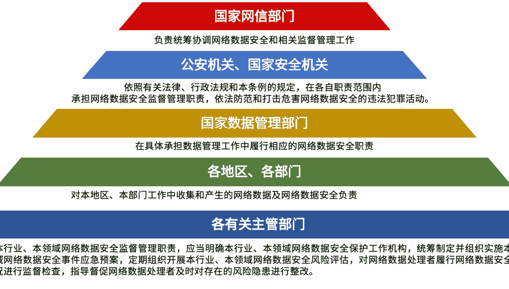

## 监督管理检查措施

- 1. 总则
- 2.一般规定
- 3. 个人信息
- 4.重要数据
- 5. 数据跨境
- 6. 网络平台
- 7. 监督管理
- 8. 法律责任
- 9. 附则

## 国家网信部门
### 有关主管部门

统筹协调有关部门及时汇总、研判、共享、发布网络数据安全风险，加强网络安全信息共享、网络安全风险和威胁预警及网络安全事件应急处置。

（一）要求网络数据处理者及其人员就监督事项作出说明；
（二）查询、复制与网络数据安全有关的文件；
（三）检查网络数据安全运行情况；
（四）检查与数据处理活动有关的设备、物品；
（五）法律、行政法规规定的其他措施应当对有关主管部门开展的网络安全监督予以配合。

## 监督检查行为的约束

- 1. 总则
- 2.一般规定
- 3. 个人信息
- 4.重要数据
- 5. 数据跨境
- 6. 网络平台
- 7. 监督管理
- 8. 法律责任
- 9. 附则

### 主管、监管部门

1. 有关主管部门开展数据安全监督，应当客观公正，不得收费。
2. 有关主管部门在数据安全监督检查中不得访问、收集与数据安全无关的信息，不得用于用途。

### 数据处理者对监督

1. 有关主管部门发现数据处理活动存在较大风险，可以按照规定和程序要求数据处理者暂停相关服务、完善技术措施等消除数据安全隐患。
2. 境外的组织、个人从事危害国家安全、公共利益或者损害个人信息的数据处理活动的，国家网信部门可以采取相应的措施。

### 数据安全检查与审计

- 1. 总则
- 2.一般规定
- 3. 个人信息
- 4.重要数据
- 5. 数据跨境
- 6. 网络平台
- 7. 监督管理
- 8. 法律责任
- 9. 附则


### 合理频次检查

有关主管部门在开展数据安全监督检查时，应当加强协同、信息沟通，合理确定检查频次和检查方式，避免必要的检查和交叉检查。


### 各审计制度衔接

个人信息保护合规审计、重要数据风险评估、重要数据境外测评等加强衔接，避免重复评估、审计。

### 处罚规则进一步细化

| 责任主体 | 涉及内容 | 处罚追责 |
| --- | --- | --- |
| 1.总则 | | |
| 2. 一般规定 | 网络数据管理者、网络平台服务者、第三方产品和服务提供者、预装应用程序的智能终端等设备、重要数据管理者 | 违反本条例第十二条、第六条至第二十条、第二十二条、第四十一条和第二十二款、第四十二条规定的，由网信、电信、公安等主管部门依据各自职责改正、给予警告、没收违法所得的；拒不改正或者情节严重的，处100万元以下罚款，并可以令其暂停相关业务、业整顿、吊销相关业务许可证或吊销执照，对直接负责的主管人员和其他直接责任人员处1万元至10万元以下罚款。 |
| 3. 个人信息 | | 网信、电信、公安、国家安全等主管部门依据各自职责改正、给予警告，可以处罚处10万元至100万元以下罚款，对直接负责的主管人员和其他直接责任人员处1万元至10万元以下罚款。 |
| 4. 重要数据 | | |
| 5. 数据跨境 | 网络数据管理者 | 违反本条例第十三条规定的，拒不改正或者情节严重的，处100万元至1000万元以下罚款，并可以令其暂停相关业务、业整顿、吊销相关业务许可证或吊销执照，对直接负责的主管人员和其他直接责任人员处10万元至20万元以下罚款。 |
| 6. 网络平台 | | |
| 7. 监管管理 | 网络数据管理者、重要数据的处理器 | 违反本条例第二十二条第三款、第三十条第二款和第三三十一条、第三十二条规定的，由网信、电信、公安等主管部门依据各自职责改正、给予警告，可以并处罚5万元至50万元以下罚款，对直接负责的主管人员和其他直接责任人员处1万元至10万元以下罚款。 |
| 8. 法律责任 | | 拒不改正或者造成大量数据泄露等严重后果的，处50万元至200万元以下罚款，并令其暂停相关业务、业整顿、吊销相关业务许可证或吊销执照，对直接负责的主管人员和其他直接责任人员处5万元至20万元以下罚款。 |
| 9. 附则 | | |

### 处罚规则进一步细化

1.总则

| 责任主体 | 涉及内容 | 处罚追责 |
| --- | --- | --- |
| 2. 一般规定 | 违反本条例其他规定的 | 由有关主管部门依照中华人民共和国网络安全法》、《中华人民共和国数据安全法》、《中华人民共和国信息保护法》等法律的规定追究法律责任。 |
| 3. 个人信息 | 网络数据处理者存在违法行为，轻微并及时改正且没有造成危害后果或者首次违法行为轻微并及时改正的，由上级机关或有关主管部门责令改正对直接负责的主管人员和其他直接责任人处罚。 |
| 4. 重要数据 | 不履行本条例规定的数据安全义务的，违反本条例规定给他人损害的，依法承担刑事责任； |
| 5. 网络平台 | 民事责任 | 构成治安管理行为的，依法治安管理处罚； |
| 6. 监督管理 | 刑事责任 | 构成犯罪的，依法追究刑事责任。 |

### 八个关键定义

| 序号 | 关键词 | 具体定义 |
| --- | --- | --- |
| 1.总则 | 网络数据 | 数据处理者 |
| 2.一般规定 | 通过网络处理产生的各种电子数据。在数据处理活动中收集、存储、使用、加工、传输、提供、公开、删除等活动。 |
| 3. 个人信息 | 个人处理者自主处理目的和处理方式。特定领域、特定群体、特定区域达到达到精度和规模，一旦遭到监测、破坏、泄露或者非法获取、非法利用，可能直接危害国家安全、经济运行、社会稳定和健康。 |
| 4. 重要数据 | |
| 5. 数据跨境 | 委托处理 |
| 6. 网络数据 |者自主决定数据的目的和处理方式。特定领域、群体、区域的数据。针对其个人信息进行特定处理作出具体、明确。注册用户5000万以上或者活跃用户1000万以上，业务类型复杂，具有重要影响的网络平台。 |
| 7. 监管管理 | |
| 8. 法律责任 | | |
| 9. 附则 | | |

## 其他适用说明及施行时间

1.总则
2.一般规定
3.个人信息
4.重要数据
5.数据跨境
6.网络平台
7.监督管理
8.法律责任
9.附则

## 核心数据
## 不适用场景

## 国家秘密、工作秘密


按照国家有关规定执行

不适用本条例适用《中华人民共和国保守秘密法》等法律、行政法规的规定

本条例自2025年1月日起施行。

## 01 图解《数据安全技术 数据安全保护要求（征）》
## 02 图解《中华人民共和国数据安全法》
## 03 图解《网络数据安全条例》
## 04 图解《GB/T 43697 数据安全技术 数据分类分级规则》
## 05 图解《GB/T 45577 数据安全技术 数据风险评估方法》
## 06 数据安全应用实践

## 中华人民共和国标准GB/T 43697—2024

## 数据安全技术 数据分类分级规则

Data security technology—Rules for data classification and grading

在国家数据安全工作机制指导下

第二十一章 明确确定“国家建立数据分类分级制度”，提出根据数据在经济社会发展中的重要性，以及一旦容易被篡改、损毁、泄露或非法获取、非法使用，对国家安全、公共利益或个人、组织合法权益造成的危害程度，对数据进行行业分类分级保护。

开展数据分类分级保护工作时，首先要对数据进行分类和分级，识别涉及的重要数据和核心数据，然后建立相应的数据安全保护措施。

2024年3月15日，全国网络安全标准化委员会会发布的国家标准
2024年10月1日实施

## 《数据安全技术 数据分类分级规则》发布

- 标识适用范围：
- 规定了数据分类分级的原则、框架、方法和流程，给出了重要数据识别标识。
- 适用于行业主导（监管）部门参与制定本行业领域的数据分类分级标准，也适用于各地区、各部门开展数据分类分级工作，同时为处理者开展数据分类分级提供参考。
- 不适用于涉及国家秘密的数据。

建议本标准为推荐性标准2024-03-15国家市场监督总局发布2024-10

## 数据安全技术分类分级规则

主要内容：给出分类分级通用规则，支撑《数据安全法》第二一条。本标准在编制过程中遵循了导向原则、协调性原则，解决了缺乏统一的数据分级问题，数据分类分级框架和分级方法等，包括：

- 规定统一的数据分类级规则，给出具体的分类分级示例；
- 有利于各行业领域数据分级衔接；
- 支撑国家数据安全相关要求，在各行业领域落地。

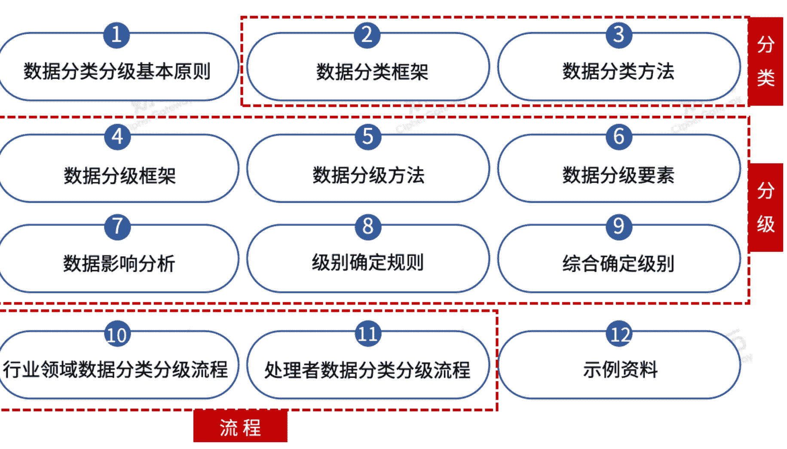


## 数据分类基本思路：先行行业领域分类、再按业务属性分类

1. 数据分类框架
2. 数据分类方法
3. 数据分级框架
4. 数据分级方法
5. 数据分级要素
6. 数据影响分析
7. 层级识别规则
8. 综合识别规则
9. 行业领域数据分类分级流程
10. 处理者数据分类分级流程


按照行业领域，将数据划分为工业数据、电信数据、金融数据、能源数据、交通运输数据、自然资源数据、卫生健康数据、教育数据、科学数据等。

各行业领域主管（监管）部门根据本行业领域业务属性，对本行业领域进行细化分类。

如涉及法律法规专门要求的的数据类别（如个人信息等），应按照有关规定和标准进行识别和分类。

| 常见业务属性分类 |
| :--- | :--- |
| 业务领域 | 按照数据范围、业务种类或业务功能进行细化分类 |
| 责任部门 | 按照数据管理部门或职责分工进行细化分类 |
| 描述对象 | 按照数据描述的对象进行细化分类 |
| 流程环节 | 按照数据流程、产业链环节进行细化分类 |
| **数据主体** | **按照数据的内容的主题进行细化分类** |
| 数据主题 | 按照数据描述的内容主题进行细化分类 |
| 数据用途 | 按照数据处理的目的、用途进行细化分类 |
| 数据处理 | 按照数据处理活动或数据工程进行细化分类 |
| 数据来源 | 按照数据来源、收集方式进行细化分类 |

> 比较意见稿多了“数据主体”的常见业务属性分类

## 根据实际情况灵活选择业务属性进行数据细化分类

1. 数据分类框架
2. 数据分类方法
3. 数据分级框架
4. 数据分类方法
5. 数据分级要素
6. 数据影响分析
7. 级别确定规则
8. 综合确定分级

基本要求 数据分类可根据数据管理和使用需求，结合已有数据基础，灵活选择业务属性进行数据细化分类。

明确数据范围 按照行业主管（监管）部门职责，明确本行业本领域管理的数据范围。

基本流程：
- 细化业务分类
- 业务属性分类
- 确定数据分类规则

目的：明确行业领域或业务线的分类
例子：工业领域，按照部门职责划分原材料、设备制造、消费品、电子信息制造、软件和信息技术服务等类别。

1. 分类依据：职责分工
目的：细化行业领域或明确某业务线的关键业务分类
例子：原材料为钢铁、有金属、石油、化工等；制造分为汽车、船只、航空、航天、工业母机、工程机械等。

2. 分类依据：业务范围、运营模式、业务流程

分类特征：选择合适的业务属性，对关键业务的数据进行细化分类。

分类建议：分析关键业务的数据分类结果，根据行业领域管理和使用需求，确定行业领域数据分类规则

分类规则1：可采取“业务线—关键业务—业务属性分类”的方式给出数据分类结果。
分类规则2：也可以对关键业务的数据分类结果进行归类统计，将具有相同主题的数据进行归类。

9. 行业领域数据分类分级流程
10. 代理者数据分类分级流程

## 基于两种分类规则的示例

| 1. 数据分类框架 |
| 2. 数据分类方法 |
| 3. 数据分级框架 |
| 4. 数据分类方法 |
| 5. 数据分级要素 |
| 6. 数据影响分析 |
| 7. 级别识别确定规则 |
| 8. 综合识别规则 |
| 9. 行业领域数据分类流程 |
| 10. 处理者数据分级流程 |
| 附录 |

## 确定分类规则

分类建议：推理分析关键业务的数据分类结果，根据行业领域数据管理和使用需求，确定行业领域数据分类规则
分类规则1：可采取“业务线—关键业务—业务属性分类”的方式给出数据分类规则（见示例1）
分类规则2：也可对关键业务的数据分类结果进行细分，将具有相似主题的数据进行聚类（见示例2）

## 分类规则

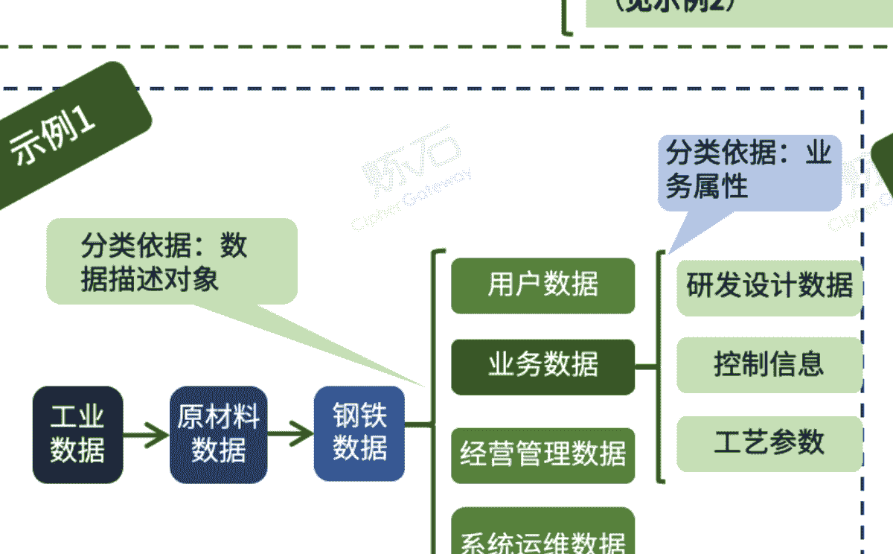
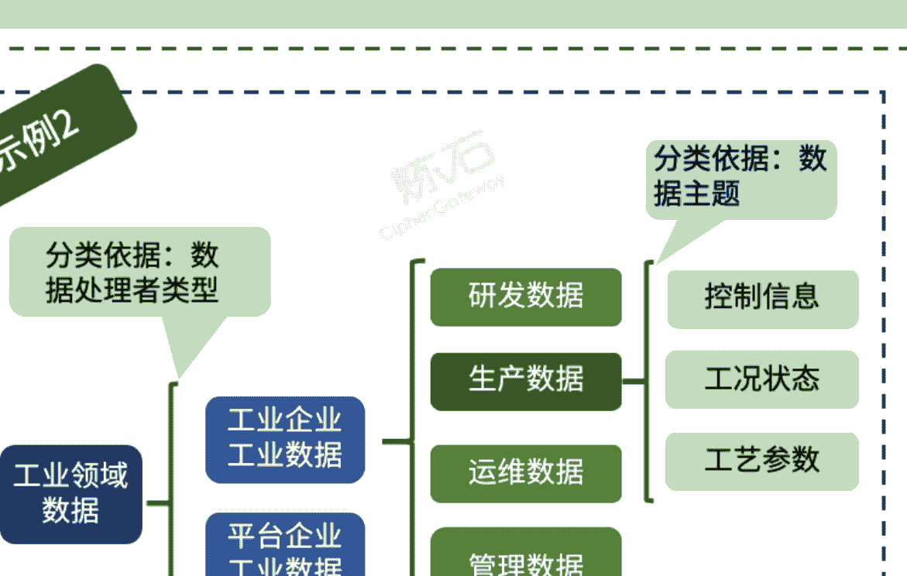

数据类别标识举例：工业数据-原材料数据-钢铁数据-业务数据-研发设计数据
数据类别标识举例：行业领域数据-工业企业数据-生产数据-控制信息

## 数据级别一般根据重要程度和危害程度两个维度判断

1. 数据分类框架
2. 数据分类方法
3. 数据分级框架
4. 数据分类方法
5. 数据分级要素
6. 数据影响分析
7. 级别确定规则
8. 综合确定级别
9. 行业领域数据分级流程
10. 处理者数据分类流程

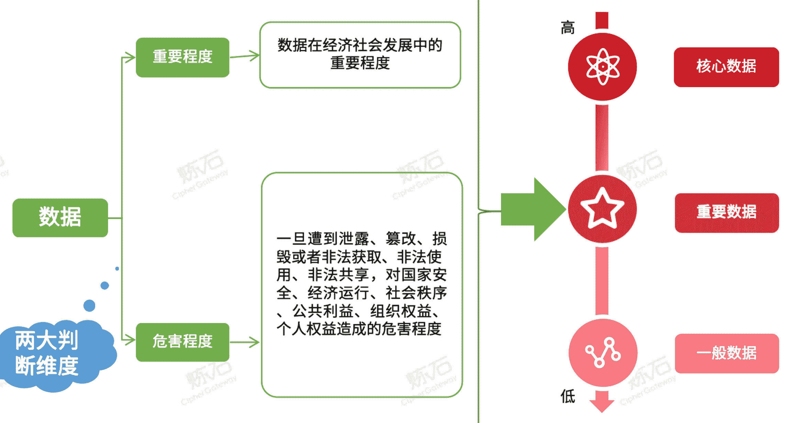

判定：
重要程度：数据在社会发展中的重要程度
危害程度：一旦遭到泄露、篡改、破坏或者非法获取、非法使用对国家安全、经济运行、社会秩序、公共利益、个人权益造成的危害
高：核心数据
一般：重要数据
低：数据

## 分级主要分为确定分级对象、分级要素、数据影响分析、综合确定级别四个步骤

数据是由多个记录组成的集合，如数据库表、数据库、文件等。

1. 数据分级框架
2. 数据分级方法
3. 数据分级框架
4. 数据分级方法
5. 数据分级要素
6. 数据影响分析
7. 级别确定规则
8. 综合确定级别
9. 行业领域数据分级流程
10. 访问者数据分级流程

确定分级对象：如数据项、数据集、衍生数据。
确定分级要素：结合数据特征，按照“分级要素”识别。
数据影响分析：结合分级要素识别情况，分析数据一旦泄露、篡改、破坏或非法获取、非法共享，可能影响对象和影响程度（见“数据影响分析”）。
综合确定级别：按照“级别确定规则”和“综合确定级别”内容，确定数据级别。
跨行业领域数据是指某个行业领域收集或产生流转到另一行业领域的数据

## 分级要素根据特征分为定性描述和定量描述

数据分级首先识别以下分级要素情况，具体考虑因素（新意见稿没有明确“安全风险”这个分级要素）。

1. 数据分类框架
2. 数据分类方法
3. 数据分级框架
4. 数据分类方法
5. 数据分级要素
6. 数据影响分析
7. 级别确定规则
8. 综合确定级别
9. 行业领域数据分类流程
10. 处理者数据分类流程

| 维度 | 描述 |
| --- | --- |
| 领域 | 数据描述的业务或内容范围。数据领域可识别描述的行业领域、业务线、流程环节、内容主题等因素。 |
| 群体 | 数据主体或描述对象集合。数据群体可识别描述的人群、组织、网络和信息系统、资源物资等因素。 |
| 区域 | 数据涉及的地区范围。数据区域可识别描述的行政区域、特定地区等因素。 |
| 重要性 | 数据在经济社会发展中的重要程度。重要性可识别数据在经济建设、政治建设、文化建设、社会建设、生命建设等方面的重要程度。 |
| 精度 | 数据的精确或准确程度。精度可识别数据值精度、空间精度、时间精度等因素。 |
| 规模 | 数据规模及数据描述的对象范围或大小。数据规模可识别数据存储、群体规模、区域规模、领域规模、生产能力等因素。 |
| 覆盖 | 数据对领域、群体、区域、时间等的覆盖范围或分布密度。数据覆盖可识别对领域、群体、时间的覆盖占比、覆盖分布等因素。 |
| 深度 | 通过数据建模、关联、挖掘或整合等处理，对数据描述对象的隐含信息或多维度细节的刻画程度。数据深度可识别数据在刻画描述中的经济运行、发展态势、行进轨迹、对象关系、历史跨度、产业产业链等方面的情况。 |

## 影响对象包括国家安全、经济运行、社会秩序、公共利益、组织权益、个人权益

影响对象是指数据面临安全风险时可能影响的对象。其中，安全风险主要考虑数据遭到泄露、篡改、破坏或者非法获取、非法使用、非法共享等风险，影响对象通常包括国家安全、经济运行、社会秩序、公共利益、组织权益、个人权益，判断影响对象的常见考虑因素

1. 数据分类框架
2. 数据分类方法
3. 数据分级框架
| 数据一旦遭到泄露、篡改、破坏或者非法获取、非法利用、非法共享 |
4. 数据分级方法
5. 数据分级要素
| 国家安全 | 经济运行 | 社会秩序 |
6. 数据影响范围
| 影响国家利益安全： | 影响经济运行机制： | 影响社会秩序： |
| 国家政治 | 经济 | 文化 |
| 社会 | 空间 | 市场经济运行 |
| 生态 | 资源 | 宏观形势 |
| 太空 | 极地 | 生物 |
7. 特别确定规则
8. 综合确定级别
9. 行业领域数据分类流程
| 公共利益 | 组织权益 | 个人权益 |
| 影响社会： | 影响组织或其他： | 影响自然： |
| 使用服务 | 生产运营 | 人身 |
| 使用设施 | 声誉 | 隐私权 |
| 使用资源 | 力 | 知识产权 |
10. 处理者数据分类流程

## 影响程度从高到低分为特别危害、严重危害、一般危害

1. 数据分类框架
2. 数据分类方法
3. 数据分级框架
4. 数据分类方法
5. 数据分级要素
6. 数据影响分析
7. 级别确定规则
8. 综合确定级别
9. 行业领域数据分类级流程
10. 处理者数据分类级流程

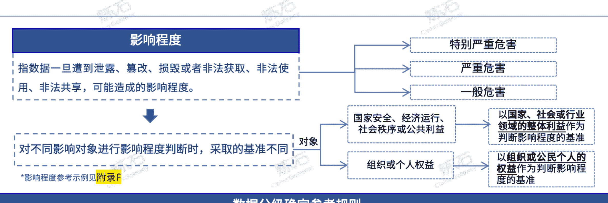

| 数据分级参考规则 |
| 影响对象 | 影响程度 |
| | 特别严重危害 | 严重危害 | 一般危害 |
| 国家安全 | 直接影响安全 | 关系其他国家安全 | 直接危害 |
| 经济运行 | 关系国民命脉 | 关系宏观运行，对行业领域造成严重危害 | / |
| 社会稳定 | 关系重要民生 | 直接危害社会稳定 | / |
| 公共利益 | 关系重大利益 | 直接危害健康和安全 | / |
| 组织权益、个人权益 | 如果影响大规模的个人或组织权益，判断是否会对国家安全、经济运行、社会秩序或公共利益造成影响 | |

## 核心数据的级别确定规则

1. 数据分类框架
2. 数据分类方法
3. 数据分级框架
4. 数据分级方法
5. 数据分级要素
6. 数据影响分析
7. 级别确定规则
8. 综合确定级别
9. 行业领域数据分类流程
10. 处理者数据分类级流程

表 1 数据级别确定表
| 影响对象 | 影响程度 | | |
| --- | --- | --- | --- |
| | 特别严重危害 | 严重危害 | 一般危害 |
| 国家安全 | 核心数据 | 核心数据 | 重要数据 |
| 经济运行 | 核心数据 | 重要数据 | 一般数据 |
| 社会秩序 | 核心数据 | 重要数据 | 一般数据 |
| 公共利益 | 核心数据 | 重要数据 | 一般数据 |
| 组织利益、个人权益 | 一般数据 | 一般数据 | 一般数据 |

注：如果影响达到大规模的个人或组织利益，影响对象可能包括个人权益或组织利益，也可能对国家安全、经济运行、社会秩序造成

### 满足以下任一条件的，数据识别为核心数据：

1. 数据一旦遭到泄露、篡改、破坏或遭遇非法、使用、非法共享，直接导致国家安全造成严重危害（如直接影响政治安全）或严重危害（如关系其他安全）
2. 数据一旦遭到泄露、篡改、破坏或遭遇非法、使用、非法共享，直接导致经济运行造成严重危害（如关系国民经济脉）
3. 数据一旦遭到泄露、篡改、破坏或遭遇非法、使用、非法共享，直接导致社会秩序造成严重危害（如关系重要民生）
4. 数据一旦遭到泄露、篡改、破坏或遭遇非法、使用、非法共享，直接对公共利益造成严重危害（如关系大利益）
5. 对于领域、群体、区域具有高敏感度、高重要性或深度，直接影响政治安全的数据；
6. 达到高精度、较大规模、高重要性或深度，直接影响政治安全的数据；
7. 经有关部门评估确认的核心数据。

## 重要数据的级别确定规则

表 1 数据级别确定表
| 影响对象 | 影响程度 | | |
| --- | --- | --- | --- |
| | 特别严重危害 | 严重危害 | 一般危害 |
| 国家安全 | 核心数据 | 核心数据 | 重要数据 |
| 经济运行 | 核心数据 | 重要数据 | 一般数据 |
| 社会秩序 | 核心数据 | 重要数据 | 一般数据 |
| 公共利益 | 核心数据 | 重要数据 | 一般数据 |
| 组织利益、个人权益 | 一般数据 | 一般数据 | 一般数据 |

1. 数据分类框架
2. 数据分类方法
3. 数据分级框架
4. 数据分级方法
5. 数据分级要素
6. 数据影响分析
7. 级别确定规则
8. 综合确定级别
9. 行业领域数据分类级流程
10. 处理者数据分类级流程

附录

# 满足以下任一条件的，数据识别为核心数据（重复部分）：

1. 数据一旦遭到泄露、篡改、破坏或遭遇非法、使用、非法共享，直接导致国家安全造成严重危害（如直接影响政治安全）或严重危害（如关系其他安全）
2. 数据一旦遭到泄露、篡改、破坏或遭遇非法、使用、非法共享，直接导致经济运行造成严重危害（如关系国民经济脉）
3. 数据一旦遭到泄露、篡改、破坏或遭遇非法、使用、非法共享，直接导致社会秩序造成严重危害（如关系重要民生）
4. 数据一旦遭到泄露、篡改、破坏或遭遇非法、使用、非法共享，直接对公共利益造成严重危害（如关系大利益）
5. 对于领域、群体、区域具有高敏感度、高重要性或深度，直接影响政治安全的数据；
6. 达到高精度、较大规模、高重要性或深度，直接影响政治安全的数据；
7. 经有关部门评估确认的核心数据。

注：如果影响达到大规模的个人或组织利益，影响对象可能包括个人权益或组织利益，也可能对国家安全、经济运行、社会秩序造成。

## 数据分类基本思路：先行行业领域分类、再按业务属性分类
（此处内容逻辑重复，已按逻辑处理）

[content]
## 行业领域数据分类分级流程包含行业标准规范和开展数据分类分级

行业领域主管（监管）部门在遵循国家有关规定的基础上，可参考以下步骤开展行业领域数据分类分级工作。

- 1. 数据分类框架
- 2. 数据分类方法
- 3. 数据分级框架
- 4. 数据分级方法
- 5. 数据分级要素
- 6. 数据影响分析
- 7. 级别确定规则
- 8. 综合确定分级
- 9. 行业领域数据分类分级流程
- 10. 处理者数据分类分级流程


按照国家数据分类分级保护有其要求，参照本文文件制定本行业领域的数据分类分级标准规范，重点明确了以下内容：

- 明确行业数据分类准则，确定数据分类所属的业务属性，给出按照业务属性划分的数据类别；
- 分析行业领域数据的领域、群体、区域、精度、规模、深度、重要性等分级要素，明确本行业领域重要数据识别准则，确定哪些数据可以确定为重要数据；
- 明确行业本领域核心数据识别准则，提出哪些数据可以确定为核心数据；


行业领域主管（监管）部门，根据本行业本领域的数据分类分级标准规范，组织本行业领域数据处理者开展数据分类分级工作，指导数据处理者准确识别、及时报送重要数据和核心数据目录信息。

附录

## 数据数据分类分级流程的六个步骤

数据处理器进行数据分类分级时，应在遵循国家和行业领域数据分类分级的基础上，参考以下步骤开展数据分类分级工作。

- 1. 数据分类框架
- 2. 数据分类方法
- 3. 数据分级框架
- 4. 数据分级方法
- 5. 数据分级要素
- 6. 数据影响分析
- 7. 层级确定规则
- 8. 综合识别规则
- 9. 行业领域数据分类分级流程
- 10. 处理者数据分类分级流程
- 附录


数据资产进行全面梳理，确定待分级的数据种类，并处理数据资产及其所属的行业领域。

按照行业领域数据分类分级标准、个人信息等特殊规则识别数据特点，参考本文文件定义的数据分类分级规则：

对数据资产进行分类，并对公共数据范围进行数据识别和分类。

注：由于一般数据范围较广，数据处理器需结合组织业务安全需要，参考表1（一级数据分级）和表2（二级数据分级）对所有数据进行精细化分级。

对数据进行分级，确定核心数据、重要数据和范围。形成数据分级清单、重要数据和数据标识，并对数据进行标识处理。

对数据分类分级结果进行审核，形成分类分级清单、重要数据和数据标识，按规定程序提交目录。

根据数据重要程度和可能造成的危害程度变化，对数据分级规则、数据核心数据目标、分类分级清单和标识进行动态更新（见附录（1）动态更新情形参考）

- 1) 行业领域主管部门已制定行业领域数据分类分级规则，处理者应结合实际样本对数据分类分级规则进行细化执行；
- 2) 所属行业没有行业主管部门认可的数据分类分级标准、或存在行业领域内未覆盖的规则，则按照本文文件进行数据分级；
- 3) 如果业务涉及多个行业领域，可以参考本文文件的基础上，分别按照各个行业领域的数据分类分级标准细化执行。

## 如何理解规范性附录和资料附录的区别?

附录用于承接和安置不方便在正文、前言或引言中所述的内容，它是对正文、前言或引言的补充或添加，它的设置可以使文件的结构更加平衡。

| 规范性附录 | 资料性附录 |
| --- | --- |
| 定义 | 当正文规范性要素中的某些内容过长或属于附加条款，可以将一些细节或附加条款移出，形成规范性附录。 | 当文件中的示例、信息说明或数据等过多，可以将其移动，形成资料性附录。 |
| 作用 | 给出正文的补充或附加条款 | 给出有助于理解或使用文件的附加信息 |
| 属性 | **强制性和地位与正文一致，是必须执行的要求** | 仅作为技术性或相关内容参考，强制性、地位及规范性附录，可以选择性执行 |
| 表述形式 | a) 任何文件中，由要求型条款或指示型条款指明的附录；<br>b) 规范标准中，由“按”或“按照”指明试验方法的附录；<br>c) 指南标准中，由推荐型条款指明的附录 | 其他表述形式的附录都属于资料性性质 |
| 示例 | ……应符合附录 A 的规定 | ……相关示例见附录 D |

## 重要数据是国家数据分级制度的核心，以规范性附录明确

- 重要数据是国家数据分级制度的核心，也是国家数据安全工作的重点。
- 重要数据是国家数据分级制度的核心，根据数据安全法》、《数据安全管理条例》等对重要数据有明确要求，是一项政策性问题。
- 重要数据是国家数据分级制度的核心，充分考虑实际情况，通过《重要数据识别指南》进行合并，原《重要数据识别指南》为标准附录 G（规范性），以后不再发布单独的重要数据。
- 新标准作为国家数据分级制度的基础，是第一部以“数据安全技术”（国办〔2024〕9号）提出的“科学界定重要数据范围”，指导各地各部门提供参考和思路。

## 制定背景

## 规范性附录（9项）

## 规范性附录（9项）

## 重要数据识别指南

| 附录（资料性） | 描述对象与数据分类 |
| --- | --- |
| 附录 A（资料性） | 个人信息 |
| 附录 B（资料性） | 分级因素 |
| 附录 C（资料性） | 安全风险因素 |
| 附录 D（资料性） | 影响对象 |
| 附录 E（资料性） | 影响程度 |
| 附录 F（资料性） | 一般分级 |
| 附录 H（资料性） | 衍生数据 |
| 附录 I（资料性） | 分级参考 |
| 附录 J（资料性） | 动态更新情形


## 重要数据演进：明确重要数据针对国家而非组织和个人

| 标准 | 《重要数据安全分类准则》 | 《重要数据处理要求》 | 《重要数据识别指南》 | 术语理解：差异分析 |
| --- | --- | --- | --- | --- |
| 征求意见 | 征求意见（最新版） | 征求意见 | | |
| 内容 | 特定领域、特定群体、特定区域或达到一定精度和规模的一旦被泄露或破坏、可能危害国家安全、经济运行、社会稳定、公共健康和安全的数据。 | 特定领域、特定群体、特定区域或达到一定精度和规模的数据、一旦被泄露或篡改、损毁、可能直接危害国家安全、经济运行、社会稳定、公共健康和安全。 | 以电子方式存储的、一旦遭遇、破坏、泄露或非法获取、违法、可能危害国家安全、公共利益的数据。 | • 覆盖范围不同。新与重要数据处理规则内涵一致，区别于重要数据识别指南，“以电子方式存储的数据”、“符合特定条件的具有一定规模的数据”，涵盖的数据范围。<br>• 影响范围不同。旧版的数据仅涵盖国家安全和安全利益，新版涵盖经济运行、社会稳定、公共健康和安全 |
| 英文对照 | 重要数据 key data | 重要数据 key data | 重要数据 critical data | |
| 注释 | 注：仅影响组织自身或群体的数据一般不作为重要数据。 | 来源：GB/T AAAAA-XXXX | 注：重要数据不包含国家秘密。 | 注：重要数据不包括国家秘密和个人信息，但涉及大量个人信息的统计数据可能危害重要数据。<br>key 的中文翻译是“首要的、关键的”。<br>critical 的翻译是“决定性的、危险的”。新国“重要数据”的语义更具客观和通用性——翻译自英文词典 |
| 重要数据识别因素 | 18项 | 19项 | 14项 | 新版重要数据识别因素与重要数据识别指南基本一致，但每个条件经过调整，使得内容更加精确。<br>• 调整：将“直接影响国家安全、经济运行、社会稳定、政治制度、引起形成安全”等内容归归到基础影响因素考虑。<br>• 合并：将基础信息提供和数据安全完全合并；<br>• 删除：删除公共的数据、情报数据和执法数据；<br>• 新增：增加可能影响特定行业、社会运行或公共利益的数据 |

## 他山之石：美国制定的《国家安全系统识别指南》

### 中国

数据分类分级规则

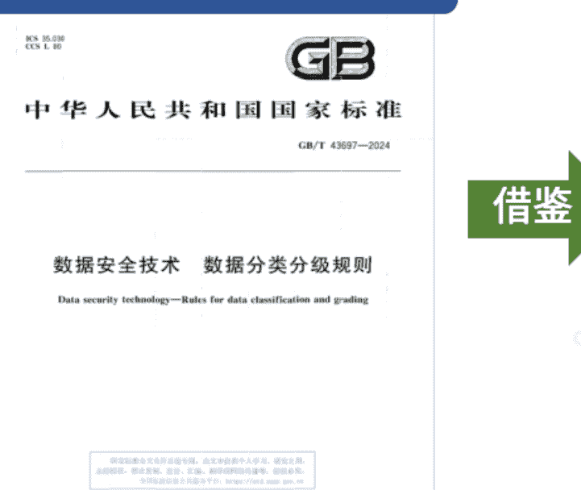

### 美国

国家安全系统识别指南

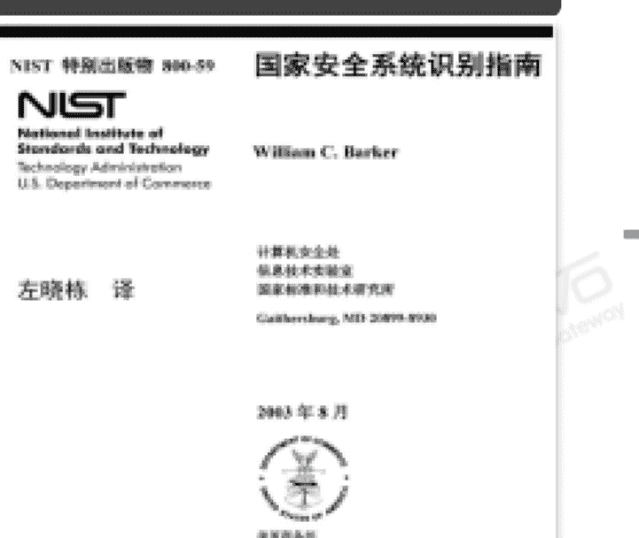

美国《国家安全系统识别指南》并没有对国家安全系统进行详细分类，而是从其影响角度描述其特征。美国《国家安全系统识别指南》为了便于操作，采取了回答问题的方式，比如满足指南中的一个或多个问题，就是国家安全系统。实践理解：美国的国家安全系统不是孤立存在的，往往分布在各个行政局中，与大量的非安全系统在一起。2022年颁布的《信息安全法》对非安全系统工作做出了部署。但是在实践中该指南依然有效。

## 识别思路：从后果而非数据类型

## 网络数据管理条例

## 总体安全

参照《条例》第二条，各地区、各部门应当数据分类分级，确定本地、本部门以及相关行业领域的重要数据，依据国家标准必须强制性的。例如、战略资产等数据，都具有军事价值，可能被其他国家或组织对我国进行军事打击，需从“军事安全”角度描述。实践理解：从“总体安全观”中的角度，分别阐述数据安全与国家安全的关系。

## 附录 G（规范性）重要数据识别指南

- 1. 数据分类框架
- 2. 数据分类方法
- 3. 数据分级分类
- 4. 数据分级方法
- 5. 数据分级要素
- 6. 数据影响分析
- 7. 级别确定规则
- 8. 综合确定分级
- 9. 行业领域数据分类流程
- 10. 处理者数据分类分级
- 附录

## 总体安全观

- 政治
- 军事
- 国土
- 经济
- 金融
- 文化
- 社会
- 科技
- 网络
- 粮食
- 生态
- 资源
- 核
- 海外利益
- 太空
- 深海
- 极地
- 生物
- 人工智能

### 影响国土安全

直接影响国土安全和统一，未公开的领土水空数据

### 影响军事安全

可被其他国家或组织利用对我国军事打击，或反映我国战略储备、应急动员、作战等能力。满足一定地理数据与战略物资资产、储备量有关数据

### 影响经济安全

直接影响市场竞争秩序。如支撑关键基础设施在行业、领域核心业务运行或重要经济领域生产的数据

### 影响文化安全

反映我国语言文字、历史、风俗、民族价值观等特质

### 影响社会安全

反映目标点、重要场所安全情况或未公开地理位置的交通数据，可被破坏分子、犯罪分子利用实施破坏

### 影响科技安全

关系我国技术实力、我国国际竞争力或我国出口管制物资。涉及我国禁止出口或出口管制物资的设计、工艺制造方法数据，涉及电路布局、技术参数检测数据

## 附录 G（规范性）重要数据识别指南2

| 数据分类框架 | 政治 | 军事 | 国土 | 经济 | 金融 | 文化 | 社会 | 科技 | 网络 | 粮食 |
|---|---|---|---|---|---|---|---|---|-|
| 数据分类方法 | 安全观 | 生态 | 资源 | 核 | 海外利益 | 太空 | 深海 | 极地 | 生物 | 人工智能 | 数据 | ...... |
| 数据分级框架 | | 影响关键安全 | 影响因素安全 | | | | | | | | |

> ### 影响关键安全
> 反映关键基础设施总体运行、发展和安全保护。反映数据安全、应急信息，可对国家安全产生影响。影响数据、数据安全、网络。
>
> ### 影响因素安全
> 影响对象、影响程度参考。影响数据、影响分、分级。
>
> ### 影响安全
> 影响数据、影响分、分级。影响数据、影响分、分级。
>
> ### 影响
> 影响数据、影响分、分级。影响数据。
>
> ### 影响
> 影响数据、影响分、分级参考。
>
> ### 影响
> 影响数据、影响分、分级。
>
> ### 影响
> 影响数据、影响分、分级。
>
> ### 影响
> 影响数据、影响分、分级。
>
> ### 影响
> 影响数据、影响分、分级。
>
> ### 影响
> 影响数据、影响分、分级。
>
> ### 影响
> 影响数据、影响分、分级。


## 附录A (资料性) 基于数据描述对象与数据主体的数据分类参考2

基于数据主体的数据分类参考示例

- 1. 数据分类框架
- 2. 数据分类方法
- 3. 数据分级框架
- 4. 数据分级方法
- 5. 数据分级要素
- 6. 数据影响分析
- 7. 级别确定规则
- 8. 综合确定级别
- 9. 行业领域数据分类分级流程
- 10. 处理者数据分类分级流程

| 数据分类 | 类别定义 | 示例 |
| --- | --- | --- |
| 公共数据 | 各级政府部门、公共组织及其技术支撑单位，在依法履行公共事务管理职责或提供公共服务过程中收集、产生的数据 | 如政数据，在供水、供电、供气等公共服务过程中收集和产生的数据等 |
| 组织数据 | 组织在自身生产经营活动中收集、产生涉及个人信息和公共利益的数据 | 如涉及个人信息和公共利益的业务数据、经营管理数据、系统运维数据等 |
| 个人信息 | 以电子或其他方式记录的与识别或者可识别的自然人相关的各种信息 | 如个人身份信息、个人生物识别信息、个人财产信息、个人通信信息、个人位置信息、个人健康生理信息等 |

## 附录 B（资料性）个人信息分类示例

| 一级分类 | 二级分类 | 典型示例和说明 |
| --- | --- | --- |
| 1. 数据分类框架 | | | 参考GB/T 35273-2020给出了个人信息的一级分类、二级分类及典型数据示例 |
| 2. 数据分类方法 | 个人基础 | 个人基础 | 自然基础信息，如个人姓名、生日、年龄、性别、民族、国籍、籍、政治立场、婚姻状况、家庭关系、电话号码、电子邮箱、兴趣偏好等 |
| 3. 数据分类框架 | 个人身份 | 个人身份 | 可直接识别自然人的信息，如身份证、护照、驾驶证、签证、港澳通行证号码、证件照片或影像等；其中特定身份信息属于敏感个人信息，参见敏感个人信息国家标准 |
| 4. 数据分类方法 | 个人生物识别 | 生物识别 | 个人面部特征，如指纹、虹膜、声纹、耳朵、眼纹等生物特征识别，包括生物特征原始信息（如照片）、对比信息（特征、模板等） |
| 5. 数据分类要素 | 网络身份 | 网络身份 | 可通过网络或手机号识别个人的信息及相关信息（金融账户除外），如用户名、用户ID、即时通讯账号、网络用户账号、用户头像、昵称、用户名、IP地址等 |
| 6. 数据影响分析 | 个人健康生理 | 健康状况 | 与个人健康状况相关的信息，如身高、体重、体质、血压、血量、血型等 |
| 7. 级别确定规则 | 个人教育工作 | 医疗健康 | 与个人疾病诊疗、医疗服务的相关信息，如医疗诊断记录、生育信息、住院史等，涵盖范围参见敏感个人信息国家标准 |
| 8. 综合确定级别 | 个人教育工作 | 个人教育 | 个人教育和培训的相关信息，如学经历、教育路径、学成、资质证书、培训记录、敏感信息、受资助信息 |
| 9. 行业领域数据分类 | 个人工作 | 个人工作 | 个人求职和工作的相关信息，如职业、工作性质、单位名称、工作地点、工作年资、工作表现、简历、退休状况等 |
| 10. 处理者数据分类流程 | 个人财产 | 个人财产 | 个人交易过程中的交易信息和记录，如交易订单、交易金额、支付记录、支出记录、交易状态、交易后、交易凭证、账单、证券 |
| | 个人资产 | 个人资产 | 个人交易过程中的交易信息和记录，如交易订单、交易金额、支付记录、支出记录、交易状态、交易后、交易凭证、账单、证券保险等 |
| | 个人借贷 | 个人借贷 | 个人在借贷过程中的信息，如个人收入、还款记录、欠债信息、还款、证信息、担保情况等 |
| | 身份识别 | 身份识别 | 用于个人身份识别的数据，如账号口令、数字证书、手机验证码、密码提示信息等 |

## 附录 B (资料性) 个人信息分类示例

| 一级分类 | 二级分类 | 典型示例和说明 |
| :--- | :--- | :--- |
| 1. 数据分类框架 | | |
| 2. 数据分类方法 | 个人通信信息 | 个人通信信息 | 通信记录、短信、语音、邮件、即时通讯等通信内容（如文字、图片、视频、文件等），以及描述个人通信的元数据（如通话时长等） |
| | 关系信息 | 关系信息 | 描述人与人之间关系的信息，如通讯标识、好友列表、群列表、电子邮件地址列表、家庭关系、工作关系、社交关系、父母或监护人信息 |
| 3. 数据分级框架 | | 操作记录 | 人在业务处理过程中的操作记录和行为，包括网页浏览记录、软件使用标识、点击记录、Cookie、发布的社交信息、点击记录、收藏记录、搜索记录、使用时间、下载记录 |
| 4. 数据分级方法 | 登录记录 | 行为数据 | 用户使用的行为记录（如游戏、用户登录时间、访问时间、累计流量等） |
| 5. 数据分级要素 | | 唯一的设备识别 | Android标识(ID)、广告标识(FA)、应用标识(OAID)等 |
| 6. 数据影响分析 | 个人设备信息 | 移动设备标识(IMEI)、移动设备标识(MAC)、设备控制、硬件序列号等 |
| 7. 级别确定规则 | 应用软件列表 | 用户在终端安装的应用程序、名称、版本等 |
| 8. 综合确定级别 | 临时位置信息 | 位置信息 | 仅定位行政区域、城市代码等；他人所在地、活动地点和活动轨迹等 |
| 9. 行业领域数据分类 | 出行信息 | 用户住房、乘坐飞机、汽车等出行信息 |
| 10. 处理者数据分类流程 | 个人标签 | 个人标签 | 基于网络记录产生的个人标签、画像，如行为、兴趣偏好等 |
| | 用户运动信息 | 用户运动 | 运动、运动方式等 |
| | 其他个人信息 | 其他个人信息 | 历史、宗教信仰、未公开记录等 |

## 附录 C.1-C.3 (资料性) 数据分级要素常见因素

- 1. 数据分类框架
- 2. 数据分类方法
- 3. 数据分级框架
- 4. 数据分级方法
- 5. 数据分级要素
- 6. 数据影响分析
- 7. 级别确定规则
- 8. 综合确定级别
- 9. 行业领域分类因素
- 10. 处理者数据分类分级流程

| 数据领域识别常见因素 | 数据群体识别常见因素 |
| --- | --- |
| **C.1 数据领域、群体、区域因素** | 行业领域；业务属性；业务环节；内容主题 |
| | 人员；团体、组织；网络系统；资源、物资；设备；基础设施 |
| | 行政区划；特定地；环境；重要场所；网络空间 |
| **C.2 数据精度因素** | 与国家安全、经济运行、社会秩序、公共利益相关的区域等 |
| | 数值精度：统计指标等 |
| | 空间精度：位置精度、数字地图等 |
| | 时间精度：年度、季度、月度等 |
| | 生产工艺精度：集成电路、机械加工精度等 |
| | 视频图像清晰度 |
| | 遥感观测精度 |
| | 数据存储量 |
| | 企业市值（估值） |
| | 设备或装备容量 |
| **C.3 数据规模因素** | 生产、加工、控制、吞吐、输送、存储能力 |
| | 资源存储量：交易量 |
| | 群体规模：用户规模、系统或设备数量、生产单位数量、基础设施数量、项目数量等 |

## 附录 C.4-C.6 (资料性) 数据分级要素识别常见因素

| 一级分类 | 二级分类 |
| --- | --- |
| 1. 数据分类框架 | 经济运行情况统计 |
| 2. 数据分类方法 | 产业发展态分析 |
| 3. 数据分级框架 | 领域、群体或区域的特征分析 |
| 4. 数据分级方法 | 行路轨迹 |
| 5. 数据分级要素 | 对象关系 |

## C.4 数据深度因素

数据深度识别的常见因素如人群或用户特征分析：

| 历史信息 | 产业供应链 |
| --- | --- |
| 区域覆盖分布或密度 | 如区域覆盖占比、领域覆盖分布、领域覆盖密度等 |
| 群体覆盖分布或密度 | 如群体覆盖占比、群体覆盖分布、人口密度等 |
| 区域覆盖分布或密度 | 如行政区覆盖密度、区域覆盖分布、区域覆盖密度等 |
| 时段覆盖分布或密度 | 时段覆盖密度、时段覆盖密度、时段覆盖密度等 |

## C.5 数据覆盖因素

数据覆盖识别的常见因素：

- 在数字经济中的重要程度：数字化基础建设、数据流通、数字化转型、数字化竞争力等
- 在数字政府和政治建设中的重要程度：政务共享、数据开放和开发利用、数字化政务服务、监管治理体系、政治制度、法律法规等
- 在文化建设中的重要程度：教育、科学、文学艺术、新出版、广播电视、卫生体育、图书馆、博物馆、网络空间等各项文化事项
- 在社会建设中的重要程度：公共数据、智慧城市、数字生活、居住、农村等
- 在生态文明建设中的重要程度：自然资源、环境、交通、水气、大气、土地等
- 在国家安全、维护社会稳定等工作的重要程度：涉及数据防护和造造安全

## C.6 重要性考虑因素

数据重要性识别常见因素

## 附录 D(资料性) 安全风险因素

数据影响分析通常考虑以下风险：

| 安全风险类别 | 定义和示例 |
| --- | --- |
| 数据泄露 | 数据窃取、未授权访问、导出等保密性风险 |
| 数据篡改 | 未授权修改、注入、伪造等破坏完整性风险 |
| 数据毁损 | 数据被毁损、质量下降、中断等破坏可用性风险 |
| 非法获取 | 违反法律、行政法规等规定、超出范围、强制获取、违规收集 |
| 非法使用 | 违反法律、行政法规等规定、使用、加工、利用 |
| 非法共享 | 违反法律、行政法规等规定，向他人提供、交换、转移、出境 |

- 1. 数据分类框架
- 2. 数据分类方法
- 3. 数据分级框架
- 4. 数据分级方法
- 5. 数据分级要素
- 6. 数据影响分析
- 7. 级别确定规则
- 8. 综合确定级别
- 9. 行业领域数据分类
- 10. 处理者数据分级流程

## 附录 E（资料性）影响对象考虑因素-经济运行、社会稳定

## 经济运行

- 1. 数据分类框架
- 2. 数据分类方法
- 3. 数据分级框架
- 4. 数据分级方法
- 5. 数据影响要素
- 6. 数据影响分析
- 7. 级别识别规则
- 8. 综合识别规则
- 9. 行业领域数据分类分级流程
- 10. 影响数据分类分级流程

| 影响对象 | 描述 |
| --- | --- |
| 1. 影响市场准入、市场行为、市场结构、商品销售、交换关系、生产经营秩序、涉外经济等市场运行秩序 |
| 2. 影响社会总供给和需求、国民经济总值和增长速率、国民经济中主要比例关系、物价水平、劳动就业总水平与失业率、货币发行总规模与增长速率、进出口贸易规模与变动等宏观经济形势 |
| 3. 影响涉及国家安全的行业、支柱产业和高新技术产业中的重要骨干企业、提供公共服务的行业、重大基础设施和重要矿产资源等国民经济命脉 |
| 4. 影响行业地区的经济发展、业务生产、技术进步、产业形态等 |

## 社会稳定

| 影响对象 | 描述 |
| --- | --- |
| 1. 影响社会稳定，可能引发社会恐慌，导致重大事件、群体性事件、暴力活动、社会治安问题等 |
| 2. 影响群众的民生保障或日常活动，如扶贫、就业、收入、教育、健康、养老和保险等保障项或供电、供气、供水等基本服务 |
| 3. 影响国家机关、企业单位、社会团体的生产秩序、经营秩序、教学科研、医疗卫生政策 |
| 4. 影响各级政府部门依法履行公共管理职责职能 |
| 5. 影响司法领域的公正性、公信誉或权威 |
| 6. 影响公共场所的活动秩序 |

## 附录 E（资料性）影响对象考虑因素-国家安全

- 1. 数据分类框架
- 2. 数据分类方法
- 3. 数据分级框架
- 4. 数据分级方法
- 5. 数据分级要素
- 6. 数据影响分析
- 7. 级别确定规则
- 8. 综合确定级别
- 9. 行业领域数据分类流程
- 10. 处理者数据分类流程

| 影响对象 | 描述 |
| --- | --- |
| 1. 影响国家权、政治制度、意识形态安全、民族和政策安全 |
| 2. 影响国土安全、统一、边疆安全和海洋利益 |
| 3. 影响经济制度、供给结构、粮食安全、能源安全、资源安全、国际合作安全 |
| 4. 影响国家科技实力、科技自主创新、科技竞争、科技领域、出口管制 |
| 5. 影响社会核心价值观、文化等 |
| 6. 影响社会影响体系、社会体系、应急管理等 |
| 7. 影响生态环境安全、生态多样性、污染防治、生态系统和稳定性等 |
| 8. 影响国防和军事现代化等 |
| 9. 影响电磁空间、关键基础设施安全、核心技术设备等网络攻击事件 |
| 10. 影响核设施、核活动情况、核破坏或其他安全 |
| 11. 影响国家生物安全、遗传资源安全、重大技术成果、公共卫生应急体系、重大传染病、重大生物安全 |
| 12. 影响太空、海洋、极地等领域的国家利益 |
| 13. 影响海外重大项目和海外能源安全 |

## 附录 E（资料性）影响对象考虑因素-公共利益、组织权益、个人权益

- 1. 数据分类框架
- 2. 数据分类方法
- 3. 数据分级框架
- 4. 数据分级方法
- 5. 数据分级要素
- 6. 数据影响分析
- 7. 级别确定规则
- 8. 综合确定级别
- 9. 行业领域数据分类流程
- 10. 处理者数据分类流程

| 影响对象 | 描述 |
| --- | --- |
| 1. 影响重大疾病（尤其是传染病）预防和控制，或者可能引发突发卫生事件、造成健康危害 |
| 2. 影响社会成员使用公共设施 |
| 3. 影响社会成员获取公开资源 |
| 4. 影响社会成员接受公共服务等方面 |
| 5. 影响公共利益、社会秩序等数据 |

| 组织权益 | 描述 |
| --- | --- |
| 1. 影响组织受到处罚、安全事件 |
| 2. 影响组织的重要或关键经营 |
| 3. 影响组织造成经济损失 |
| 4. 影响组织声誉等 |
| 5. 影响组织的知识产权、商业秘密、技术损失等 |
| 6. 影响组织公平竞争 |
| 7. 影响法人、合法权益 |

| 个人权益 | 描述 |
| --- | --- |
| 1. 影响个人私生活活动、隐私等 |
| 2. 影响自然人的尊严 |
| 3. 影响自然人的安全 |
| 4. 影响自然人的财产安全 |
| 5. 影响个人在处理活动中的权利、选择权、知情权等 |
| 6. 影响个人权益 |

## 附录 F（资料性）影响程度示例-国家安全、经济运行、社会稳定

| 影响分类框架 | 影响对象 | 影响程度 | 参考说明 |
| --- | --- | --- | --- |
| 1. 数据分类框架 | 影响对象 | | 直接影响国家政治安全 |
| 2. 数据分类方法 | 影响对象 | 特别严重危害 | 关系国家安全重点领域，或者对国土、军事、经济、文化、社会、科技、电磁空间、网络、资源、海外利益、太空、极地、深海、人工智能等造成威胁 |
| 3. 数据分级框架 | 国家安全 | 严重危害 | 对国土、军事、经济、文化、社会、科技、电磁空间、网络、生态、资源、海外利益、太空、极地、深海、人工智能等安全造成威胁 |
| 4. 数据分级方法 | | 一般危害 | |
| 5. 数据分级要素 | | | 1)影响中国经济命运的重要活动和关键领域的安全，涉及国家安全的行业、提供重要的公共事务的行业、重要资源等<br>2)直接影响中国经济命运的发展重点领域、重大基础设施、重大建设项目以及其他大类利益安全<br>3)对一个或多个行业领域的经济发展、业务生产、技术进步、产业生产造成严重危害，如支持行业和高新技术行业中的重要企业造成损害，导致大面积中断、大量业务能力丧失<br>4)对一个或多个省级行政区的经济运行造成特别危险，导致大面积中断、规模基础设施运行中断停止 |
| 6. 数据影响分析 | | 特别严重危害 | |
| 7. 级别规则 | | | 1)直接影响宏观经济运行状况和发展趋势，如社会基础和供需关系、国民经济总值和增长速率、国民经济主要比例类别、物价水平、就业人数水平与失业率、货币政策影响与增长速度、进出口贸易总规模 |
| 8. 综合确定级别 | 经济运行 | | 2)直接影响一个或多个地区、行业内企业或大型企业，对行业发展、技术进步和产业生产造成严重影响，或者直接影响行业核心竞争力、业务运行、关键链业务、核心供应链等 |
| 9. 行业领域数据分类 | 严重危害 | 3)对单个行业领域、业务经营、生产经营、技术进步、产业生产等造成一般危害，如受影响的用户和数据数量较、生产生活范围较小、持续时间较短、社会影响较小<br>4)对单个行业或小地区的经济运行造成一般危害 |
| 10. 处理者数据分级 | | 一般危害 |

## 附录 F（资料性）影响程度参考实例-国家安全、经济运行、社会稳定

| 影响对象 | 影响程度 | 参考说明 |
| --- | --- | --- |
| 1. 数据分类框架 | | 1)关系重要民生，直接影响人民群众生活保障的物资、货物、工程或项目等 |
| 2. 数据分类方法 | 特别严重危害 | 2)直接影响特别重大事件、特别群体性事件、暴恐活动等，引起一个或多个省级行政区大部分地区的恐慌，严重影响社会正常运行 |
| 3. 数据分级框架 | 社会秩序 | 3)直接影响突发重大事件、群体性事件等，影响一个或多个地区的社会稳定<br>2)特别影响人民群众的日常生活秩序 |
| 4. 数据分级方法 | 严重危害 | 3)影响各级政府部门公共管理职责<br>4)严重影响法治和社会伦理 |
| 5. 数据分级要素 | 一般危害 | 1)影响人民群众的日常生活秩序<br>2)影响国家机关、企业单位、社会团体的生产秩序、经营秩序、教学科研、医疗卫生政策 |
| 6. 数据影响分析 | | 3)直接影响公共场所的活动秩序、公共交通秩序 |
| 7. 级别确定规则 | | 1)关注公共利益，导致一个或多个省级行政区大部分的公共资源供应长期紧张、较范围社会受损（如1000万人以上）无法使用公共设施、获取公共数据、接受公共服务 |
| 8. 综合判断负面影响 | | 2)导致重大网络安全安全事件，或导致特别事故发生的安全事故，对公共利益造成严重危害、社会影响<br>3)导致突发重大公共安全事件(Ⅰ），造成社会公共健康特别损害的大规模传染疫情、群体性不明源疾病、重大食物和职业中等严重影响公众健康 |
| 9. 行业领域分类 | 公共利益 | 1)直接危害公共健康和安全，严重影响防控、传染疾病的预防和治疗等<br>2)导致重大公共安全事件(Ⅱ），造成社会公共健康特别损害的大规模传染疫情、群体性不明源疾病、重大食物和职业中等严重影响公众健康<br>3)导致一个或多个省级行政区大部分的公共资源供应长期紧张、较范围社会受损（如1000万人以上）无法使用公共设施、获取公共数据、接受公共服务 |
| 10. 处理者数据分级 | 一般危害 | 对公共利益产生一般危害，影响小范围社会成员使用公共设施、获取公共数据资源、接受公共服务等*


## 附件F (资料性) 影响程度参考例-公共利益、组织权益、个人权益³

| 影响对象 | 影响程度 | 参考说明 |
| :--- | :--- | :--- |
| 数据分类框架 | 特别严重危险 | 导致组织受到监管部门严重处罚（如取消经营资格、长期暂停相关业务等），或者影响重要/关键业务无法正常开展的情况，造成重大经济或技术损失，破坏机构声誉，企业面临破产 |
| 数据分类方法 | | |
| 数据分级框架 | | |
| 数据分级方法 | | |
| 组织权益 | 严重危险 | 导致组织受到监管部门处罚（一段时间内暂停经营业务等），或者影响部分业务无法正常开展的情况，造成重大经济或技术损失，破坏机构声誉 |
| 数据分级要素 | 一般危险 | 导致引发诉讼事件，或在某一时间造成部分业务中断，使经济利益、声誉、技术等微受损 |
| 数据影响分析 | 特别严重危险 | 个人信息受到重大的、不可消除的、可能无法克服的影响，容易导致自然人的格尊受到损害或者人、财产安全受到危险。如无法承担的责任、失去工作能力、导致长期的心理或生理疾病、导致死亡等 |
| 级别确定规则 | | |
| 综合确定级别 | | |
| 个人权益 | 严重危险 | 个人信息受到较大影响，个人信息主体恢复恢复困难，消除影响较大。如遭遇欺骗、资金被盗用、被银行列入黑名单、信用评分受损、名誉受损、造成违法、被被告、被法传唤、健康状况恶化等 |
| | 一般危险 | 个人信息主体会受到，但可以恢复。付出额外成本、无法应用提供的服务、导致误解、产生损害和紧张的情绪、导致较小的生理疾病等 |

附录

## 附录H（资料性）一般数据分级参考1

1. 数据分类框架

按照数据一旦泄露、篡改、损毁或者非法获取、非法使用、非法共享，对于经济运行、社会秩序、公共利益或个人、组织造成的危害程度，将数据分为各个级别。

2. 数据分类方法
3. 数据分级框架
4. 数据分级方法
5. 数据分级要素
6. 数据影响分析
7. 识别确定规则
8. 综合确定级别
9. 行业领域数据分类基础
10. 处理者数据分类分级流程

附录

## 附录H (资料性) 一般数据分级参考2

一般数据分级，要考虑敏感个人信息等特定类型数据的敏感性，特定类型数据最低参考级别包括：

| 数据级别 | 一般数据4级框架下 | 一般数据3级框架下 | 在一般数据2级框架下 |
| :--- | :--- | :--- | :--- |
| 最低参考级别 | 1)敏感个人信息不低于4级，一般个人信息不低于2级；<br>2)组织内部员工个人信息不低于2级；<br>3)去标识化的个人信息不低于2级；<br>4)个人标签信息不低于2级；<br>5)有条件开放/共享的公共数据级别不低于2级，禁止开放/共享的公共数据不低于4级。 | 1)敏感个人信息不低于3级，一般个人信息不低于2级；<br>2)有条件开放/共享的公共数据级别不低于2级，禁止开放/共享的公共数据不低于3级。 | 在一般数据2级框架下，敏感个人信息不低于2级，禁止开放/共享的公共数据不低于2级。 |

- 1. 数据分类框架
- 2. 数据分级方法
- 3. 数据分级框架
- 4. 数据分级方法
- 5. 数据分级要素
- 6. 数据影响分析
- 7. 级别识别确定规则
- 8. 综合确定级别
- 9. 行业领域数据分类分类流程
- 10. 处理者数据分类分级流程
- 附录

## 附录1 (资料性)衍生数据定级参考

1. 数据分类框架
2. 数据分类方法
3. 数据分级框架
4. 数据分类方法
5. 数据分级要素
6. 数据影响分析

属于衍生数据

| 数据类别 | 类别定义 | 数据示例 |
| :--- | :--- | :--- |
| 原始数据 | 是数据的原始形式和内容，未经过加工处理 | 采集的原始数据 |
| 脱敏数据 | 对敏感数据(个人信息)采取特定手段进行变换后的新数据，降低敏感性 | 标准化的个人信息 |
| 标签数据 | 对用户行为进行分析，生成用户标签 | 偏好标签、关系标签 |
| 统计数据 | 由多个个人或实体的数据进行统计或分析形成的数据 | 群体轨迹、统计表、报告等 |
| 融合数据 | 对不同业务、区域、领域的数据汇聚，进行挖掘或聚合 | 多个业务、多个领域的整合 |

7. 级别确定规则
8. 综合确定级别
9. 行业领域数据分类

衍生数据分级参考原始数据，综合考虑数据要素、影响程度，按照第6章进行分级：

| 脱敏数据 | 比原始数据级降低 |
| 统计数据 | 比原始数据级降低 |
| 标签数据 | 比原始数据级升高 |
| 融合数据 | 比原始数据级升高，如果包含大量敏感信息，则设置更低的级别 |

10. 处理者数据分级流程

附录

## 附录 J（资料性） 动态更新参考

- 1. 数据分类框架
- 2. 数据分类方法
- 3. 数据分级框架
- 4. 数据分级方法
- 5. 数据分级要素
- 6. 数据影响分析
- 7. 级别确定规则
- 8. 综合确定级别
- 9. 行业领域数据分级
- 10. 处理者数据分级流程
- 附录

数据分类分级完成后，当数据的业务属性、重要程度和危害程度变化通常需要动态更新，动态更新常见情形包括：

01 数据内容
a)数据规模化，导致原有安全级别不再适用
b)数据内容未发生变化，但数据时效性、规模、应用场景、加工方式等显著变化

02 数据合并
c)多个原始数据直接合并，导致原来的安全级别不再适用合并后的数据
d)对不同数据选取部分合并形成的新数据，导致原有安全级别不再适用合并后的数据

03 数据融合
e)不同数据类型汇聚形成新的类别，导致原有的数据安全级别不再适用于汇聚后的数据

04 数据技术
f)数据进行脱敏或删除，或者经过去标识化、匿名化处理

05 其他方面
g)发生数据安全事件，导致敏感性发生变化
h)因国家或行业主管部门要求，导致确定的数据级别不再适用
i)需要对数据安全级别进行变更的其他情形

## 数据安全技术 数据分类规则 参考文献

1. 数据分类框架
2. 数据分类方法
3. 数据分级规则
4. 数据分级方法
5. 数据分级要素
6. 数据影响分析
7. 级别确定规则
8. 综合确定级别
9. 行业领域分类分级流程
10. 处理者数据分类分级流程

- [1] GB/T 21063.4 政务信息资源目录 第4部分：政务信息资源分类
- [2] GB/T 35273—2020 信息安全技术 个人安全规范
- [3] GB/T 39335—2020 信息安全技术 个人影响评估指南
- [4] GB/T 42012—2022 信息即时通信服务数据安全要求
- [5] GB/T 42013—2022 信息安全技术 快递物流服务数据安全要求
- [6] GB/T 42014—2022 信息安全技术 购物服务数据安全要求
- [7] GB/T 42015—2022 信息安全技术 网络支付服务数据安全要求
- [8] GB/T 42016—2022 信息安全技术 音视频服务数据安全要求
- [9] GB/T 42017—2022 信息安全技术 网络预约约车服务数据安全要求
- [10] JR/T 01997—2020 金融数据安全 数据安全分级指南
- [11] 中华人民共和国数据安全法
- [12] 中华人民共和国网络安全法
- [13] 中华人民共和国个人信息保护法

附录

01 图解《数据安全技术 数据安全保护要求（征）》
02 图解《中华人民共和国数据安全法》
03 图解《网络数据安全管理条例》
04 图解《GB/T 43697 数据安全技术 数据分类级规则》
05 图解《GB/T 45577 数据安全技术 数据安全评估方法》
06 图解数据安全应用实践

## 数据安全评估方法总览

一、范围
二、规范引用文件
三、术语和定义
四、缩略语
五、通则
六、风险评估准备
七、调研

- 5.1 概述
- 5.2 要素关系
- 5.3 原理
- 5.4 适用情形
- 5.5 实施流程
- 5.6 内容框架
- 7.1 处理者
- 7.2 业务系统
- 7.3 资产
- 7.4 活动
- 7.5 防护措施
- 7.6 个人保护

八、风险识别
九、风险与评价
十、评估总结

## 适用范围及引用文件

一、范围
二、规范引用文件
三、术语和定义
四、缩略语
五、通则
六、风险评估准备
七、调研
八、风险识别
九、风险与评价
十、评估总结
附录
参考文献

本文件描述了数据安全评估的基本概念、要素关系、原理，给出了数据安全评估的实施流程、内容、方法等。本文件指导处理者、第三方机构开展数据安全评估，也可供主管部门实施参考。

规范引用文件

下列文件中的内容通过引用构成构成构成必不可少的条款。其中，注日期的文件，仅该日期版本适用于本文；不注日期的文件，其最新版本（包含所有的修改）适用于本文。

GB/T 25069-2022 信息安全技术术语
GB/T 43697-2024 数据安全技术 数据分类规则

## 本文件适用GB/T 25069-2022 界定的术语和定义

1. 范围
2. 规范引用文件
3. 术语和定义
数据：任何以电子或其他方式记录的信息。
数据安全：通过采取必要措施，确保数据处于有效保护和合法利用的状态，以及具有保障持续安全的能力。
4. 缩略语
5. 通则
6. 合理性：数据收集、存储、使用、加工、传输、公开、删除等活动。数据处理活动遵守法律、行政法规要求，符合网络安全和数据安全常识，不损害国家、公共利益和个人的合法权益。
6. 数据风险评估
7. 调研
8. 风险识别
数据风险：可能导致危害数据的保密性、完整性、可用性和数据处理合理性等事件的威胁、脆弱性、问题、隐患等。数据安全事件的发生可能性及其对国家安全、公共利益或
9. 风险与评价
10. 评估总结
附录
参考文献

## 本文件适用GB/T 25069-2022 界定的术语、定义和缩略语

1. 范围
2. 规范引用文件
3. 术语和定义
4. 缩略语
5. 通则
6. 数据风险评估
7. 调研
8. 风险识别
9. 风险与评价
10. 评估总结
附录
参考文献


注：该活动具有明确的目标，并延续一段时间。[来源:GB/T 20984—2022, 3.1.4]


GDP：国内生产总(Gross Domestic Product)
SDK：软件开发工具(Software Development Kit)
VPN：虚拟网络(Virtual Private Network)

## 数据风险评估主要围绕数据和处理活动，发现安全隐患

1. 范围
2. 规范引用文件
3. 术语和定义
4. 缩略语
5. 通则
6. 数据风险评估准备
7. 调研
8. 风险识别
9. 风险与评价
10. 评估总结
附录
参考文献

数据风险评估，主要围绕数据和处理活动，聚焦可能影响数据的机密性、完整性、可用性处理活动的安全风险，掌握总体状况，发现安全隐患，提出数据安全管理和技术防护建议，提升数据安全攻击、防泄露、防滥用能力。


## 数据安全风险评估的要素关系

| 要素关系 | 评估原理 | 适用情形 | 实施流程 | 内容框架 | 评估手段 |
| :--- | :--- | :--- | :--- | :--- | :--- |

- 1. 范围
- 2. 规范引用文件
- 3. 术语和定义
- 4. 缩略语
- 5. 通则
- 6. 数据风险评估准备
- 7. 调研
- 8. 风险识别
- 9. 风险与评价
- 10. 评估总结
- 11. 附录
- 12. 参考文献


开展数据风险评估应充分考虑要素之间。各要素说明如下：

a) 数据处理者是评估的核心要素，数据风险评估的对象，在流转过程中涉及多个数据处理活动，数据处理活动可能涉及不同数据。
b) 数据处理者运营业务，业务利用数据和处理活动实现。
c) 信息系统是业务的支撑，信息系统涉及一个或多个数据处理活动。
d) 风险源在数据或处理活动中存在，由风险源产生数据安全风险，对数据和处理活动具有危害。
e) 安全措施用于保护数据和处理活动，控制数据安全风险，抑制数据风险发生。

| 标识符号说明： 1—风险要素；2—评估对象；3—要素关系；4—风险。 |

## 数据风险评估原理

1. 范围
2. 规范引用文件
3. 术语和定义
4. 缩略语
5. 通则
6. 数据风险评估准备
7. 调研
8. 风险识别
9. 风险与评价
10. 评估总结
附录
参考文献

数据风险评估，主要围绕数据处理器的数据和数据处理活动，对可能影响数据保密性、完整性、可用性和数据处理合理性的安全风险进行分析和评价。数据安全风险评估原理图2。


## 数据化风险评估主要内容

| 要素关系 | 评估原理 | 适用情形 | 实施流程 | 内容框架 | 评估手段 |
| :--- | :--- | :--- | :--- | :--- | :--- |

- 1. 范围
- 2. 规范引用文件
- 3. 术语和定义
- 4. 缩略语
- 5. 通则
- 6. 数据风险评估准备
- 7. 调研
- 8. 风险识别
- 9. 风险与评价
- 10. 评估总结
- 11. 附录
- 12. 参考文献


## 输出数据安全风险评估的适用情形

1.范围 要素关系 评估原理 适用情形 实施流程 内容框架 评估手段

适用于以下情形之一的数据处理器，应开展数据安全风险评估。

| 序号 | 情形 |
| --- | --- |
| 1 | 重要数据处理器、核心数据处理器、1000万以上个人信息的数据处理器，每年对其数据处理活动开展数据安全风险评估。 |
| 2 | 处理重要数据的大型网络服务提供者依据本文件开展数据安全风险评估，还应充分说明关键业务和供应链网络数据安全等情况。 |
| 3 | 重要数据的处理器提供、委托处理、共同处理数据前，开展数据安全风险评估。 |
| 4 | 当数据范围、数据处理活动、环境、相关方等发生重大变更，被评估对象的环境、外部环境、业务目标、安全目标等发生重大变化，超出数据安全风险评估时的情形。 |
| 5 | 法律、行政法规、部门规范、强制性国家标准等文件要求开展数据安全风险评估的情形。 |

适用于以下情形之一的数据处理器，结合实际情况开展数据安全风险评估。

| 序号 | 情形 |
| --- | --- |
| 1 | 重要数据处理器合并、分裂、解释、被宣告破产、进行数据迁移的情形。 |
| 2 | 大型网络平台运营商、赴外上市的数据处理器、党政机关，按照规定定期开展数据安全风险评估。 |
| 3 | 承载重要数据处理活动的信息系统发生架构调整、上线等重大变更；重要数据系统上线前，可根据需要开展数据安全风险评估；新技术应用可能带来数据安全风险，可根据实际需要开展数据安全风险评估；其他可能危害国家安全、公共利益的数据处理量大于个人、涉及违法方法的数据处理活动。 |

- 2. 规范性引用文件
- 3. 术语和定义
- 4. 缩略语
- 5. 通则
- 6. 数据安全风险评估准备
- 7. 信息调研
- 8. 风险识别
- 9. 风险分析与评价
- 10. 评估总结
- 附录
- 参考文献

## 明确数据安全风险评估的实施流程

| 元素关系 | 评估原理 | 适用情形 | 实施流程 | 内容框架 | 评估手段 |
|---|---|---|---|---|---|

- 1. 范围
- 2. 规章性引用文件
- 3. 术语和定义
- 4. 缩略
- 5. 通则
- 6. 数据安全风险评估准备
- 7. 信息调研
- 8. 风险识别
- 9. 风险分析与评价
- 10. 评估总结
- 附录
- 参考文献

数据安全风险评估流程，主要包括评估准备、信息调研、风险识别、风险分析与评价、评估总结五个阶段，见图3。

> 注：参考TC260-PG-2021A《网络安全标准指南——网络数据安全风险评估指南》3.3进行数据安全风险自评估、第三方评价及检查评估。

| 评估准备 | 信息调研 | 风险识别 | 风险分析与评价 | 评估总结 |
|---|---|---|---|---|
| | | | | |
| 评估准备是数据安全风险评估的初始阶段，在评估实施前完成准备工作。 |
| 主要识别数据处理者基本情况，梳理其业务和信息系统的关系，处理数据和开展的数据活动情况，采取的数据安全防护措施。 |
| 针对每个数据对象，对数据管理、数据处理活动、数据安全技术、个人信息保护等，通过多种手段识别可能存在的数据安全风险因素。 |
| 在风险识别的基础上开展风险分析、评价，最后提出评估结论。 |
| 编制数据安全风险评估报告，开展数据处置。 |
| 形成调研表、数据安全风险评估方案等。 |
| 形成数据处理者基本情况、业务清单、信息系统清单、数据清单、数据处理活动清单、安全措施情况等，具有条件的，可绘制数据处理流程图。 |
| 形成数据安全识别工作记录。 |
| 形成数据安全风险清单、数据安全风险清单、整改建议等 |

## 数据安全风险评估五个阶段的具体工作及主要产出物

- 1. 范围
- 2. 合规性引用文件
- 3. 术语和定义
- 4. 缩略语
- 5. 通则
- 6. 数据安全风险评估准备
- 7. 信息调研
- 8. 风险识别
- 9. 风险分析与评价
- 10. 评估总结
- 附录
- 参考文献


| 阶段 | 具体工作 | 主要产出物 |
| --- | --- | --- |
| 评估准备 | 1.确定评估目标<br>2.确定评估范围<br>3.组建评估团队 | 4.开展前期准备<br>5.制定评估方案 | - 调研表<br>评估方案 |
| 信息调研 | 1.数据处理者调研<br>2.业务和信息系统调研<br>3.数据资产调研 | 4.数据处理活动调研<br>5.安全措施调研 | - 处理者基本情况<br>业务清单<br>信息清单<br>数据资产清单 | - 数据处理清单<br>数据范围<br>安全措施 |
|  识别 | 1.数据安全管理<br>2.数据处理活动分析 | 3.数据安全技术<br>4.信息调研 | - 数据安全识别工作记录、包括文档查阅、人员访谈记录、安全检查技术检测情况等 |
| 风险分析与评价 | 1.建模问题清单<br>2.风险分析与评价<br>3.提出整改建议 | - 安全问题清单<br>安全风险清单<br>整改建议 |
| 评估总结 | 1.风险评估报告<br>2.安全处置 | - 评估报告 |

## 数据安全风险评估的内容框架

| 元素关系 | 评估原理 | 适用情形 | 实施流程 | 内容框架 | 评估手段 |
|---|---|---|---|---|---|

数据安全风险评估，在信息调研基础上，围绕数据管理、数据处理活动、数据安全技术、个人信息保护等方面评估。评估框架见图4，具体评估见第八章，包括以下方面。

| 数据安全管理 | 数据处理活动安全 | 数据安全技术 | 个人信息保护 |

- 1. 范围
- 2. 合规性引用文件
- 3. 术语和定义
- 4. 缩略语
- 5. 通则
- 6. 数据安全风险评估准备
- 7. 信息调研
- 8. 风险识别
- 9. 风险分析与评价
- 10. 评估总结
- 1. 附录
- 2. 参考文献

包括数据安全制度、组织机构、分类管理、合作外包管理、安全威胁和应急管理、开发运维、云数据安全等。包括数据收集、存储、传输、使用和加工、公开、删除等。包括网络安全防护、身份识别与访问控制、监测预警、数据脱敏、数据防泄、接口安全、备份与恢复、安全审计等。包括个人信息处理原则、告知同意、个人信息处理、敏感信息处理、主体权利、个人信息义务、投诉举报、大型网络平台等。

## 环境数据处理活动安全、数据安全技术、个人信息保护评估

| 要素关系 | 评估原理 | 适用情形 | 实施流程 | 内容框架 | 评估手段 |
- 1. 范围
- 2. 规范性引用文件
- 3. 术语和定义
- 4. 缩略语
- 5. 通则
- 6. 数据安全风险评估准备
- 7. 信息调研
- 8. 风险识别
- 9. 风险分析与评价
- 10. 评估结论
- 附录
- 参考文献


| 数据安全管理 | 数据处理活动安全 | 数据安全技术 |
| :--- | :--- | :--- |
| 流程 | 数据收集 | 数据存储 | 数据传输 | 数据和加工 | 网络安全防护 |
| 组织机构 | | | 身份识别与访问控制 |
| 分类 | 数据提供 | 数据公开 | 数据删除 | 监测预警 |
| 人员管理 | | | 数据脱敏 |
| 合作外包管理 | | | 数据防泄 |
| 安全威胁和应急管理 | 个人信息保护 | | | 接口安全 |
| 开发运维 | 基本原则 | 告知同意 | 保护义务 | 主体权利 | 投诉举报 | 备份恢复 |
| | 信息处理 | 敏感信息保护 | 大型网络平台 | 安全审计 |
| 云数据安全 | | | |
| 信息调研 | 数据处理者基本情况 | 业务和信息系统 | 数据资产情况 | 数据处理活动情况 | 安全防护措施 |

## 提出数据安全风险评估的四种手段

- 要素关系 评估原理 适用情形 实施流程 - 内容框架 评估手段

开展数据安全风险评估时，综合采取下列手段进行评估：

| 序号 | 评估手段 |
| --- | --- |
| 1 | 人员访谈 | 对相关人员进行访谈，核查制度章程、防护措施、安全责任落实情况 |
| 2 | 文档查验 | 查验安全管理制度、合同协议、演练报告、事件处置报告及数据安全风险评估报告、网络安全等级保护报告等有关材料及制度落实情况的证明材料 |
| 3 | 安全核查 | 核查网络环境、数据库和大数据平台等相关系统和设备安全策略、配置、防护措施情况 |
| 4 | 技术测试 | 应用技术工具、渗透测试等手段查看数据资产情况、检测防护措施有效性 |

- 1. 范围
- 2. 规范性引用文件
- 3. 术语和定义
- 4. 缩略语
- 5. 通则
- 6. 数据安全风险评估准备
- 7. 信息调研
- 8. 风险识别
- 9. 风险分析与评价
- 10. 评估总结
- 附录
- 参考文献

## 制定数据安全风险评估目标，提升数据安全保护能力

明确评估目标 确定评估范围 组建评估团队 开展前期准备 制定评估方案

数据安全风险评估的目标，包括但不限于：

- 发现可能共享、交易、委托、向境外提供重要数据等处理活动的数据安全问题和风险。

- 促进完善数据安全保护措施，提升数据安全保护能力。

- 明确数据处理者所涉及的数据种类、规模、分布等基本情况。

- 明确数据处理者数据活动的基本情况

- 发现可能影响国家安全、公共利益或者个人、组织合法权益的数据安全全问题和风险。

- 1. 范围
- 2. 规范性引用文件
- 3. 术语和定义
- 4. 缩略语
- 5. 通则
- 6. 数据安全风险评估准备
- 7. 信息调研
- 8. 风险识别
- 9. 风险分析与评价
- 10. 评估总结
- 附录
- 参考文献

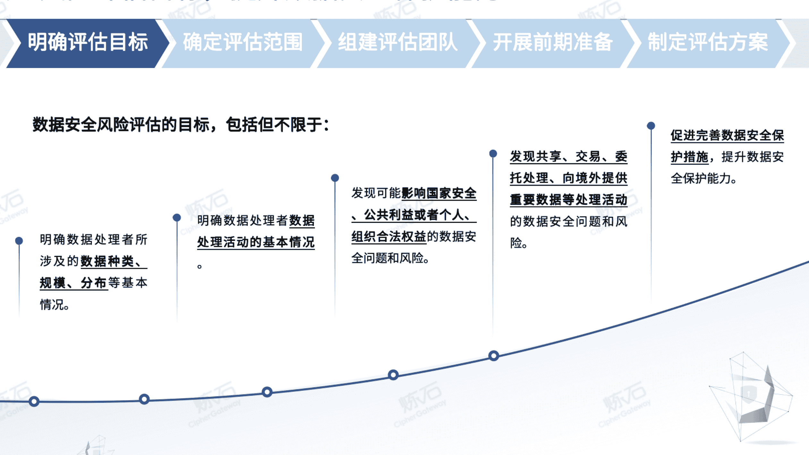

## “全面摸排、重点评估”原则确定评估范围

明确评估目标 确定评估范围 组建评估团队 开展前期准备 制定评估方案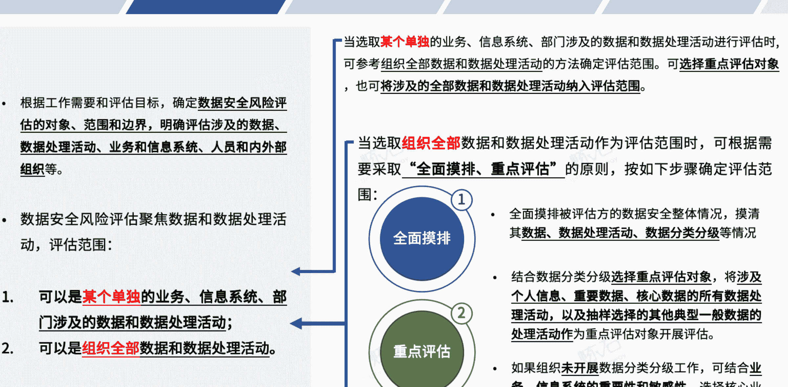

- 当选取某单一业务、信息系统、部门涉及的数据和处理活动时，可参考组织全部。
- 当选取组织全部数据和处理活动时，可能需要“全面摸排、重点评估”原则，按照如下步骤确定范围：
- 根据工作需要和评估目标，确定数据风险评估的对象、范围和边界，明确涉及的数据和处理活动、业务和内部组织等。
- 数据安全评估聚焦数据和处理活动：
- 1. 可以是单一业务、信息系统、部门涉及的数据和处理活动；
- 2. 可以是组织全部数据和处理活动。
- 摸排被评估数据整体情况，摸清数据、处理活动、分类等。
- 结合业务、信息系统的重要性和敏感性，选择核心或重要数据和处理活动作为评估对象开展。

## 指导评估团队、检查团队组建

- 1. 范围
明确评估目标
确定评估范围
组建评估团队
开展前期准备
制定方案

- 2. 规范性引用文件
数据处理器开展安全风险评估
主管部门开展检查

- 3. 术语和定义
可组织业务、安全、法务、合规、运维、研发等相关部门参与
可根据评估范围、涉及的行业特征、专业需求，选择专业能力的评估人员组成队伍。

- 4. 缩略语
评估小组
评估组长：数据安全负责人或授权代表
应提前完成风险文档、工具等各项准备工作，签署保密协议。

- 5. 数据安全风险准备
数据处理器可委托第三方专业机构实施
第三方专业机构在评估中获取的信息只能用于评估目的，未经授权不应泄露、出售或非法向他人提供。

- 7. 信息调研
被评估方建立专项工作团队，成员包括数据安全负责人和安全、法务、合规、运维、研发、业务、数据、风险等部门，或数据处理器内部负责事项的其他人员。专项工作团队按照做好人员设备、技术保障等工作，开展风险评估。

- 8. 风险识别
- 9. 风险分析与评价
- 10. 评估总结
- 附录
- 参考文献

## 规范风险评估的前期准备工作

- 1. 范围
明确评估目标
确定评估范围
组建评估团队
开展前期准备
制定方案

- 2. 规范性引用文件
开展数据安全风险评估前期准备时，应根据评估目标、评估范围和调研情况，制定工作计划、确定评估依据、确定评估内容、建立文档。

- 3. 术语和定义

### 1、制定工作计划
### 2、确定评估依据
### 3、确定评估内容
### 4、建立文档

- 4. 缩略语

## 工作计划内容
## 文档工具准备

工作计划内容一般包括：
针对评估目标和范围确定评估依据，常见评估依据限于：
结合评估目标、范围、依据，针对被评估对象的实际情况，确定对象每个对象的评估内容。
针对评估目标、范围、依据和内容，准备风险评估表、技术测试工具等。

- 5. 通则
- 工作目的
- 工作要求
- 工作内容
- 工作流程
- 调研安排
- 评估进度安排等

- 1）法律：《网络安全法》、《数据安全法》、《个人信息保护法》等法律，有关行政法规、司法辖办法；
- 2）监管部门：网部门及主管（信）主管部门相关数据安全法规、规范性文件；
- 3）地方政策：地方数据安全相关政策制定和管理规定；
- 4）相关标准：通用数据安全国家标准、行业标准等；
- 5）单位制度：开展自律制度，本单位数据安全制度规定可作为依据之一。

## 评估内容

- 1)数据评估者应对对数据处理活动、数据安全、数据安全技术等方面进行风险评估；
- 2)涉及个人信息的，应在1）的基础上，对个人信息保护开展风险评估；
- 3)开展评估过程中，可根据任务要求、评估重点、重心、需要、依据等，逐步完善评估工作。

## 规范管理

在评估工作过程中，应对评估相关文件进行统一编号、并规范管理。

- 6. 数据安全评估准备
- 7. 信息调研
主管部门

- 8. 风险识别
开展风险评估时，主管部门。

- 9. 风险分析与评价
- 10. 评估总结
- 附录
- 参考文献


# 摸清数据底数，输出数据资产清单

| 数据处理者调研 | 业务和信息系统调研 | 数据资产调研 | 数据处理活动调研 | 安全防护措施调研 |
| :--- | :--- | :--- | :--- | :--- |
| 1. 范围 | | | | |
| 2. 范性引用文件 | | | | |
| 3. 术语和定义 | | | | |
| 4. 缩略语 | | | | |
| 5. 通则 | | | | |
| 6. 数据安全风险准备 | | | | |
| 7. 信息调研 | | | | |
| 8. 风险识别 | | | | |
| 9. 风险分析与评价 | | | | |
| 10. 评估总结 | | | | |
| 附录 | | | | |
| 参考文献 | | | | |

梳理结构化数据（如数据库表等）和非结构化数据（如文件对象等），输出数据资产清单。

涉及范围包括但不限于生产环境、测试环境、备份存储环境、云存储环境、个人工作终端、数据采集设备终端收集和产生的数据。

# 调研内容包括但不限于以下方面：

- a)【数据资产情况】包括数据资产类型、数据范围、数据规模、数据形态、数据存储分布、元数据等。
- b)【数据分类情况】包括数据分类规则、数据类别、数据层级、重要数据和核心数据目录情况等。
- c)【信息数据情况】包括信息类别、规模、敏感程度、数据来源、业务流转与信息系统的对应关系等。
- d)【重要数据数据】包括重要数据种类、规模、行业领域、数据来源、业务流转与信息系统的对应关系等。
- e)【核心数据数据】包括核心数据类别、规模、行业领域、数据来源、业务流转与信息系统的对应关系等。
- f)【其他一般数据情况}

# 梳理数据处理活动清单，验证或绘制数据流图

| 数据处理者调研 | 业务和信息系统调研 | 数据资产调研 | 数据处理活动调研 | 安全防护措施调研 |
| :--- | :--- | :--- | :--- | :--- |
| 1. 范围 | | | | |
| 2. 范围性引用文件 | | | | |
| 3. 术语和定义 | | | | |
| 4. 缩略语 | | | | |
| 5. 通则 | | | | |
| 6. 数据安全评估准备 | | | | |
| 7. 息调研 | | | | |
| 8. 风险识别 | | | | |
| 9. 风险分析与评价 | | | | |
| 10. 评估总结 | | | | |
| 附录 | | | | |
| 参考文献 | | | | |

针对评估对象和范围，列出数据处理活动清单，描述数据流关系，绘制数据流图。

数据流图应描述数据流各环节经过的相关方、信息系统，以及每个流动环节涉及的数据类型等。调研内容包括但不限于：

- a) 【数据收集情况】数据收集渠道、收集方式、数据范围、收集目的、收集频率、外部数据、合同协议、相关系统，以及在评估公共场所安装采集设备、个人身份识别的情况。
- b) 【数据存储情况】数据存储方式、数据中心、存储系统（数据库、数据库平台、云存储、网盘、存储性质等）、外部存储桶、存储点、存储周期、存储冗策略等。
- c) 【数据传输情况】数据传输途径和方式（如互联网、VPN、手机专线等传输情况，采用专用传输线路等）、传输链路、内部数据接口。
- d) 【数据使用和加工情况】数据使用的目的、方式、场景、规则规范、相关系统和部门、数据清洗、转换、标注等加工、采用算法方法提供互联网服务的情况、核心数据、重要数据个人信息处理、共同共享的情况。
- e) 【数据提供情况】数据提供（数据共享、数据交换易用、合并、分拆、解密、被宣告方等原因导致转移数据）的目的、方式、接收数据、合同协议、对外提供的信息和重要数据的种类、范围、敏感度、保存期限。
- f) 【数据公开情况】数据公开的目的、方式、对象数据、敏感数据。
- g) 【数据删除情况】数据删除情形、删除方式、物理媒介、信息共享等。
- h) 【数据输出情况】是否存在个人信息或重要数据输出，跨业务、跨境办公、境外上云、使用云服务或数据中心、国际交流场所等的数据输出情况。

# 掌握企业已有安全防护措施情况

| 数据处理者调研 | 业务和信息系统调研 | 数据资产产研 | 数据处理活动调研 | 安全防护措施调研 |
| :--- | :--- | :--- | :--- | :--- |
| | | | | |

调研已有安全防护措施，包括不限于如下方面：

- a) 【已评估】已开展的等级保护测评、商用密码安全性评估、安全检测、风险评估、安全认证、合规审计情况，及发现问题的改进情况。
- b) 【组织人员】数据安全管理组织、人员及制度情况。
- c) 【安全设备】防火墙、入侵检测、入侵防御等网络安全设备及策略情况。
- d) 【身份鉴别等】身份识别与访问控制情况。
- e) 【漏洞修复】加固网络安全漏洞管理及修复情况。
- f) 【远程管理】VPN等远程管理软件的用户及管理情况。
- g) 【口令管理】设备、系统及用户的账号口令管理。
- h) 【安全技术】加密、解密、去标识化等安全技术应用。
- i) 【安全事件】3年发生的网络和数据安全事件、攻击威胁情况：
  1) 3年发生的网络和数据安全事件、攻击威胁情况，包括事件名称、数据类型和数量、发生原因、级别、处置措施、改进措施、重大事件提供事实调查报告；
  2) 实际环境中通过检测工具、监控系统、日志审计发现的威胁；
  3) 近期公开的数据暴露、社交媒体或特定行业安全事件；
  4) 其他可能面临的数据暴露、窃取、篡改、损毁、滥用、非法获取、非法利用等。

1. 范围
2. 规范性引用文件
3. 术语和定义
4. 缩略语
5. 通则
6. 数据安全风险评估
7. 信息调研
8. 风险识别
9. 风险分析与评价
10. 评估总结

# 明确数据安全识别的具体实施步骤

1. 范围
2. 规范性引用文件
3. 术语和定义
4. 缩略语
5. 通则
6. 数据安全风险评估
7. 信息调研
8. 风险识别
9. 风险分析与评价
10. 评估总结

# 已开展测评结论分析

如果评估对象已开展相关的测评，应对已开展的测评工作进行分析。（见下页）

# 选择适用的评估内容进行评估

针对评估对象的特点，选择适用的评估内容进行评估，方法如下：

- 1) 数据处理器应识别安全管理（3节）、安全活动（4节）、安全技术（5节）等风险；
- 2) 个人信息处理器还需要在此的基础上识别信息保护风险（6节），被评估对象涉及数据出境的应按照国家法规、国家标准要求开展；
- 3) 若存在未按要求开展工作的，直接结合9章进行风险分析；
- 4) 梳理各项评估结果，形成数据安全识别工作。

若评估对象未实施通过法律、行政法规、强制性标准等要求的。

1. 范围
2. 规范性引用文件
3. 术语和定义
4. 缩略语
5. 通则
6. 数据安全风险评估
7. 信息调研
8. 风险识别
9. 风险分析与评价
10. 评估总结

# 数据安全管理、数据处理活动、数据安全技术、个人信息保护

1. 范围
2. 规范性引用文件
3. 术语和定义
4. 缩略语
5. 通则
6. 数据安全风险评估
7. 信息调研
8. 风险识别
9. 风险分析与评价
10. 评估总结

从数据安全管理、数据处理活动、数据安全技术、个人信息保护等方面进行安全识别，发现可能存在的数据风险。


### 数据安全管理
数据管理制度、安全组织、分类分级管理、人员安全管理、合作与外包、安全威胁和应急管理、开发运维安全

### 数据处理活动安全
收集安全、存储安全、传输安全、使用和加工安全、公开安全、删除安全、其他处理活动安全

### 数据安全技术
网络防护、身份识别与访问控制、脱敏、接口安全、备份恢复、安全审计

### 个人信息保护
个人信息处理原则、告知、同意、处理、敏感信息处理、主体权利、义务、投诉、大型平台信息保护

# 明确数据安全管理的八项评估内容

1. 范围
应从以下方面识别数据安全风险。评估项符合附录A的规定。
2. 规范性引用文件
数据管理制度包括数据安全制度体系、安全制度落实，评估项符合A.1的规定。
3. 术语和定义
安全组织包括数据安全组织架构、安全岗位设置等，评估项符合A.2的规定。
4. 缩略语
分级管理包括数据资产管理、数据分类分级制度、分类保护等，评估项符合A.3的规定。
5. 通则
人员安全管理包括人员录用、安全协议、离职、安全培训等，评估项符合A.4的规定。
6. 数据安全风险准备
合作外包管理包括合作管理机制、合作约定、人员访问权限、第三方接入与数据回收、数据委托处理等，评估项符合A.5的规定。
7. 信息调研
安全威胁和应急管理包括安全威胁和应急管理等，评估项符合A.6的规定。
8. 风险识别
开发运维管理包括新应用开发、开发代码、测试数据的安全管理等。评估项符合A.7的规定。
9. 风险分析与评价
云数据安全包括被评估对象用云计算服务、被评估对象为云计算服务提供者这类，评估项符合A.8的规定。
10. 评估总结

# 明确数据处理安全的八项评估内容

1. 范围
从以下方面识别数据处理活动安全风险。评估项符合A.2的规定。
2. 规范性引用文件
包括数据收集合法性、通过第三方数据收集安全、数据质量控制、数据收集方式、数据收集设备及环境安全等。评估项符合A.1的规定。
3. 术语和定义
包括数据存储适当性、逻辑存储安全、存储介质安全等。评估项符合A.2的规定。
4. 缩略语
包括传输链路安全性、传输链路可靠性等。评估项符合A.3的规定。
5. 通则
包括数据使用和合法性、数据正当使用、数据导入导出、数据处理环境、数据使用和加工安全措施。评估项符合A.4的规定。
6. 数据安全风险准备
包括数据提供合法必要性、数据管理、数据提供技术措施、数据接收方、数据转移安全、数据出境安全等。评估项符合A.5的规定。
7. 信息调研
8. 风险识别
9. 风险分析与评价
包括数据公开适当性、数据公开管理等。评估项符合A.6的规定。
10. 评估总结
包括删除管理、存储介质销毁等。评估项符合A.7的规定。

# 明确安全技术的八项评估内容

1. 范围
从以下方面识别安全技术风险。评估项符合A.3的规定。
2. 规范性引用文件
安全防护包括资源管理、隔离、边界防护等。评估项符合A.1的规定。
3. 术语和定义
身份识别与访问控制包括身份识别、访问控制、授权管理等。评估项符合A.2的规定。
4. 缩略语
监测预警包括安全预警和监测机制落实、异常监测等。评估项符合A.3的规定。
5. 通则
脱敏包括脱敏规则、脱敏方法和使用限制等。评估项符合A.4的规定。
6. 安全风险评估
防泄露包括防泄露技术、泄露措施有效性等。评估项符合A.5的规定。
7. 信息调研
接口安全包括对外接口、访问控制等。评估项符合A.6的规定。
8. 风险识别
数据恢复包括数据恢复策略和操作规程、数据恢复等。评估项符合A.7的规定。
9. 风险分析与评价
安全审计包括审计执行、日志审计等。评估项符合A.8的规定。

# 明确个人信息保护的九项评估内容

被评估对象涉及个人信息处理，应从以下方面识别信息保护风险，评估项符合A.4的规定。注：个人信息保护参考GB/T 39335—2020个人信息保护影响评估（见下页）。

- 1. 范围
合法、诚信、正当、必要原则等评估项符合A.1的规定。
- 2. 规范性引用文件
个人信息告知规则等评估项符合A.2的规定。
- 3. 术语和定义
个人信息前取得同意、撤回同意等评估项符合A.3的规定。
- 4. 缩略语
个人信息保存、个人信息共同处理、个人信息委托处理、向他人提供信息、自动化决策、个人信息公开等评估项符合A.4的规定。
- 5. 通则
敏感信息处理通用规则、生物识别信息安全等评估项符合A.5的规定。
- 7. 信息调研
8. 风险识别
个人信息的查阅、复制、可携带性、更正、补充、删除及其他信息主体权利等评估项符合A.6的规定。
- 9. 风险分析与评价

# 扩展：个人信息影响评估的基本原理及风险等级

中华人民共和国国家标准
GB/T 39335—2020
信息安全技术 个人信息影响评估指南
Information security technology— Guidance for personal information impact assessment
2020-11-19 发布 2021-06-01 实施
国家市场监督总局 国家标准化委员会发布
《信息安全技术个人信息影响评估指南 GB/T39335—2020

# 表 D.5 风险等级判定表

| 风险等级 | 可能性级别 | | | | |
| :--- | :--- | :--- | :--- | :--- | :--- |
| | 影响 | 低 | 中 | 高 | 极高 |
| 级别 | 严重 | 中 | 高 | 严重 | 严重 |
| | 高 | 中 | 中 | 高 | 严重 |
| | 中 | 低 | 中 | 中 | 高 |
| | 低 | 低 | 低 | 中 | |

### 1. 范围
### 2. 规范性引用文件
# 3. 术语和定义
# 4. 缩略语
# 5. 通则
# 6. 数据安全风险准备
# 7. 信息调研
# 8. 风险识别
# 9. 风险分析与评价
## 10. 评估总结
## 附录
## 参考文献

| 通则 | 数据安全风险分析 | 数据安全风险评价 | 形成数据安全风险单 |
| :--- | :--- | :--- | :--- |
| 通则 | | | |
| 9.2.1 风险归类分析 | 9.2.2 风险危害分析 | 9.2.3 风险发生可能性 | |

# 风险危害分析，主要考虑数据价值、风险严苛程度等因素

# 风险危害分析，主要考虑数据价值、风险严苛程度等因素

# 风险危害分析，主要考虑数据价值、风险严苛程度等因素

# 风险危害分析，主要考虑数据价值、风险严苛程度等因素

# 风险危害分析，主要考虑数据价值、风险严苛程度等因素

# 风险危害分析，主要考虑数据价值、风险严苛程度等因素

# 风险危害分析，主要考虑数据价值、风险严苛程度等因素

# 风险危害分析，主要考虑数据价值、风险严苛程度等因素

# 风险危害分析，主要考虑数据价值、风险严苛程度等因素

# 风险危害分析，主要考虑数据价值、风险严苛程度等因素

# 风险危害分析，主要考虑数据价值、风险严苛程度等因素

# 风险危害分析，主要考虑数据价值、风险严苛程度等因素

# 风险危害分析，主要考虑数据价值、风险严苛程度等因素

# 风险危害分析，主要考虑数据价值、风险严苛程度等因素

# 风险危害分析，主要考虑数据价值、风险严苛程度等因素

# 风险危害分析，主要考虑数据价值、风险严苛程度等因素

# 风险危害分析，主要考虑数据价值、风险严苛程度等因素

# 风险危害分析，主要考虑数据价值、风险严苛程度等因素

# 风险危害分析，主要考虑数据价值、风险严苛程度等因素

# 风险危害分析，主要考虑数据价值、风险严苛程度等因素


## 数据处理者根据数据对自身的价值、重要性灵活调整危害程度等级

1. 范围
2. 规范性引用文件
3. 术语和定义
4. 缩略语
5. 通则
6. 数据安全风险评估准备
7. 信息调研
8. 风险识别
9. 风险分析与评价
10. 评估总结
附录
参考文献

| 通则 | 数据安全风险分析 | 数据安全风险评价 | 形成数据安全风险清单 |
| :--- | :--- | :--- | :--- |
| 9.2.1 风险归类分析 | 9.2.2 风险危害程度分析 | 9.2.3 风险发生可能性分析 | |

数据安全风险危害程度等级表：

| 等级 | 风险危害程度描述 |
| :--- | :--- |
| 很高 | 一旦发生数据安全风险，对国家安全、经济运行造成严重危害或特别严重危害，对社会稳定、公共利益造成特别严重危害 |
| 高 | 一旦发生数据安全风险，对国家安全和经济运行产生危害，对社会秩序和公共利益产生严重危害。对组织产生特别严重危害、对自身运行造成特别严重危害或个人信息主体产生特别严重危害 |
| 较高 | 对国家安全和经济运行产生有限危害，对社会秩序和公共利益产生危害，对组织权益、组织自身运行产生严重危害，对个人信息主体权益产生严重危害 |
| 中 | 对国家安全和经济运行产生一般危害，对社会秩序和公共利益产生一般危害，对组织权益、组织自身运行产生危害，对个人权益产生一般危害 |
| 低 | 对国家安全和经济运行几乎产生危害，对社会秩序和公共利益产生危害，对组织权益、组织自身运营、个人权益造成一般危害 |

数据处理者可以根据数据对自身的价值、重要性，结合风险危害程度，将影响组织权益、个人权益等的风险危害程度自定或调整为“非常高”、“高”、“极”等等级，并进行风险处置。

## 主要考虑风险发生频率、安全措施有效性和完备性、风险源关联性等因素

| 范围 | 通则 | 数据安全风险分析 | 数据安全风险评价 | 形成数据安全风险清单 |
| :--- | :--- | :--- | :--- | :--- |

风险发生可能性分析，主要考虑**风险源发生频率、安全措施有效性和完备性、风险源关联性**等因素。分析方法如下：

### 1. 范围
## 2. 合规性引用文件

| 通则 | 数据安全风险分析 | 数据安全风险评价 | 形成数据安全清单 |
| :--- | :--- | :--- | :--- |
| 9.2.1 风险分类分析 | 风险发生可能性等级： | 等级 | 风险发生可能性描述 |
| 高 | 涉及违法行为、数据安全措施明显不足或安全措施有效性较弱，被评估对象已经发生或在通常条件下会发生。本单位、国内相同或相似业务模式的单位多次高频发生同类安全事件，或与其他风险源结合引发风险，风险隐患发生可能性（例如出现频率高，在很多情况下几乎不可避免，或经常发生） | | |
| 中 | 数据安全风险事件发生的可能性一般。或有一定数据安全措施，但有效性不足，评估对象在一定条件下会发生，本单位、国内相同或相似业务模式的单位发生相关风险，或有一定概率与其他风险源结合引发风险，风险隐患发生可能性一般（例如出现频率中等，在某些情况下可能发生，或经常发生） | | |
| 低 | 数据安全措施完备、有效的，评估对象或同类组织很少或在较好条件下发生相关风险事件，或很难。与其他风险源结合引发风险，风险隐患发生可能性低（例如几乎不可能，或仅可能在非常特殊的情况下发生） | | |

## 3. 术语和定义
## 4. 缩略语
## 5. 通则
## 6. 数据安全风险评估准备
## 7. 信息调研
## 8. 风险识别
## 9. 风险分析与评价
## 10. 评估总结
## 附录
## 参考文献

## 可能影响国家安全的数据安全风险属于重大安全风险

| 通则 | 数据安全风险分析 | 数据安全风险评价 | 形成数据安全风险清单 |
| :--- | :--- | :--- | :--- |

1. 范围
2. 违规性引用文件
3. 术语和定义
4. 缩略语
5. 通则
6. 数据安全风险评估准备
7. 信息调研
8. 风险识别
9. 风险分析与评价

使用风险危害程度和可能性进行数据安全风险评价，评价结果包括如下方面。

| 评价结果 | 详情 |
| :--- | :--- |
| 重大安全风险 | 一般指直接影响国家安全的数据安全风险。 |
| 高安全风险 | 一般可能直接影响经济运行、社会稳定、公共健康安全，以及为广泛的公众利益，或对国家安全造成可能影响的数据安全风险。 |
| 中安全风险 | 一般可能对合法权益造成较为严重的影响，或者直接对自然的人格尊受到严重损害或者人身、财产安全受到严重危害，或对经济运行、社会稳定、公众利益造成较为严重间接影响的数据安全风险。 |
| 低安全风险 | 一般可能直接对合法权益造成一般影响，或者对自然的人格尊受到损害或者人身、财产安全受到危害，或对社会、公众利益有一定或较小影响的数据安全风险。 |
| 轻微安全风险 | 一般可能对合法权益造成一般或较小影响，或者对自然的人格尊、人身安全、财产安全不造成损害或产生轻微的危害，或对小范围的组织或公民权益造成安全风险。 |

附录
参考文献

## 仅影响组织权益、个人权益等的风险可自行定为“重大”“高”等级

1. 范围
2. 规范性引用文件
3. 术语和定义
4. 缩略
5. 通则
6. 数据安全风险评估准备
7. 信息调研
8. 风险识别
9. 风险分析与评价
10. 评估总结
附录
参考文献

数据处理者可根据自身情况，将影响权益、个人权益等的风险自定或调整为“重大”“高”等级，及时进行处置。本文件提出了定性和定量评价的方法，如需获得定量结果，可参考下表进行：

| 数据安全风险等级 | 风险危害程度 |
| :--- | :--- |
| 很高 | 较高 |
| 高 | 重大 |
| 较高 | 高 |
| 中 | 中 |
| 低 | 低 |

## 数据安全风险清单列出各项风险的等级、危害程度、发生可能性

1. 范围
2. 规范性引用文件
3. 术语和定义
4. 缩略语
5. 通则
6. 数据安全风险评估准备
7. 信息调研
8. 风险识别
9. 风险分析与评价
10. 评估总结
附录
参考文献

针对各项数据安全风险完成评价后，整理了各项评估结果，基础上形成数据安全清单，列出各项风险的等级、危害程度、发生可能性等。数据安全清单如下表：

| 序号 | 风险类型 | 风险描述 | 危害程度 | 发生可能性 | 风险等级 | 涉及的数据类型、级别 | 涉及的处理活动 |
| :--- | :--- | :--- | :--- | :--- | :--- | :--- | :--- |
| | | | | | | | |

要求如下：序号、风险类型、风险描述、风险源描述、涉及的数据类型、级别、涉及的处理活动按照数据安全风险清单填写即可。危害程度：按照9.2.3获得的危害程度分析结果，填写危害等级，如高。发生的可能性：按照9.2.3获得的发生可能性分析结果，填写发生可能性等级，如高。风险等级：按照“数据安全风险评价”章节获得的风险评价结果，填写风险等级，如高。

## 评估报告应准确、清晰地描述评估活动的主要内容

| 编制评估报告 | 风险处置建议 | 残余风险分析 |
| :--- | :--- | :--- |

1. 范围
2. 规范性引用文件
3. 术语和定义
4. 缩略语
5. 通则

根据评估情况，评估团队编写数据安全评估报告（模板见附录E）。评估报告应准确、清晰地描述评估活动的主要内容（并包含必要的证据或记录），提出可操作的整改措施建议。评估报告的内容如下所示：

6. 数据安全风险评估准备
7. 信息调研
8. 风险识别
9. 风险分析与评价
10. 评估总结
附录
参考文献

| 关键词 | 情况说明 | 详情 |
| :--- | :--- | :--- |
| 基础信息 | 数据处理者基本信息、数据安全管理机构信息、数据安全负责人姓名和联系方式等 | |
| 评估概述 | 包括评估目的及依据，评估对象和范围，评估结论等 | |
| 评估工作情况 | 包括评估人员、评估时间安排、评估工具和环境情况等 | |
| 信息调研情况 | 包括数据处理者、业务和信息系统、数据、数据处理活动、安全措施等情况，形成的数据资产清单、数据活动清单、数据流图等文件可视放在报告正文或附件中 | |
| 数据安全风险识别 | 数据安全管理、数据处理活动、数据安全技术、个人信息保护等方面识别的风险 | |

## 编制评估报告 风险处置建议 残余风险分析

评估报告的内容如下所示（续1）：

| 关键词\情况说明 | 详情 |
| :--- | :--- |
| 风险分析与评价 | 对数据安全问题可能带来的安全风险进行分析，视情况对风险进行评价 |
| 整改建议 | 针对发现的数据安全问题或风险，提出改进措施或风险处置建议 |
| 数据安全风险源清单 | 列出完整的数据安全风险源清单，并附关键记录和证据，若无法在附录中完整列出，则列出证据关键信息和序号，在提交评估报告时作为附件提交 |
| 涉及重要数据、个人信息、核心数据 | 详细列出的数据种类、数量（包括数据内容本身），开展数据处理活动的情况、面临的数据安全风险及其应对措施等 |

1. 范围
2. 规范性引用文件
3. 术语和定义
4. 缩略语
5. 通则
6. 数据安全风险评估准备
7. 信息调研
8. 风险识别
9. 风险分析与评价
10. 评估总结
附录
参考文献

第三方机构开展评估或检查的评估报告由评估组、审核人签字并加盖机构章。

## 在信息调研中加强数据安全管理及实施情况

1. 范围
2. 规范性引用文件
3. 术语和定义
4. 缩略
5. 通则
6. 数据安全评估
7. 信息调研
8. 风险识别
9. 风险分析与评价
10. 评估总结
附录
参考文献

重要数据处理者应当向有关主管部门报送风险报告报告包含上述内容，还包括下列内容。具体如下：

| 情况说明 | 详情 |
| :--- | :--- |
| 在信息调研中 | 目的、种类、数量、范围、存储期限、地点等，开展处理活动的情况，不包括数据本身 |
| 在信息调研中 | 管理制度、加密、备份、标签标识、访问控制、认证等技术措施及必要措施 |
| 在信息调研中 | 发现的网络安全风险，发生的网络安全事件 |
| 在信息调研中 | 提供、共同处理的数据情况 |
| 在数据安全识别中 | 单独列出、共同处理数据的风险评估情况 |
| | 有关主管部门规定的其他内容 |

## 评估人员可结合实际情况，提出处置建议，酌指导数据处理器整改

| 1. 范围 | 编制评估报告 | 风险处置建议 | 残余风险分析 |
| :--- | :--- | :--- | :--- |

评估人员可结合实际情况，对发现的数据安全风险提出处置建议。评估方制定数据安全处置方案，限期完成，无法及时完成整改的，应采取临时措施防止数据安全事件发生。常见处置措施但不限于：

a) 停止收集此类数据。
b) 对某些类型数据进行销毁。
c) 缩小处理范围。
d) 短存储期限。
e) 加强对数据处理活动人员培训。
f) 匿名化、去标识化。
g) 完善管理制度。
h) 补充签署协议（针对数据转移）。
i) 修订隐私条款。

评估人员根据数据处理者决定的处置措施，结合风险识别和评估方法，判断措施有效性和残余风险，形成记录。评估方完成整改后可视开展数据安全风险复核，复核时重点分析处置后的残余风险，以及采取额外措施导致的次生风险等。

## 重点评估数据脱敏、加密等制度建设情况

1. 范围
| A.1 数据安全管理 | A.2 数据处理活动 | A.3 数据安全技术 | A.4 个人信息保护 |
| :--- | :--- | :--- | :--- |
2. 规范性引用文件
| 安全管理制度 | 安全组织机构 | 分类分级管理 | 人员安全管理 | 合作外包管理 | 安全威胁和应急管理 | 开发运维管理 | 云数据安全 |
| :--- | :--- | :--- | :--- | :--- | :--- | :--- | :--- |
3. 术语和定义
| 数据安全制度 | 数据安全制度落实 |
4. 缩略语

针对数据安全制度建设情况，重点评估如下方面：

5. 通则
6. 数据安全风险评估准备
7. 信息调研
8. 风险识别
9. 风险分析与评价
10. 评估总结
附录
参考文献

## 重点评估网络安全责任制、数据安全责任制落实情况

1. 范围
2. 规范性引用文件
3. 术语和定义
4. 缩略
5. 通则
6. 数据安全风险评估准备
7. 信息调研
8. 风险识别
9. 风险分析与评价
10. 评估总结
附录
参考文献

| A.1 数据安全管理 | A.2 数据处理活动 | A.3 数据安全技术 | A.4 个人信息保护 |
| 安全管理制度 | 安全组织机构 | 分类分级管理 | 人员安全管理 | 合作外包管理 | 安全威胁和应急管理 | 开发运维管理 | 数据安全 |
| 数据安全制度体系 | 数据安全制度落实 |

针对被评估数据安全责任制落实情况，应重点评估如下方面：

| 关键词\情况说明 | 详情 |
| :--- | :--- |
| 责任落实情况 | 网络安全责任制、数据安全责任制落实情况，网络安全和数据安全事件责任核查情况。 |
| 制度建设情况 | 数据安全制度的制定、发布流程建设情况。 |
| 定期审核和更新情况 | 数据安全制度的定期审核和更新情况。 |
| 发布范围 | 制度发布范围是否涵盖，发布方式是否正规、有效。 |
| 数据安全制度 | 数据安全制度落实情况，是否具备操作程序、记录表单等 |

## 重点评估数据安全风险分析、数据安全评价

1. 范围
2. 规范性引用文件
3. 术语和定义
4. 缩略语
5. 通则
6. 数据安全评估
7. 信息调研
8. 风险识别
9. 风险分析与评价
10. 评估总结
附录
参考文献

| A.1 数据安全管理 | A.2 数据处理活动 | A.3 数据安全技术 | A.4 个人信息保护 |
| 安全管理制度 | 安全组织机构 | 分类分级管理 | 人员安全管理 | 合作外包管理 | 安全威胁和应急管理 | 开发运维管理 | 数据安全 |
| 数据安全架构 | 数据安全岗位 |

针对被评估数据安全架构，重点评估如下。具体如下所示：

| 情况说明 | 详情 |
| :--- | :--- |
| 在信息调研中 | 目的、种类、数量、范围、存储期限、地点等，开展处理活动的情况，不包括数据本身 |
| 在信息调研中 | 管理制度、加密、备份、标签标识、访问控制、认证等技术措施及必要措施 |
| 在信息调研中 | 发现的网络安全风险，发生的网络安全事件 |
| 在信息调研中 | 提供、共同处理的数据情况 |
| 在数据安全识别中 | 单独列出、共同处理数据的风险评估情况 |
| | 有关主管部门规定的其他内容 |

## 重点评估数据安全风险分析、数据安全评价

1. 范围
2. 规范性引用文件
3. 术语和定义
4. 缩略语
5. 通则
6. 数据安全评估
7. 信息调研
8. 风险识别
9. 风险分析与评价
10. 评估总结
附录
参考文献

## 特权账户所有者、关键数据处理岗位等数据岗位设立双人岗

1. 范围
2. 规范性引用文件
3. 术语和定义
4. 缩略语
5. 通则
6. 数据安全评估
7. 信息调研
8. 风险识别
9. 风险分析与评价
10. 评估总结
附录
参考文献

| A.1 数据安全管理 | A.2 数据处理活动 | A.3 数据安全技术 | A.4 个人信息保护 |
| 安全管理制度 | 安全组织机构 | 分类分级管理 | 人员安全管理 | 合作外包管理 | 安全威胁和应急管理 | 开发运维管理 | 数据安全 |
| 数据安全架构 | 数据安全岗位 |

针对被评估数据安全架构，重点评估如下。具体如下所示：

| 情况说明 | 详情 |
| :--- | :--- |
| 在信息调研中 | 目的、种类、数量、范围、存储期限、地点等，开展处理活动的情况，不包括数据本身 |
| 在信息调研中 | 管理制度、加密、备份、标签标识、访问控制、认证等技术措施及必要措施 |
| 在信息调研中 | 发现的网络安全风险，发生的网络安全事件 |
| 在信息调研中 | 提供、共同处理的数据情况 |
| 在数据安全识别中 | 单独列出、共同处理数据的风险评估情况 |
| | 有关主管部门规定的其他内容 |

## 采用技术手段定期对数据资产进行扫描

| A.1 数据安全管理 | A.2 数据处理活动 | A.3 数据安全技术 | A.4 个人信息保护 |
| :--- | :--- | :--- | :--- |
| 安全管理制度 | 安全组织机构 | 分类分级管理 | 人员安全管理 | 合作外包管理 | 安全威胁和应急管理 | 开发运维管理 | 数据安全 | |
| 数据资产管理 | | 数据分类分级制度 | 数据分类分级保护 |

1. 范围
2. 规范性引用文件
3. 术语和定义
4. 缩略语
5. 通则
6. 数据安全风险评估准备
7. 信息调研
8. 风险识别
9. 风险分析与评价
10. 评估总结
附录
参考文献

| 关键词|情况说明 | 详情 |
| :--- | :--- | :--- |
| 数据资产台账 | 数据资产台账建设、更新、维护情况; |
| 数据资产清理 | 数据资产梳理是否全面、能否覆盖数据库、大数据存储组件、云上对象存储或网盘等存储工具及办公计算机、U盘、光盘等存储介质中的数据; |
| 数据资产管理 | 通过数据资产管理等工具对数据资产清单及时更新、维护的情况; |
| 数据资产扫描 | 采用技术手段定期对数据资产进行扫描的情况、及发现识别个人信息、重要数据的能力|


## 落实数据访问权限申请、保护措施部署等方面


| 安全管理制度 | 安全组织机构 | 分类分级管理 | 人员安全管理 | 合作外包管理 | 安全威胁和应急管理 | 开发运维管理 | 数据安全 |
| --- | --- | --- | --- | --- | --- | --- | --- | --- |
| 数据资产管理 | | | | | 数据分类分级制度 | 数据分类分级保护 | |

| 关键词/情况说明 | 详情 |
| --- | --- |
| 制度建设 | 数据分类分级保护制度建设情况，是否符合国家、行业和地方的数据分类分级规范要求； |
| 分类分级管理 | 数据分类分级管理情况，和核心数据和重要数据目录建立及维护情况； |
| 分类分级保护措施 | 是否在相关制度中明确了数据分类分级保护策略，数据分类分级保护措施是否落实在数据访问权限申请、保护措施部署等等方面； |
| 变更和审核 | 数据分类分级变更和审核流程情况； |
| 个人信息分类分级管理 | 个人信息分类分级管理情况。|

## 对处理的个人信息和重要数据进行明确标识

| A.1 数据安全管理 | A.2 数据处理活动 | A.3 数据安全技术 | A.4 个人信息保护 |
| --- | --- | --- | --- |
| 安全管理制度 | 安全组织机构 | 分类分级管理 | 人员安全管理 | 合作外包管理 | 安全威胁和响应管理 | 开发运维管理 | 数据安全 | |
| 数据资产管理 | | 数据分类分级制度 | 数据分类分级保护 | |

1. 范围
2. 规范性引用文件
3. 术语和定义
4. 缩略语
5. 通则
6. 数据安全风险评估准备
7. 信息调研
8. 风险识别
9. 风险分析与评价
10. 评估总结
附录
参考文献

| 关键词/情况说明 | 详情 |
| --- | --- |
| 明确标识 | 是否对处理的个人信息和重要数据进行明确标识；|
| 覆盖全流程 | 按照数据级别建设全流程数据处理活动的安全措施情况；|
| 自动化标识 | 数据分类分级标识或数据资产管理工具建设情况，是否具有自动化标识能力，是否具有数据标识结果发布、审核等能力；|
| 重要数据重点保护 | 按照相关重要数据目录或规定，评估重要数据并进行重点保护的情况；|
| 核心数据严格管理 | 按照相关核心数据目录或规定，评估核心数据并进行严格管理的情况； |

## 关键岗位人员对其数据安全意识或专业能力进行考核

1. 范围
2. 规范性引用文件
3. 术语和定义
4. 缩略
5. 通则
6. 数据安全风险评估准备
7. 信息调研
8. 风险识别
9. 风险分析与评价
10. 评估总结
附录
参考文献

| A.1 数据安全管理 | A.2 数据处理活动 | A.3 数据安全技术 | A.4 个人信息保护 |
|---|---|---|---|
| 安全管理制度 | 安全组织机构 | 分类分级管理 | 人员安全管理 | 合作外包管理 | 安全威胁和应急管理 | 开发运维管理 | 数据安全岗 |
| 人员录用 | 保密协议 | 转岗离岗 | 数据安全培训 | |

针对人员录用情况，应重点评估以下方面：

| 关键岗位情况说明 | 详情 |
|---|--|
| 背景调查 | 重要岗位员工录用前背景调查情况； |
| 意识或能力考核 | 数据处理关键岗位人员录用，对其数据安全意识或专业能力进行考核的情况。 |

针对保密协议签订情况，应重点评估以下方面：

| 关键情况说明 | 详情 |
|---|--|
| 明确禁止 | 员工工作纪律和工作要求中明确规定禁止的数据安全相关行为； |
| 责任承诺或保密协议 | 是否与所有涉及数据服务的人员签订责任承诺或保密协议，与数据安全关键人员签订安全岗位职责； |
| 保密承诺书 | 在重要岗位人员调离或终止同时，是否明确并告知其继续履行有关义务，并签订保密书。 |

## 数据安全岗位每年至少进行次数据培训

1. 范围
| A.1 数据安全管理 | A.2 数据处理活动 | A.3 数据安全技术 | A.4 个人信息保护 |
| --- | --- | --- | --- |
| 安全管理制度 | 安全组织机构 | 分类分级管理 | 人员安全管理 | 合作外包管理 | 安全威胁和应急管理 | 开发运维管理 | 数据安全 | |
2. 规范性引用文件
3. 术语和定义
4. 缩略
| 人员录用 | 保密协议 | 转岗离岗 | 数据安全培训 | |

针对人员转岗离岗管理，应重点评估如下：

| 关键词情况说明 | 详情 |
|---|---|
| 人员转岗或离岗 | 在人员转岗或离岗时，是否终止相关人员操作权限，并明确其后续的数据保护和责任； |
| 终止合同 | 对终止合同的人员，是否及时收回其系统权限及权限，明确告知其继续履行有关义务。 |

6. 数据安全风险评估准备
7. 信息调研
8. 风险识别

针对数据安全培训情况，应重点评估如下：

| 关键词情况说明 | 详情 |
|---|---|
| 培训计划 | 数据安全计划制定、更新情况； |
| 教育培训 | 开展数据安全培训并保留相关记录； |
| 专项培训 | 是否对数据安全岗位每年至少进行一次安全培训，对关键岗位进行定期性考核。 |

附录

## 对第三方或外包服务机构的安全能力评估

1. 范围
2. 规范性文件
3. 术语和定义
4. 缩略语
5. 通则
6. 数据安全风险评估准备
7. 信息调研
8. 风险识别
9. 风险分析与评价
10. 评估总结
附录

| 关键词情况说明 | 详情 |
|---|---|
| 安全管理机制 | 安全管理机制建设情况，如对第三方或外包服务机构的选择、评价、监督； |
| 安全能力评估 | 是否对第三方或外包服务机构的安全能力进行评估； |
| 责任义务监督 | 对外包服务机构、人员履行义务的监督情况； |
| 现场服务安全 | 外包人员现场服务管理； |
| 技术依赖程度 | 对外包服务商的技术依赖，对委托数据的控制和管理。 |

## 对接、使用本单位合作方的数据使用行为进行约束

| A.1 数据安全管理 | A.2 数据处理活动 | A.3 数据安全技术 | A.4 信息保护 |
|---|---|---|---|
| 安全管理制度 | 安全组织机构 | 分类分级管理 | 人员安全管理 | 合作外包管理 | 安全威胁和应急管理 | 开发运维管理 | 数据安全 | |
| 合作方管理机制 | 合作协议约束 | 外包人员访问权限 | 第三方接入与数据回收 | 政务数据委托处理 | |

1. 范围
2. 规范性引用文件
3. 术语和定义
4. 缩略语
5. 通则
6. 数据安全风险评估
7. 信息调研
8. 风险识别
9. 风险分析与评价
10. 评估总结
附录
参考文献

| 关键词/情况说明 | 详情 |
|---|---|
| 安全协议 | 服务合同、承诺及安全保障情况，是否通过合同协议等方式对接、使用本单位合作方的数据使用行为进行约束； |
| 合作协议 | 是否在合作协议中明确了数据处理目的、方式、范围、安全责任、数据返还或销毁要求、保密约定及违约责任处罚条款等等； |
| 责任界定 | 合同、协议中，数据处理者与合作方、外包服务商的安全责任界定情况 |

## 外包人员对数据与系统的访问、修改权限遵循最小范围

1. 范围
| A.1 数据安全管理 | A.2 数据处理活动 | A.3 数据安全技术 | A.4 个人信息保护 |
2. 规范性引用文件
| 安全管理制度 | 安全组织机构 | 分类分级管理 | 人员安全管理 | 合作外包管理 | 安全威胁和应急管理 | 开发运维管理 | 数据安全全周期 |
3. 术语和定义
| 伙伴管理机制 | 合同协议约束 | 外包人员访问权限 | 第三方接入与数据回收 | 政务数据委托处理 |
4. 缩略语

针对外包人员访问权限管理情况，重点评估如下：

5. 通则

| 关键词说明 | 详情 |
|---|---|
| 最小必要 | 外包人员对数据与系统的访问、修改权限限于最小必要范围； |
| 权限开放 | 能够在测试环境下使用测试数据完成的，是否向外包人员开放了生产环境权限或真实数据； |
| 操作监管 | 外包人员数据导出操作或数据外操作的监督管理情况； |
| 敏感数据 | 外包人员对敏感数据的访问及操作功能是否被实时监督或监控； |
| 访问权限 | 数据服务账号及访问权限管理； |
| 远程访问 | 外包人员远程访问操作系统或数据的情况。 |

6. 数据安全风险评估准备
7. 信息调研
8. 风险识别
9. 风险分析与评价
10. 评估总结
附录
参考文献

## 对合作方接入的系统、使用的技术工具进行了技术检测

1. 范围
| A.1 数据安全管理 | A.2 数据处理活动 | A.3 数据安全技术 | A.4 个人信息保护 |

2. 规章引用文件
| 安全管理制度 | 安全组织机构 | 分类分级管理 | 人员安全管理 | 合作外包管理 | 安全威胁和应急管理 | 开发运维管理 | 数据完整安全 |

3. 术语与定义
| 合作方管理机制 | 合作协议约束 | 外包人员访问权限 | 第三方接入与数据回收 | 政务数据委托处理 |

4. 缩略语

针对第三方接入与数据回收情况，重点评估方面：

5. 通则

| 关键情况说明 | 详情 |
|---|---|
| 技术检测 | 是否对合作方接入的系统、使用的技术工具进行了技术检测，或合作方提供的机构评估的安全报告，避免引入木马等等； |
| 数据回收和删除 | 为完成技术服务目的向合作方提供的数据，在结束后是否回收，是否要求合作方对数据删除； |
| 外包服务到期 | 外包服务到期后，账号注销、数据回收、数据删除等管理； |
| 接口停用和下线 | 为完成技术服务目的向合作方提供的权限和接口，在结束后是否进行了停用或下线。 |

6. 数据安全风险评估准备
7. 信息调研
8. 风险识别
9. 风险分析与评价
10. 评估总结
附录

## 不擅自留存、使用、暴露或者向他人提供政务数据

1. 范围
| A.1 数据安全管理 | A.2 数据处理活动 | A.3 数据安全技术 | A.4 信息保护 |
|---|---|---|---|
| 安全管理制度 | 安全组织机构 | 分类分级管理 | 人员安全管理 | 合作外包管理 | 安全威胁和应急管理 | 开发运维管理 | 数据安全 |
| 合作方管理机制 | 合同协议约束 | 外包人员访问权限 | 第三方接入与数据回收 | 政务数据委托处理 |

2. 规范性引用文件
3. 术语和定义
4. 缩略语
5. 通则
6. 数据安全风险评估准备

涉及政务处理情形，重点评估如下：

| 关键词情况说明 | 详情 |
|---|---|
| 监管履行 | 委托维护政务系统、存储、加工政务数据，是否经过严格程序，包含相应的数据安全保护； |
| 义务履行 | 政务数据受托方依照法律、法规的规定和合同约定，不擅自留存、使用、暴露或者向他人提供政务数据； |
| 安全措施 | 支撑政务系统运行的相关安全措施，是否满足政务数据管理和安全要求。 |

7. 信息调研
8. 风险识别
9. 风险分析与评价
10. 评估总结
附录

## 事件情况包括近期发现的安全威胁、违规行为及其统计

1. 范围
| A.1 数据安全管理 | A.2 数据处理活动 | A.3 数据安全技术 | A.4 个人信息保护 |
|---|---|---|---|
| 安全管理制度 | 安全组织机构 | 分类分级管理 | 人员安全管理 | 合作外包管理 | 安全威胁和应急管理 | 开发运维管理 | 数据因素 |
2. 规范性引用文件
3. 术语和定义
4. 通则
5. 数据安全评估准备
6. 信息调研
7. 风险识别
8. 风险分析与评价
9. 评估总结
附录
参考文献

## 安全威胁和事件 | 安全应急管理

识别安全威胁和安全事件情况，包括但不限于：

| 关键词情况说明 | 详情 |
|---|---|
| 上报情况 | 近期发生的网络安全或数据安全事件及其处置、记录、整改，如事件名称、影响对象、发生时间和频率、发生原因、外部威胁、事件级别、处置措施、整改措施等，重大事件需提供调查报告；|
| 威胁统计 | 近期通过安全工具、日志审计、安全测评、合规检查发现的安全威胁、违规行为及其统计; |
| 攻击威胁情况 | 实际环境中通过监控系统、检测工具等发现的攻击威胁情况; |
| 威胁预警 | 近期公布或暴露的行业、类似业务模式的威胁事件、威胁预警； |

## 建立的数据安全投诉举报渠道

1. 范围
2. 规范性引用文件
3. 术语和定义
4. 缩略语
5. 通则
6. 数据安全风险评估准备
7. 信息调研
8. 风险识别
9. 风险分析与评价
10. 评估总结
附录
参考文献

| A.1 数据安全管理 | A.2 数据处理活动 | A.3 数据安全技术 | A.4 个人信息保护 |
| --- | --- | --- | --- |
| 安全管理制度 | 安全组织机构 | 分类分级管理 | 人员安全管理 |
| 合作外包管理 | 安全威胁和应急管理 | 开发运维管理 | 数据安全 |
| 安全威胁和事件 | | 安全应急管理 |

针对数据安全应急情况，重点评估：

| 关键词情况说明 | 详情 |
|---|---|
| 应急预案 | 数据安全事件应急预案制定和修订情况，是否定义数据安全事件类型，明确不同级别事件的处置流程和方法； |
| 机制建设 | 数据安全应急响应及处置机制建设情况，发生数据安全事件时是否立即采取措施，是否按照规定及时告知用户并向有关部门报告； |
| 应急演练 | 数据安全事件应急演练情况； |
| 风险监测 | 数据处理活动安全风险监测情况，发现数据安全缺陷、风险时，是否立即采取补救措施； |
| 情况通知 | 数据安全事件对个人、其他组织造成危害的，是否将安全事件和风险情况、危害后果、已采取的补救措施等通知相关人员，未告知的是通过公告等其他方式； |
| | 面向提供服务的处理者是否建立的数据安全投诉举报渠道，近三个内的数据安全投诉举报处置、记录和整改情况，是否存在侵害用户个人信息法律权益的情况。 |
| 投诉举报渠道 | | |

## 开发测试中使用真实数据对相关数据进行去标识、脱敏处理

1. 范围
| A.1 数据安全 | A.2 数据处理活动 | A.3 数据安全技术 | A.4 个人信息保护 |
|---|---|---|---|
| 安全管理制度 | 安全组织机构 | 分类分级管理 | 人员安全管理 | 合作外包管理 | 安全威胁和应急管理 | 开发运维管理 | 云数据安全 |

2. 规范性引用文件
3. 术语和定义

针对开发运维情况，重点评估如下：

4. 缩略语
5. 通则
6. 数据安全风险评估准备
7. 信息调研
8. 风险识别
9. 风险分析与评价
10. 评估总结
附录
参考文献

| 关键词/情况说明 | 详情 |
|---|---|
| 审核流程 | 新应用开发评审 |
| 版本控制 | 开发程序的修改、更新、发布版本 |
| 工程实施、验收 | 工程实施、验收的安全管理 |
| 开发代码、测试数据 | 开发代码、测试数据的安全管理 |
| 安全评估 | 产品或业务上线前安全评估 |
| 控制情况 | 开发环境和实际运行环境的隔离情况、测试数据的控制情况 |
| 监督和审计 | 对开发运维行为的监督审计 |
| 远程运维 | 远程运维、审批、安全防护 |
| 资料完善性 | 第三方SDK或开源软件的运维、二次开发等资料完善 |

**开发测试中使用真实个人信息、核心数据、重要数据情况**，开发测试前对相关数据进行**去标识、脱敏处理**（测试数据除外）情况； |


## 公有云、社区云等不同类型云平台需进行边界防护

1. 范围
| A.1 数据安全管理 | A.2 数据处理活动 | A.3 数据安全技术 | A.4 个人信息保护 |
| :--- | :--- | :--- | :--- |

2. 规章性引用文件
| 安全管理制度 | 安全组织机构 | 分类分级管理 | 人员安全管理 | 合作外包管理 | 安全威胁和应急管理 | 开发运维管理 | 数据安全安全 |

3. 术语和定义
被评估对象是云服务提供者时，应重点评估如下：

4. 缩略语
| 关键词说明 | 详情 |
| :--- | :--- |
| 边界防护 | 公有云、社区云等不同类型云平台边界防护情况； |
| 数据传输安全防护 | 租户与云平台、数据中心之间数据传输防护情况； |
| 数据安全责任界面判定 | 针对不同服务模式、部署模式和服务，云平台对相关的数据责任判定及规定； |
| 责任边界清晰 | 通过合同协议等方式，与租户明确数据安全边界，履行相应的责任； |
| 协同保障措施 | 发生数据安全风险或事件时，为租户提供报告、应急处置等保障措施； |
| 超范围收集 | 租户数据收集方式是否合理，是否存在超范围收集； |

5. 通则
6. 数据安全风险准备
7. 信息调研
8. 风险识别
9. 风险分析与评价
10. 评估总结
附录

## 云平台需提供安全能力

1. 范围
| A.1 数据安全管理 | A.2 数据处理活动 | A.3 数据安全技术 | A.4 个人信息保护 |
| :--- | :--- | :--- | :--- |

2. 规范性引用文件
| 安全管理制度 | 安全组织机构 | 分类分级管理 | 人员安全管理 | 合作外包管理 | 安全威胁和应急管理 | 开发运维管理 | 数据安全安全 |

3. 术语和定义
被评估对象是云计算服务提供者，应重点评估如下（续）：

4. 缩略语
| 关键词说明 | 详情 |
| :--- | :--- |
| 基础安全防护 | 云平台提供的基础安全防护能力 |
| 高风险操作的提示 | 云平台对用户高风险操作的提示 |
| 身份管理和访问控制 | 云租户身份管理和访问控制情况 |
| 相关制度和安全措施 | 云租户数据安全的相关制度和安全措施 |
| 个人信息权益保障 | 约定服务到期、提前终止等情形下，数据删除和个人信息保障等情况； |
| 数据备份和恢复机制 | 云数据存储、备份策略、恢复生效符合安全需要； |
| 风险评估 | 云平台开展安全评估、云计算服务评估等情况； |

5. 通则
6. 数据安全风险准备
7. 信息调研
8. 风险识别
9. 风险分析与评价
10. 评估总结
附录

管理中心管控 | 云安全管理管控情况；
迁移安全保障 | 云数据迁移安全保障情况；
数据出境安全 | 云平台数据出境安全。

## 数据收集具备合法性、正当性

1. 范围
| A.1 数据安全管理 | A.2 数据处理活动 | A.3 数据安全技术 | A.4 个人信息保护 |
| :--- | :--- | :--- | :--- |

2. 规范性引用文件
| 数据收集 | 数据存储 | 数据传输 | 数据使用和加工 | 数据提供 | 数据公开 | 数据删除 | 其他 |

3. 术语和定义
数据收集合法正当性 通过第三方收集数据数据质量控制数据收集方式数据收集设备及环境针对数据收集合法正当性，应重点评估如下：

4. 缩略语
| 关键词说明 | 详情 |
| :--- | :--- |
| 合法性、正当性 | 数据收集是否存在抓取、超范围收集或者非法方式获取数据，收集目的和范围是否合法？ |
| 收集数据的情况 | 违反法律、行政法规关于收集数据使用目的、范围要求，重点评估从外部机构收集数据的安全性

5. 通则
6. 数据安全风险准备
7. 信息调研
8. 风险识别
9. 风险分析与评价
10. 评估总结
| 关键词说明 | 详情 |
| :--- | :--- |
| 通过合法方式约定 | 通过合同协议等合法方式，从外部机构收集的数据范围、收集方式、使用目的和授权同意； |
| 鉴别和记录 | 对外部收集数据源进行鉴别和记录的情况 |
| 真实性及可靠性 | 数据的真实性及可靠性；对外部收集数据的合法性和授权同意情况进行审核。

## 数据集监控、过程记录等情况，以及安全措施应用

1. 范围
| A.1 数据安全管理 | A.2 数据处理活动 | A.3 数据安全技术 | A.4 个人信息保护 |
| :--- | :--- | :--- | :--- |

2. 规范性引用文件
3. 术语和定义
4. 缩略语
5. 通则
6. 数据安全风险准备
7. 信息调研
8. 风险识别
9. 风险分析与评价
10. 评估总结
附录

| 数据收集 | 数据存储 | 数据传输 | 数据使用和加工 | 数据提供 | 数据公开 | 数据删除 | 其他 |
| 数据收集合法正当性 通过第三方收集数据数据质量控制数据收集方式数据收集设备及环境针对数据质量控制情况，应重点评估如下：

| 关键词说明 | 详情 |
| :--- | :--- |
| 数据质量管理制度 | 数据质量管理制度建设，对数据收集质量和管理措施进行明确要求； |
| 安全管理和操作规范 | 安全管理和操作规范对数据清洗、转换和加载等操作进行明确要求； |
| 数据质量管理和监控 | 数据质量管理和监控的情况，对异常数据及时警告或更正采取的手段措施； |
| 安全措施应用 | 收集监控、过程记录等情况，以及安全措施应用情况； |
| 数据的真实性校验 | 采用人工检查、自动检查或其他手段对数据的真实性、准确性、完整性校验情况。 |

## 采集任务完成后及时删除留存的数据

1. 范围
| A.1 数据安全管理 | A.2 数据处理活动 | A.3 数据安全技术 | A.4 个人信息保护 |
| :--- | :--- | :--- | :--- |

2. 规章性引用文件
| 数据收集 | 数据存储 | 数据传输 | 数据使用和加工 | 数据提供 | 数据公开 | 数据删除 |

3. 术语和定义
| 数据收集合法正性 通过第三方数据收集数据质量控制数据收集方式数据收集设备及环境安全 |

4. 缩略语
针对数据收集方式，应重新评估如下：

| 关键词说明 | 详情 |
| :--- | :--- |
| 侵犯他人知识产权等采用自动化收集，违反法律、行政法规、部门规章或协议约定情况，利益 | 侵犯他人知识产权等合法权益情况； |
| 数据收集范围的明确 | 采用自动化收集时，对数据收集范围的明确情况，收集与提供服务无数据的情况； |
| 性能、功能影响 | 采用自动化收集数据以及对服务的性能、功能带来的影响； |
| 对采集人员严格管理 | 通过人工方式采集数据，是否对采集人员严格管理，直接接收到相关人员或系统，采集完成后及时删除采集人员留存的数据。 |

环境安全，应重新评估如下：
| 关键词说明 | 详情 |
| :--- | :--- |
| 检测安全漏洞 | 终端及设备的安全漏洞，是否存在风险； |
| 环境管控 | 人工采集数据碎片化等方式，对采集数据进行安全管控； |

## 永久存储数据类型的必要性

1. 范围
| A.1 数据安全管理 | A.2 数据处理活动 | A.3 数据安全技术 | A.4 个人信息保护 |
| :--- | :--- | :--- | :--- |
| 数据收集 | 数据存储 | 数据传输 | 数据使用和加工 | 数据提供 | 数据公开 | 数据删除 | 其他 |
| 数据存储适配性 | 逻辑存储安全 | 存储介质安全 |

数据存储适配性，应重点评估如下：
| 关键词说明 | 详情 |
| :--- | :--- |
| 安全策略和操作规程 | 数据存储策略和操作规程的建设情况，存储位置、期限的适配性； |
| 必要性 | 永久存储数据类型的必要性。 |

## 对敏感信息、重要数据进行加密存储及加密有效性

1. 范围
| A.1 数据安全管理 | A.2 数据处理活动 | A.3 数据安全技术 | A.4 个人信息保护 |
| :--- | :--- | :--- | :--- |
2. 规范性引用文件
| 数据收集 | 数据存储 | 数据传输 | 数据使用和加工 | 数据提供 | 数据公开 | 数据删除 | 其他 |
3. 术语和定义
4. 缩略语
5. 通则
6. 数据安全风险准备
7. 信息调研
8. 风险识别
9. 风险分析与评价
10. 评估总结
附录

针对加密存储情况，应重点评估如下：
| 关键词说明 | 详情 |
| :--- | :--- |
| 安全管理 | 数据库权限管理、访问控制、日志管理、加密、版本等方面要求的落实； |
| 检测逻辑存储漏洞 | 逻辑存储系统是否存在安全漏洞，修复、处置情况； |
| 安全措施分开存储 | 数据库管理、运维等人员的安全管理措施； |
| 加密存储情况及加密有效性 | 敏感信息、重要数据进行加密存储及加密有效性； |
| 外部区域安全管理 | 数据在第三方平台、数据中心等外部区域的安全管理、访问控制情况； |
| 数据分级差异存储控制 | 根据安全级别、重要性、使用频率等因素，对数据分级差异存储控制； |
| 差异应对机制 | 重要数据和核心数据的差异应对机制。 |

## 明确对存储介质存储的安全要求

1. 范围
| A.1 数据安全管理 | A.2 数据处理活动 | A.3 数据安全技术 | A.4 个人信息保护 |
| :--- | :--- | :--- | :--- |
| 数据收集 | 数据存储 | 数据传输 | 数据使用和加工 | 数据提供 | 数据公开 | 数据删除 | 其他 |
| 数据存储质适性 | 逻辑存储安全 | 存储介质安全 |

2. 规范性引用文件
3. 术语和定义
4. 缩略语
5. 通则
6. 数据安全风险准备
针对存储介质安全情况，应重点评估下面方面：
| 关键词说明 | 详情 |
| :--- | :--- |
| 存储介质使用、管理及资产标识 | 存储介质（含移动存储介质，下同）的使用、管理及资产标识情况； |
| 存储介质安全管理规范 | 存储介质安全管理规范建设情况，是否明确对存储介质存储的安全要求； |
| 定期或随机性安全检查 | 存储介质进行定期或随机性检查情况； |
| 访问和使用行为的记录和审计 | 存储介质访问和使用行为的记录和审计情况。 |

## 评估敏感个人信息和重要数据传输加密情况及加密有效性

1. 范围
| A.1 数据安全管理 | A.2 数据处理活动 | A.3 数据安全技术 | A.4 个人信息保护 |
| :--- | :--- | :--- | :--- |
2. 规范性引用文件
| 数据收集 | 数据存储 | 数据传输 | 数据使用加工 | 数据提供 | 数据公开 | 数据删除 | 其他 |
3. 术语和定义
传输链路安全性-针对数据传输链路安全性，应重点评估如下方面：
| 关键词说明 | 详情 |
| :--- | :--- |
| 4. 缩略语和操作规程 | 安全传输策略和操作规程的建设落实情况； |
| 5. 通则 | 加密措施有效性 | 敏感信息和重要数据传输加密情况及加密措施有效性，是否选用安全的密码算法； |
| 6. 数据安全风险准备 | 完整性保护 | 个人信息和重要数据传输进行完整性保护； |
| 7. 信息调研 | 传输通道防护措施 | 数据传输通道部署身份识别、安全配置、密码算法配置、密钥管理等防护措施情况； |
| 8. 风险识别 | 安全审计 | 数据传输、接收的记录和安全审计情况； |
| 9. 风险分析与评价 | 安全传输协议 | 采取安全传输协议等安全措施情况；数据异常传输检测 数据异常传输发现及处置情况； |
数据组织传输管理 | 制定数据组织传输管理规则，跨组织数据传输技术传输链路安全性-针对数据传输链路的可靠性，应重要评估如下：
| 关键词说明 | 详情 |
| :--- | :--- |
| 附录 | 网络传输链路的可用情况 | 网络传输链路的可用情况，包括关键网络传输链路、设备节点实行冗余连接，建立容灾方案和替代方案等； |
| 参考文献 | 点对传输 | 点对传输中是否存在传输经过第三方的情况。 |

## 应用AI技术按有关规定开展工作

1. 范围
| A.1 数据安全管理 | A.2 数据处理活动 | A.3 数据安全技术 | A.4 个人信息保护 |
| :--- | :--- | :--- | :--- |
| 数据收集 | 数据存储 | 数据传输 | 数据使用和加工 | 数据提供 | 数据公开 | 数据删除 | 其他
数据使用和加工合法性 数据正当使用数据导入导出数据处理环境数据使用和加工措施针对数据使用和加工合法性，应重点评估如下：
| 关键词说明 | 详情 |
| :--- | :--- |
| 法律、行政法规 | 使用和加工数据时，遵守法律、行政法规，尊重社会和职业道德； |
| 危害国家安全、公共利益 | 数据使用和加工行为中，损害个人、组织权益； |
| 违法信息 | 是否制作、发布、传播违法信息； |
| 推荐技术、深度合成技术 | 应用推荐技术、深度合成技术提供互联网信息服务、生成式AI服务的符合《互联网服务算法推荐规定》等规定。 |

2. 引用文件
3. 术语和定义
4. 缩略语
5. 通则
6. 数据安全风险准备
7. 信息调研
8. 风险识别
9. 风险分析与评价
10. 评估总结
附录

## 重点评估在个人信息和重要数据滥用情况

1. 范围
| A.1 数据安全管理 | A.2 数据处理活动 | A.3 数据安全技术 | A.4 个人信息保护 |
| :--- | :--- | :--- | :--- |
2. 规范性引用文件
| 数据收集 | 数据存储 | 数据传输 | 数据使用和加工 | 数据提供 | 数据公开 | 数据删除 | 其他
3. 术语和定义
数据使用和加工合法性 数据正当使用数据导入导出数据处理环境数据使用和加工措施针对数据正当使用情况，重点评估如下：
| 关键词说明 | 详情 |
| :--- | :--- |
| 安全策略和操作规程 | 使用安全策略和操作规程的落实情况； |
| 相关授权 | 使用获得数据方、数据主体等授权 |
| 承诺或用户协议的一致性 | 使用行为为承诺或用户协议的一致性 |
| 利于促进社会发展 | 使用数据开展开发活动和新技术，有利于促进社会发展 |
| 劳动者正当权益损害 | 使用数据画像、信息推送、内容呈现等业务，造成用户面临公平待遇、平台竞争影响、平台内劳动者正当权益损害风险情况；

6. 数据安全风险准备
7. 信息调研
8. 风险识别
9. 风险分析与评价
10. 评估总结
附录

## 定期对个人信息和重要数据导出行为进行安全审计

1. 范围
| A.1 数据安全管理 | A.2 数据处理活动 | A.3 数据安全技术 | A.4 个人信息保护 |
| :--- | :--- | :--- | :--- |
2. 规范性引用文件
| 数据收集 | 数据存储 | 数据传输 | 数据使用和加工 | 数据提供 | 数据公开 | 数据删除 | 其他
3. 术语和定义
数据使用和加工合法 | 数据正当使用数据导入导出数据处理环境数据使用和加工措施针对数据导入导出情况，重点评估如下：
| 关键词说明 | 详情 |
| :--- | :--- |
| 安全评估和授权审批 | 数据导出安全评估和授权流程建设情况； |
| 审计策略和日志管理 | 导入导出审计策略和日志机制建设情况； |
| 导出权限管理 | 导出权限管理、导出操作记录情况； |
| 存储介质管理 | 导出数据的存储介质的标识、加密、使用、销毁管理情况； |
| 安全审计情况 | 定期对个人信息和重要数据导出行为进行安全审计； |
| 完整性校验 | 对导入数据的格式、安全性和完整性校验情况。 |

6. 数据安全风险准备
7. 信息调研
8. 风险识别
9. 风险分析与评价
10. 评估总结
附录

## 数据处理环境需加密、脱敏等安全措施

1. 范围
| A.1 数据安全管理 | A.2 数据处理活动 | A.3 数据安全技术 | A.4 个人信息保护 |
| :--- | :--- | :--- | :--- |
2. 规范性引用文件
| 数据收集 | 数据存储 | 数据传输 | 数据使用和加工 | 数据提供 | 数据公开 | 数据删除 | 其他 |
3. 术语和定义
数据使用和加工合法性 数据正当使用数据导入导出数据处理环境数据使用和加工安全措施
4. 缩略
5. 通则
| 关键词说明 | 详情 |
| :--- | :--- |
| 安全措施 | 数据处理环境设置身份识别、访问控制、加密、脱敏等安全措施情况； |
| 配置、配置核查 | 大数据平台等组件按照基线要求进行安全配置、配置核查情况； |
| 安全检测 | 处理环境中的安全漏洞情况，已发现漏洞的情况； |
6. 数据安全风险准备 |数据使用和加工安全措施针对数据使用和加工安全措施，重点评估如下：
7. 信息调研
| 关键词说明 | 详情 |
| :--- | :--- |
| 个人信息和重要数据 | 在数据清洗、转换、建模、分析、控等处理过程中，特别是个人信息和重要数据的保护措施情况； |
8. 风险识别 | 数据防泄措施 | 数据防泄措施建设情况； |
9. 风险分析与评价 | 安全保护措施 | 数据使用过程中采取的数据脱敏、水印溯源等安全保护措施情况； |
| 最小化授权 | 数据访问操作行为的最小化授权、访问控制、审批管理情况； |
10. 评估总结 数据使用权限管理情况 | 如存在未授权访问、范围越权、权限未及时收回、特权账号不受符合情况； |
| 附录 | 操作记录审计 | 数据处理过程中个人信息、重要数据等敏感数据的操作记录、定期审计情况； |
| | 高风险行为审计 | 高风险行为的审计及回溯工作完成； |
| | 委托加工的数据 |是否明确受托方的安全保护义务，并采取技术措施或其他约束对方防止非法操作、数据泄露； |


# 对外提供个人信息和重要数据，需限于实现处理目的的最小范围

| | A.1 数据安全管理 | A.2 数据处理活动 | A.3 数据安全技术 | A.4 个人信息保护 |
|---|---|---|---|---|
| 1.范围 | | | | |
| 2.合规性引用文件 | 数据收集 | 数据存储 | 数据传输 | 数据使用和加工 | 数据提供 | 数据公开 | 数据删除 | 其他 |
| 3.术语和定义 | 数据提供合法正当必要性 | 数据提供管理 | 数据提供技术措施 | 数据接收方 | 数据转移安全 | 数据出境安全 | |
| 4.缩略语 | 针对数据提供合法正当必要性，应重点评估如下方面: | | | | | |
| 5.准则 | 详情 | | | | | |
| 6.数据安全风险评估准备 | 关键词/情况说明 | 合法、正当、必要 | 提供、委托处理、共同处理数据，以及数据接收方处理网络数据的目的、方式、范围是否合法、正当、必要； | | | | |
| 7.信息调研 | 数据接收方的诚信、守法等情况； | | | | | | |
| 8.风险识别 | | | | | | |
| 9.风险分析与评价 | 遵守法律法规和监管政策 | 数据提供是否遵守法律法规和监管政策要求，是否存在非法买卖、提供个人信息或重要数据行为； | | | | | |
| 10.评估总结 | 实现处理目的的最小范围 | 对外提供的个人信息和重要数据范围，是否限于实现处理目的的最小范围。 | | | | | |
| 附录 | | | | | | |

# 对外提供数据前，需进行数据安全风险评估和个人信息保护影响评估

| A.1 数据安全管理 | A.2 数据处理活动 | A.3 数据安全技术 | A.4 个人信息保护 |
|---|---|---|---|
| 数据收集 | 数据存储 | 数据传输 | 数据使用和加工 | 数据提供 | 数据公开 | 数据删除 | 其他 |
| 数据提供合法正当性 | 数据提供管理 | 数据提供技术措施 | 数据接收方 | 数据转移安全 | 数据出境安全 | |

针对数据提供管理情况，应重点评估如下方面：

| 关键情况说明 | 详情 |
|---|---|
| 安全策略和操作规程 | 数据提供策略和操作规程的建设落实情况 |
| 审批情况 | 数据对外提供的审批情况； |
| 风险评估 | 对外提供数据前，数据安全风险评估情况和个人信息保护影响评估； |
| 签订合同协议情况 | 签订合同同协议情况，是否在合同协议中明确了处理数据的目的、方式、范围、数据安全保护措施、安全责任义务及处罚，与网络数据接收方立订或拟立订的相关合同中涉及网络数据安全的要求是否具有有效约束网络数据接收方履行数据安全保护义务； |
| 安全评估情况 | 开展共享、委托、处理、向境外提供数据等高风险风险数据处理活动前的安全评估情况； |
| 到期返还、删除数据 | 监管数据接收方到期返还、删除数据的情况； |
| 提供境内数据 | 向境外执法机构提供内的数据的情况； |
| 部门评估 | 核心数据跨主体流动前是否经过国家有关部门评估。 | |

# 重点评估对外提供的敏感数据是否进行加密及有效性

1.范围

| A.1 数据安全管理 | A.2 数据处理活动 | A.3 数据安全技术 | A.4 个人信息保护 |
|---|---|---|---|

2.规范性引用文件

| 数据收集 | 数据存储 | 数据传输 | 数据使用和加工 | 数据提供 | 数据公开 | 数据删除 | 其他 |

3.术语和定义

| 数据提供合法正当必要性 | 数据提供管理 | 数据提供技术措施 | 数据接收方 | 数据迁移安全 | 数据出境安全 | |

4.缩略语

针对数据提供技术措施情况，应重点评估如下方面：

5.通则

| 情况说明 | 说明 | 详情 |
|---|---|---|

6.数据安全风险评估准备
| 进行加密及加密有效 | 对外提供的敏感数据是否进行加密及有效性； | |

7.信息调研
| 监控审计 | 对所提供数据及数据提供过程的监控审计情况； | |

8.风险识别
| 安全措施情况 | 对外提供数据时采取签名、添加水印、脱敏等安全措施情况； | |

9.风险分析与评价
| 日志是否完备 | 跟踪数据流量、接收信息及处理情况，日志是否完备 | |

10.评估总结
| 安全保障措施及有效性 | 数据提供、委托处理、共同处理的安全保障措施有效，采取了拟采取的技术和管理措施防数据被泄露、破坏或者非法获取等风险； | |
| 技术应用情况 | 联邦学习等技术应用情况。 | |

 接收方承诺保障安全的管理、技术措施和能力

| A.1 数据安全管理 | A.2 数据处理活动 | A.3 数据安全技术 | A.4 个人信息保护 |
|---|---|---|---|
| 数据收集 | 数据存储 | 数据传输 | 数据使用和加工 | 数据提供 | 数据公开 | 数据删除 | 其他 |
| 数据提供合法正当必要性 | 数据提供管理 | 数据提供技术措施 | 数据接收方 | 数据转移安全 | 数据出境安全 |

针对数据情况，应重点评估如下：

| 关键词 | 情况说明 | 详情 |
|---|---|---|
| 诚信状况 | 数据接收方的诚信、违法违规等情况； | |
| 合法性、正当性、必要性 | 数据接收方处理数据的目的、方式、范围等的合法性、正当性、必要性； | |
| 保障数据安全 | 接收方承诺保障数据的管理、技术措施和能力并履行义务； | |
| 考核接收方保护能力 | 考核接收方的保护能力，掌握其发生的历史安全事件处置情况； | |
| 保护监管 | 对接收方数据使用、转移、对外提供的监管情况。 | | |

# 接收方数据安全能力满足数据转移后不降低水平

| A.1 数据安全管理 | A.2 数据处理活动 | A.3 数据安全技术 | A.4 个人信息保护 |
|---|---|---|---|
| 数据收集 | 数据存储 | 数据传输 | 数据使用和处理 | 数据提供 | 数据公开 | 数据删除 | 其他 |

1.范围
2.合规性引用文件
3.术语和定义
4.缩略语
5.通则
6.数据安全风险评估准备
| 关键词 | 情况说明 | 详情 |
|---|---|---|
| 针对数据合并、分、解、破产等原因向外转移数据，或接收方数据处理等场景，重点评估： | | |
| 向主管部门报告 | 是否向有关主管部门报告； | |
| 制定数据转移方案 | 是否制定数据转移方案； | |
10.评估总结
| 接收方安全保障能力 | 接收方安全保障能力，是否满足数据转移后不降低现有安全水平； | |
| 数据处理情况 | 没有接收方的，对相关数据删除情况。 | |

# 涉及数据出境的需开展数据出境安全评估、个人信息认证

| A.1 数据安全管理 | A.2 数据处理活动 | A.3 数据安全技术 | A.4 个人信息保护 |
|---|---|---|---|
| 数据收集 | 数据存储 | 数据传输 | 数据使用和加工 | 数据提供 | 数据公开 | 数据删除 | 其他 |

1.范围
2.规章引用文件
3.术语和定义
4.缩略语
5.通则
6.数据安全风险评估准备
7.信息调研
8.风险识别
9.风险分析与评价
10.总体总结
附录
参考文献

数据提供合法正当必要性 | 数据提供管理 | 数据提供技术措施 | 数据接收方 | 数据转移安全 | 数据出境安全

针对数据出境安全情况，重点评估：

| 关键词 | 情况说明 | 详情 |
|---|---|---|
| 场景梳理 | 数据出境场景梳理是否合理、完整，是否覆盖全部业务场景和产品类别; | |
| 线路梳理 | 出境线路梳理是否合理、完整，是否覆盖公网出境、专线出境等情形； | |
| 涉及数据出境的 | 涉及数据出境的，按照有关规定开展数据出境安全评估、个人信息保护认证、个人信息出境标准合同签订的情况； | |
| 针对公网出境场景 | 针对公网出境场景，监测核查实际出境数据是否与申报内容一致 | |

# 公开的数据需进行必要的脱敏处理、数据水印、防爬取、权限控制


1.范围
2.规范性引用文件
3.术语和定义
4.缩略语
5.通则
6.数据安全风险评估准备
7.信息调研
8.风险识别
9.风险分析与评价
10.1评估总结


数据公开适当性 | 数据公开管理

针对数据公开适当性，应重点评估如下方面：

| 关键词 | 情况说明 | 详情 |
|---|---|---|
| 适当性 | 数据公开的目的、范围的适当性。 | |
| 一致性 | 数据公开的目的、范围与行政许可的一致性。 | |
| 符合程度 | 公开的数据内容与法律要求的符合程度。 | |
| 脱敏处理 | 对公开的数据进行必要的脱敏处理、数据水印、防爬取、权限控制。 | |

附录
参考文献

# 公开数据进行脱敏处理、防爬取、数字水印等措施

1.范围

| A.1 数据安全管理 | A.2 数据处理活动 | A.3 数据安全技术 | A.4 个人信息保护 |
|---|---|---|---|
| 数据收集 | 数据存储 | 数据传输 | 数据使用和加工 | 数据提供 | 数据公开 | 数据删除 | 其他 |

2.规章引用文件
3.术语和定义
4.缩略语

针对公开管理情况，应重点评估如下：

| 关键词 | 情况说明 | 详情 |
|---|---|---|
| 安全制度 | 公开的安全制度、策略、操作规程和流程建设落实情况 | |
| 条件、批准程序 | 公开的条件、批准程序，涉及基础设施是否经过批准，涉及个人信息的单独同意 | |
| 安全评估情况 | 公开前的安全评估情况，是否对数据环境、权限等风险 | |
| 处置情况 | 因法律法规、监管政策的更新，对公开数据的处置情况 | |
| 脱敏处理 | 公开数据的脱敏处理、数字水印等控制措施。 | |

6.数据安全风险评估准备
7.信息调研
8.风险识别
9.风险分析与评价
10.评估总结
附录
参考文献

# 重点评估数据有效性、彻底性

1.范围

| A.1 数据安全管理 | A.2 数据处理活动 | A.3 数据安全技术 | A.4 个人信息保护 |
|---|---|---|---|
| 数据收集 | 数据存储 | 数据传输 | 数据使用和加工 | 数据提供 | 数据公开 | 数据删除 | 其他 |

2.规范性引用文件
3.术语和定义
4.缩略语

5.通则

针对数据管理情况，应重点评估如下：

| 关键词 | 情况说明 | 详情 |
|---|---|---|
| 管理制度和审批机制 | 存储介质销毁管理制度和审批机制的落实情况 | |
| 介质销毁策略和操作程序 | 介质销毁策略和操作程序，是否明确各类介质的销毁流程、方式和要求，是否妥处置毁的存储介质； | |
| 存储介质销毁 | 存储介质销毁过程的监控、记录情况； | |
| 硬件资产维护 | 硬件资产维护、报废、销毁管理情况等； | |
| 数据恢复验证 | 介质销毁有效性，是否被销毁的存储介质进行数据恢复验证； | |

6.数据安全风险评估
7.信息调研
8.风险识别
9.风险分析与评价
10.评估总结
附录
参考文献

# 按照数据分类明确不同级别数据采用删除措施

1.范围

| A.1 数据安全管理 | A.2 数据处理活动 | A.3 数据安全技术 | A.4 个人信息保护 |
|---|---|---|---|
| 数据收集 | 数据存储 | 数据传输 | 数据使用和加工 | 数据提供 | 数据公开 | 数据删除 | 其他 |

2.规范性引用文件
3.术语和定义
4.缩略语

针对存储介质销毁情况，应重点评估如下：

| 关键词 | 情况说明 | 详情 |
|---|---|---|
| 管理制度和审批机制 | 存储介质销毁管理制度和审批机制的落实情况； | |
| 介质销毁策略和操作程序 | 介质销毁策略和操作程序，是否明确各类介质的销毁流程、方式和要求，是否妥处置毁的存储介质； | |
| 存储介质销毁 | 存储介质销毁过程的监控、记录情况； | |
| 硬件资产维护 | 硬件资产维护、报废、销毁管理情况等； | |
| 数据恢复验证 | 介质销毁有效性，是否被销毁的存储介质进行数据恢复验证； | |

6.数据安全风险评估
7.信息调研
8.风险识别
9.风险分析与评价
10.总结结论
| 明确不同级别删除措施 | 按照数据分类，明确不同级别适当的删除措施，核心数据删除是否采用存储介质销毁方式。 | |

附录
对于通信、快速流动、网络购物、支付、网络音频、汽车、网约车等数据处理活动的评估，可参照相应的国家标准、行业标准的具体的评价进行。
参考文献

# 重点评估外部攻击、内部攻击、新型攻击的发现和处置情况

1.范围

| A.1 数据安全管理 | A.2 数据处理活动 | A.3 数据安全技术 | A.4 信息保护 |
|---|---|---|---|
| 网络安全防护 | 身份识别与访问控制 | 监测预警 | 数据脱敏 | 数据防露 | 数据接口 | 数据备份恢复 | 安全审计 |

3.术语和定义

针对网络安全防护情况，应重点评估如下方面：

| 关键词 | 情况说明 | 详情 |
|---|---|---|
| 网络资源管理 | 网络拓扑结构、网络区域划分、IP地址划分、网络带宽设置等网络资源管理情况。 | | |
| 边界防护 | 边界隔离、边界防护等措施的有效性。 | | |
| 安全策略 | 安全策略和配置核查情况。 | | |
| 安全审计 | 网络访问控制、安全审计情况。 | | |
| 安全漏洞 | 安全漏洞发现及常见漏洞修复、处置情况。 | | |
| 异常流量 | 异常流量、恶意代码和钓鱼邮件发现及处理及处置情况。 | | |
| 攻击的发现和处置 | 外部攻击、内部攻击、新型攻击的发现和处置情况。 | | |
| 未授权连接 | 未经授权连接内网、外网、无线等情况。 | | |
| 关键组件的冗余 | 通信链路、网络设备、计算设备等关键设备的冗余情况。 | | |
| 第三方组件安全 | 对第三方组件进行安全核查、维护、更新情况。 | | |
| 在互联网的泄露及管理 | 服务器、端点、数据资源在互联网上的情况。 | | |
| 处理数据核心数据 | 处理数据的核心系统，应按照有关规定符合安全等级保护要求。 | | |
| 信息系统安全 | 针对关键设施的建设、符合基础设施保护要求。 | | |

6.数据安全风险评估
7.信息调研
8.风险识别
9.风险分析与评价
10.评估总结
附录
参考文献

# 重点评估是否存在通过机制的访问方式

1.范围

| A.1 数据安全管理 | A.2 数据处理活动 | A.3 数据安全技术 | A.4 信息保护 |
|---|---|---|---|
| 网络安全防护 | 身份识别与访问控制 | 监测预警 | 数据脱敏 | 数据防露 | 数据接口 | 数据备份恢复 | 安全审计 |

3.术语和定义

针对身份鉴别措施，应重点评估如下：

| 关键词 | 情况说明 | 详情 |
|---|---|---|
| 身份鉴别机制 | 建立用户、设备、应用系统的身份鉴别机制，身份标识具有唯一性； | | |
| 身份鉴别信息 | 身份鉴别信息具有复杂度要求并定期更新； | | |
| 通过访问方式 | 是否存在通过鉴别机制的访问方式； | | |
| 登录失败相关情况 | 登录失败时采取会话限制、非法登录次数、设置连接超时自动退出等措施； | | |
| 远程管理时 | 当远程管理时，采取必要措施防止身份鉴别信息在网络传输中截获； | | |
| 身份鉴别技术 | 处理需要的数据系统，采用口令技术、密码技术、生物技术等两种或以上组合技术对用户进行鉴别的情况。 | | |

6.数据安全风险评估
7.信息调研
8.风险识别
9.风险分析与评价
10.评估结论
附录
参考文献

# 满足业务实际需要的最小化权限进行授权

| A.1 数据安全管理 | A.2 数据处理活动 | A.3 数据安全技术 | A.4 个人信息保护 |
|---|---|---|---|
| 网络安全防护 | 身份识别与访问控制 | 监测预警 | 数据脱敏 | 数据防露 | 数据接口 | 数据备份 | 安全审计 |

针对数据访问控制措施，应重点评估如下方面：

| 关键词 | 情况说明 | 详情 |
|---|---|---|
| 访问控制机制 | 建立与数据类别相应的访问控制机制情况，是否限定用户访问范围； | | |
| 身份认证 | 在数据访问前设置身份认证等措施，防止数据的授权访问； | | |
| 身份关联 | 数据访问权限与访问者的身份关联； | | |
| 权限申请、审批机制 | 数据访问权限申请、审批机制的建设落实情况； | | |
| 最小化权限原则 | 是否满足业务实际需要的最小化权限进行授权。 | | |

1.范围
2.规范性引用文件
3.术语和定义
4.缩略语
5.通则
6.数据安全风险评估准备
7.信息调研
8.风险识别
9.风险分析与评价
10.评估总结
附录
参考文献

# 用户账号实际权限满足最少可用、职权分离原则

1.范围

| A.1 数据安全管理 | A.2 数据处理活动 | A.3 数据安全技术 | A.4 信息保护 |
|---|---|---|---|
| 网络安全防护 | 身份识别与访问控制 | 监测预警 | 数据脱敏 | 数据防露 | 数据接口安全 | 数据备份恢复 | 安全审计 |

2.规范性引用文件
3.术语和定义
4.缩略
5.通则

| 关键词 | 情况说明 | 详情 |
|---|---|---|
| 数据权限审批流程 | 数据建设落实情况，是否明确用户账号分配、开通、使用、变更、注销等安全保障要求，是否对数据权限申请和变更进行审核，是否严格管理管理员权限数量： | | |
| 人员角色分离 | 系统管理员、安全管理员、安全审计员等人员角色分离和权限管理情况： | | |
| 体系权限分配表 | 体系权限分配表建设及更新情况，用户账号实际权限是否满足最少可用、职权分离原则； | | |
| 与审批结果不一致 | 是否存在与权限审批结果不一致的情况： | | |
| 账户和角色 | 是否存在多余、重复、过期的账号和角色： | | |
| 权限冲突 | 是否存在共享账户和角色权限冲突的： | | |
| 安全问题 | 是否存在离职人员账号未及时关闭、沉默账号，权限违规变更等安全问题： | | |
| 数据敏感操作 | 数据拷贝、传输、导出、修改、删除等数据敏感操作是否采取多人审批或操作监控，并进行日志审计。 | | |


## 异常行为事件进行识别、发现、跟踪和监控

1. 范围

## A.1 数据安全管理
## A.2 数据处理活动
## A.3 数据安全技术
## A.4 个人信息保护

2. 规范性引用文件
- 网络安全防护
- 身份识别与访问控制
- 监测预警
- 数据脱敏
- 数据防泄露
- 数据接口安全
- 数据备份恢复
- 安全审计

3. 术语和定义

针对数据安全风险监测预警情况，应量化评估如下：

| 关键词 | 情况说明 |
| :--- | :--- |
| 安全监测预警和信息报告机制 | 安全监测预警和信息报告的建设落实情况，是否明确对组织内部数据访问的操作的日志记录、安全监控等； |
| 异常行为监测指标 | 异常行为监测指标设置情况，包括IP地址、账号、数据、使用场景等，对异常行为事件进行识别、发现、跟踪和监控等 |
| 敏感数据操作的安全监控和分析 | 对比传输、下载、导出等敏感数据操作的安全监控和分析的情况，是否实现数据异常访问和进行操作监控 |
| 数据交换流量进行安全监控和分析 | 对数据交换网络流量进行安全监控和分析的情况，是否具备对异常流量和行为进行监控的能力 |
| 风险信息处理 | 风险信息的获取、分析、研判、通报、处置工作开展情况； |
| 监测能力 | 数据安全漏洞、漏洞等风险的监测预警能力建设情况 |

5. 通则
6. 数据安全风险评估指南
7. 信息调研
8. 风险识别
9. 风险分析与评价
10. 评估结论

附录
参考文献

## 重点评估静态数据脱敏和动态数据脱敏技术能力建设情况

| A.1 数据安全管理 | A.2 数据处理活动 | A.3 数据安全技术 | A.4 个人信息保护 |
| :--- | :--- | :--- | :--- |
| 网络安全防护 | 身份识别与访问控制 | 监测预警 | 数据脱敏 | 数据防泄露 | 数据接口安全 | 数据备份恢复 | 安全审计 |

针对数据脱敏情况，重点评估如下方面：

| 关键词情况说明 | 详情 |
| :--- | :--- |
| 使用限制 | 数据脱敏规则、脱敏方法和脱敏数据的使用限制情况； |
| 应用场景 | 需要进行数据脱敏的应用场景、处理流程及操作记录情况； |
| 技术能力 | **静态数据脱敏和动态数据脱敏技术能力建设**情况； |
| 效果验证 | 开发测试、人员信息公示等应用场景的数据脱敏效果验证情况； |
| 重新识别 | 对**匿名化或去标识化**处理的个人信息重新识别出个人信息主体的风险分析情况，是否**采取相应的保护措施**。 |

1. 范围
2. 规范性引用文件
3. 术语和定义
4. 缩略语
5. 通则
6. 数据安全风险评估准备
7. 信息调研
8. 风险识别
9. 风险分析与评价
10. 总结结论
附录
参考文献

## 重点评估数据防泄露技术措施有效性

| A.1 数据安全管理 | A.2 数据处理活动 | A.3 数据安全技术 | A.4 个人信息保护 |
| :--- | :--- | :--- | :--- |
| 网络安全 | 身份鉴别与访问控制 | 监测预警 | 数据脱敏 | 数据防泄露 | 数据接口安全 | 数据备份恢复 | 安全审计 |

针对数据防泄露情况，应重点评估如下方面：

| 关键词/情况说明 | 详情 |
| :--- | :--- |
| 防泄露技术手段部署 | 数据防泄露技术手段部署情况，能否对网络、邮件、终端等关键环节进行监控并报告敏感信息的外发行为； |
| 数据售卖情况 | 市场上售卖组织业务数据的情况，查看能否通过公开渠道、开源网站查询到组织业务信息，如代码、数据库信息等； |
| 防泄露技术 | 数据防泄露技术措施有效性。 |

## 数据接口部署身份识别、访问控制、安全传输协议等防护措施

| 1. 范围 | A.1 数据安全管理 | A.2 数据处理活动 | A.3 数据安全技术 | A.4 信息保护 |
| :--- | :--- | :--- | :--- | :--- |
| 2. 规范性引用文件 | 网络安全防护 | 身份识别与访问控制 | 监测预警 | 数据脱敏 | 数据接口安全 | 数据备份恢复 | 安全审计 |
| 3. 术语和定义 | **对外部接口安全**针对接口安全情况，重点评估如下： | | | | |
| 4. 缩略 | 关键词说明 | | | | |
| 5. 通则 | 向互联网及合作方接口认证与安全监控能力情况，是否能够限制数据接入，对接口调用进行必要的监控和处理； | | | | |
| 6. 数据安全风险评估 | 机密存储应用程序（API）加密及密钥存储措施设置情况，能否避免密钥被恶意搜索或解密； | | | | |
| 数据流的安全控制 | 同等安全级、不同区域间跨系统、跨区域数据流动的安全措施情况。 | | | | |
| 接口安全控制 | 对接口安全控制情况，重点评估如下： | | | | |
| 7. 信息调试 | 关键词说明 | | | | |
| 8. 风险识别 | 接口安全控制策略情况，是否规定使用接口名称、接口参数等数据安全； | | | | |
| 9. 风险分析与评价 | 传输接口审批涉及个人信息和重要数据的传输实施； | | | | |
| 10. 评估总结 | 定期检查（特别是外部接口）进行清理，检查是否立即停止； | | | | |
| 敏感数据的接口调用 | 身份识别、访问控制、授权策略、安全传输协议等防护措施； | | | | |
| 接口防护 | 对接口类型、名称、参数等安全规范情况； | | | | |
| 安全规范 | 与接口对接明确数据的使用、供应方保密约定及数据责任等； | | | | |
| 明确数据责任 | 对接口访问进行日志记录，同时对异常事件进行告知。 | | | | |

## 定期采取必要的技术措施备份和归档数据完整性

1. 范围

## A.1 数据安全管理
## A.2 数据处理活动
## A.3 数据安全技术
## A.4 个人信息保护

2. 规范性引用文件
- 网络安全防护
- 身份鉴别与访问控制
- 监测预警
- 数据脱敏
- 数据防泄露
- 数据接口安全
- 数据备份恢复
- 安全审计

3. 术语和定义
4. 缩略语
5. 通则
6. 数据安全风险评估准备
7. 信息调研
8. 风险识别
9. 风险分析与评价
10. 评估总结

针对数据备份恢复情况，重点评估如下方面：

| 关键词 | 情况说明 | 详情 |
| :--- | :--- | :--- |
| 策略和操作规程 | 数据恢复策略和操作规程的落实情况； |
| 备份方式 | 数据备份的方式、频率、保存期限、存储介质等情况； |
| 灾难功能 | 提供本地或异地数据备份功能； |
| 数据备份恢复 | 定期开展数据备份工作情况； |
| 访问控制 | 备份和归档数据访问控制措施的有效性； |
| 数据完整性和可用性 | 定期采取必要的技术措施备份和归档数据完整性和可用性情况； |
| 灾难恢复演练 | 定期开展灾难恢复演练情况。 |

附录
参考文献

## 重点评估审计策略和要求的合理性、有效性

| A.1 数据安全管理 | A.2 数据处理活动 | A.3 数据安全技术 | A.4 个人信息保护 |
| :--- | :--- | :--- | :--- |
1. 1. 范围
2. 2. 规范性引用文件
3. 3. 术语和定义
4. 4. 缩略语
5. 5. 通则
6. 6. 数据安全风险评估准备
7. 7. 信息调研
8. 8. 风险识别
9. 9. 风险分析与评价
10. 10. 总结结论
11. 附录
12. 参考文献

| 网络安全防护 | 身份识别与访问控制 | 监测预警 | 数据脱敏 | 数据防泄露 | 数据接口安全 | 数据备份恢复 | 安全审计 |
| 审计执行 | 日志留存记录 | 行为审计 |

针对数据安全审计执行情况，重点评估如下方面：

| 关键词 | 情况说明 | 详情 |
| :--- | :--- | :--- |
| 实施情况 | 审计的实施情况； |
| 合理性、有效性 | 审计策略和要求的合理性、有效性； |
| 定期审计 | 对数据的访问权限和实际访问控制情况进行定期审计的情况，审核用户实际权限与审批目的是否保持一致，并及时清理过期的账号和授权 |
| 特权用户安全审计 | 特权用户安全审计情况。 |

## 日志保存期限需符合法律法规要求

1. 范围
2. 规范性引用文件
3. 术语和定义
4. 缩略
5. 通则
6. 数据安全风险评估
7. 信息调研
8. 风险识别
9. 风险分析与评价
10. 评估总结
附录
参考文献

| A.1 数据安全管理 | A.2 数据处理活动 | A.3 数据安全技术 | A.4 个人信息保护 |
| 网络安全防护 | 身份识别与访问控制 | 监测预警 | 数据脱敏 | 数据防泄 | 数据接口安全 | 数据备份恢复 | 安全审计 |
| 审计执行 | 日志留存记录 | 行为审计 |

针对日志留存记录情况，重点评估如下：

| 关键词 | 情况说明 | 详情 |
| :--- | :--- | :--- |
| 日志留存管理 | 对授权访问、收集、批量复制、提供、公开、删除、接口调用、下载、导出等环节进行日志留存； |
| 日志记录内容 | 日志记录内容，包括时间、操作账号、处理方式、授权登录等； |
| 识别和追溯 | 日志记录能够追溯和访问行为 |
| 定期对日志进行备份 | 是否定期对日志进行备份，防止数据被删除； |
| 日志保存期限 | 日志保存期限是否符合法律法规要求，如六个月以上。 |

## 重点评估数据批量复制、删除等风险行为审计情况

1. 范围
2. 规范性引用文件
3. 术语和定义
4. 缩略语
5. 通则
6. 数据安全风险评估
7. 信息调研
8. 风险识别
9. 风险分析与评价
10. 评估总结
附录
参考文献


针对数据行为审计情况，重点评估如下：

| 关键词 | 情况说明 | 详情 |
| :--- | :--- | :--- |
| 审计情况 | 对网络运维活动、用户行为、网络异常行为等审计情况； |
| 行为审计 | 对数据库、数据接口的访问和操作审计情况； |
| 高风险行为审计 | 对数据批量复制、下载、删除等高风险行为审计情况； |
| 合规审计 | 对个人信息处理活动的合规审计。 |

## 重点评估移动应用是否存在违法违规收集

1. 范围

| A.1 数据安全管理 | A.2 数据处理活动 | A.3 数据安全技术 | A.4 信息保护 |
| :--- | :--- | :--- | :--- |
| 个人信息处理基本原则 | 个人信息告知 | 信息同意 | 个人信息处理 | 敏感个人信息处理 | 个人主体权利 | 个人信息安全义务 | 个人信息投诉举报 | 大型网络防护 |

2. 规范性引用文件
3. 术语和定义
合法、诚信原则
4. 缩略语
正当、必要原则

针对正当、必要原则遵守情况，应侧重点评估如下方面：

| 关键词 | 情况说明 | 详情 |
| :--- | :--- | :--- |
| 具有明确、合理的目的 | 处理个人信息是否具有明确、合理的目的 |
| 处理目的直接相关 | 处理个人信息是否与处理目的直接相关，是否采取对个人权益影响最小的方式 |
| 处理目的的最小范围 | 收集个人信息是否限于实现处理目的的最小范围，是少数类型、最低频次等。是否存在过度收集个人信息行为 |
| 不得无故拒绝产品或者服务 | 是否以个人不愿意处理个人信息或者撤回同意为，拒绝提供产品或者服务，或者干扰他人正常使用服务，处理个人信息属于提供产品或者服务所必需的除外 |

6. 数据安全评估准备
7. 信息调研
8. 风险识别
9. 风险分析与评价
10. 评估总结
附录

违法违规收集使用个人信息
移动互联网应用（如App、SDK、程序等）是否存在违法违规收集个人信息或侵害用户权益；

## 处理个人信息具有明确、合理的目的

1. 范围

| A.1 数据安全管理 | A.2 数据处理活动 | A.3 数据安全技术 | A.4 信息保护 |
| :--- | :--- | :--- | :--- |
| 个人信息处理基本原则 | 个人信息告知 | 信息同意 | 个人信息处理 | 敏感个人信息处理 | 个人信息主体权利 | 个人信息安全义务 | 个人信息投诉举报 | 大型网络防护 |

2. 规范性引用文件
3. 术语和定义
合法、诚信原则
4. 缩略语
正当、必要原则

针对正当、必要原则遵守情况，应侧重点评估如下方面：

| 关键词 | 情况说明 | 详情 |
| :--- | :--- | :--- |
| 具有明确、合理的目的 | 处理个人信息是否具有明确、合理的目的 |
| 处理目的直接相关 | 处理个人信息是否与处理目的直接相关，是否采取对个人权益影响最小的方式 |
| 处理目的的最小范围 | 收集个人信息是否限于实现处理目的的最小范围，是少数类型、最低频次等。是否存在过度收集个人信息行为 |
| 不得无故拒绝产品或者服务 | 是否以个人不愿意处理个人信息或者撤回同意为，拒绝提供产品或者服务，或者干扰他人正常使用服务，处理个人信息属于提供产品或者服务所必需的除外 |

6. 数据安全风险评估准备
7. 信息调研
8. 风险识别
9. 风险分析与评价
10. 评估总结
附录
参考文献

## 个人信息处理需告知行使权利的方式

1. 范围

| A.1 数据安全管理 | A.2 数据处理活动 | A.3 数据安全技术 | A.4 信息保护 |
| :--- | :--- | :--- | :--- |
| 个人信息处理基本原则 | 个人信息告知 | 信息同意 | 个人信息处理 | 敏感个人信息处理 | 个人信息主体权利 | 个人信息安全义务 | 个人信息投诉举报 | 大型平台保护 |

2. 规范性引用文件
3. 术语和定义

针对个人信息告知情况，应侧重评估如下：

| 关键词 | 情况说明 | 详情 |
| :--- | :--- | :--- |
| 公开个人信息处理规则 | 在处理信息前，是否显著易懂的语言真实、准确地公开个人信息处理 |
| 数据安全风险评估 | 告知个人信息处理者的名称或姓名、联系方式，是否有法律、法规规定应保密 |
| 信息调研 | 个人信息处理规则是否告知信息的目的、处理方式、信息的种类、保存期限； |
| 风险分析与评价 | 个人信息处理规则是否告知《信息保护法》规定权利和程序； |
| 便于查阅和保存 | 个人信息处理规则是否便于查阅和保存； |
| 评估总结 | 紧急情况下，个人信息处理是否消除后及时告知。 |

附录
参考文献

## 处理个人信息需取得同意，法律规定的除外

1. 范围

## A.1 数据安全管理
## A.2 数据处理活动
## A.3 数据安全技术
## A.4 信息保护

2. 规范性引用文件

| 个人信息处理基本原则 | 个人信息告知 | 信息同意 | 个人信息处理 | 敏感个人信息处理 | 个人主体权利 | 个人信息安全义务 | 个人信息投诉举报 | 大型平台保护 |

针对个人信息同意情况，应重点评估如下：

| 关键情况说明 | 详情 |
| :--- | :--- |
| 取得个人同意 | 处理个人信息前需取得同意，由人在充分知情的前提下自愿、明确作出，法律规定的除外； |
| 数据安全评估 | 基于个人信息处理者的，个人信息处理者是否提供便捷的撤回的方式，个人撤回同意是否影响个人信息处理活动的效力； |
| 风险识别 | 个人信息种类发生变更的，是否重新取得个人同意。 |

7. 信息调研
8. 风险识别
9. 风险分析与评价
10. 评估总结
附录
参考文献

## 个人生物识别信息与个人信息分存储

1. 范围

## A.1 数据安全管理
## A.2 数据处理活动
## A.3 数据安全技术
## A.4 人信息保护（注：此处OCR可能应为个人信息保护）

2. 规范性引用文件
3. 术语和定义

| 个人信息处理基本原则 | 个人信息告知 | 信息同意 | 个人信息处理 | 敏感个人信息处理 | 个人信息主体权利 | 个人信息安全义务 | 个人信息投诉举报 | 个人信息公开 | 大型网络台保护 |
| 个人信息保存 | 个人信息共同处理 | 个人信息委托处理 | 个人信息转移 | 向他人提供个人信息 | 自动化决策 | 个人信息公开 |

针对个人信息保存情况，应重点评估如下：

4. 缩略语
5. 通则
6. 数据安全风险评估准备

| 关键词 | 情况说明 | 详情 |
| :--- | :--- | :--- |
| 最短时间 | 个人信息的保存期限是否为实现处理目的的必要最短时间，法律、法规另有规定除外； |
| 分开存储 | 是否将个人生物识别信息与个人信息分存储。 |

7. 信息调研
8. 风险识别
9. 风险分析与评价

对于两个以上的个人信息处理者共同决定个人信息的处理目的和处理方式的，重点评估：

| 关键词 | 情况说明 | 详情 |
| :--- | :--- | :--- |
| 约定权利和义务 | 是否约定各自的权利和义务，约定是否影响个人向某一个个人信息处理者行使权利。 |

10. 评估总结
附录

## 对受托人的个人信息处理活动进行监督

1. 范围

| A.1 数据安全管理 | A.2 数据处理活动 | A.3 数据安全技术 | A.4 信息保护 |
| :--- | :--- | :--- | :--- |

2. 规范性引用文件
3. 术语和定义

| 个人信息基本原则 | 个人信息告知 | 个人信息同意 | 个人信息处理 | 敏感个人信息处理 | 个人信息主体权利 | 个人信息安全义务 | 投诉举报 | 大型网络平台保护 |
| 个人信息保存 | 个人信息共同处理 | 个人信息委托处理 | 个人信息转移 | 向他人提供个人信息 | 自动化决策 | 个人信息公开 |

针对个人信息委托处理情况，应重置评估如下：

4. 缩略语
5. 通则

| 关键词 | 情况说明 | 详情 |
| :--- | :--- | :--- |
| 活动监督 | 与受托人约定委托处理的目的、期限、处理方式、个人信息的种类、保护措施以及双方的权利和义务等，对受托人的个人信息处理活动进行监督； |
| 是否超出约定 | 个人信息受托人是否按照约定处理个人信息，是否超出约定的处理目的、处理方式等处理个人信息； |
| 委托合同生效、无效、被撤销或终止的，受托人是否将个人信息返还个人信息处理者或者以方式删除、是否违规保留个人信息； |
| 未经同意情况 | 未经个人信息处理者同意，受托人是否转委托他人处理个人信息 |

6. 数据安全评估准备
7. 信息调研
8. 风险识别
9. 风险分析与评价

合并、分裂、解散、被宣告破产等原因因需要转移个人信息的、重点评估：

10. 评估总结

| 关键词 | 情况说明 | 详情 |
| :--- | :--- | :--- |
| 向个人告知 | 向个人告知接收方的名称或姓名和联系方式； |
| 接受履行义务 | 接收方继续履行个人信息处理者的义务； |
| 变更目的、方式 | 接收方变更原的处理目的、处理方式的、是否重新取得个人同意。 |

附录


## 向他人提供个人信息的，需取得个人的单独同意

1. 范围

| A.1 数据安全管理 | A.2 数据处理活动 | A.3 数据安全技术 | A.4 信息保护 |
| :--- | :--- | :--- | :--- |

2. 规范性引用文件

3. 术语和定义

| 信息处理基本原则 | 个人告知 | 信息同意 | 信息处理 | 敏感信息处理 | 信息主体权利 | 信息安全义务 | 投诉举报 | 大型平台信息保护 |
| :--- | :--- | :--- | :--- | :--- | :--- | :--- | :--- | :--- |
| 个人信息保存 | 个人信息共同处理 | 个人信息委托处理 | 个人信息转移 | 向他人提供个人信息 | 自动化决策 | 个人信息公开 |

向他人提供个人信息的，应重点评估如下：

4. 缩略

5. 通则

6. 数据安全风险评估准备

7. 信息调研

8. 风险识别

9. 风险分析与评价

| 关键词 | 情况说明 | 详情 |
| :--- | :--- | :--- |
| 告知接收信息 | 是否向他人告知接收信息的名称或姓名、联系方式、处理目的、处理方式和个人信息的种类。 | |
| 获取个人同意 | 是否取得个人的单独同意。 | |
| 是否在范围内处理 | 接收方是否在上述处理目的、处理方式和个人信息的种类范围内处理个人信息。如接收方变更原的处理目的、处理方式的，是否重新取得个人同意。 | |

针对自动化决策情况，应重点评估如下：

| 关键词 | 情况说明 | 详情 |
| :--- | :--- | :--- |
| 决策透明 | 是否保证决策的透明度和结果客观、公正，是否对个人实行不合理的差别待遇； | |
| 自动化决策方式 | 通过自动化决策方式向个人进行信息推送、营销经营等，是否同时不提供针对其个人特征的选项，或者对个人提供便捷的拒绝机制； | |
| 算法推荐 | 对应用算法技术提供互联网服务的情形，是否采取方式告知用户其提供算法推荐的规则，并以适当方式公示算法推荐的基本原理、目的的意图和主要运行机制等。 | |

10. 评估总结

附录

参考文献

## 个人信息公开需取得个人单独同意

1. 范围

| A.1 数据安全管理 | A.2 数据处理活动 | A.3 数据安全技术 | A.4 个人信息保护 |
| :--- | :--- | :--- | :--- |

2. 规范性引用文件

| 个人信息处理基本原则 | 个人信息告知 | 个人信息同意 | 个人信息处理 | 敏感个人信息处理 | 个人信息主体权利 | 个人信息安全义务 | 个人信息投诉举报 | 大型网络平台 |
| :--- | :--- | :--- | :--- | :--- | :--- | :--- | :--- | :--- |

3. 术语和定义

个人信息保存 | 个人信息共同处理 | 个人信息委托处理 | 个人信息转移 | 向他人提供个人信息 | 自动化决策 | 个人信息公开

针对个人信息公开情况，重点评估值如下：

4. 缩略

5. 通则

6. 数据安全风险评估准备

| 关键词 | 情况说明 | 详情 |
| :--- | :--- | :--- |
| 取得个人同意 | 个人信息公开是否取得个人单独同意； | |
| 合理范围处理个人信息 | 是否在合理的范围内处理个人自行公开或者已经合法公开的个人信息，个人明确拒绝的除外； | |

7. 信息调研

8. 风险识别

9. 风险分析与评价

10. 评估总结

| 对个人权益影响大需取得个人同意 | 处理已公开的个人信息，对个人权益有重大影响的，是否取得个人同意； | |

附录

参考文献

## 对敏感个人信息需采取严格保护措施

1. 范围

| A.1 数据安全管理 | A.2 数据处理活动 | A.3 数据安全技术 | A.4 信息保护 |
| :--- | :--- | :--- | :--- |

2. 规章性引用文件

| 个人信息处理基本原则 | 个人信息告知 | 个人信息同意 | 个人信息处理 | 敏感个人信息处理 | 个人信息主体权利 | 个人信息安全义务 | 个人信息投诉举报 | 大型网络平台保护 |
| :--- | :--- | :--- | :--- | :--- | :--- | :--- | :--- | :--- |

3. 术语和定义

| 通用规则 | 生物特征识别安全 |

针对敏感个人信息处理规则，应重点评估如下方面：

4. 缩略语

5. 通则

| 关键词 | 情况说明 | 详情 |
| :--- | :--- | :--- |
| 敏感个人信息处理 | 敏感个人信息处理是否具有特定的目的和充分的必要性，是否对敏感个人信息采取严格保护措施； | |
| 获取个人单独同意 | 处理敏感个人信息是否已取得个人的单独同意； | |
| 特殊情况需书面同意 | 法律、行政法规规定处理敏感个人信息应取得书面同意的，是否取得个人的书面同意； | |
| 告知影响 | 处理敏感个人信息是否向个人告知处理敏感个人信息的必要性以及对个人利益的影响； | |
| 未成年人信息处理 | 处理不满14周岁未成年人个人信息的，是否已取得未成年人的父母或其他监护人的同意，是否制定了未成年人的个人信息处理规则； | |
| 遵守法律规定 | 是否遵守法律、行政法规对处理敏感个人信息的规定。 | |

6. 数据安全风险评估准备

7. 信息调研

8. 风险识别

9. 风险分析与评价

10. 评估总结

附录

参考文献

## 开展业务活动时不得限定使用人脸识别技术作为身份识别的唯一方式

1. 范围

| A.1 数据安全管理 | A.2 数据处理活动 | A.3 数据安全技术 | A.4 信息保护 |
| :--- | :--- | :--- | :--- |
| 个人信息处理原则 | 个人信息告知 | 个人信息同意 | 个人信息处理 | 敏感信息处理 | 个人信息主体权利 | 信息安全义务 | 投诉举报 | 大型网络平台保护 |

2. 规范性引用文件

3. 术语和定义

4. 缩略

5. 通则

6. 数据安全风险评估准备

7. 信息调研

8. 风险识别

9. 风险分析与评价

针对人脸识别数据安全，应重点评估如下：

| 关键词 | 情况说明 | 详情 |
| :--- | :--- | :--- |
| 设置显著的标识 | 在公共场所安装采集人脸识别设备，是否为维护公共安全必需，是否遵守规定，并设置显著的标识； | |
| 目的明确 | 所收集的图像、身份识别信息，只用于维护公共安全的目的，未用于其他目的，或取得单独同意的除外； | |
| 不得频繁申请 | 开展业务活动时不得限定人脸识别技术作为身份识别的唯一方式，并且对个人拒绝人脸识别技术时，避免频繁申请或干扰； | |
| 及时删除 | 完成身份脸识别过程中，应及时删除相关数据； | |
| 满足法律规定 | 是否满足人脸识别有关规定； | |
| 参考其他要求 | 对于数字、声音等人脸识别信息，可参照相应的国家标准、行业标准具体要求 | |

10. 评估总结

附录

参考文献

## 为个人提供查询其信息的途径

1. 范围

| A.1 数据安全管理 | A.2 数据处理活动 | A.3 数据安全技术 | A.4 信息保护 |
| :--- | :--- | :--- | :--- |

2. 规章性引用文件

| 个人信息处理基本原则 | 个人信息告知 | 个人信息同意 | 个人信息处理 | 敏感信息处理 | 个人信息主体权利 | 个人信息安全义务 | 个人信息投诉举报 | 大型网络平台保护 |
| :--- | :--- | :--- | :--- | :--- | :--- | :--- | :--- | :--- |

3. 术语和定义

4. 缩略语

5. 通则

针对个人信息的查询、复制、携带等权利保障情况，应评估如下：

| 关键词 | 情况说明 | 详情 |
| :--- | :--- | :--- |
| 提供查询途径 | 个人信息处理者是否为个人提供查询其信息的途径，是否及时提供查询； | |
| 提供复制途径 | 是否为个人提供复制其信息的途径，是否及时提供复制； | |
| 个人信息转移 | 个人请求将个人信息转移至其指定的个人信息处理者，符合规定条件的，个人信息处理者是否提供的方法。 | |

6. 数据安全风险评估准备

7. 信息调研

8. 风险识别

9. 风险分析与评价

针对个人信息的更正、补充等权利保障情况，应评估如下：

| 关键词 | 情况说明 | 详情 |
| :--- | :--- | :--- |
| 为个人提供请求途径 | 个人信息处理者是否为个人提供请求信息更正、补充的途径； | |
| 满足更正补充需求 | 个人请求更正、补充其个人信息的，个人信息处理者是否予以核实，是否及时 | |

10. 评估结论

附录

参考文献

## 停止提供产品或者服务，或保存期限已满，需删除个人信息

1. 范围

| A.1 数据安全管理 | A.2 数据处理活动 | A.3 数据安全技术 | A.4 数据保护 |
| :--- | :--- | :--- | :--- |
| 个人信息处理基本原则 | 个人信息告知 | 个人信息同意 | 个人信息处理 | 敏感个人信息处理 | 个人信息主体权利 | 个人信息安全义务 | 个人信息投诉举报 | 大型网络平台保护 |

2. 规章性引用文件

3. 术语和定义

- 个人信息的查询、复制、可携带
- 个人信息的更正、补充
- 个人信息的删除
- 其他个人信息权利

4. 缩略语

5. 总则

针对个人信息的删除等权利保障情况，应重点评估以下情形的，个人信息处理者是否主动删除个人信息：

6. 数据安全风险评估准备

7. 信息调研

8. 风险识别

9. 风险分析与评价

10. 评估结论

附录

参考文献

## 个人有权拒绝个人信息处理器仅通过自动化决策的方式作出决定

1. 范围

| A.1 数据安全管理 | A.2 数据处理活动 | A.3 数据安全技术 | A.4 信息保护 |
| :--- | :--- | :--- | :--- |

2. 规范性引用文件

| 个人信息基本原则 | 个人信息告知 | 个人信息同意 | 个人信息处理 | 敏感个人信息处理 | 个人信息主体权利 | 个人信息安全义务 | 个人信息投诉举报 | 大型网络平台保护 |
| :--- | :--- | :--- | :--- | :--- | :--- | :--- | :--- | :--- |

3. 术语和定义

| 个人信息的查询、复制、携带 | 个人信息的更正、补充 | 个人信息的删除 | 其他个人信息权利 |

4. 缩略语

针对个人信息主体权利保障情况，还应重点关注以下方面：

5. 通则

| 关键词 | 情况说明 | 详情 |
| :--- | :--- | :--- |
| 提供解释说明途径 | 个人信息处理器是否为个人提供对其个人信息规则进行解释说明的途径； | |
| 自动化决策 | 通过自动化决策方式作出对个人权利有重大影响的决定，是否为个人提供解释说明的途径，个人是否有拒绝个人信息处理器仅通过自动化决策的方式作出决定； | |
| 自然人死亡 | 自然人死亡的，其亲属属于自身的合法、正当利益，是否可对死者相关个人信息进行查询、复制、更正、删除等，死者有安排除外； | |

6. 数据安全风险评估

7. 信息调研

8. 风险识别

9. 风险分析与评价

10. 评估总结

| 便捷的申请受理和机制 | 是否建立便捷的申请受理和处理机制，个人行使权利的，是否给出理由。 | |

附录

参考文献

## 重点评估加密等安全措施应用情况

1. 范围

| A.1 数据安全管理 | A.2 数据处理活动 | A.3 数据安全技术 | A.4 信息保护 |
| :--- | :--- | :--- | :--- |

2. 引用文件

| 个人信息处理基本原则 | 个人信息告知 | 个人信息同意 | 个人信息处理 | 敏感信息处理 | 个人信息主体权利 | 个人信息安全义务 | 个人信息投诉举报 | 大型平台保护 |
| :--- | :--- | :--- | :--- | :--- | :--- | :--- | :--- | :--- |

3. 术语和定义

| 个人信息保护措施 | 个人信息负责人 | 个人信息影响评估 | 个人信息安全应急 |

4. 缩略

针对个人信息保护措施落实情况，应重点评估如下：

| 关键词 | 情况说明 | 详情 |
| :--- | :--- | :--- |
| 管理制度和操作规程 | 内部管理制度和操作程的落实情况； | |
| 管理实施 | 对个人信息分类实施及效果； | |
| 安全技术措施应用 | 加密等安全措施应用情况； | |
| 合理确定操作权限 | 是否合理确定个人信息的操作权限； | |
| 应急预案制定 | 个人信息安全事件预案制定和组织情况； | |
| 加密处理 | 是否在展示、公开等环节，直接进行加密处理； | |
| 定期合规审计 | 是否定期对其个人信息遵守法律、行政法规进行合规审计。 | |

6. 数据安全评估准备

7. 信息调研

8. 风险识别

9. 风险分析与评价

10. 评估总结

附录

参考文献

## 对个人信息处理活动以及采取的保护措施进行监督

1. 范围

| A.1 数据安全管理 | A.2 数据处理活动 | A.3 数据安全技术 | A.4 信息保护 |
| :--- | :--- | :--- | :--- |

2. 合规性引用文件

| 个人信息处理基本原则 | 个人信息告知 | 个人信息同意 | 个人信息处理 | 敏感个人信息处理 | 个人信息主体权利 | 个人信息安全义务 | 个人信息投诉举报 | 大型平台保护 |
| :--- | :--- | :--- | :--- | :--- | :--- | :--- | :--- | :--- |

3. 术语和定义

| 个人信息保护措施 | 个人信息负责人 | 个人信息影响评估 | 个人信息安全应急 |

4. 缩略

针对个人信息保护负责人设置情况，应重点评估如下：

| 关键词 | 情况说明 | 详情 |
| :--- | :--- | :--- |
| 保护措施监督 | 个人信息处理者的个人信息负责人设置情况，对个人信息处理活动以及采取的保护措施等进行监督 | |
| 公开负责人联系方式 | 是否公开个人信息负责人的联系方式，将个人信息保护负责人的姓名、联系方式等公开 | |

个人信息保护影响评估情况，应重点评估如下：

| 关键词 | 情况说明 | 详情 |
| :--- | :--- | :--- |
| 个人信息保护影响评估 | 是否在处理敏感个人信息、利用个人信息进行自动化决策、委托处理个人信息、向其他个人信息者提供个人信息、公开个人信息、向他人提供个人信息时进行影响评估 | |
| 合法要求 | 个人信息影响评估内容符合《个人信息保护法》第56条要求 | |
| 至少保存三年 | 是否对个人信息处理情况进行记录，个人信息影响评估报告和处理情况记录至少保存三年 | |

10. 评估总结

附录

参考文献

## 发生或者可能发生个人信息泄露、篡改、丢失时，需立即采取补救措施

1. 范围

| A.1 数据安全管理 | A.2 数据处理活动 | A.3 数据安全技术 | A.4 数据信息保护 |
| :--- | :--- | :--- | :--- |
| 个人信息处理基本原则 | 个人信息告知 | 个人信息同意 | 个人信息处理 | 敏感个人信息处理 | 个人信息主体权利 | 个人信息安全义务 | 个人信息投诉举报 | 大型网络平台信息保护 |

2. 规章引用文件

3. 术语和定义

4. 缩略语

针对个人信息安全应急措施部署情况，应重点评估如下：

| 关键词 | 情况说明 | 详情 |
| :--- | :--- | :--- |
| 应急预案制定及组织实施 | 个人信息安全事件应急预案制定及组织实施情况； | |
| 补救措施 | 发生或者可能发生个人信息泄露、篡改、丢失时，是否立即采取补救措施； | |
| 通知并报告有关部门 | 个人信息安全事件是否通知所涉及个人并报告有关部门，事件通知是否包含种类、原因、可能造成的危害、补救措施、个人信息处理者联系方式等。 | |

5. 通则

6. 数据安全风险评估准备

7. 信息调研

8. 风险识别

9. 风险分析与评价

10. 评估总结

附录

参考文献

## 对违反个人信息保护相关规定行为的投诉举报渠道

| 1. 范围 | A.1 数据安全管理 | A.2 数据处理活动 | A.3 数据安全技术 | A.4 个人信息保护 |
| :--- | :--- | :--- | :--- | :--- |
| 2. 规范性引用文件 | 个人信息处理基本原则 | 个人信息告知 | 个人信息同意 | 个人信息处理 | 敏感个人信息处理 | 个人信息主体权利 | 个人信息安全义务 | 个人信息投诉举报 | 大型网络平台 |
| 3. 术语和定义 |
| 4. 缩略语 |
| 5. 通则 |
| 6. 数据安全风险评估 |
| 7. 信息调研 |
| 8. 风险识别 |
| 9. 风险分析与评价 |
| 10. 评估总结 |

针对个人信息保护情况，重点评估如下：

| 关键词 | 情况说明 | 详情 |
| :--- | :--- | :--- |
| 投诉举报 | 对违反个人信息保护相关规定行为的投诉举报渠道，在合理范围内处理个人自行公开或者已经合法公开的个人信息，个人明确拒绝的除外； | |

附录

参考文献

## 按照规定建立健全信息保护（此处文本不完整）

1. 范围

| A.1 数据安全管理 | A.2 数据处理活动 | A.3 数据安全技术 | A.4 个人信息保护 |
| :--- | :--- | :--- | :--- |
2. 引用文件

| 个人信息处理基本原则 | 个人信息告知 | 个人信息同意 | 个人信息处理 | 敏感信息处理 | 个人信息主体权利 | 个人信息安全义务 | 个人信息投诉举报 | 大型网络平台 |
| :--- | :--- | :--- | :--- | :--- | :--- | :--- | :--- | :--- |
3. 术语和定义

4. 缩略

针对个人信息保护情况，重点评估如下：

| 关键词 | 情况说明 | 详情 |
| :--- | :--- | :--- |
| 建立健全 | 按照国家规定建立 | |

（内容省略）

## 附录B(资料) 典型数据类型

1. 范围

| 序号 | 风险类别 | 描述 |
| :--- | :--- | :--- |
| 1 | 数据泄露风险 | 由于数据窃取、爬取、数据库撞库等安全措施、人员操作失误或有意盗窃等，导致数据泄露、恶意访问等影响机密性的风险。 |
| 2 | 数据篡改风险 | 由于数据注入、中间攻击等安全威胁，或者缺乏有效的安全措施、人员有意或无意操作，导致数据未被篡改等影响完整性的风险。 |
| 3 | 数据破坏风险 | 由于拒绝服务、自然灾害、引入恶意代码、数据污染、设备故障等安全措施、或者缺乏有效的安全措施、人员有意或无意操作，导致数据被破坏、损毁、数据质量下降等影响可用性的风险。 |
| 4 | 数据丢失风险 | 由于数据过程、硬件故障、备份失效、链式损坏等问题，或者缺乏有效的安全措施、人员有意或无意操作，导致数据丢失、无法恢复等安全风险。 |
| 5 | 数据滥用风险 | 由于缺乏授权访问控制、权限控管等的安全管控措施、人员有意或无意操作，导致数据未被授权或越范围使用、加工的。 |
| 6 | 数据伪造风险 | 由于数据源头、深度伪造等安全措施、或者缺乏有效的安全措施、人员有意或无意操作，导致数据或数据被伪造、数据主体被篡改 | |
| 7 | 非法获取数据 | 违反法律、行政法规等有关规定、非法或违规获取、收集数据的风险，包含违法违规购买的数据的情况 |
| 8 | 违规出售数据 | 违反法律、行政法规等有关规定、非法或违规向他人出售、交易数据的风险 | |
| 9 | 非法保存数据 | 违反法律、行政法规等有关规定、非法或违规留数据，如逾期存储、违境外存储等 | |
| 10 | 违规使用数据 | 违反法律、行政法规等有关规定、非法或违规使用、加工、委托处理数据的风险 | |


## 附录B(资料性) 典型数据安全风险类型

| 序号 | 风险类别 | 描述 |
|---|---|---|
| 11 | 1. 范围违法违规提供数据 | 违反法律、行政法规等有关规定，非法或违规等向他人提供、共享、交换、转移数据的风险 |
| 12 | 2. 合规性引用文件违法违规公开数据 | 违反法律、行政法规等有关规定，非法或违规等公开数据的风险 |
| 13 | 3. 术语和定义 违法违规购买数据 | 违反法律、行政法规等有关规定，非法或违规购买、收受的数据的数据风险 |
| 14 | 4. 缩略语 违法违规出境 | 违反法律、行政法规等有关规定，非法或违规等向境外提供数据的风险 |
| 15 | 5. 准则 超范围处理数据 | 数据处理活动违反必要性原则，超范围或过度收集使用个人信息或重要数据的风险 |
| 16 | 6. 数据安全评估准备 数据处理缺乏正当性 | 违正当性原则，数据处理活动缺乏明晰、合规的理由 |
| 17 | 7. 信息调研 未有效保护个人信息主体权利 | 由于未采取有效的个人信息保护措施，人为操作或外部威胁，导致未能有效保护个人信息主体的知情权、限制权或损害个人信息主体合法权益 |
| 18 | 8. 风险识别 App违法违规收集个人信息 | App违反个人信息收集政策或标准规范，存在违法违规收集个人信息的行为的 |
| 19 | 9. 风险识别 数据处理缺乏公正 | 由于有意或无意操作，导致数据处理不公正、违反诚实守信原则，侵犯其他个人或组织合法权益的 |
| 20 | 10. 风险分析与评价 数据处理频率风险 | 由于外部攻击威胁，导致数据处理行为或遭遇全数据安全风险的 |
| 21 | 10. 评估总结 数据不可控风险 | 由于第三方数据安全能力不足、缺乏第三方的托管控制、合同约定缺陷、外包人员操作等，导致委托处理或第三方的方法违反法律法规或合同约定数据、造成第三方超范围处理、长期留存数据、难以转移等数据不可控风险 |
| 22 | 附录 数据数据风险 | 由于考虑因素之间的关系，导致从数据推断模型、重要、未公开的个人数据等，包括面向人工智能模型的攻击、面向基础的跨境撞攻击等 |
| 23 | 参考文献 其他风险 | 缺乏数据安全意识、国家安全、社会利益或个人合法权益的安全风险 |

## 附录C(资料) 数据安全风险分析参考

### 1. 范围

针对9.2.2给出的数据安全风险程度，表C.1给出此类数据安全危险程度等级参考。

### 2. 规范引用文件

表C.1 数据安全风险程度等级参考

### 3. 术语和定义

| 危害程度等级 | 影响对象 | 风险危害程度示例 |
| --- | --- | --- |
| 国家 | 1)直接影响国家政治安全。<br>2)直接影响涉及国家的行业、提供重要公共产品的行业、国家重大基础设施（能源、电力）等关系国家经济运行的行业的正常运行和发展，大型业务中、大规模设施维护等。<br>3)可能导致我国重要基础设施暴露在高强度攻击中或严重影响我国国土、主权安全。例如我国核心网络设施和信息系统的高精度信息暴露、精确坐标的影像数据泄露。<br>4)可能直接影响我国经济决策、造成通货膨、利率、物价水平、劳动就业水平、失业率、出口贸易规模等巨大波动、GDP下降等重大风险。例如引起全球GDP下降超过1% |
| 公共利益 | --- | 1)直接遭受特定重大事件、特别群体事件、社会活动等；引发社会动荡，如造成重大人员伤亡、财产损失和环境破坏。<br>2)直接遭受一个或多个（自治省、直辖市）地区的公共资源长期长期、大面积极端、范围内成员（如1000万以上）无法使用公共设施、访问公共数据资源、遭受公共服务。<br>3)可能遭受特定公共卫生事件（一级），造成公众健康严重损害的重大传染疾病疫情、群体性非因素疾病、大食物和中毒等严重影响公众健康的。<br>4)可能直接影响群众重要生活保障的事项、物资、工程项目等；可能导致发生特定重大事件、特别群体事件、暴力活动等；可能引发社会性危机、对社会稳定、公益利益造成严重损害。例如发生我国境内内的动乱、引起全国范围的群众群体、社会蔓 |

### 4. 缩略

### 5. 通则

### 6. 数据安全风险评估准备

### 7. 信息调研

### 8. 风险识别

### 9. 风险分析与评价

### 10. 汇总结论

## 附录

## 参考文献

## 附录C(资料性)数据安全风险分析参考

### 1. 范围

表 C.1 数据安全风险危害程度等级参考（续）

| 危害程度等级 | 影响对象 | 风险危害程度示例 |
| :--- | :--- | :--- |
| 2. 规范引用文件 | | 1)关键国家安全重点领域、或者国土、经济、科技、社会、生态、军事、网络、人工智能、生物、太空、深海、极地、海外利益等某一领域造成严重危害 |
| 3. 术语和定义 | | 2)直接影响国家宏观经济状况和发展；如社会供给和需求、国民经济总值和增速、货币发行、劳动就业水平与失业率、出口贸易总规模 |
| 4. 缩略 | | 3)直接影响多个行业内、大规模用户、对行业、技术进步造成严重危害、或者直接影响行业领域、核心优势等 |
| 5. 准则 | | 4)可能影响我国重要设施受到威胁或我国国土、主权安全。例如我国重要设施的高精度位置、精确坐标的影像数据泄露 |
| 6. 数据安全风险评估准备 | | 5)可能影响国家宏观经济状况、国民生产总值、货币利率、劳动就业水平、失业率、出口贸易总规模发生变化。例如影响一个省、自治区 |
| 7. 信息调研 | | 1)可能导致重大事件、群体性事件、引发社会动荡、造成伤亡、财产损失或环境污染 |
| 8. 风险识别 | | 2)直接影响安全、如严重影响疫情防控和控制 |
| 9. 风险分析与评价 | | 3)可能影响公共卫生事件（II级）、造成公众健康损害、重大传染疫情、疾病 |
| 10. 汇总结论 | | 4)可能影响一个城市或地区的有效利用短缺（如万人以上）无法使用资源、接受公共服务 |
| 附录 | | 5)可能发生重大事件、群体性事件。可能影响居民日常生活。影响多个省、自治区范围内群众活动、社会动荡 |

## 附录(资料性) 数据安全风险参考3

### 1. 范围

表C.1 数据安全风险等级参考（续）

| 危害等级 | 影响对象 | 风险危害示例 |
| --- | --- | --- |
| 高 | 组织 | 1)可能导致组织受到自治部门或行业机关的行政处罚或整改要求，对机构构成较大影响（如业务临时处罚或定期整改），直接或者造成经济损失在营业额(10%,5%)以内的、或造成严重的声誉损害。<br>2)可能导致组织受到行政处罚、吊销许可证，或重大经济损失，直接或间接损失合计达10%以上 |
| | 个人 | 个人信息主体可能遭受较大影响，遭受诈骗金额在个人财产的10%以上、资金滥用且被盗用金额在个人财产的10%以上、被敲雇、遭受重担、健康状况恶化。个人信息处理存在特别严重数据安全风险，存在超过10万个人信息违法收集行为等，可能导致自然人遭受严重影响，如失去工作、导致长期疾病、导致死亡 |
| | 国家 | 1)对军事、经济、文化、社会、科技、电磁、网络、生态、资源、太空、地、深海、生物、人工智能等造成威胁。<br>2)对行业领域发展、业务经营、产业生产造成危害。<br>3)对单个行业领域的经费运行、市场准入、市场结构、生产经营等 |
| | 公共利益 | 1)直接影响单位、社会团体的生产经营、科研、医疗卫生秩序。<br>2)直接影响公共场所活动、公共交通，影响社会成员使用公共设施、获取公开资源、接受公共服务 |

### 2. 规范引用文件

### 3. 术语和定义

### 4. 缩略

### 5. 通则

### 6. 数据安全风险评估准备

### 7. 信息调研

### 8. 风险识别

### 9. 风险分析与评价

## 10. 评估总结

## 附录

## 参考文献

## 附录C(资料性) 数据安全风险参考4

### 1. 范围

表C.1 数据安全风险等级参考（续）

| 危害程度等级 | 影响对象 | 风险危害示例 |
| --- | --- | --- |
| 较高 | 组织 | 1)可能导致组织受到部门或行业机关的行政处罚或整改，对机构构成较大影响（如业务临时停处罚或定期整改），直接或者造成经济损失在营业额10%、5%以内的、或造成严重的声誉损害。<br>2)组织业务数据和经营数据处理存在特别严重数据安全风险，存在超过10万个人信息违法违规使用行为等，可能导致组织受到监管处罚、安全事故或讼等、企业面临破产。或自然人遭受严重影响，如失去工作、导致长期疾病、导致死亡 |
| | 个人 | 个人信息主体可能遭受较大影响，遭受诈骗金额在个人财产的10%以上、资金滥用且被盗用金额在个人财产的10%以上、被敲雇、遭受重担、健康状况恶化。个人信息处理存在特别严重数据安全风险，存在超过10万个人信息违法收集行为等，可能导致自然人遭受特别影响，如失去工作、导致长期疾病、导致死亡 |
| 中 | 公共利益 | 1)可能影响公共场所的活动、公共交通流量，可能影响范围内社会成员使用公共设施、获取公开数据、接受公共服务 |
| | 组织 | 1)对组织造成经济损失，如直接或造成经济损失在营业额5%以内、或造成一定声誉损害。<br>2)组织业务数据和经营数据处理存在特别严重数据安全风险。可能影响组织的业务生产经营、破坏环境声誉、公信力等、企业遭遇经济损失 |

### 2. 规范引用文件

### 3. 术语和定义

### 4. 缩略语

### 5. 通则

### 6. 数据安全风险评估准备

### 7. 信息调研

### 8. 风险识别

### 9. 风险分析与评价

## 10. 评估总结

## 附录

## 参考文献

## 附录C(资料性) 数据安全风险分析参考

### 1. 范围

### 2. 规范性引用文件

### 3. 术语和定义

### 4. 缩略语

### 5. 通则

### 6. 数据安全风险评估准备

### 7. 信息调研

### 8. 风险识别

### 9. 风险分析与评价

## 10. 评估总结

## 附录

## 参考文献

表C.1 数据安全风险等级参考（续）

| 危害程度等级 | 影响对象 | 风险危害示例 |
| --- | --- | --- |
| 中 | 个人 | 1)个人信息主体可能会影响，如信用评分受损、名誉受损、法律诉讼、导致疾病。<br>2)个人信息处理存在严重数据安全风险、存在超过10万个人信息违法行为等。可能导致自然人遭受严重影响，如遭受资金滥用、列入黑名单、信用评分受损、名誉受损、法律、健康状况恶化 |
| | 组织 | 1)对组织造成经济损失。<br>2)组织业务数据和经营数据处理存在一般数据安全风险，可能导致组织的利益、声誉受损 |
| 低 | 个人 | 1)个人信息主体可能会遭受，如遭受额外成本、无法使用服务、造成误解、产生情绪。<br>2)个人信息处理存在一般数据安全风险、存在部分个人违法行为。可能导致自然人遭受一般影响，如遭受额外成本、无法使用服务、造成误解、产生情绪、疾病 |

## 附录C(资料) 数据安全风险分析

### 1. 范围

针对9.2.3给出的数据安全风险发生可能性、表C.2给出的各类数据安全风险参考。

### 2. 规范性引用文件

### 3. 术语和定义

### 4. 缩略语

### 5. 通则

### 6. 数据安全风险评估准备

### 7. 信息调研

### 8. 风险识别

### 9. 风险分析与评价

## 10. 评估总结

## 附录

## 参考文献

表C.2 数据安全风险可能性参考

| 可能性等级 | 风险发生可能性示例 |
| --- | --- |
| 高 | 风险发生频率：在该行业的数据安全防护中，在很多情况下发生的风险，频率高（>=1次/月）或多次发生。<br>安全措施有效性和完整：缺乏数据防护或具有少量防护措施，无法抵御大部分破坏。<br>风险关联性：通过风险清单分析，易与其他风险关联或可能关联超过识别清单的60%<br>风险发生频率：在该行业的数据安全防护中，在特定条件下可能会威胁，频率中（>=1次/半年）或证实 |
| 中 | 安全措施有效性和完整：具有相应的数据防护措施，能够抵御大部分破坏。<br>风险关联性：通过风险清单分析，与其他风险关联、可能关联超过识别清单的20% |
| 低 | 风险发生频率：在该行业的数据安全防护中，在很少见的情况下会发生的威胁，频率低且未证实发生。<br>安全措施有效性和完整：具有较为完善的数据防护措施，能够抵御破坏。<br>风险关联性：通过风险清单分析，几乎不可能与其他风险关联 |

## 附件D 数据安全风险危害程度量化方法

### 1. 范围

### 2. 规范性引用文件

### 3. 术语和定义

### 4. 缩略语

### 5. 通则

### 6. 数据安全风险评估准备

### 7. 信息调研

### 8. 风险识别

### 9. 风险分析与评价

## 10. 评估总结

## 附录

## 参考文献

结合9.2.2给出的数据安全风险危害定量分析，表D.1按照百分制给出数据安全危害程度量化方法，结合实际情况，根据得分区间给出危害程度得分，得分越高危害程度越高。

表 D.1 数据安全风险危害等级参考

| 等级 | 得分 |
| --- | --- |
| 很高 | [80%,100%] |
| 高 | [60%,80%] |
| 较高 | [40%,60%] |
| 中 | [20%,40%] |
| 低 | [0%,20%] |

## 附录(D) 数据安全风险发生可能性量化方法

结合9.2.3给出的数据安全风险发生可能性分析方法，表D.2按照百分比给出数据安全发生可能性量化方法，结合实际情况，根据区间给出发生可能性得分，得分越高发生可能性越高。

表 D.2 数据安全风险发生可能性等级参考

| 等级 | 得分 |
| --- | --- |
| 高 | [75%,100%] |
| 中 | [30%,75%] |
| 低 | [0%,30%] |

## 附录D(资料) 数据安全风险量化评价方法

结合9.3给的数据安全风险量化评价方法，本条提出数据安全风险量化评价方法，结合实际情况，根据D.1和D.2给出的结果计算风险分值，得分越高风险等级越高。

计算公式如下:


其中Ri为风险评价分值；$\sigma i$为风险危害程度赋值；VI为风险发生可能性赋值。

## 附录E(资料性) 数据安全风险评估报告模板

### E.1 报告封面样式
E.2 报告基本信息样式
E.3 报告主要内容样式
E.4 报告声明模板样式

### 1. 范围
2. 规范性引用文件
3. 术语和定义
4. 缩略语
5. 通则
6. 数据安全风险评估准备
7. 信息调研
8. 风险识别
9. 风险分析与评价
10. 评估总结
附录
参考文献

## 附录E(资料性) 数据安全风险评估报告

### 1. 范围
2. 规范性引用文件
3. 术语和定义
4. 缩略语
5. 通则
6. 数据安全风险评估准备
7. 信息调研
8. 风险识别
9. 风险分析与评价
10. 评估总结
附录
参考文献

## 附录E(资料性) 数据安全风险评估报告

### 1. 范围
2. 规范性引用文件
3. 术语和定义
4. 缩略语
5. 通则
6. 数据安全风险评估准备
7. 信息调研
8. 风险识别
9. 风险分析与评价
10. 评估总结
附录
参考文献

## 附录E(资料性) 数据安全风险评估报告

### 1. 范围
2. 规范性引用文件
3. 术语和定义
4. 缩略语
5. 通则
6. 数据安全风险评估准备
7. 信息调研
8. 风险识别
9. 风险分析与评价
10. 评估总结
附录
参考文献

## 附录E(资料性) 数据安全风险评估报告

### 1. 范围
2. 规范性引用文件
3. 术语和定义
4. 缩略语
5. 通则
6. 数据安全风险评估准备
7. 信息调研
8. 风险识别
9. 风险分析与评价
10. 评估总结
附录
参考文献

## 附录E(资料性) 数据安全风险评估报告

### 1. 范围
2. 规范性引用文件
3. 术语和定义
4. 缩略语
5. 通则
6. 数据安全风险评估准备
7. 信息调研
8. 风险识别
9. 风险分析与评价
10. 评估总结
附录
参考文献

## 附录E(资料性) 数据安全风险评估报告

### 1. 范围
2. 规范性引用文件
3. 术语和定义
4. 缩略语
5. 通则
6. 数据安全风险评估准备
7. 信息调研
8. 风险识别
9. 风险分析与评价
10. 评估总结
附录
参考文献

## 附录E(资料性) 数据安全风险评估报告

### 1. 范围
2. 规范性引用文件
3. 术语和定义
4. 缩略语
5. 通则
6. 数据安全风险评估准备
7. 信息调研
8. 风险识别
9. 风险分析与评价
10. 评估总结
附录
参考文献

## 附录E(资料性) 数据安全风险评估报告

### 1. 范围
2. 规范性引用文件
3. 术语和定义
4. 缩略语
5. 通则
6. 数据安全风险评估准备
7. 信息调研
8. 风险识别
9. 风险分析与评价
10. 评估总结
附录
参考文献

## 附录E(资料性) 数据安全风险评估报告

### 1. 范围
2. 规范性引用文件
3. 术语和定义
4. 缩略语
5. 通则
6. 数据安全风险评估准备
7. 信息调研
8. 风险识别
9. 风险分析与评价
10. 评估总结
附录
参考文献

## 附录E(资料性) 数据安全风险评估报告

### 1. 范围
2. 规范性引用文件
3. 术语和定义
4. 缩略语
5. 通则
6. 数据安全风险评估准备
7. 信息调研
8. 风险识别
9. 风险分析与评价
10. 评估总结
附录
参考文献

## 附录E(资料性) 数据安全风险评估报告

### 1. 范围
2. 规范性引用文件
3. 术语和定义
4. 缩略语
5. 通则
6. 数据安全风险评估准备
7. 信息调研
8. 风险识别
9. 风险分析与评价
10. 评估总结
附录
参考文献

## 附录E(资料性) 数据安全风险评估报告

### 1. 范围
2. 规范性引用文件
3. 术语和定义
4. 缩略语
5. 通则
6. 数据安全风险评估准备
7. 信息调研
8. 风险识别
9. 风险分析与评价
10. 评估总结
附录
参考文献

## 附录E(资料性) 数据安全风险评估报告

### 1. 范围
2. 规范性引用文件
3. 术语和定义
4. 缩略语
5. 通则
6. 数据安全风险评估准备
7. 信息调研
8. 风险识别
9. 风险分析与评价
10. 评估总结
附录
参考文献

## 附录E(资料性) 数据安全风险评估报告

### 1. 范围
2. 规范性引用文件
3. 术语和定义
4. 缩略语
5. 通则
6. 数据安全风险评估准备
7. 信息调研
8. 风险识别
9. 风险分析与评价
10. 评估总结
附录
参考文献

## 附录E(资料性) 数据安全风险评估报告

### 1. 范围
2. 规范性引用文件
3. 术语和定义
4. 缩略语
5. 通则
6. 数据安全风险评估准备
7. 信息调研
8. 风险识别
9. 风险分析与评价
10. 评估总结
附录
参考文献

## 附录E(资料性) 数据安全风险评估报告

### 1. 范围
2. 规范性引用文件
3. 术语和定义
4. 缩略语
5. 通则
6. 数据安全风险评估准备
7. 信息调研
8. 风险识别
9. 风险分析与评价
10. 评估总结
附录
参考文献

## 附录E(资料性) 数据安全风险评估报告

### 1. 范围
2. 规范性引用文件
3. 术语和定义
4. 缩略语
5. 通则
6. 数据安全风险评估准备
7. 信息调研
8. 风险识别
9. 风险分析与评价
10. 评估总结
附录
参考文献

---
*(注：由于原始OCR文本存在大量重复、断码及识别错误，以上内容已根据语义进行了深度合并、去重与纠正。)*
[/content]
---
*(注：由于原始OCR文本存在大量重复、断码及识别错误，以上内容已根据语义进行了深度合并、去重与纠正。)*


## 参考文献

- 1. 范围
- 2. 规范性引用文件
- 3. 术语和定义
- 4. 缩略语
- 5. 通则
- 6. 数据安全风险评估
- 7. 风险调研
- 8. 风险识别
- 9. 风险分析与评价
- [1] GB/T20984—2022 信息安全技术 信息安全风险评估方法
- [2] GB/T35273—2020 信息安全技术 个人信息安全规范
- [3] GB/T37988—2019 信息安全技术 数据安全成熟度模型
- [4] GB/T39335—2020 信息安全技术 个人信息影响指南
- [5] GB/T41391—2022 信息安全技术 移动互联网应用程序(App)收集个人信息基本要求
- [6] GB/T45574—2025 数据安全 敏感个人信息处理要求
- [7] JR/T0223—2021 金融数据安全 数据生命周期安全规范
- [8] Y/DT3801—2020 互联网和网络数据安全风险评估实施方法
- [9] 中华人民共和国个人信息保护法(2021年8月20日中华人民共和国第十三届全国人民代表大会委员会第三次会议通过)
- [10] 中华人民共和国数据安全法(2021年6月10日中华人民共和国第十三届全国人民代表大会委员会第二十九次会议通过)
- [11] 中华人民共和国网络安全法(2016年11月7日中华人民共和国第十二届全国人民代表大会委员会第二十四次会议通过)
- [12] 《互联网服务深度合成管理规定》(2022年11月13日国家互联网信息办公室、工业和信息化部、公安部联合印)
- [13] 《互联网信息算法推荐管理规定》(2022年11月16日国家互联网信息办公室、工业和信息化部、公安部、国家市场监管总局办公室联合印)
- [14] 《常见类型移动互联网应用程序个人信息标识范围规定》(2021年3月12日国家互联网信息办公室秘书处、工业和信息化部办公室、公安部办公厅、市场监管总局办公室联合印)
- [15] 《App违规收集个人信息标识方法》(2019年11月28日国家互联网信息办公室秘书处、工业和信息化部办公室、公安部办公室、市场监管总局办公室联合印)
- 附录

- 01 图解《数据安全技术 数据安全保护要求（征）》
- 02 图解《中华人民共和国数据安全法》
- 03 图解《网络数据安全管理条例》
- 04 图解《GB/T 43697 数据安全技术 数据分类分级准则》
- 05 图解《GB/T 45577 数据安全技术 数据安全风险评估方法》

## 06 炼石数据安全应用实践

# 炼石免改造数据安全
实战型数据安全与密改厂商

## 安全需求：“风险与合规”共同驱动数据安全建设

### 在内部风险：数据风险如影随形形成数据处理
### 外部合规：“五法一典”过程与结果合规

数据安全产业发展阶段性（先发展再治理，迎来痛点）、行业特殊性（经济学外部效应亟需法律法规），造就安全防线与合规需求


国家安全机关窃取我国涉及高铁运行的安全数据导致国家安全案件

### 首侧选用《数据安全法》案例
广州某公司未履行数据保护义务，100多万数据泄露风险被罚


核心数据分类措施重要数据风险评估分类标准适配数据交换中跨境特殊类型数据健康信息权利标识某行政部门网络信息安全分类运行安全等级保护风险处置数据本地化与共享安全防护某银行因被罚200万元

### 关键数据
在暗网被公开


关键信息基础设施安全保护（等保）
数据安全管理条例商用数据等保
数据安全密法
数据安全网关
数据安全实战
数据安全脱敏系统

## 以数据为中心
## 落地痛点：安全建设面临“两难”：
- 功能型需求，要在应用中融合，造成成本高、风险大、周期长，新应用的开发与安全匹配，安全机制总是滞后或缺失
- 数据保护落实，数据泄露导致的业务风险快速积累

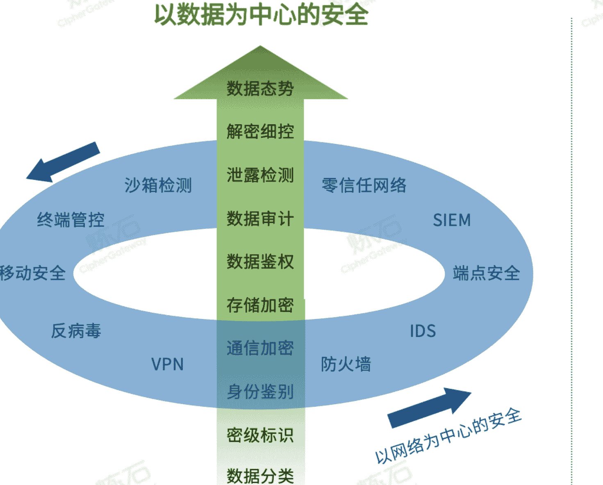

## 产品体系：免改造灵活交付多重安全能力，易部署易扩展
- 数据源识别
- 数据本地
- 数据识别
- 数据风险评估
- 数据流动监控
- 数据分类
- 数据可视性
- 资产管理
- 存储加密
- 解密授权
- 端点加密
- 动态脱敏
- 静态脱敏-适配
- 管理：合规监控、审计
- 技术：满足数据处理活动要求
- 控制策略 - 域控、分布式保护-密钥管理
- 攻击行为-特征提取- 响应处理- 检测结果可视
- 数据访问留存- 数据导出-文件下载

## 敏捷部署：旁路平台结合主路控制面，免改造落地保护
- 提供
- 传输
- 加工
- 使用
- 收集
- 用户访问
- 集成安全能力
- 前台系统
- 后台系统
- CRM
- 应用
- 插件模块保护结构化数据
- CiphSuite 访问
- 代理模块保护结构化数据
- 数据资产管理系统
- 数据安全管理平台
- 代理
- 文件系统
- 数据库
- 非结构化数据
- 结构化数据
- 数据追溯系统
- KMS密管
- TFE/FDE模块保护非结构化数据
- TDE/UDF模块保护结构化数据

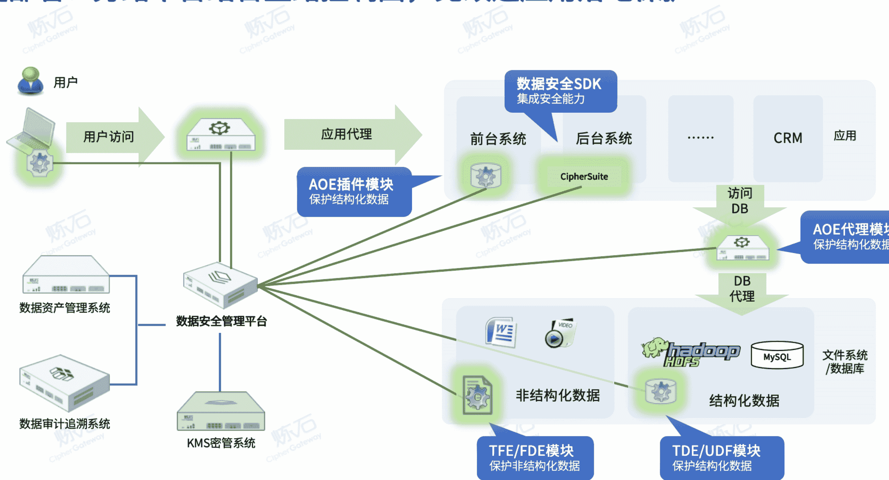

## 产品价值：将安全能力送到真实的数据流程，对流动数据的高流量识别与控制，实现安全与业务融合

## 数据安全主平台
- 全文索引
- 任务调度系统
- 资源管理
- 风险评估
- 数据流动监控
- 可视化工具
- 风险警告
- 接口传输
- 传输加密
- 加密模块
- 其他基础技术
- 可视化平台
- 访问管理
- 数据静态分析
- 数据动态监控
- 风险检测
- 中间传输
- 访问管理
- 身份认证
- 可视化库
- 数据提供公开

### OLTP
### HOLAP
### MOLAP
### ROLAP
- 数据防护
- 安全风险分析

### 数据传输
- 日志审计
- 数据加密
- 数据库同步
- 文件传输

### 数据存储
- 单机存储
- 分布存储
- 备份加密

### 数据处理
- 数据发现
- 安全加固
- 水印追踪
- 数据化数据
- 非结构化数据
- 半结构化数据

### 数据使用
- 实时计算
- 高线计算
- 数据脱敏
- 数据集成
- 数据转换
- 数据访问
- 数据访问安全
- 数据分类
- 数据分级

### 数据清洗
- 数据预处理
- 数据采集
- 数据采集
- 数据管理
- 实时数据
- 关系数据库
- 实时数据
- 日志数据
- 日离收集
- 高线收集
- 关系数据

### HDFS
### SQL
### NoSQL

## 场景一：存储加密、使用解密/脱敏
存储 > 使用 > 加工 > 提供

### 结构化数据
### 非结构化数据
支持ABAC的访问控制，实现用户与标签多层防护
主体节点
FDE全磁硬盘加密
细度访问控制
应用服务器
用户1、用户2、用户3
数据库提取数据
AOE插件
数据安全管理平台
数据安全管理
透明加密
面向用户侧
不影响业务人员使用
DBA运维查看密文
DBA工具查看密文

## 方案优势：兼容多、交付快、防护好
免改造敏捷实施
覆盖事前、事中、事后的防护绕过

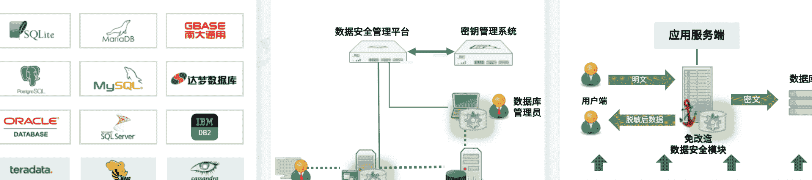

## 划分：数据安全包含“实战、双合规”实战是检验安全能力的唯一标准
数据演练
攻防后数据泄露

## 密评合规
实战三体
 最佳实践
- 形成实战水平的对抗
- 转化为常态的、重复验证和审计的- 风险
- 过程合规
- 结果合规
- 商用密码安全性评估
- 法律场景
- 业务需求
- 审计要求
- 合规监控
- 合规评估
- 策略
- 集中域
- 网信和市场监管：数据安全认证
- 网信和市场监管：个人信息保护
- 公安：工作秘密防护
- 财政部：数据进入
- 国资委：商业秘密
- 保密
- 风险
- 风险
- 风险
- 密评合规

## 国密实践
一站式密改套餐敏捷交付

### 密审要点解析
业务影响广，改造难度大，风险值最高，核心数据改造由用户执行，调整，信息系统新增。

### 测评准则
依据GB/T39871-2020《信息安全技术 信息系统加密基本要求》通过要求60分以上，打分制满100分，共4项，包含8个方面，典型场景，没有管理制度，周期每年至少一次，高风险项，一览
- 实体未通过加密技术进行识别（网络和通信:无缝解密）
- 未采用加密技术保证过程中重要数据的机密性
- 未采用加密技术保证数据在存储中的机密性
- 未采用加密技术保证数据在传输中的机密性
- 建立加密管理制度和接收数据（法律责任）
- 制定加密解决方案、实施方案，未通过
- 未采用加密对外部连接到内部的认证（第四级）

| 物理环境 | 身份识别 | 门禁记录 | 监控记录 | 加密服务范围 | 密码认证 |
| :--- | :--- | :--- | :--- | :--- | :--- |
| | | | | 设备加密 | 10分 |
| | | | | 访问控制 | 20分 |
| | | | | 严格性 | 10分 |
| | | | | 允许性 | 30分 |

| 管理制度 | 人员管理 | 密钥管理 | 应急处置 | 审计记录 | 加密软件管理等制度 |
| :--- | :--- | :--- | :--- | :--- | :--- |
| 人员管理 | 角色 | 职责 | 权限 | 培训与考核 | 保密协议 |
| 建设运行 | 加密应用方案 | 实施方案 | | | 30分 |
| 应急处置 | 应急处置方案 | 报告 | | | |

## 合规产品：一站式接入包捷交付

| 测评界面 | 测评单元 | 备注 | 高风险 | 得分 | 密码产品 |
| :--- | :--- | :--- | :--- | :--- | :--- |
| 物理和环境安全(10天) | 身份识别 电子登录记录存储完整性 | | 4.17 | 0.00 | |
| | 视频监控记录数据存储完整性 | | 2.92 | 0.00 | 高风险缓解 |
| 网络和通信安全(20天) | 身份识别 通信数据完整性 | 高风险(无缓解) | 5.88 | 5.88 | IPSec VPN 安全网关 |
| | 通信过程中重要数据的机密性 | 高风险 | 5.88 | 5.88 | SSL VPN 安全网关 |
| | 网络边界访问控制信息的完整性 | | 4.12 | 4.12 | |
| 设备和计算安全(10天) | 身份识别 远程管理通道安全 | 高风险 | 2.08 | 2.08 | SSL VPN 安全网关 |
| | 系统资源访问控制信息的完整性 | | 1.46 | 1.46 | 应用和数据安全密码模块 |
| | 重要信息资源标记完整性 | | 1.46 | 1.46 | 软件密码模块 |
| | 日志记录完整性 | 恢复程序完整性、重要恢复程序真实性 | | 1.46 | 0.00 | |
| 应用和数据安全(30天) | | | | | |


# 高可靠 专业密钥管理、实时离线解密，保障高可用

KMS密钥设备

管理员

KMS密钥聚群

+ 1. 根据算法加密密钥导出至3个USBKey，任意2个还原
2. 跨设备需人工同步

+ 2. 运维工具离线解密

明文

真随机数 密钥

管理员

+ 3. 扇库还原明文

管理平台集群

真随机数

模块密钥

数据库

明文

业务用户

+ 1. 由密钥加密落盘存储
2. 跨设备自动同步

+ 1. 应用系统实时解密

明文

ETL工具

模块密钥派生

工作密钥(数据加密、数据MAC)

+ 1. 不落盘存储
2. 由模块密钥实时解密

+ 5. 程序模块解密

+ 4. 实时解密明文到备库

开发人员

应用程序

CipherSuite

备库

管理员

+ - 密管支持双机热备、两地三中心高可用模式，密钥明文不出设备、模块密钥明文不出设备

+ - 工作密钥安全从平台分发数据处理模块，模块可缓存工作密钥后运行，不需要实时在线

+ - 保护策略下，支持启用应用后，模块可从平台更新密钥

+ - 密码算法是标准，密钥管理机制可控，只要密钥数据直接连接，一定可解密

+ - 常态状态下，支持应用系统密钥、支持DBA运维工具直接密钥
- 紧急情况下，支持从库还原明文、支持实时解密明文到备库
- 极端情况下，用运维工具或程序可以兜底密钥

# 高可用：模块健壮诊断、平台“两地三中心”

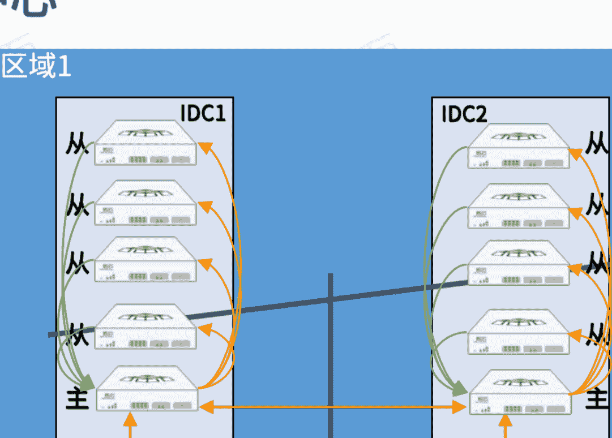

【模块可离线运行】

+ - 模块从平台获取规则后可存在内存中，当平台不可用也可正常运行
- 仅当模块在服务重启启动时才需要从平台集群重取规则

【模块强化健壮性】

+ - 以AOC插件作为例，本身作为应用的一部分，无单独进程，不会死进程
- 在没有匹配状态下，模块默认采用透传模式，最大程度优化业务
- 模块经过多年打磨、运行实战，兼容各种苛刻的企业级应用场景

【模块诊断】

+ - 模块自身记录环境、启动流程、异常事件等监控功能
- 针对Java等环境支持不停机实时诊断机制，排查潜在故障原因

# 工业级：加密机制兼容复杂场景

支持数据加密后的密态查询

# 明文标识确保加密可靠

| COMPLAINT_NO | PARTTY_ID | CONTACT_TEL |
|---|---|---|
| 1 | 2051720100000 | dOVnyM3lWClPPp/f3nWsq- | W1tYp7j1IdDbEoW6- |
| 2 | 2051720100008 | dOVnyM3lWClCPp/f3jnZq- | W1tYp7j1IdDbEoW6- |
| 3 | 2051720100009 | dOVnyM3lWCLp/Y3jnZq- | W1tYp7j1IdDbEoW6- |
| 4 | 2051720100010 | dOVnyM3lWClCHp/Y3nWsq- | W1tYp7j1IdDbEoW6- |
| 5 | 2051720100011 | dOVnyM3lWCLp/N3jnZq- | W1tYp7j1IdDbEoW6- |
| 6 | 2051720100012 | dOVnyM3lWClCHp/Y3nWsq- | W1tYp7j1IdDbEoW6- |
| 7 | 2051720100013 | dOVnyM3lWClCLp/Y3nWsq- | W1tYp7j1IdDbEoW6- |
| 8 | 2051720100014 | dOVnyM3lWClCHp/Y3nWsq- | W1tYp7j1IdDbEoW6- |
| 9 | 2051720100015 | dOVnyM3lWClCLp/Y3jnq- | W1tYp7j1IdDbEoW6- |
| 10 | 2051720100016 | dOVnyM3lWClCHp/Y3nWsq- | W1tYp7j1IdDbEoW6- |
| 11 | 2051720100017 | dOVnyM3lWClCLp/Y3nWsq- | W1tYp7j1IdDbEoW6- |
| 12 | 2051720100018 | dOVnyM3lWClCHp/Y3nWsq- | W1tYp7j1IdDbEoW6- |
| 13 | 2051720100019 | dOVnyM3lWClCLp/Y3nWsq- | W1tYp7j1IdDbEoW6- |
| 14 | 2051720100020 | dOVnyM3lWClCHp/Y3nWsq- | W1tYp7j1IdDbEoW6- |
| 15 | 2051720100021 | dOVnyM3lWClCLp/Y3jnq- | W1tYp7j1IdDbEoW6- |
| 16 | 2051720100022 | dOVnyM3lWClCHp/Y3nWsq- | W1tYp7j1IdDbEoW6- |
| 17 | 2051720100023 | dOVnyM3lWClCLp/Y3nWsq- | W1tYp7j1IdDbEoW6- |
| 18 | 2051720100024 | dOVnyM3lWClCHp/Y3nWsq- | W1tYp7j1IdDbEoW6- |
| 19 | 2051720100025 | dOVnyM3lWClCLp/Y3nWsq- | W1tYp7j1IdDbEoW6- |
| 20 | 2051720100026 | dOVnyM3lWClCHp/Y3nWsq- | W1tYp7j1IdDbEoW6- |
| 21 | 2051720100027 | dOVnyM3lWClCLp/Y3jnq- | W1tYp7j1IdDbEoW6- |
| 22 | 2051720100028 | dOVnyM3lWClCHp/Y3nWsq- | W1tYp7j1IdDbEoW6- |
| 23 | 2051720100029 | dOVnyM3lWClCLp/Y3nWsq- | W1tYp7j1IdDbEoW6- |
| 24 | 2051720100030 | dOVnyM3lWClCHp/Y3nWsq- | W1tYp7j1IdDbEoW6- |
| 25 | 2051720100031 | dOVnyM3lWClCLp/Y3jnq- | W1tYp7j1IdDbEoW6- |

| 类型 | 规则 | 示例 |
|---|---|---|
| 手机型号 | | 按照3、4、4 拆分加密 |
| 身份证号 | | 按照6、4、4 拆分加密 |
| 住址 | | 按照3、3、其余拆分加密 |
| 其他 | | |

| 姓名 | 性别 | 年龄 | 手机号 |
|---|---|---|---|
| 张三 | 女 | 20 | 188 1111 2222 110102 1996 0102 3333 |
| n1 n2 | | | p1 p2 p3 ID1 ID2 ID3 ID4 |
| n3 | | | p4 ID5 |

+ - 炼石加密后，在加密中存储明文索引，保证加密字段不会被二次解密，明文不会被二次加密

+ - 在加密功能上线过程中，不可避免会出现明文混合的情况，通过明文标识明文和明文分区

+ - 支持加密数据库的模糊查询。对加密字段做特殊处理，将加密字段按照规则解密，然后解密后部分字段分别处理，之后各部分字段（解密规则）可以应用化，通过策略管理来进行配置

+ - 支持对加密算法进行定制，对加密字段长度扩展

# 好用：集中式管控，分布式保护

# 统一策略

# 集中式管控

# 统一密钥管理

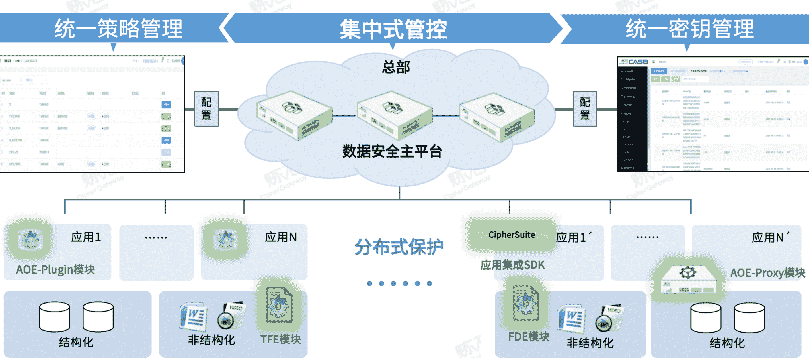

总部

数据安全主平台

分布式保护

应用1

CipherSuite

应用1

AOE-Plugin

结构化

AOE-Proxy

结构化

TFE模块

FDE模块

结构化

数据中心1

数据中心2

# 数据安全实战实践

# 数据防护

# 传统平台面临挑战

# 数据实战挑战

+ - 易用：基于基础算法升级到服务化，易于集成
+ - 效能：从功能组件到资源池，适用于云化趋势
+ - 托管：从功能上支持分级、多租户模式，方便部署

传统CSP侧重于密码技术本身，而在真实业务场景中难以有效防护事前、事中、事后全方位防护手段

# 应用改造难题

集成现有系统时需要大量二次开发，开发风险大、周期长，凸显主要矛盾，传统CSP在满足合规方面缺乏灵活性、难以落地

# 安全合规支撑

《数据安全法》、《个人信息保护法》、《网络安全法》、《相关条例》等对数据合规要求日趋严格，标准的各类数据合规等新需求对加密明确要求，而传统CSP支撑不足


# 下一代平台打造关键能力

下一代密码服务基于创新技术，实现密码能力从支撑层到真正应用层的跨越，有效解决“加密加改”推广后的难题，是顺应数字化发展趋势，基于创新安全技术构建的综合平台。

# 构建实战能力

通过改造整合优势，将密码能力与数据安全能力紧密结合，形成了全方位安全实战防护体系。采用零信任架构，结合安全沙箱、轻量可信技术在用户端创建一个受保护的安全工作桌面，对应的原环境叫做“普通桌面”；“安全桌面”内，所有的文件自动加密，所有的网络受控，未经授权访问任何数据和文件从里面拿出去会被审计和检查，任何试图越权的操作都会被拒绝。

# 下一代密码平台

| 政府 | 金融 | 交通 | 电信 | 教育 | 医疗 |
|---|---|---|---|---|---|
| | 免改造整合 | | | | |

# 适配重心

通过改造技术优势，轻松接入现有系统，提供贴近业务场景的密码解决方案，实现从支撑层到真正应用层的跨越。

| 事前 | 脱敏访问控制 | 事中 | 事后 | |
|---|---|---|---|---|
| | | 检测响应 | 审计追溯 | |

# 统筹合规

满足密评、关保、等保、数评等合规要求，数据安全合规合规融合。

| 密评 | 关保 | 等保 | 数评 |
|---|---|---|---|

# 数据可见：结合法规要求，落地数据分类分级

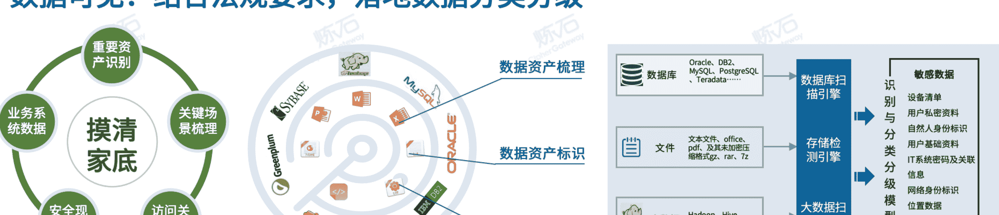

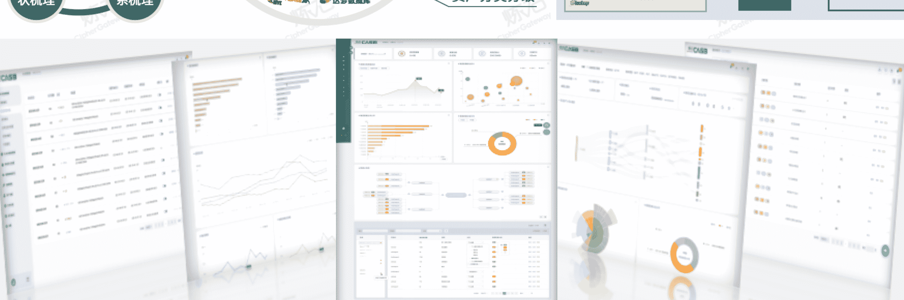

# 数据可见：终端探针提供无感数据发现

# 敏感数据发现

对多种敏感文件格式内内容的提取和分析，采用高效识别语言算法判别文件是否涉及，并保存扫描结果，以便进一步的处理。

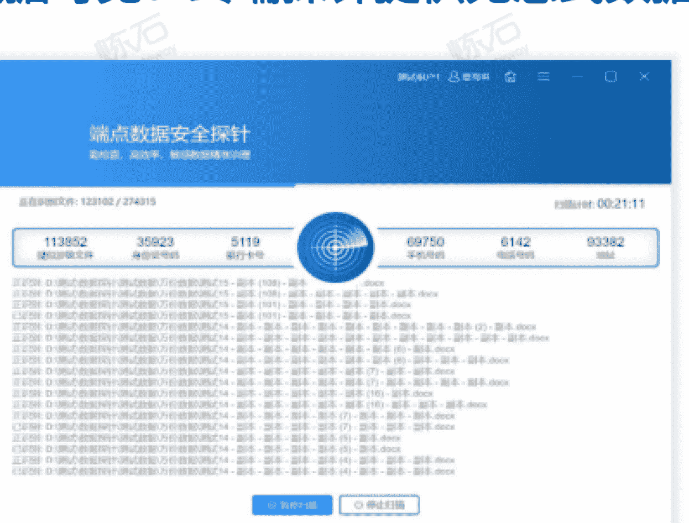

# 敏感数据处置

可识别别的疑似敏感文件进行加白处理，将其标记为非敏感数据；或对识别别的疑似敏感文件从终端上永久性删除。

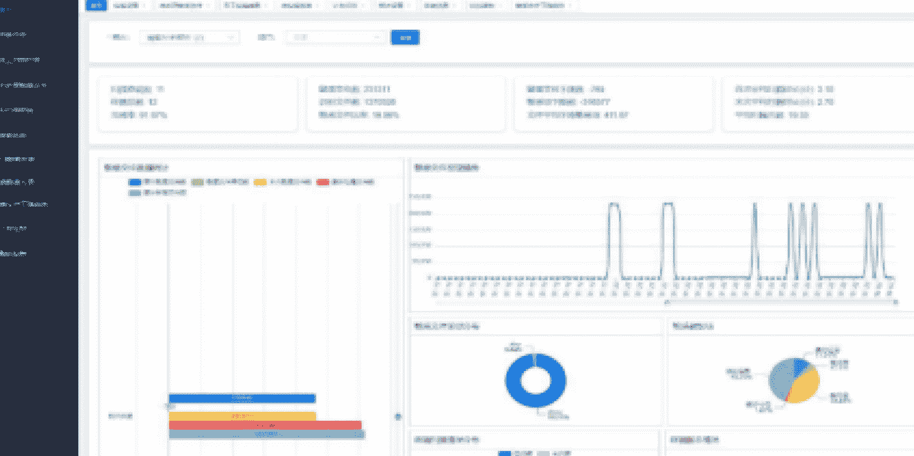

# 可视化汇总及报告

将客户端的扫描结果以看板、数据趋势、可视化图表的形式呈现，形成可视数据分析及可导出的报表。

# 个性扫描设置

强化后台管理功能，可以进行权限限制，自定义扫描范围和规则覆盖办公环境终端，实现对敏感数据的合规管理。

# 事前防护：最小化敏感数据访问范围

易于实施的“主体到人”，支持与应用身份管理打通。主体到人，主体到数据细粒度访问控制。

| 姓名 | 身份证号 | 手机号 | 行程 |
|---|---|---|---|
| 张瑞 | 62107833567356125 | 139003334901 | Pvg-pekvg |
| 张瑞 | 62108*********56125 | 13***9901 | p***, |
| 张瑞 | 8495008040480548 | 1323450466 | 3a7v0wCPOGHNabv |
| 张瑞 | 8495008040480548 | 1323450466 | 3a7v0wCPOGHNabv |

+ - 可适配应用系统自带标识，实现用户身份的动态脱敏-支持ABAC基于属性的访问控制等


# 事前防护：终端沙箱构建可信工作空间

采用零信任架构，结合安全沙箱、轻量可信技术在用户端创建一个受保护的安全工作桌面，对应的原环境叫做“普通桌面”；“安全桌面”内，所有的文件自动加密，所有的网络受控，未经授权访问任何数据和文件从里面拿出去会被审计和检查，任何试图越权的操作都会被拒绝。


# 事中检测响应：业务人员风险操作识别处置

+ - 免造面对对所有流经的业务操作进行监测，结合当前的业务上下文，判断行为是否正常的模式
- 如果发现是异常操作和不合规操作，则进行告警甚至操作阻断，以防止恶意操作导致的数据泄露和系统破坏


# 场景举例


# 客户信息安全增强

总体设计图（最终）行为不符合正常工作时间行为异常阻断产品库/设计/机器人总体设计。

某员工用户C有权访问单位的PLM系统，能够访问到某Z型产品中的设计数据。偶然，此人在正常工作时间内，批量下载全套的产品数据，此时数据控制面的实时监控能够捕捉到此异常行为，立即执行阻断，并将该事件记录和报告。

+ - 客户人员每天需要查看高价值的客户信息，以便提供服务，但存在过量访问的内控风险，而业务应向往失达到安全机制
- - 通过避免制造控制的安全内增强，可视客户人员每天访问客户信息的阈值，超过100次以内可正常访问，超过100次系统触发告警，超过200次触发阻断（通过流程终止后可能访问）

# 数据库

溯源

# # 事后审计：可查到人的访问审计追溯

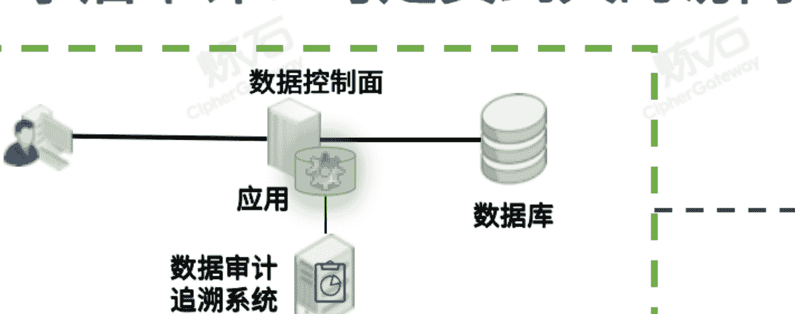

# 记录所有访问敏感数据的行为

包含账号、时间、IP、会话、操作、耗时、结果等内容，形成终端用户身份的SQL日志。用户可以通过日志查询数据的访问情况，在事故发生后精确溯源。

| 操作时间 | 操作者 | 行为 | 操作对象ID | 操作对象名称 | 操作对象所有者 | 状态 | 告警 | 告警类型 | 附件 |
|---|---|---|---|---|---|---|---|---|---|
| 20161221 23:43:22 | 用户C | | | | | | | | |
| 用户C | | | | | | | | | |
| 用户C | | | | | | | | | |
| 用户C | | | | | | | | | |
| 用户C | | | | | | | | | |
| 用户C | | | | | | | | | |
| 用户C | | | | | | | | | |
| 用户C | | | | | | | | | |
| 用户C | | | | | | | | | |
| 用户C | | | | | | | | | |


## 数据流通实践
### 基于TEE技术的跨域数据管控

## 外发痛点：数据“可见即可转”，共享失控

数据已成为企业可以交易的商品，但在共享后存在“数据失控”问题困扰着数据提供方：

- 数据的接收方有没有对数据进行滥用？
- 对方有没有再次将数据外发给第三方？
- 这些数据在对方的有效期内如何控制？

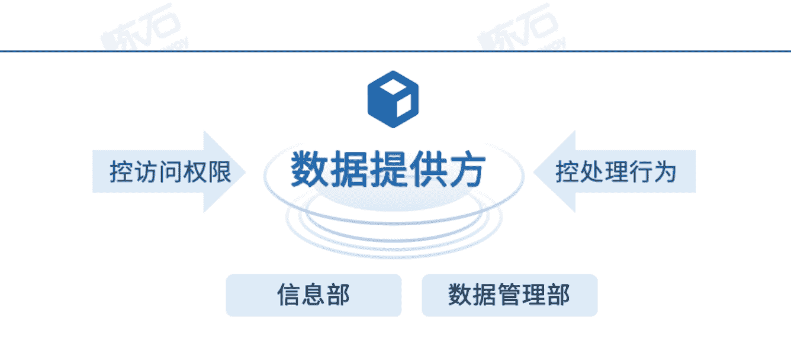

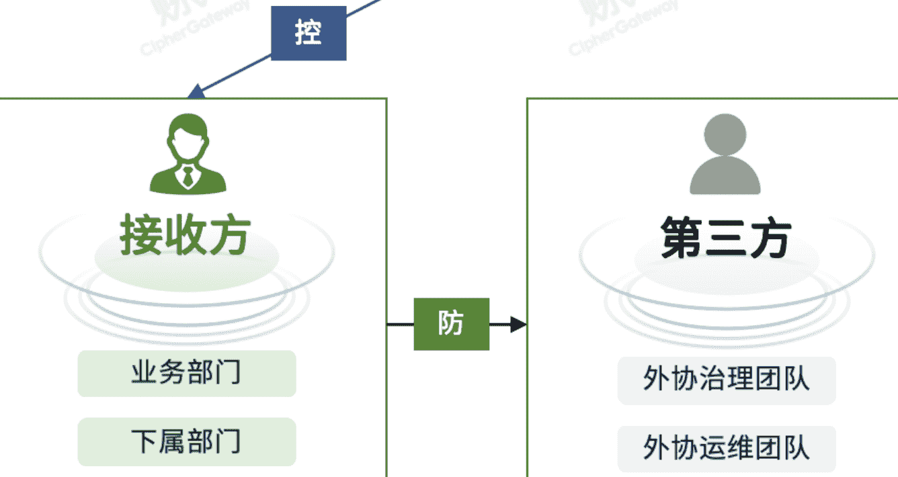

问题实质是，数据提供方仅赋予接收方使用权而非所有权，并且要按照约定来限制对方的使用范围。

现做法是双方签字协议来实现约束，但数据的所有权在技术上是**失控的**。数据不共享的前提下，必须从技术上实现对接收方使用数据的数据进行控制，防止数据滥用、防止数据池泄露给第三方，维护数据提供方的利益。

## 数据流合规产品：改造落地“数据可见不可转”

数据已成为企业间可交易的商品，但交易后序存在“数据失控”问题困扰数据持有者：

- 数据的接收方是否有对数据进行滥用？
- 对方是否有再次将数据外发给第三方？
- 这些数据在接收方的有效期如何控制？

（注：此处原文包含业务部门、下属部门、业务合作机构、外协治理团队、外协运维团队、网络黑客组织等相关方关系图，及数据流程图描述）

# 1. 高线场景：实现数据可见不可转

# 2. 在线场景：实现数据可见不可转

## 跨域管控：部署模式不原有数据共享流程

| 基础数据共享数据库 | 个人信息 共享数据库 | 生产运营 共享数据库 | 数据中台 集中数据库 | 管理支撑 共享数据库 |
| :--- | :--- | :--- | :--- | :--- |
| 数据中台共享数据管理系统 | | | | |
| 来自内部的数据共享请求 | | | | |
| 数据中台发送数据受控共享平台 | | | | |

# 跨域数据管控平台

| 离线场景：实现数据可视不可改 | 在线场景：实现数据可用不可改 |
| 数据状态胶封装技术 | 受控数据共享专用终端技术 | 访问控制技术 | 数据水印防泄溯源技术 |
| :--- | :--- | :--- | :--- |
| 用户层 | 数据生产 | 数据使用 | 数据控制 | 数据服务 |
| 安全层 | 数据加密 | 访问控制 | 权限管理 | 数字水印 | 数据脱敏/重命名 | 数据审计 |
| 应用层 | 数据目录 | 数据源集 | 数据授权 | 用量统计 | 交换通道 | 日志记录 |
| 支撑层 | TEE可信执行环境 | 同态加密HE | 数据信息管理 | 交换通道 |
| 基础层 | CA服务 | 身份信息 | 密钥管理 | 区块 | 交换通道 |

来自外部的数据共享请求
数据投放及密文下发

| 专用加密模块 | 分子公司 | 专用加密模块 | 专用 | 专用加密模块 | 生态后保障 | 专用 |
| :--- | :--- | :--- | :--- | :--- | :--- | :--- |
| 应用系统 | | 应用系统 | DBA 工具 | 应用系统 | 数据使用 | DBA 工具 | 使用 |
| 可信执行环境 | 数据使用 | 可信执行环境 | 数据使用 | 可信执行环境 | |

## 公司定位：炼石就是数据安全

炼石是以“免改造”为特色的数据安全产品厂商，国家级精特新“小巨人”，自研灵活投送多重安全能力的免改造平台，帮企业客户打造领先安全防护体系，敏捷交付密评改合规。


# 炼石免改造数据安全

- 2015 公司成立安天投资
- 2016 应用融合数据安全
- 2017 Pre-A轮 国君和投资
- 2018 免改造数据安全
- 2019 免改造数据保护平台
- 2020 A轮 腾讯投资
- 2021 数据安全主平台
- 2022 A+轮 领航新界投资
- 2023 数据安全产品+服务
- 2024 全域数据保护
- 2025 下一代密评平台


## 案例-政府海量数据：某部14亿人口个人信息加密保护

### 项目背景介绍

客户行业：政府
项目名称：某部某委持卡数据库安全建设项目

项目需求：
某部某委持卡拥有全国的省民生卡数据，均为涉及公民隐私的敏感数据，受《网络安全法》、《密码法》、《数据安全法》以及《个人信息保护法》等法律法规的合规要求，需要对卡数据库采用加密技术进行保护。

- 项目建设目标及实施方案：
  - 目标1：通过免应用改造模式，实现部级持卡敏感数据的加密保护。
  - 目标2：基于国密算法实现数据，满足合规要求。
  - 目标3：适配省级数据通过接口传输至部级的业务场景，通过本方案实施后，以加密形式存入数据库中。
- 痛点1：海量数据，部级中已有数据百级，处理包括，以及灾备库。
- 痛点2：实时性，实施后，生产库和灾备库之间实时同步机制。

# 部署和实施方案
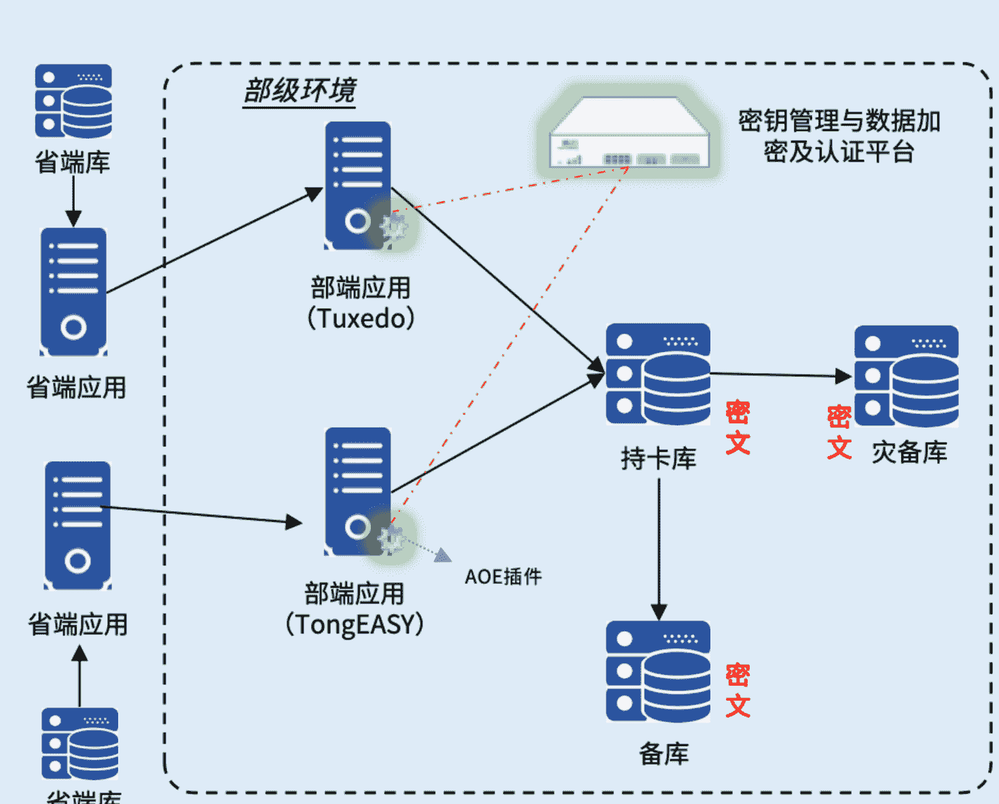

## 案例-金融核心交易：某商业银行数据加密

### 项目背景介绍

客户行业：银行
项目名称：某商业银行数据加密项目

面向重要数据与个人信息保护，依托自主研发的AOE加密模块，打造灵活改造的数据保护、高性能密码产品，构建高覆盖率，有效保护数据结构化与非结构化数据，保障数据生命周期安全，实现用户到字段级的防护。

项目需求：
某商业银行掌握海量用户数据，但面临日益严峻内部威胁，亟需在数据安全与经济发展之间平衡，强化个人信息的保护。

项目实施痛点：
- 待保护的数据量达到亿级，人员多、存储分散、传输频繁；
- 开发改造应用周期长、难度大、风险高；
- 环境复杂，涉及字段类型多种、种类多种、查询等；
- 加密过程不可影响正常业务运行。

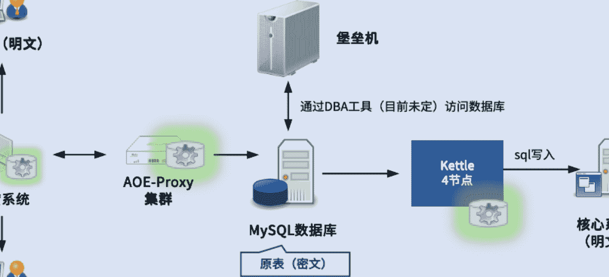

## 案例-某航空公司数据加密

### 项目背景介绍

客户行业：航空
项目名称：某航空公司系统加密升级

项目需求：
企业拥有大量旅客和员工数据，受国外GDPR以及国内《网络安全法》、《密码法》等法律法规的合规要求，需要建立数据安全平台，采用密码技术保护个人信息以及敏感数据。

项目建设内容：
面向用户授权的动态脱敏服务，基于国密实现字段级加密，数据访问控制。

项目收益：
- 1、实现批量系统的应用数据需求，保护旅客隐私安全，提升系统水平。
- 2、满足国家关于隐私数据保护、商用密码信息系统应用规范。


## 案例-运营型BOSS：某省移动个人信息保护

### 项目背景介绍

客户行业：运营类
项目名称：省移动BOSS个人信息保护

项目需求：
针对BOSS中的客户信息进行加密保护，在实现数据安全的同时，也符合部对于客户加密的考核要求。该方案通过集团联测，获得集团支持。

项目实施痛点：
- 业务资料表加密，影响所有访问资料表的业务，涉及三方协同（改造范围：集团网中心、省内CRM/BOSS/经营系统）。

解决方案：
- BOSS系统：应用安装AOE插件，应用写入数据实时加密，应用实时解密；
- 历史数据通过客户客户端进行采集集成SDK，调用SDK解密接口，实现采集数据解密；
- 分级：BOSS侧导出的密文文件解密明文文件，按照还原逻辑解析明文文件，数据写入vertica和TD数据库。

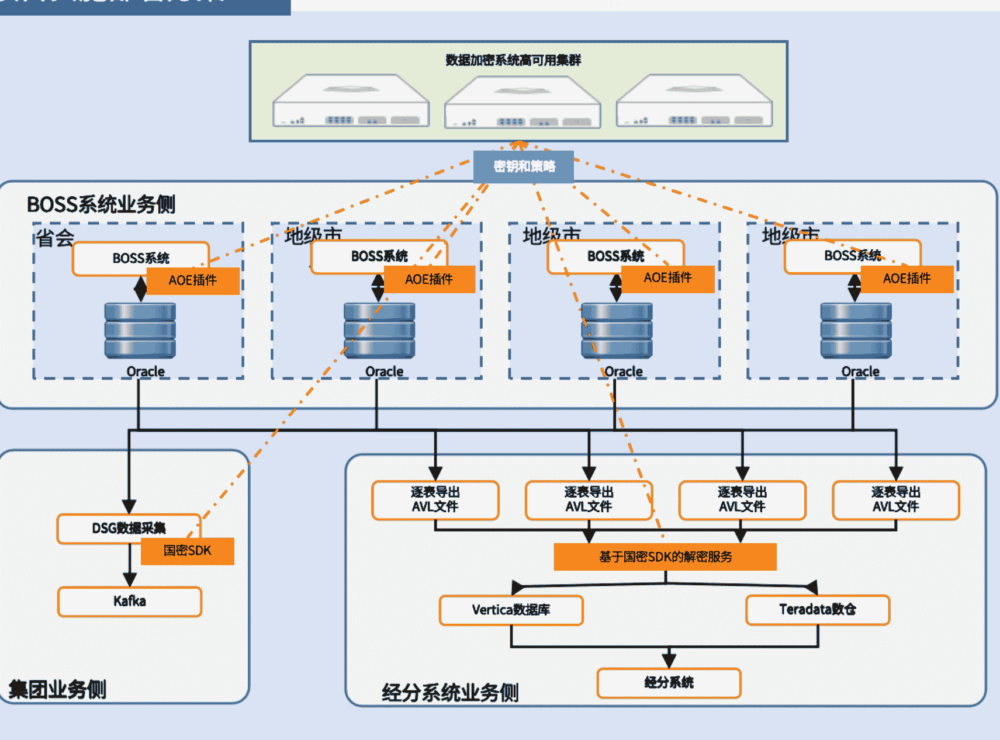

## 案例-医院应用：某医院患者数据加密

### 项目背景介绍

客户行业：医院
项目名称：某医院数据加密安全项目

项目需求：
某医院掌握着海量病患隐私数据，为加强个人敏感数据保护，防止隐私信息泄露，满足《个人信息保护法》、《密码法》等法律法规的合规要求，并且对业务系统进行改造，不影响业务使用。

项目建设内容：
面向重要数据与个人信息保护，依托自主主研的AOE加密模块和AOE集群，打造灵活适配业务的数据保护、高性能密码方案。

项目收益：
- 1、实现系统应用的数据加密需求，保护病患和员工隐私数据安全，提升系统安全水平。
- 2、满足国家关于个人隐私数据保护、商用密码信息系统加密应用规范。

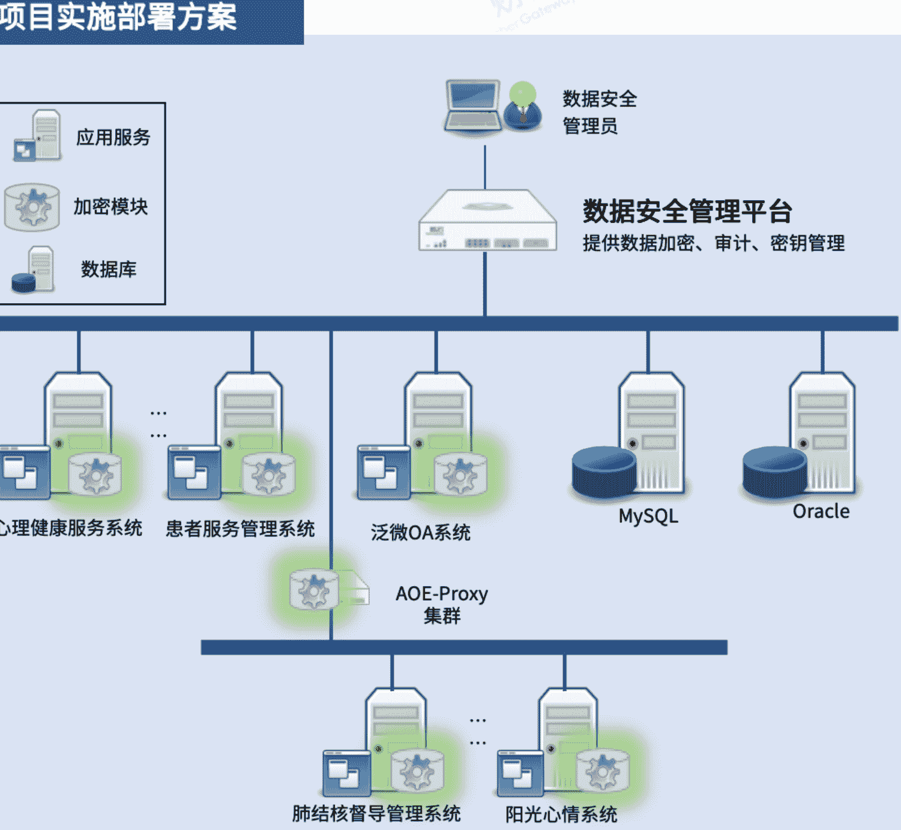

## 案例-工业关键应用：某大型国有车企车主数据加密

### 项目背景介绍

客户行业：制造业
项目名称：某大型国有车企车联网系统数据加密

项目需求：
企业拥有大量车主和车辆的敏感数据，且受国内外GDPR以及国内《网络安全法》、《密码法》等法律法规的要求，需要应用密码技术，建设加密平台使车辆案例系统、车联网客服系统、监控系统，云上+云下数据得到保护。

项目建设内容：
对车联网数据库10个高敏感字段1400万条车主个人信息进行加密，同时不影响下游业务流，不影响数据维护和使用。

项目收益：
- 1、实现核心业务的应用数据加密，保护用户隐私数据安全，提升系统水平。
- 2、满足国家关于隐私数据保护、商用密码信息系统密码应用规范。

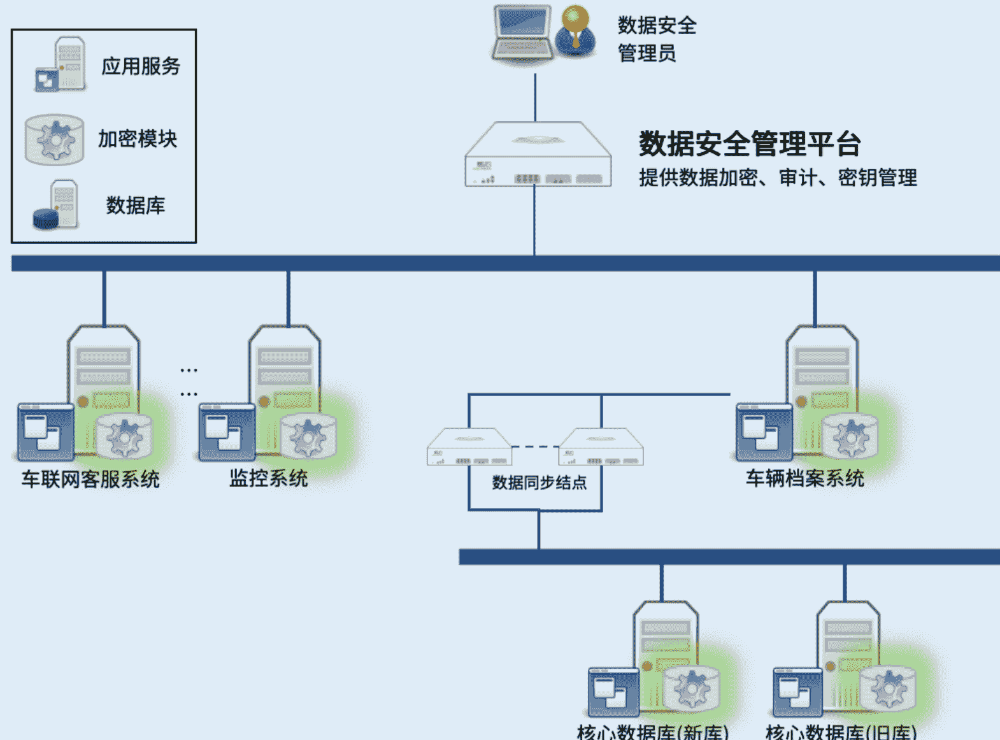

数据安全管理平台
提供数据加密、审计、密钥管理

# 炼石免改造数据安全

# THANKS

www.ciphergateway.com

010-88459460

sales@ciphergateway.com


