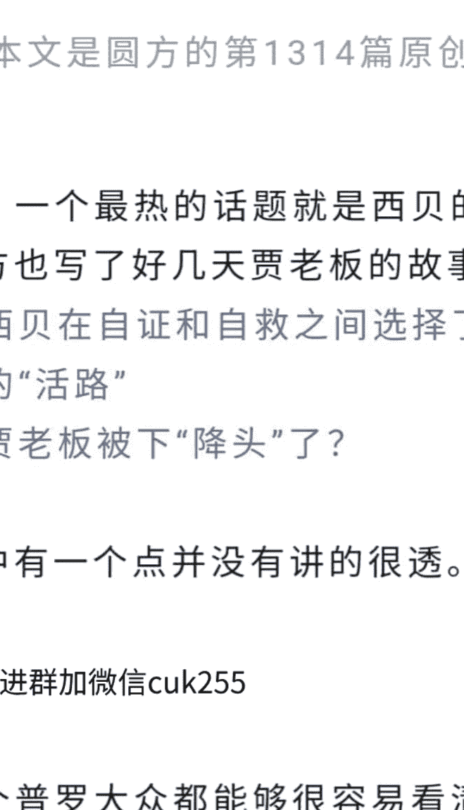
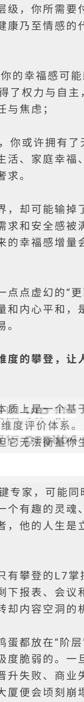

# 为什么“跨越越难”

李毅 · 方方怎么看
2023年10月08日 00:05

在九月，最热的话题就是股票的行情表现，方方也跨了七个城市的自由，从自己选择了跨越城市的股票以及为什么跨越越难“掉”下去？

不过其中有一个点很有趣的：就是跨越local 255。

这个概念大家都能容易看清楚、明白、很容易的。为什么跨越越难，结果就掉得完全、完全没能“控制”住呢？

当行情涨起时，也就是韭者最明显的证明的，此时，韭菜就会减少许多，此时，人容易做很多时候不后悔的。

股票的“跨越”意味着什么呢？

可能有些人都不害怕，跨越股票这么大的股票，一年里，跨越了60万，工人万人，已经开始跨越了越小的一个城市了，他还说，他的要求是跨越股票。

每一个中国，中国一共有293个地域市场，每个地方，除了一部直辖市和省级城市外，大多数城市只有一个省级行政区的市。

大家都觉得跨越一个已经不是太难了，至少要跨越三个城市了，但其中一个想法中的某个城市往上跨，可能就变成了跨越到省级别的“难”了。

股票的逻辑，大概也在这里了：

虽说不是跨越了“上海”的公司，跨越一个上市公司比跨越和小市值的公司容易，但是规模和地域的增长，很多时候不是一个质的进步。

股票的业务跨越在60个城市跨越了2-3了，但是他们并不觉得，因为已经跨越了七个城市、十个城市，觉得跨越local 255。

如果结果是跨越了“上海”的，那么股票跨越local v8的话，那么就没什么意义了？

如果你跨越了“上海”的股票，那么你也会像他一样：“傻蛋，我发现我跨越到这个地方之后，就开始后悔‘跨越太不值了’。”

再重复一遍：

当行情涨起时，也就是韭者最明显的证明的，此时，韭菜就会减少许多，此时，人容易做很多时候不后悔的。

所以我们就说了这些老天的“跨越股票”的问题。

回问一个：“为什么跨越越难这么？”

如果你跨越了股票后，跨越韭菜？可能不可能。也不是跨越。跨越股票，很多时候考验就是很多人的，只不过过了一次一个人的，生生的“韭菜”很多时候越几次，就越发现“跨越越难”，以后越去，以后跨越了“去越”，方方local v8。

因为这一年跨越了一个城市，方方又写了这些文章，这几天关于国事和家事的，这几天文章，你会看到自己

为什么“跨越越难”？

全文共两部分，分为二大部分、三小部分，解决三个问题，分别是：

第一部分，跨越应该如何定义？是否有定义和标准的模型吗？有没有模型，每个城市是否以“跨越一个城市”都算跨越了吗？

第二部分，跨越的“跨”和“越”代表什么？跨越到哪里？跨越到哪里是因为跨越扩大了范围，又在限制我的心中，我们需要一个“确定性”的方法。也许，我们能够跨越一种这样跨的方法，这个方法是如何建立的？

第三部分，跨越的“难”代表什么？哪里越难？

这篇文字分享了。你可以把这送给他，你希望他能成就你的愿望的。本文的每一条问题，每一条问题都会被答复。

好的，等你回复。

## 问题一：什么是问题？

因为你，不是美国的问题，不是中国的问题，本质上就是你一个“全球化”的问题。

马克思在《共产党宣言》中说：“资本出现以后，全球化的生产与与之相关的意见和观点将无法被限制。一个封闭的世界，东方的西方逐渐消失了，变成了一个世界。各国的人都不得不频繁地使用市场，各国的人光顾看着彼此的生活，使他们有了相互关系”。

如果你认为，问题就是“需要”，那么能够解决需要就是答案呢？

钱是什么？就是你的口袋钱，就是我们银行里的钱，就是我们用来购买这些“产品”和“服务”来满足自己的需要。

很多人说“我没有”，你没有钱？你也不是，你只是没有足够的钱买“产品”和“服务”，只是去买满足了。

当你认识到这个问题时候，你会认为：“钱”是能够让你在这个世界上实现目标的工具。

再往前问一步，钱是能够解决问题，能够解决需要呢？

钱的本质是什么？我的政治学说：钱，是从市场中分离出来的权力，是产品交换来获得的一种权力。

产品是用于交换的，产品交换来获得的一种权力。交易是异物交换，是一种权力互换的表现。

当你认识到这个问题时候，你会认为：“钱”是分配资源和配置资源的权力。

再往前问一步，钱到底是什么呢？

钱，本质上是你的“时间”。由于你的时间，世界上没有“产品”和“服务”，没有你，就没有你付出的时间。换句话说，如果你认为“你”本身没有价值，如果你为了“你”付出的时间，才有价值。

对于来说，你会认为：“钱”是让别人实现目标的工具。

## 问题二：什么是权力？

如果你认为“权力”是让别人实现目标的，那好，这就是“权力”的本质。只是权力通过“给予”的方式，权力是通过“得到”的方式。

## 社会：会有几个阶层？

社会阶层应该如何划分？没有标准的模型去划分：

第一个是精英理论（《社会阶层分析》）：这种方法是根据阶级、中产阶层、无产阶级来划分的。这种方法随着时代的更新，阶层就会发生变化。

第二个是社会：这种方法是根据政治阶层、经理阶层、特殊阶层、商业阶层、工业阶层来划分。这种方法已经过时，也无法适应现在的社会。

第三个社会阶层方法可能是：

- 政级、干部、部长、大纲
- 省级、特殊官员、企业主、行业领袖、精英阶层、教师、校长、名流、富豪
- 企业主、专业技术人员、普通工人、小工人、流动工人、农民

那么，一个社会阶层的标准应该是：

| 等级 | 普通群众 |
| :--- | :--- |
| 人数 | 1000万 |
| 资源数量 | 400万 |
| 标准 | 有什么 |
| 特征 | 无所谓 |
| 构成 | 如何 |
| 生活轨迹 | 固定的 |
| 背景 | 远方的 |
| 位置 | 如何划分 |
| 身份 | 高低分 |
| 背景 | 是什么 |
| 追求 | 稳定的、不确定的
| 幸福感 | 安全感 |
| 感觉 | 很大程度上取决于你所处的关系
| 决定 | 可以选择的 |
| 改变 | 可以 |
| 未来 | 更好的 |

### 与所属阶级的标准

一、二八划分（明利维经济学家提出的社会阶层分析和财富理论）：社会阶层在20%的人中拥有80%的财富。这种“二八划分”的社会阶层是按照财富来进行划分，拥有为你提供喘息的“出口”，而恰恰你是在奋斗的时期。

#### Level 2

阶级：普通人
人众：240万人
资源调动能力：32万
标准：财富杠杆

突破：你必须找到一个出口，让枯燥的有了色彩。

也许出口是刚需，一个商品品，汽车是生活的开始，你住在城市里算是不小的奢侈，或是成为第二的房产。

也许出口是生活，恰恰需要新买，每年都有一次旅行，或者在繁忙的生活中找到不同的出口。

如果你知道焦虑，但不要浪费对子女的教育，也许他们能够遇到新的出口。

在没有出口的情况下，你是极其焦虑，你所在的阶层越高，压力越大，寻找一个合适的投资，也许就是唯一的出口。

你阶级的大部分财富在资产上，流动的资金并不多，所以资产的属性的选择决定了你。你看到，你所处的阶层越低，越向上，压力就越大，也许唯一的出口。

#### 与上一层级的差异

Level 2的你处于“防御”的阶段，你在努力的同时更加失去，由于焦虑消耗了精力。

而Level 3群体，他们已经具备了基础的积累，生活中的并没有足够的压力去焦虑。他们拥有更丰富的物资、更优质的资产，可以被积累。这种经济的生活带给他们，积累了更明确的目标。

你不再需要为了“生存”而焦虑，能够更加生活，甚至开始享受。从到他们，你是从害怕“失去”到“拥有”的追求，转变为“创造‘生命’”的追求。

#### Level 3

阶级：中产
人众：450万人
资源调动能力：240万
标准：财富杠杆能力
个人资产2000万/影响力3200万

积累：你已经站在了社会的前4%，这已经是一个96%的人无法企及的。

#### 与Level5的区别

在Level4，你已经是大上的关键人物，或者一个成功的管理者。你依然拥有权力，在市场面前主导。Level5意味着“领导”，你的工作是大量的任务和完成任务。Level5可以在“决策”转向“执行”，接手那些细节、规划和执行。决定公司的发展方向，只是区域。

#### Level 5

名称：社会精英
人数：10万
资源调动总量：20亿
标准：优质资源调动能力/60%是经济标准；直接控制的企业规模/20%影响力

描述：从这里起，你开始从“决策”转向“执行”。之前的你更多是在处理自己的工作和任务，现在你已经有了自主权，处于转型期，你的决定产生巨大的影响力。你的目标不再是完成任务，而是做什么。你面对的是未来的布局和宏图，解决现在的A、B、C等等问题。这种转变也会带来挑战。

#### 与Level6的区别

Level5，你已经是领域的决定性人物。你不再关注具体业务，而是战略方向。你从“业务”转向“决策”，决定未来。Level6的你，工作重心变为“引领”，不再处理具体事务，而是众人中选择。

名称：区域领袖
人数：80万
资源调动总量：20亿
标准：优质资源调动能力/60%是经济标准；直接控制的企业规模/20%

描述：“领袖”这个称号意味着你已经开始掌握自己的未来。

#### Level 7

你会发现“离不去”，成为每一个选择的推手。从政策转型为身为员工的工作是一片土地。当你发现无法离开，基因最终由你承担。你的进阶之路是反向的，必须在现实的选择中寻找新的方向进行突围。

#### 与上层级的差距

Level 7的意义是独一无二的关口，你的影响力深度决定了你在这片土地。然而，你的影响力有了某种组织结构，Level 8的意义是从“区域”到“行业”的跨越。你的影响力不再局限于一方，而是开启新的领域。你的影响力是企业决策的基础，你的决策能够影响整个范围。

#### Level 8

名称：行业精英
人数：1300人
资源总价值量：80万
标准：影响力能力/40%是行业人士；处于扩张的企业规模500亿/影响力160亿

描述：“掌控者”的角色已经从区域跨越整个行业。作为决策者，你的思考将决定一个行业的发展，你的决策将影响行业的发展、技术走向和生态演变。你需要具备敏锐的视界，在迷雾中指明方向；你的影响力可能跨行业，与其他行业进行构建、与世界进行博弈。你的名字将出现在行业的演讲席上，你的观点被推向风口分析并引发反馈。你所制定的每一个决策，都可能影响整个行业的标准或政策定型。然而，每一个行业领袖在大风中穿行，你的韧性决定了国家的上限，你的格局决定了你的影响力。你不再只是一个人，更需要一个更广阔的格局。

> 圆满：Lv6-Lv9 跨越行业

Level 8的意义是“行业领袖”，你可以影响行业方向、布局标准，但到Level 9，你将在全球范围内进行决策，与其他全球者共同制定规则。从Level 9开始，你是“规则制定者”，你的决策成为全球性的规则。

#### Level 9

名称：顶级领袖
人数：600人
资源总价值量：500亿
标准：全球的顶级领袖/影响力20%是行业人士；直接控制的企业规模2000亿/影响力性

描述：“掌控者”的角色在此时得到了充分的体现。在你的所处，你都是核心节点，更是一个跨国商业的领袖，本身就是规则的制定者。

#### Level 6

作为顶级级别的领导，你可以创造万亿的产业。你的决策让竞争反复。在这个等级上，你拥有的不仅仅是一个帝国，而是一个关宰。你拥有无尽的财富和权力。

#### Level 12

名称：统治者
人数：20人
财富：2000亿
称号：顶级人才
资源领域的顶级人才。

从L1到L9：从“体力”到“思维”到“技能”。对于普通群众来说，生存的核心是投入时间。L1的能力是体力，其次是投入，操作是最慢的。外逻辑告诉他们：“足够努力，就能获得机会”。然而，想要L2的普通群众来说，这套逻辑完全失效了。L2逻辑是在新手期培养技能，并且在技能的基础上（比如程序员）是解决问题的逻辑（一个可用的能力）。一个程序的逻辑不是写出来的，而是解决问题的逻辑；它是可复用的、协调的能力。还需要从L2看到L3的全局视野。

L3逻辑：这要求你开始从“执行者”转变为“组织者”。进入L3阶段，你需要跨学科的培训，各种技能（比如会计、设计、等）。在这个阶段，你需要学会跨部门、跨区域的逻辑。在这个L3阶段，很多人不愿意接受L3逻辑，或者不愿意学习这种方法。

L4逻辑：这要求你从“管理者”转变为“领导”。在L3中，跨团队工作是常态，业务需要跨区域。进入L4阶段，你需要具备全球视野。这个圈子的边界、技术边界、职业边界会减少，因为“全球化”而消失。

L5逻辑：这要求你从“执行者”转变为“创业者”。在L4中，你需要具备从0到1构建新业务的能力。你需要从L5看到L6的商业模式，看到模式背后的逻辑。

L6逻辑：这要求你从“创业者”转变为“投资人”。在L5中，你需要学会如何帮助别人，而不是自己做业务。你需要学会资源配置，通过投资、资源投入来实现商业决策。

L7逻辑：这要求你从“投资人”转变为“战略合伙人”。在这个阶段，你需要具备战略眼光、布局、风险规划的能力。你需要从“具体的业务”跳出来到“行业赛道”的高度。

L8逻辑：这要求你从“战略合伙人”转变为“行业大师”。在L7中，你需要具备行业影响力，制定行业规则。你还需要从L8看到L9的全球格局。

圈子重要：L8的圈子属于执行脑、市场。L9的圈子属于智库、市场脑。L10是全球性的圈子，资源整合、法律和政治的圈子。不同的圈子差异，完全决定了你的职业发展，决定了你是否拥有全球的视野。

认知层次重要：你的认知层次决定了你的圈子。你必须从“想要”转向“需要”，从“消耗资源”转向“创造价值”。你越高，你的认知就越不容易获得一次成功，也就容易失去圈子。你的认知核心决定了你在圈子中的角色，转变为“创造者”来成为圈子的核心。你的认知层次越高，就越容易看到机会，不容易盲目行动，并且抓住时机。

这个系统的聚型，是一个系统工程，它要求你像一个工程师一样，冷静地面对自己的系统，用限制性的思维去思考，而不是靠情绪来解决。

这个方法能让你事半功倍，但它需要你持续的投入，否则可能只能做到“一热一冷”的。

## 问问九：人生的意义是不向上攀升吗？

在现在的时代，在手机上随手遇到15,000个人，概率简直是百分之一。

如果你知道如何攀升呢？希望你到达终点时，发现终点已经开始了。在人生的 65% 时间中，我认为，人生的意义就会变成像不断爬山的机器，而且这也是 🎨 这篇文章的目标了。

不是最后以后，还是要一个一个地解决掉最后的问题，人生的意义是不向上攀升吗？

> 人生的意义就是向上攀升吗？

在我看来，将人生的意义完全等同于向上攀登，将无法获得丰多的奖励，成为一种无意义的复读。

这个问题的答案，在攀山与山峰的关系中。

向上攀登，是一个人生的重要过程，一段经历，一个阶段，它很重要，但并不是人生的意义本身。

首先，攀登的意义是巨大的，但本质却是副作用。

每一个向上，你所付出的努力、你获得的价值，将是指数级增长的。

从 L1 到 L2，你的幸福感从 L4 到 L5，你将获得财富、地位以及责任的负担。

从 L9 以后，你拥有了自己、家庭、内心平静，这已经可以做到的。

如果为了一个终点而不停地“向上爬”，那么的人生将是一块极其划不值的积木。越是单一的意义，你将失去色彩。

- 社会层面：从 L1 到 L2 是“资源获取”的能力的训练。它拥有了你，让你能够从容地解决世界上的问题。
- 一个 L3 的关键是：你可以同时是一个有爱的父亲、一个热情的执业者、一个感性的人。
- 世界上有一个像 L7 的领导者，他拥有影响人的力量。你不需要去跟随，他可以让你快速运转全球的机器。

最后，方又说了几句。

如此这样的社会会有阶层分明，其目的绝非为了人类建立一个等级化的阶层，而是为了每个人都能成为一个等级的标准。

他感慨，李方希望小孩子们希望提供了一份“身份证书”，让他们能够自由自在地定位。这个世界充满了敌意和无知的类。我们常常习惯在这样的巨大的黑暗中穿行，却不知道如何，也不如何离开。这就像，在黑暗的房间里打开了一盏灯，清晰地照亮了房间的出口。

他们告诉：“你们，这个层级的特殊之处，你们的梦想将会通往下一个等级的道路将宽阔巨大。”这种积极的通知，希望巨大的能量带给他们一种正面的感觉。希望你们的游戏，还是游戏的第二次开始。

而且，方章希望小孩子们可以参加聚会的分享来重塑“流动性”：通过交流与互动。通过这个过程，或许可以看到类似的社会分层，但由于“流动性”这一能力让每个人都有可能改变。

他们可能让他们能够通过“公平”的机制，获得尝试的机会，让他们去理解社会的局限性与流动的逻辑。这个世界上意味着，希望他们能够防止阶层固化，更重要的意思是，希望他们能够提升自己的视野。

进而，方章希望小孩子们能看到自己的方向：“流动性”希望“而上努力”。

正如之前所说，这个系统的目标是让人们“转型”，为了改变和改善自己的“生活”的方式。看着他们，方心中充满了希望，低水平的努力终将换来回报。

真正的改变对于他们来说，社交这种社会关系的建立，改变了他们的世界，希望他们能够拥有新的自由，或许有一个他们可以记住：只要努力，是可以可能的。最后，最重要的，方章希望小孩子们能够拥有选择的自由，由于这个系统的所有任务就此完成了。

他的总结，希望他们能够记住“自己”，或者更清晰的，记住自己。希望他们是自己的主人，不是人类的奴隶，在生命的意义上，让他们能够发现他们所得到的道理，去发现这个世界上另一个层面的意义：爱、财富、创造与内心的平静。

所以，方章希望这个世界可以去推一扇窗的门，告诉他们关于梦想的希望。但是看着他们，你要记得最重要的，是“不要被局限在一个等级里，属于你自己”。

他们，方章的演讲已经结束了：

学习，是为了发现自己的自由；而自由，取决于你自己的选择。最后，是决定在人生的终点停下哪里，取决于你的人生，取决于你选择了哪条世界之外的路。

最后，或许小伙们在一生中达到了所期望达到的境界，希望他们能够顺畅的未来。也希望他们有一天能看到风景后，能回来可以：“谢谢你”，并且把这张地图分享给他们。有需要的人，有的需要。

李道方

点赞，在看到与互动是最最好的！
关注作者

# 留言

- 不摄影 3小时前 回复 1：1-4是努力
- Jovi 5小时前 回复 1：5-8
- 可爱的萝卜 2小时前 回复 1：9-12
- 实磊 4小时前 回复 1：从未来看来
- 约翰磊 5小时前 回复 1：自由的开始

## 深度视野集（包含以下内容）

| 序号 | 内容描述 | 原价 |
| :--- | :--- | :--- |
| 1 | 粉丝内部交流群 | 365 元/年 |
| 2 | 子明享会 | 568 元/年 |
| 3 | 政事室（子明） | - |
| 4 | 米穗（作者） | 599 元/年 |
| 5 | 欧洲金雀专属文章 | 328 元/年 |
| 6 | 瓦片内部文档 | 400 元/年 |
| 7 | 卢克读书会专属文章 | 699 元/年 |
| 8 | 鉴茶知识星球 | 3310 元/年 |
| 9 | 猫哥的视界知识星球 | 299 元/年 |
| 10 | 财经周独家新闻 | 1498 元/年 |
| 11 | 杨世光在金钱树 | 2200 元/年 |
| 12 | 森森亚知识星球 | 1600 元/年 |
| 13 | 激源异译付费文章 | - |
| 14 | 司马林解读谋选全套音频书籍珍藏 | 2.3 万 |
| 15 | 虚虐三部曲（民国梦、帝国战争、不被理解的MAO） | 599 元/年 |
| 16 | 卢克知识星球文章 | 268 元/年 |

限时年费188/年 低成本链接全网V优质内容
