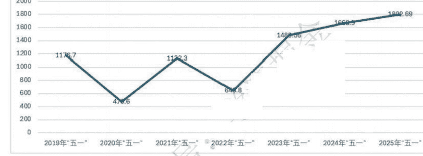
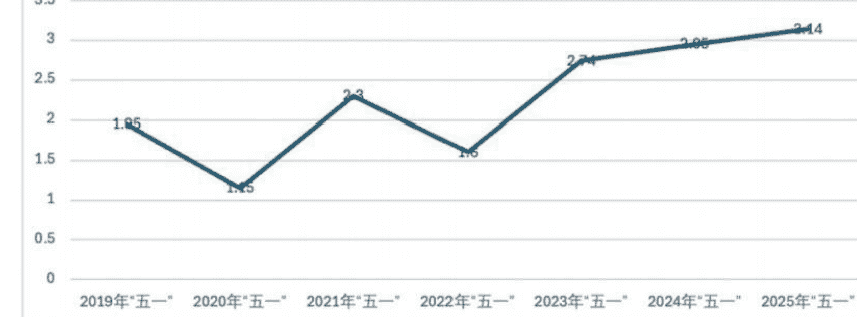
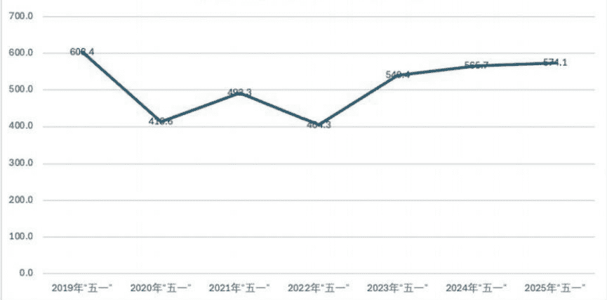
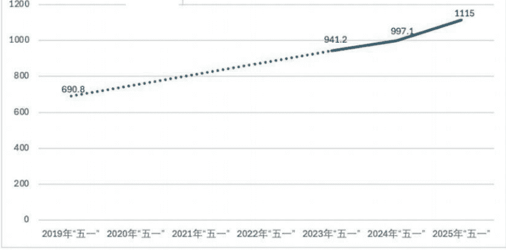
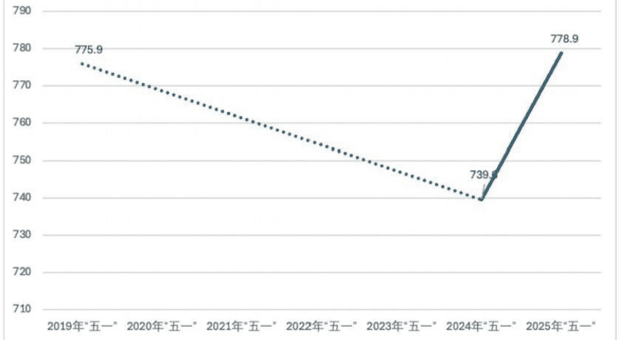

# 对于五一消费数据的研究，消费者的钱都哪儿花去了？为什么是航空？

发射，我们对于五一数据的一些研究。

首先，关于五一的总消费数据。

2019年以来，数据如下。其中2020年和22年受到疫情影响。

排除掉两年之后，总消费数量稳健提升。

从23年到25年，年化增长在10%左右。超过了GDP增速。

## 五一假期期间国内游客总消费费（亿元）

这意味着，旅游这个生意，是一个超出社会平均增长的一个好生意。

这是我们之前比较喜欢的相关股票的。港股曾经持有华住、携程，A股持有过宋演艺、22年喜欢买酒店股等。

但是，我们发现了一个问题。

## 五一假期全国国内出游（亿次）

五一出行消费增加，主要依靠人次的增加，而不是单价的增长。

2019年平均每个游客消费608元。

2025年平均每个游客消费574.1元。

23年到25年有缓慢的提升，整整过去的六年，单人的人均消费反而下降。

## 五一期间国内游客人平均花费（元）

单消费水平，直接影响市场的内涵程度。这意味着，每个市场是非常的。虽然行业在增长的，但企业未能能够赚钱。

那么，旅游出行中，哪些地方容易费钱？答案是交通。

因为交通工具，具有非常严格的供给。

以铁路和航空为例，在某一个节点，都是供给相当合理的。比如航空，飞机和航空公司，其都是限制。

## 民航客运量累计（万人次）

我们看一下民航数据，19年是690.8万，现在是1115万，增长了61.4%。相对去年增长了11.5%。

我们假设，民航每年保持10%的增速。那么，航空的约束，也即飞机，也需要保持10%的增速，才会达到某个平衡。

但由于本次政策爆发，很显然，一旦停止吸收政策，我们未来飞机增量会受到明显的影响。

受到影响的直接就是股票。如果飞机价格出现了上涨，那么则可以认为我们的假设的成立了。

## 经济舱平均售价（元）

结束，今年经济舱平均售价确实出现了明显的上涨。幅度为5.3%。相对于19年的五一，价格也稍微上涨。

大家不要觉得这个幅度并不大。相对于人均消费的增加来说，已经很大了。毕竟，现在在人均消费只恢复到19年的94%。

就是说，在人均消费的情况下，消费者在飞机上的反占比又提高了。这意味着，整个旅游的利润，却是许多细分了。

考虑到停止接收消费的影响刚刚开始，预计今年中国将会出现更加明显的民运匮缺。

在这个时候，消费者会更加考虑廉价的航空。同时，在精细化运营之中占有优势的航空企业，将会容易可见的拿到更多的利润。

这就是，我们没有选择航空公司，也没有选择旅游景区机票而选择了航空的原因。

我们愿意寻找优秀的航空公司，一年的时间，来证明我们的逻辑，以及以证明他们的优秀的。

这篇文章，也是我们长期消费选题思路的分享。希望能够让大家理解我们，以及对大家的投资有有所帮助。

# 免费 价值 及时 专注

# 扫码加入 知识星球TOP 免费资源群

- 每日免费获取有价值资源
- 可提供各类资源搜索服务

公众号:知识星球TOP 微信号:jntsg8 微信号:jntsg2

分享资料仅供个人学习，请及时删除，切勿商用传播
