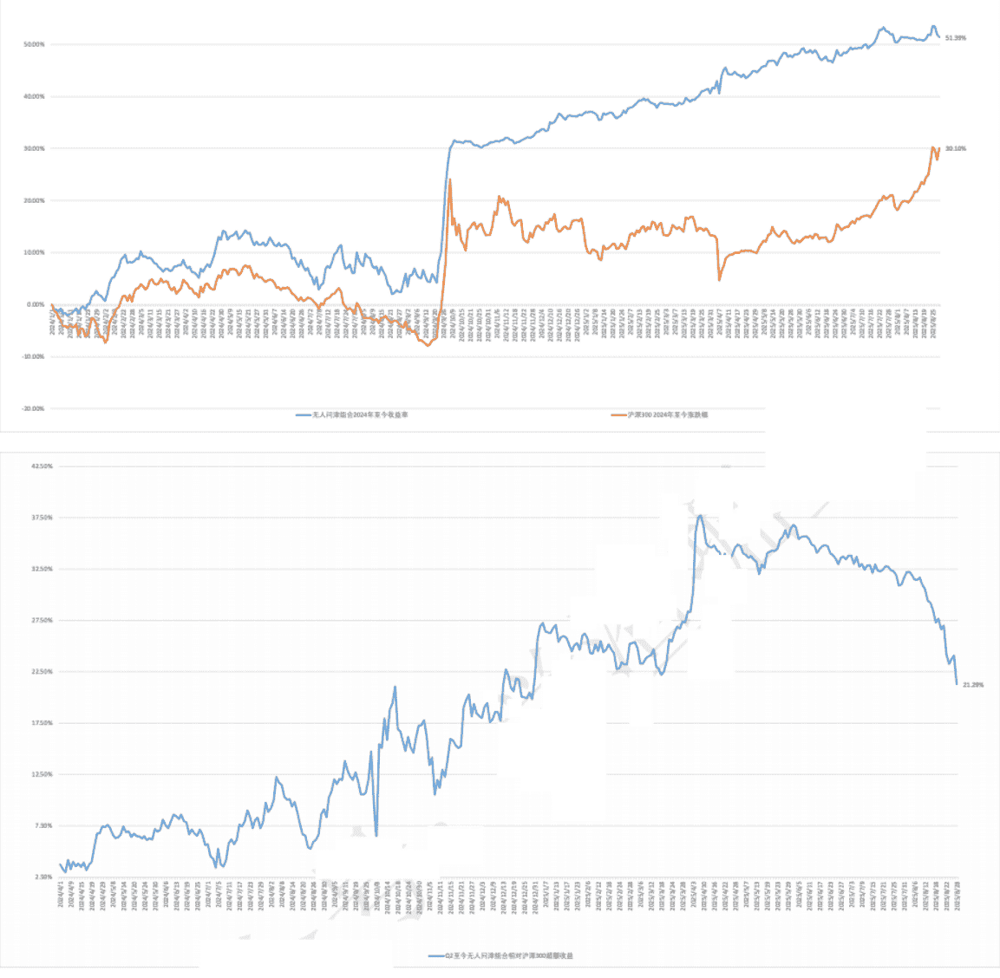
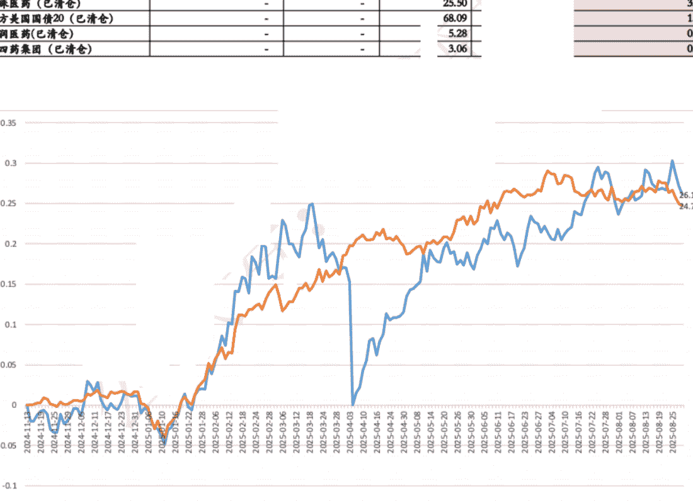

# 1、“买在无人问津时”长线组合

## 1) 收益情况

| 2025/8/28 | 成立至今涨跌幅 | 2025年至今 | 2024年至今 | 八月涨幅 | 今日涨幅 |
|---|---|---|---|---|--|
| 实在无人问津时(成立2016.12.21) | 410.31% | 10.81% | 51.39% | 0.62% | -0.34% |
| 沪深300 | 34.90% | 13.44% | 30.10% | 9.52% | 1.77% |

## 2) 组合持仓与仓

| 2025/8/28 | 沪深指数(亿化) | 权重(%) | 实际仓位(%) | 今日涨幅(%) | 24年至今涨幅(%) |
|---|---|---|---|---|--|
| 实在无人问津 | | | 100.00 | -0.34 | 5.3 |
| 30年沪深ETF | 185 | 25.62 | 109.63 | -0.77 | -1.02 |
| 中国保险 | 326 | 5.00 | 58.31 | -0.35 | 4.70 |
| 中国银行 | 994 | 4.99 | 109.16 | 0.16 | -0.04 |
| 安交证券 | 528 | 4.94 | 52.05 | 0.00 | 3.17 |
| 医药 | 477 | 3.71 | 71.24 | 1.20 | 3.07 |
| 贵州银行 | 217 | 3.77 | 75.12 | -0.90 | -1.39 |
| 长电 | 1467 | 4.56 | 9.08 | -0.17 | 0.77 |
| 招商 | 410 | 4.51 | 51.43 | -0.45 | -0.23 |
| 贵州啤酒 | 266 | 4.40 | 56.50 | -0.34 | -2.55 |
| 广发基金 | 165 | 4.25 | 23.08 | -0.34 | -5.19 |
| 中信邮 | 206 | 4.23 | 22.31 | -0.06 | -7.71 |
| 中国电子 | 1705 | 4.18 | 9.73 | -0.44 | -7.19 |
| 海洋石油 | 254 | 4.16 | 13.11 | 0.16 | 5.16 |
| 华夏 | 89 | 4.02 | 13.24 | 0.37 | 3.70 |
| 天力电力 | 6691 | 3.99 | 27.89 | -0.32 | -0.07 |
| 顺丰 | 495 | 3.97 | 64.64 | -0.86 | 3.17 |
| 天顺医药 | 2229 | 3.87 | 15.52 | -0.52 | -2.06 |
| 京信 | 741 | 3.82 | | 40.22 | -0.35 | -2.06 |
| 大天(亿化) | | | 87.60 | | 32.05 |
| 健康医药(亿化) | | | 77.00 | | 27.00 |
| 医药健康(亿化) | | | 18.26 | | 25.81 |
| 贵州(亿化) | | | 37.07 | | 24.10 |
| 长江(亿化) | | | 9.55 | | 17.30 |
| 吉比特(亿化) | | | 210.89 | | 17.28 |
| 创业板ETF(亿化) | | | 13.78 | | 16.33 |
| 中信(亿化) | | | 29.83 | | 15.30 |
| 中国保险(亿化) | | | 21.48 | | 11.48 |
| 国民运(亿化) | | | 14.45 | | 11.18 |
| 中华(亿化) | | | 7.42 | | 9.70 |
| 30年沪深ETF(亿化) | | | 112.76 | | 9.93 |
| 农业(亿化) | | | 23.68 | | 0.32 |
| 世信(亿化) | | | 18.03 | | 8.27 |
| 海康家(亿化) | | | 28.20 | | 6.42 |
| 银行(亿化) | | | 22.10 | | 6.20 |
| 国电海南(亿化) | | | 22.46 | | 5.81 |
| 中信建(亿化) | | | 109.44 | | -5.24 |
| 万丰京(亿化) | | | 70.05 | | -17.77 |

# 3）相对沪深 300 的超额收益

###、“在无人问津时”长线组合
注：部分公司因为分红而成本降低。

| 2023/8/28 | 煤行业（亿吨） | 仓位价格 | 今日涨幅(%) | 24年至今产量(%) |
|---|---|---|---|---|
| 原煤产量 | 100.00 | -0.20 | 24.72 |
| 煤炭进口 | 12 | 19.61 | 64.43 | 1.85 |
| 澳洲煤进口 | 60 | 15.10 | 1.51 | -7.81 |
| 中南煤 | 175 | 10.32 | 5.19 | 8.12 |
| 陕西煤 | 897 | 5.63 | 24.70 | -0.43 | 11.98 |
| 山西硫矿 | 273 | 5.10 | 11.38 | -1.81 | -0.09 |
| 黑蒙古 | 777 | 4.82 | 101.70 | -1.21 | -3.81 |
| 进口煤 | 250 | 4.45 | 18.88 | -1.59 | -4.46 |
| 动力煤 | 930 | 5.54 | 15.74 | -0.68 | 14.57 |
| 动力气 | 441 | 3.86 | 23.20 | -1.80 | -17.89 |
| 中亚矿 | 194 | 0.99 | -4.85 | 157.54 |
| 进口 | 12.75 | | | 49.52 |
| 俄罗斯煤 | | | 27.05 | | 28.90 |
| 哈萨克煤 | | | 9.94 | | 27.57 |
| 哥伦比亚煤 | | | 15.36 | | 24.22 |
| 中国南煤 | | | 82.55 | | 23.07 |
| 缅甸煤 | | | 395.72 | | 21.76 |
| 澳洲煤 | | | 414.60 | | 19.22 |
| 土耳煤 | | | 69.70 | | 9.55 |
| 蒙古煤 | | | 6.10 | | 5.74 |
| 万国煤 | | | 5.87 | | 4.43 |
| 南非煤 | | | 4.23 | | 4.33 |
| 刚果煤 | | | 5.33 | | 1.27 |
| 俄罗斯煤 | | | 25.50 | | 3.73 |
| 南亚国际煤 | | | 68.09 | | 1.89 |
| 国际煤 | | | 3.28 | | 0.88 |
| 鄂矿焦炭 | | | 3.06 | | 0.82 |

加微信ntsg2，进资料分享群

# # 知识星球
# 付费资源分享群

添加微信
免费入群
微信:ntsg2

| 序号 | 公号/星球/社群 | 原价 | 领域 |
|---|---|---|---|
| 1 | 生业有木 | 2765/年 | 副业、搞钱 |
| 2 | 尝容吃瓜群 | 365/年 | 时政、历史 |
| 3 | 记忆Legacy/骏树西风 | 365元/年 | 成长、搞钱 |
| 4 | 欧洲金靴 | 328元/年 | 时政、历史 |
| 5 | 卢克文青会 | 699/年 | 时政、社会 |
| 6 | 体制内主任 | 599/年 | 体制、职场 |
| 7 | 外局人的视角 | 669元/年 | 金融、时政 |
| 8 | 灏泽异谈 | 4166/年 | 财富、成长 |
| 9 | 守护夜司令 | 599/年 | 时政、经济 |
| 10 | 江宁知府 | 365/篇 | 时政、国际 |
| 11 | 政堂/顾子子 | 568/年 | 时政、经济 |
| 12 | 唐书院 | 1399/篇 | 金融、财富 |
| 13 | 大树乡谈 | 199/年 | 时政、成长 |
| 14 | 水库欧大 | 10000远 | 房产、经济 |
| 15 | 洪灏的宏观策略 | 4376/年 | 经济、搞钱 |
| 16 | 金政通鉴/北海道南山 | 4576/年 | 股票、行研 |
| 17 | 猫豹的世界 | 299/年 | 时政、社会 |
| 18 | 飞沫王 | 3600/年 | 股市、经济 |
| 19 | 米联视间 | 599/年 | 经济、金融 |
| 20 | 鉴茶财经院 | 330/年 | 房产、股票 |
| 21 | 赢在八小时之外 | 365元/年 | 成长、职场 |

