# 2025-08-28 股票市场。（数据部分）

微信:jntsg8
微信:jntsg2

2025年08月28日 20:29

## 1. 整体情况

市场后V型反弹，创业板涨近14%，个股涨数7，沪深全市成交量29.77万，较上个交易日增量1948亿。盘面上，市场热点集中在权重和活跃品种，个股涨跌多少，全市场涨2800个涨股，截至收盘，沪顾涨1.14%，创业指涨2.25%，创业板涨3.82%。

### 1) 行情回顾

| 时间 | 当日涨幅数量 | 涨幅（同指数） | 当日跌幅数量 | 跌幅（同指数） | 中位数涨幅 | 中位数跌幅 | 平均涨幅（同指数） | 平均跌幅（同指数） | 中间涨幅（同指数） | 万得A等指数当日涨幅 |
|---|---|---|---|---|---|---|---|---|---|---|
| 2025/08/27 | 633 | -2171 | 4764 | 2294 | -2.85 | -2.99 | -2.35 | -2.59 | - | -1.74 |
| 2025/08/28 | 2868 | 2235 | 4402 | 2362 | 0.18 | 3.01 | 0.69 | 3.04 | 1.58 | 3.82 |

### 2) 截至当日，24年以来个股情况

| 时间 | 上涨股票数量 | 上涨幅（同指数） | 下跌股票数量 | 下跌幅（同指数） | 股票平均涨幅 | 股票平均跌幅 | 中间涨幅（同指数） | 中间跌幅（同指数） | 万得A指数 |
|---|---|---|---|---|---|---|---|---|---|
| 2025/08/27 | 3816 | -156 | 1542 | 158 | 32.57% | -2.96% | 17.07% | -2.90% | |
| 2025/08/28 | 3832 | 16 | 1524 | 18 | 33.80% | 1.23% | 17.67% | 0.60% | |

### 3) 全A指数

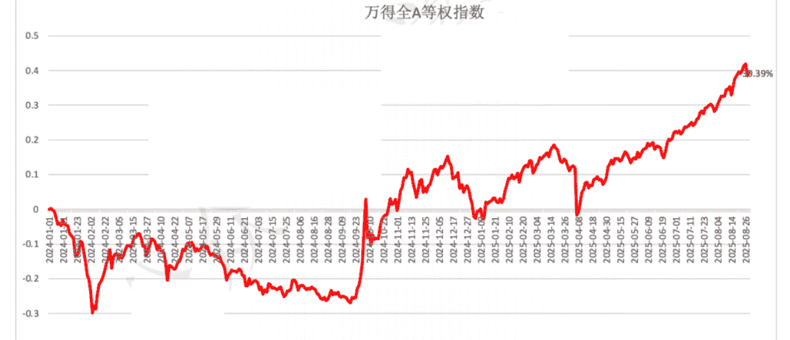

### 4) 脱水300指数

加微信jntsg2，进资料分享群

### 5) 迷你指数

### 6) 出售指数

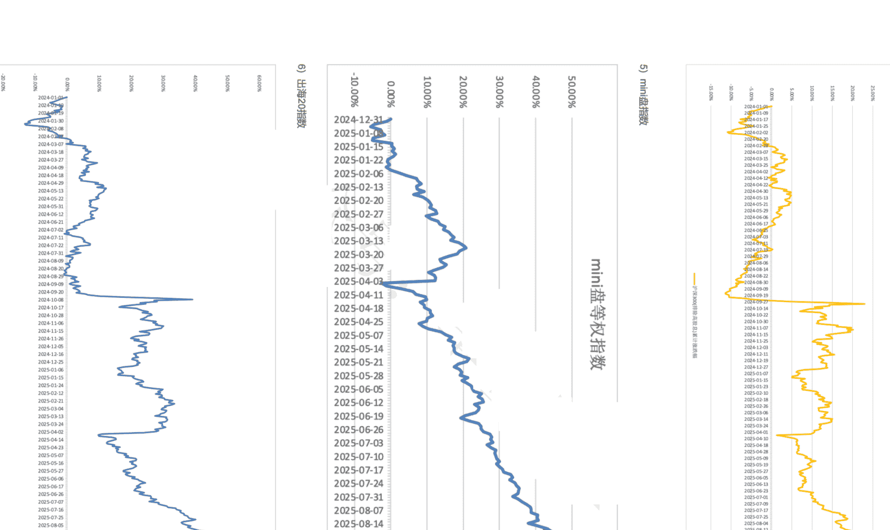

加微信jntsg2，进资料分享群

### 7) 红利20指数

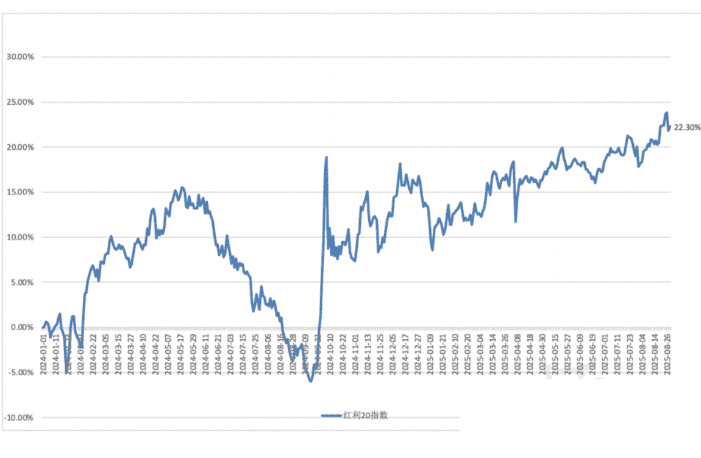

### 8) 降息20指数

降息20

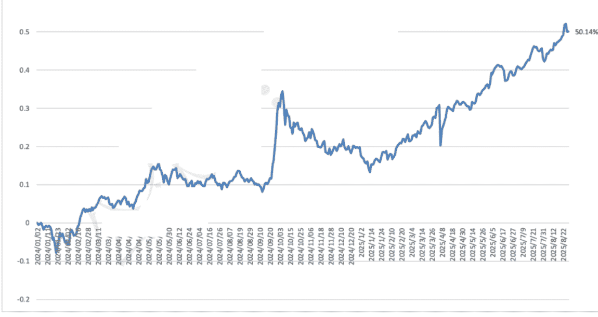

## 2. 热点一

### 1) 高股息

| 股票代码 | 简称 | 市值(亿元) | 股息(%) | 股息排名 | 幅(%) | 成交额(亿元) | 连续涨跌天数 |
|---|---|---|---|---|---|---|---|
| --- | --- | | | | | | |
| 600555.SH | 长寿电力 | | 57.52 | 42.9 | 1 | 10.00 | 0.09 |
| 600250.SH | 天信 | | 55.72 | 40.5 | 2 | 10.00 | 0.58 |
| 600999.SH | 宁波银行 | | 26.91 | 13.18 | 3 | 10.00 | 0.46 |
| 601668.SH | 中信邮政 | | 115.1 | 11.5 | 4 | 10.00 | 4.5 |
| 601999.SH | 华夏银行 | | 43.5 | 9.9 | 5 | 10.00 | 4.3 |
| 600036.SH | 招商银行 | | 997.51 | 8.8 | 6 | 10.00 | 10.8 |
| 600548.SH | 长江电力 | | 431.09 | 8.5 | 7 | 10.00 | 1.12 |
| 600019.SH | 宁海股份 | | 355.6 | 7.8 | 8 | 10.00 | 1.15 |
| 603893.SH | 华润电力 | | 237.16 | 7.5 | 9 | 10.00 | 6.28 |
| 600052.SH | 长安电力 | | 125.49 | 6.3 | 10 | 10.01 | 8.35 |

### 2) 降息率分析

加入微信jntsg2，进阶资料群

| 日期 | 证券名称 | 成交额(亿元) | 振幅(%) | 换手率 | 成交额(亿元) | 成交量(万手) |
|---|---|---|---|---|---|---|
| 2023/03/28 | 中国银行 | 118.54 | 16.26 | 9.97 | 177.33 | 5 |
| 2023/03/27 | 招华银行 | 121.89 | 18.2 | 10.26 | 119.86 | 7 |
| 2023/03/26 | 工商银行 | 125.33 | 19.51 | 10.00 | 105.15 | 6 |
| 2023/03/25 | 华泰 | 666.38 | 28.2 | 10.01 | 93.92 | 1 |
| 2023/03/24 | 中信证券 | 997.51 | 33.58 | 10.00 | 85.13 | 2 |
| 2023/03/23 | 招商银行 | 893.94 | 79.04 | 10.00 | 67.29 | 2 |
| 2023/03/22 | 万科银行 | 255.58 | 13.52 | 10.01 | 42.45 | 1 |
| 2023/03/21 | 平安保险 | 233.16 | 15.12 | 10.01 | 39.68 | 1 |
| 2023/03/20 | 平华银行 | 123.93 | 18.45 | 10.00 | 28.36 | 3 |

## 3. 趋势主导

- 1) 指数成交占比

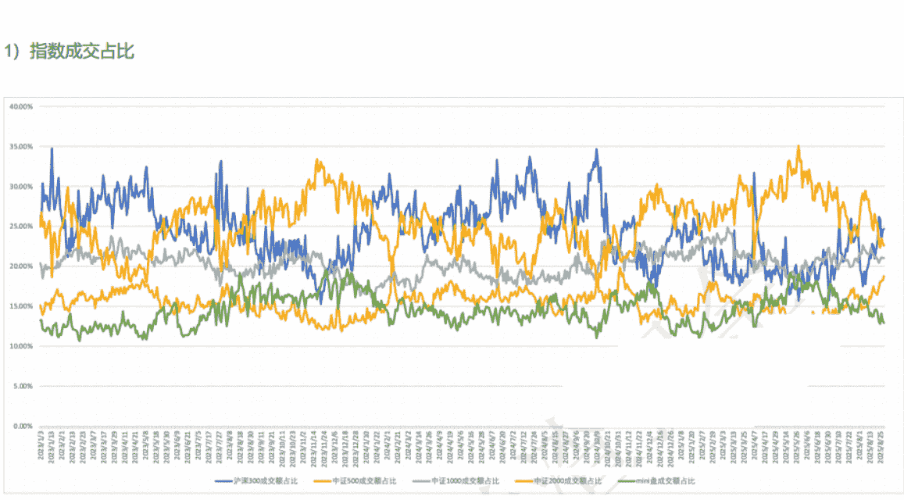

- 2) TMT和红利低波成交占比

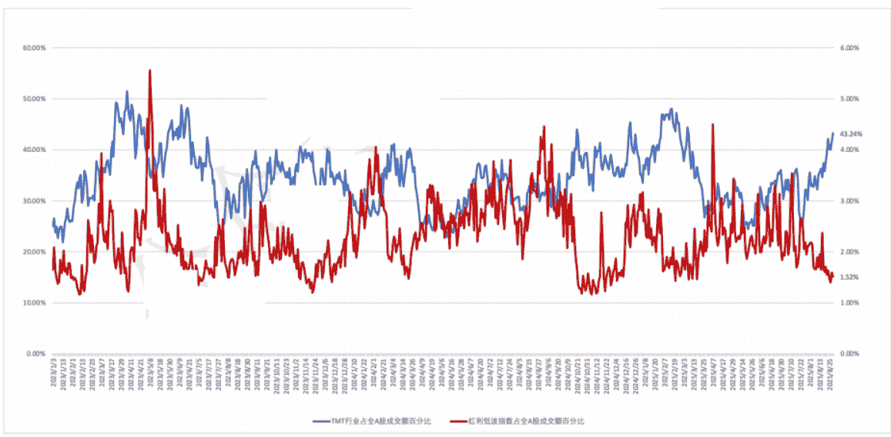

## 4.沪深300指数期货波动率

加微信jntsg2，进资料分享群

## 5. 杠杆与利率

### 1) 融资资金

| 数据日期 | 数值 |
|---|---|
| 2023/06/27 | 20,123.74 |
| 新增一期(亿元) | - |
| 累计融资额(亿元) | 5,833.45 |

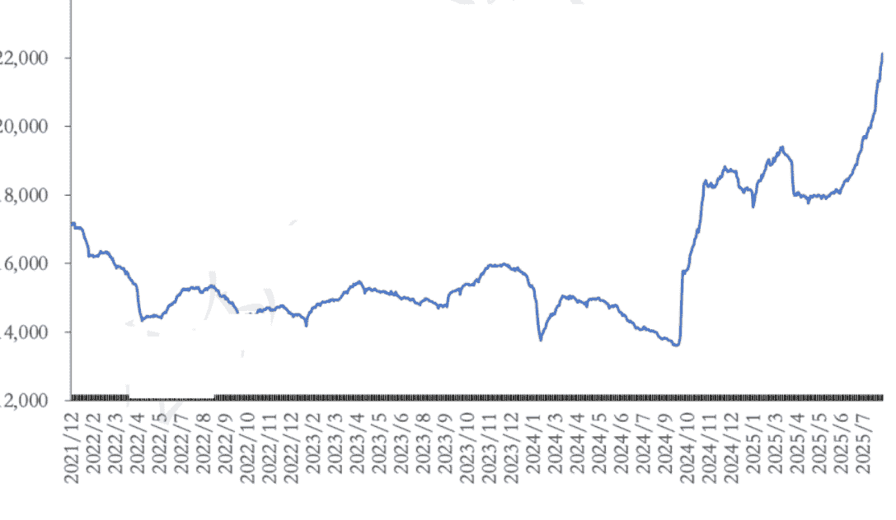

### 2) 十年收益

### 3) 期权策略

### 4) 保证金

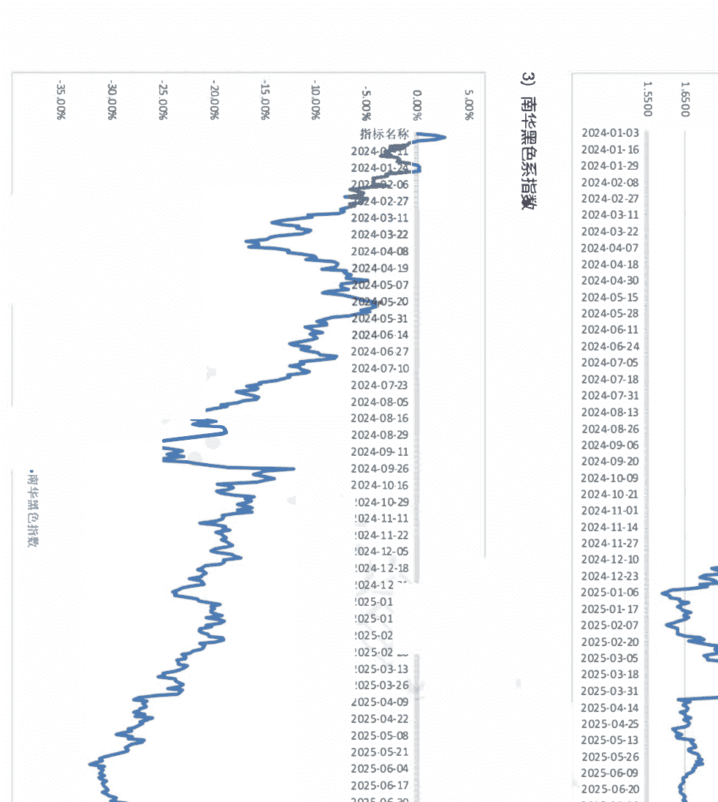

| 2024-04-01 |
| 2024-04-03 |
| 2024-04-06 |
| 2024-04-08 |
| 2024-04-11 |
| 2024-04-13 |
| 2024-04-15 |
| 2024-04-18 |
| 2024-04-20 |
| 2024-04-23 |
| 2024-04-25 |
| 2024-04-27 |
| 2024-04-30 |
| 2024-05-02 |
| 2024-05-06 |
| 2024-05-07 |
| 2024-05-09 |
| 2024-05-13 |
| 2024-05-14 |
| 2024-05-16 |
| 2024-05-17 |
| 2024-05-20 |
| 2024-05-21 |
| 2024-05-23 |
| 2024-05-24 |
| 2024-05-28 |
| 2024-05-29 |
| 2024-05-31 |
| 2024-06-03 |
| 2024-06-04 |
| 2024-06-06 |
| 2024-06-07 |
| 2024-06-11 |
| 2024-06-12 |
| 2024-06-13 |
| 2024-06-14 |
| 2024-06-18 |
| 2024-06-19 |
| 2024-06-21 |
| 2024-06-25 |
| 2024-06-26 |
| 2024-06-27 |
| 2024-06-28 |
| 2024-07-01 |
| 2024-07-02 |
| 2024-07-04 |
| 2024-07-05 |
| 2024-07-08 |
| 2024-07-09 |
| 2024-07-11 |
| 2024-07-12 |
| 2024-07-15 |
| 2024-07-16 |
| 2024-07-18 |
| 2024-07-19 |
| 2024-07-22 |
| 2024-07-23 |
| 2024-07-25 |
| 2024-07-26 |
| 2024-07-29 |
| 2024-07-30 |
| 2024-08-01 |
| 2024-08-02 |
| 2024-08-05 |
| 2024-08-06 |
| 2024-08-08 |
| 2024-08-09 |
| 2024-08-12 |
| 2024-08-13 |
| 2024-08-15 |
| 2024-08-16 |
| 2024-08-19 |
| 2024-08-20 |
| 2024-08-22 |
| 2024-08-23 |
| 2024-08-26 |
| 2024-08-27 |
| 2024-08-29 |

中国10年期权收益率

加微信jntsg2，资料分享群

| 日期 | 营业收入(亿元) | 净利润(亿元) | 现金流量(亿元) |
|---|---|---|---|
| 2022/4/1 | 50.58 | 6.31 | |
| 2022/4/2 | 47.29 | 31.24 | 45.90 |
| 2022/4/3 | 39.19 | 18.58 | 82.43 |
| 2022/4/4 | 55.17 | 20.88 | 74.30 |
| 2022/4/5 | 27.66 | 50.23 | 106.25 |
| 2022/4/6 | 71.04 | 20.81 | 121.57 |
| 2022/4/7 | 33.12 | 3.43 | 50.21 |
| 2022/4/8 | -48.59 | -35.36 | -62.34 |
| 2022/4/9 | -23.44 | -29.62 | -12.83 |
| 2022/4/10 | 14.11 | 29.63 | 68.05 |
| 2022/4/11 | 54.99 | 34.71 | 36.75 |
| 2022/4/12 | -30.22 | -19.29 | -13.68 |
| 2022/4/13 | 33.58 | -14.33 | -10.73 |
| 2022/4/14 | 43.30 | -24.03 | -92.16 |
| 2022/4/15 | 25.13 | -8.55 | -10.63 |
| 2022/4/16 | 0.51 | 4.16 | 13.42 |
| 2022/4/17 | -20.99 | -5.74 | -19.78 |
| 2022/4/18 | 9.46 | -14.62 | 14.39 |
| 2022/4/19 | 31.88 | -11.24 | 19.78 |
| 2022/4/20 | -23.84 | -6.89 | 18.51 |
| 2022/4/21 | 29.68 | -16.95 | 18.51 |
| 2022/4/22 | -51.99 | -28.08 | 0.13 |
| 2022/4/23 | -0.09 | -3.88 | 4.00 |
| 2022/4/24 | 38.30 | -14.74 | 34.38 |
| 2022/4/25 | -20.61 | -17.83 | 5.51 |
| 2022/4/26 | 31.83 | -14.08 | 14.01 |
| 2022/4/27 | 45.20 | -13.74 | 10.96 |
| 2022/4/28 | -45.12 | -33.74 | 9.67 |
| 2022/4/29 | -33.40 | -19.56 | -9.90 |
| 2022/4/30 | -33.13 | -18.56 | 72.68 |
| 2022/5/1 | -55.25 | -24.83 | -67.84 |
| 2022/5/2 | 27.73 | -2.73 | 31.33 |
| 2022/5/3 | -51.99 | -28.08 | -26.09 |
| 2022/5/4 | 22.26 | -11.53 | 20.21 |
| 2022/5/5 | -22.26 | -10.73 | 11.53 |
| 2022/5/6 | 28.58 | 10.51 | 20.24 |
| 2022/5/7 | 16.20 | 15.85 | 2.02 |
| 2022/5/8 | 31.12 | 0.35 | 41.34 |
| 2022/5/9 | -30.11 | -14.84 | 3.64 |
| 2022/5/10 | -13.00 | -8.16 | 3.46 |
| 2022/5/11 | 40.12 | -27.77 | 69.78 |
| 2022/5/12 | -40.27 | -28.17 | 8.50 |
| 2022/5/13 | 22.19 | -11.52 | 27.76 |
| 2022/5/14 | -22.16 | -12.64 | 8.32 |
| 2022/5/15 | 27.63 | 10.23 | 10.33 |
| 2022/5/16 | 3.12 | -0.10 | 0.91 |
| 2022/5/17 | -45.12 | -33.68 | -27.71 |
| 2022/5/18 | -68.20 | -31.72 | -36.48 |
| 2022/5/19 | -34.12 | -16.68 | -54.37 |
| 2022/5/20 | -38.36 | -20.63 | -53.53 |
| 2022/5/21 | 44.26 | 10.05 | 54.18 |
| 2022/5/22 | 46.70 | 4.26 | 74.38 |
| 2022/5/23 | 10.92 | 10.87 | 0.58 |
| 2022/5/24 | 33.12 | 10.05 | 1.49 |
| 2022/5/25 | 44.93 | 36.95 | 7.98 |
| 2022/5/26 | 31.33 | 21.78 | 6.86 |
| 2022/5/27 | -10.86 | -23.29 | 2.86 |
| 2022/5/28 | -35.12 | -24.64 | 12.09 |
| 2022/5/29 | -34.72 | -6.50 | -68.09 |
| 2022/5/30 | 22.47 | 19.59 | -7.49 |
| 2022/6/1 | 22.88 | 8.77 | 11.18 |
| 2022/6/2 | 43.35 | 8.92 | 19.12 |
| 2022/6/3 | 0.02 | 20.77 | -20.73 |
| 2022/6/4 | 16.41 | -0.58 | -7.42 |
| 2022/6/5 | 16.81 | 19.98 | -13.23 |
| 2022/6/6 | -21.54 | -17.55 | -37.11 |
| 2022/6/7 | 22.56 | 40.35 | 70.95 |
| 2022/6/8 | 62.91 | 22.56 | 44.61 |
| 2022/6/9 | -16.73 | -34.18 | 12.27 |
| 2022/6/10 | -33.16 | -48.11 | -13.97 |
| 2022/6/11 | -7.88 | -5.91 | -3.10 |
| 2022/6/12 | -10.48 | -4.98 | 25.48 |
| 2022/6/13 | 10.31 | 24.10 | 27.27 |
| 2022/6/14 | -7.18 | 8.47 | -7.44 |
| 2022/6/15 | -10.54 | 10.13 | 7.74 |
| 2022/6/16 | -25.78 | -21.11 | 53.39 |
| 2022/6/17 | -39.12 | -19.54 | -26.01 |
| 2022/6/18 | -68.20 | -31.72 | -36.48 |
| 2022/6/19 | -34.12 | -16.68 | -54.37 |
| 2022/6/20 | -38.36 | -20.63 | -53.53 |
| 2022/6/21 | 44.26 | 10.05 | 54.18 |
| 2022/6/22 | 46.70 | 4.26 | 74.38 |
| 2022/6/23 | 10.92 | 10.87 | 0.58 |
| 2022/6/24 | 33.12 | 10.05 | 1.49 |
| 2022/6/25 | 44.93 | 36.95 | 7.98 |
| 2022/6/26 | 31.33 | 21.78 | 6.86 |
| 2022/6/27 | -10.86 | -23.29 | 2.86 |
| 2022/6/28 | -35.12 | -24.64 | 12.09 |
| 2022/6/29 | -34.72 | -6.50 | -68.09 |
| 2022/6/30 | 22.47 | 19.59 | -7.49 |

## 5) 市场（沪深圳）成交变化

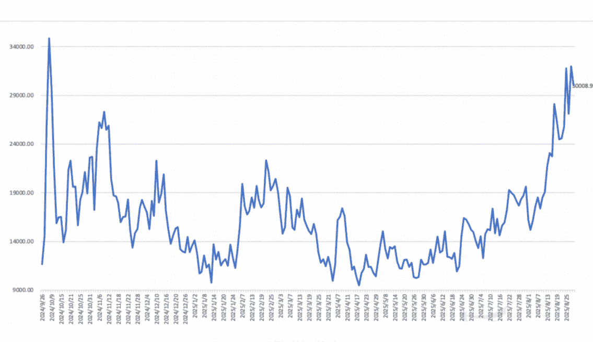

## 6) 市值20亿以下股票的趋势图

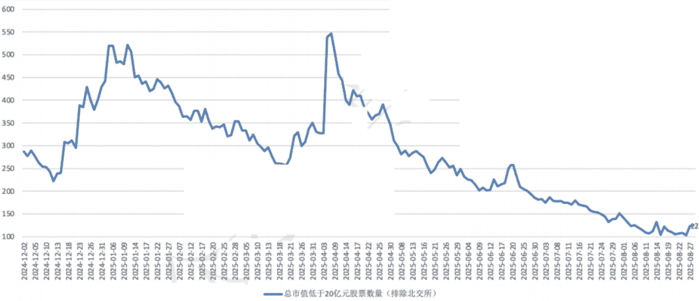

## 7) 南向资金趋势图

加微信jntsg2，进资料分享群

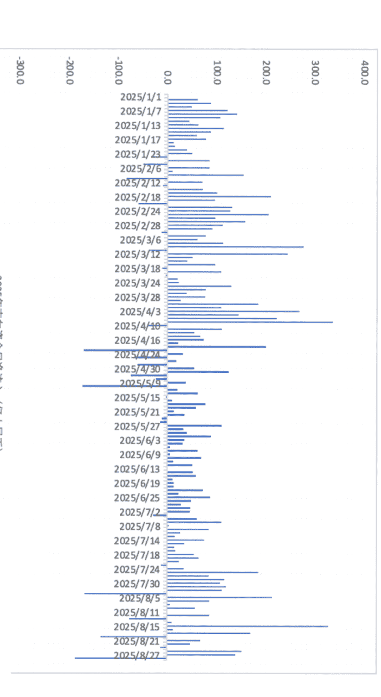

加微信jntsg2，进资料分享群

## 知识星球TOP 付费资源分享群 添加微信免费入群

| 序号 | 公号/星球/社群 | 原价 | 领域 |
|---|---|---|---|
| 1 | 生态有木 | 2765/年 | 副业, 搞钱 |
| 2 | 怂冗众吃瓜群 | 365/年 | 时政, 历史 |
| 3 | 记忆承载/雯树西风 | 365元/年 | 成长, 搞钱 |
| 4 | 欧洲金靴 | 328元/年 | 时政, 历史 |
| 5 | 卢克文克青会 | 699/年 | 时政, 社会 |
| 6 | 体制内主任 | 599/年 | 体制; 职场 |
| 7 | 外人的视角 | 669元/年 | 金融, 时政 |
| 8 | 灏择异谈 | 4166/年 | 财富, 成长 |
| 9 | 守夜人总令 | 599/年 | 时政, 经济 |
| 10 | 江宁知府 | 365/篇 | 时政, 国际 |
| 11 | 政堂/顾子明 | 568/年 | 时政, 经济 |
| 12 | 唐书院 | 1399/篇 | 金融, 财富 |
| 13 | 大树乡谈 | 199/年 | 时政, 成长 |
| 14 | 水犀欧大 | 10000远 | 房产, 经济 |
| 15 | 洪灏的宏观策略 | 4376/年 | 经济, 搞钱 |
| 16 | 金政通鉴/北海道山 | 4576/年 | 股票, 行研 |
| 17 | 猫留的世界 | 299/年 | 时政, 社会 |
| 18 | 飞沫 | 3600/年 | 股市, 经济 |
| 19 | 米联储见闻 | 599/年 | 经济, 金融 |
| 20 | 鉴茶财经院 | 330/年 | 房产, 股票 |
| 21 | 赢在八小时之外 | 365元/年 | 成长, 职场 |
| ... | ... | 更多资源，不再列举 |

- 图书、报告、课程等各类高价值资源
- ★ 免费群 每日分享资源
- ★ VIP群 每日分享所有资源（日均20+），75/年

## TOP级资源 TOP社群
