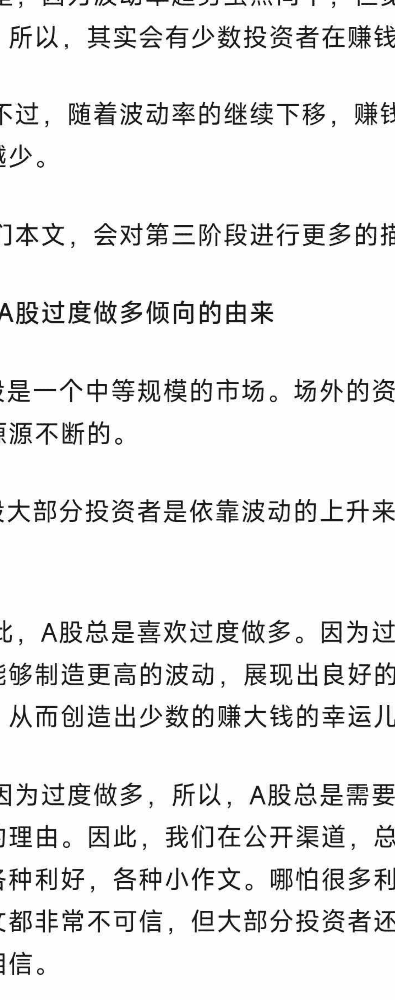
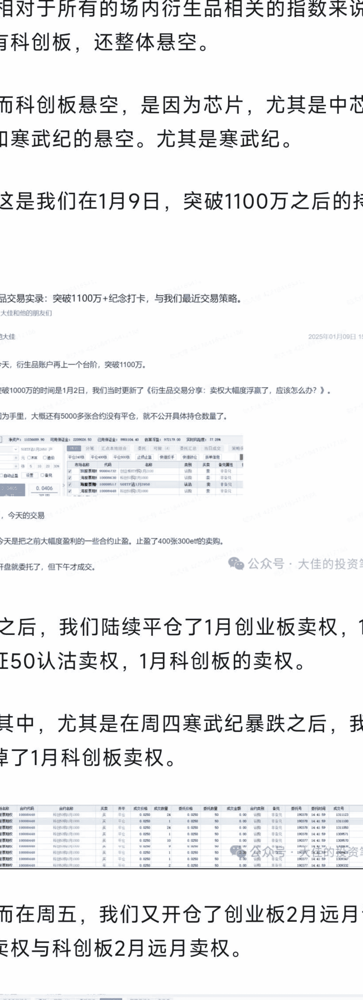

# 如何用滚球增长资金？从60万到110万的富程之路

作者：大象的捧哥 发布于2023年01月18日 13:22

本文5500字，共分为五个部分：

- 1) 资产增长逻辑
- 2) 滚球策略
- 3) 资产是如何越来越多滚起来的
- 4) 从60万到110万的跨越
- 5) 对于资产增长的我的建议

前言：

很多人在赚钱的时候，却不会省钱。财富的积累，不是靠赚，而是靠省。越省越攒越快。

很多人在有钱以后，却没有学会滚球。滚球，就是利用利滚效应。

## 一 资产增长逻辑

在资产增长的初期，我们要记住，资产增长是不均匀的。越早期，增长的速度越慢，等到资金越多，增长的速度就越快。

在资产增长的初期，我们要学会耐心。在这个阶段，资产的增长速度非常慢，很多人在这里就会放弃了，这往往是失败的开始。

但是在资金增长后期，给你的回报是非常惊人的。这时候，资产增长的速度会大到让你难以相信。

这种模式就是复利效应。资金越多，滚球的速度越快。只要你坚持下去，时间越长，资产增长的速度就会翻倍。

## 二 滚球策略

滚球，就是学会等待。在资金增长的过程中等待。

大体，可以分为三个阶段：

第一阶段是在90万之前，从60万滚到90万的过程，这是一个最枯燥的阶段。

第二阶段，是从90万到105万的过程，这时候你会发现增长快了。

第三阶段，是从105万到110万的过程，这时候大部分人都在飞了。

但是，滚球并不是均匀的。越早期，增长的速度越慢，越后期，增长的速度越快。很多人在早期就会放弃，这也是滚球的难度所在。

在这个过程中，你需要一个目标。为了保证自己能够坚持下去，你需要给自己设定一个目标。这就是坚持下去的动力。

为了基金，于价值，现在是机会。

### 第二波：重大回调与大反弹

10月18日后，股市开始反弹，有望迎来一次大涨。

在此之后，还有两次反弹。

10月18日后，股市在11月之前将迎来调整。

事实上，10月18日指数跌至3242点，在11月中旬跌破3200点支撑。

在过程中，市场发生了剧震，又迎来一次反弹。

### 第三波：筑底与反弹

12月初，股市继续下跌，随后开始筑底。

第一底部，基本在3200点附近。

第二底部，则在3150点附近，并开始。

对于每个投资者来说，我们要关注的底部，尤其是12月，成交量萎缩，此时的情绪极度低迷，是布局的好机会。

但是，由于资金外流，股市必然迎来大跌。

最后，在12月26日股市企底，这一天以后不再下跌。

在这里，我们不仅赚了钱，我们还赚了500点，赚了一个翻倍。

第三波结束之后，我们将以基金来操作为主。

### 为什么要选基金呢？

相对于于场内各种股票的收益，只有基金，整体性更好。

# 免费 价值 及时 专注

# 扫码加入 知识星球TOP 免费资源群

- 每日免费获取价值资源
- 可提供各类资源搜索服务

公众号:知识星球TOP 微信号:jntsg8 微信号:jntsg22

分享资料仅供个人学习，请及时删除，切勿商用传播
