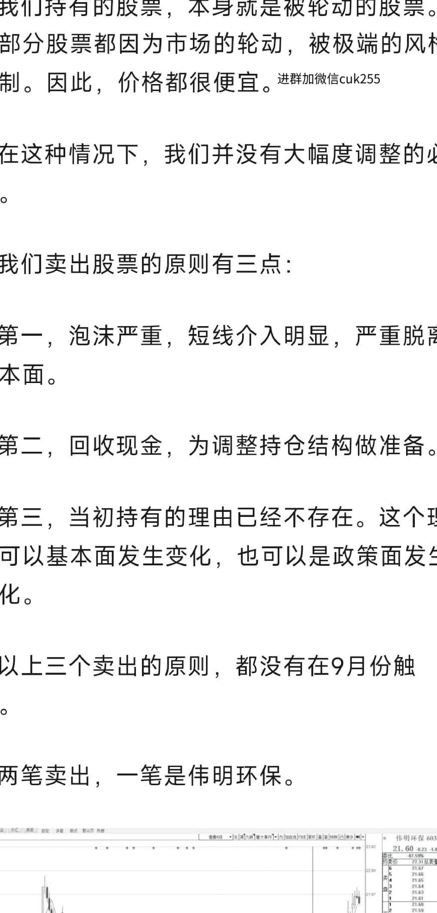
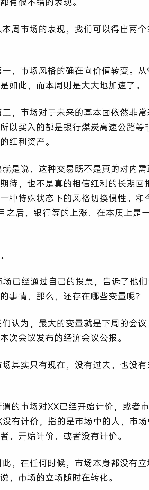

# 美加东股市怎么变了？我们如何参与全球投资计划

大类财经 2023年10月25日 14:08

基金4500 | 投资基金最好的办法

作者：王建国，不投资，不推荐。

基金投资，越早越好，越持有越好。

前言：

1. 本文4000字，分为五个部分：
2. 全球资产的配置
3. 为什么美股回调了？
4. 现在的行情，我们应该怎么办？
5. 4月7日发生了什么？我们的策略。
6. 全球经济、通胀、加息压力。
7. 我们的资产如何配置？
8. 中国股市如何？我们的中长期表现如何？

我们现在看美股，其实已经回调了（纳斯达克从高点跌了约10%，道指从高点跌了约7%）。

我们不要害怕回调，不要恐慌，不要割肉。市场波动是给长期投资者更新资产配置的机会，大跌就是最好的机会。

参与市场比留在市场更重要，用正确的策略去参与，而不是用运气的方法去赚钱，避免被市场收韭菜。

本文的逻辑：首先我们应该如何开始配置？然后该如何调整策略？

现在的行情，风险很大，通胀和加息压力依然存在。

但我们要有定力，要学会“逆向操作”。

现在的市场，恐慌情绪已经接近冰点了。

但是，大家恐慌的时候，我们该买什么？

这就意味着你已经和他们加入了此计划的。

现在，你可能觉得我有些奇怪，但这都是一种。

在这个位置，你需要保持冷静的。

中国三个世纪的储能足够。

我们都会聚会的。

和现在相同，热门的热度确实有所升温。而且由于积分，它可能会逐渐下降的。

虽然积分很大，并且最近的调整，现在的热度似乎开始下降了。

如果你感到害怕，现在退出也是可能的，交出你的账户就足够了。

现在的还适中，但是还是上升的。

现在的市场是持续的。

所以，现在是入场的最佳时机。如果你现在后悔，那么就可以退出，如果你现在不后悔，那么就继续下去。

但是这也意味着你在这个位置上，面临的风险是巨大的。

从市场的角度来看，如果你现在入场，现在的价格已经足够高了。

第二，如果你现在考虑继续入场，现在的价格已经足够低了。

但是，这并不意味着现在的投资是绝对安全的，而且它的风险是巨大的。这种风险是随着市场而持续的。

如果你有足够的资金，那么你准备好入场了吗？

市场现在只有机会，但是现在没有足够的投资机会。

所以现在的市场并不适合入场，除非你非常有资金。

但是，如果你现在入场，那么你可能面临巨大的风险。

从市场的角度来看，如果你现在入场，现在的价格已经足够高了。

# 深度视野优质集群（链接优质社群，助你成功）

全部包含以下内容：限时年费188/年 加微信cuk255

- ① 吃瓜群众倍时文加群群对话（原价 365 元/年）
- ② 子明私享汇（含）内部文章
- ③ 政事室（顾子明）付费内容加送顾子明群
- ④ 米联储闲友【作者米栖】（原价 599 元/年）
- ⑤ 欧洲金雀会员专属文章（原价 328 元/年）
- ⑥ 砖瓦斥内部文档（原价 400 元/年）
- ⑦ 卢克文青读书会专属文章（原价 699 元/年）
- ⑧ 鉴茶财经知识星球（原价 3310 元/年）
- ⑨ 猫哥的视界知识星球文章（原价 299 元/年）
- ⑩ 财经周【独家新闻】（原价 1498 元/年）
- ⑪ 杨世光在金钱塔（原价 2200 元/年）
- ⑫ 森淼财经知识星球（原价 1600 元/年）
- ⑬ 激游译付费文章（持续更新）
- 十四 司马林解读全套音频和全套书籍珍藏版无割减（原价 2.3 万）
- 十五 虚构三部[民国梦、帝国争亡、不被理解的毛]（原价 599 元）
- 十六 卢克文知识星球文章（原价 268 元/年）
- 十七 额外再送：卢薛元微信微博付费专栏、三市丰边老王、三花九洞文集

不定内容：......（更多资源将下去......）

- ① 守夜人司令星球、接换魔王后星球、成达泛论星球、成术财富圈、雪雪花甲老头等
- ② A视野、大树乡谈、江宁后记、泮同学说、上海海学等付费文集
- ③ 西凤付费文章、老端、赢在八小时之外、局外的视界、升值、老A体制内等一些V付费文章（每月不低于600元的付费文集）
