# 2025-10-27 股票市场（数据部分）

## 1. 整体情况

今日A股市震荡上升，沪指高开走涨1%，再创新高，中证突破4000点，沪深两成成交量2.34万亿，较上一个交易日放量3659亿。截至收，沪指涨1.18%，沪深涨1.51%，创业板涨1.98%。

### 1) 行情展望

### 2) 截至当日，24年以来个股情况

| 时间 | 当日上涨数量 | 涨幅（上交易日） | 下跌股票数量 | 跌幅（上交易日） | 中位涨幅 | 跌幅（上交易日） | 平均涨幅 | 跌幅（上交易日） | 中位涨幅 | 跌幅（上交易日） | 万得全当涨幅 | 跌幅（上交易日） |
| :--- | :--- | :--- | :--- | :--- | :--- | :--- | :--- | :--- | :--- | :--- | :--- | :--- |
| 2025/10/24 | 3028 | 14 | 2274 | -28 | 0.28 | -0.08 | 0.73 | 0.57 | | 1.27 | | |
| 2025/10/27 | 3361 | 333 | 1862 | -412 | 0.41 | -0.12 | 1.22 | 0.75 | 18.31 | 19.12 | 1.19 | | |

### 3) 等权A指指数

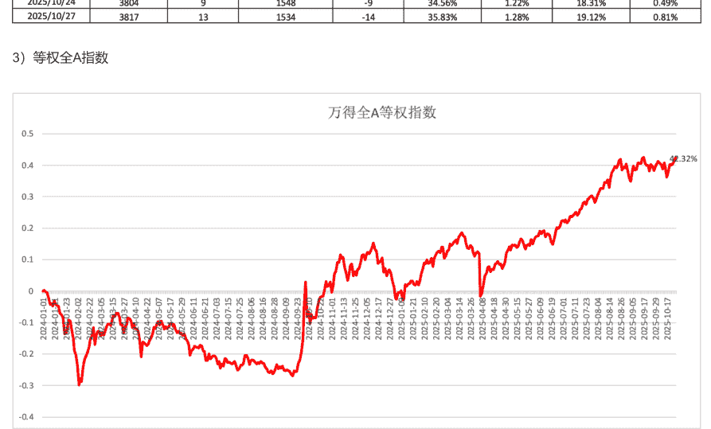

### 4) 脱水300指数

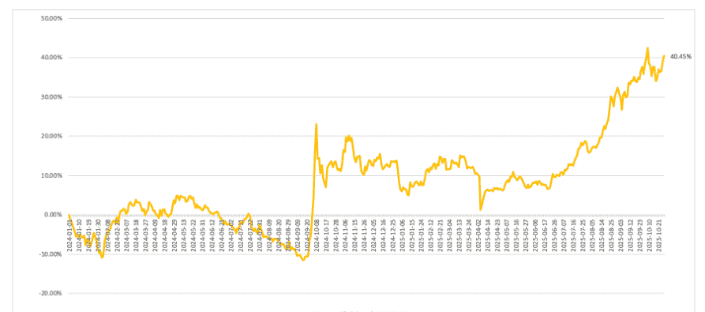

### 5) mini指数

## mini等权指数

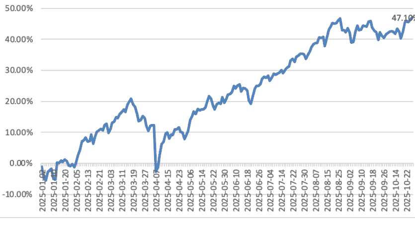

### 6) 出海20指数

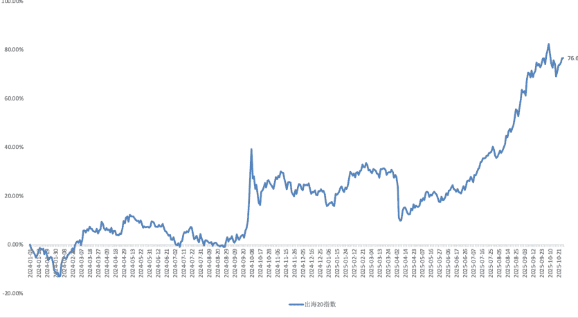

### 7) 红利20指数

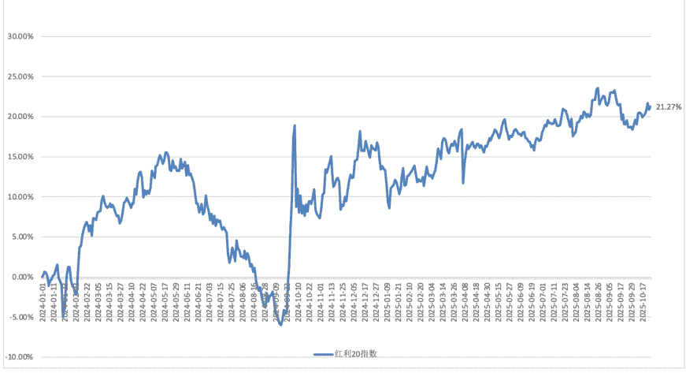

### 8) 降息20指数

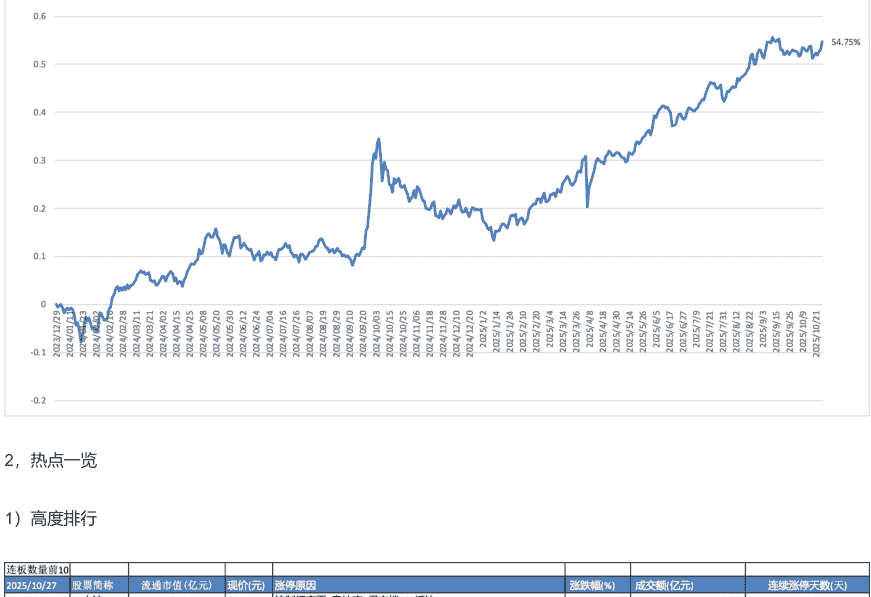

## 2. 热点列表

### 1) 高度排行

| 代码 | 名称 | 累计涨幅(%) | 波动率(%) | 跨境交易-期货-资产配置-S1ETF | 加权指数(%) | 仓位(%) | 领先涨幅(最大) |
| :--- | :--- | :--- | :--- | :--- | :--- | :--- | :--- |
| 000999 | 恒生富指 | -37.85 | 11.56 | 存储银行-中特保险-S1ETF | 4.81 | 0.09 | 6 |
| 000002 | 宝莱银行 | -10.35 | 16.92 | 电化行业-半导体-S1ETF | 7.58 | 5.43 | 5 |
| 000016 | 平安银行 | 95.56 | 28.22 | 化工行业-中医药-S1ETF | 10.01 | 11.81 | 3 |
| 000858 | 上证5 | 45.27 | 6.47 | 食品贵酒-白酒消费-S1ETF | 5.02 | 0.50 | 4 |
| 000319 | 工商银行 | 95.99 | 4.68 | 南亚旅游-免税消费-S1ETF | 9.81 | 2.24 | 3 |
| 000006 | 招商银行 | 53.41 | 28.62 | 医药制造-光伏-新能源-智能城市 | | 10.09 | 10.80 | 3 |
| 000152 | 华夏银行 | 53.74 | 4.91 | 电子行业-半导体-中特设备 | | | | |
| 002151 | 长安银行 | 72.23 | 7.53 | 农林牧茶-中化一-新能源-医药 | | 9.99 | 22.98 | 2 |

### 2) 宽度排行

| 代码 | 名称 | 加权指数(%) | 仓位(%) | 领先涨幅(最大) |
| :--- | :--- | :--- | :--- | :--- |
| 300007 | 创业板指 | 10.00 | 105.00 | 1 |
| 000300 | 中证300 | 10.00 | 50.63 | 2 |
| 000005 | 上证500 | 10.00 | 38.67 | 1 |
| 006005 | 上证510 | 10.00 | 34.98 | 1 |
| 000259 | 宁德时代 | 10.00 | 34.51 | 1 |
| 000001 | 沪深指数 | 10.97 | 28.75 | 1 |
| 300618 | 上科50 | 10.00 | 19.68 | 1 |
| 002151 | 长安银行 | 9.99 | 22.98 | 2 |

## 3. 风格主导

### 1) 指数占比

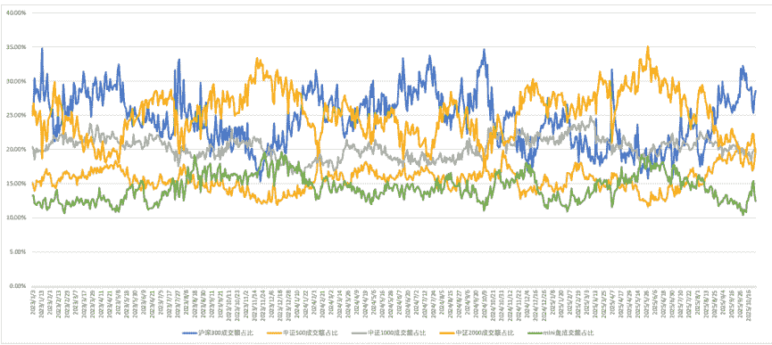

### 2) TMT和利低波占比

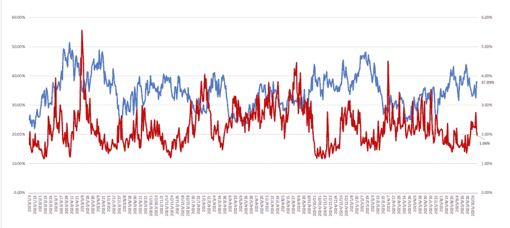

## 4. 沪深300波动率

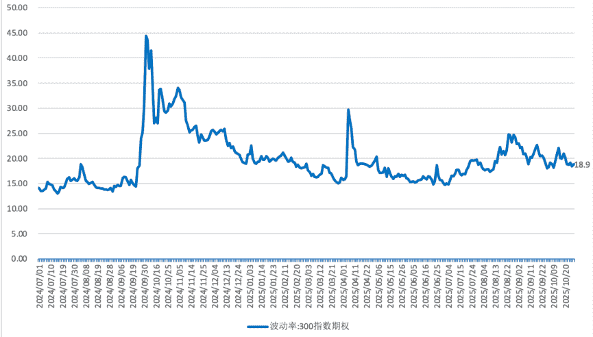

## 5. 杠杆与利率

### 1) 融资资金

| 最新截至 | 2025/10/24 |
| :--- | :--- |
| 融资余额（亿元） | 24,199.18 |
| 融资年期余额（亿元） | 7,276.12 |

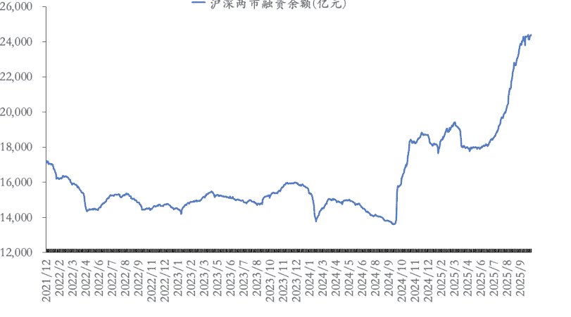

### 2) 担保比例

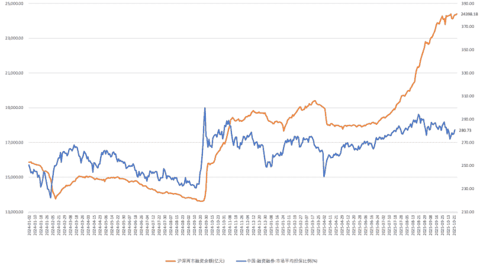

### 3) 十年国债收益率

## 中国:10期国债收益率

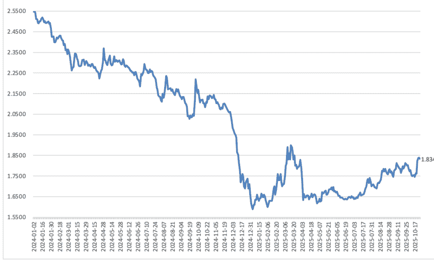

### 4) 南华黑色指数

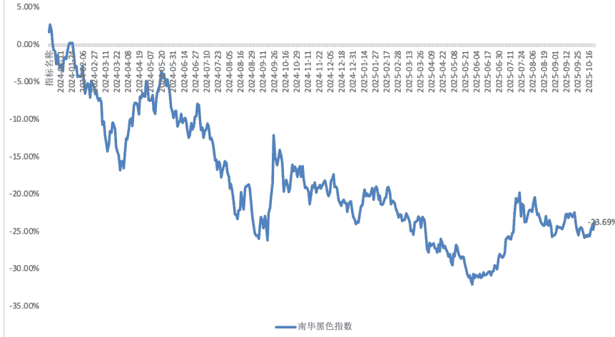

### 5) ETF资金

| 代码 | 当日收盘价 | 涨跌幅 | 最高 | 最低 | 成交量(手) | 换手率 |
| :--- | :--- | :--- | :--- | :--- | :--- | :--- |
| 000001 | 4.19 | 5.23 | 5.21 | 4.09 | 22617 | 11.38 |
| 000002 | 4.40 | 5.22 | 5.22 | 4.10 | 22486 | 11.22 |
| 000003 | 4.53 | 5.27 | 5.31 | 4.35 | 23517 | 11.76 |
| 000004 | 5.17 | 6.18 | 6.48 | 5.12 | 25318 | 12.67 |
| 000005 | 5.57 | 6.18 | 6.48 | 5.32 | 24730 | 12.62 |
| 000006 | 5.63 | 5.93 | 5.93 | 5.53 | 23332 | 9.33 |
| 000007 | 5.82 | 6.35 | 6.35 | 5.72 | 22732 | 8.96 |
| 000008 | 5.05 | 5.35 | 5.35 | 5.03 | 21112 | 7.74 |
| 000009 | 4.17 | 5.17 | 5.17 | 4.16 | 21832 | 6.00 |
| 000010 | 4.52 | 5.52 | 5.52 | 4.52 | 22112 | 8.12 |
| 000011 | 5.22 | 5.89 | 5.89 | 5.22 | 21732 | 8.68 |
| 000012 | 5.23 | 5.93 | 5.93 | 5.23 | 21775 | 8.71 |
| 000013 | 5.20 | 5.76 | 5.76 | 5.20 | 22589 | 9.03 |
| 000014 | 5.70 | 6.70 | 6.70 | 5.70 | 23506 | 10.77 |
| 000015 | 5.39 | 6.39 | 6.39 | 5.19 | 23150 | 10.72 |
| 000016 | 5.39 | 6.39 | 6.39 | 5.39 | 23150 | 10.69 |
| 000017 | 5.84 | 6.84 | 6.84 | 5.84 | 23842 | 9.15 |
| 000018 | 5.64 | 6.64 | 6.64 | 5.64 | 23532 | 9.11 |
| 000019 | 5.65 | 6.65 | 6.65 | 5.65 | 23532 | 9.13 |
| 000020 | 5.27 | 6.27 | 6.27 | 5.27 | 23627 | 9.31 |
| 000021 | 5.37 | 6.37 | 6.37 | 5.37 | 23627 | 9.32 |
| 000022 | 5.99 | 6.99 | 6.99 | 5.99 | 25998 | 11.03 |
| 000023 | 5.98 | 6.98 | 6.98 | 5.98 | 25998 | 11.02 |
| 000024 | 5.65 | 6.65 | 6.65 | 5.65 | 25135 | 9.97 |
| 000025 | 5.65 | 6.65 | 6.65 | 5.65 | 25135 | 9.96 |
| 000026 | 5.42 | 6.42 | 6.42 | 5.42 | 24025 | 9.52 |
| 000027 | 5.42 | 6.42 | 6.42 | 5.42 | 24025 | 9.51 |
| 000028 | 5.58 | 6.58 | 6.58 | 5.58 | 23886 | 9.24 |
| 000029 | 5.58 | 6.58 | 6.58 | 5.58 | 23886 | 9.23 |
| 000030 | 5.62 | 6.62 | 6.62 | 5.62 | 23620 | 9.28 |
| 000031 | 5.62 | 6.62 | 6.62 | 5.62 | 23620 | 9.27 |
| 000032 | 5.40 | 6.40 | 6.40 | 5.40 | 24120 | 9.16 |
| 000033 | 5.40 | 6.40 | 6.40 | 5.40 | 24120 | 9.15 |
| 000034 | 5.35 | 6.35 | 6.35 | 5.35 | 23720 | 9.06 |
| 000035 | 5.35 | 6.35 | 6.35 | 5.35 | 23720 | 9.05 |
| 000036 | 5.30 | 6.30 | 6.30 | 5.30 | 23220 | 8.95 |
| 000037 | 5.30 | 6.30 | 6.30 | 5.30 | 23220 | 8.94 |
| 000038 | 5.28 | 6.28 | 6.28 | 5.28 | 22820 | 8.84 |
| 000039 | 5.28 | 6.28 | 6.28 | 5.28 | 22820 | 8.83 |
| 000040 | 5.25 | 6.25 | 6.25 | 5.25 | 22420 | 8.73 |
| 000041 | 5.25 | 6.25 | 6.25 | 5.25 | 22420 | 8.72 |
| 000042 | 5.20 | 6.20 | 6.20 | 5.20 | 22020 | 8.62 |
| 000043 | 5.20 | 6.20 | 6.20 | 5.20 | 22020 | 8.61 |
| 000044 | 5.18 | 6.18 | 6.18 | 5.18 | 21620 | 8.51 |
| 000045 | 5.18 | 6.18 | 6.18 | 5.18 | 21620 | 8.50 |
| 000046 | 5.15 | 6.15 | 6.15 | 5.15 | 21220 | 8.40 |
| 000047 | 5.15 | 6.15 | 6.15 | 5.15 | 21220 | 8.39 |
| 000048 | 5.12 | 6.12 | 6.12 | 5.12 | 20820 | 8.29 |
| 000049 | 5.12 | 6.12 | 6.12 | 5.12 | 20820 | 8.28 |
| 000050 | 5.10 | 6.10 | 6.10 | 5.10 | 20420 | 8.18 |
| 000051 | 5.10 | 6.10 | 6.10 | 5.10 | 20420 | 8.17 |
| 000052 | 5.08 | 6.08 | 6.08 | 5.08 | 20020 | 8.07 |
| 000053 | 5.08 | 6.08 | 6.08 | 5.08 | 20020 | 8.06 |
| 000054 | 5.05 | 6.05 | 6.05 | 5.05 | 19620 | 7.96 |
| 000055 | 5.05 | 6.05 | 6.05 | 5.05 | 19620 | 7.95 |
| 000056 | 5.03 | 6.03 | 6.03 | 5.03 | 19220 | 7.85 |
| 000057 | 5.03 | 6.03 | 6.03 | 5.03 | 19220 | 7.84 |
| 000058 | 5.02 | 6.02 | 6.02 | 5.02 | 18820 | 7.74 |
| 000059 | 5.02 | 6.02 | 6.02 | 5.02 | 18820 | 7.73 |
| 000060 | 5.00 | 6.00 | 6.00 | 5.00 | 18420 | 7.63 |
| 000061 | 5.00 | 6.00 | 6.00 | 5.00 | 18420 | 7.62 |
| 000062 | 4.98 | 5.98 | 5.98 | 4.98 | 18020 | 7.52 |
| 000063 | 4.98 | 5.98 | 5.98 | 4.98 | 18020 | 7.51 |
| 000064 | 4.97 | 5.97 | 5.97 | 4.97 | 17620 | 7.41 |
| 000065 | 4.97 | 5.97 | 5.97 | 4.97 | 17620 | 7.40 |
| 000066 | 4.95 | 5.95 | 5.95 | 4.95 | 17220 | 7.30 |
| 000067 | 4.95 | 5.95 | 5.95 | 4.95 | 17220 | 7.29 |
| 000068 | 4.93 | 5.93 | 5.93 | 4.93 | 16820 | 7.19 |
| 000069 | 4.93 | 5.93 | 5.93 | 4.93 | 16820 | 7.18 |
| 000070 | 4.92 | 5.92 | 5.92 | 4.92 | 16420 | 7.08 |
| 000071 | 4.92 | 5.92 | 5.92 | 4.92 | 16420 | 7.07 |
| 000072 | 4.90 | 5.90 | 5.90 | 4.90 | 16020 | 6.97 |
| 000073 | 4.90 | 5.90 | 5.90 | 4.90 | 16020 | 6.96 |
| 000074 | 4.88 | 5.88 | 5.88 | 4.88 | 15620 | 6.86 |
| 000075 | 4.88 | 5.88 | 5.88 | 4.88 | 15620 | 6.85 |
| 000076 | 4.87 | 5.87 | 5.87 | 4.87 | 15220 | 7.75 |
| 000077 | 4.87 | 5.87 | 5.87 | 4.87 | 15220 | 6.74 |
| 000078 | 4.85 | 5.85 | 5.85 | 4.85 | 14820 | 6.64 |
| 000079 | 4.85 | 5.85 | 5.85 | 4.85 | 14820 | 6.63 |
| 000080 | 4.83 | 5.83 | 5.83 | 4.83 | 14420 | 6.53 |
| 000081 | 4.83 | 5.83 | 5.83 | 4.83 | 14420 | 6.52 |
| 000082 | 4.82 | 5.82 | 5.82 | 4.82 | 14020 | 6.42 |
| 000083 | 4.82 | 5.82 | 5.82 | 4.82 | 14020 | 6.41 |
| 000084 | 4.80 | 5.80 | 5.80 | 4.80 | 13620 | 6.32 |
| 000085 | 4.80 | 5.80 | 5.80 | 4.80 | 13620 | 6.31 |
| 000086 | 4.78 | 5.78 | 5.78 | 4.78 | 13220 | 6.21 |
| 000087 | 4.78 | 5.78 | 5.78 | 4.78 | 13220 | 6.20 |
| 000088 | 4.77 | 5.77 | 5.77 | 4.77 | 12820 | 6.11 |
| 000089 | 4.77 | 5.77 | 5.77 | 4.77 | 12820 | 6.09 |
| 000090 | 4.75 | 5.75 | 5.75 | 4.75 | 12420 | 6.00 |
| 000091 | 4.75 | 5.75 | 5.75 | 4.75 | 12420 | 5.99 |
| 000092 | 4.73 | 5.73 | 5.73 | 4.73 | 12020 | 5.89 |
| 000093 | 4.73 | 5.73 | 5.73 | 4.73 | 12020 | 5.88 |
| 000094 | 4.72 | 5.72 | 5.72 | 4.72 | 11620 | 5.79 |
| 000095 | 4.72 | 5.72 | 5.72 | 4.72 | 11620 | 5.77 |
| 000096 | 4.70 | 5.70 | 5.70 | 4.70 | 11220 | 5.74 |
| 000097 | 4.70 | 5.70 | 5.70 | 4.70 | 11220 | 5.73 |
| 000098 | 4.68 | 5.68 | 5.68 | 4.68 | 10820 | 5.71 |
| 000099 | 4.68 | 5.68 | 5.68 | 4.68 | 10820 | 5.67 |
| 0000100 | 4.67 | 5.67 | 5.67 | 4.67 | 10420 | 5.66 |

## 6) 市场(沪深圳)成交变化

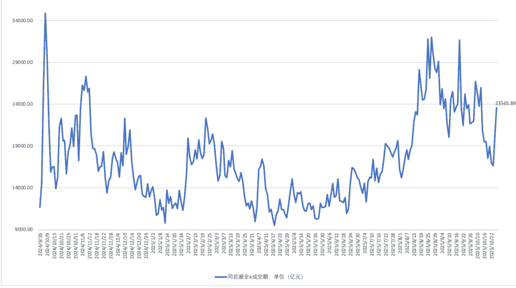

## 7) 市值20亿以下股票的趋势图

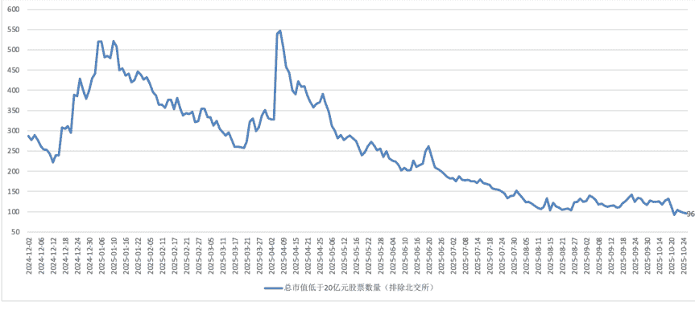

## 8) 南向资金趋势图

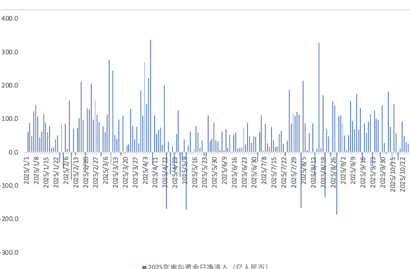

## 深度视野优质集圈（链接优质社群，助你成功）

全部包含以下内容：限时年费188/年 加微信cuk255

- ① 吃瓜群众倍时圈加时时群对话（原价 365 元/年）
- ② 子明私享汇（含）内部文章
- ③ 政事室（顾子明）付费内容加送逐顺子明群
- ④ 米联锦顶【作者米横】（原价 599 元/年）
- ⑤ 欧洲金雀会员专属文章（原价 328 元/年）
- ⑥ 砖万瓦内部文档（原价 400 元/年）
- ⑦ 卢克文青读书会专属文章（原价 699 元/年）
- ⑧ 鉴茶财经知识星球（原价 3310 元/年）
- ⑨ 猫哥的视界知识星球文章（原价 299 元/年）
- ⑩ 财经周刊【独新闻】（原价 1498 元/年）
- 十一 杨世光在钱（原价 2200 元/年）
- ⑫ 森淼财经知识星球（原价 1600 元/年）
- ⑬ 激游异读付费文章（持续更新）
- 十四 司马林解读全套音频和全套书籍收藏版无删减（原价 2.3 万）
- 十五 虚走三部[民国梦、帝国争战、不被理解的 MAO]（原价 599 元）
- 十六 卢克知识星球文章（原价 268 元/年）
- 十七 额外再送：卢沪锐新浪博付费专栏、三村丰老王、三花九洞集文

不定期内容：（更多资源不写下了）……

- ① 守夜人知识星球、接换魔王知识星球、成术财富圈、雪花甲老头等
- ② 创始佳锐、达叔谈论星球、成术财富圈、雪花甲老头等
- ③ 西风付费文章、老端、赢在八小时之外、局人的视界、升值、老A体制内等等其它大V付费文章（每月低于600 元的付费文章）

## 限时年费188/年 低成本链接全网V优质内容

## 深度视野文集

深度视野（付费文集）

