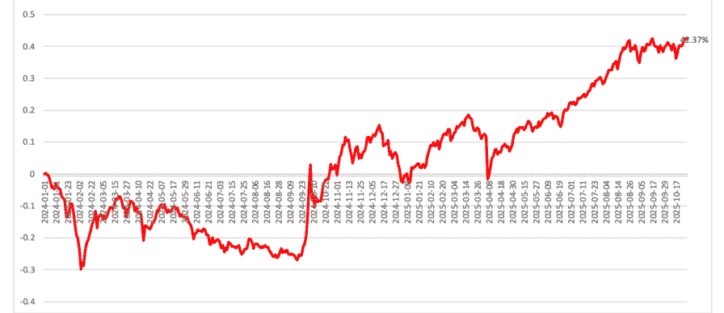
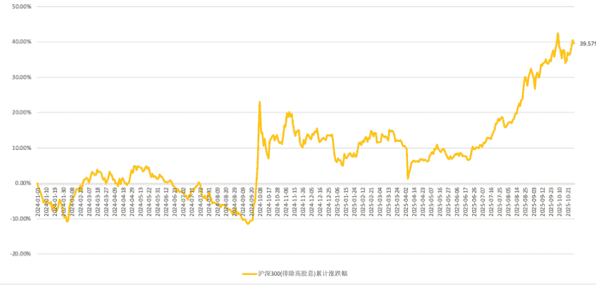
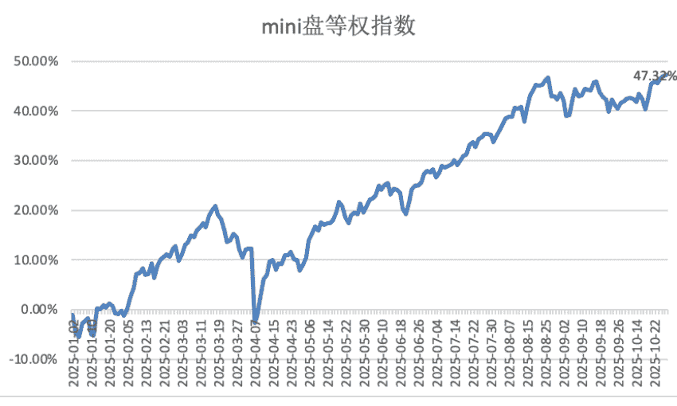
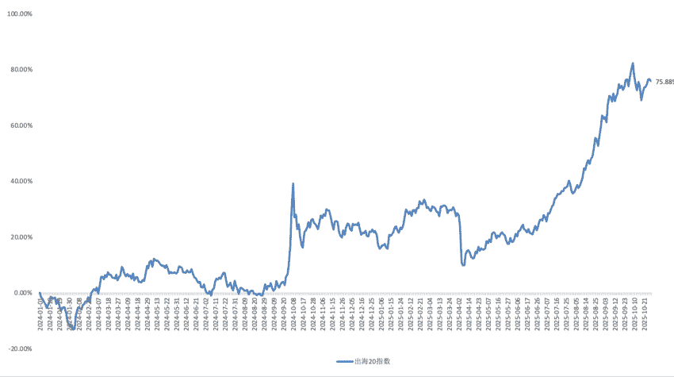
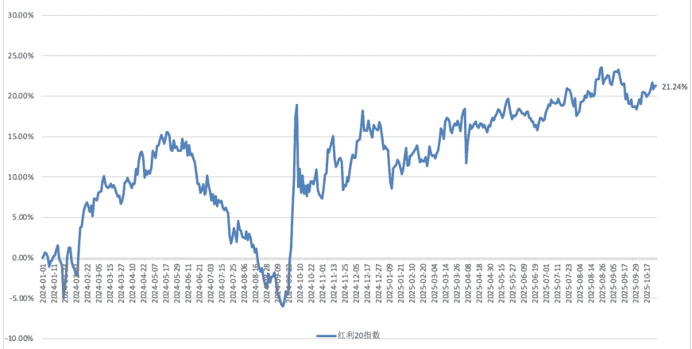
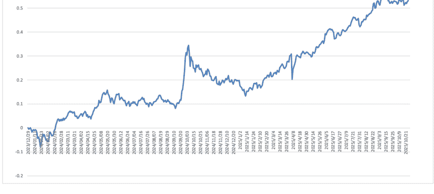
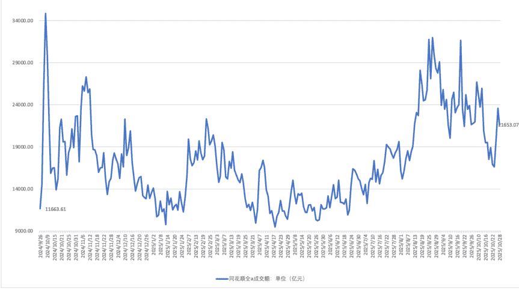
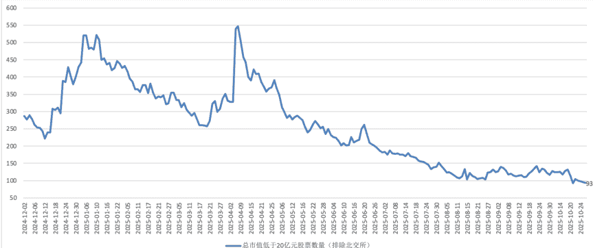
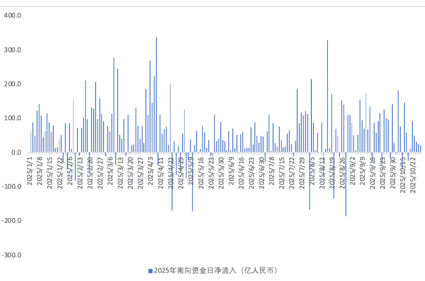

# 2025-10-28 股票市场。（数据部分）

2025年10月28日 20:10

## 1, 整体情况

### 1)行情回顾

| 时间 | 当日涨跌数量 | （较上交易同比） | 下跌股票数量 | （较上交易同比） | 涨幅（股数） | 成份平均涨幅 | 涨幅（较上交易同比） | 中位数涨幅 | 涨幅（较上交易同比） | 万泽全当日涨幅 | （较上交易同比） |
|---|---|---|---|---|---|---|---|---|---|---|---|
| 2025/10/27 | 3361 | 333 | 1862 | -412 | 0.41% | 0.12% | 0.75% | 0.02% | 1.19% | | |
| 2025/10/28 | 2366 | -995 | 2908 | 1046 | -0.13% | 0.16% | -0.60% | | -0.34% | | |

### 2)截至当日，24年来个股跌情况

| 时间 | 上涨股票数量 | 下跌股票数量 | 涨幅（股数） | 成份平均涨幅 | 涨幅（较上交易同比） | 中位数涨幅 | 涨幅（较上交易同比） | 万泽全当日涨幅 | （较上交易同比） |
|---|---|---|---|---|---|---|---|---|---|
| 2025/10/27 | 3817 | 13 | 1534 | -14 | 35.83% | 1.28% | 19.12% | 0.81% | | |
| 2025/10/28 | 3834 | 17 | 1515 | -19 | 35.80% | 0.03% | 19.30% | 0.38% | | |

### 3)等权全A指数

### 4)脱水300指数

### 5) min盘指数

### 6) 出海20指数

### 7) 1) 比特币回归

### 8) 沪深20指数

沪深20

## 2, 热点行情

### 1) 高度排行

| 代码 | 名称 | 合成市值(亿元) | 流交量 | 涨幅(%) | 成交额(亿元) | 涨跌幅度(万) |
| :--- | :--- | :--- | :--- | :--- | :--- | :--- |
| 000059 | 中信银行 | 18.22 | 6.36 | 沪深权证期货-交交-IT1ETF | 5.09 | 0.10 |
| 000001 | 上华银行 | 398.18 | 18.22 | 沪深权证期货-交交-IT1ETF | 10.06 | 0.23 |
| 000052 | *万华化学 | 19.63 | 6.33 | 五子期权-中交所-创业板ETF | 4.98 | 0.06 | 5 |
| 000016 | 平安保险 | 59.10 | 4.24 | 五子期权-中交所-创业板ETF | 10.00 | 0.15 | 5 |
| 601939 | 上交银行 | 51.98 | 52.46 | 大象贵金属-现货-交银-贵金属期 | 10.00 | 0.18 | |
| 002504 | 宁德时代 | 885.55 | 11.11 | 可国期权-中交所-创业板ETF | 9.98 | 10.75 | 4 |
| 601398 | 华夏银行 | 753.11 | 75.16 | 大象贵金属-现货-交银-贵金属期 | 10.27 | 0.44 | 4 |
| 600662 | 海康医疗 | 28.91 | 22.96 | 贵州老酒-中证-期货 | 20.60 | 28.73 | 1 |
| 000008 | *万科证券 | 71.00 | 8.07 | 沪深权证期货-交交-IT1ETF | 4.94 | 0.16 | 3 |
| 600519 | 贵州茅台 | 2013.52 | 39.14 | 可国期权-中交所-创业板 | 10.25 | 23.99 | |

### 2) 宽度排行

| 代码 | 名称 | 合成市值(亿元) | 流交量 | 涨幅(%) | 成交额(亿元) | 涨跌幅度(万) |
| :--- | :--- | :--- | :--- | :--- | :--- | :--- |
| 002001 | 东方财富 | 318.88 | 54.98 | 三羊期权-中证500-上涨ETF | 10.00 | 59.99 | 1 |
| 600506 | 长江电力 | 154.54 | 11.12 | 三羊期权-中证500-上涨ETF | 10.00 | 14.11 | 1 |
| 600028 | 浙商银行 | 753.11 | 75.16 | 五子期权-中交所-创业板 | 10.00 | 46.53 | 2 |
| 300750 | 宁德时代 | 885.55 | 11.11 | 贵州期人-中证-期货ETF | 10.00 | 20.73 | 1 |
| 000518 | 贵州证券 | 112.64 | 8.88 | 贵州期人-中证-期货ETF | 10.00 | 23.81 | 10 |
| 600036 | 工华银行 | 273.43 | 22.96 | 可国期权-中交所-创业板 | 10.00 | 22.97 | 2 |
| 000001 | 招商银行 | 150.00 | 5.09 | 沪深权证期货-交交-IT1ETF | 10.00 | 21.86 | |
| 600238 | 华力股份 | 51.97 | 33.21 | 可国期权-中交所-创业板 | 10.00 | 17.81 | 1 |

### 3. 风格主导

### 1) 指数成交

### 2) TMT和红利低波占比

### 4) 沪深300期波动率

### 5. 股利率

### 1) 融资资金

| 截至日期 | 余额 | 季度新增(亿元) | 年新增(亿元) |
|---|---|---|---|
| 2023/10/27 | | 3402.88 | 271.50 | 7603.62 |

### 2) 担保比例

### 3) 十年债收益率

### 4) 南华指数

### 5) ETF资金

| 股票代码 | 涨跌幅 | 涨幅 | 最高 | 最低 | 换手 | 成交量 |
|---|---|---|---|---|---|---|
| 000001 | -4.15 | -5.23 | 0.71 | 0.67 | 0.10 | 11.34 |
| 000002 | -2.15 | -2.63 | 0.55 | 0.51 | 0.10 | 10.52 |
| 000003 | -4.13 | -2.08 | 2.24 | 2.08 | 0.11 | 11.55 |
| 000004 | -5.57 | -2.18 | 14.29 | 10.63 | 0.47 | 10.47 |
| 000005 | -5.57 | -2.18 | -0.35 | -0.74 | 0.10 | 10.32 |
| 000006 | -1.93 | -3.82 | -0.31 | -0.55 | 0.10 | 10.94 |
| 000007 | -4.18 | -6.17 | -0.52 | -0.00 | 0.10 | 10.00 |
| 000008 | -2.13 | -3.33 | -0.12 | -0.12 | 0.10 | 10.10 |
| 000009 | -0.22 | -1.69 | -22.75 | -13.88 | 0.10 | 10.88 |
| 000010 | -2.15 | -2.63 | 0.55 | 0.51 | 0.10 | 10.52 |
| 000011 | -2.20 | -2.76 | 5.36 | -3.16 | 0.10 | 10.96 |
| 000012 | -2.50 | -1.58 | 12.89 | 10.76 | 0.10 | 10.74 |
| 000013 | -4.13 | -2.08 | 14.24 | 10.63 | 0.11 | 11.55 |
| 000014 | -2.94 | -2.08 | -18.51 | -15.41 | 0.10 | 10.41 |
| 000015 | -4.13 | -2.08 | -0.35 | -0.74 | 0.10 | 10.32 |
| 000016 | -2.67 | -2.06 | -0.29 | -0.38 | 0.10 | 10.38 |
| 000017 | -2.58 | -1.69 | -16.54 | -11.03 | 0.10 | 11.03 |
| 000018 | -4.13 | -2.08 | -0.93 | -0.97 | 0.10 | 10.97 |
| 000019 | -4.13 | -2.08 | -12.33 | -11.42 | 0.10 | 10.42 |
| 000020 | -1.64 | -2.27 | -12.51 | -11.42 | 0.10 | 10.42 |
| 000021 | -5.89 | -2.86 | -10.57 | -10.28 | 0.10 | 10.28 |
| 000022 | -2.15 | -2.63 | 0.55 | 0.51 | 0.10 | 10.52 |
| 000023 | -1.20 | -1.85 | 4.14 | 2.32 | 0.10 | 10.32 |
| 000024 | -1.57 | -1.37 | 2.06 | 2.41 | 0.10 | 10.41 |
| 000025 | -1.02 | -1.37 | 8.86 | 8.21 | 0.10 | 10.21 |
| 000026 | -2.62 | -1.42 | -8.70 | -8.26 | 0.10 | 9.26 |
| 000027 | -4.13 | -2.08 | 14.24 | 10.63 | 0.11 | 11.55 |
| 000028 | -3.12 | -3.22 | -0.14 | -0.21 | 0.10 | 10.21 |
| 000029 | -2.15 | -2.63 | -29.71 | -29.52 | 0.10 | 10.52 |
| 000030 | -4.13 | -2.08 | -18.23 | -18.73 | 0.10 | 10.73 |
| 000031 | -4.13 | -2.08 | -18.23 | -18.73 | 0.10 | 10.73 |
| 000032 | 10.92 | 10.07 | 0.05 | 1.49 | 0.10 | 10.49 |
| 000033 | -4.13 | -2.08 | -12.33 | -11.42 | 0.10 | 10.42 |
| 000034 | 42.80 | 37.78 | 5.02 | 5.02 | 0.10 | 5.02 |
| 000035 | -15.12 | -4.08 | -10.56 | -12.00 | 0.10 | 12.00 |
| 000036 | -2.15 | -2.63 | -10.57 | -10.28 | 0.10 | 10.28 |
| 000037 | 22.67 | 28.83 | 10.59 | 7.61 | 0.10 | 7.61 |
| 000038 | -2.15 | -2.63 | -10.57 | -10.28 | 0.10 | 10.28 |
| 000039 | 2.02 | 20.77 | -23.75 | -25.58 | 0.10 | 25.58 |
| 000040 | 16.61 | 16.98 | -0.58 | -7.42 | 0.10 | 7.42 |
| 000041 | -4.13 | -2.08 | -10.57 | -10.28 | 0.10 | 10.28 |
| 000042 | 13.23 | 13.28 | -29.95 | -19.51 | 0.10 | 19.51 |
| 000043 | -4.13 | -2.08 | -12.33 | -11.42 | 0.10 | 11.42 |
| 000044 | 10.77 | 33.36 | 48.13 | 46.11 | 0.10 | 46.11 |
| 000045 | -7.68 | -1.97 | -0.01 | 2.74 | 0.10 | 2.74 |
| 000046 | -4.13 | -2.08 | -10.57 | -10.28 | 0.10 | 10.28 |
| 000047 | 37.84 | 30.15 | 57.65 | 42.72 | 0.10 | 42.72 |
| 000048 | -15.78 | -15.18 | -10.11 | -10.28 | 0.10 | 10.28 |
| 000049 | -21.78 | -21.11 | 5.11 | 5.03 | 0.10 | 5.03 |
| 000050 | 19.93 | 19.14 | 1.15 | 1.68 | 0.10 | 1.68 |
| 000051 | -19.81 | -19.71 | -1.90 | -0.68 | 0.10 | -0.68 |
| 000052 | 10.13 | 10.33 | -29.61 | -28.81 | 0.10 | -28.81 |
| 000053 | 210.98 | 214.79 | 7.11 | -13.50 | 0.10 | -13.50 |
| 000054 | -15.12 | -15.12 | -10.57 | -10.28 | 0.10 | -10.28 |
| 000055 | 53.60 | 30.15 | 23.65 | 69.84 | 0.10 | 69.84 |
| 000056 | 63.26 | 27.68 | 35.57 | 71.10 | 0.10 | 71.10 |
| 000057 | -14.13 | -14.13 | -10.57 | -10.28 | 0.10 | -10.28 |
| 000058 | -41.79 | -28.74 | -12.04 | -23.67 | 0.10 | -23.67 |
| 000059 | -14.13 | -14.13 | -10.57 | -10.28 | 0.10 | -10.28 |
| 000060 | 19.19 | 20.63 | 1.64 | 28.64 | 0.10 | 28.64 |
| 000061 | -15.12 | -15.12 | -10.57 | -10.28 | 0.10 | -10.28 |
| 000062 | 175.02 | 164.10 | 90.52 | 89.83 | 0.10 | 89.83 |
| 000063 | -15.12 | -15.12 | -10.57 | -10.28 | 0.10 | -10.28 |
| 000064 | 152.87 | 146.08 | 79.81 | 33.91 | 0.10 | 33.91 |
| 000065 | -15.12 | -15.12 | -10.57 | -10.28 | 0.10 | -10.28 |
| 000066 | 17.28 | 14.95 | -7.18 | -37.60 | 0.10 | -37.60 |
| 000067 | 2.38 | 2.38 | -14.95 | -14.98 | 0.10 | -14.98 |
| 000068 | 88.66 | 82.13 | 40.51 | 17.15 | 0.10 | 17.15 |
| 000069 | -15.12 | -15.12 | -10.57 | -10.28 | 0.10 | -10.28 |
| 000070 | 63.09 | 60.43 | 20.39 | 63.62 | 0.10 | 63.62 |
| 000071 | -15.12 | -15.12 | -10.57 | -10.28 | 0.10 | -10.28 |
| 000072 | 22.52 | 21.12 | 7.85 | -7.45 | 0.10 | -7.45 |
| 000073 | 18.12 | 17.32 | -5.11 | -2.94 | 0.10 | -2.94 |
| 000074 | 109.62 | 104.54 | 116.72 | 98.21 | 0.10 | 98.21 |
| 000075 | -15.12 | -15.12 | -10.57 | -10.28 | 0.10 | -10.28 |
| 000076 | -22.99 | -20.98 | 21.71 | 37.61 | 0.10 | 37.61 |
| 000077 | 36.25 | 33.35 | 20.13 | 61.83 | 0.10 | 61.83 |
| 000078 | 64.88 | 62.25 | 20.13 | 61.83 | 0.10 | 61.83 |
| 000079 | 95.49 | 90.65 | 60.31 | 80.34 | 0.10 | 80.34 |
| 000080 | 125.54 | 121.88 | 66.33 | 71.27 | 0.10 | 71.27 |
| 000081 | 168.74 | 162.09 | 67.35 | 27.21 | 0.10 | 27.21 |
| 000082 | 202.35 | 195.18 | 51.19 | 50.48 | 0.10 | 50.48 |
| 000083 | 102.35 | 101.58 | 53.43 | 53.43 | 0.10 | 53.43 |
| 000084 | 115.18 | 113.51 | 53.43 | 53.43 | 0.10 | 53.43 |
| 000085 | 120.93 | 118.16 | 48.17 | 47.79 | 0.10 | 47.79 |
| 000086 | 6.11 | 5.72 | -32.88 | -39.62 | 0.10 | -39.62 |
| 000087 | -15.12 | -15.12 | -10.57 | -10.28 | 0.10 | -10.28 |

## 6) 市场(沪深)成交变化

## 7) 市值20亿以下股票的趋势图

## 8) 南向资金趋势图

深度视野VIP群 人工追踪50+大V 付费进群加微信cuk255 微信chp5568

## 深度视野优质集圈（链接优质社群，助你成功）

全部包含以下内容：限时年费188/年 加微信cuk255

- ① 吃瓜群众倍时圈文加时群对话（原价 365 元/年）
- ② 子明私享汇（含）内部文章
- ③ 政事室（子明佛）付费内容加送顺子明群聊
- ④ 米联锦顶集【作者米梗】（原价 599 元/年）
- ⑤ 欧洲金锐会员专属文章（原价 328 元/年）
- ⑥ 砖万瓦内部圈（原价 400 元/年）
- ⑦ 卢克文青读书会专属文章（原价 699 元/年）
- ⑧ 鉴茶财经知识星球（原价 3310 元/年）
- ⑨ 猫哥的视界知识星球文章（原价 299 元/年）
- 十 财经周刊【独家新闻】（原价 1498 元/年）
- 十一 杨世光在金钱树（原价 2200 元/年）
- 十二 森淼财经知识星球（持续更新）
- 十三 司马林解读选题全套音频和全套书籍藏版无割减（原价 2.3 万）
- 十四 虚虚三部[民国梦、帝国争亡、不被理解的MAO]（原价 599 元）
- 十五 卢克文星球文章（原价 268 元/年）
- 十六 额外再送：卢锐新浪微博口碑付费专栏、三村丰老王、三花九洞文集

不定期内容：（更多资源不下去了……——

- ① 守夜人司令星球、接换魔王后星球、成术财富圈、雪球花甲头等
- ② 创世佳记、达叔浅论星球、成术财富圈、雪球花甲头等
- ③ A视野、大树乡谈、江初优势、泮咩说、上海海家学等付费文集
- ④ 西风付费文章、老端、高在小时之时、局外人的视界、升值、老体制内等其它一些V付费文集（每月不超过600元的付费文集）

## 限时年费188/年 低成本链接全网优质内容

深度视野文集
进群微信cuk255
深度视野（付费文集）

