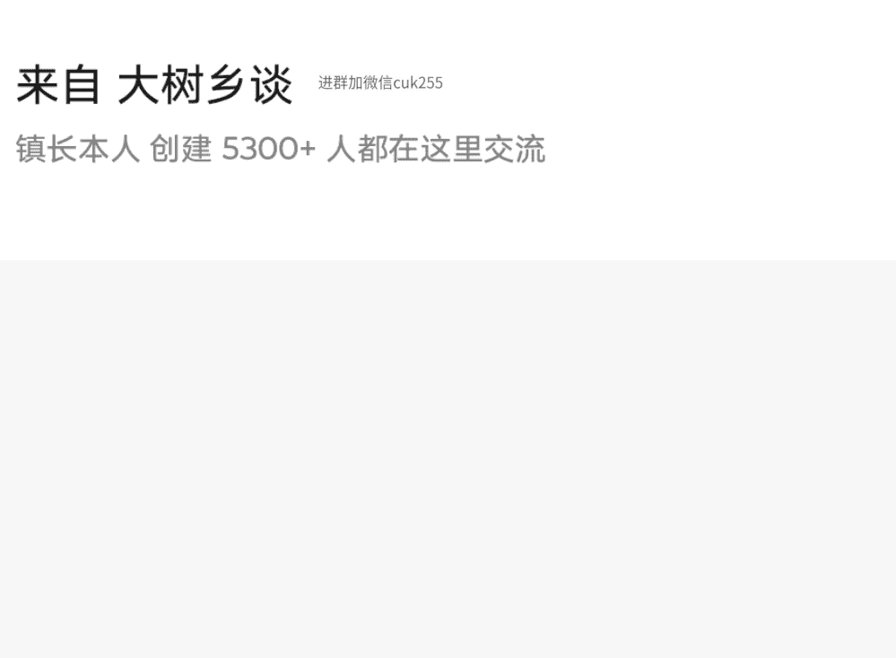

# 镇长本人的主题

2025/11/6 21:27

简单回顾下2025年10月22日写的《谈谈湖北的“三资”改革》，当时小镇就说，活盘国资、缓解财政局张，的确是国家支持的，也是“十五”期间需要积极探索的。但当地法并不存在，尤其是加上“一切尽可能”的绝对化语言后，问题就更大了。

其实原本打算说的“资产化、证券化、杠杆化”能用则用、不用则售、不售租、融资还是符合要求的，也都是工具和手段，最终还是服务于国资债增缓解压力的目的，合用可用、不合用则不用，而不是绝对化的“一切尽可能”。

而且当前最需要解决的恰不是杠杆化，而是去杠杆化，地方还在化债呢，怎么还回头上杠杆？说的直白点，能上杠杆的早离开了，就不会等到现在，顶多有一些新增的、少量的还有一定可能。

未来“三资”改革会更加严重，绝对不会有哪个地方方出来如此激进的口号。地方也需要注意，谨慎绝对化的口号。要注意流量的负面作用，客观地，平实的话语不容易出圈，而绝对的，口号化的很有害，做事的时候，低调是好事，毕竟各地有各地的情况。

如果一个人对“一切尽可能”的这三句话觉得有问题，还觉得很兴奋，那恰恰明白不懂国家的主导方向，对国资改革也缺乏了解，甚至可以说在价值观和方法论上存在明显的需要完善的不足，当然本身就不想揽国趋势，那都无所谓了。

来自大树乡谈

镇长本人创建 5300+ 都在这里交流

# 深度视野优质集群（链接优质社群，助你成功）

全部包含以下内容：限时年费188/年 加微信cuk255

- ① 吃瓜群众倍时文档加时群聊天（原价 365 元/年）
- ② 子明私享汇（含）内部文章
- ③ 政事室（顾子明）付费内容加送顺子明群
- ④ 米联锦顶【作者米楼】（原价 599 元/年）
- ⑤ 欧洲金会员专属文章（原价 328 元/年）
- ⑥ 砖万瓦内部文档（原价 400 元/年）
- ⑦ 卢克文青读书会专属文章（原价 699 元/年）
- ⑧ 鉴茶财经知识星球（原价 3310 元/年）
- ⑨ 猫哥的视界知识星球文章（原价 299 元/年）
- ⑩ 财财经财经【独家新闻】（原价 1498 元/年）
- ⑪ 杨世光在金钱圈（原价 2200 元/年）
- ⑫ 森森跃财经知识星球（原价 1600 元/年）
- ⑬ 激泽异译付费文章（持续更新）
- ⑭ 司马林解读谋选全套音频和全套书籍收藏版无割减（原价 2.3 万）
- ⑮ 虚构三部曲[民国梦、帝国战争、不被理解的 MAO]（原价 599 元）
- ⑯ 克克文章（原价 268 元/年）
- ⑰ 额外再送：卢户元新微博付费专栏、三村丰老文、三花九洞文集

不定内容：......（更多资源不下去了......）

- ① 守夜人司令知识星球、接换魔王知识星球、成术财富圈、雪花花甲老头等
- ② 创始星球、达叔深度论星球、成术财富圈
- ③ A视野、大树乡谈、江宁后记、泮咩说、上海家学等付费文集
- ④ 西风付费文章、老端、高在八小时之外、局人的视界、升值、老A体制内等其它一些大V付费文章（每月不低于600元付费文章）

限时年费188/年

# 低成本链接全网V优质内容

深度视野文集进群微信cuk255

深度视野（付费文集）

