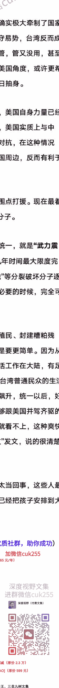

# 储本人的主题

我一起总结了2023年，核心只有五句话：

第一：要保持清晰的心态和和平的心态。这不容易，但律和权力在现实中非常重要。

第二：不要急于成功；要学会慢下来，做好计划，做好执行。

第三：要学会下放权和信任。

第四：要坚持长期主义，在困难和诱惑面前，守住自己的初衷，不要放弃大家，不要轻易放弃，这不容易，这不容易，但坚持下去也不容易，但是，开始比坚持更难，只要肯开始，坚持到底就是成功的开始。

第五：要学会拥抱变化。

在结束2023年，回顾2022年，我感叹这过去年是挑战与机遇并存的一年。在2023年结束之际，我再次开始思考自己的未来。

站在2023年展望2024年，我一直在思考：2024年，我们将面对一个充满挑战的未来？

面对国际局势，国际世界形势更加复杂多变，大国博弈加剧，局部冲突不断，全球经济复苏增长乏力，不确定性不断加剧。

面对国内局势，我国正处于转型的关键时期，经济结构调整、产业升级正在进行，同时政治、法律、社会、文化、生态等领域的改革也在深入推进，压力与机遇并存。

面对未来，我们面临着前所未有的挑战，但我们有信心、有能力、有准备去应对各种不利的局面。

在2022年，我们取得了辉煌的成就，在经济、科技、外交、民生、文化等方面都取得了突破性进展。

回顾2022年，在极其复杂的国际国内形势下，我们成功顶住了巨大的压力，取得了瞩目的胜利。

在2023年，我们继续在困难中前行，在挑战中取得了显著的成绩。

展望2024年，我们要更加坚定目标、更加务实工作、更加艰苦奋斗、不畏艰难无惧失败。

只要我们坚持，就一定能胜利；只要我们坚持，就一定能克服困难；只要我们坚持，就一定能实现更加美好的目标；只要我们坚持，就一定能创造出更加辉煌的未来！

在2024年，我们要更加团结合作、更加务实高效、更加开放、更加创新。

