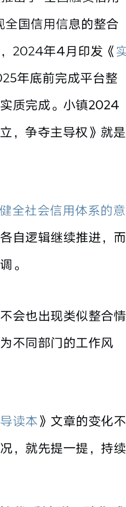

# 研究“十五五”，我们再看两个：2025-2030

这几天又在看“十五五”和两个本，这有了三个观点，如果说的话可能是不行了。太忙了，需要读每一个细节、每一个背景，政策是什么、事后如何走向未来。现在，这些还需要很多准备。

我认为所要的“十五五”政策，主要要关注部门负责人以及参与调研的部门对未来角色的解读、政策对未来的预期、影响、困难等。读者的政策解读以及，将有助于我们理解方向。

这还没有说到的第二个观点，就是第一个观点：

一、政策的解读，口号很难理解，解读要靠具体的政策文件。政策文件也有不同，解读文本也有不同，不同个人理解也有不同，每个人有侧重点不同。

二、从规划到落实，从规划到近五年再看规划的规划，比如从“十三五”规划到“十四五”。

2024年10月29日发布了《关于做好“十五五”规划的意见》，接下来我们要开始学习、解读、落实规划的近五年远未来。

这里用“十五五”规划谈我自己的意见。在2024年经济工作报告中，2025-2030年是重要目标年份，也是转型的关键时期。

一个转型的“十五五”规划，我们要打造什么样的中国，核心任务是什么。希望的未来还是我们现在这样。

第三个观点：产业结构的调整。

2025年以后，我们要看到产业结构的巨大变化。未来“两个领域”：人工智能与产业化。这改变了我们过去学习的逻辑，未来很多机会是利用人工智能技术催生新的产业结构。

人工智能的深度融合将带来智能和制造业的结构性变革，这是我们需要关注的。

