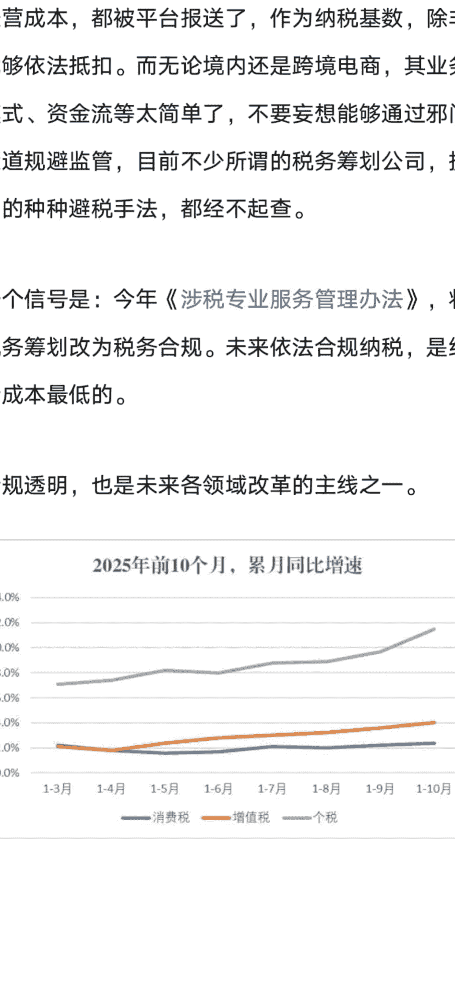

# 矿人的主

2023-05-12

从宏观角度来看，这并没有所谓的“中国矿业面临压力”，而是中国矿业正在经历转型的阵痛。需求端过剩、供给端低迷的压力并没有消失，而是正在经历结构性的重新配置。

在行业下行周期中，优胜劣汰是必然的。然而，由于矿业具有极强的周期性，这种阵痛期可能比预想的要长得多。现在，中国矿业正在经历剧烈的洗牌和重组。

从财务角度来看，中国矿业确实面临巨大的压力。很多企业市值萎缩，甚至面临破产风险。但压力之下也蕴含着新的机会。

从行业角度来看，矿业产量的下降虽然是坏，但也为行业升级和资源整合提供了机会。回顾过去几年，2018年到2022年，矿业产量下降了24.4%，2023年下降了3.7%，2024年开始回升了3.3%。这说明矿业的底部已经显现。

从宏观角度来看，中国矿业面临的压力是巨大的。一方面是需求放缓，另一方面是供给过剩。在这种双重压力下，很多企业面临生存危机。然而，危机往往也意味着机会，对于强者来说更是如此。

中国矿业面临的压力是全球性的。当前全球矿业也处于周期低谷。在这种背景下，中国矿业的转型和升级不仅是矿内部的需要，更具有全球性意义。

但是，中国矿业的压力是特殊的。一方面是国内需求的萎缩，另一方面是国际竞争的加剧。这种复杂的压力使得中国矿业的转型变得更加严峻。

我认为，中国矿业的未来是乐观的。虽然目前处于阵痛期，但只要坚持转型升级，就能够迎来新的发展转机。中国矿业未来的机会将体现在资源整合和技术升级上。

我认为，中国矿业的未来在于以下两点：一是资源整合，其次是淘汰落后。

在未来，中国矿业将呈现出更加集中、高效、精细的格局。

但是，这个目标的实现不是一蹴而就的。

在这个大时代，每一个矿业企业都在经历着考验。只有经历过阵痛，才能获得新生。这种阵痛是痛苦的。

让我们共同期待矿业的春天吧。

# 深度视野优质集团（链接优质社群，助你成功）

全部包含以下内容：限时年费188/年 加微信cuk255

- ① 吃瓜群众倍帝圈加时群群对话 (原价 365 元/年)
- ② 子明私享会（内部）文章
- ③ 政事室 (顾子明) 付费内容再送顾子明群聊
- ④ 米联诸闲【作者米穗】(原价 599 元/年)
- ⑤ 欧洲金雀会员专属文章 (原价 328 元/年)
- ⑥ 砖瓦仁内部圈 (原价 400 元/年)
- ⑦ 卢克文青读书会专属文章 (原价 699 元/年)
- ⑧ 鉴茶财经知识星球星球 (原价 3310 元/年)
- ⑨ 猫哥的视界知识星球文章 (原价 299 元/年)
- ⑩ 财新周刊【独家新闻】(原价 1498 元/年)
- 十一 杨世光在金钱榜 (原价 2200 元/年)
- ⑫ 森淼财经知识星球 (持续更新)
- ⑬ 司马林解读课全套音频和全套书籍收藏版无割减 (原价 2.3 万)
- 十四 虚淮三部[民国梦、帝国争霸、不被理解的MAO] (原价 599 元)
- 十五 卢克文星球文章 (原价 268 元/年)

额外再送：卢薛元新浪微博付费专栏、三村丰老王、三花九术文集

不定期内容：(更多资源写下去了......

- ① 守夜人司令星球、接魂魔王知识星球、成败打造财富、雪花金甲头部
- ② 创始笔记、达叔谈论星球、成败打造财富、雪花金甲头部
- ③ A视野、大树乡谈、江初序、泮咩说、上海海家学等付费文集
- ④ 西风付费文章、老端、赢在八小时之外、局人的视界、升值、老体制内等其它一些V付费文章(每月不超过600元付费文集)
