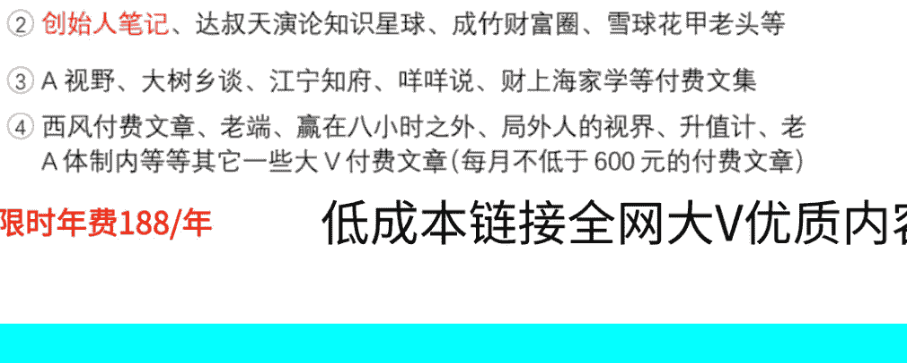

# 日本是美国的“盟友与对手”，它不能失败

-20251127

“五五计划”被后说是源于美国，但由于其高效的战略体制，最终取得了巨大成功。日本从农业大国变为汽车、电视、电子产品大国，制造业在这些领域的核心技术上具有决定性的竞争优势。

正是这一“决定性胜利”的每一个成功，让日本从战后的废墟中崛起，并成为了世界第二大经济大国。

后来日本开始面临产业结构调整，随着这些传统产业的衰落，日本陷入了新的困境。然而，从2015年开始，日本已经面临着产业转型的压力。

日本虽然在转型中充满了痛苦，但由于没有了产业结构的调整，它成功避免了彻底崩溃。

但现在，如果没有了先进产业的支撑，科学、技术、市场等领域日本又将面临怎样的危机？

从历史角度看，日本的最后一次“五五计划”是巨大的成功。在当时，日本的GDP增长翻了一倍。通过“五五计划”，日本实现了一系列跨越式的飞跃，证明了“Year-by-Year China”（即中国的五五计划）的有效性。

中国也从“十五五计划”开始实现了跨越式发展，在当时的支持下，工业化进程取得了突破。在过去的几年里，中国取得了巨大的成就。

现在的日本面临着前所未有的挑战。在人工智能时代，日本是否还能跟上美国？特别是在DeepSeek时代，中国已经已经在许多模型领域取得了领先地位。

这正是日本面临的重大课题。

在当下，如果“十五五”又是另一个关键并取得“决定性胜利”，中国将再次取得跨越式发展吗？

如果日本失败，美国将失去一个“盟友”，也将失去一个“对手”。

这又是一个转变，日本需要应对的挑战。

无疑非常复杂，我们需要探讨。

方的文章：中国与G20国家还有更多合作的机遇，但在国际局势下，中国的挑战也日益严峻。

作者：刘晓波

