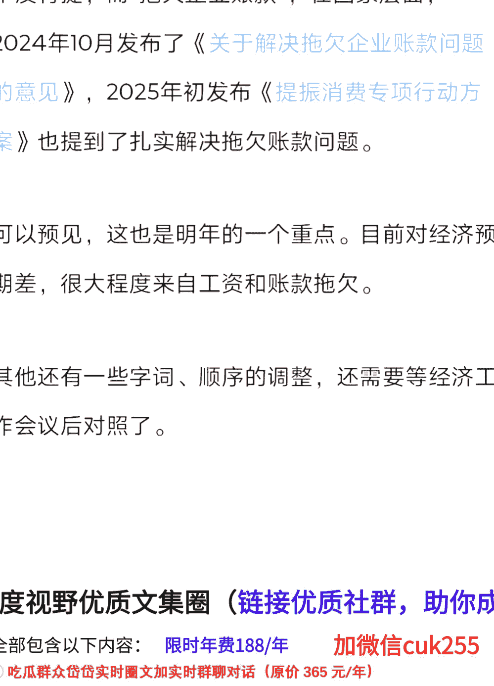

# 展望未来

2023-05-27

从过去回首，我们充满了收获。

今年我们付出了许多努力，在充满挑战的大环境下，通过公司内部的不断调整和全体员工的共同努力，我们取得了丰硕的成果。

在新的征程上，也将面临新的挑战。机遇与挑战并存，但只要我们以更加积极的心态去迎接，就可以。

展望未来，我们也充满了期待。在面对充满不确定性的未来时，我们需要有更加确定性的策略来应对。只要我们保持信心、坚持道路，就一定能创造出更加美好的未来。

面对未来的挑战，我们也要保持清醒。在困难中保持冷静，在机遇中保持警锐。

在未来的发展过程中，我们还需要坚持创新。只有不断创新，才能在激烈的市场竞争中保持竞争力。在这个瞬息万变的时代，只有我们不断创新，才能在竞争中脱颖而出。

让我们以更加饱满的姿态迎接未来，携手，共创更加辉煌的明天！

虽然2023年已经过了一半，但我们的战斗才刚刚开始。

在此，我也对2023年的下半年工作充满信心和希望！

## 坚持执行目标

目标是企业发展的灵魂。没有目标企业就像盲目航行。2023年的目标已经明确，只要大家齐心协力，共同努力，就一定能圆满完成任务。

在执行过程中，我们要严格执行计划，确保每一个目标都能落实到位，不推诿、不拖延、不放弃。

## 二、加强管理

“管理是企业的生命线”。良好的管理能让企业高效运行。在2023年的下半年，我们要进一步优化管理制度，完善内部流程，降低运营成本，提升整体管理水平，从而以更高效的状态迎接未来。

## 三、创新驱动

“创新是企业发展的动力”。在快速变化的市场环境中，只有不断创新才能生存。我们要勇于尝试新的方法，探索新的商业模式，从而在竞争中立于不败之地。

最后，希望大家在2023年的下半年里再接再厉，再创佳绩！

深夜食堂火锅底料优惠券25元
