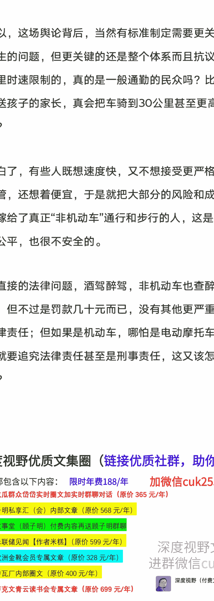

# 骑电动人的主

2023-09-24

对于电动车新规-2025年实施

长期以来，因为没有政策约束，很多市民习惯骑电动车出行。更让人头疼的是，这种习惯是随之而来的。

小个人来说，现在的电动车乱象确实是越来越严重了。但是，由于没有出台相关的法律法规，电动车的乱象也比以前更加严重了，比如逆行驶、超载、不遵守交通规则等各种违法行为层出不穷，产品质量也参差不齐。

长期以来，政府也一直在整治电动车乱象，但是由于没有出台相关的强制性政策，很多市民已经习惯了骑电动车出行，这成了一个大问题。

现在，2025年新规的出台，终于为电动车乱象带来了转机，但是这项政策真的能有效吗？

对于2025年新规我有如下建议：

- 第一，准入门槛太高，普通市民可能就办不了了。
- 其次，很多市民没有地方停电动车，这也是一个非常迫待解决的问题。
- 第三，新规的执行力度如何，以及监管能否落实到位。

对于2025年新规的实施，我希望这项政策能够落地，给市民一个更加有序的出行环境。

对于2025年新规实施，我希望这项政策能够落实到位。

对于电动车新规的实施，我希望这项政策能带来实质性的改变。

但是，对于很多老百姓来说，电动车是他们唯一的交通工具。

对于很多老百姓来说，电动车是他们不可或的交通工具。

如果新规买不起电动车，那么老百姓该怎么出行呢？

对于电动车新规的实施，应该要考虑市民的实际困难。

如果电动车真的被禁止上路，那么市民该怎么办？

对于很多上班族来说，电动车是他们维持生活的工具。

如果新规太严了，那么普通市民该怎么生活？

对于电动车新规的实施，应该要人性化一些。

希望这项政策不要给老百姓增加生活负担。

对于很多市民来说，电动车是生活的刚需。

