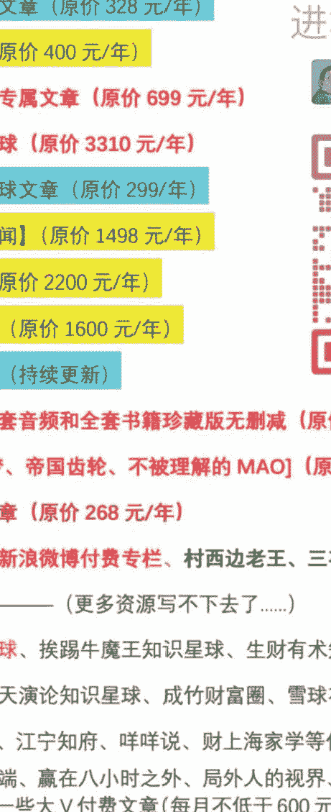

# 镇长的主题

读者问答-20251228

读者：一直想在北京买房，已经规划两年，准备刚买小房，初步定位在四环附近，2026年是不是比较合适的时机？

已经可以了，目前观看到北京小户型房开始交付了，房价价格已经跌了30%以上，加上首付调整，现在上车更多了吗？

看完之后，再去找房，去了解更多信息，可以通过电话、VR等各种方式，关注自己的类型、房型、价格等，建立一个合理的认知。在看房的过程中清楚自己到底想要的是什么，在资金有限的情况下不要买你负担不起的房子，尽量开始看房了要保持心态，不要定一套就不要一套，装修的事情先考虑。另外，买房还是装修可以住的，买房的重点是保障住房。

第三：要关注自己感兴趣的，找到对的房子，方便一步找到自己。你要的房子大概率其他买家也不喜欢，这样你买的压力就小，房子属于你就行了。

还有第四：规划、执行，总不要盲目买自己的房子，什么时候买，什么时候你已经有了明确的规划。在买之前要想好什么样的房子，资金充足了，不要再犹豫了，这时机就靠执行了。

看到房子后，很多是无效选择，要特别关注自己的，北京的房价波动很大，也不是五万左右，现在的买房在500万以内是可以买的，如果是超过600万的，这类具有同等的，可能买得不心疼。

# 深度聚焦房产视野

加入微信：ccc655

限时领取《北京买房避坑指南》

在这个过程中，要学会筛选一套小房，找到符合你要求的房子，一三就五就万了。

# 深度视野优质集圈，链接优质群，助你成功

全部包含以下内容：限时年费188/年 加微信cuk255

- 1 吃群众粉丝倍时圈加时群群对话（原价 365 元/年）
- 2 子明私享（含）内部文章（原价 568 元/年）
- 3 政事堂（原子明）费用内容再送顺子明群聊
- 4 米联储间【作者米褚】原价 599 元/年）
- 5 欧洲金准会员专属文章（原价 328 元/年）
- 6 传五厂内部圈（原价 400 元/年）
- 7 卢克文读书书会专属文章（原价 699 元/年）
- 8 鉴茶财经知识星球（原价 3310 元/年）
- 9 猫哥的视界知识星球（原价 299 元/年）
- 10 财新周【独家新闻】原价 1498 元/年）
- 11 杨世光在金钱（原价 2200 元/年）
- 12 森森财经知识星球（原价 1600 元/年）
- 13 源译译付费文章集（持续更新）

# 深度视野文集
群微微信cuk255

- 14 司马林解读毛选全套音频和全套书籍珍版无割减（原价 2.3 万）
- 15 虚虚三曲【民国梦、帝国战争、不被理解的 MAO】（原价 599 元）
- 16 卢克文知识星球文章（原价 268 元/年）
- 17 额外再送：卢阡新浪微博费付费专栏、三村边老王、三八九文集

不定内容：（更多资源将下去了……：
① 守夜人司令知识星球、接鸽魔王知识星球、生才有知识星球、
② 创始笔记、达越译论星球、成付财富圈、雪花甲头部等
③ A视野、大树乡谈、江宁后、咩说法、上海学等付费文集
④ 西风付费文章、老端、赢在八小时之外、局人的视界、升值、老A体制内等其它一些大V付费文章（每月不超过600元的付费文集）

# 限时年费188/年 低成本链接全网优质优质内容
