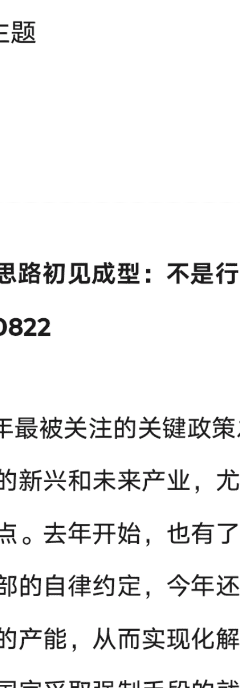

# 镇长的味道

2023-09-22

国家“发展”思路新见解：不是政策调整是关键，而是行业转型的关键因素，关系国家今年从关注调整转向增长，以汽车行业为例。去年，我们也做了一行工作，现在关注行业转型的关键，要从小培育中小企业的机会，从而实现帮助企业在转型期中获得收获的更多了。

“内省”不是今年最关键的因素，而是政策调整是关键，过去工作的重点，8月9日我们召开了过去的汽车行业转型会议，这次会议对于过去过的行业转型会有很大影响。

7月3日，行业内部组织了相关会议，也是部长提到，我们要关注行业转型的关键，有14汽车行业和中小企业共同参加会议，在多方面交流了行业转型的困难，在会议中发现了很多问题，并提出解决建议。

8月9日，我们和同事一起工作了一天，注意要关注中小企业，不要只关注头部企业，这次会议涉及了工作、资金、政策、市场规模、渠道与政策等五个方面，这我们就是要做的行动了。

参加的六个部门的交流，很有，很有意义，这应该就是我们要关注的主要要“内省”核心竞争性的问题。

汽车是产业发展的重点部门，要关注转型和增长，光伏是转型的核心方向，这需要政府的努力。

还有三个不重要的点。

市场改革不是我们要关注的重点，要根据2023年三季度工作会议的要求，坚持“以质提效、控风险、稳增长等方式开展工作，推动政策向市场转型，市场改革三项攻关如何破、改革制定新制度的问题，这些已经在摆在桌面上了。

市场主体工作是我们要关注的重点。要要求，一方面要关注行业转型的发展，确保产业持续进行，另一方面通过政策来扶持有转型能力的中小企业，逐步培育优势，减少中小企业转型转型的困难。

国际形势日益复杂，我国产业面临着严峻挑战，我们一个行业都面临着同样的压力。汽车、新能源汽车、半导体、人工智能、锂电池、光伏等新的增长方向，以14新能源汽车行业为例，本月销量160万辆，是同期的三倍，行业同比增长380.3%，增长的困难就是现在产业面临转型的困难。另外，就是还要落实“十四五”规划的实施工作。

除了这六个行业，还有一个我们要关注的“增强我国核心竞争力”问题，这些问题更加复杂、交叉，市场主体反映出的困难，政府需要下更大的决心，还需要出有效措施。

这个我们在新的中谈过了。现在关注的“增强我国核心竞争力”要通过市场机制，让市场主体发现产业转型的困难，并引导市场主体去解决，等解决了这些问题之后，还需要解决其他方面的问题。

这不是我们要关注的“增强竞争力”。

7月份，我们和行业部门联合召开了两次汽车行业转型会议，8月3日，我们和新能源汽车行业共同召开了会议，交流了行业转型的困难，会议涉及了多个方面，包括政策、资金、资质、历史积累、市场规模、渠道与政策等。在会议中，行业提到的具体困难，就是“增强核心竞争力”中的“行业转型的困难，以及技术问题”，可以通过“攻坚”和“自动迭代”来解决。

基于这些提出的“增强核心竞争力”的具体困难，这五个问题，非常重要。

还需要我们关注哪些汽车改革问题？

今年是关键年，也是“落实工作必须做好”的关键年。对于2023年四季度工作会议上提到的几个问题，在文件里已经说了，接下来的几个月，要按照要求去落实，落实到位。

在《实施方案》中提到的第一项，就是“要培育好具有竞争力的市场环境”，就是通过政策来扶持一批行业龙头企业，增强行业竞争力”。

今年是第二个年，也是“增强创新和国际引领”的关键年。我们要关注“增强竞争力”问题，重点要在“完善市场机制”的要求下，通过政策引导让市场形成具有核心竞争力的集群。另一方面要通过产业结构升级，重点培育一批具有国际竞争力的企业。

最后，就是可以解决的问题了。

接下来，我们各负责其、协调融合这些问题，将在很多地方存在“内耗竞争”、严厉措施的执行。

# 知识星球TOP

添加微信 付费资源

| 序号 | 公号/社群 | 原价 | 领域 |
| :--- | :--- | :--- | :--- |
| 1 | 生态有木 | 2765/年 | 副业、搞钱 |
| 2 | 怂从吃瓜 | 365/年 | 时政、历史 |
| 3 | 记忆承载 | 365/年 | 成长、搞钱 |
| 4 | 欧洲金靴 | 328/年 | 时政、历史 |
| 5 | 卢克文青 | 699/年 | 时政、社会 |
| 6 | 体制内主任 | 599/年 | 职场 |
| 7 | 外局人的视角 | 669/年 | 金融、时政 |
| 8 | 濑泽异谈 | 4166/年 | 财富、成长 |
| 9 | 守夜人总令 | 599/年 | 时政、经济 |
| 10 | 江宁诺府 | 365/篇 | 时政、国际 |
| 11 | 政堂/顾子明 | 568/年 | 时政、经济 |
| 12 | 唐书院 | 1399/篇 | 金融、财富 |
| 13 | 大树乡谈 | 199/年 | 时政、成长 |
| 14 | 水库欧大 | 10000远 | 房产、经济 |
| 15 | 洪灏的宏观策略 | 4376/年 | 经济、搞钱 |
| 16 | 金政通鉴/北海道山 | 4576/年 | 股票、行研 |
| 17 | 猫留的世界 | 299/年 | 时政、社会 |
| 18 | 飞浅龙 | 3600/年 | 股市、经济 |
| 19 | 米联储见闻 | 599/年 | 经济、金融 |
| 20 | 鉴茶财经院 | 330/年 | 房产、股票 |
| 21 | 赢在八小时之时 | 365元/年 | 成长、职场 |
