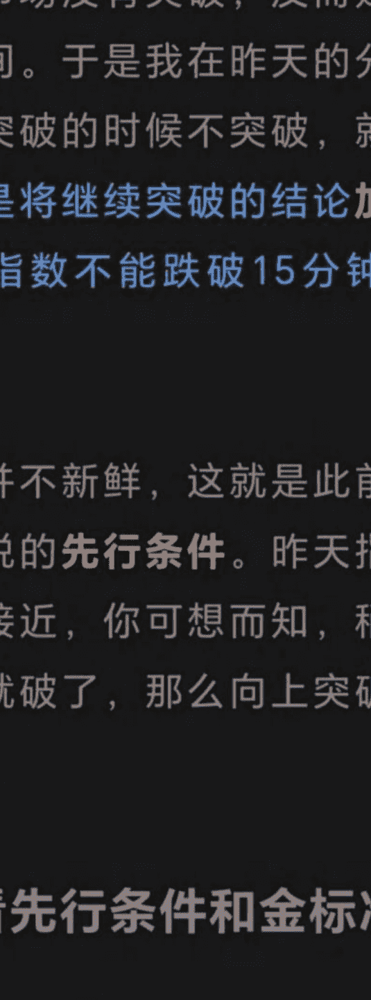
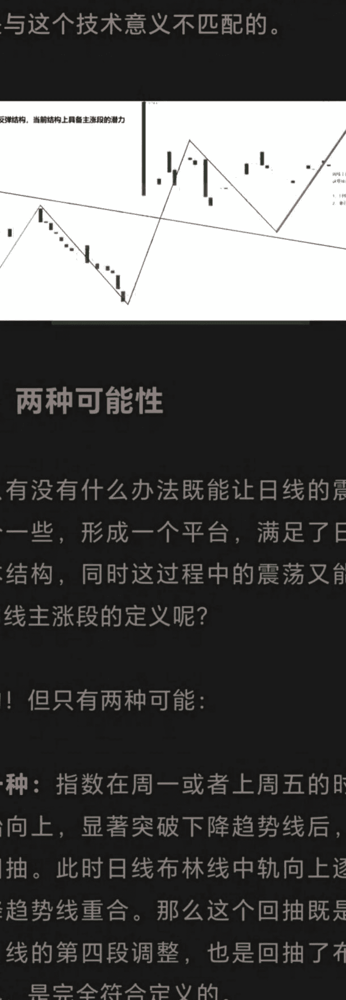
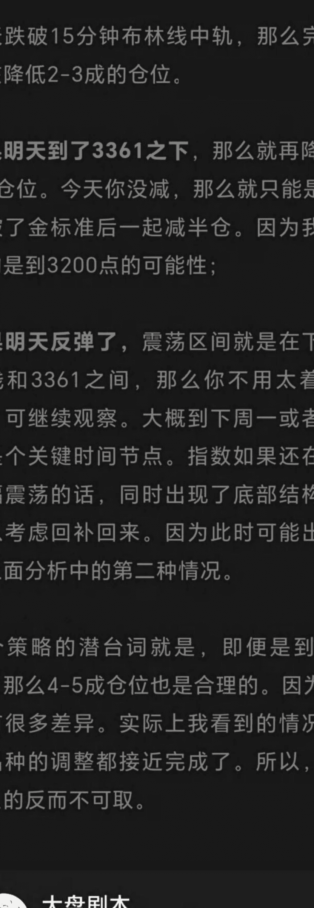

# 所有的回调

作者 大象日报
2023年05月19日 02:13 财经

很多人认为在回调中寻找机会。

在回调中寻找机会其实是反向思维。

## 二、 寻找回调和条件

- 1. 我在3326中看到了和3322相似的回调条件，其实回测是有参考价值的：

从设置了3326回调之后，我又看到了类似的趋势出现。第三次是在3280中回调，看起来和上一次一样，但是我没有跟进了，因为前三次回调都在3326附近支撑住了，这一次直接跌破了。

- 2. 现在的回调在3326中，和3322非常相似，我之前定义的“回调”在3326中再次回调了：

为什么这次回调没有被“支撑住”了？因为回调已经跌破了3326的支撑。

在这种情况下，由于3326形成的新的支撑位被突破了，所以回调失效了。

## 三、 回调的形态

很多人问我另一个问题，回调的形态代表什么？我认为回调形态代表大家在回调中寻找机会。

在设置了3326形成的支撑位之后，最后两次回调形成了一个三角形的形态，所以回调又突破了呢？

这个回调的角度我注意到了比第一阶段的角度更陡峭，第二次和第三次回调的回调的下跌幅度越来越小。

这种三角形的形态被认为是有可能的，但是我认为第三次回调的时候趋势已经结束了。
