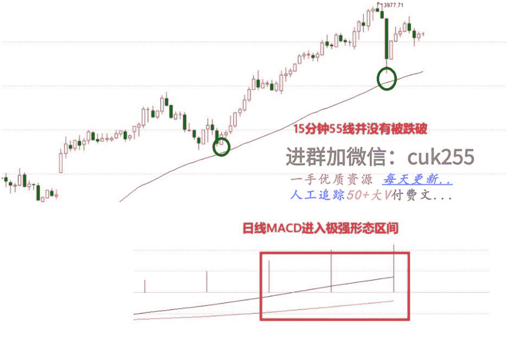
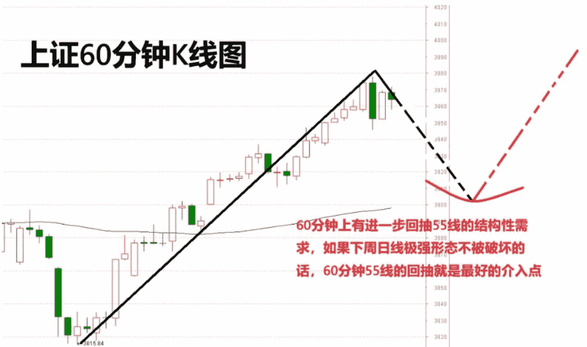

# 一个最佳位置

已付费 原创 肥猪仔 大盘脚本

2025年12月28日 20:01 陕西 🎧2人

又到了半个字都不能多说系列...但绝对精彩。

付费进群+V: cuk255 人工追踪50+大V付费文...每日分享各美深度文章..

在上期的分析中，我跟大家提出了“有条件看突破”的概念。其实就是两个“只要”：

## 1、只要不破15分钟55线，那么就一直看；

## 2、只要是15分钟55线之上的任何波动都是意义的，都应该忍受。

15分钟55线并没有被跌破
进群加微信：cuk255
一手优质资源 每天更新...
人工进阶50+大付费文...
日线MACD进入极强形态区间

一直看剧本的朋友我想应该是心领神会的。这个“条件”不是乱给的。底层逻辑是用日线极强形态的持续来度量突破55均线的有效性。本质是将不能够当下判断的“突破”问题，等效转换成了能够量化评估的极强形态问题。这是我们平时分析中的常用手段。

就像是你，研究解析几何，有时候从平面直角坐标系切换到极坐标，一下就会清晰无比；也像是，你研究信号波动，从时域切换到频域，又是豁然开朗一样。

我们这个分析体系，实际上就是包含两个部分，一个是结构性分析，一个是稳定性分析。二者是从不同角度描述同一个东西。同时也是互为补充。就像是你手里拿着一个杯子，会正面看，会反面看一样。力求这个杯子进行最全面的描述。所以，切换视角，多数时候是非常重要的。

当然，任何事情有利就有弊。这种切换视角的思路有时候也会人为地将情况搞复杂的。你不能总是奢求任何时候任何方法都能得到相同的结果。比如，当结构和稳定性分析的结论相矛盾，就会让人觉得无所适从。此时，你要明白，并不是市场本身“复杂和矛盾”了。市场本身是客观不变的。只是我们做到“预判”，分析工具对应的正确性永远都是概率分布的。这时候，我们稍微等一等，这也可能是我看的，兼具成本和概率优势的一个最好的技术性低点。

以下，我分三个要点，分步将这个低点的核心问题阐述如下：

一、首先跟大家进一步清楚的事情是，文中设置的15分钟55线的技术条件，是有时间范围的。也就是必须在日线MACD极强形态的持续过程中。所谓极强形态的持续时间是从DIFF指标穿0轴开始，到DEA指标也上穿0轴为止。一般来说大概有四天左右的时间。从目前来看，这次日线的极强形态是在周一结束。

按照我们对极强形态被破坏的定义，在周一下午之前，指数如果没有突破15分钟55线，那么基本上就可以反证55均线突破成功。如果相反的话，当前的MACD极强形态很有可能变成一个日线的MACD的0轴死叉。这样反而会加速向下走势的发展。

以下，我分三个要点，分步将这个低点的核心问题阐述如下：

一、首先跟大家进一步澄清的事情是，文中设置的15分钟55线的技术条件，是有时间范围的。也就是必须在日内MACD极强形态的持续过程中。所谓极强形态的持续时间就是从DIFF指标穿0轴算起，到DEA指标也穿0轴为止。一般来说大概有四天左右的时间。从目前来看，这次日线的极强形态大概是在周一结束。

那么按照我们对极强形态被破坏的定义，在周一下午之前，指数如果没有跌破15分钟55线，那么基本上就可以反涨55均线突破成功。如果相反的话，当前的MACD极强形态很有可能演变成一个日线的MACD的0轴死叉。这样反而会加速向下趋势的发展。

所以，周一上午指数持续在15分钟55之上震荡十分关键。不要小看半天时间，这是后续行情要继续向上发展的一个关键点。

## 二、当上述条件满足的情况下，从周一下开始，指数逐渐退出日线的极强势形态。此时15分钟向上的MACD顶部背离会再次生效。在这个顶部背离的引领下，指数会逐渐走出一个针对60分钟55线的震荡回落的调整。

细心的朋友会发现，当前60分钟从3815点开始，只走出了第一段向上段，但线上早已走出了接近八连阳的走势。所以，在结构分析的视角下，60分钟的调整需求是相当强的。如果在这种结构性调整需求的背景下，15分钟仍然在55线的支撑下持续震荡向上，那么显然就矛盾了。当稳定性向上的需求和结构性向下的需求，达到某个平衡点后，市场必然要做出向下的调整选择。

所以，当指数重新回抽60分钟55线时，就是当前上涨结构中，成本和概率优势达到最佳均衡点的建仓位置。此时，增加九成左右的仓位都是可以的。

## 上证60分钟K线图

三、要注重，如果第一个条件没有满足。那么60分钟回抽55线的完美性质就要被大折扣。因为，从底层逻辑上已经甚至无法建立起指数已经突破55天均线的这个大背景了。当然，我们可以等待60分钟以第三段的形式去突破55天均线，但是时候的概率和持续性就比第二情况要低了。

所以，这种情况对应的操作策略：在60分钟回抽55线附近，尝试加仓。如果60分钟55线支撑不住，及时减仓；如果60分钟55线支撑住了，可以进一步加仓。

对于新手来说，60分钟55线的支撑是是有意义的。

肥猪仔

# 深度视野文集
群微微信cuk255

全部包含以下内容：

| 序号 | 作者/频道 | 原价 |
| :--- | :--- | :--- |
| 1 | 粉丝会 | 365元/年 |
| 2 | 成付财富圈 | 59元/年 |
| 3 | 政事堂 | 568元/年 |
| 4 | 米联储 | 599元/年 |
| 5 | 欧洲金雀 | 328元/年 |
| 6 | 咕五内部 | 400元/年 |
| 7 | 卢克文读书会 | 699元/年 |
| 8 | 鉴茶财经 | 3310元/年 |
| 9 | 猫哥的视界 | 299元/年 |
| 10 | 财经新周 | 1498元/年 |
| 11 | 杨世光在钱 | 2200元/年 |
| 12 | 森森财经 | 1600元/年 |
| 13 | 源泽异译 | 持续更新 |
| 14 | 司马林解读毛选 | 2.万元 |
| 15 | 虚走三部曲 | 599元/年 |
| 16 | 卢克文知识星球 | 268元/年 |
| 17 | 额外赠送 | 三村边老王、三花九文学集 |

（更多资源将不下去了）：
- 守夜人司令知识星球
- 接鸿魔王星球
- 生才有知识星球
- 创始笔记
- 达沃译论星球
- 雪球花甲老头
- A 视野
- 大树乡谈
- 江初响
- 泮咩说
- 上海海学
- 西风付费文章
- 老端
- 赢在小时之外
- 局外人的视野
- 升值
- 体制内等等其它大V付费文集

限时年费188/年 低成本链接全网V优质内容
