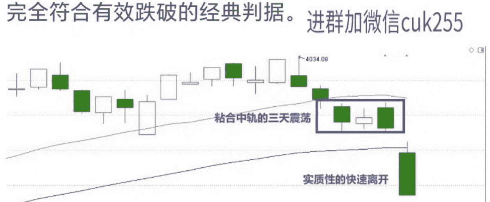
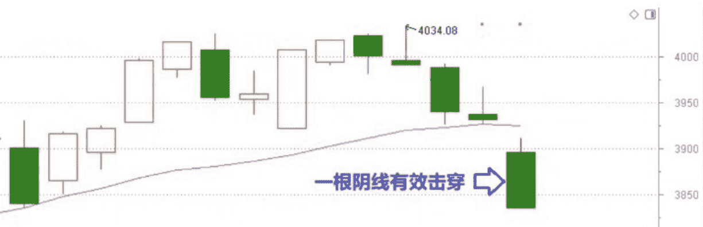
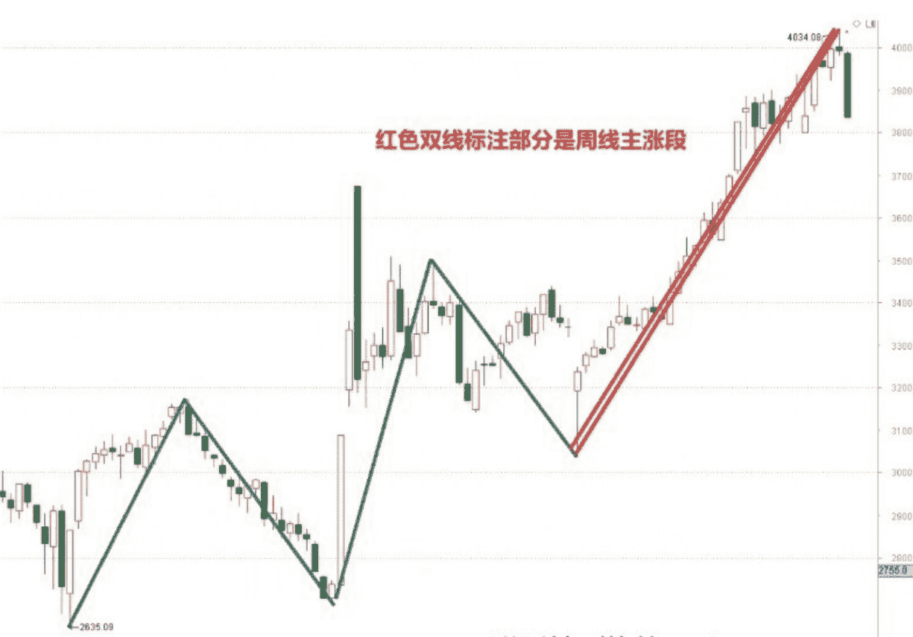
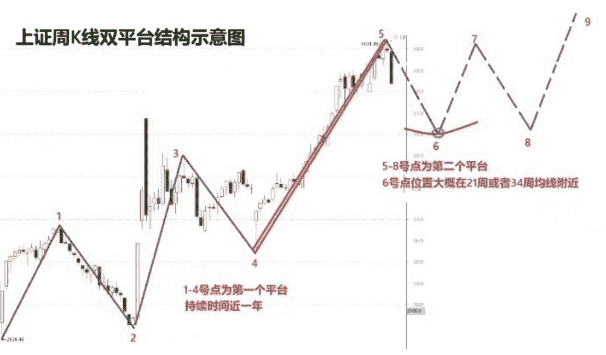
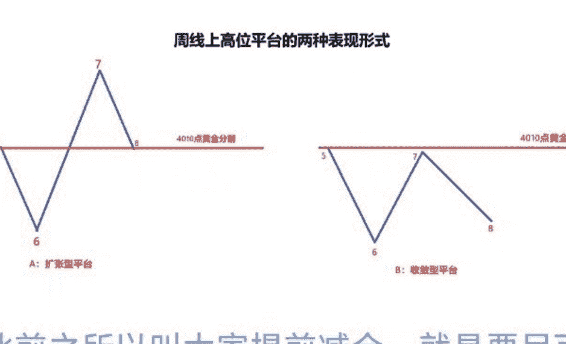
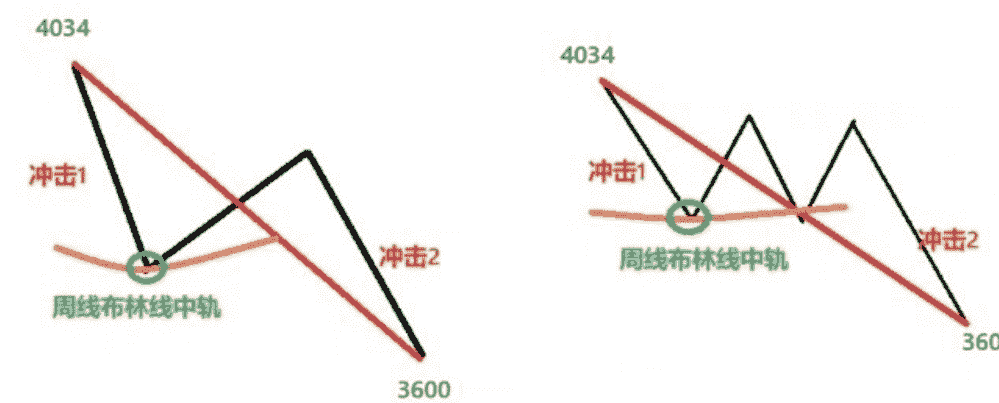
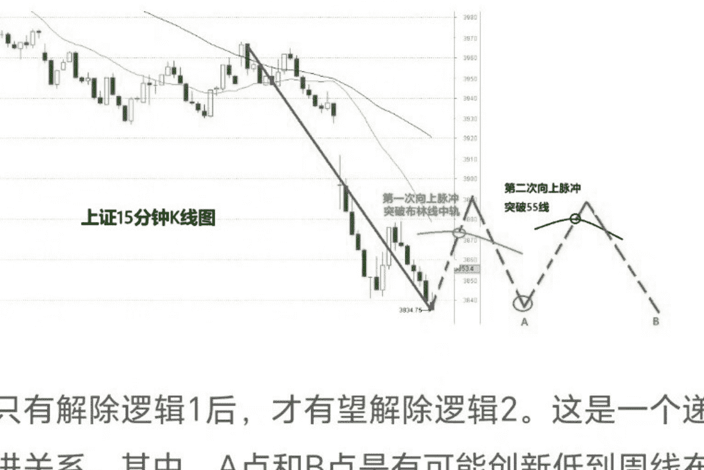

# 调整的所有秘密

2025-11-23 商品介绍 >

⭐⭐⭐⭐暂无评分 去评分

微信关注公众号 > 入群加微信cuk255

## 一、基本定性

本周的几天调整和从3040点上涨以来的所有震荡调整都有明显的区别。之前的只能“回抽”，而这周是完全有效地跌破了日线的布林线中轨，才是真正的“调整”。形态是十分清晰的，周二到周四的三根K线是略微跌破中轨的震荡，现在是不是有点怀念这“片刻宁静”？周五的阴线是快速离开的。这是完全符合有效跌破的经典依据。进群微信cuk255

如果你更技术一点，看的是双日周期，那结论是一样的。显然，一根大幅幅的阴线，直接完成了对双日周期布林线中轨的有效跌破。我术

## 上证双日周期内有效突破布林线中枢意图

因此，无论是从单日还是双日周期的逻辑上看，本周的下跌都进一步确认了4034点就是从3040点上涨以来周线为主段的最高点。也就是说，周线的主涨段在4034点位置已经结束了。可以仔细下面这个周线图，红色双线标注位置是周线为主涨段:

红色双线标注部分是周线为主涨段

进群加微信cuk255

大家要注意的是：

- 1、结束的是红色的双线部分的快速主涨上涨段。而不是从2635点开始的周线上涨趋势。上涨趋势没有结束；
- 2、这个结论我是在4034点形成之前就跟大家反复预判了。而本周的下跌只是后端更一步的佐证和完成验证闭环而已。

所以，从4034点后的调整的基本性就是：一个周线上涨趋势行过程中的正常回落。是区别于此前周线主涨段的一个周线级别的调整段。是主涨段结束后的必然的结构性需求。

这个定性的描述看似话，但其重要性就在于，不能看着调整来势汹汹就将其分歧波高线月线级别的调整或者是上涨趋势的终结，又或者是盲目乐观，低估了调整的威力，将其误解成日线级别的“回抽”。

过高过低的估计都是不对的，因为没有任何逻辑和信号来支撑。它就是一个周线级别的调整。周线级别的调整至少应该持续4-5周的时间量级。这点是要首先明确的。

## 二、结构上的定量

进群微信cuk255

一直看脚本的朋友都知道，从2635点以后的上涨潮势，我一直在用周线的双平台结构来进行描述。在3040点主涨段出现之前，这个描述都是预判性质的，但是这个主涨段出现后，这种双平台的变化可能性就陡缩小了。换句话来说就是，3040点后的主涨段进一步在后端佐证了此前预设双平台结构的正确性。

那么根据双平台结构的基本性质。现在的调整在基本上高位“第二个平台”开始构建的第一个下降段，即下图中的56段，随后还要再次经历周线上的反弹，下图中的67段，然后再次回落，即78段，然后再次创新高的过程。

一直看脚本的朋友都知道，从2635点以后的上涨潮势，我一直在用周线的双平台结构来进行描述。在3040点主涨段出现之前，这个描述都是预判性质的，但是这个主涨段出现后，这种双平台的变化可能性就陡缩小了。换句话来说就是，3040点后的主涨段进一步在后端佐证了此前预设双平台结构的正确性。

那么根据双平台结构的基本性质。现在的调整在基本上高位“第二个平台”开始构建的第一个下降段，即下图中的56段，随后还要再次经历周线上的反弹，下标中的67段，然后再次回落，即78段，然后再次创新高的过程。

### 周线双平台结构示意图

从这个结构中，可以得到以下关键定量：

- 1、5-8的高位震荡平台技术意义和1-4的低位平台是对称的。一般来说5-8第二个平台的总体呈现出时间上略微缩短。也就是说1-4的低位平台持续了，而当前的高位平台时间上会缩短；
- 2、我们当前处于56段的调整中。56段的技术意义和此前2段调整相当。所以总体来说，调整的空间是在400个点左右。一般来说6号点的精确位置是在周线布林中轨或者是34周均线的任一位置。考虑到前面2段调整是400点的量级，并且从周起就跌了200个点。所以布林线中轨太接近而不能成为最终支撑，除非它是在中轨附近反复震荡形成6号点。这不能首先想定，而是要根据实际走势来修正。我们首先想定的应该是到周均线附近，这个位置是动态的，但大概就是从4034跌去400点左右。
- 3、周线的布林中轨即便不是最终的6号点，其对调整也会形成强力的支撑；67段的向上反弹，是整个高位平台的核心。在整个平台的三段结构中，只有7号点的位置具有弹性，相对于5号点来说可以创新高。因为5号点正好是关键分割4010点的位置，创新高这种情况，如下图中的扩展型平台意味着突破分割。这种情况下7号点创了新高，那么就很可能运行到4010点--4400点中间的某个位置。67段的潜在反弹幅度就很高。

我们之所以叫大家提前减仓，就是要尽可能规避掉56段的调整，然后以最好的成本来博67段创新。

## 三、对于56段更详细分析

- 1、有了以上两点定性的准备，对于56段的调整我们大概就有了印象，调整是一个较低速度和较低幅度的调整，并不是趋势性的转折。而本周市场仅了一个星期的时间就跌了200点的幅度，这并不是说明后面的调整要向下加速，正好相反，从下周开始的走势应该是要有明确且明显的调整。要达到这个目的，可以是先反弹，形成震荡来消耗时间，也可以是下跌速度明显变小，然后形成日线级别的反。总之，不会出现所谓的“惯性”加速下跌。这是最基本的判断。
- 2、56段作为一个周线调整。其基本的内在结构性要求是内部至少需要形成三段、至多需要形成五段的日线级别的结构。不管是三段还是五段下跌结构，主要的下跌“冲击”就是第一段和最后一段。

我们目前处于第一波冲击的末期。周线布林中轨道下周预计会到3800点附近。
- 3、从上面理想的标准模型来看，在此之后的反弹是在下跌过程中最有短线操作空间的。对于前期减仓完成，且具备技术分析素养的朋友来说，一个完美的操作方案莫过于周线中轨附近逐步加仓，反弹后减仓，再到3600附近再完成回补。这个操作站在预判模型的角度有点“过于完美”。看似简单，实际操作起来对于新手并不友好。所以，对于绝大多数的朋友来说，反而应该执行“后200个点逐级加仓”的策略。你可以选择在冲击1的3800点附近分步加仓，然后到冲击2的3700点附近再次分步加仓。最终确保3600点附近完成9成的左右仓位。中间的震荡能等等。

## 四、排除短线差

上述我们在去年5月到9月的调整中，也就是说2段的调整，同样采用这种策略。朋友基本上都过了去年月份的上涨。但这是理论，我们实际操作是要在这个框架下，解决实际问题。按照上面的框架，显然完全可能会出现“第一次机会”。排除的“最差情况”只有一个：

- 逻辑1：60分钟的主跌段，周五之所以形成如此幅度，原因是有两个下跌逻辑形成了共振；
- 逻辑2：日线进入极弱形态。现在的局面是15分钟的位置较高，要同一种的方式应该是击穿15分钟布林中轨，此时震荡直到15分钟创新低，后再形成向上的反弹。

上证15分钟K图只有逻辑1后，才有逻辑2。这是一个递进关系。其中A点和B点可能创新低到周线布林中轨附近。所以，从精细化的角度来说，如果直接跌到800点以下，则进行第一次回补。比如从A点，随后再次反弹逻辑2后的回落点B处，再加一成。在反弹过程中追高。

【课程大纲】
- 分析预判和交易的本质 | 经典分析方法的缺陷
- 特殊指标的重要运用 | 什么是背离 | 结构分析的领先意义
- 如何寻找最有效的支撑压制系统 | 识别交易拐点
- 全周期看盘和位置体系 | 稳定性的应用

## 深度优质集群

全部包含以下内容：限时年费188/年

- ① 吃瓜群众包圈群对话（原价365 元/年）
- ② 子明私享汇（内部）文章
- ③ 政事室（顾子明）付费内容再送子明群聊
- ④ 米联储闲友【作者米穗】（原价599 元/年）
- ⑤ 欧洲金雀会员专属文章（原价328 元/年）
- ⑥ 砖瓦仁内部圈（原价400 元/年）
- ⑦ 卢克文青读书会专属文章（原价699 元/年）
- ⑧ 鉴茶财经知识星球（原价3310 元/年）
- ⑨ 猫哥的视界知识星球文章（原价299 元/年）
- ⑩ 财财经周【独家新闻】（原价1498 元/年）
- ⑪ 杨世光在金坝（原价2200 元/年）
- ⑫ 森淼财经知识星球（原价1600 元/年）
- ⑬ 潇游异译付费文章（持续更新）
- ⑭ 司马林解课全套音频和全套书籍藏版无删（原价2.3 万）
- ⑮ 虚构三部曲[民国梦、帝国争亡、不被理解的MAO](原价599 元/年）
- ⑯ 卢克文知识星球文章（原价268 元/年）
- ⑰ 额外再送：卢钛元微博付费专栏、三村丰老王、三花九洞文集

- ① 守夜人知识星球、接换魔王知识星球、成术后财富、雪球花甲老头等
- ② 创始人笔记、达叔谈论知识星球、成术后财富、雪球花甲老头等
- ③ A视野、大树乡谈、江宁付君、咩咩说、上海家学等付费文集
- ④ 西凤付费文章、老端、赢在八小时之外、局外的视界、升值、老A体制内等其它一些V付费文章（每月不低于600元）

