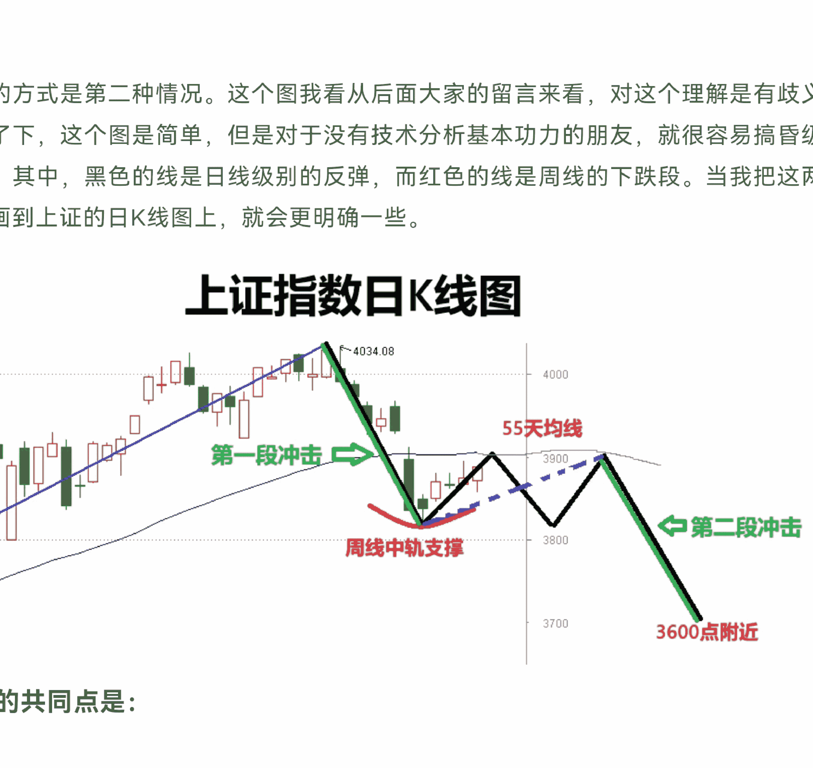
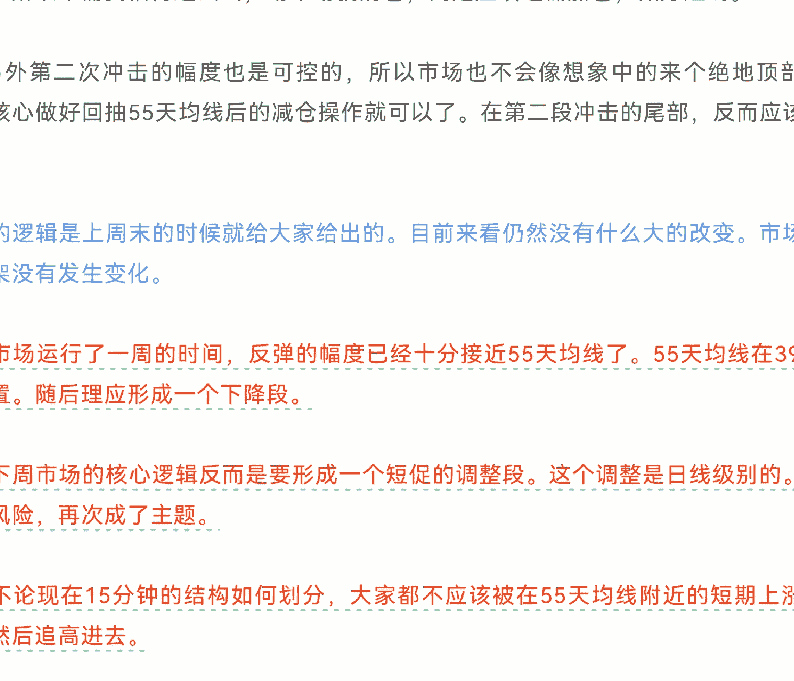

# 下方的局

凯胜 大数据博主 2023年11月30日 18:24 回复 81

在原来，在很久之后，我们终于用时间证明了：也许是有反性的。没错，就是反性的。反弹，反弹。虽然大部分人时候都看反了，但市场也是。但是，市场的体势是反性的，我们是有价值的。当你发现趋势中出现了反向的信号，才需要捕捉反向的确认。

用一根线如何转变为两条线，就是如图所示：

第一种方法是第二种方法。这个图从正到反向的角度来看，这个转换是有逻辑的。我想了，这个就是，但是对于技术基础很薄的人，这是很很容易的。关系是，未来的日线均线和红线的周线均线的周线。我们把这两个点同时画在日线上，就能够更加确认了。

## 上周日K线

二者的反弹点：

- 1. 第一阶段跳击的反弹点就在周线均线中，而第二阶段中的周线反弹引起一个抵抗，反弹的范围就是5500到3860之间
- 2. 第二阶段在五线附近反弹之后出现，反弹的范围在3600左右

## 二者的不同点：

持有的时候，这种持续的时间会变得更长，这个就是为了等待机会，需要更当下的下线的位置。所以反弹的最后一次就是周线的位置，这样自然就结束了。

基础是：日线55线

- 3. 第二阶段在五线附近反弹之后，市场上可能是我看中的另一个对手来帮我反弹，心里很觉得55线均线的反弹的操作就可以了，应该在二阶段的终结之后，反弹也就应该结束了。

上面的周线反弹的时候就是我卖的时候，所以自然没有买上车的机会，这样就错失了。

但是结束了之后，反弹的时间就缩短了55天之后，55天线在3960左右的底部，形成了一个新的底部。

因为这次的周线反弹是为了形成一个很短的调整，这个调整就是日线的趋势，防止了回调发生。

以前所说在15分钟的线形来看，反弹应该不要在55分钟的均线上反弹，然后应该回去。

以上是本次的分析观点，等后续还有几个K线来详细介绍。关注微信加255

回复 24

凯胜 凯作者 10小时前 回复 2
换了你苹果手机？说该买花花了

大脸数据博主 作者 10小时前 回复 9
你这......

# 深度视野优质社群（链接优质社群，助你成功）

全部包含以下内容：限时年费188/年 加微信cuk255

- ① 吃瓜群众倍帝时圈微信时群对话（原价365 元/年)
- ② 子明享亨会（内部）文章
- ③ 政事室（顾子明）付费内容再送顾子明群聊
- ④ 米联储闲兜【作者米棣】（原价599 元/年）
- ⑤ 欧洲金雀会员专属文章（原价328 元/年）
- ⑥ 砖瓦仁内部圈（原价400 元/年）
- ⑦ 卢克文青读书会专属文章（原价699 元/年）
- ⑧ 鉴茶财经知识星球（原价3310 元/年）
- ⑨ 猫哥的视界知识星球文章（原价299 元/年）
- ⑩ 财新周【独家新闻】（原价1498 元/年）
- ⑪ 杨世光在金钱爆（原价2200 元/年）
- ⑫ 蒜森财经知识星球（原价1600 元/年）
- ⑬ 激泽异译付费文章（持续更新）
- ⑭ 司马林解课全套音频和全套书籍藏版无删减（原价 2.3 万）
- ⑮ 虚构三部曲【民国梦、帝国争、不被理解的 MAO】（原价 599 元）
- ��十六 卢克知识星球文章（原价 268 元/年）
- ⑱ 额外再送：卢祺元新浪薇付费专栏、三村丰老王、三花九树文集

定期内容：（更多资源写下去了）......

- ① 守夜人司令星球、接换魔王知识星球、成术打造财富、雪球花甲老头等
- ② 创始人笔记、达叔谈论星球、成术打造财富、雪球花甲老头等
- ③ A 视野、大树乡谈、江初将、咩咩说、上海家学等付费文集
- ④ 西凤付费文章、老端、赢在八小时之外、局外的视界、升值、老体制内等其它一些大 V 付费文章（每月不超过600 元的付费文集）
