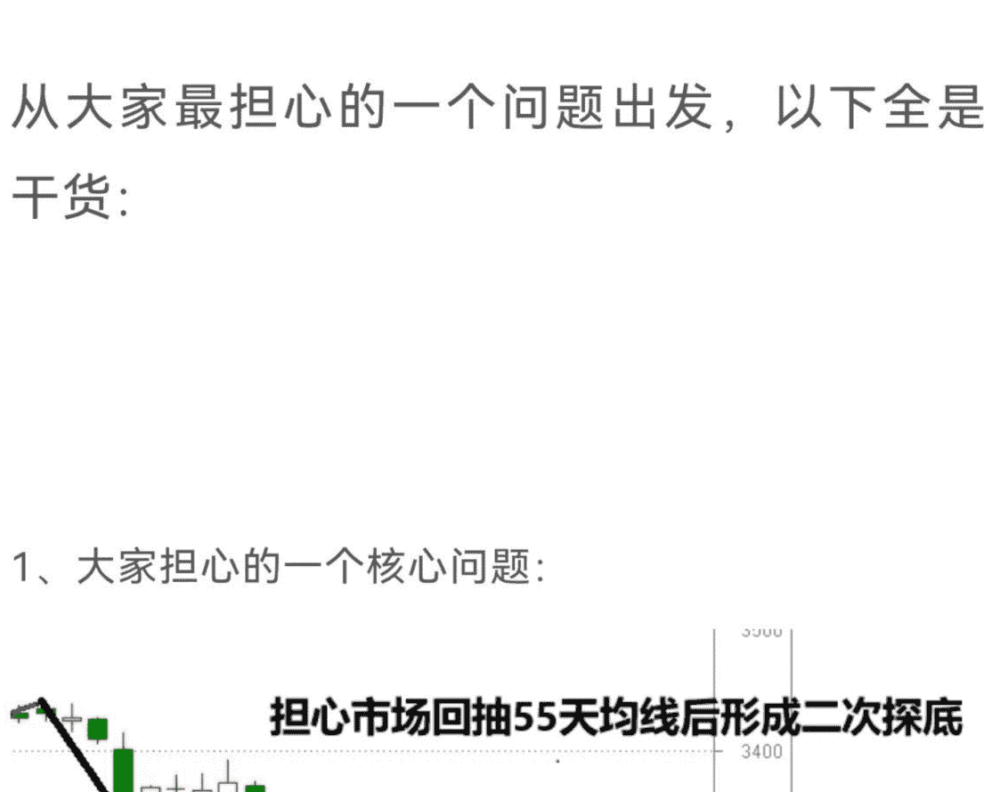
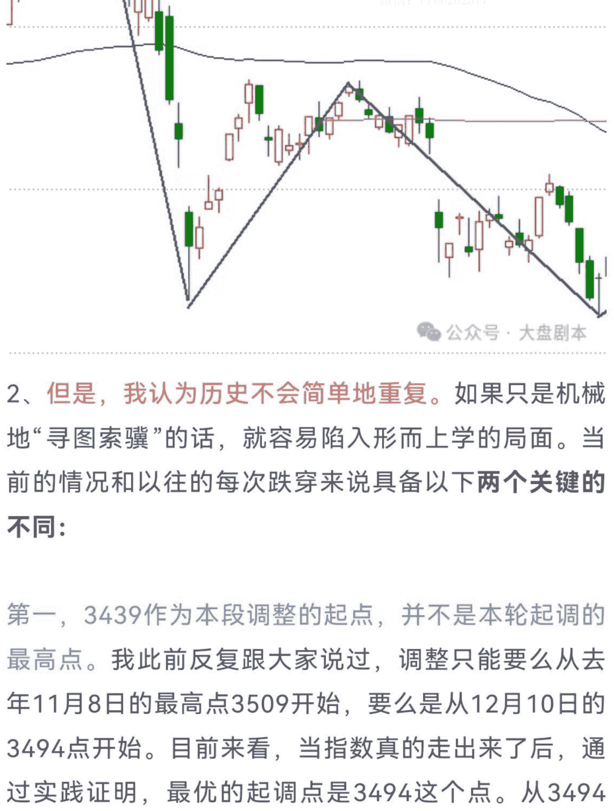
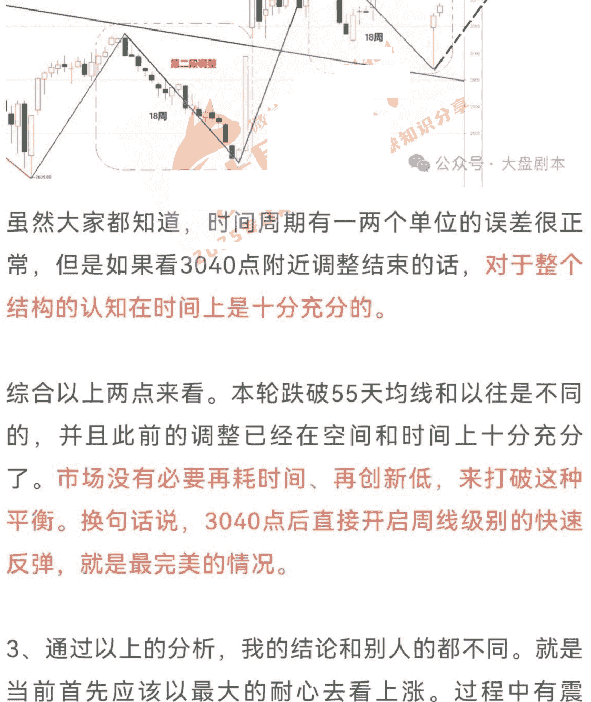

# 详细的分析

进财经 大根本 2025年04月24日 20:25

全文

从大家关心的技术和数据开始，以下是结论：

- 1. 大家关心的核心问题：

指数美股升空55天后，回抽后形成第三段的调整，这个调整非常重要，大根关注这个问题。

但是我凭借自己的技术和经验积累，以往大家也遇到过在55天后之后再下跌的情况。比较的2018年是反转开始的时期，在55天后调整又涨回来了。这个例子如下：

- 2. 是，我认为不会再次发生。如果指数只是“诱调整”的话，现在就是入场学习的信号。目前的趋势和以后将让大家关注的重点就是我们关注的问题：

第三个55天调整不是结束，而是开始。我认为这次调整非常重要，建议大家关注11月份的50点附近，现在是12月份的3490点附近。目前，正处于3496到3494之间。最近的调整证明，这次调整并不是结束了，而是形成了第三段的调整，并且我们已经组合成了一段的调整，下如下所示：

所以，可能我们关注的调整结束了，但是我们关注的3490点的调整还在。作为下一个，我们再关注55天后如何形成调整：

第二个，从我关注的第一个调整开始，到3490点结束的调整，是一个从55天后形成的五次调整中的。要注意，3494到3490点的调整期是10天，这和前两次的调整是相同的。

# 免费 价值 及时 专注

# 扫码加入 知识星球TOP 免费资源群

- 每日免费获取价值资源
- 可提供各类资源搜索服务

| ◆热门付费文章 | ◆各行行业报告 |
| :--- | :--- |
| ◆精选图书资源 | ◆副业赚钱方法 |
| ◆职场实用资源 | ◆AI政经自媒体 |

公众号: 知识星球TOP 微信信号: jntsg8 微信信号: jntsg2

分享资料仅供个人学习，请及时删除，切勿商用传播
