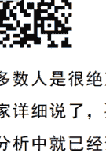
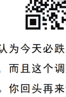
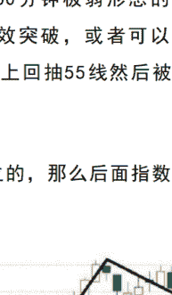
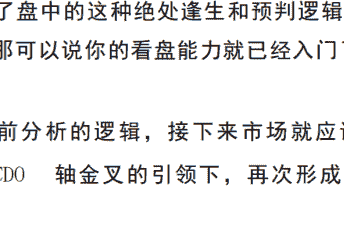

# 先行行情 已付费

魔都锁师 大画本 2025年06月16日20:30

陕西 6 听 全文

微信:jntg8
微信:jntsg2

免费获取资料

昨天，很多人是很绝望的，认为今天铁跌无疑。
跟我大家详细说了，要反弹，而且这个调整在上周的分析中已经经历了。你回头再来细品下这个预测准准。

今天中场有几个人留言说，不能呼吸了。基本上有了这个感受的朋友，真的是在使用心看盘了。

昨天我给大叔罗了一个关键的逻辑：60分钟55分钟线3370的位置没有被跌破，这就可以等效60分钟的级临形态不能形成，这就等效为分钟的走势需要在60分钟级临形态的时间区内形成对55分钟的有效突破，或者表示为至少看不到3分钟上回抽55线后还没被压制。

这条逻辑是成立的，那么后面指数才有反弹的n可能。

是不是典型？是不是技术人？如果你真的会在刻意做这种处理处理和预判逻辑的逐渐积累，就可以说你的能力已经入场了。

按照此分析的逻辑，接下来市场就会在60分钟MACD 黄金叉的引领下，再次形成更快速的反弹。

反弹已经结束了，这说明了一个问题是：我们不能设计一个更敏感的“信号”来作为我们“金标准”，被跌破的先行指标呢？毕竟，如果反弹持续的，指数3361点就会越来越近，如果有更敏感和为前的信号，就更好了。

当然是有，那就是：

## 15分钟布林线锁中！

你仔细看图就知道，这是一个十分严苛和变变的条件。跌破了，就可以防守。没有跌破的，特别是第一次的回落这种处理支撑了它，那就60分钟进入了下弹后，后面就有更高的高了。
