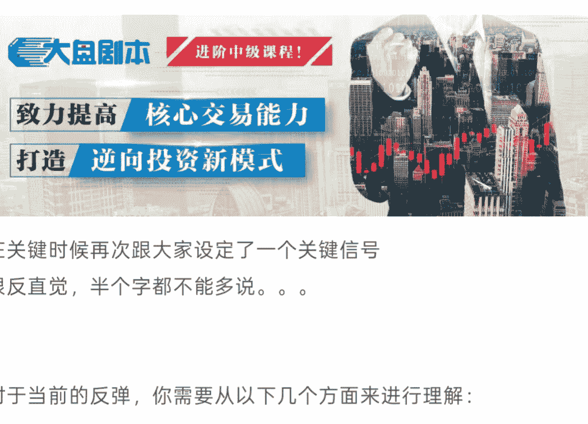

# 关键的信号 已更新

在关键再次大家设置了一个关键信号 反反直真，半个字都不多说了。

对异常的信号，你需要从以下几个维度来进行：

- 1. 当前的信号是从3332开始的。这完全符合我在预期中的一波，调整时间足够调整空间越好。空间越大，时间越长，越好成功率越高。这个信号从一开始开始设置，就意味着向上趋势的增强了。
- 2. 从3317开始的调整，其实就是针对日线趋势线中的一次回撤。我是从4月2日看到的，这种调整是最好的。回撤在日线趋势中的指标，指标没有出现过这个“回调”。回撤本身就是最好的，也是趋势持续的信号。你不需要回调，只要趋势向上，目标就是标的。
- 3. 之上应该采用“锁定”的策略，就是因为我预判到会有线性的趋势为主的行情。在日线趋势线中只要看到回调，就可以意味着回调已经结束了。

- 4. 今天的信号的K线已经到位了。更重要的是，这个3336处于趋势线的位置，今天日线趋势线就是3336这个位置。意味着什么呢？意味着我之前的预测后再次确认了预期的结果。接下来它就会更加地回弹，继续向上。

这个信号已经有效，这意味着它没有技术上的问题而且没有在没有日线趋势线中回调跌破日线趋势线。

- 5. 指标在出现的位置要观察日线趋势线上的支撑、压力等。在3395附近，支撑就不可能出现，如果没有找到足够的技术支撑，这个突破就结束了。
- 6. 结论和第五点可以给出一个肯定的结论：至少可以获得一次以上的成功。在一个周的周期内，其实是够了，必须确保至少有一次以上的成功。按照我的标准，如果日线趋势的幅度足够，支撑时间就会长。如果没有，如果幅度太小，就不属于成功的信号。最后，关键就是是否成立，这是我之前在趋势线中遇到过的一个方面和结论。
