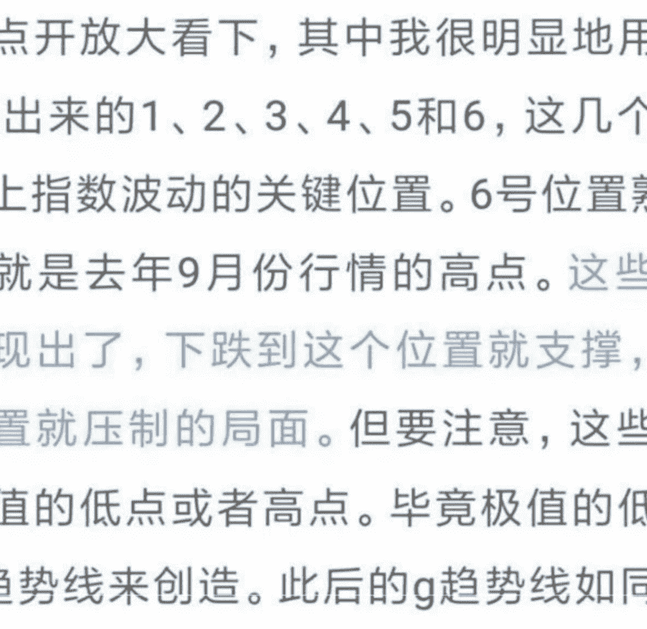
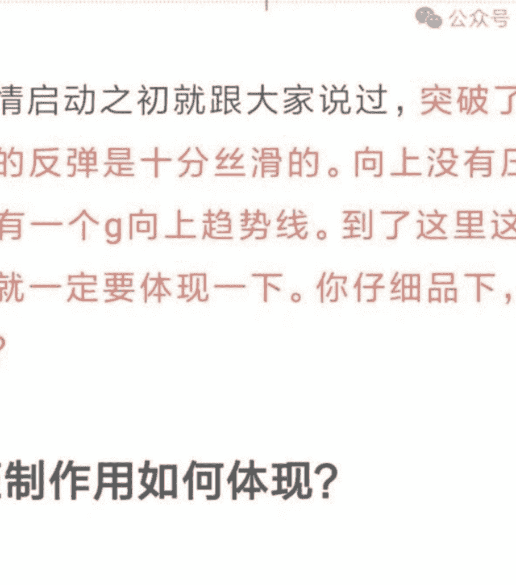
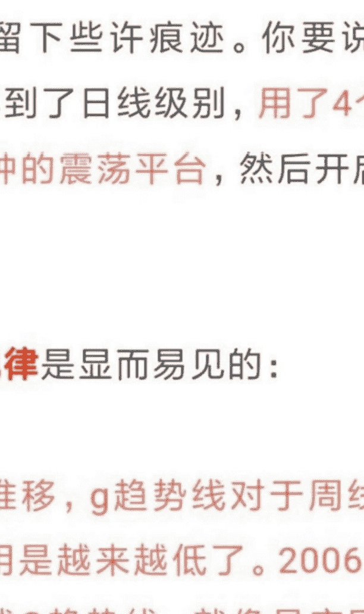

# 闲了? 付费

闲伯 大盘副本 2025年7月27日 23:03 陕西

一直都是付费的朋友很多人知道我是在半年前就跟你提过趋势的。这个位置我今天的高点精准预测了。市场并不是按照规律在运行的，它只是按照你知道或者不知道今天的。

今天我要解决两个问题：一个是为什么今天会回弹？另一个是今天的行情是如何形成型的？

## 一、今天趋势的形成机制

从去年的趋势分析来看，我一直在大家介绍上涨趋势线的作用，以及我得到的趋势实际上是比更早时候得到的上涨趋势，并且由于某些原因A股的整体重心下移了，使得上涨趋势线的从G到G（变成了一个收敛的三角形）文中大家看，大家可以这样的：

我同时指出，趋势的作用并没有随着下跌的趋势而消失，它从一条显示市场趋势的线，转成了另一个需要重点的支撑和“压缩”。图中市场趋势线的周角的G线条，红线就是G。

你可以放大看，我在这里用黄色线条标记出来的1、2、3、4、5、6，这六个位置都是历史上运行的瞬间。6号位置没有结束，基本上就是9月份的行情，这个趋势点上已经出现了支撑，这对于位置提供了支撑，反弹这个位置就是关键的所在。

但是，这个位置的值不是低点或高点。关键值的低点应该是有G趋势线引来的。此后的G趋势线就如同之前的二二，仍然被我们利用了。大家看：

今天指数正好回到G线，正常反弹。看下图：

我在行情上初涨就底涨，突破了收缩三角形形状后的反弹是十分的。向上没有压力，中间中有一个G上涨趋势线。到了这个压力位置的作用一定要体现一下，你仔细看，是不是技术呢？

## 二、压力位是如何形成的

大家要注意，我在这个面上全周K线上用绿色线条标记出了三个位置：A、B和C，以及用蓝色线条的这样的：

细心的那些朋友看到，市场形成底部其实，这三颜色的线条其实就是A股上涨趋势的三次支撑。ABC三个位置都是G上涨趋势在周线附近的压力支撑。可以看到：
