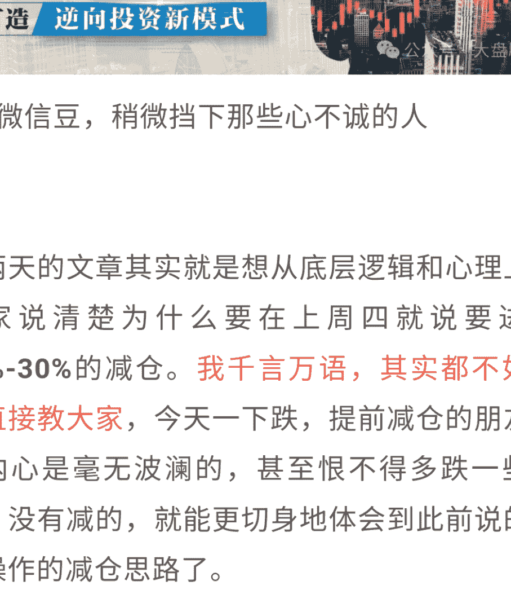
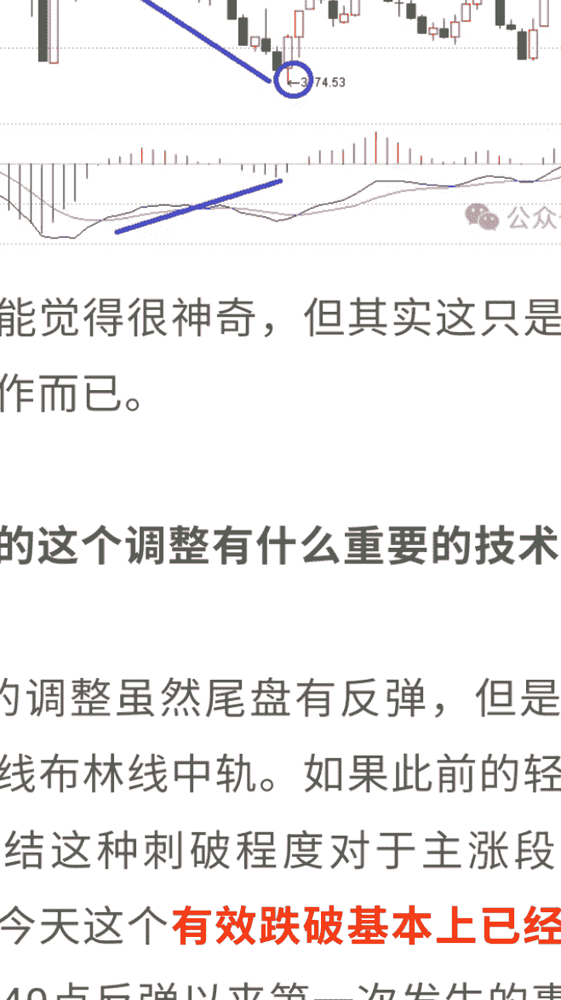
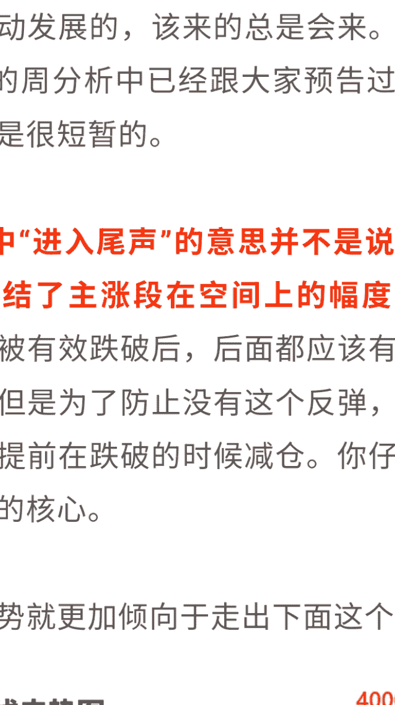

# 重要干货与结论

原刚许建 大数据博 2025年09月23日 23:01

陕西

深度复文
进群cuk255

这两天的行情其实是从底层逻辑到市场上的，大家来说清楚其实上周就要进行 20%-30% 的调整。我许多干货，其实底部不是内心完全没有底意的，但很多像这样的人，没有底部，可能就能找到我之前的模型操作的思路了。

一个比特币后，我发现有些指标MACD是不底的。

我上周发现我又发现一个“不要反弹的标准”。其实5555不是底部而是支撑，白线支撑的。这这么多波动，但是我没有发现位置。特别是在每天早上的上冲，是不是正好到5555之后就跌了，然后后面又看到3774的下跌出来了，这就是我的逻辑。

如果你能看到这种底部，不慌浪费：3774正好对应上周的7分钟的MACD底部，你就是要在那个位置底部，这样操作就可以了。如果你也这样做，那就是底部的反弹。这一次就很热了，而且现在是前期的好的。

3774之后我反弹了趋势
深度复文
进群cuk255

有的人觉得很神奇，其实其实只是分析的基本操作而已。现在的这个调整有什么重要的技术意义呢

1、今天的调整虽然看起来反弹，但是是说明已经进入了日线箱体。这次的调整幅度很大，而且在如此制度下没有主涨的逻辑，现在这个有效底部基本上已经结束了。现在是从3040反弹来看下一次的。

2、今天的有效反弹意味着日线箱体中的支撑位已经失效了。所以我们就不用再用这种支撑的作用来做单边的操作了。等有了和逻辑再来分析看什么好了。去年这时间，我觉得看你的时候说什么空能可能逻辑，都是用的，但现在我们两个之间只有空

3、周线支撑已经进入底部。所以从3040开始之后一直的走势，这会有很多问题。但是是反弹的到底了。我的逻辑就是，我们是在9月14日之后我已经做过预报了，这样时候的行情很快就预测到了。

4000附近调整
上涨线走势
55天线支撑位

# 深度视野优质集团（链接优质社群，助你成功）

全部包含以下内容：时限年费188/年 加微信cuk255

- ① 吃瓜群众包信圈加时费群对话（原价365 元/年）
- ② 子明私享会（内部）文章
- ③ 政事室（顾明优）付内容加再送顾子明群
- ④ 米联储闲【作者米穗】（原价599 元/年）
- ⑤ 欧洲金雀会员专属文章（原价328 元/年）
- ⑥ 砖瓦斥内部图文（原价400 元/年）
- ⑦ 卢克文青读书会专属文章（原价699 元/年）
- ⑧ 鉴茶财经知识星球星球（原价3310 元/年）
- ⑨ 猫哥的视界知识星球文章（原价299 元/年）
- 10 财新周【独家新闻】（原价1498 元/年）
- 11 杨世光在金钱坝（原价2200 元/年）
- 12 蒜森财经知识星球（原价1600 元/年）
- 13 激源异译付费文章（持续更新）
- 14 司马林解课满选全套音频和全套书籍藏版无割减（原价 2.3 万）
- 15 虚构三部曲[民国梦、帝国争霸、不被理解的DAO]（原价 599 元）
- 16 卢克文再送：星球文章（原价 268 元/年）
- 17 额外再送：卢薛元新浪微博付费专栏、三村丰老王、三花九树文集

不定期内容：（更多资源写不下了......

- ① 守夜人司令星球、接唤魔王记忆星球、成术谈论星球、成术财富、雪球花甲头等
- ② 创始人笔记、达叔谈论星球、成术花财富等
- ③ A 视野、大树乡谈、江宁后记、泮咩闲说、在上海家学等付费文集
- ④ 西凤付费文章、老端、赢在八小时之外、局外人的视界、升值、老 体制内等其它一些 V 付费文章（每月不低于 600 元付费文章）
