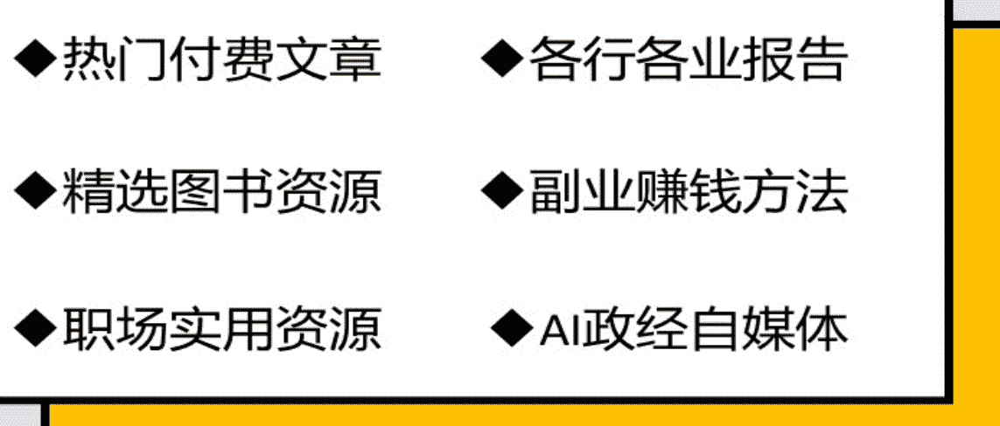
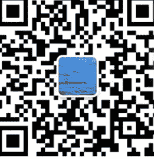
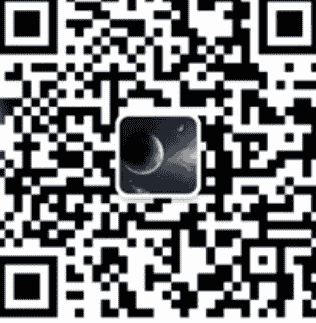
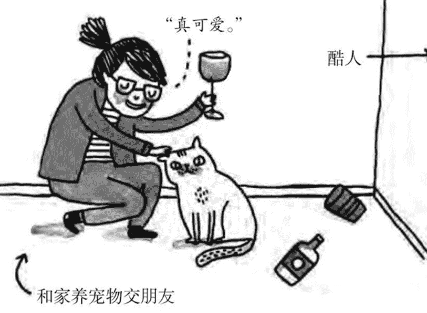
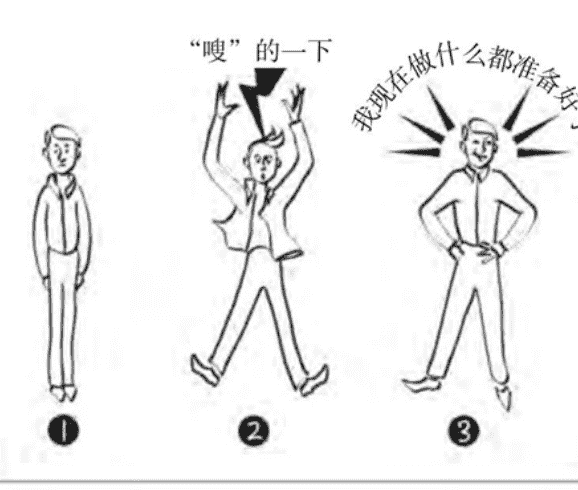
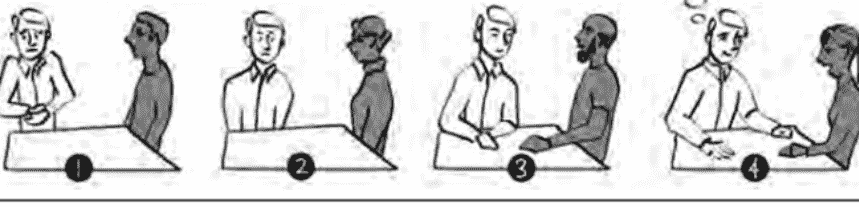
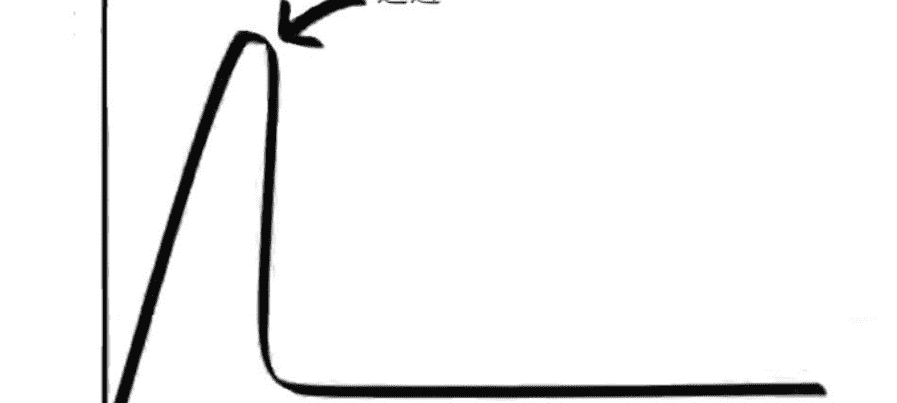

## 如何克服社交焦虑

## How to Be Yourself
Quiet Your Inner Critic and Rise Above Social Anxiety

[美] 埃伦·亨德里克森 (Ellen Hendriksen) / 著
冯晓薇 / 译

波士顿大学
焦虑治疗专家 
帮助你成功摆脱社交焦虑的控制，突破自我，掌控人生

高达40%的人认为自己不擅长社交交往，会对社交活动产生焦虑感。社交焦虑已成为仅次于抑郁症和酒精成瘾的人类三大常见心理障碍。

中信出版集团

# 免费 价值 及时 专注

## 扫码加入 知识星球TOP 免费资源群

- 每日免费获取有价值资源
- 可提供各类资源搜索服务

公众号：知识星球TOP 微信信号：jntsg8 微信信号：jntsg2

分享资料仅供个人学习，请及时删除，切勿商用传播

# 献给

谨以此书献给

尼古拉斯·拉斯

微信公众号:jntsg8
微信公众号:jntsg2

免费进资料群

# 前言 测测你的社交焦虑程度

在对抗不公时，莫伊要是不开口说话的话，那看上去就像只被围困的猛虎。

莫伊是律师，聪明绝顶，待人谦逊真诚。他身材矮小瘦削，有点儿秃顶，戴着一副框丝眼镜，留着一张八字胡。看起来像威尔尔雅，但在维护老年人权益、保护弱势女性等社会事务方面很有原则。到现在的，他已经在全球三个国家工作超过多年了。

为了实现理想中的正义，他得经常身为最不理想的环境——会议中。莫伊的故事就是这些会议中，在社区中心和教堂的地下室里，在咖啡的余味中，坐在折叠椅上发生的。他这样说他自己的故事：“那天在场上，一位会议组织者转身对我说‘你知道吗，莫伊，我们两个聊天的时候，你很会说话，但在会议上，你总是很安静，我好像没听你在会上开口说过。’”

莫伊非常尴尬，但他清楚那个人说得没错。开会时他总是认真倾听、彬彬有礼，但他从来不发一言。这番话让他蛮意地意识到，他的沉默如此明显，根本不靠近别人的眼睛。

莫伊说：“我什么都不想，而是不知道该怎么说。别人说话时似乎都很坦然、很自信，我好不容易鼓起勇气张开嘴时，却发现话题已经变了。一直都是这样。”

不是莫伊不知道自己该说什么，这种情况我们很多人都经历过。尤其在今天这个难以把握的世界，我们常常纠结于“怎么回这条信息”“这段文字发到朋友圈是否合适”等问题。如果你天生内向，或者莫伊的情况类似（稍后会讨论这二者的区别），那么技术和互联网让你有理由去质疑自己。自然，你还要面对面对面的人这种状态斗争。

和莫伊一样，你可能也会有张口说话的那种折磨。就像站在10米高的跳台上，一想到就要跳进水里，你的心砰直跳。保持沉默带来挫败。你可能在想“其实我知道答案”“那是我的点子”，但一想到要说出来，你就仿佛跳进了该话的深渊，全身无动。那个会议组织者的话让莫伊觉得，保持沉默会有糟糕。一直保持沉默就像放在膝部的碎片越堆越高，片刻很容易被打破，但打破几个小时的沉默，几乎是不可能的。如果是真的打破了，一定有人转回头来惊呼：“哎，我忘了你也！”

所以，莫伊决定不再等了。他说：“后来有一次开会前，我在手机里记了笔记，我想写出来再来说比较容易，但还是不能做到。最糟糕的是，我旁边的家伙拿着手机，我提前念了一遍笔记，但之后说第一句话时就卡住了，大脑一片空白，根本说不出来。”

莫伊的经历很普遍，这就是所谓的“社交焦虑”，一种强烈的自我怀疑。社交焦虑的人会觉得自己突兀、尴尬，之后会有想要躲开的冲动。有时在场上始终保持沉默，或者担心自己说错，可能会被别人批评。很多人无论在教室、聚会、团体、工作中，还是和陌生在一起，在社交媒体上，都面临压力。他们确信自己在某些方面太怪、太笨、烦人，或者其他方面不如自信、社交能力不足。

鼓励自己再试一次。莫伊的经历很普遍，这就是所谓的“社交焦虑”，一种强烈的自我怀疑。社交焦虑的人会觉得自己突兀、尴尬，之后会有想要躲开的冲动。有时在场上始终保持沉默，或者担心自己说错，可能会被别人批评。莫伊的经历很普遍，这就是所谓的“社交焦虑”，一种强烈的自我怀疑。社交焦虑的人会觉得自己突兀、尴尬，之后会有想要躲开的冲动。有时在场上始终保持沉默，或者担心自己说错，可能会被别人批评。莫伊的经历很普遍，这就是所谓的“社交焦虑”，一种强烈的自我怀疑。

莫伊的经历很普遍，这就是所谓的“社交焦虑”，一种强烈的自我怀疑。社交焦虑的人会觉得自己突兀、尴尬，之后会有想要躲开的冲动。有时在场上始终保持沉默，或者担心自己说错，可能会被别人批评。

莫伊的经历很普遍，这就是所谓的“社交焦虑”，一种强烈的自我怀疑。社交焦虑的人会觉得自己突兀、尴尬，之后会有想要躲开的冲动。有时在场上始终保持沉默，或者担心自己说错，可能会被别人批评。

莫伊的经历很普遍，这就是所谓的“社交焦虑”，一种强烈的自我怀疑。社交焦虑的人会觉得自己突兀、尴尬，之后会有想要躲开的冲动。有时在场上始终保持沉默，或者担心自己说错，可能会被别人批评。

- 必须和有权威的人（老师、老板等）对话时，我就会紧张。
- 2别人进行眼神接触对我来说是有困难的。
- 必须谈论自己或者自己的感受时，我会紧张。
- 4 很难很难和融洽相处。
- 5 和别人单独相处时，我会紧张。
- 6 我担心表达自己的观点会让自己显得很愚蠢。
- 7 到店里退货让我感到焦虑。
- 8 我发现自己很难对别人的观点提出异议。
- 9 我总是担心自己在社交场合下不知道该说什么。
- 10 和不熟悉的人交往时会很紧张。
- 11 我觉得自己在和他人沟通时会说一些尴尬的话。
- 12 在一群人中，我会担心被忽视。
- 13 我不确定是否要和一个仅仅算得上认识的人打招呼。
- 14 如果别人能听到我打电话，我就会不自在。
- 15 在公共场所吃饭或喝酒，我会感到尴尬或焦虑。
- 16 在公面前表演、演奏或演讲让我感到焦虑。
- 17 当别人看着我做做事时，我会感到不自在。
- 18 打电话、发邮件或发短信给太熟悉的人时，我会焦虑。
- 19 我在课堂上或会议上发言时有困难。
- 20 上公共厕所让我感到焦虑和害羞。
- 21 我很难与吸引的人自如地交谈。
- 22 考试让我焦虑。
- 23 我在主持聚会或活动时，会感到有压力，会焦虑。
- 24 我发现自己很难拒绝推销员。
- 25 我不喜欢成为大家的焦点。

以上仅仅是25个场景，还有很多其他场景。例如，社交焦虑以前是“慢燃”，那么科技发展而言就是“火上浇油”。为什么呢？因为焦虑源于不确定，还有什么比现代交流更不确定的呢？社交媒体让一切变得糟糕。

- 为什么只回短信？
- 为什么老板回邮件？
- 为什么她发短信说我可以打电话给你？
- 为什么他发短信说自己是骗吗？

美国堡大学的一项研究调查了近400名19至32岁的年轻人，发现使用的社交媒体上花费多少时间，焦虑感越强。社交媒体本身的特性是什么？社交媒体上的公开评论数量也是，这固了让他们的成长变得更加困难。无论是在网络上还是现实世界，面对评论，我们都会选择回避或恐惧。与大多数专业术语不同，回避和恐惧这两个词的含义完全相同。回避就像是用手机捂住耳朵，“听，听不见你！”但回避可能让你费钱，逃避可能让你远离别人的路，到时候就无法跟别人聊天——逃避可以是公开的，比如没出现在派对上、躲在语音箱里；也可以是隐藏，你甚至都没自己在逃避，眼神交流就是典型的逃避。或者我们可能会去派对，但大多数时间都在摸手机或躲在阳台上，然后悄悄溜。虽然逃避让我们马上解脱，但随之来的几乎总是内疚、羞愧、失望或沮丧的苦涩味。

聚会上的我 “真可爱。” 焦虑给我们带来的是无比紧张地搓着团建活动、报告或婚宴。希望老天带下那位竭力把你拉进舞池的好伴娘，你选用叉戳她，不想跟着集体舞。整个活动的回到家里时，常频繁不安，莫名胃痛，面部肌肉因一直假笑而酸痛。有时你会直接灌醉。对我们大多数人而言，这种感觉由来已久。对于有社交焦虑的人而言，这种漫长的经历始于8~15岁的某个阶段，并让我们在未来十年里宁愿翘着手机，也不愿与人交谈。对我们很多人人来说，社交焦虑就像褐色的眼睛或卷曲的头发，是身体的一部分，从第一天起，我们记忆中这就是这样。现在你可能注意到我说的是“我们”。学术界有一句话：研究就是我的寻找。许多科学家之所以选择某一领域，是因为研究主题对他们或他们的生活来说是真实的。研究“坚毅”的专家在遭遇任何挫折之后都会重新起来。创伤专家经历了危及生命的事件后能否幸存。缺陷与动障碍者的无视身体倾倒的纸桩，专注案例工作。我在波士顿著名的焦虑与焦虑相关中心（CARD）工作，这一点也能很清楚。

我最早的记忆可以揭示我的焦虑从何来。20世纪80年代初，我3岁那年，在幼儿园和其他15个孩子一起坐在地板上。我的老师菲太太一头着中分的橙色头发，弹吉他一边唱着我们是《我的阳光》、《安静，小宝贝》等轻柔的歌曲，哄我们暂时安静下来。我记得自己睁眼时，看到菲太太坐在吉位上，专注地看着我，脸上带着微笑。虽然她忙着看着我一会儿了，她说：“你醒了吗！早上好，甜心！”我坐起来揉眼睛时，突然意识到别人都在看着我。我顿时僵住了，就像一只在车灯前呆呆不动的小鹿。有些孩子在笑，这笑声并不是嘲，但对一个敏感的3岁孩子来说，就像被玩具木棒刺穿了心脏。刚醒的我还有点晕乎，这让被人取笑的感觉变得更加强烈。我紧闭双眼，在黑暗中备窘迫。这是我很早记忆。我没记住拿哥哥的爆米花去泪掉眼睛，没记住第一次玩“不给糖就捣乱”的游戏，我焦虑的大脑只记住这次无意的小睡后，友好的老师和被逗笑的同学带给我的那种丢失的感觉。

焦虑从那时就开始了。小学一年级，我记得带着胃疼和“忘了什么作业”揪心的担忧去睡觉，我记得自己在忙碌的课上喘不过气。三年级时，我记得熟悉的人背着背包，但一直拖到班上。中期，强烈的自我意识和竞争同伴可谓完美，但这在焦虑里的深渊，我不足。高中时，我开始展现自我，交往很好的朋友，还当上了干部。之后的大学四年深深冲击了我。其他学生参加派会，在学术会上讨论，我主动发表发言简直只有零星几次。此时，拿到医学专业的学位后，慢慢发生了变化。我不仅可以在会议上发言，还能主持会议；我举办过晚餐，能够自信地对着屋子讲课；在婚礼上跳舞。我曾经经历过焦虑各种事——在金店找店员，故意把咖啡洒，试图在路边咖啡店旁停车时，我们会紧张到冒汗。向别人提起自己的焦虑时，他们的脸上写满了：“真是不想了！”但是我不自在，即使过去并不是这样的，我知道也能做到。那么，我是怎么做到的？怎样做到呢？我将在本书里分享所有的答案。显然，现在的我有时还会焦虑。我有时要做公共演讲，面对人群时，我会忍不住流泪，有时看不出来，我甚至会流露。比如看着朋友婚礼时，哭。合适吗？太合适了。我的弱点是害怕。孩子们用手机时，我们会巧妙地将自己的镜头挪开。我讨厌视频通话。在弟弟的婚礼上，摄像师跑到面前：“你有什么事？”我看着山上像跑步，离开的双脚和渍土。我可能看着焦虑了，但我无法如地。但关键是，你可以努力。这是你可以做到的。你可以轻松地与他人交谈，不在意被别人注视。很多焦虑是可以习得，这意味着可以学习如何克服焦虑。不用努力十年，通过研究来克服焦虑。我的付费很大。

## 如何克服社交焦虑

这本书是写给所有经常或一直陷入社交焦虑的人，我知道这样的人并不少。事实上，焦虑是分层的，社交焦虑的程度很有差别。第一个层级，也是最常见的，即“社交尴尬”。即便事老板的人也会感到尴尬或窘迫。比如服务员说“请问用时”，脱口而出。抱一位女士时，你不小心碰到了她的胸。和朋友道别，这三种情况在我们身上发生不止一次。这些时刻可能会让你只想退缩，却躲不去。当然，它们最终成为不错的故事。

第二层级是大家说的害羞，我称之为“日常社交焦虑”。如果听到“害羞”一词，你感觉到的就是你，那么这本书就是为你准备的。我们都有同感：在聚会会上，我们一直和伴侣或最好的朋友在一起；我们在自己的办公桌上吃午饭；即使知道答案，我们也不会举手发言。我们也逛闲聊天、和老板共用电梯，要求某人去影厅继续他的电话。自己独处时和熟悉的人在一起时，我们感觉一切正常；当会议室里所有的眼睛都望着我们时，我们的眼睛就会呆直。我和朋友看完比赛后，我们突然算不出给服务员买多少费；试图在路边咖啡店旁停车时，我们会紧张到冒汗。我们担心自己会被认为行为不妥或没有能力，然后又因为自己的担忧感到沮丧。我们觉得自己太蠢了，为什么不能更自信一些？

第三个是最后一个层级，像莫伊一样，在人生的某个阶段，13%的美国人认为自己是“极度羞怯”，但我认为属于社交焦虑障碍。社交焦虑障碍是指在社交或工作场所，害怕被他人审视、评审、被发现缺乏社交能力和个人表现能力，这会焦虑让你去做自己想做或要做的事。它是人类第三大常见的心理障碍，让你抑制抑郁和酒精依赖。如果社交焦虑症让你痛苦不堪或生活受损，那就不只是烦恼，而是问题了。简单来说是，它让你恐惧，无法去你想要的生活。它让你痛苦不堪，比如为了准备公开演讲，你连续几周紧张不安、失眠，甚至从卫生间的窗户爬逃出去。它让你生活受损，是指你不想主持会议或管理他人而拒绝了晋升的机会，结果在职业发展上止步；或者你决定放弃课程参与，导致成绩下降了20%；或者当你最好的朋友邀请你在她的婚礼上致辞时，你无法如地答应，这让你觉得很心伤。

- 有责任心，有强大的内心导向和强烈的职业道德感；
- 天生擅长记住别人的面子；
- 极具同理心；
- 亲社会，对他人友好、乐于助人、无私利他；
- 考虑他人的权利、需求和感受。

在我们的生活中，这些特质的具体表现又是什么呢？有社交焦虑的人经常会：

- 忽略不需要的话——在一个人拼命抓人眼球的世界里，跳出了“话越多越好”的讲话方式；
- 努力工作，确保他人感到舒适；
- 细心观察和倾听他人——在今天寻求关注的文化中，这项特质几近失真：

- 保持高标准、严要求，工作表现堪称典范；
- 尊重其他文化和背景。

看上去是不是很眼熟？很多有社交焦虑的人积聚了这些力量。即使你属于焦虑群中因焦虑而讽刺和批评他人的那“21%”，我知道在你所有的刺下面，你可能也有很多类似的品质。就像河豚一样，你的刺只是因为你恐惧。

再回顾下这些特质。这些都是适用于21世纪日益互联网和全球化的社会的技能。我们中有很多社交焦虑的人，在多元文化的世界里敏感且谨慎地生活着。而那些不关心他人想法的人，忽视他人的权利和感受，也丢弃了有可能建立的关系。你可能已经自然而然做了其中很多事，再通过一些练习，你就可以在做这些事时更加从容。

另外，40%的人认为自己很害羞，这也是社交焦虑的一种表现形式。再把问题扩大，问问我们在生活中的某些时刻是否会感到焦虑，这个比例就会飙升到82%。此外，在特定情况下，高达99%的人会感到社交焦虑，只有1%的人（包括心理变化）从未有过社交焦虑。对于这些数据，我敢说，日常生活中的社交焦虑再平常了，它比你原以为的要普遍得多，尽管你有时（甚至经常）会感到尴尬。

社交焦虑很正常，但你之所以拿起这本书，就是因为社交焦虑已经妨扰了你的生活。也许允许纠结于某条短信怎么措辞，祈祷老师不会叫你回答问题，正在某个生日，生怕冒犯别人，演讲时害怕大脑突然出现空白或者全身无力……不管你的社交焦虑属于哪种，你都有想要改变。

你可以把这本书看成一条通向改变的道路，让自己摆脱内在的紧张，展示内心舒适的一面。不管你现在向世人呈现的是什么样的自己——是尖酸强硬，还是和蔼亲，或是高度紧张、尴尬窘迫，我知道最好的“你”一直都在。当你那些让你觉得舒服放松的他们（你知道或最亲密的家人）聚在一起，或者是独自享受孤独时，你的自我就会显出来，这才是真正的你。

以及，当我说你自己时，指的是做真正的自己，无所畏惧的自己。你或许不相信，向世界展示真实的自我是安全的。在接下来的章节中，我将在你的大脑中点亮一盏明灯，让那些有用的特质继续发挥作用，同时抛弃那些没用的特质，给你装满你需要的工具，推动你朝着希望的目标前进。

事实上，“你”始终在变化。你是一个有生命的、呼吸的生命，在10岁或20岁时，和你在30岁、40岁、50岁及更大年龄时，不会是同一个人。每一天都在改变，并将继续改变。问题是，你需要选择改变的方法。我不会承诺你获得一个“新的你”，因为你不需要改变自己的个性，你只需要看到你本来的自己足够了。从根本上说，社交焦虑就是用一种扭曲的视角看待真实的自我，将这种扭曲视为真实。我们放大了（这完全是在想象中）的缺点。我们总在心底自以为存在的缺点，全然忘记了自己拥有的巨大天赋。当你找回自信时，你就不需要争取别人对你的信心，你需要的是勇于尝试的意愿。

做你自己，克服社交焦虑，这将改善你生活的方面：你的工作，你的人际关系，甚至是超市杂货店。做真实的你，即使只是站在收银台前工作、在聚会上与人握手或参加公司的研讨会，都能帮助你应对这些各种、不完美却无可比的人生。有一点我很确信，那就是你没有任何问题。我再说一遍，即使你认为这句话适合你，你没有任何问题。这本书会让你做自己时感到无比舒适，了解这一点会你实现可能。

开始学习如何做自己时，我们可以从优秀的人那里汲取一些灵感。比如，圣雄地以平静的方式摇晃了帝国主义的根基，带领印度走向独立，并在范围内教了我们太多的。1930年甘地领导了盐游行，抗议殖民政府对生活必需品的垄断，这是他发起的最大的运动之一。当时印度人不仅要以昂贵从政府购买盐，还要缴巨额税，穷人不堪。于是甘地开始了走向阿拉伯海长达300里的抗议游行，身边有几个随者，路上，甘地不断呼喊：“和平、非暴力”。每次演讲结束后都会一句：“希望这些话能传到这片土地的每一个角落。”一天过去，游行的消息传播开，越来越多的随者加入了队伍。多个春天里，聚集了数千名随者。甘地等人来到了阿拉伯海边，象征性地抓了一把盐。年后，马丁·路德借鉴甘地的做法为社会改革提供了方案。马丁·路德先生领导了伯明种族隔离运动、华盛顿游行，最终促成了美国国会通过1964年民权法案。

## Part 1 深度了解社交焦虑

### 第一章 社交焦虑是如何形成的？

吉姆从没缺席过任何周日晚上舞蹈工作室课。室外，晚秋的金橙叶子还挂在树上，在新的风中摇抖。室内，宽敞的大厅像个宽敞宴厅。大厅一侧摆着几张圆桌，上面铺着亚麻桌布，盛着水的玻璃杯乱放在桌上。厅里余下部分空间都留给了宽敞亮的硬木舞池，音响正放着马文·盖意的歌曲《多甜蜜》。大厅挤满了人。大约20对学员站散松的一排，在优雅的工作室老板托马斯的指导下，练习东海岸舞。每个星期晚上，托马斯会教授一次集体操，还把舞蹈变成了社交会，给他这个舞会取了一个名字：练习派。托马斯放着音乐，大家宣布：“女士们，先生们学员们邀请此跳舞！”他们在练习舞步时，老师会走动，给予指导，调整学员舞姿：“一只手放在肩膀上，下巴抬起来！”56岁的吉姆4年前开始跳交际舞，现在已成了老学员。他身材修长，一头头发修剪整齐，显示出他的爱尔兰蓝纹。一个晚上，当小哈利·康尼克眼睛一个微笑，最后一个音符放完，学员们都放慢舞步，托马斯靠近麦克风，眼里闪过一丝光亮，问道：“现在请大家把舞池留给真美，好吗？”吉姆有点儿困惑。托马斯是一首接一首连着放，让大家一直跳下去。那真不太一样。真美是吉姆的老师，所以他礼性地鼓掌，转身走向一把折椅。托马斯继续说：“今晚我们将为大家献上一场惊喜表演——生日舞会！”吉姆呆住了。那天是他的生日。他们怎么知道？他没有告诉过任何人。他好好转身回到舞池，日光划过几十个人。真美在一圈旁观者中站着，她面带着微笑，向吉姆伸出了手。

时间和练习改变了一切。四年前，吉姆梦也想不到自己会参加任何聚会，更说是舞会。在舞会上，他得主动邀请女舞伴。在舞会上，他得主动女舞伴。在舞会上，他得主动邀请女舞伴。在舞会上，他得主动邀请女舞伴。在舞会上，他得主动邀请女舞伴。在舞会上，他得主动邀请女舞伴。在舞会上，他得主动邀请女舞伴。在舞会上，他得主动邀请女舞伴。在舞会上，他得主动邀请女舞伴。在舞会上，他得主动邀请女舞伴。

吉姆成长的20世纪70年代，那是波士顿市中心的一个工人阶级社区。吉姆的父亲性格沉稳，在哈佛当了30年的经理；他的母亲是一家保险公司的秘书。吉姆和弟弟瑞安在波士顿三层公寓里长大，户型相同走廊挨着木制台阶。放学后，吉姆、瑞安和邻居家的孩子们在街上玩。孩子们在街上绕过汽车，踢球。玩累了，孩子们去街角杂货店花钱买饮料和零食。无论表面上看起来还是实际，社区的关系都很紧密。如果有陌生人出现，周围的人马上注意到。吉姆回忆道，房子从窗户跳到卧室，很安全。这种紧密说明社区的团结。

吉姆回忆道：“住在那里很安全，虽然有时也会来麻烦。”吉姆和瑞安在家里，妈妈告诉我们不要出去玩，等妈妈回来。吉姆和瑞安在家里，妈妈每次他们出门前，都要仔细检查一下。妈妈会说“让我看看”，然后盯着他们，从头到脚检查。梳理乱的头发，把脸擦干净。“必须看着整洁。”梅英会问：“你们今天见到邻居了吗？”吉姆回忆道：“当时我们就像生活在鱼缸里，总被审视。”

这种恐惧让我们害怕他人发现自己在做事，害怕被他人暴露。这些习得经历往往难以察觉，无法准确定位。对我来说，还有很多人来，没有真正的开始，而是一直如此。吉姆从母亲梅英那里学到的就是，无论走到哪里，都有人在看他、在评判。奥尼尔太太的电话就是证明。多年来，像溪水流过基岩，日久沥出的沟槽一样，社交焦虑已悄无声息地存在于吉姆身上。50后的今天，他说：“我总觉得别人人在看着我，觉得他们发现我有什么地方不对。母亲和我弟弟身上灌输了这种思想。”

我们像海绵一样吸收着家庭教育，并没有意中识别到一种核心信念在我们的内心逐渐形成。在有些家庭，学到的东西可能完全不同。比如，和邻居在门廊那儿聊天是件美好的事，在舞池中展现跳舞是件开心的事。我丈夫从小到大都认为，一定要留修理水管或家里。但吉姆的家庭，尽量保持宽容，推测也许是因为自尊心太强，但现在我知道是因为恐惧。

焦虑无逸。如果一个人的一级属有人焦虑障碍，比如吉姆父母中有一个焦虑障碍，那么这个人患焦虑障碍的风险就会增加35倍。但心理遗传却是谜，即使对于最投入的科学家来说，它也是让人抓狂的。为什么呢？

首先，焦虑不是由单个基因控制。目前我们还不清楚焦虑是少数基因的影响还是很多基因共同的结果。还有一个问题叫“表型复杂”，意思是焦虑就像神话中的九头蛇。当然，社交焦虑也有各种临床表现，强迫症、恐惧症、害怕蜘蛛等。我们很难想象这些不同的“花”是如何从一种基因的种子中萌芽的。

其次，焦虑不是客观情况，目前还没有确定焦虑实验室测试。我们不能在显微镜通过观察吉姆或梅美的血液样本看到焦虑。焦虑的诊断结果都是基于自我报告。尽管我们的基因表达已有千年历史，但是关于焦虑障碍（即严重的社交焦虑）的描述在1966年才首次出现在文献中，直到1980年被明确命名为“障碍”。

最后一个难题是基因和经验，它们像咖啡和奶油混成的旋涡般很难分离。性情驱动着我们每天的选择，但喜欢待在家里读书，反映的是一种特定的基因组合，还是我们长期形成的习惯呢？简而言之，焦虑是否遗传是一清楚，而是怎么遗传的还不清楚。

除基因外，社交焦虑的种子也会习得下。在某个时间，像吉姆一样，我们习得了害怕人的评判，习得了隐藏的羞辱。这一习得可能是通过一段经历而被烙记的，比如在全校老师面前突然尖叫，或在拥挤的餐馆里突然恐慌，好心的服务员叫来了救护；可能一次可能的经历，比如看到自己朋友被欺骗，或是看到某个同学日复一日被老师骗钱；也可能是成长在一个认为社交毫无意义与人交往的家庭里。无论以哪种方式习得社交焦虑，这让我们产生了对焦虑的恐惧，害怕他人发现我们自己在做事，害怕被他人暴露。这些习得经历往往难以察觉，无法准确定位。对我来说，还有很多人来，没有真正的开始，而是一直如此。

吉姆从母亲梅英那里学到的就是，无论走到哪里，都有人在看他、在评判。奥尼尔太太的电话就是证明。多年来，像溪水流过基岩，日久沥出的沟槽一样，社交焦虑已悄无声息地存在于吉姆身上。50后的今天，他说：“我总觉得别人人在看着我，觉得他们发现我有什么地方不对。母亲和我弟弟身上灌输了这种思想。”

我们像海绵一样吸收着家庭教育，并没有意中识别到一种核心信念在我们的内心逐渐形成。在有些家庭，学到的东西可能完全不同。比如，和邻居在门廊那儿聊天是件美好的事，在舞池中展现跳舞是件开心的事。我丈夫从小到大都认为，一定要留修理水管或家里。但吉姆的家庭，尽量保持宽容，推测也许是因为自尊心太强，但现在我知道是因为恐惧。

焦虑无逸。如果一个人的一级属有人焦虑障碍，比如吉姆父母中有一个焦虑障碍，那么这个人患焦虑障碍的风险就会增加35倍。但心理遗传却是谜，即使对于最投入的科学家来说，它也是让人抓狂的。为什么呢？

首先，焦虑不是由单个基因控制。目前我们还不清楚焦虑是少数基因的影响还是很多基因共同的结果。还有一个问题叫“表型复杂”，意思是焦虑就像神话中的九头蛇。当然，社交焦虑也有各种临床表现，强迫症、恐惧症、害怕蜘蛛等。我们很难想象这些不同的“花”是如何从一种基因的种子中萌芽的。

其次，焦虑不是客观情况，目前还没有确定焦虑实验室测试。我们不能在显微镜通过观察吉姆或梅美的血液样本看到焦虑。焦虑的诊断结果都是基于自我报告。尽管我们的基因表达已有千年历史，但是关于焦虑障碍（即严重的社交焦虑）的描述在1966年才首次出现在文献中，直到1980年被明确命名为“障碍”。

最后一个难题是基因和经验，它们像咖啡和奶油混成的旋涡般很难分离。性情驱动着我们每天的选择，但喜欢待在家里读书，反映的是一种特定的基因组合，还是我们长期形成的习惯呢？简而言之，焦虑是否遗传是一清楚，而是怎么遗传的还不清楚。

除基因外，社交焦虑的种子也会习得下。在某个时间，像吉姆一样，我们习得了害怕人的评判，习得了隐藏的羞辱。这一习得可能是通过一段经历而被烙记的，比如在全校老师面前突然尖叫，或在拥挤的餐馆里突然恐慌，好心的服务员叫来了救护；可能一次可能的经历，比如看到自己朋友被欺骗，或是看到某个同学日复一日被老师骗钱；也可能是成长在一个认为社交毫无意义与人交往的家庭里。无论以哪种方式习得社交焦虑，这让我们产生了对焦虑的恐惧，害怕他人发现我们自己在做事，害怕被他人暴露。这些习得经历往往难以察觉，无法准确定位。对我来说，还有很多人来，没有真正的开始，而是一直如此。

社交焦虑很正常，但你之所以拿起这本书，就是因为社交焦虑已经妨扰了你的生活。也许允许纠结于某条短信怎么措辞，祈祷老师不会叫你回答问题，正在某个生日，生怕冒犯别人，演讲时害怕大脑突然出现空白或者全身无力……不管你的社交焦虑属于哪种，你都有想要改变。

你可以把这本书看成一条通向改变的道路，让自己摆脱内在的紧张，展示内心舒适的一面。不管你现在向世人呈现的是什么样的自己——是尖酸强硬，还是和蔼亲，或是高度紧张、尴尬窘迫，我知道最好的“你”一直都在。当你那些让你觉得舒服放松的他们（你知道或最亲密的家人）聚在一起，或者是独自享受孤独时，你的自我就会显出来，这才是真正的你。

以及，当我说你自己时，指的是做真正的自己，无所畏惧的自己。你或许不相信，向世界展示真实的自我是安全的。在接下来的章节中，我将在你的大脑中点亮一盏明灯，让那些有用的特质继续发挥作用，同时抛弃那些没用的特质，给你装满你需要的工具，推动你朝着希望的目标前进。

事实上，“你”始终在变化。你是一个有生命的、呼吸的生命，在10岁或20岁时，和你在30岁、40岁、50岁及更大年龄时，不会是同一个人。每一天都在改变，并将继续改变。问题是，你需要选择改变的方法。我不会承诺你获得一个“新的你”，因为你不需要改变自己的个性，你只需要看到你本来的自己足够了。从根本上说，社交焦虑就是用一种扭曲的视角看待真实的自我，将这种扭曲视为真实。我们放大了（这完全是在想象中）的缺点。我们总在心底自以为存在的缺点，全然忘记了自己拥有的巨大天赋。当你找回自信时，你就不需要争取别人对你的信心，你需要的是勇于尝试的意愿。

做你自己，克服社交焦虑，这将改善你生活的方面：你的工作，你的人际关系，甚至是超市杂货店。做真实的你，即使只是站在收银台前工作、在聚会上与人握手或参加公司的研讨会，都能帮助你应对这些各种、不完美却无可比的人生。有一点我很确信，那就是你没有任何问题。我再说一遍，即使你认为这句话适合你，你没有任何问题。这本书会让你做自己时感到无比舒适，了解这一点会你实现可能。

### 社交焦虑很正常吗？

另外，40%的人认为自己很害羞，这也是社交焦虑的一种表现形式。再把问题扩大，问问我们在生活中的某些时刻是否会感到焦虑，这个比例就会飙升到82%。此外，在特定情况下，高达99%的人会感到社交焦虑，只有1%的人（包括心理变化）从未有过社交焦虑。对于这些数据，我敢说，日常生活中的社交焦虑再平常了，它比你原以为的要普遍得多，尽管你有时（甚至经常）会感到尴尬。

1930年，甘地领导了盐游行，抗议殖民政府对生活必需品的垄断，这是他发起的最大的运动之一。当时印度人不仅要以昂贵从政府购买盐，还要缴巨额税，穷人不堪。于是甘地开始了走向阿拉伯海长达300里的抗议游行，身边有几个随者，路上，甘地不断呼喊：“和平、非暴力”。每次演讲结束后都会一句：“希望这些话能传到这片土地的每一个角落。”一天过去，游行的消息传播开，越来越多的随者加入了队伍。多个春天里，聚集了数千名随者。甘地等人来到了阿拉伯海边，象征性地抓了一把盐。年后，马丁·路德借鉴甘地的做法为社会改革提供了方案。马丁·路德先生领导了伯明种族隔离运动、华盛顿游行，最终促成了美国国会通过1964年民权法案。

## 社交焦虑的特质

很多社交焦虑的人并不是软弱的，相反，他们拥有许多非常优秀的特质：

- 有责任心，有强大的内心导向和强烈的职业道德感；
- 天生擅长记住别人的面子；
- 极具同理心；
- 亲社会，对他人友好、乐于助人、无私利他；
- 考虑他人的权利、需求和感受。

在我们的生活中，这些特质的具体表现又是什么呢？有社交焦虑的人经常会：

- 忽略不需要的话——在一个人拼命抓人眼球的世界里，跳出了“话越多越好”的讲话方式；
- 努力工作，确保他人感到舒适；
- 细心观察和倾听他人——在今天寻求关注的文化中，这项特质几近失真：

- 保持高标准、严要求，工作表现堪称典范；
- 尊重其他文化和背景。

看上去是不是很眼熟？很多有社交焦虑的人积聚了这些力量。即使你属于焦虑群中因焦虑而讽刺和批评他人的那“21%”，我知道在你所有的刺下面，你可能也有很多类似的品质。就像河豚一样，你的刺只是因为你恐惧。

再回顾下这些特质。这些都是适用于21世纪日益互联网和全球化的社会的技能。我们中有很多社交焦虑的人，在多元文化的世界里敏感且谨慎地生活着。而那些不关心他人想法的人，忽视他人的权利和感受，也丢弃了有可能建立的关系。你可能已经自然而然做了其中很多事，再通过一些练习，你就可以在做这些事时更加从容。

## 为什么拿起这本书？

社交焦虑很正常，但你之所以拿起这本书，就是因为社交焦虑已经妨扰了你的生活。也许允许纠结于某条短信怎么措辞，祈祷老师不会叫你回答问题，正在某个生日，生怕冒犯别人，演讲时害怕大脑突然出现空白或者全身无力……不管你的社交焦虑属于哪种，你都有想要改变。

你可以把这本书看成一条通向改变的道路，让自己摆脱内在的紧张，展示内心舒适的一面。不管你现在向世人呈现的是什么样的自己——是尖酸强硬，还是和蔼亲，或是高度紧张、尴尬窘迫，我知道最好的“你”一直都在。当你那些让你觉得舒服放松的他们（你知道或最亲密的家人）聚在一起，或者是独自享受孤独时，你的自我就会显出来，这才是真正的你。

以及，当我说你自己时，指的是做真正的自己，无所畏惧的自己。你或许不相信，向世界展示真实的自我是安全的。在接下来的章节中，我将在你的大脑中点亮一盏明灯，让那些有用的特质继续发挥作用，同时抛弃那些没用的特质，给你装满你需要的工具，推动你朝着希望的目标前进。

事实上，“你”始终在变化。你是一个有生命的、呼吸的生命，在10岁或20岁时，和你在30岁、40岁、50岁及更大年龄时，不会是同一个人。每一天都在改变，并将继续改变。问题是，你需要选择改变的方法。我不会承诺你获得一个“新的你”，因为你不需要改变自己的个性，你只需要看到你本来的自己足够了。从根本上说，社交焦虑就是用一种扭曲的视角看待真实的自我，将这种扭曲视为真实。我们放大了（这完全是在想象中）的缺点。我们总在心底自以为存在的缺点，全然忘记了自己拥有的巨大天赋。当你找回自信时，你就不需要争取别人对你的信心，你需要的是勇于尝试的意愿。

做你自己，克服社交焦虑，这将改善你生活的方面：你的工作，你的人际关系，甚至是超市杂货店。做真实的你，即使只是站在收银台前工作、在聚会上与人握手或参加公司的研讨会，都能帮助你应对这些各种、不完美却无可比的人生。有一点我很确信，那就是你没有任何问题。我再说一遍，即使你认为这句话适合你，你没有任何问题。这本书会让你做自己时感到无比舒适，了解这一点会你实现可能。

## Part 1 深度了解社交焦虑

### 第一章 社交焦虑是如何形成的？

吉姆从没缺席过任何周日晚上舞蹈工作室课。室外，晚秋的金橙叶子还挂在树上，在新的风中摇抖。室内，宽敞的大厅像个宽敞宴厅。大厅一侧摆着几张圆桌，上面铺着亚麻桌布，盛着水的玻璃杯乱放在桌上。厅里余下部分空间都留给了宽敞亮的硬木舞池，音响正放着马文·盖意的歌曲《多甜蜜》。大厅挤满了人。大约20对学员站散松的一排，在优雅的工作室老板托马斯的指导下，练习东海岸舞。每个星期晚上，托马斯会教授一次集体操，还把舞蹈变成了社交会，给他这个舞会取了一个名字：练习派。托马斯放着音乐，大家宣布：“女士们，先生们学员们邀请此跳舞！”他们在练习舞步时，老师会走动，给予指导，调整学员舞姿：“一只手放在肩膀上，下巴抬起来！”56岁的吉姆4年前开始跳交际舞，现在已成了老学员。他身材修长，一头头发修剪整齐，显示出他的爱尔兰蓝纹。一个晚上，当小哈利·康尼克眼睛一个微笑，最后一个音符放完，学员们都放慢舞步，托马斯靠近麦克风，眼里闪过一丝光亮，问道：“现在请大家把舞池留给真美，好吗？”吉姆有点儿困惑。托马斯是一首接一首连着放，让大家一直跳下去。那真不太一样。真美是吉姆的老师，所以他礼性地鼓掌，转身走向一把折椅。托马斯继续说：“今晚我们将为大家献上一场惊喜表演——生日舞会！”吉姆呆住了。那天是他的生日。他们怎么知道？他没有告诉过任何人。他好好转身回到舞池，日光划过几十个人。真美在一圈旁观者中站着，她面带着微笑，向吉姆伸出了手。

时间和练习改变了一切。四年前，吉姆梦也想不到自己会参加任何聚会，更说是舞会。在舞会上，他得主动邀请女舞伴。

吉姆成长的20世纪70年代，那是波士顿市中心的一个工人阶级社区。吉姆的父亲性格沉稳，在哈佛当了30年的经理；他的母亲是一家保险公司的秘书。吉姆和弟弟瑞安在波士顿三层公寓里长大，户型相同走廊挨着木制台阶。放学后，吉姆、瑞安和邻居家的孩子们在街上玩。孩子们在街上绕过汽车，踢球。玩累了，孩子们去街角杂货店花钱买饮料和零食。这种社区的关系都很紧密。如果有陌生人出现，周围的人马上注意到。吉姆回忆道，房子从窗户跳到卧室，很安全。这种紧密说明社区的团结。

吉姆回忆道：“住在那里很安全，虽然有时也会来麻烦。”吉姆和瑞安在家里，妈妈告诉我们不要出去玩，等妈妈回来。吉姆和瑞安在家里，妈妈每次他们出门前，都要仔细检查一下。妈妈会说“让我看看”，然后盯着他们，从头到脚检查。梳理乱的头发，把脸擦干净。“必须看着整洁。”梅英会问：“你们今天见到邻居了吗？”吉姆回忆道：“当时我们就像生活在鱼缸里，总被审视。”这种恐惧让我们害怕他人发现自己在做事，害怕被他人暴露。这些习得经历往往难以察觉，无法准确定位。对我来说，还有很多人来，没有真正的开始，而是一直如此。吉姆从母亲梅英那里学到的就是，无论走到哪里，都有人在看他、在评判。奥尼尔太太的电话就是证明。多年来，像溪水流过基岩，日久沥出的沟槽一样，社交焦虑已悄无声息地存在于吉姆身上。50后的今天，他说：“我总觉得别人人在看着我，觉得他们发现我有什么地方不对。母亲和我弟弟身上灌输了这种思想。”

我们像海绵一样吸收着家庭教育，并没有意中识别到一种核心信念在我们的内心逐渐形成。在有些家庭，学到的东西可能完全不同。比如，和邻居在门廊那儿聊天是件美好的事，在舞池中展现跳舞是件开心的事。我丈夫从小到大都认为，一定要留修理水管或家里。但吉姆的家庭，尽量保持宽容，推测也许是因为自尊心太强，但现在我知道是因为恐惧。

焦虑无逸。如果一个人的一级属有人焦虑障碍，比如吉姆父母中有一个焦虑障碍，那么这个人患焦虑障碍的风险就会增加35倍。但心理遗传却是谜，即使对于最投入的科学家来说，它也是让人抓狂的。为什么呢？

首先，焦虑不是由单个基因控制。目前我们还不清楚焦虑是少数基因的影响还是很多基因共同的结果。还有一个问题叫“表型复杂”，意思是焦虑就像神话中的九头蛇。当然，社交焦虑也有各种临床表现，强迫症、恐惧症、害怕蜘蛛等。我们很难想象这些不同的“花”是如何从一种基因的种子中萌芽的。

其次，焦虑不是客观情况，目前还没有确定焦虑实验室测试。我们不能在显微镜通过观察吉姆或梅美的血液样本看到焦虑。焦虑的诊断结果都是基于自我报告。尽管我们的基因表达已有千年历史，但是关于焦虑障碍（即严重的社交焦虑）的描述在1966年才首次出现在文献中，直到1980年被明确命名为“障碍”。

最后一个难题是基因和经验，它们像咖啡和奶油混成的旋涡般很难分离。性情驱动着我们每天的选择，但喜欢待在家里读书，反映的是一种特定的基因组合，还是我们长期形成的习惯呢？简而言之，焦虑是否遗传是一清楚，而是怎么遗传的还不清楚。

除基因外，社交焦虑的种子也会习得下。在某个时间，像吉姆一样，我们习得了害怕人的评判，习得了隐藏的羞辱。这一习得可能是通过一段经历而被烙记的，比如在全校老师面前突然尖叫，或在拥挤的餐馆里突然恐慌，好心的服务员叫来了救护；可能一次可能的经历，比如看到自己朋友被欺骗，或是看到某个同学日复一日被老师骗钱；也可能是成长在一个认为社交毫无意义与人交往的家庭里。无论以哪种方式习得社交焦虑，这让我们产生了对焦虑的恐惧，害怕他人发现自己在做事，害怕被他人暴露。这些习得经历往往难以察觉，无法准确定位。对我来说，还有很多人来，没有真正的开始，而是一直如此。

## 社交焦虑的分类

大卫·莫非柯博士是一位大学的心理学家，他认为“暴露”分为四类：

- 我们的焦虑：我们可以担心别人会看到我们焦虑的身体迹象：被汗渗透的衬衫，红的脸，回答问题时结巴巴……因此我们衣橱里装高领毛衣，药柜里有强效止汗剂。我们在公共场合不用笔，也不喝水，因为不想让人注意到自己的手在抖。为了不别人看到自己流汗，我们从不脱掉外套。
- 我们的外表：我们对自己的外表不满意。我们认为自己不够吸引力，穿着不得体，发型奇怪，身形肥胖。我们认为所有人都会注意到我们的缺点，或者觉得我们很奇怪。不管怎么努力，我们的外表都不好。
- 我们的性格：我们担心自己人格：不够、幽默、愚蠢、总是失败、疯狂、不够资格、没能力、或者有缺陷。焦虑时我们可能会喃语：“我到底怎么了？”回答了这个问题，你就会找到自己的核心恐惧。不管答案是什么，暴露告诉我们，我们确实是有缺陷。
- 我们的社交技能：我们觉得自己没个性或相当笨拙。在公开场合，我们担心自己不知道该什么，或者语无伦次，大脑突然一片空白；过于安静，显得无趣；情绪冲动，或无法让他，没人明白我们在说什么。他们目光呆滞地看了我们一会儿后，甚至会请让我们这一次，语气就像在3岁的孩子说话。

所以，我们觉得与其冒着暴露一切的危险，不如躲起来，有时是明躲（比如向灌木丛），有时是暗躲（看着手机，避免和别人目光接触，或是静静坐着倾听朋友的诉说）。对于吉姆，逃避会带来两个事情：第一，与蒂娜交往是冒险的，甚至有危险，他有被羞辱的危险。如果他们开始交往，蒂娜慢慢失去兴趣，让吉姆陷入心碎的痛苦中。这种完全有可能发生，但因为吉姆选择了逃避，选择了远离蒂娜，所以他从没有机会确认事后的结果。

第二，他无法对蒂娜对他的热情。逃避就像你的大脑里只有大惊小小的母鸡，它本身是好的，但在保护你免受某种状况影响的过程中，它无意中发出的信息你应对不了。逃避可以保护你不受威胁，但也许你无法学会“这不算太糟”。

眼……对于焦虑的大脑来说，为避免危险和被拒绝，这些代价不足道。但是，一次又一次付出这种代价，我们就少了经验和信心，更不用提糟糕的发展了。

吉姆靠着蒂娜大约一年后，邻居家孩子告诉他，蒂娜一家上周周末搬走了。吉姆松了口气，同时也惊讶地发现自己很失望。他对自己失望，也失望这一切就这样结束了。他发现，逃避成了他应对青春和成年早期挑战的首选。他的遗传基因，加上母亲梅梅的影响，以及逃避带来的增强效应，长久地印刻在他的脑海中。

快近40年。吉姆50岁生日刚过，他的人生便遭遇了低谷：经历了一段漫长而不稳定的婚姻后，他的妻子跟着另一个男人跟他同居了，留下吉姆独自面对焦虑。“她过去常把我的焦虑说成是你的问题，”他回忆道，“她会对对我喊：你需要专业的帮助！’但当我最后去找医生时，她却不再理我了。”离婚后，吉姆除了上班，生活中就没别的安排。整个周末，他住在家里。他会读小说，一方面是喜欢读，但主要是因为不想做其他事情。他偶尔会参加家庭聚会、洗礼仪式、葬礼前的守灵等，从收到邀请的那一刻起，他就开始在心里纠结自己要要去什么。等到了那天，他有时会临时取消，对着电话咳嗽说自己病了。

吉姆的堂姐罗莎琳注意了他的几次缺席，很担心他。她让吉姆别老闷在家里，要走出去，还鼓励吉姆多参加教会活动。为了让堂姐放心，吉姆去了教会，但刚周后便不再去了。堂姐又督促他去读书。看到吉姆摇头拒绝，她说：“你不是喜欢读书吗？你必须自己走出门！”吉姆周末会去家里的湖边小屋，因为那里他一个人在湖边，从不跟任何人说话。罗莎琳只能摇头。这不是她想让他做的。

我们很多人的生活中都有一个“罗莎琳”，对于我们这些焦虑的人的鼓励，既有些居高临下（“能做到！”），也有直接的威胁（“你想孤独终老吗？”）。但是，为了弥补由于强烈不安而受阻的有限社交生活，因为“对你有处”，无异于被迫去吃蔬菜。即便心里也认为确实应该走出去，但别人越推，我们就越推。另外，这样做似乎并不值得。我们为什么要让自己走出去，去参加聚会、派对或社交活动？难道是为了让自己担心、焦虑或尴尬？终于能回到家里，庆幸一切结束，我们才算松了一口气。

在一个周末，吉姆脑海里想着罗莎琳的告诫，很不情地带她参加晚上的烧烤会。她在堂姐客厅的沙发上，参加聚会的人在他周围转来转去，聊天，拿着汉堡和土豆沙拉的纸盘。孩子们追逐着喵喵喵的小狗。有人从他后面走过来，突然停了来，之后传来一个女声音：“咦，你怎么在这里？”

吉姆转过身——是蒂娜。他扬起眉，几时想到灌木丛里的冲动再次冒了，但他听见自己脱口：“罗莎琳是我的堂姐。你怎么会在这儿？”

“你记得吗，我以前住在罗莎琳街家对面，我们是朋友啊。”她从沙发后转了过来，坐在吉姆旁边，把手里的纸盒放在了膝盖上。

他们开始叙旧。这些年她过得很困难，现在，她在当地的交通管理局找到了一份稳定的工作，开始了一段新恋情，终于找到了一个好男人。吉姆告诉蒂娜，他离婚了。

“我真为你难过，”她说，“我们可以单独聊聊吗？”

吉姆的心都快提到嗓子眼了。“当然可以。”他声音沙哑地道：

他们走到门前的台上，在昏暗的灯光下并排坐。她一起抽烟，礼貌地把烟雾向他身边吹。过了一会儿，她说：“你知道吗，当年我以为你不喜欢我，这让我很伤，因为我觉得你很好，我喜欢你。我不傲慢。别的男孩子来找我，那些年龄比我大的男孩只想和我亲热。他们总来搭讪，我也很烦。我知道，你和我可以真正交流，你会认真听我说话，而且你是个绅士，这才是我想要的。我当时就知道，你是我要找的那个男孩。”

吉姆半天说不出来。“你以为我不喜欢你？”他终于挤两句，“你可反应了。”

蒂娜转过身，久久望着他。然后她笑了，轻轻敲下了吉姆的脑后。她猛吸了一口烟，说：“如果我知道你的真心，后来又会怎样呢？”

我在二月一个朗明的冬日，在波士顿的马萨诸州医院见到吉姆的。自从我去了罗莎琳那次烧烤聚会后，他几个月来都懊悔不已，这促使他预约来见我。吉姆本可以轻松继续他的生活。失去的爱情，失败的婚姻，周末从家里走出来，在周一清晨的阳光下眯眼睛……但上次遇见蒂娜后，他觉得自己再不能像这样了。吉姆告诉我这个故事时，我问他，如果换种情况怎样。他笑了，望向窗外。“如果我多年年前做了相反的事，我们可能都快30周年的结婚纪念日了。我不想再过这种焦虑的生活。”

“当然，”我说，“你会换个顺序吗？”

“我希望自己能够拿出勇气去过自己想要的生活，”吉姆说。

（注：此处后续文本存在大量OCR乱码，可能为识别错误或重复，已根据语义逻辑剔除无效的乱码字符流）

## 第2章 社交焦虑能给我们带来什么？

社交焦虑不是废物，生理学能告诉你为什么社交焦虑在进化中产生。

我们可以衡量人类的情绪、观点和意图并做出适当回应的能力称为“社交意识”。社交意识有必要也有益，就像运用修术一样。适当“修剪”社交意识，可以产生社会效益；但如果社交意识疯狂生长，不受约束，那就成了过度社交意识。如果我们过度解读社交场合，认为聚光灯一直照在身上，这就偏执妄想了。别人的眼神和动作我们都放在心里，从每次互动中都看到了威胁，这会让我们退缩或沉默。简单来说，社交意识过度发展，成了严重的社交焦虑，就像疯长的果树，已经无法结果。

社交焦虑没有用，它根植于我们说的社交意识，或者我稍后讲的行为抑制。这些核心特质非常重要，所以进化才保证了人类中具有这些特质过度发展的倾向。

那，什么样的性格才能从种子成长到开花结果？为什么这些核心特质如此重要？像果树一样，这些核心特质过度发展会怎么样？你修剪后又会怎样？为了回答这些问题，我先讲辛西娅的故事。

1980年2月，来自波士多的褐发美女辛西娅，正在哈佛大学心理学系（美国历史最悠久的心理学系）攻读博士学位。她还需要学习一年。哈佛大学心理学系成立于100多年前，创始人是美国心理学之父威廉·詹姆斯。高三，辛西娅上了心理学课，就像一下打开了灯的开关一样，她知道自己找到了未来的事业。第二天，她将与导师、著名的发展心理学家拉克博士会面，汇报博士论文数据收集的进展。她期待告诉导师自己的研究数据又增加了，上次和导师见面后她研究了不少受试者。

现在我们来换个场景。2岁的詹妮，穿着一件鲜红色的滑雪服，牵着妈妈的手出现在实验室门口。辛亚的研究领域是儿童发展，所以其他研究生都在研究老鼠，或者为了方便研究哈佛大学的本科生，辛亚需要从波士顿当地医院的新生中辛苦招募自己的研究对象。詹妮就是其中之一，她已经快两个了。辛亚热情地向詹妮和妈妈招呼，蹲下身面对辛亚的微笑。詹妮理不理？她转过头靠在妈妈腰上。辛亚还没有完成数据收集，但她亲切地看着詹妮，发现她笑了。辛亚用几个动作向詹妮解释一下研究目的：“我们将詹妮尝试一些适合她年龄的挑战性活动，这也是现实生活中经历的：在一个新的空间里看到新事物，认识一个人。随着难度的增加，我们会知道孩子如何反应。”詹妮点头同意，辛亚带着她穿过了一条走廊，来到一个温馨的游戏室。游戏室里满了娃娃、食物、玩具，游戏室另一头挂着镜子。接下来的一个小时，詹妮在接触新事物。首先是辛亚让詹妮接触玩具，詹妮坐在妈妈膝盖上，睁大眼睛看着。辛西娅搓着桌子，让詹妮给两个娃娃上食物：“这是蛋糕，朋友！你想不要一起玩？”辛西娅把两只毛绒动物放在一起，然后詹妮开始玩。“哎呀，朋友！”辛西娅捂着大眼睛看着詹妮，皱着眉。詹妮捂着脸。辛西娅看着詹妮，詹妮立刻退缩。辛亚鼓励她再按一次开关：“看镜子。”詹妮犹豫了很久，最后回到妈妈身边。任务结束了，辛亚让詹妮尝试哪块拼图放在哪里，一边让詹妮留在妈妈身边。

最后一次任务！神秘的帷幕拉开，詹妮看到了新物体，辛西娅鼓励她接近：“看，镜子头上有灯。”詹妮伸手，按了开关，灯亮了。辛西娅看着詹妮，詹妮大着眼睛看着自己的脸。“这是你的蛋糕，朋友！”

辛西娅看着，总之，詹妮需要表演的场景。在17个不同的孩子中，约1/3的表现像詹妮那样。

但请记住这两个数字：人类中中有40%的人认为自己害羞，13%的人有社交焦虑。这告诉我们，社交焦虑不是进化的疏忽。自然试图告诉我们：
- 壁花（指聚会上一直呆在一旁的人）
- 躲在暗处的紫罗兰（指害羞的人）

都是人类花束的一部分。每年9月，从剪贴上的照片可以看到，作为这个群体的一员，我经常发现住在新英格兰的人会在秋天去苹果园“亲手摘下自己的苹果”。你可能认为苹果树越大、结的果越多。但事实并非如此。苹果树需要修剪，而且是大量修剪，在幼树时就必须修剪。你可能认为修剪过多会影响树的长，事实相反：修剪能让空气和阳光进入，结出更多果实。相反，让过度生长就不会结果。

为什么要说这些呢？我们可以衡量人类的情绪、观点和意图并做出适当回应的能力称为“社交意识”。社交意识有必要也有益，就像运用术一样。适当“修剪”社交意识，可以产生社会效益；但如果社交意识疯狂生长，不受约束，那就成了过度社交意识。如果我们过度解读社交场合，认为聚光灯一直照在身上，这就偏执妄想了。别人的眼神和动作我们都放在心里，从每次互动中都看到了威胁，这会让我们退缩或沉默。简单来说，社交意识过度发展，成了严重的社交焦虑，就像疯长的果树，已经无法结果。

社交焦虑没有用，它根植于我们说的社交意识，或者我稍后讲的行为抑制。这些核心特质非常重要，所以进化才保证了人类生命中具有这些特质过度发展的倾向。

那，什么样的性格才能从种子成长到开花结果？为什么这些核心特质如此重要？像果树一样，这些核心特质过度发展会怎么样？你修剪后又会怎样？为了回答这些问题，我先讲辛西娅的故事……（此处重复内容已略）

## 更进一步讲，即使少量的社交焦虑，也是帮助的。

社交焦虑究竟能为我们带来什么？从进化的角度来看，它带给我们很多。人类是社会性动物，与老虎或熊不同，我们需要在群体中生活。在人类的狩猎和采集时代，我们依靠群体获取食物和住所、寻找源、制造工具。不论扶养后代，还是个人的生命，都需要群体的努力才能确保这个群体繁殖、世代延续。因此，避免冲突和被视为无贡献这两点至关重要。保持自己地位的方法就是努力工作、交朋友、被喜欢。为确保这一点，少量的社交焦虑带给我们两件必需品：

1. 群体凝聚力。我们很容易注意到别人对我们的评价，因为个体有适量的社交焦虑，才能保持社会的凝聚力。具有凝聚力、避免在内部冲突上耗精力的群体比不受外的群体反应更敏捷，也更有生命。随着时间的推移，和谐的群体将战胜易怒的群体。因此，与其让一个坏蛋拖垮整个团队，不如人与其他人和谐相处，这是更明智策略。
2. 个人安全。如果你是那个坏蛋，会怎样？“放逐”、“流放”、“驱逐”，不管说什么，意思都是被清除。

进化行为抑制一直存在，如果适应适当，行为抑制能帮助我们保持安全。社交焦虑也是如此。因此，尽管社交焦虑并不愉快或有用，但它的源头——社交意识绝对有用。

总之，社交焦虑之所以能存在数千年，是因为从进化的角度看，它带来的好处比我们付出的代价要多。它能使社会平稳运行，确保我们是群体中的一部分。即使在外卖和亚马逊跑步的时代，群体仍能提供我们所需的陪伴和归属感。它赋予了我们自我意识、同理心和体贴特质，使我们成为可靠的长期伙伴，从而确保我们的基因得以延续。

如果你有太多的抑制的行为，别担心，振作起来，坏比好了。还记得苹果树吗？繁籽叶茂，需要修剪的苹果树，远好过干死的苹果树。正如本章开头提到的托马斯·卡莱尔的那句话，在同类面前“过于敏感”，要好完全不敏感。

那么，社交焦虑相当于需要修剪的苹果树吗？我们有些过度社会意识和行为为抑制的人怎样才能找到自己的最佳状态呢？为了找到答案，我们再来看看西辛娜和她的177位研究对象吧。

纵向研究在科学界很少见，但在西辛娜收集了她的博士论文数据后，她所在的实验室继续追踪研究了这些研究对象多年。20世纪90年代初期，这些孩子成长到13岁后，他们中的一些受邀请回到实验室，接受了青春期恐惧的采访，害怕的内容包括蜘蛛和结交新朋友。他们的性格截然不同，大约有一人在研究之初被归类为有行为抑制的，如是否乖，另一半则没有行为抑制。研究结果很有趣。你可能认为行为抑制的孩子什么都怕，而没有行为抑制的孩子什么都不害怕，但结果并非如此。

事实上，在典型恐惧（如恐高症、电梯恐惧症或社交恐惧）方面，两组间的差异为0。与以前相比，在对父母的依恋程度即分离焦虑方面，两组受试者也没有差异。

行为抑制没有行为抑制的两组受试者之间唯一的真正的区别是什么呢？就是社交焦虑。有行为抑制的孩子中有34%的人社交焦虑，而在没有行为抑制的孩子中这个占比只有9%。对没有行为抑制的孩子来说，9%的比例似乎很高，但别忘了，13岁可是人生中最尴尬的年龄——13岁的孩子已经发育，但又不成熟，性欲旺盛且极度敏感。从这个角度看，难怪相当比例有行为抑制的孩子会出现社交焦虑。

更引起关注的是两个比例之间的差异。相比而言，苦于社交焦虑的有行为抑制的孩子，同样有社交焦虑但没有行为抑制的3倍多，他们是过于茂盛的苹果树。行为抑制虽然在很多地方都有用，但也可能造成了他们整个青少年期的社交焦虑。

那么，66%为行为抑制却没有社交焦虑的孩子是什么样的？行为抑制已深入其骨髓，他们仍然感觉正常，这又是为什么呢？这就是甜蜜点。由于过去几年“安静”正名的呼声高涨，这些人有了自己的名字：内向的人。

内向的人终于属于自己的这一天。过去几年，安静和内向不仅得到了认可，还变成潮流，像艾米·静默、盖伊·川崎和金·卡戴珊这些看着最内向的人，都自称有内向的一面。我还记得在苏珊·凯恩畅销书《安静》时的那种吃惊。她怎么知道我更喜欢欢读而不是聚会？她怎么知道我独自工作而不是被迫合作？可以肯定的是我，我也喜欢社交聚会，但事后必须休整一下。一天里我不需要与他人互动以免无聊、孤独，但我更喜欢一对一的交流，而不是面对一大群人。

你可能是个内向的人，但不焦虑。你可能喜欢独处或者和熟悉的人聚会，但在陌生人或职位更高的人面前你也可以很自自在。你可能不喜欢大型聚会或招待会，因为这些活动会消耗你的精力，但不是因为焦虑让你想躲在餐桌底下。你可以做到自信和自在。

你也是外向的，但有社交焦虑。在卡实验室的后续研究中，有9%的孩子属于这一类，而你恰好也是之一。这非常痛苦。想象你要从别人那里获取能量，但又害怕失去能量。例如，你可能真的想和同事一起去酒吧，但又担心他们不希望你去；你可能喜欢聚会，但又担心自己会说尴尬；你可能也想被拉到麦克风前，又被观众哄坏了；你可能很想和朋友一起过周末，但又害怕临时取消，这让你“古怪、靠谱”。最重要的是，内向的人觉得独处是充电，而外向的人觉得独处是消耗精力——太多独处的会让外向的人流失。怎么选择都不对？你不是在躲着，就是遇到尴尬和害怕。

虽然有外向的人来说，这种感觉就像是自然的，没人把“内向”和“焦虑”混淆。而内向和社会焦虑的界限很模糊。内向的人非常常见，有时社交焦虑被认为是一种内向。虽然行为抑制导致内向和社交焦虑，而且两种特质经常出现在身上，但二者在概念上差异很大。我们不仅尊重内向性格，而且要克服社交焦虑，但二者之间的界限是什么呢？

第一，内向是天生的，而社交焦虑是后天的。西辛娜出生时就有行为抑制，但请记住，社交焦虑源于基因和习得。比如你被人欺负，就会知道有些脆弱；也许你永远不会寻求帮助，因为父母警告过求助觉得脆弱；就像苏珊·凯恩说的，这会让安静显得异常。不管社交焦虑如何进入大脑，你都会相信别人会评判。

第二，对于内向的人来说，独处会觉得很好。但对于社交焦虑，独处只会让你觉得焦虑。这种差别很细微，但没有焦虑的感觉很好，让我们再仔细看。内向的人通过独处、一对一处和小组聚会获取能量。如内向性格，独处让你精神振奋。相比之下，应对社交焦虑时选择独处会觉得焦虑，让你感到不畅而不是满足。你会对自己说“我不在意”，但在内心深处，逃避社交让你感到孤独、充满遗憾。你可能不会参加其实想去的活动，因为你担心自己出丑、不被接受或感到尴尬。你会对自己说“我太害怕聚会了”、“我总觉得说错话”，而不焦虑的内向的人会说“这个场合适合我”、“不是我的风格”。

第三，社交焦虑因完美主义演变强烈。我们将在第13章详细论这一点，这里先了解一下。因为完美主义，你认为自己的社交表现非黑即白。你认为只有完美的社交才会受到他人的认可。你要表现完美——幽默、能言善辩、泰然，要么就是个白痴，每个人都会嘲笑你。这种压力让人很无力。我们以为自己若是风趣幽默的社交人的典范，就不会受欢迎，结果越发沉默。

相比之下，对于不焦虑的人（或不焦虑的外向的人）来说，完美主义不是事。为什么呢？因为在他们看来不存在什么社交表现的问题，自然也不会受到评判。你可以在演讲时卡住，在对话时思路受阻，没准备好其他话题，并不说明你有什么不好，也没损失。在生活中，有些对话很有趣流畅，有些对话粗鄙平庸，但对话并不能反映你是什么样的人。

第四，内向是你的处世方式，而社交焦虑会影响你的生活。近年来，支持内向性格运动的负面影响之一就是一些内向的人认为是因为自己内向，所以可以躲避社交。用内向做理由的理由，这就不再是内向了。例如，我的一个来访者桑柔，他在失去大部分朋友后来找我。他自述性格相信，但他有意推延回复别人的电话和短信，害怕群体聚会，常在最后一时刻取消活动，觉得自己不舒服或累。他的合理化解释是由于性格内向，他需要“充电”恢复。其实内向但他也在回复朋友。他痛苦地发现，如果他一次说“不”，最终朋友就不会再请他了。幸运的是，他又把朋友拉回来了。现在的他，就像西皮笑着说的那种：“看着内向的自己喜欢丰富的社交生活。”

记住，社交焦虑是对暴露的恐惧，而我们为了避免暴露所做的事都会成为阻碍。你担心自己发言时脸会变成像焦热的龙虹一样，是为了保持持续。你以为自己的双手合十是为了害，是把双手牢牢交叉放在胸前，像在大声对所有人说“走开”。因为害怕暴露，你早早就露出了派态，你确信自己很怪异，觉得没什么好的，或者马上就得邀请同学跳舞了。但是之后，你又会懊过了毕业派对上的蛋糕，更错过了值得纪念的美好时刻。你错过了是因为缺席，是因为在场上陷入自我监控模式，担心自己说错话或者事情搞砸。这就是为什么社交焦虑会阻碍我们想要的生活。

相比之下，没有社交焦虑的内向的人自信，他们感觉良好。需要时可以打开“开关”，“打开开关”需要付出努力，之后他们还需要充电，比如第二天窝在沙发上看书，或者和朋友去吃餐。内向的人害怕暴露，因为这种恐惧。如果你不害怕，你可能会提前离开。如果你不确定自己属于哪一类，试着想象一下让自己自信，你的社交生活是什么样的。如果你的现状不同，可能是因为焦虑，而不仅仅是内向。但社交焦虑不会让我们陷入困境。就像苹果树一样，我们可以修剪掉社交意识。如果我们愿意做尝试，关键是在过程中我们就能展现出最好面：责任心、同理心、深度思考、深刻感受以及高标准。幸运的是，我体验这些，从西辛娜那里得到了支持。

西辛娜·加西亚博士是发展心理学家，她在布兰克大学担任心理学和科学教授三十多年，写作时兼任《儿童发展》期刊的编辑。1984年，她那篇关于儿童的前沿论文发表在期刊上。开创性的学者，她的工作不限于论文。无论走到哪里她都会关心和理解这些行为抑制的人。1998年，当我大四时，西博士负责授“发展理论和历史”这门课程。虽然班很大，但我记忆里至少有30多个学生。我每次都早到教室，把课桌围成一个圈。我记得当时我觉得自己很累，所以我通常在大教室中某个地方。西总是轻快地走进教室，自信地坐在一张课桌旁，周围的空气充满了智慧。她讲课不用书，用研究结果罗列。我看着、听着，但没举手发言。随着学期的推进，最后几周，课程结束时突然我说：“如果你在众人面前发言有困难，请在办公时间找我，提前告诉我。”我大吃一惊，以前没有教授说过。她没进一步解释。我不确定她会给我通行还是最后通牒，不确定她告诉我不要担心还是早开始发言。我知道她是在对我说话，所以我去了。尽管2月初天气很冷，我在办公室门口徘徊，她示意我来。我含糊地说我去去找她。之后，她摘下眼镜看了我一会儿，说：“好的，谢谢你告诉我。”她当时肯定还问了我上课怎么样，以及我最终的研究项目打算做什么，但这些都不记得。我只记得由于焦虑情绪的过滤，我认为她对我的表现很失望，或者对我没勇气发言感到生气。现在我知道，事实并非如此。直到我开始写这本书，了解到西博士的研究源并直接采访了她，才明白她当时为什么要邀请我（其实还有其他人，但当时我以为只有自己说出自己的困难）。简单地说，她是理解我的。我现在意识到她摘下眼镜看着我，那不是责备，而是认可和理解。如果我是她的儿子，我可能就会退回妈妈身边。

我现在知道2月的那天，在离开西博士办公室后，她更加仔细地看了我的学习档案。采访中我说起自己当年的经历时，她告诉我：“班里有些人不举手或很难做到所欲言，我需要用不同方式去评估他们的互动与参与。我没有分数，但是通过我的作业、测验成绩和期末项目来评价我对学习材料的理解。”我知道我像海绵一样在看着，就像西一样在旁专注地看着孩子们那样样。

我们很多人会随着时间逐渐改变。想想40%的人，包括我在内，都会说自己“以前很糟糕”。性格不是一成不变的，基因也不是天命。正如西博士的导师杰罗·卡根博士所说的：“基因、文化、时间和运气共同塑造我们我们。”

我们可以想象成锚，锚上有一条链在我们的船上，但锚不会让船停止不动，相反，有了错误的船可以在广阔的范围里行。积极经历可以推动我们向广阔范围的一前行，而恐惧和回避会让我们在另一端上下颠簸。詹妮弗·大后可能会内向而不焦虑，她可能会让自己在社交场合“开启”，之后在独处时享受“充电”。她可能不会选择不参加活动，她不需要把这份工作留在那些焦虑的人。的确，基因和环境不断相互作用，环境是在变化的。百万像这样的人可以利用环境来做实验、实践，最终成为想要的人。结论就是，社交焦虑可以改变。改变不会改变内向（或外向）性格。

## 第十三章 社交焦虑在大脑里有什么？

在成长发展的旅程中，生活就会发生改变。你会惊讶地发现你开始在课堂上发言；你会问陌生人她的鞋是从哪里买的；你会在办公室里做演讲；你会在生日会上默默地希望没有人看到。这里出一个问题：我们在成长发展的过程中，大脑经历了什么？事实证明，经常做的事可以改变你的大脑，不是说。幸运的是，社交自信可以改变你的大脑。社交焦虑写在基因里的吗？不是自然选择巩固了社交焦虑在人类物种中的地位吗？仅仅依靠开车就能抵消进化的双重力量吗？记住：基因不是命运。大脑通过基因编程和进化影响我们的行为，但影响是双向的——行为同样影响大脑。

年前，斯坦福大学一个小组发表了一系列研究结果，发现针对社交焦虑患者的认知行为疗法从根本上改变了大脑一些区域的连接，支持了“大脑连接决定命运”的观点。社交焦虑的大脑与没有焦虑的大脑有什么不同？当我们把自己推到社交范围的顶端时，大脑里发生什么？到底是在神经网络中发挥作用？为了回答这些问题，想象一下你要去参加家庭聚会。离开之前，纠结是去还是不去。鼓起勇气，在卧室镜前摆出了一个神奇的姿势。但当你来到聚会，你觉得自己并不在这里，因为你看不任何人。你的胃开始收获。终于找到了一个朋友。她看到你眼睛一亮，走过来，抱抱你，把你带到厨房，告诉你这里有饮料。一边穿行在人群中一边说“对不起，借过”。你自己倒了杯酒，站在一盘香蕉和蔬菜旁边，大脑里的战斗开始了。所有口味的冰激凌，常见的香草口味，还有芹芥口味等，都是由奶油、鸡蛋和糖制成的。所有的焦虑，从害怕到恐惧，再到社交焦虑，都是大脑中同样的恐惧反应。

当你站在社交簇旁，感觉自己无可说需要努力克制离开的冲动时，你的神经触就像跨越时代广场一样被亮的。哪里被点亮了？有什么影响呢？让我们在大脑里面看看。用线条把你的头在两耳朵之间的直线离开。在每一只眼睛后面都有一个被认为是杏仁核的神经。杏仁核的功能很多，它更像黑桃而不是腰带，它有消化系统、生殖系统、情感系统的一部分。虽然它是大脑中处理恐惧的唯一部分，但它是恐惧系统的关键。它负责接收感官信息，看到狗狗吼，听到公交车辆疾驰而来，就会立刻做出反应。我们是人类的火报警器，专门探测威胁、对威胁做出反应。

杏仁核不仅会对紧迫的身体伤害威胁发出警报，如果把咆哮的狗换成咆哮的陌生人，警报器同样大声响起。对我们社交焦虑的人来说，不需要狗狗，只要有一个陌生人就够了。

事实上，实验上一次对詹妮弗这些具有行为抑制的儿童和没有抑制的行为进行追踪调查，他们已经21岁了。研究员对他们进行了磁共振成像扫描，目的是观察他们大脑，看看根据哪些结构和功能可以区分这两类人群。为此，研究小组制作了一系列不同面的幻片，一张接一张地现在屏幕上。成年的詹妮弗和其他人在扫描中看到一个个陌生人的脸闪过。接着，有些面孔开始重复出现，可能会出现两次、三次或更多次，直到最终不再重生。看到这些多次出现的面孔时，行为抑制和没有行为抑制的人群没有差异，他们大脑都没有明显的反应。当一张全新的面孔突然出现在屏幕上时，没有行为抑制的人群杏仁核依然平静，而有行为抑制的人群的杏仁核像车灯一样亮了起来。

欢我，没人喜欢我！整个折磨的过程目的是把他们的社交焦虑经历传递给大脑。

参与者感受到了自己故事的打击，他们被要求依次用两种方式中的一种来处理焦虑。先是在看到一些故事闪过时，做出简单的反应，假装“没人喜欢我”这一念头是真的，把它密封好后交出去。但在余下的故事闪过时，他们被要求从不同角度思考，积极重构信念，让这些经历“那么不消极和有害”。由于没有过这方面的训练，每个人都只能强制做到。

离开“脑扫描挨受打击的酷刑室”后，参与者就被分成了两个小组。在接下来的4个月里，一组人在焦虑时不停地寻找自己的指引，另一组则每天接受认知行为治疗，学习如何重建这种对立的焦虑，勇敢面对恐惧。

4个月后，所有人又接受了同样的扫描：同样的故事，闪现焦虑的信念。这次情况不同了。经过4个月的练习，当被要求重构信念时，接受了认知行为治疗的组建立了新的行为技能的组比被动组更能功能想办法摆脱社交焦虑。有了新技能，当“没人喜欢我”这一念头闪现时，他们很快就能反驳“不是这样！”“我能说出一个喜欢我的人的名字”或者“这些在我面前闪过的不一定就是真的？”接受了认知行为治疗的参与者被要求根据习惯做出反应，但他们改变的大脑已无法做到。

更重要的是，大脑扫描证实了这一点。还记得社交焦虑大脑对社交威胁的反应速度和程度并没有没有焦虑的大脑快且弱吗？无论程度还是速度，接受了认知行为治疗的参与者在大脑中都可以观察到。认知行为帮助缩短了这几秒钟的延迟，以及神经系统反应不够强健的差距。戈尔丁博士完美总结了这一点：“这几秒钟决定了一个人是进入麻烦还是获得自由。”

让我们再回到你参加的家庭聚会上，给你的未来一些鼓励和帮助。端着酒杯时，感到焦虑非常正常。身边都是陌生人，你的杏仁核过度紧张，而前额叶层只能慢吞吞地帮你。你很跟自己说再也不参加聚会了，但也可以尝试自己一个新的承诺：发誓做出选择，而不是逃避。改变是可以发生的。生理学的角度来看，社交焦虑大脑和没有社交焦虑的大脑完全相同，基础架构都在。你有能力，只是只需要一些练习来加强你的能力。认知行为会激活大脑中已有的网络。就像坚持锻炼可以增强我们的体质，坚持练习思考和采取不同的行动可以增强我们的大脑。而且，其他研究也得出了结论，认知行为会给大脑带来明显的变化。可见，戈尔丁的研究结果是不幸运的。

那么结论是什么呢？要挑战自己的社交焦虑习惯，一段时间后，我们可以打破原本的神经通路。等到下次聚会时，你和你的大脑都准备好了。

身受社交焦虑折磨的我们，总以为自己需要做出巨大的改变，把性格翻过来，或者大脑里面的东西先打干净彻底重塑。但事实证明，我们的目标不是另一个极端。

社交焦虑的反面是什么？无良？乍一听，完全没有行为约束确实很好，可以让我们不再恐惧，不再被困在自己的脑袋里。但是，等等，你希望得到什么呢？

你可能会猜，社交焦虑的对面是自信，这也不完全正确——真正做到完全没有社交焦虑的，只占总数的约1%，都是心理变态。社交焦虑有利的，心理焦虑也一样。心理变态的人很自律，但同时他们也不负责、浮夸、冲动、浅薄、无情和虚伪。心理变态可以是很吸引人的虚构人物：从《汉尼伯》里的汉尼拔到《南方公园》里的卡特曼。但在现实生活中，他们的存在，套用托马斯·霍布斯的话来说，是“孤独、残忍、（通常）短暂的”。这不是我们要的。

德国图灵大学的尼拉斯·比尔堡博士等人进行了一项研究，他们对犯罪心理变态和社交焦虑障碍患者的大脑做了共振扫描，发现社交焦虑障碍者的额叶边缘回路过于活跃，而变态狂的额叶边缘不够活跃。这项研究和其他类似研究显示出心理焦虑和社交焦虑是大脑变化的两个极端。如果说社交焦虑的大脑回路过于活跃，没有威胁时烟雾报警器也会响，那么反过来，有烟雾却没有报警，又发生什么呢？心理变态的房子会看着。这不是我们要的目标。

如果说社交焦虑的大脑回路过于活跃，没有威胁时烟雾报警器也会响，那么反过来，有烟雾却没有报警，又发生什么呢？心理变态的房子会看着。这不是我们要的目标。

如果说社交焦虑的大脑回路过于活跃，没有威胁时烟雾报警器也会响，那么反过来，有烟雾却没有报警，又发生什么呢？心理变态的房子会看着。这不是我们要的目标。

如果性格不需要极端，只需要一些练习就好。这不需要极端，不是我们需要的。

如果性格不需要极端，只需要一些练习就好。请记住，影响是双向的：大脑影响行为，行为影响大脑。让我们开始做改变。接下来的章将介绍一些新的思维方式和策略，帮你应对外面的世界。你可以轻松地自己。

就像没有运动的人通过运动变得健康，社交焦虑的人也可以通过自我驱动变得自在。读这本书并不让你感到痛苦。在接下来的章节里，你会学会一些工具，这些工具将激发你更多的社交活动，不仅改变你的大脑，还能改变你的生活。你不需要神奇地变成社交人，只需要关注他人、倾听他人、关心他人、同身受的能力。书是基于认知行为理论的基本观点：你的思维方式和行为方式影响你的感受，因此改变你的思维方式和尝试新的行为，你会有不同的感受。你不再那么焦虑，更愿意出现在各种场合。

## Part 2 深入了解你的内在评判

### 第4章 内在评判是如何削弱我们的自信与勇气的

什么是内在评判？我们每个人都有，无论好还是坏，都会听到大脑中的声音。这个声音可能温和，也可能响亮。虽然我的社交焦虑比以前减轻了很多，但时候这个声音还会响起，就像蜡烛被点燃。

最近的例子，为了幼儿园的合作工作，我需要两辆购物车。我推着第一辆车转了一圈，把它装得满满，先放在那里，然后推着第二辆车继续。

朋友推车离开后，我做了一个决定，决定看别人而不是一味低头。我拉着满载的两辆购物车向收银台走，我看了周围的人：人在看商品标签，有人在货架上的食物，也有人回头看我。但没有人说什么。即使他会有多糖呢？我并不古怪，只是在幼儿园的合作工作，刚好需要很多牛奶和香蕉。没有人对我的购物车挑剔，我也能如此。

那我从超市带回家的车，还有一针强制剂，它让我明白了这么多年都没学到的道理：我的焦虑不可信。很少有人真的会说“你上去真不自在，你这怪人不应该在该这一”“就那样吧，你在谈话中老是停顿，我们不能跟你聊了”“女士，你没事事吧？买这么多牛奶，太奇怪了？”

对于来说，超市购物就像是被按了社交焦虑按钮——他们担心会挡别人的道，怕别人看自己购物车东西，或者不愿意和收银员聊天。超市购物一般让我焦虑，因为摄影很少会从无跳出来，怕镜头的我。

然而，手上拿着幼儿园长达页的购物清单，第一次站在超市里，意识到自己需要两辆购物车。看到清单上剩下的物品，才意识到购物车里要放1加牛奶、40根香蕉和30个苹果。以前的焦虑又出现了。推到乳制品区时，我的脑子里一片混沌。不由自主地去想别人怎么想：“她的饮食这么单调？她要不要买牛奶？这是极端了吗？”

我车里放了1加牛奶，然后把重重的购物车推到农产区，拿了40根香蕉，心想我还没从一次买过这么多东西。最后，当我把30个苹果装进袋子，想象着别人可能会些讨厌的话时，一位男士走了过来。“苹果不错啊。”他说。我吓了一跳，那刻肾上腺飙升，被暴露的感觉突然袭来。抬抬头，看到一位老朋友对我笑。我能猜到当时自己脸上是什么表情，因为他的笑容迅速变成了惊慌和后悔。“对不起，吓着你了。”他说。“没有，没有，我完全沉浸在自己的世界里。”我老实实地道。接下来我和开心地聊了一会儿，他对购物车里的东西字字未提。我想根本没有被别人注意到。

被困在自认为可能被人评判的世界里，或者被困在自我评判的头脑中，一点都不好，它让我远离了真正的自己。周日下午，在超市忙碌农产区，我进入了一个自己造的虚构判断世界。这让我无法看到超市那些美好的人：年轻夫妇在争论咖啡的品牌，爸爸们带着孩子，满头白发的女人在嗅甜苹果。我意识到他们中并没有看着我或我的购物车。

朋友推车离开后，我做了一个决定，决定看别人而不是一味低头。我拉着满载的两购物车向收银台走，我看了周围的人：人在看商品标签，有人在货架上的食物，也有人回头看我。但没有人说什么。即使他会有多糖呢？我并不古怪，只是在幼儿园的合作工作，刚好需要很多牛奶和香蕉。没有人对我的购物车挑剔，我也能如此。

那我从超市带回家的车，还有一针强制剂，它让我明白了这么多年都没学到的道理：我的焦虑不可信。很少有人真的会说“你上去真不自在，你这怪人不应该在该这一”“就那样吧，你在谈话中老是停顿，我们不能跟你聊了”“女士，你没事事吧？买这么多牛奶，太奇怪了？”即使有人说“你只吃牛奶和香蕉？你有问题！”我可能只会当成怪人。

在超市里买这么多牛奶和香蕉，太奇怪了？这种，我的社交焦虑会时出现，但它以前那么久。为什么社交焦虑会持续多年，但事实上没有人说过什么？有人说过什么？那是我大脑里的声音，还有脑里的声音。

你可以称之为“安全感”或是“自我批评”。在这本书里称它“内在评判”，我们每个人都有，无论好还是坏。但对于社交焦虑症的人来说，内在评判不是低语，而是大喊。“战斗或逃避是我们所有反应，不论攻击来自他人还是我们自己的脑。内在评判认为这样做是有益的，它用严厉的方式保护我们的安全。你可以把它想象成一把保护伞，试图把我们从不安中救出来。它告诉我们做不到，这样做太难了。它指示坐着就不会出门，因为别人可能会被注意到。

内在评判期望我们做到最好，就像父母对孩子，注定统治世界一样。它一方面要求你表现得更好，一边削弱你的信心。你需要轻松展现完美的社交技能，像直接从脑袋里钻出来一样。内在评判有意地保护我们的安全，但让我们感到挣扎、充满压力和缺乏安全感。这里引出了一个问题：社交焦虑的人真正害怕的是什么？是社交场吗？完全不是。许多人都喜欢和亲近的人在一起。那是尴尬吗？尴尬主要是因为我们害怕会真。按照我们在章节中提到的戴维·莫斯科齐博士的说法，我们真正害怕的是暴露。到底，社交焦虑是一种恐惧。无论我们试图隐藏什么，都会暴露，被所有人发现，就像一阵风吹走了假一样。我们“认为”自己有问题，所以设隐藏。重要的是“认为”这个词上有引号。为什么？因为我们告诉我们认为的缺陷有很多，要么不是真的，要么程度很轻，根本不在意。独处与信任的人在一起，我们也不会想我们认为的缺陷。除了在超市买这么多苹果，平时生活中不会觉得自己古怪。只有在公共环境中，这些错误念头会变得突出。这就是社交焦虑的来源。如果没人看到，我就买这么多苹果也无所谓。但是和老板独处、培训新同事，或者必须和药店员聊天时，我们就会开始害怕。换句话，社交焦虑与隐藏有关。与其恐惧，不如说是羞耻（shame）。“Shame”这个词可以追溯到它的欧洲语言根“skam”，意为“遮盖”。简单来说，就是羞耻让我们隐藏。注意你的身体信号。就像悲伤让人沉重且疲惫、愤怒让人紧张且焦虑一样，社交焦虑就是一种寻找“遮盖”的冲动。

第一章中提到的4种核心恐惧——我们的焦虑、我们的外表、我们的性格和我们的社交技能，各自有不同的隐藏策略。如果担心自己看上去焦虑（比如脸红），我们可能只会化妆或穿高领毛衣；如果担心自己的外表，我们可能不会吸引他人交谈；如果担心自己的社交技能，我们可能会在周五晚上聚会前排练习要的故事，认为自己足够；如果担心自己的性格，我们可能会问无数问题转移自己的注意力，比如那家新餐厅怎么样？你点了什么？我记得你妈妈下次都要带她去那儿？你妈妈怎么样？你妹妹怎么样？真的吗？再多说几个。（潜词：别让我谈论我自己。）

## 内在评判让你认为自己永远“不好”

1999年，得州大学心理学研究领先的克维·克拉克博士开发了一种创造性的方法，来演示内在评判的运作。研究参与者的社交焦虑程度有巨大的差异，程度在推购物车的牛奶和香蕉时会多想；最轻的，即使购物车里还装着蚕蛹上面的樱桃，他们的眼睛也不会一下。研究人员向这些参与者分别展示了描述个性的不同词汇，一次一个。有的词是积极的，如“放松”、“镇定”、“机智”和“自信”，有些词是消极的，如“笨”、“愚蠢”、“烦人”和“可怜”。

然后，一半的参与者被告知，他们现在需要在镜头前做一个两个分钟演讲。更糟糕的是，他们被告知这段演讲是专门用来评估其社交技能和公共演讲能力的，心理学专家观看演讲视频，并对他们的表现评分。最糟糕的是，可怜的参与者直到演讲开始前30秒才知道演讲主题。另一半参与者呢？他们只需要坐着，没有演讲。因为一半参与者必须表演，现在成了四组：焦虑程度高的人要做；焦虑程度高的人不用；焦虑程度低的人要做；焦虑程度低的人不用。演讲并没有马上开始。在要做演讲（被听到或如何做演讲后），每个参与者都被激活了能记住些积极和消极词汇。焦虑程度高的人提取积极词汇，“善于表达”、“有思想”和有活力”这样的词，却记得“愚蠢”、“荒霉”和“失败”这样的词。焦虑程度低的人提取积极词汇，并没有阻碍他们提取消极词汇。而言之，社交焦虑时，消极内容比积极内容更大。这自有道理：做好准备不是生存的关键，而是预见坏事。因为关注威胁，就会损失。不幸的意味着我们会带着不安去接待、房间或谈判等场景。我们的内在会在脑海中低语，告诉我们事情很糟糕，我们需要做好，否则就会暴露。

内在评判并不是某一突然冒出来的，在参加社交活动之前和之后都在。它存在于预期中，也存在于余波中。关于这一点，如果你确定自己害怕什么，可以想想以前的场景，填空：
- 当（焦虑的场合）时，
- 明显，我（内在评判出的问题）。
- 当（担心外表）时，
- 明显，我（内在评判出的问题）。
- 当（担心社交能力）时，
- 明显，我（内在评判出的问题）。
- 当（担心焦虑）时，
- 明显，我（一个失败者）。

- 当（焦虑的场合）时，
- 明显，我（内在评判出的问题）。
- 当（担心外表）时，
- 明显，我（内在评判出的问题）。
- 当（担心社交能力）时，
- 明显，我（内在评判出的问题）。
- 当（担心焦虑）时，
- 明显，我（一个失败者）。

- 当（焦虑的场合）时，
- 明显，我（内在评判出的问题）。
- 当（担心外表）时，
- 明显，我（内在评判出的问题）。
- 当（担心社交能力）时，
- 明显，我（内在评判出的问题）。
- 当（担心焦虑）时，
- 明显，我（一个失败者）。

有很多方法让你假装在手机里，比如：
- 当我在工作会议上发言时，
- 明显，我（无能）。
- 当我和新来的实习生谈话时，
- 明显，我（没有个性的）。
- 当我在生日派对上，
- 明显，我（没有社交技能的）。
- 当我说话时，我的声音（声音颤抖）。
- 当我第一次约会时，
- 明显，我（没有吸引力的）。
- 当我参加面试时，
- 明显，我（声音颤抖）。
- 当我在午餐上讲故事时，
- 明显，我（无法表达我自己）。
- 当我被迫不止一个人聊天时，
- 明显，我（大脑一片空白）。

想想上次边拉衬衫领子边想“这里是不是热？”把你的想法写在这里吧。必要时可以重复。

感恩节那个周末，奇怪的是，洛伦感觉由于自己正和女朋友莎拉被放在95州公路上。整个周末都处于“开机”模式——第一次见莎拉的父母和妹妹、祖母、几个姑姑和叔叔，还有一大堆表亲，这些名字在他的脑子里搅成了一团。他的脸都快哭了。他用手指敲着方向，“你觉得我这次表现还好吗？”他问莎拉，“我不确定他们是否喜欢我。“你在玩玩笑吧？”莎拉说，“表现很好啊。每个人都喜欢。他们很高兴见到你。”“真的吗？我觉得自己太安静了，应该多说点儿。但每次我刚想起点儿什么，就发现又换了话题了。”

“我没觉得啊。你对大家都很好，我看到和你爸爸在吃甜点时聊了很久。“他主动过来聊的，”洛伦，“我们聊了海滩清理，海洋里没生命的塑料这些东西。“这是好事。他主动找你聊，我觉得说明他喜欢你。“也许他只是探探我的底，看看我是否配得上他的女孩。“我觉得他不是在试探你，他只是想和你聊聊。我和你学过的环境研究专业，我们划去过海上皮划艇，所以和你聊起了海洋垃圾。“好吧，”洛伦说，“现在他一想到我就会想到垃圾。“那应该怎么样呢？”莎拉问道，她有点生气了。“我也也不知道，应该可以更好的吧。”洛伦没有说出来的是：这次去你家，我的心应该一直在嗓子眼里，我的声音不应该抖那么厉害，我应该表现好。

洛伦没有告诉莎拉的是，他的忧虑并非始于95州国际路。其实和莎拉定下感恩的计划后，他就一直担心能见到莎拉的家人。没有什么紧事要做的时候，这种担心就会现在他的脑海中。坐在学校班车上，因为心里在默念时候要说的话，有几次他都错过了自己的下车。

当然，在重大时刻或重大变化感到焦虑很正常，谁不会为开始一份新工作或第一次会议会担心呢？不焦虑反而奇怪了。你想给他留下好印象，希望事情进展顺利，自然会紧张。但问问题是：焦虑程度应该与你将面对的任务难度相匹配？因为要在成千上万名观众面前展现自己，真的会焦虑吗？参加新的毕业课程会有同样的焦虑吗？这就是不匹配。

我们花在预期的时间和任务不匹配，社交焦虑障碍患者的紧张情绪通常会持续几天或几周，直到事情最终发生。吉梅记得，他周末都在家里的那几年，每次接到邀请，他的预期焦虑就会突然活跃起来，并一直持续到活动开始。我之前的受访者卡莉萨记得，她的焦虑是从那年的9月被选中在明年6月的高毕业典礼上担任演讲嘉宾开始的。她说：“我焦虑了快整一年。每次只要想要起来，我就会下蹲。这太可怕了！”

为了减轻恐惧，我们常在脑海中排演即将发生的情况，试图找到所有可能的答案。如果音频、视频设备坏了怎么办？她不理我怎么办？我有问题我回答不上怎么办？接着我们会想：我怎么才能摆脱这种困境？我们幻想看着逃避；要是来一场地震，我就不用演讲了！也许黑死病会卷土重来，派对会被取消！

糟糕的是，抓狂也没有什么用。2003年，戴维·克拉克克斯博士和同事亨德里克·瑞瑞根博士尝试通过实验，在易受社交焦虑影响群体和不容易焦虑影响群体制造出预期焦虑的完美风暴。实验非常成功。参加研究的大学生们被告知，他们在20分钟后做一个简单的演讲。为了增强预期的紧张度，大学的学生被告知演讲过程会被录像并交给专家评审。另外，他们在演讲开始前才会拿到演讲主题。增强紧张度的最后一步（就像做甜点最后放上樱桃一样），就是他们被告知：希望你能尽量给评分专家留下好印象。

然后，为了分散注意力，研究人员让一半参与者看了部关于虫子的20分钟长的电影，并让许多参与者给最吸引他们的虫子打分（最吸引人的显然是蝇）。而另一半参与者得到的是以下指示：

- 1. 试着想象一个你不觉得不舒服的社交场合，或者你给别人留下了不好的印象；
- 2. 试着想象在这种情况下你是如何表现的，你觉得自己在别人眼里是什么样子；
- 3. 试着想象一下，你在接下来的演讲中会是什么表现，你觉得别人眼中是什么什么样，他们会看到什么；
- 4. 试着尽可能详细地分析你演讲时可能出现的问题的地方；
- 5. 试着预测你在演讲时可能发生的最糟糕的事；
- 6. 试着想象如果出现失误，你应该怎么做。

这些大学生参与者与被要求在每一点上花几分钟时间去思考。如果他们在20分钟内设想完了，就会被要求再设想另一种不同的“社交交赔”。你大概能猜到发生了什么——惊慌损失对他们的准备毫无帮助，只会让他们感觉更糟糕。

是有的，无论参与者是否有社交焦虑，预期加工都会发生。克拉克和瑞瑞根得出的结论是，社交焦虑程度高的人群和程度低的人群之间的主要区别并不在于预期加工的影响，无论你是谁，都一样有预期加工。他们的不同之处在于，程度高的人群更有可能深度参与预期加工。

总之，如果在评判的重大时刻前，有意提到过去的失败，这就是预期加工。如果是事件后，那就是事件后加工。无论哪一种，都是关于关注问题的地方。在每件事件发生之前后，在评判时都会把我们放在放大镜下面。这只会放大镜会让放大，还会歪曲事实，让我们把中立解释消极的。最终，在社交焦虑的残酷折磨中，我们的事前紧张和事后自我鞭笞不仅没有任何用处，反而让我们退倒，与努力的方向恰好相反。

而且，问题的关键在于，内在评判并不像我们想象的那样自信和铁腕，其实际比客观还要含糊。2006年，两位杰出的奥利大学心理学家朱迪斯·威尔逊和罗纳德·拉普迪进行了一项研究，类似于戴维·克拉克在1999年做的那项研究。他们分别向社交焦虑障碍的人和没有社交焦虑障碍的人群展示了描述性的词汇。同样，一半的词汇是消极的，如“无聊”、“懒惰”和“自私”；另一半是积极的，如“令人倾倒”、“能干”、“聪明”和“热情”。重要的是，这些词与焦虑有关。威尔逊和拉普迪还有“受害”和“冷静”。他们和克拉克的研究相似，研究人员要求参与者对这些词和自己的符合度进行评价，但有一点更为复杂：除了测量参与者对这些词汇描述自己的准确度外，研究人员还测量了参与者在每个词上做出决定的时间。

结果怎样？社交焦虑障碍的参与者不仅再现了克克的发现，而且他们更认同“枯燥”、“不胜任”和“笨拙”等描述，忽略了积极描述，如“能力”。同时，威尔逊和拉普迪发现，社交焦虑障碍参与者需要更长的时间来决定。也就是说，不确定，需要想想：这是我吗？这就是我吗？这种犹豫可能瞬间说明了不确定。这种不确定和这种困惑，是所有焦虑的核心。我们紧张是因为有些事情我们不知道，有些事没把握。这种不确定意味着内在评判上有裂缝。为了保护我们的安全，内在评判认为我们做不到，但不确定。它告诉我们没有达到标准，但首先想是是否如此。我们的内在评判并不是我们想象的那样强大和全能，它更像是《荒野生存》里那个普通人一样。但你知道吗？内在评判认为你不够好，这站不住脚，是一种完全的扭曲。事实上，我要的是你足够好，也有能力。没有什么怕的，你可以自己去做。内在评判是不定的。我们偶尔遇到一些放弃内在评判的人，他们会说：“狂热让我感觉自己在做事。我觉得一切不可掌握。如果不焦虑，我就什么也不成。”莎特别不愿意放弃预期加工。事后这种经历就觉得疲惫。“每次要做展示前，我就开始计划，”她说，“试着想象所有可能出现的地方，就能知道如何应对。”她回顾了所有的尴尬时刻，极力找出类似事件再次发生的办法。”她顿了一下：“实际上不管用。”又补充道：“只会心力交瘁。”莎心里清楚她的种种规划其实是导致失败了。我们来看焦虑做了什么。事先慌你有用吗？事后有用吗？不管你怎么看，博士他的这句话很有道理：“如果不确定，可以尝试为一个天的实验。第一天，把所有焦虑抓到；第二天，把所有焦虑出来。恢复后问自己：哪一天更快乐？哪一天更有效？”我敢打赌，你绝对不想重复第二天的经历。在超市里的洛伦，到研究的那些本科生，都证明内在评判不可帮助我们改善任何事情。

## 第5章 反抗内在评判：替换

世上的事没有好坏，思考取决于。莎士比亚《哈姆雷特》，你脑子里有一个法庭。虽然没有法庭里的法官席、陪审团席，以及电视剧《法律法庭》里法官模样，但它就在你脑子里，而且审判正在进行。实际上这种审判已经存在很多年，它决定了你的恐惧是否会真：你汗流浃，周围的人慢慢后退；你说话时，每个人都困惑地看着你，他们看着电视，不愿听你说话。当然，检方的证据是你内在评判。它已经在审庭席上喋嘴了好几年，说实话早该闭嘴了。它恼人的声音一直在骚扰你，套用受人尊重的法律。“扭曲姐妹”（Twisted Sister）团的歌曲就是，“我们再忍受了”。

为了挑战内在评判，改变它给你警告时的回应。当它大声嘈嚷时，改变你的想法。20世纪年代末，苹果公司标志性的广告提醒了我们：Think Different（不同凡响）。为了实现这一目标，我们需要两个工具，这两个工具具有共同的目标：回应内在评判，而不是让它说服我们躲在灌丛中或浴室里。这两个工具是你的第一一套新工具。

第一个工具是替换。我们要反抗内在（至少是有礼貌的坚持，对抗不是我的风格），目标是改变内在造成的威胁。之后，我会介绍第二个类型的工具：拥抱。要与内在评判逻辑，而不是争辩，我们要给自己一些不吝啬给别人的同情。

为了依据精心打造的论证来替换工具，先请出我们的辩护律师。他面带稚气，说实话还是个新手。他在这方面没少经验，但很渴望有机会检验自己的能力。也许，只是也许，他有些招式可以把弃掉的内在变成溜滑线条。重要的，积极思维不是你要做的。积极思维或正面肯定不会让你在脑中的法庭上走得太远。事实上，那些不安的话——“你很棒！做你自己就好！”——感觉是在散乱的。所以，这个工具不是教你鼓励的话。相反，辩护律师是来帮助我们理清思路的。让我们他们应对内在评判好吗？辩护律师紧张地走到法官席前，环顾四周。内在评判坐在证人席上，仿佛那里是他的主场。辩护律师在想，“站在这儿跟坐在旁边的视野完全不同！”他紧张地咬了口，挺起肩膀，“勇气，明确，明确。”律师看向内在评判，后者咧笑了。内在评判已经在证人席上待了很久，很自在。但律师知道自己要做的事情。他清了嗓子说：“第一个问题，最糟糕的结果是什么？”这是工具的第一用法：明确。就像房地产的咒语是“地点，地点，地点”，“克服焦虑的咒语是“明确，明确，明确”。为什么呢？焦虑通常是模糊的；所有人都会觉得我很糟糕会有坏事发生！焦虑成了巨大的。我们可以从预测中解读任何东西。留意这些不精确的信号：“总是”、“所有人都”、“没有人”。

糟糕的想法不行，它像是一种本能反应：胃里一阵阵挛，肾上腺瞬间飙升。内在评判会给你一种强烈的感觉，这种感觉就像事实。因为觉得自己不够好，所以认为一定是真的；因为认为自己是个失败者，所以确定一定是真的。因为我们觉得热，所以自己的脸变成了“脸红”，因为脸红，所有人都在看。

如果请具体一点。最糟糕的结果是什么？“明确，明确，明确”，试试这样：如果痉挛能说话，它会说什么？如果痉挛变成文字，它会告诉你什么？一旦这些想法变成语言，就有了形式，意味着我们可以挑战它。把自己想象成一个卡通人物，然后你脑子里蹦出来的想法会是什么。所以请具体一点。最糟糕的结果是什么？我预计自己做的具体是什么？谁来内在评判？辩护律师说，说出他们的名字。

“所有人认为我是怪人”变成了“在聚会上，可能会注意到我的手在抖，我觉得太对劲”。

“人们认为我很丑”变成了“我的衣着和发型很糟糕”。

“我会搞砸的”变成了“他们不会理解我要什么，陷入了一场漫长且尴尬的误会之中”。

“糟糕的事情发生”变成了“我担心自己该站哪里，或该怎么站”。有时我们很幸运，只要“明确，明确，明确”就可以立刻平息焦虑。一旦确定具体的焦虑，我们就能认清它的本质。当某件尴尬的事情具体化为“会在全体会议上沉默”，你就会意识到这件事的真实程度比你想的得多。但更常见的是，“明确，明确，明确”只是第一步。在确定了内在评判最糟糕的情况后，我们就可以开始挑战它回到法庭上去。

## 一组神奇的问题

接下来是一组神奇的问题。辩护律师直视内在评判，问道：“那到底有多糟糕？”内在评判又开始嘲笑。“那到底有多糟糕！很糟糕！很糟糕！人们会拒绝我或忽视我，甚至我很笨！你总不能告诉我这些算糟糕吧。”

“好吧，这些当然不是好事，”辩护律师说，“但它们真的是巨大的灾难吗？”

“完全是灾难性的！”

“会有人死吗？你会彻底被毁吗？”内在评判顿了一下：“死算吗？”

“不算。”

“但这些事情太糟糕了！”

“是很糟，但它们是灾难性的吗？值得你这么紧张吗？”内在评判的声音第一次哑下来。“那还是很糟。”它坚持说。

辩护律师微笑着，双手交叉放在背后，他可能很享受这一切。

我们的辩护律师在做什么呢？他在做这种“去灾难化”的工作，就像掉掉了狮子的爪，它打破了最糟糕情况的泡沫。别误解我的意思，问题依然存在，有些人可能会暂时认为我们“古怪”、“没吸引力”或者“愚蠢”。但真的有多糟呢？被别人评判有多糟？我们应该正确认识这种情况对自己的影响。

但随后，内在评判又有了新的想法，它有了精神：“但很多事都是灾难性的！会在做演示时犯错而被解雇！我的汗浸透衬衫，同事们会觉得我是个焦虑的怪胎！我约会会出洋洒，永远单下去！”你不由得要肯定内在评判：这是种天赋，能把模棱两可上升到轻度威胁，再将预测到真的巨大的灾难。“你看，这些真是灾难吧？”内在评判抱起双臂，沾沾自喜。

辩护律师对此有着准备。“是的”，这些都是坏的。但告诉我，这些事情发生的可能性有多大？在演示过程中犯错而被解雇的概率有多大？因为出汗，每个人都认为你是个焦虑的怪胎的概率有多大？一次失败的约会注定你永远孤独的概率有多大?

“非常大。”。“不会吧？”犯一次错就被解雇？每个人都会觉得你是个怪胎？你在这个世上剩下的日子里一直孤独？”

辩护律师这么做的目的是什么？如果我们的大脑设想最糟糕的情况，相信最糟糕的情况一定会发生，有助于我们回归理智。这种预测灾难的能力是有用的：在焦虑之后，我们可以预见小事和所谓的“重大后果”：

- 做演示时大脑一片空白（小事）
- 解雇（重大后果）
- 出汗（小事）
- 所有人看到（小事）
- 躲开（重大后果）
- 约会会洋洒（小事）
- 永远单身（重大后果）

我们想到的糟糕情况实际概率很小。以演示为例，哪种情况更有可能发生：解雇，还是人们注意到你汗？所有人认为你是个焦虑的怪胎的概率有多大？只有注意到你汗淋了衬衫，认为你太热了？或者你痉挛，这种紧张的概率有多大？

“糟糕的结果是什么？”“发生最坏情况有多大？”这两个问题可以用来缓解心跳，多一点真实感，再去想最坏的情况。现在我知道可能感觉不真实，但记住，内在评判刚刚开始用“替换”工具。社交焦虑用了你的余生来克服它，你不需要整个去克服它。我们的下一个工具“拥抱”可以帮助你加速过程。

（此处略）

## 第6章 与内在评判和拥抱

你开车去游泳馆，接完成游泳课的孩子。你把车停进停车场，走进游泳馆，和前台那个倦怠的打了个招呼。你慢慢走到游泳池区，内在焦虑开始：

- 感觉不对（小事）
- 怀疑自己的能力（小事）
- 感觉无能（小事）
- 感觉不知所措（小事）
- 觉得自己不够好（小事）
- 认为自己是个失败者（小事）

看着那些抓游泳池边踢水的孩子们。空气中还有氯气的味道。你想，从泳池里孩子的数量来看，也不知道水里几组孩子，他们都在接受不同水平的训练。你扫视水面，寻找你孩子所在的组。接着你听到，在孩子的嘈杂吐槽和水花飞声中，一个低沉的成年人的声音响起来：

不对！不是这样，你这个白痴！想什么呢？真是没法相信你踢水！你看着像只溺水的鸡！你这是逗我吗？你这么游泳，所有人都会嘲笑你的！”你恐惧地看着——一名教练正站在一个水中上下浮动的孩子旁边训斥。孩子开始哭哀，眼泪慢慢填了她的护镜。“你下周不用来了，”教练哼了一声，“别的孩子也不希望你在这里。”

你看得目口呆，环顾四周，看看是否还有人看到了这一幕。这不打算虐待儿童吗？你默默想，自己的孩子离开这个教练至少一千米远。你还在考虑要和前台说这件事时，泳池里另一个小组开始了一节新课，离你站的地方只有几米远。孩子们在练习踢腿，一组一样。多数孩子都高兴地踢腿，身后水花乱溅，有个孩子有点费力，他的腿胡乱拍着水面。“嘿，孩子，”教练说，“你很努力，做得不错！这样，你试着把腿伸直，踢腿时臀部用力而不是膝盖用力。这样整条腿都在，你会游得飞快！再试下？好，这样差不多了。再试下，继续这样练，你会学会比他还快！好哒！”

我们回到陆地上后。哪个教练能让孩子游得更好？不用说，肯定是第二个。为什么呢？为什么严厉的方法不好用？综上所述，当内在评判将焦虑推向高潮时，首先问：“最糟糕的结果是什么？”尽可能准确地回答，“明确，明确，明确”。然后问：“事实上有多少？”“发生最坏情况有多大？”这两个问题可以用来缓解心跳，多一点真实感，不必再去想最坏的情况。现在我知道可能感觉不真实，但记住，内在评判刚刚开始用“替换”工具。社交焦虑用了你的余生来克服它，你不需要整个去克服它。我们的下一个工具“拥抱”可以帮助你加速克服的过程。

让他明白掌握技能需要时间，并且给予了孩子明确的积极尊重。支持型的教练不仅更好，教学也更有效。这就是下一个工具的关键在于：在支持性的环境中，而不是在惩罚性的环境中，我们更有可能实现目标。

第一个教练听起来很像我们的内在评判，感觉他大学学的是是“刻薄”专业。其实我们总是在和自己对话。我们认为是严厉的批评鼓励我们，服让我们改变，或者自我惩罚是为了让自己顺从。虽然我们本能自己知道，教练侮辱孩子的做法不对，但我们很难意识到，内在评判也不对——不仅不对，而且无效。总说“你不做，你没有能力，你甚至不该尝试”，只是让你只想去躲避、逃避。

那么，我们该怎么和自己对话呢？就像我们第二个教练那样。如果说“替换”指的是我们与内在评判辩论，改变了我们可怕的想法和恐惧，那么创造一个支持性的环境，让我们尝试去做困难的事，就是“拥抱”法。我们不会面对正面挑战这些想法，相反，我们承认它的存在，同时给自己一个温暖、支持的拥抱。下文是具体的方法。

一个叫林爻的人：“如果我唱跑调了，你会怎么做？你会站起来走出去吗？”面对唱歌焦虑，林爻想出了一个好办法：“我们需要朋友的一点儿小帮助。”有了拥抱，你就有了帮助，但不是来自朋友，而是来自你的内心。毕竟朋友全天24小时都陪你，但你可以帮助你自己。

这就是自我同情。从本质上讲，拥抱就是给予自己支持、温暖和善意，在你最需要时给一点儿小帮助。

## 运用自我同情的方法

“自我同情”可能会让你脑中浮现出温馨的画面，实际上它是很实用的工具。有些人（尤其是那些在父母过于严格、偏爱批评的家庭中长大的人）可能一开始就开始反对，认为自我同情就是放纵、软弱或逃脱。但是，当我与自我同情的研究先驱、特拉克大学的克里斯·聂夫博士交流后，她提供了一个过滤掉不属于自我同情范围的内容的好方法。聂夫博士说：

“我们联系具体情境，有同情之心的妈妈会让她的孩子吃掉所有的糖吗？不会，绝不会。她承认糖是很迷人的，然后亲切地鼓励孩子做出更健康的选择，而不是放下孩子任性不要。”我们自我同情就是要创造这种支持性的、有亲切感的、鼓励性的环境，在这种环境中你可以鼓起勇气明智选择。简而言，自我同情是在内评中给予相应。内评是在寻找和攻击我们内在的脆弱，而自我同情寻找的是人之常情，并给予理解、关爱、欣赏和鼓励。

聂夫博士说是，自我同情三个组成部分：正念、自我友善，以及意识到人性是共通的。第一个“正念”你肯定听过，但却像臭氧一样，我们很难给它一个准确的定义。我们现在就开始一个应急的速成课程吧。

如果挑战我们的想法（那真的有多糟糕？）概率有多大？我该如何应对？要带着消念头挺进拳击场打上几个回合，那正念就是在拳击场的围外冷静观察。简单来说，正念就是有意识地关注当下，不做判断。聂夫博士在她的著作《自我同情：接受不完美的自己》中给出了我见过的对正念最好的解释。她写道：“想象自己在电影院，银幕上放映电影，你沉浸在故事里。电影中的坏人发动攻击时，你差点几跳起来；不从力量斗争时，你紧张地咬指甲；剧情发生转折时，你倒抽了一口气。但这时你旁边的人打了个喷嚏，于是一切都被打破了。你回过神，手上还是拿着爆米花，还是坐在座位上，想起来‘我在看电影’。”

换句话说，不是你实际的想法或经历，而是观察你的想法或经历的方法。这是一种领悟：“哦，我在X，我在听Y，我注意到了Z。”更重要的是，你可以自行选择把注意力放在哪里。你可以观察你的思想、你的呼吸，或者你身体发出的声音。就像你看着投在银幕上的电影图像一样，你可以看着你的想法或感觉在意识领域里漂浮、飞弃。

使用这个技巧，你就可以旁视你的想法，不会被它纠缠。例如，你可以回想一下最近的一个丢脸时刻。如果你在想“那次我搞砸了”，可能就会感到滋味、内疚或羞愧。现在稍微改变它，对自己说“我的想法是那时我真是搞砸了”。这两者有着微妙差异。第二种表述会有距离，有感觉。就像身边的伙伴打喷嚏时，我们的注意力会把电影从现实中抽出来，意识到电影不是现实。你正如电影不是现实，我们的想法也不是。这看起来有什么奇怪的吧？但是可以获得自由。记住，感觉不是事实。想法是短暂的，不是事实真相。内在评判别把可怕、焦虑的失败预期抛给我们，但我们不必为这些预期纠结。而且，我们可以看着内在评判出这些想法，不必放去。

更奇怪的是，直到现在我才意识到，“我不善社交”或“我没什么可说的”这些想法就像“我有双棕色眼睛”或者“我39岁”一样真实体感，但在正念的银屏幕上，“看起来很蠢”这样的想法，只是看法，只是念头。打个实实在在的喷嚏，我们就从“我够好”变成了“我我不够”——其中的差异说明了一切。在这个惊人的时刻，想法是可以改变的。或者为了坚持正念，想法只需要观测。

为了社交焦虑，一项研究对社交焦虑障碍的人进行了10分钟的正念训练，包括转移注意力（将注意力放在当前任务无关的事上）或什么都不做。正念训练让参与者专注于呼吸，走后思想带回来（因为思想很容易走，第一次尝试正念时，发现能力处于“走掉”和“回到”之间）。在这个研究中，参与者接受测试。被要求回忆最近的一次糟糕经历（如聚会、会议或约会），他们感到非常焦虑。回忆结束后，参与者评估压力程度，然后应用不同的策略（如正念、分散注意力或什么都不做），再加5分钟，再次评估压力程度。正如观察到的，正念组中，参与者的压力水平在5分钟稳定下降；分散注意力组压力一点下降；什么都不做的组压力反而上升了。记住，这训练了10分钟。

如果你是个初学者，可以尝试以下三种正念练习，“5-4-3-2-1”方法可以帮你摆脱烦恼回到现实。利用五种感官：

- 5：首先环顾四周，说出你能看到的5种东西。比如笔记本电脑、一杯咖啡、一台打印机、一叠便利贴和窗户。
- 4：然后说出你能听到的4种声音。比如汽车声、鸟鸣声、空调声或流水声。
- 3：接着说出你能触到的3种东西。比如穿着的鞋、椅子后背和键盘。
- 2：然后说出你能闻到的2种味道。比如咖啡的味道和书的味道。
- 1：最后说出你能尝到的1种味道。如果你手头没有东西，可以感受一下嘴的味道。

为什么做这个练习？第一，体会你的感觉回到此时。如果你期待未来，“5-4-3-2-1”法会把你拉回来；如果你在反思过去，它会轻轻把过去唤醒。第二，这是正念定义中“不做评判”部分的良好。你只需要听周围的声音，而不去回应。

## 经典的正念呼吸

最初考验的正念就是正念呼吸。有意识地关注呼吸，感觉空气进入鼻孔，让它滑过鼻腔的感觉。吸气4次，呼气6次。吸气时感觉肺部扩张，呼气时感觉身体收缩。注意到呼气时你的鼻子是温暖的。然后再做一次。即使思维无序像走丢的狼，也不要绝望。关注呼吸的机会一直有，一生都有。你也可以尝试其他冥想练习。请记住那种感觉，“哦，我在看电影”，用这种感觉去观察一朵花、一个葡萄、一个焦虑的思想。正如聂夫博士说：“你无法治愈感受不到的。”选择方式，你只需要关注，有意识，不加判断。”

## 全心地对自己对话

以上是关于正念的内容，现在回到拥抱。我和聂夫博士的话中，她指出：“我们不能说‘不要相信内在评判’，而转向内在评判，‘你是怎么帮我的？’”我们发现内在评判和自我同情一样的。还记得那两位游泳教练吗？表面上两位教练也是在某种方式帮孩子游泳。第一个教练是因为自己觉得尴尬，当我们担心自己觉得尴尬，邻居会觉得我们奇怪，而想要放弃野餐时，可以问问内在评判怎么帮我们。答案几乎总是，也一直，“我在努力保护你的安全。”内在评判就像个神经质，它说：“如果你不去那里，就不会伤害。你不去保证就不会被嘲笑。安全总比后悔好，所以这次你不在家里？”

但是自我同情可能会告诉你：“亲爱的，我知道你很害怕。你和邻居熟悉，这会让你紧张。不只有你这样，每个人都会感到尴尬和怪异，每个人刚搬来都是新邻。经验告诉你，刚见面那种感觉很糟糕，但之后会好起来。你以前在遇到困难的时候，我知道即使现在坚持，这次你也能做到”。如果你觉得自己叫“亲爱的”老，那就不要这么叫。关键是要表达爱和支持，要勇敢，自我同情，“亲爱的，我知道你害怕，为何不在家里呢，吃了一盒冰淇淋？”像第二位游泳教练不会转身或让你继续错误地踢腿，自我同情也不会让你随意选择。第二位教练对于孩子的教是，朝着正确方向温和、友好继续。

## 自我同情与自尊心之间

魏博士，自我是一个标签：“我很棒！我很美！”但是即使给自己贴积极的标签，如果我们足够幸运，“我很聪明”“我很成功”也只是标签。这里的危险在于，我们往往为了守住正面形象而避免可能造成威胁的新尝试。还是那个词：逃避。事实上，2015年的一项研究表明，在练习自我同情的人群中，低自尊心对其心理健康几乎没有影响，这表明自我同情创建了一个缓冲区，编织了一张友善的安全网，使那些我们称为“走狗屎”的人免于崩毁。

如果你像我一样，第一次全情地对自己对话，整个过程只会持续几秒，之后大脑就被牵引进去，回到此前为烦恼的模式。这很正常。由于习惯了对自己刻，我们很难友善，但这就是正念发挥作用的地方。这种“哦，我在看电影”的感觉，可以用来不加判断地观察。确实是正念让我看到那些担心的念头不见了，我对自己说了一句“哦”。意识到我很兴奋，就像意识到自己在看电影一样。

## 将替换为拥抱法

我们将替换法和拥抱法放在一起。你可以单独使用这些工具，但如果两种工具结合起来，效果会更好、更大。例如，之前一位参与者普拉纳夫在生物技术领域工作，年前创立了一家公司。为了拿到投资，他必须进行演讲，这涉及亿美元的风险。普拉纳夫担心演讲会紧张。但公共演讲并不是普拉纳夫害怕的舞台。尽管演讲会让人紧张，但他可以满意地表演，赢得投资，之后大家。

通常，普拉纳夫会让所有的电话，不管是固定电话还是移动电话，都不给朋友或家人打电话。他觉得特别累，用电子邮件联系：“谢了，终于可以在网上下单了。”我可以去餐厅或点餐，让他不想打电话。为什么？普拉纳夫担心电话另一端的语气合适吗？对方生气了吗？

于是，他用了一遍替换法和拥抱法。“指明，指明，指明”，他发现自己累得根本没办法对这些想法做出反应。偶然间的正念——确实是正念，让我看到那些担。他问问了第一个问题：“电话到底有多糟糕？”普拉纳夫想了一会儿。“这也算什么灾难，”他慢慢地说，“我也不会死。但我想他们说话的样子。”坐直了身体，“你可以忍受几分钟的尴尬。这么多年你都熬来了，完全可以打几个电话。只要你是在向前走，即使尴尬也没事。你做得很棒，普拉纳夫。

再加注：奈莉是社区大学的学生，25岁左右，她成为一名服装设计师，同时也在寻找浪漫的爱情。在网上互动并发现信息后，她决定赴约见一个男人，但她很紧张。他们发过邮件和短信，对方看着很有趣，也关注她在邮件和短信里写的那些话。如果照片可信，他还有点儿帅。但是奈莉讨厌这个过程。她想在出门前只喝一大口酒壮胆，又不想让自己看起来像酒醉。“这不是我想要的形象。”她说。她还想改变自己第一次会和对方学习的习惯。她说，成年人在外过夜并不是问题，问题在于她做的理由是错的。“约会真的让我害怕。”

所以在约会前，奈莉也用了一遍替换法和呼吸法。首先，她问自己害怕什么（指明，指明，指明），发现脑子里钻过一大堆：如果他不不喜欢我怎么办？如果他失望了吗？如果他认为约会是在浪费时间呢？奈莉不能问问题争论，所以她把这些问题变成了陈述句。

然后她问“概率是多少？”普拉纳夫想了会儿，他的结论是：“订餐的人可能什么事都见过——醉酒、吵架……他们并不在乎我是否在点餐出错。最后，“你会如何应对？”普拉纳夫思了一下：“要是我生气，我想自己做不了。我的心里不舒服几分钟，之后就会别的事——孩子、工作，还有别的事。用这种方式，普拉纳夫把自己的焦虑从放大缩小到了小。焦虑并没有消失，但他已经提醒自己并不像他最初的那么糟，而且可以应对。下一步是拥抱。起初普拉纳夫在做正念练习时有些吃力，他很难注意想法而不采取行动，解决问题的思路很容易在一起。一个周四的晚上，普拉纳夫觉得特别累，感觉周围很长，他工作的最后一天是打电话给合作伙伴。于是，他开始恐惧，但在那一刻，他发现自己可以驱赶这些想法：“我累得根本没办法对这些想法做出反应。”

由于，偶然间的正念——确实是正念，让我看到那些担心的念头不见了，我对自己说了一句“哦”。意识到这一点我很兴奋，就像意识到自己在看电影一样。

他试图在下次时再次使用这个方法。这让他能看到自己的想法究竟是什么：“我当时想，电话的人不管是谁，他都不会因为我给了钱而对我，这种事绝不会发生。”

之后，他开始思考如何安抚同样问题的人。用这种方式改变视角，他能感受到关注和温柔，这与他通常持的“要自力生存”的态度大相同。“好的，普拉纳夫，”他说，“每个人都会焦虑，每个人都有自己的难题。你在努力，也决心尝试一下。”他坐直了身体，“你可以忍受几分钟的尴尬。这么多年你都熬来了，完全可以打几个电话。只要你是在向前走，即使尴尬也没事。你做得很棒，普拉纳夫。”

拿着相机漫步纽约街头，布兰登身上没有钱，也没认认识的人，但他每天都会上街，拍下数千张照片。起初布兰登什么都拍，建筑物、消防亭、路灯等。他也会拍人，其实就是偷拍。慢慢地，他注意到，他在社交媒体上发给朋友和家人的人物照片反馈最多，人物有着地标不具备的吸引力。于是，不畏挑战的布兰登定下了“拍摄纽约市民”的目标，并准备绘制一系列互动图，类似于做一次城市摄影普查。目标确定后，他立刻意识到这个项目将要去接触近万人。他得得学会和陌生人说话。

在这之前，布兰登自认为很善于和人打交道。即便如此，他说：“最初几个月，每次在街上拦下陌生人，我都很害怕。接近一个陌生人并且有可能被拒绝，这本就会让你很紧张。”

那布兰登是怎么克服的呢？他是怎么学会和陌生人交流，就像他们已经认识了多年一样呢？

他说：“我只能不断地去做，直到不再害怕。我只知道自己可以应对，现在我可以很轻松地接近他人，不再担心他们会有什么反应。”

这次，布兰登拍完了最后几张照片，热情地感谢了三位大厨。开始寻找下一个拍摄对象，他告诉我们要强调他说的两件事：“第一，我的想象无处可去。”我们都知道，大脑总是倾向于想象最坏的情况——“要是……”“要是有人拔枪怎么呵？”要是有人想绑我该怎么办？”大脑告诉我们最坏的情况是有可能发生的，但根据我们知道这太可能了。这就是为什么刚开始去接近陌生人时最困难，因为我们没有经验去放缓本意很好保护过度的大脑的警告。走一万陌生人的经历让布兰登确定，即使在一个钢筋水泥包裹的大城市，许多人也是友好的。当然，有时他会被拒绝，有时也会得到荒窘于下流的回应，他并不感到困异，经验能让他抓住现状，大多数人都乐于提供帮助。

布兰登：“第二，我知道能应对。”不管是直接被拒绝还是对方说话很粗，或者对方是非法物品，布兰登惊讶地发现，自己几乎可以应对任何事。没有得到“好”的回应并不能说明自己是个失败者，只能说明这次没成功，可以再次一次。事实上，被拒绝被接受让布兰登能更深入地了解自己的能力，教会他要相信自己，也给了他自己的信心。

我问布兰登，对于那些希望能够自在与陌生人交谈的人，他会给他们什么建议。“如果想和陌生人交谈时感到自在，”他说，“唯一的方法是在你不在自在时去接近陌生人。”你必须通过多次不舒服的经历，才能最终获得舒适。事实上，布兰登计划的摄影普后来没成形，但重要的是但他成长了自己。与他人对话后，他赢得了自由和自信。

这听上去很熟悉，它就是“先假装做到，直到真的做到”。这是为什么呢？实际上，看到自己在行动中，看到自己在做到，你就开始相信自己做到。

当然，初几次的失败确实让你畏缩，也会让你觉得不公平。那么，我们什么时候会觉得自己准备好了呢？在走别人一万次之前，布兰登知道自己已经准备好了呢？通常我们认为只有自己觉得准备好了，才是准备好了。如果感到焦虑，我们就会推迟行动。这种做法其实是退缩。你要像布兰登那样，记住：感到不舒服时，你已经准备好了。开始行动，你的信心也会迎回上头。

接触到这一概念后，我突然发现它无处不在。极为常见的观点是，我们得先有一件事情的意愿，才会去做这件事。妄想好你不想去做的事情：去健身、吃沙拉、下睡觉，妄想……但是一旦你去了，是不是很高兴自己开始行动了？同样，假设你在学习一项新技能，你实际有多少次想练习？如果你和我一样，小时候学上了7年的钢琴课，答案可能也不会超过两位。同样，游泳的人很少期待自己能游多少圈，练提琴的人很少奢望去练习高音。在漆黑寒冷的冬日清晨，想要去泳场打水球，你的反应就是赖在床上，而不是穿上泳鞋。

可一旦开始去做，你是否就会投入其中呢？即使没有被父母或教练承认，但你是否也享受过一圈圈圈的节奏，一次次在冰面上平滑滑？一开始我可能不情，但终于能够强迫自己去弹钢琴时，我经常发现自己已练的时间超过老师要求的20分钟。虽然没有承认，但其实不是练琴本身让我痛苦，而是我内心的抗拒。

当感觉自己不想去上瑜伽、穿鞋训练、坐下来写作，或者不再看抖音而去专心工作时，我们可以使用这个小魔法：有动机前先行行动。像布兰登那样，你不需要等到有想做的意愿时再去。相反，你可以先行行动起来，之后感觉就跟上来的。

你照，信心也一样。通常的迷思是“我感到自信才算准备好了”。其实，在你害怕或没准备好时行动起来，可以让你获得自信。即使只是做样子走走的形式，你的信心也会跟上。

# 建立信心其实是这样的：这样做重要。真诚地去做，先假装自己能做到，直到真的做到。像布兰登那样，先努力去做，再在不断的学习中建立信心。勇敢去做让你有任何害怕的事吧。勇敢不代表不害怕，事实上恐惧才是勇敢的前提。真正的勇敢是感到恐惧但还是去做。

坚持一段时间就会有变化。社交焦虑会变成具体的事，而不是你的状态。你开始思考自己的焦虑：“我只是焦虑，不是”

做不到。”不要把社交焦虑看作锁住你的链条，你可以捡起球带着它走。在感受到自信前，你可以先开始行动。比如，走进一个拥挤的房间，和他人进行更多的眼神交流，稍稍放开自己。不用等到你觉得准备好了。你可以先出去学习一下，之后我们的信心会跟上。

和布兰登一样，最初的几次最困难。经验不足以消除我们害怕恐惧想象到的所有可能的最坏情况，所以，在早期阶段要把成就建立在做的事情上，而不是你的感觉。你焦虑，但还是和人打招呼。满头汗，但没有完美的答案。你紧张，但还是出来。你的焦虑，不要寻求它的反馈。看看自己做了什么。你有信心的。它正向追赶。

## 第8章 进行角色扮演，塑造真实自我

假装你是碧吕丝，一个五年级的小学生，她在春季演奏会前向我鼓励了一位紧张的朋友。在《今夜秀》经典节目中，约翰尼·卡森请来巴雷特，巴雷特是70年代的作家和名人。这些二分钟互动都被记录了下来。研究人员观察到，在非结构化互动中，社交焦虑程度高的女性得分要低。但在二分钟互动中，加入结构后，一切变了。结果表明，社交焦虑程度高的女性也有社交技能，她们只是需要一些结构来使用。即使与那些自信、健谈的低焦虑女性相比，社交焦虑程度高的女性只要有了一些明确的结构，就可以在闲聊中出现。

结构从小可达几个月或只持续片刻。无论大小或时间短，结构可以给你一个目标，给你一个定义。它能消除不确定性，给你清晰的思路，让你对自己的技能有信心。你选择的结构可能是正式和确定的。例如在婚礼上召回宾客拍照或主动请宾客签名。完全无法控制局面让人茫然，不知道该说什么。看上去违背直觉的是，赋予一项任务或角色对我们来说是一种解脱。即使没有预先确定的任务，你也可以通过给自己分配任务来创建结构。在社交活动上，你可以向大家介绍自己；在公司的节日聚会上，你可以和老板、关系好的同事聊天。或者，上述研究中的女性一样，挑战自我，在5分钟内尽可能多了解一个新认识的陌生人。

## 为什么结构对约翰尼本人不起作用呢？

你可能会说，“等一下，我大概明白了，如果我只是在扮演一个角色，这会影响做到真正的自己吗？设置了所有这些约束条件，我还能自在地做我自己吗？”在《今夜秀》中，约翰尼和女演员贝莉·亚瑟谈起了自己的过去：“我很小就开始接触魔术，因为我有点害羞，总是活在自己的世界里。我觉得表演就能参加派对。我看过那些广告‘做派对的主角！找到女朋友！’主要是为了找女朋友。虽然这两样都没成功，但很多人都这么做。他们喜欢起身表演。即使不做你自己，你也可以成为瞩目的焦点。”

约翰尼的传记作者劳伦斯·米利特在纪录片《约翰尼·卡森：深夜之王》中写道：“约翰尼喜欢掌控局面，作为艺人他可以做到这一点。他一直在表演，一直在学习，一直在拓展个性，他可以除了自己之外的任何人。”

约翰尼自己创造了很多“结构”——魔术、表演等，但他都不善于做自己。就来30年的忠实伙伴埃德·麦马克洪评价：“他和一万人在在一起时表现很好，和十个人一起时却很糟。”

答案在于这个角色的源头。劳伦认为对约翰尼·卡森来说，这些人一个角色是为了赢得人的认可而创造的。露丝不喜欢男孩，她认为男孩是胖的、烦人的。所以约翰尼的角色是为了赢得母亲的认可而创造的。如果他足够有趣、足够成功，让他母亲感到骄傲。但遗憾的是，这不能实现。据报道，约翰尼事业上，露丝曾看着《今夜秀》，之后关掉电视：‘这不好’。

走向最终角色——他自己的区别在于：角色是否源自你的内心，而不是来自别人。角色必须由你自己选择并占据。假设你是一个建筑，打造一个他人类似于设计了一个虚假外墙。但是，你看着建筑后，你会发现都是帆布和木地板，顶多是脚架。在建筑完成后，不再需要脚架。

凭借这一个安全约束，她能够制造自己的‘建筑’，直到不再需要‘脚手架’。成长使她不再需要角色这一结构。她仍然可以代言，但在她自己代言。

## 那么生活中应该怎么做？

那么在生活中应该怎么做呢？让我们认识一下艾莎，她曾面对自己时出现的严重的焦虑。她是家里第一个上大学的孩子，无论是在学校上还是在医院上，她觉得自己与周围人不合拍。艾莎认为自己不属于这里，她的发展超出了自己的想象。通过不懈努力，吸引了大量资金。这件事引起了高层的注意，艾莎发现不知不觉自己已经在快速晋升。但是她不仅觉得高兴，反而非常害怕，怕自己就会暴露不足和无能。艾莎来找我时，她说自己应该在基层工作，而不是高层人员。一方面，她知道自己擅长照顾患者，她真心喜欢帮助困难儿童家庭。但更大的问题是艾莎认为自己只会干，没有领导能力。

第一次医院做报告时她不知所措，只要在展示片的过程中，把报告交给一位同事即可。同事是不声色的，接了过去，就像事先计划好的。但之后她带着顾虑和担忧，艾莎为此决定找我。另一次会议上，艾莎假装接紧急电话让她自己走走廊，靠在墙上深呼吸几。她说她把会议上的“权力套装”看作演出，和她在诊处的工作完全不同。在一次会议上，艾莎看到医院50多的财务总监做了一个年度预算报告。这位总监的汇报风格清晰严慎，他讲述了病人从医院的投资和支出中受益的故事。艾莎发现，她出现在高层领导的会议上，是为了这个家庭；她在圆桌会议上发言，是为了他们；她展示报告，也是为了他们。

在这个角色的激励下，艾莎开始不断在会议上发言。一次发言后，高层领导也没有那么可怕了。一开始艾莎只是自闭症家庭的代言人，是为了传递他们的信息。但慢慢地，艾莎的性格渗透到了代言人的角色中。有趣的，代言人要站着发言、大声说出想法、举手提问，逐渐这些行为渗入了艾莎的性格。看着自己这些事，艾莎开始相信自己能做到。

## 旁边旁边的人”。那些被随机分配到独自任务的受试者则需要“在地铁上享受独处，花点儿时间独自思考。目标是专注于自己和即将开启的一天”。可以预见，那些分到主动攀谈任务的受试者最初并不情愿，他们以为这段经历会尴尬、不愉快、无价值，结果却恰相反。令人惊讶的是，与那些要求独处的人相比，与陌生人交流的体验可能是积极的。此外，通勤的效率并没有降低，与陌生人交流的受试者的效率水平与独处的受试者几乎相同。

给自己安排任务，跟对面说“早上好”或聊天，就算对话到为止也没问题。当然，对话可能会下去，你和陌生人之间会有一次愉快的对话，这能提振你的情绪，让你充满工作活力。最重要的是，它还能给你的建筑增添一块坚实的砖块。

唯一的注意的是：不要选择一个你用来躲避的结构。宴会后帮洗碗是一个任务，如果只让你待在厨房，而别人都在门上路边喝咖啡聊天，那么你的“建筑”就被忽视了。

无论你选择什么结构——无论是长期、短期还是暂时的，履行职责，你就是在其中一块“砖”建造的“建筑”，你就是真实的自我。官方摄影师的角色是一种结构，它会教你要自信，还要有礼；

“请大家都留在点儿！”琳达，能把你的太阳拿过来吗？”给家里人订餐电话的角色让你发现，电话的人并不指望你一字不差，到一半时，你孩子要把香肠换成意大利辣肠，对方也可以应对。

在一段时间内，你的结构可能充当向导的角色，但最后，你是在建设自己，发现自己可以有多强大。事实上，经过一段时间的练习后，你会发现自己已不再有虚假的外表。

- 1. 当然，有时制造假象是必要的。如果你处境危险或遭受对待，隐藏真实的自己可能关乎安全和生存问题。一旦遭遇危险，你就可以开始塑造真实的自己。

- 2. 听着可能很耳熟。这叫冒者综合征（也叫自我能力否定倾向），社交焦虑出现在你的工作中和学校里。冒者综合征会对你低语：你不属于这里。他们让你进来是错误。这里不适合你这样的人。冒者综合征设你想会被揭露，结果就是可怕的羞辱。所以，人们对此往往有两种极端反应。一种是一种过度补偿自己认为的不足：过度准备、过度排练、过度努力；另一种是疏远和贬低自己的经历，坚持说“不适合我”“这有什么用”，或者“我不打算尝试”。

## 第9章 重复去做，直面恐惧

1932年，纽约。19岁的阿尔伯特——一个瘦瘦的男孩，站在布鲁克斯植物园里，紧张地咬着指甲，远远注视着坐在公园长椅上的一个美丽女孩。过了一会儿，他挺起肩膀大步走过去，坐在了那个女孩旁边。他面微微笑对她说：“今天天气真好。”

快进十年。这个瘦瘦的男孩成为了心理学界一位传奇人物，他在植物园的经历为早期认知行为法奠定了基础，而认知行为法正是治疗法的基础。为什么要它为基础呢？简单回答是，因为有效。多年，认知行为法一次又被证明是应对各种健康挑战最有效的治疗方法，包括抑郁症、创伤后应激以及社交障碍症。在1932年，19岁的阿尔伯特·艾利斯不知道，在被问历史上最有影响力的心理治疗师时，当代临床心理学家会将他排在弗洛伊德之前。在1932年，十几九岁的艾利斯还害怕和骚扰该女孩说话。

尽管艾利斯成年后声名显赫，但他小时候是个很坏的孩子。他拒绝上课戏剧表演，必须要背诵歌曲或去领奖时，他愁得满头大汗。在19岁时，艾利斯自己定了一个任务：设置某种结构。他决定和尽可能多说话。他每天都去植物园。2004年，90多高龄的他在接受美国国家公共电台的采访时，回忆起这个任务：“每当看到女士独自坐在公园长椅上，我就会走过去和她坐在一起，并且给自己——分钟和她说话。当时我想，如果我死了，那就死吧！”

一个月的时间里，艾利斯与130多女士进行了交谈。他勇敢地走过去，坐下来，和她们们打招呼。结果发生了什么呢？艾利斯说：“从哲学和认知的角度看，什么都没有发生，没人切掉我的块肉，而我拥有了10多次愉快的闲谈经历。

什么都没有发生。这是理想的结果；我们的想象无法预测，我们内在的评判无法预测到。一旦经历被拒绝，就知道现实其实很像我们想象的那种。”

艾利斯另一个发现是，重复做是关键。就像兰布斯·斯坦登的经历，万事都有开头。但是每次艾利斯走近一位新的陌生女士时，他能够感觉到底容易了一点，渐渐地也没有那么焦虑了。更重要的是，他恢复得越来越越越，让他满头大汗的焦虑越来越短。事实上，当你的信心跟上时，当你开始选择你的结构和扮演你的角色的时，你一直在等待的结果就会发生：你的焦虑会一点点消失。这不是我说的，阿伯特·艾利斯说的。

## 三张图表

既然说一画胜千言，说一画胜千言，那就让我们用来描述下在年轻的阿伯特·艾利斯身上发生了什么。先看第一幅：横轴代表时间，纵轴代表焦虑水平。用面语来说，“放松”在底部，“抓狂”在顶部。

## 抓狂

## 逃避

## 放松

## 几秒钟

## 一分钟左右

## 几分钟

你知道，社交焦虑就像万圣节鬼屋里的鬼怪，会突然跳出来。几秒钟内所有系统重新启动。你有种想离开的冲动，要赶紧跑远点以免被看到；或者想拿出手机，这样不用和别人眼神交流。这种逃避会有时候缓解焦虑。逃避时，焦虑会神奇地消散，留给我们的不仅是解脱，还有种不幸的确认——确认我们刚刚离开了危险。这包括：和同学聊，和同事休息时聊，昨晚赛事，或者公园长椅上和美女聊几句。重要的是，逃避会让我们产生一种不去的感觉，觉得自己无论如何应对不了。

与此相比，看一张图片。如果坚持会发生什么——我们会在派对上谈；几秒钟加入其他人类群谈；在课堂上手发言；年轻的阿尔伯特坐在美女长椅上，焦虑程度会激增，但坚持下去，到了山顶就开始下降。必有降。

如果我们越过峰顶，而不是逃避，就会学会完全不同。我们不会强化那种“坐在长椅上的女孩是威胁”的想法，相反，我们会了解到她其实很顺。我们会明白，即使不舒服，即使已经有了男朋友，我们能够应对，即使脱而出的话那么流畅。当然，焦虑感下降比逃避的速度要慢，但在漫长的下降过程中，我们会懂得兰布斯·斯坦登和阿尔伯特·艾利斯的道理：

| 放松 | 几秒钟 | 一分钟左右 | 几分钟 |
| :--- | :--- | :--- | :--- |
| | | | |

现在，让我们把注意力集中在难的部分：峰顶。这就是吉姆在灌木丛中的时候，就是艾莎在装电话的时候。我们可以选择穿过马路，在路道上写字，带着微笑，去吃玉米卷。峰顶看着很高，实际不需要太久，也许几分钟。一旦过顶，接下来的就是下坡。只要坚持下去，就会容易。

| 放松 | 几秒钟 | 一分钟左右 | 几分钟 |
| :--- | :--- | :--- | :--- |
| | | | |

## 抓狂

| 放松 | 几秒钟 | 一分钟左右 | 几分钟 |
| :--- | :--- | :--- | :--- |
| | | | |

## 第10章 集中你的挑战

我的生活充满了可怕不幸，其中大部分不幸从未发生过。蒋甲16岁时，满怀雄心，从中国来到美国，他很想成为比尔·盖茨。时间流过——高中，大学，第一份工作，结婚……不知道蒋甲30岁了，贷款买了房，很快当了父亲。蒋甲知道如果不马上采取行动，就会化在中年层管理者的状态中。在妻子的支持下，蒋甲抓住机会，辞掉了年薪六数的工资。但是4个月后，资金即将到位，他的梦想马上变成真实。投资者抛弃他，蒋甲还有四个员工和妻子要养活，收入几乎为零。蒋甲崩溃了。他知道必须尽快找到新的投资者，但焦虑像洪水一样涌来。他想，那个投资者是经验丰富的企业家，如果他认为我的公司不值得投资，那一定是有道理的。蒋甲感到焦虑在阻碍他去实现梦想，于是他决定战胜焦虑，启动一个训练营风格的项目，他称之为“被拒绝00天”。没想到这个项目最终让他写成了一本书《被拒绝的勇气》（Rejection Proof）。每天他都竭尽努力主动被拒绝。

他向不认识的人提出荒唐的要求，比如：“你要不要来个午觉？”“你能在茶店里睡午吗？”“我能把这个包裹寄给那个老人吗？”“我可以从消防的柱子上滑下去吗？”“我能做这家商店的真人吗？”很多人都会说“不”，但因为他就在寻求拒绝，别人说“不”就意味着他的项目成功了。

虽然很多人都说了“不”，但更多的人会说“不”。你可以在我的后院训练足球。“你可以坐在我的警车里的驾驶座上。“你可以给我的大学班做演讲。“你可以在这班西南航空的飞机上广播。“这个跳舞的老人可以教你跳基础舞。“我可以在15分钟内用我们的甜甜罐给你做个奥运环。”

当然，你不像蒋甲那样请狗狗美容师帮你理发。和蒋甲一样，采取行动，直面恐惧，这这一点很重要。所以，选择一些让你害怕的事情——不是让你可怕的那种，而是你有点害怕的事。直面恐惧的方法就是暴露，是一种训练方法。

那里是我多年前的一位来访者，在我的心中，他应该应对社交焦虑的暴露方法的程度排名第一。我们第一次一起练习时他太不情愿。于是我决定先从我工作的医院做些任务开始。我向服务询问去餐厅怎么走。接下来轮到阿里问。然后我们分别拦下一名身穿橙色上衣的医院志愿者再次问路。不到半小时，阿里就已经进入了状态。我们在人来人走的路上，他不需要我任何提示，就把一个陌生人问去停车场的路，然后向她道谢。他开始即兴发挥，不断重复。他拦住另一个陌生人问路，这位小子让他继续走路，但阿里跑了相反的方向。小小子跑过来跟他说：“嘿，老兄，不对，那边这边。”阿里笑着。他站在后面，惊讶地看着他。阿里很兴奋。然后他又向陌生人问：“哪边是左边？”陌生人眼睛亮着，指着：“那边。”阿里很兴奋。训练结束后，我们互相说“再见！”

蒋甲感到焦虑在阻碍他去实现梦想，于是他决定战胜焦虑。如果你克服恐惧，你会做什么？不是“我会有感觉”，而是“我会做什么”。具体的目标要明确。例如：“如果我感到不安，我会做什么？”

兰布斯·斯坦登的答案是：“如果我感到不舒服，我会向别人告诉他们：“如果我有信心，我就可以去拒绝。”蒋甲的答案是：“如果我不焦虑，我就可以去拒绝，再试一次。”

阿里的答案是：“如果我不焦虑，我就可以去那些漂亮女孩聊天。”

蒋甲的答案是：“如果我有信心，我就可以去拒绝，拍掉身上的灰尘再试一次。”

## 打造你的“真实列表”

注意在挑战清单上列出并练习那些让你害怕的事情，但不要去做“浑蛋”。练习真实的你，而不是愤怒、精神错乱的你。你一想到要怒斥老板，就会感到焦虑，这会让你焦虑，但这些也不是练习的好选择。选择那些帮你建立自己的事。事实上，你甚至可以把这个叫做“真实列表”。想想看，如果没有焦虑阻碍你的话，你会做什么？如果不用过度思考的话，什么事你想做的？敢于直面恐惧的你会做什么？把那些事情列在清单上。现在，让我们从你害怕的事情开始。列一些小的、具体的事，它们能帮你买到一张通往社交焦虑地的快车。

- 1.
- 2.
- 3.
- 4.

下次有机会时，尝试你清单上的事。剧透警告：对挑战的预期比实际去完成挑战感觉要糟糕很多。这是一个常见的问题，叫做焦虑不匹配，原因是，就像我帮别人等停车一样，你有意尝试一些舒适区域外的事，就会发现结果其实总是没事。有时，我们可能会看到有人扬起眉或者吃惊脸地看着我们，但没事是我们对付不了的。比如，蒋甲了解了，动物美容院的女士解释她们不理人时会略哈笑，她们很友善，不会有灾难性后果，也没有人报警。没人问他“你这么蠢”，也没有人会生气。但是这一切，我们必须经历过的才能相信。的确，当我和莉甲谈论他的预期和实际经历后，他说：“这种焦虑不匹配很快就能得到矯正。经历几次后，你就可以迅速校准。刚开始时，我脑子里想的都是最的情况：对她掏脸，报警，或者让我滚出去。我的脑子把这些当成结果，等到最后，我几乎可以在任何方向向她提出任何要求。”

所以，在尝试挑战清单的之前，如果你有点怀疑，没关系。普拉纳夫在点餐时会感到焦虑；妥莉在会议上会感到紧张；阿里不想去……总之，没什么。

访者贝认为，只要离开房间，她就能安全远离她喜欢的人了。当然对方还能看见她。她觉得自己看上去会显得很冷漠高傲。在奥尔登博士的帮助下，贝丝学会了留在房里，这样她才有机会知道，不仅她喜欢的那个男人很友好，而且即使不采取某些安全行为，她也是安全的。她的“救生圈”确实把她压在水下了。

多年来，奥尔登和牵勒两位博士一次次看到这种情况发生。他们的来访者开始从别人的角度来看自己的行为时，最重要的灵感时刻就刻来了。的确，想象一下如果你看到有人在室内戴着墨镜，翻看智能手机，抱着胸望向地板，或者你一走进房间他就立刻离开，你会如何反应。你会认为你不喜欢他，或者他不喜欢你。我还记得自己的灵感时刻：高中时，一个特别不会说话但诚实的男孩在我的留言本上写了一句话，说他觉得“清高很可爱”。这让我开始明白，我在努力控制自己的焦虑的同时，也在疏远别人。

该如何解决这个问题呢？如牵勒博士所说，“我们希望人们像科学家那样做。首先要好好了解自己使用的安全行为，然后去做一些实验，看看移除这些安全行为会发生什么”。

好消息是：把你掉在水下的救生圈不仅可以，而且有效。我们是怎么知道的呢？在过去的10年里，奥尔登和牵勒进行了一系列开创性的研究，要求人们抛掉救生圈。他们告诉我，在这些研究中，有92%的人可以马上识别自己的安全行为。我当然清楚自己过去是怎么做的：避免眼神接触，避免自我介绍。但好的是，我又表现得好像我认识你，这让别人困惑感，大家也尴尬。意识到自己的所作所为后，我就不再再这样做了。在奥尔登和泰勒的研究中，他们发现参与者可以停止自我的安全行为。

在几项研究中，奥尔登和泰勒要求社交焦虑的参与者与实验室的工作人员进行5分钟的交谈，这也是结识新朋友时必须做的，在闲聊中互相了解。交谈之前，参与者被问及他们担心在对话中会发生什么，或者说他们的内在判断预测会暴露什么。回答五花八门，包括“我会说些蠢话”“对方会对我印象很差”“对方会觉得我很冷”，等等。

接下来，参与者被问及他们的安全行为。他们会做什么让自己感到更安全，或者防止暴露发生？答案也是各式一样：

- 我会好好想想怎么把话说清楚。
- 说话时，我会把手放在嘴巴前。
- 别人说话时，我会预演接下来的要说的。
- 微笑，微笑，再微笑。
- 我会注意吐字清晰。
- 我会持续监控我说的话。
- 我试着深呼吸，让自己冷静下来。

然后，一半参与者得到以下指令，把他们的个人恐惧和行为填进空白处，就像这样：

为了帮助你克服焦虑，重要的是去发现你害怕的是否会发生。要达到这个目的，你要尽量不做那些你通常会做的、怕别人认为你很奇怪的。例如，在谈话过程中不要回避任何事来保护自己，不要回避眼神交流。只想着你不回避眼神交流会变成怎样，这样你就能看到自己的预期是否会被验证。

另一半则没有被告知有关安全行为的信息。他们告知要耐心等待。克服焦虑就像泡热水澡；刚开始不舒服，但是以后就会习惯，感觉也会好的。

之后每个人都被要求进行5分钟的一对一谈话。结果真的很惊人：首先，那些放弃安全行为的参与者看起来没那么焦虑。真的，不需要努力去隐藏它们，他们看起来更自在了。

接下来，奥尔登和牵勒向询问人员的谈话经历，看看他们更喜欢和谁交谈。结果是那些放弃安全行为的人。他们更愿意和谁待在一起？同上。他们想和谁做朋友？同上。你都猜对了。

最有趣的是，放弃安全行为的参与者认为人员喜欢他们，因为他们看上去没那么焦虑。事实上，人员认为是因为他们交谈时更好、更坦率，同时表达出兴趣，与他人积极交流。换句话，参与者认为人员喜欢他们，是因为他们表现不好的地方；实际上人员喜欢他们，是因为他们表现好的地方多。一旦那些原本用于预先演练或努力管理形象的能量被释放出来，这种真实的友好，自然地填补了空白。

还是那个词：真实。换句话，就是做你自己。事实上，在使用安全行为时，我们知道那是假的自己；我们知道，展现给人的不是真实的自我，而是一个过滤过的、高度管理的版本。安全行为目的是隐藏真实的自我——安全行为让我们陷入一种想法，即我们不喜欢或奇怪。而我们也没有机会证明这种想法是错误的。误解是，当参与者不再试图拯救时，他们能够真实地与他人连接。出乎所料，与仅仅告知要坚持和等待的参与者相比，他们的五分钟经历更舒适了。

放弃安全行为意味着什么？来访者开始从别人的角度来看自己的行为时，最重要的灵感时刻就刻来了。的确，想象一下如果你看到有人在室内戴着墨镜，翻看智能手机，抱着胸望向地板，或者你一走进房间他就立刻离开，你会如何反应。你会认为你不喜欢他，或者他不喜欢你。我还记得自己的灵感时刻：高中时，一个特别不会说话但诚实的男孩在我的留言本上写了一句话，说他觉得“清高很可爱”。这让我开始明白，我在努力控制自己的焦虑的同时，也在疏远别人。

该如何解决这个问题呢？如牵勒博士所说，“我们希望人们像科学家那样做。首先要好好了解自己使用的安全行为，然后去做一些实验，看看移除这些安全行为会发生什么”。

好消息是：把你掉在水下的救生圈不仅可以，而且有效。我们是怎么知道的呢？在过去的10年里，奥尔登和牵勒进行了一系列开创性的研究，要求人们抛掉救生圈。他们告诉我，在这些研究中，有92%的人可以马上识别自己的安全行为。我当然清楚自己过去是怎么做的：避免眼神接触，避免自我介绍。但好的是，我又表现得好像我认识你，这让别人困惑感，大家也尴尬。意识到自己的所作所为后，我就不再再这样做了。在奥尔登和泰勒的研究中，他们发现参与者可以停止自我的安全行为。

在几项研究中，奥尔登和泰勒要求社交焦虑的参与者与实验室的工作人员进行5分钟的交谈，这也是结识新朋友时必须做的，在闲聊中互相了解。交谈之前，参与者被问及他们担心在对话中会发生什么，或者说他们的内在判断预测会暴露什么。回答五花八门，包括“我会说些蠢话”“对方会对我印象很差”“对方会觉得我很冷”，等等。

接下来，参与者被问及他们的安全行为。他们会做什么让自己感到更安全，或者防止暴露发生？答案也是各式一样：

- 我会好好想想怎么把话说清楚。
- 说话时，我会把手放在嘴巴前。
- 别人说话时，我会预演接下来的要说的。
- 微笑，微笑，再微笑。
- 我会注意吐字清晰。
- 我会持续监控我说的话。
- 我试着深呼吸，让自己冷静下来。

然后，一半参与者得到以下指令，把他们的个人恐惧和行为填进空白处，就像这样：

为了帮助你克服焦虑，重要的是去发现你害怕的是否会发生。要达到这个目的，你要尽量不做那些你通常会做的、怕别人认为你很奇怪的。例如，在谈话过程中不要回避任何事来保护自己，不要回避眼神交流。只想着你不回避眼神交流会变成怎样，这样你就能看到自己的预期是否会被验证。

另一半则没有被告知有关安全行为的信息。他们告知要耐心等待。克服焦虑就像泡热水澡；刚开始不舒服，但是以后就会习惯，感觉也会好的。

之后每个人都被要求进行5分钟的一对一谈话。结果真的很惊人：首先，那些放弃安全行为的参与者看起来没那么焦虑。真的，不需要努力去隐藏它们，他们看起来更自在了。

接下来，奥尔登和牵勒向询问人员的谈话经历，看看他们更喜欢和谁交谈。结果是那些放弃安全行为的人。他们更愿意和谁待在一起？同上。他们想和谁做朋友？同上。你都猜对了。

最有趣的是，放弃安全行为的参与者认为人员喜欢他们，因为他们看上去没那么焦虑。事实上，人员认为是因为他们交谈时更好、更坦率，同时表达出兴趣，与他人积极交流。换句话，参与者认为人员喜欢他们，是因为他们表现不好的地方；实际上人员喜欢他们，是因为他们表现好的地方多。一旦那些原本用于预先演练或努力管理形象的能量被释放出来，这种真实的友好，自然地填补了空白。

（注：后续文本存在大量重复和乱码，已根据语义逻辑进行清理和整合）

他的说的这一点，我在大学时有过类似的经历。大三，我担任驻校辅导员，住在宿舍。我不用执行什么校规，主要是帮助大一新生顺利过渡到大学生活。作为一项公卫卫生措施，所有驻校辅导员都在宿舍门上贴了一袋安全性用品，留有避孕套、润滑油，供学生自取。我通常都很尽职，看到袋子空了就马上补装。但之后因为临期末考试，结果发现门上挂着又一个可怜的空封。那个学年的最后一天，我要搬走了，在宿舍箱子里装着书。我的门开着，希望能和朋友进来聊几句。突然有一个我不认识的学生来了，他留着剃光头，戴着一副眼镜。他敲了门，从门口探进脑袋：“嘿，你有避孕套吗？”这留下了深刻印象。“没有，抱歉。”他走走了。

（注：后续文本存在大量重复和乱码，已根据语义逻辑进行清理和整合）

往往是对话的好素材。每个人都喜欢尴尬的故事，却使你更富人性，能显示出你的幽默感，你还可能听到对方也讲述了自我的尴尬故事。这有助于拉近彼此的距离，这一点我将在第16章深入讨论。

所以，列出你的挑战清单吧。在挑战过程中，你可以用替换法和拥抱与自己对话。给自己设置一些结构，扮演一个你选择的角色。勇敢面对峰前的延续，迎接挑战。把安全行为——生蛋——留在家里。过了峰顶之后，都是下坡路，滑下山坡，进入你的生活。你练习越多，挑战起来就越从容。

最后，别忘了那个信心迷信。你不可能在真空中获得自信，然后去面对世界。反之，你需要通过去做过挑战的事来增强信心，用勇气面对焦虑，真实生活。真实的生活包括一些拒绝、窘迫和尴尬的情景，也有对自己做到的事的深层满足，即使这些事情可能不像你想的那样。随着不断练习，你会发现生活中有很多难以忘怀的时刻。通过练习，你明白，即使环境有害，你也可以继续前进，保持勇气。你能够应对将来。

这不是我说的。蒋幂对我说：“没想到我那么容易就对对方说‘可以’。我意识到，因为害怕被拒绝，我错过了无数机会，但其实是在拒绝自己。”他停顿了一下。在一个又又一个来访者身上，以及我自己身上，我已经能够看出来这个停顿就是那个重要时刻。然后，他的声音充满了惊讶，道：“这个世界比我想象的好多了。”

## Part 4 逃离社交焦虑的陷阱

### 第11章 陷阱：我必须时刻监控自己和自己的焦虑

“哇啦，哇啦啦。哇啦啦。”在连戈听来，这位女医师的声音就像漫画里的老师布朗的老师。女医师在跟连戈介绍如何给病人做肺检查，面色慌慌的病人在一旁看着，连戈忙得像医生一样定自若的，根本听不进去的话。女医师说完，转回头期待地看着连戈。连戈突然意料到他要做了，看来他要给病人做个肺检查。

连戈是医学院一名大学生，今年他觉得自己像是一直活在狙击手的枪口下。在医学院的两年，他大部分时间不是在图书馆，就是在解剖实验室里，一心思要在学业上有所成就。但今年7月和同学们从教室转到医学院实习后，他就陷入了焦虑之中——他发现自己置身于一个要负责的新的世界，他要帮助治疗真实的病人，而不再是解剖实验室里的死尸或是分析教科书里的案例。

最大的还是被审视。住院医师和主治医师似乎不信医学院这些学生的能力，所以连戈一直在某位权威医生的监督下工作。他需要给病人测量重要体征、写病历、做身体检查，但总觉得自己像是在演戏。他在评判上对他说：“你们知道你你不懂自己在做什么，你不属于这里，你看起来很累。”

逸戈，最差的是他给病人做身体检查，真的会尴尬病人的身体。他说：“我得做宫颈检查、乳房检查、睾丸检查等此类检查，非常可怕。”生活在被医生监督和接触真实病人之间，逸戈：“我一直很焦虑。”

于是，逸戈努力掩饰自己。说话时，他会确保用“医生腔”和足够专业的词汇；与他人沟通时，他总是是在考虑自己接下来该说什么，并进行权衡和心理预演，确保不会说出任何不礼貌、不妥当或愚蠢的话。

这些印象管理让逸戈过多关注自己的焦虑、自己要说的话，反而把一切搞砸了。他经常听不到病人、主治医师或住院医师对他说的话；写病单时会因为忘了自己要做什么；给病人检查身体时会忘了考虑整个循环系统。病房临床教学时，他从不回答主治医师的问题，除非被非直接点到名，那时候的大脑就会一片空白，记不起脑子里排练过的“台词”。

在医院里住了几个月后，他的中期评估是（说得轻点儿）仍有提升空间”。住院医师说他经常心不在、注意力不集中，主治医师说他似乎是心事重。逸戈感到灰心丧气，他只想好好干、做个好医生，他必须要改变现状了。

正如你现在了解到的，社交焦虑本质上是一种认知偏差，是一种错误的信念，认为自己有问题，别人也会注意到自己的问题。“你将被暴露”，但这并不是社交焦虑告诉你的一言一句。在这一部分的这一节中，我们将聚焦有关社交焦虑的迷思。

选个经典例子说出了社交焦虑的第一个迷思：我必须时刻监控自己和自己的焦虑。他会对对自己要的话做计划和预演，确保自己的声音不会尖锐刺耳，并留意自己的每一句话，确保听上去显得他很聪明，不会冒犯谁，也不会被批评。但这些印象实在太耗精力，最终阻碍了他的正常表现，让他陷入社交焦虑的迷思。

和燃料、资本一样，注意力是有限资源，在用完之前我们能分配的注意力只有这么多。连戈的所有注意力都集中在了对自己和焦虑的管理上。这一现象被恰如其地称为“自我聚焦的注意力”，是指对自身的关注消耗了所有注意力。关注身体（“我看着很怪吗？”）、情绪（“我在这一块快了”）、表现（“我说那个干吗？”听着像傻呆”）、管理（“我应该对她微笑，但可能看起来很怪异。不可避免地异，不是吗？我看上去可能是想把她塞进的汽车后备箱里”），因此我们在社交活动中获得的有关实际情况的信息也许少。那么从哪里去填空白呢？幸的是，我们向自己的焦虑寻找答案，这或许就像二手车销售我们购买什么型号的车一样。或者，我们向内在判定，结果只会糟糕。简单来说，我们是在向内，却想要了解外面的情况如何。

无论是在高中舞会上，还是年度绩效考核中，我们都会根据自己的不适决定如何向他人展现自己。这就是所谓的“体验自己的感受”（felt sense）。我们感到自己像白痴，所以认为自己一定是在胡说八道；我们感到自己像失败者，只要一转身，别人就会悄悄断定我们是失败者。这种感受很真实，于是我们向自己的焦虑求证，它可以说是最不可靠的信息来源。难怪愁劳而死。

最重要的是，这种自我聚焦的影响不仅发生在我们焦虑时刻。在大学的研究人员让社交焦虑的大学生与助理进行5分钟对话（实验）（你可能已经注意到了），一半参与者要求在对话过程中密切关注自己的感受、想法和动作。与此相反，另一半参与者要求密切注意伙伴的话语和表情。研究人员让他们5分钟后再次报告。第二次，自我聚焦的报告显示，社交焦虑的第一个思维——我必须时刻监控自己和焦虑会引发消极反应。对社交焦虑的人来说，他拼命努力希望一切顺利，而导致更焦虑。这些努力占据了他的注意力，让事情变得糟糕。他的内在判别对他表现成了自实现的预言。

如果这种自我聚焦妨碍了我们，我们该怎么办？怎样摆脱这种迷思？答案是将注意力由内向外转移。还记得那首歌曲唱到的“头、肩、膝和脚趾”吗？默默唱（不需要做），把注意力放在身上，然后转到肩上，停留一下，移到膝盖，最后是脚趾。感受你的注意力从身体的一个部分转移到另一个部分。同样也适用于将注意力由内向外。将注意力放在哪里？我们可以从内心的评论转向关注周围的事。我们可以专心听伙伴的事。

最重要的是，我们可以把注意力集中在任务上，这就是“任务聚焦”。为了这一点，我们请出美国大学的苏珊·博克斯博士，她是一位有力的研究者。她教我们如何避免内在评判，融入周围环境。她鼓励我们像锻炼肌肉一样，锻炼注意力聚焦的“肌肉”。这里的练习不是看着手，而是把注意力集中在任务上。博克斯博士说，我们可以先聚焦在一些容易的事情，比如散步、洗碗、家里拿出碟或抚摸猫，这样练习把注意力向外转移。这听起来很容易，但就像正念一样，你的注意力经常按你希望的那样走。当注意力分散到其他地方时，我们要把注意力回到任务上。没错，大脑就像大脑一样，轻轻把注意力拉回来。

当你把大部分注意力集中在任务上时，再加大“投注”。试着把注意力集中在电视节目、广播节目或播客5分钟，然后总结你听到的。接着把注意力转移到真实的人：先用电话交谈，再进行面对面谈。把注意力放在头的任务上：听或说，而不是让内在不停评论。经过一段时间的练习，在话中一旦陷入封闭回路，就能把注意力转移到任务上，保持顺畅。有一点要注意，把注意力回到任务上，而不是随机的事上。把注意力放在呼吸，“我会感觉更好”或“我必须看看朋友”而不是任务上。你要把注意力回到应该的事情上。

为了进一步证明注意力向外转移的力量，你可以尝试由牛津大学的崔·克拉克博士进行的一项实验。他与同事、同事或任意一个人分别进行两次对话。第一次对话时，把注意力集中在你的表现、身体和思绪上。注意你说的话，努力控制你的印象。第二次对话时，将注意力转向外部。看看对话对象的脸，仔细听他们在说什么，关注他们。这是根本性的变化。哪种对话更有效？哪次更快乐？哪次对话得到回应更好？当然是第二次。克拉克博士说：“这个方法能帮助人们通过经历发现，他们为控制社交焦虑所做的一切有用。”

我们特别擅从别人的脸上找到威胁。愤怒和邪恶的面部表情照片被用于了无数社交焦虑的研究中，因为即使是微笑，也会被社交焦虑的大脑解读为威胁。避开焦虑的面孔可能有道理，避开微笑的面孔可能似乎没用。荷兰莱德堡大学的拉克·克林博士领导的研究小组采用了一种巧妙的方法，训练社交焦虑的大脑与笑脸。在这项研究中，克林和他的同事向参与者展示电影屏幕上的人照片，并给他们配备调节杆。拉高调节杆，照片就会放大、越来越模糊，最终无法识别；而降低调节杆，照片就会缩小、最终清晰。拉高调节是在模拟拉近，而降低调节是在模拟回避。在数百次实验中，一半参与者要求拉近一群人的笑脸照片；另一半则要把这些照片远离。研究人员希望在一段时间后，大脑会重新连接，看到笑脸。

这项训练能否实现现实生活？研究小组要求参与者面对镜头做一分钟演讲，并告知他们友好度、能力等方面。面对演讲，即将到来的评判，拉近微笑的组人在演讲后焦虑感明显。简单来说，就是训练有效。当然，我们并没有带着调节杆在世界上操作（比如）。

那么，实验室的发现怎样应用于世界呢？一种方式是自己玩游戏。在外面走路时，数数看到了多少人戴眼镜，多少人戴耳机，或者多少人有胡子。计数是有意识的，但它会在无意识中让你注意力转移到对方的脸。眼睛、耳朵或胡子的数量不重要，你在看脸才是。你会觉得很奇怪——即使你这样做，只要坚持下去。

梅，在地铁厢里、商场、上班族、疲惫者、或者是精力充沛的孩子。梅，在地铁站台上站会儿，看着一张脸，惊讶道：“等，那个人啊！”梅，在医院里，住院医师和主治医师，并不是为了寻找自己的视，而是为了听他们在什么。她不再把注意力集中在自己的担忧和印象管理上，而是集中在别人和任务上。由于实习结束时，她会将注意力转移到外。不再再挣扎是否显得愚蠢，而是腾出空间去做一位专注于、积极回应病人需求的医生。

做一名好医生的关键跟上述无关，而是专注于任务，不是思绪。

查理·布朗（Charlie Brown）是查斯·舒尔茨（Charles. Schulz）创作的漫画《花生》中的人物，是一个三年级学生，特点是近乎光的脑袋，额前和后脑各有几根头发。在老师上课时，他听到的话就是“哇啦啦……”被用来酒精而脑不清、扭曲的话、或者让人难以理解的话——译者注。

## 第12章 陷阱

### 陷阱2: 我的感觉就是我的模样

### 陷阱3: 我的感觉就是人们都会评判我

### 陷阱2: 我的感觉就是我的模样

我讨厌做报告，尤其是要在500个人面前做一个报告，还有通过网络直播。已经好几个月了，她已经坏了，“我会被死的，一定会死的。”结局听起来实在太糟。梅是一家知名鞋业公司的董事。她留着精致的短发，戴着时尚的眼镜，看起来热情切，走起来像大步，永远随身携带大杯星巴咖啡——这显示出她工作时的投入。她喜欢自己的工作，还有旗下关系紧密的团队，但每次做报告时，她要向同事亚瑟做，坚持先用邮件幻灯片，在电话会议上解释，这样她就可以露面了。有几次梅露面做报告时，她就打电话请假。

为什么聪明能干的梅在做报告时会手无策呢？向梅说：“我就是觉得自己像个呆头脑脑的白痴，担心自己会失控，大家会觉得我是焦虑症的。”这种感受不是每个人都有。焦虑时我们会觉得所有人都能看到我们的窘态。不管我们担心的是什么——看着很蠢、无能、没个性或者其他什么，我们觉得这些全部都写在了自己的脸上。对梅而言，简单来说：“我看上去就是害怕那样。”

第二个陷阱很难相信。为什么呢？自己感觉怎么样就会什么样——问题出哪里？要找谁祸首，看看自己的眼睛。为了解释清楚，我们快速概览一下焦虑的生理影响。我们所有的情绪都体现在身上：愁让人身体沉重、动作缓慢；愤怒让人上腺素激素激增，甚至咬牙齿；厌恶让人流浃衣。那焦虑呢？经过千年进化，我们系统会时刻开启，把氧气输送到肺部，将血液输送到大肌肉群，让你全力去战斗或转身逃命。其结果就是焦虑的生理特征：红脸是因为血管扩张；体升高自然会汗；呼吸急促口干是因为身体需要更多氧气和水。脚冰凉？是因为血液流向了最大的肌肉。手发抖至嘴唇都在？要怪我们身上充斥着肾上腺素吧，让我们马上变成模样，肌肉则像盘绕的弹簧一样紧绷直到疲劳。最后，肠胃系统释放多余重量来减轻负担，我们可以跑得更快或更灵活地战斗。

这些反应不会让人愉快。相反，长期焦虑会让我们疲惫不堪，肩颈、背部和胃部都会长出结节。还有，我们很难靠上腺素来思考，它会让人很难集中注意力，很难想下来要说什么或记住别人说了什么——你不想在面试或约会时留给别人留。

我的记忆基于什么信息呢？还记得第1章的“体验自己的感受”吗？我的记忆基于我对我演出的感觉；我感到害怕和尴尬，所以我认定自己看起来很害怕又尴尬。既然不能回到过去，我永远不会知道实际到底什么样。即使纯属虚构，这也是我脑海中记得的。你看，我从未见过的东西甚至都进入了我的记忆。

即使我们从未想过这一视角，这种在脑海中回忆焦虑时刻的倾向也很常见，这也是要打破“我的感觉就是我的模样”的关键。如何打破呢？用你自己的手机就可以。替代你想象的影像，一个可靠的方法是制作真实的影像。让你的把这些话说、演讲或做任何你焦虑的事录成视频。我知道，你可能会说：“但我讨厌我自己！”在语言箱里听到自己的声音讨厌！你可能讨厌这样做，但这样做实际上的回报巨大，因为你能够看到别人眼里的你自己。

录了视频后，在观看之前问自己，你认为自己会看到什么？闭上眼睛，想象一下你内心的清晰影像，你认为你看起来什么样？说话时信口开开，语无伦次；像摆设舌锁一样顿顿？如果我们问，她可能会说：“我看起来很呆，说话时候会停，从一个问题跳到另一个问题，每隔几句话就说‘嗯”，脸上的表情就像影像《阿甘和阿里》的人物一样。”

现在鼓起勇气，点击“播放”键。最初几秒钟，你会有些不能反应：“我看上去是那样吗？”每个人都有这种经历，很正常。接下来，像陌生人一样看你自己。尽可能客观地观察，问向自己，你的恐惧是不是事实；屏幕上的这个人看起来脸吗？这个人从一个话题跳到另一个话题了吗？这个人停了多少次？用中立的视角，可以让你看到和听到真实的自己。你可能会一些明显的焦虑迹象流露出来，但不会像你想的那样。所以，你内心的感受和外表的表现并不匹配。

然后再看一遍，看看视频里他人——你的谈话伙伴或观众。找一个你记得明显的焦虑的时刻——一个错误，一个停顿，一个你大脑一片空白的时刻。然后问问自己：其他人注意到了吗？其他的反应是像你犯了大错一样吗？如果一个陌生走进来，他们会认为其中一个真的看起来很怪吗？(可能不能)。如果是对话，比较谈话双方：一个人在说话时是否有停顿和磕绊？(可能也有点儿)。那个人欢迎你。)更重要的是，很高兴你能看到，你的感受并不是模样的。

来访者和一同在办公室观看视频时，我们会拍摄他们那些感觉最糟糕、陷于自我和充满焦虑的时刻，然后截屏他们感觉很好、注意力集中在外、感到更平静的时刻。之后，我们将这些截屏放在一起看。我是从伦敦皇家学院的一个团队那里学到的这项技术(以及下图)。看一看。左边是这位先生谈话中最糟糕的时刻——他记得自己感到了焦虑，注意力转向内，很肯定自己的面部表情看上去很怪。他报告说，右图是他注意力集中在外面，感觉焦虑多少很少，根本没在想自己的面部表情是什么样的状态。我们观察一下，他的模样的有什么不同？完全没有。唯一不同的是他的感受。不仅他的脸看着来并不奇怪，而且他的感受也不看会有什么不同。

## 但有时我们看着自己的视频，会注意到自己看起来很奇怪。

同一项研究中，伦敦国王学院和牛津大学的研究团队描述了他们的两位位来访者。一位男性很担心同事们发现他喝啤酒时手总是发抖，所以他每喝一口酒就会转过背对着他们。他认为这是隐藏焦虑的好办法，直到他在视频中看到自己。他意识到，每喝一口酒就转身看向很奇怪，他可能在视频里的每个人表示，他对他们不感兴趣，而实际恰恰相反。另一位女性则担心自己会显得很胆怯，所以她在和人交谈时，会先在脑子里过一遍早就准备好的话，并监控自己不要说什么，好让自己感觉更好。在视频中看着像是在做报告，而不是听闻别人说什么再做出的回应。同样，这也和她的完全相反。接下来说，她会尝试试前说，再说自己能想到的。之后他很高地看到，这时视频里的她看着好自然。太好了。

同样，如果你看到自己不喜欢，比如语速太快、没有眼神交流、不停地摆弄手，所有这些都是行为，是你试图拯救自己，让自己焦虑。还记得要拿掉“救生圈”吗？一旦找到安全行为，你就可以这些救生圈。

### 3 陷阱：人都会评价我

杰克以最快的速度跑步。他气喘吁吁，不是为了健身、减肥或参加比赛，是在努力让自己的脸尽可能红。在午餐休息前，他回到电子商店，看看同事们是否注意到。我保证一切都会明白。有时我们确实会表现出明显的焦虑症状，脸红、出汗或窘呆。但我们认为每个人不仅看到我们的焦虑，还会严厉批评我们。换句话说，我们认为别人会评价我们。

杰克知道在运动、喝一杯啤酒、感到尴尬（还有要命的）感到焦虑时，就会脸红。这一点可以在镜子里或照片中看到，有时别人也会。夏天，他可以把脸红解释为太热，但天气寒冷时这个说法就不成立了。他说：“有时我会脸红，因脸红而尴尬，结果脸更红，之后又觉得别人注意到脸红，脸红又红。”这简直是灾难！”

当杰克感到脸开始发热时，他的脑海里就会闪过：如果我脸红，那就像我在躲什么，人们就会认为我有问题——有病或者是个变态。他确信人们看到他脸红时会想，“哇，杰克有问题”。这种情况发生过吗？杰克说：“糟糕的一次，是我在店里帮两个十几岁的女孩，其中一个女孩问我你怎么了那我脸红得发紫了。之后的几个星期，杰克一直躲在电器区，那里顾客少，尤其是十几岁的女孩很少去。这种恶性循环是这样的：首先，你产生了某种身体反应。然后，你认定这种身体反应是羞耻。“如果人们看到我的手颤抖，会认为我有问题”“如果我在公共场所靠倒，那就太可怕了”“人们会注意到我的眼皮在跳，然后坏事接踵而来”……对杰克来说，就是，“如果我脸红，所有人认为我有问题”。最后，预测身体可能会背叛，然后试图隐藏身体，就像杰克躲在真空尘器和烤面包机旁以免暴露。好，以上就是痛苦结果。有些人竭尽全力想隐藏自己的症状。我有一位叫斯林的来访者，她的困难是出汗。她身材高大，属于易出汗体质。她相信额头上的汗和腋下的汗会让人联想到他们的表情都会带着掩饰的厌恶；这个人哪里有问题呢？她在公共场合会局不安，除非她是诚恳地使用处方强度的杀汗剂，不仅在腋下，还喷在额头上，每隔一小时就喷一次，这让她无法集中精力做任何事。有一次，她甚至在工作的腋下垫了一块海绵，结果海绵鼓起错位，效果更糟。应对自己出汗几乎占据了她所有的注意力、所有的时间，甚至包括她的生活。

就像杰克和克斯林那样，当我们感到有压力时，身体也会做出相应的压力反应，这与我们的目标背道而驰。对于杰克，他是从因压力而脸红，变成了因脸红而压力。对脸红的恐惧，以及担心别人注意到并且反感，反而让他脸红越严重。这种离不开的心理动力是“聚光灯效应”。聚光灯效应指的是高估自己的行为会被别人注意的程度。当我们感觉特别脆弱或明显时，这种效应就会加强。研究表明，无论我们穿衣服糟糕、显眼、玩球打了，我们总是觉得自己怪异、古怪或愚蠢，觉得别人审视我们的程度高过天际，但这种想法并不新鲜。早在1936年，戴尔·卡特基在他的经典著作《人性的弱点》中写道，“对自己的欲望和问题的兴趣是对你问题的十倍。我们都在世界的中心，但我们忘记其他人也是如此，都在各自的世界。”我们的大脑处理模糊的过程，为了保护自己，我们会在面对不确定时，找到安全行为，并预想最坏的情况。

为了安全，我们会在面对不确定时裸露。这个“暴露”是说要经历的恐惧，而不是躲开，认识到这些感觉没那么糟糕，而且经过了练习后，你会觉得它们很无趣。在跑步机上跑过几次后，杰克觉得自己准备好尝试一下了。他关掉跑步机，直奔换衣室。洗完热水，穿衣服出门健身，穿过停车场，来到电子商店。这招很有用。他觉得自己脸红发热，这是他真正想要脸红。当他走进商店，准备面对恐怖的判定时，自动门嗡的一声开了。他穿过通道，走过家庭影区，穿过游戏区——店里不忙，很多同学都在游戏区。他边走边和同事打招呼引起他们的注意。有几个同事回了声“哈”；一位同事说起波士红袜队最近的失利，但对杰克的脸只字未提。杰克心里觉得有点儿不舒服。他知道太阳穴有些酸痛，他费这么大劲只把自己的脸弄红，却没有人放在眼里。

我以前有来访者叫莱西，她担心人们会注意到她谈话中的停顿。于是，我让她对尴尬的停顿说：“管来吧！”我安排了一个实验，让她与我的一位同事交流。我的同事不知道的是，莱西会有意地把话说一半，静数5秒钟，然后再开始说话。之后莱西询问了这位同事的反应。她说：“是有点奇怪，我估计你只是思路断了一下。”这位同事又有些好意思地承认：“坐在那里说话时，我就开始担心。”

典型反应。想想上次你注意到某人停了一下，说：“嘘……”他的表情奇怪或外表正常，你会觉得被判吗？可能不是。只是好奇。杰克意识到，当有人问“你怎么了”时，他甚至不知道自己的脸红。可能根本无关，脸红。脸红、心跳、呼吸短促，自然还有脸红。运动会带来类似焦虑引起的不适感：心跳加速、出汗、呼吸。卧撑或举重训练让你身体颤抖，在楼梯上跑步或做比训练，让你心跳加速；即使是压力的训练也会让你手抖。你也可以来点创新：用咖啡棒横着鼻子，感受头晕的感觉；把头放在膝盖中间坐几分钟，然后坐直身体，感受眩晕的感觉；或者像个5岁孩子在办公室里睡，坐着转椅不停感受头晕。这些都是让我们对这些感觉不再害怕。我有一位客户，他害怕狭小空间局限，是他躺在地板上，把头部埋在底下，让自己做些准备。等到无聊了，他就加大难度，躺在底下把脑袋固定在地板上。唯一的问题是，他忘了提前告诉妻子，当妻子看到被绑在地板上，他得努力避免被曝光。我完题了。重点是：你的目标是要习惯自己这种“狂欢”式的反应，不管流汗、颤抖、声音、脸红，还是其他反应。记得第10章中提到的“裸露”吗？这个“暴露”是说要经历的恐惧，而不是躲开，认识到这些感觉没那么糟糕，而且经过了练习后，你会觉得它们很无趣。

罗西与六位位者站成一圈，随着大家的交谈声在她头上方旋绕，她变得越来越安静了。心不在焉地搓着衬衫上的签名，思考自己要说的话，但等她想起来时，话题又变了。她感觉到自己的决心在动摇。选择向前加入这群人时，她觉得自己勇敢，她觉得自己隐形的。到为止，罗西很少在会议上觉得自己勇敢。她通常在开始时掐一点，一结束就马上离开，她感觉自己付不起报告前的紧张。她用午餐休息看报告——其实她已经准备好了，但是回去后觉得自己在做有价值的事，同时避开午餐时间的聚会。在一次研究生的联谊活动中，她接触了几组人，不知所措，只能偷偷溜。她托词要去洗手间，接到紧急电话，或者突然想起要去别的地方。糟糕的是，罗西感觉周围的每个人都在相互交流——她们互相轻松交流。她来会是为了展示她的研究生工作，并为了拓展关系。她清醒地看到学术界的职位实在大了，所以提醒自己让她来的任务看到自己：机敏可爱、有趣、聪明能干，不仅倔横。这任务太大了，她静静地站着，心不在焉地摆弄自己的签名，觉得自己完全没办法应对这种场合。“我记得自己心里在想，我不知道怎么表现正常，”她说，“回忆那次会议，觉得很尴尬，也相信自己有问题。”

那会议结束后不久，罗西预约来找我咨询，请把她加到社交技能训练中。“我一直不清楚怎么表现得正常。”她直截当地说。在社交焦虑问题中，她并没有社交技能缺陷（这一点将在第14章详细讨论），所以我知道其实别的原因。谈到那次会议，罗西看到周围一圈圈地聚在一起轻松交流。谈到社交焦虑的经历时她说：“就像不知道该该话一样，为了弥足不断，我会花几个小时计划如何社交。如果不能按计划进行，我就会生气，分析别人哪里出了问题。我25岁了，应该怎么做和别人交友，对吧？所有没有借口后悔，交流顺畅，不能冒犯别人，别人良好感不好。我这表现聪明、自信，吧，还有过谈资。我必须表现得很完美。”

## 第13章 陷阱4：我必须表现得很完美

# 我有问题。

我是个失败的人。

这是教科书级的完美主义：在你的愿望和自己实现愿望的能力之间有差距——差距越大，我们就越恐慌。罗西的社交互动规定和她对自己技能的评估显示了心理学家所说的“二分法思维”，即全有或全无思维。不管它的名字叫什么，意思是我们认为如果某件事做得不完美，我们就失败了。而且我们把失败个人化了：如果不能轻松机智地和他人交谈，我们就是彻彻头尾的失败者。

其实只有我们自己这么想。寻找朋友和熟人的反馈像有点孩子，华盛顿大学对此做了一项研究。研究人员要求社交焦虑的人和没有社交焦虑的人带朋友参加研究，然后请他们和朋友彼此诚实地提供真实评价，评价友人的质量和喜欢彼此的程度。总的来说，社交焦虑的人自我评价是负面的，朋友对他们的评价是正面的，而没有社交焦虑的人从朋友那里得到的评价一样。

怎么办呢？首先，我们对自己要求严格，定的标准几乎不可能达到，我们理解对他人只会双重标准，还会努力看向别人最好的一面，同时认为对方看到我们最差的一面。细想下那些认为别人会判别或拒绝我们的想法，我们对自己真是太吝了。

但是，最具破坏性的完美主义心态是我们的价值观取决于自己的社交表现。不完美就不够好，在二分法思维里，不完美像是“完全无能”。罗这样的完美主义者达不到她无法企及的社交标准，她会觉得全是自己的问题。“我在社交方面能力很差，所以我我很差劲。”这就是她的结论。

但还有些完美主义者的结论是“别人都差劲”，我的客户薇安是个很好的例子。

在我的办公室里，坐在我面对面的薇安抱怨道说：“人都那么爱评判别人。我们这一代太自以为是，心胸狭窄，而且世上到处都是蠢蛋。我的意思是，是什么让你认为你你可以活着却不为世界做贡献？”

“你”这个词把我惊着了。这是我第一次遇见薇安，她24岁，有社交焦虑，而且正如我现在要了解到的，她非常非常生气。

我不知道怎么社交，而且我这个年纪的人都阴险、不成熟、很浅。我以为这些人很聪明、敏感、成熟，但他们爱俏八卦、背后捅刀子、言行傲慢、自以为是。”她说的“这些人”是她的故事。薇安在一家非营利性组织的筹款部门找到了一份新工作，薇安很喜欢这份工作，认为她的工作很有意义也值得投入。她讨厌的是那些事。她也很痛苦，渴望被大家接受又总爱乞求。她的线上生活更糟。浏览Instagram(照片墙)时，她忍不住要在聚会、远足或聚会照片下面留下简短刻刻的评论。她蔑大家的集体性，因为那让她深感孤独。无论在网上还是现实生活中，薇安知道自己把别人推远，她时而为自己的荒谬感到内疚，时而又怪别人小气愚蠢、自以为是。这就是在看一场网球比赛：内疚，责备，内疚又责备，来回拉回。

薇安说话时，有时音量高到像在叫吼，甚至是咆哮。还有，她爱用第二人称说，“你走来走去的模样就像你你就该在这儿，就像你为社会做贡献，就像你理当活着。除非你做了巨大贡献，或者你活得有价值，否则你就不应该在这里。”她来咨询几次后，我才意识到她说的“你”不是我一个人。

第一次咨询完，她有点头晕心烦。薇安离开时，电梯楼下，示意我过去，“你下次不能在走那头订个咨询室？”她低声说，“我们在接待室都能听到她的声音。”就像罗西一样，薇安的标准是如此之高、如此之严格，至于在她眼里，她自己都不值得活在世上。她完全信“我必须表现得很完美”这个话，她的焦虑和不安折磨了她，使她觉得自己无是处。她看到其他人“走来走去的模样，好像在说‘我应当应该在这里的’，这让薇安觉得很傲慢、自以为是，让她对自己和别人都很生气。实际上别人只不过不过是正常表现。对于薇安来说，她的能力和期望之间的差距巨大，不是因为她的能力低，而是因为她的期望太高。别人怎么要求这么高！他们可不像薇安那样挣扎。

虽然典型的社交焦虑可能是往后退缩而不是靠近，而是绕远（这样我们就不会遇到任何人），或是忍着不举手……这些不是全部。评判、愤怒和批评的极度敏感看着不像典型的社交焦虑，这种表现不像像是披着羊皮的狼，而像是披着羊皮的羊，在感受到潜在的评判或羞辱靠近时，我们就会露出“獠牙”。薇薇就是如此。大约1/5有社交焦虑的人像她这样，表现为易怒和愤怒。她不是缩在角落里，而是尴尬地走出去。

虽然表现形式可能不同，但他们的目标是相同的：避免被拒绝，避免面对焦虑，希望能被大家接受。人类有一种基本的归属需求。愤怒被认为是目标受阻的结果。当焦虑影响听到被他们接受时，我们就会非常满意。

举例来说，如果是行为抑制人的（比如我们的研究生罗西）受邀参加活动，她可能会选择待家里。她还可以把电话转到手机以防有人打电话。而薇安会参加聚会，她表现得很尴尬，试图控制话语，不时换话题，话中总是先离开。如果有人说错了事实，她会马上跳出来：“不是的，事实上我们的大脑使用率在80%以上，那种说法不对。”

社交媒体引发的焦虑，认同可以是量化的，你的点赞、朋友和关注者都具有量。操作指导类站帖提到：“一张与你的Instagram账号不匹配的照片会永远失去关注。”这让人很难拒绝完美主义的诱惑，而完美主义正是社交媒体产生的原因。还记得自我规定吗：“每个人都要喜欢我”变成了“每个人都要给我点赞、关注，或转发？”完美主义也造成另一种普遍存在的社交媒体现象。2013年，错失恐惧症（Fear of Missing Out，简称FOMO）被收入《牛津语词典》。它是指一种普遍存在的恐惧，认为别人可能正在享受某种有趣的经历，而你不在场。这种恐惧并不是完美主义，但它带来的结果是什么？我们感到不好、被拒绝了或者有问题。这种非黑即白的结论就是完美主义的核心。对于薇安来说，深夜刷Instagram，看到她错过的聚会照片，前一天的自酿啤酒尝会，大家在城里新开的小酒馆喝酒，别人的这些乐趣是在证明自己的社交失败。

随着错失恐惧症这个概念在过去几年的发展，虽然它现在会带给我们带来不同的味道和感觉。若要找到你自己害怕的，你要问问自己：“如果真的错过了，这说明了什么？”

第一种味道：我做了一个错误的决定。这次又回到了完美主义。这个决定可能小到你上次去的餐馆，大到你选择的职业，但无论这个决定是什么，这样的想法都会削弱你对自己判断力的信心。“不是正确选择，这不够好”——这种类型的失败恐惧，会让人去想“要是……”和“如果……”。事实上，2013年一项研究表明，那些经历了多次失败的人，整体满意度也低了。

第二种味道：别人比我好。本质上是嫉妒、自卑和憎恨的混合。这种类型接近“错失症”这个词的实际意义：你被排除在外，因为你不知道、因为你想不起、因为你没勇气。不管如何，这种类型直接到了“我不够好”。

最后，对于“如果真的错了，这说明了什么？”最后一个答案是“我很差劲”或者按别人的说法——我很差劲。这两种极端的完美主义代表了不安感。那，除了感到焦虑、抑郁和不安之外，错失症还会带来什么？它让我们开始关注内在。当我们关注内在和状态更新时，我们会错过周围发生的一切。这就是错失症最大的代价：真的错过了。假设你正在家里度过一个放松的夜晚，查看提醒……

现在我要指出一点，人们很容易把逃避装成错失了。毕竟社交焦虑的人都是完美主义者，所以容易产生全有或无的心态——不参加所有的派对就是待家里。但是，全有或无并不是解决完美主义。那是什么呢？1980年，斯坦福大学荣誉教授戴维·伯恩博士出版了第一本基于研究的抑郁症自助书《伯恩新情绪疗法》，书里有一章关于完美主义，名为“敢于平庸”。在这一章，他用了一个接近罗西内心的选题来讨论完美主义。他写道，作为年轻新手，他花了两年润色自己的第一篇科研论文。这确实是一篇优秀的论文，他如今自豪。但他注意到在那两年，他的同事们也发表了大量论文。他分析承认自己的第一篇论文价值98点。但他认为，他也可以在同一期推出10篇论文，每篇论文价值80点，这样净产就是800点，这比他写两年论文只能得到98点得多。

科学脑的研究生罗西，却接受了敢于平庸的概念。作为优秀的学者，她特意让自己做了一些普通训练。她对下次预演实验室报告的次数（平均1~2次，如果是高内容的幻灯片，有可能再加一次），自己也试着照做，而不是过度准备和预演。更重要的是，罗西决定去尝试符合一半标准的对话，她马上就体验到了解脱快感。只要她表现出一半的风趣、自信或聪明就可以了。她说：“和以前不一样，我只想做普通人。”怎么回事呢？因为压力小，罗西就表现得更为自然，她的闲对象也给了她的回应，她比紧张时候好很多。结束谈话时，她感觉很好，这也提升了她的信心。以前，她认为自己有责任维持对话，要时刻表现得机智流畅，她从没有达到过目标。现在她的目标是“平庸”；谈话中有些停顿，她会主动做一些（而不是全部）互动，她可能会说一些机智的话，也可以不说。她不仅实现了这个目标，而且愿意再去尝试，这就形成了一个良性循环。不仅更有效，她还可以进行更多的练习，而且心情也愉快得多。

对于薇安来说，她需要大量的练习来减少对自己和他人的愤怒。她内心那个硬核完美主义者认为，她对自己的追求更为有效。“这是严厉的爱。”她抗议道。但渐渐地，她明白，正是挑剔、爱批评让自己陷入了困境。敢于平庸很有用，敢于善待同样有用。同事安娜德对薇安很热情时，薇安的想法是安娜德肯定什么事没做，也没有多少朋友。发现自己的这个想法后，薇安努力让自己相信安娜德真的喜欢她在一起。几天后，薇安和另一位新员工做过，她先想到的是急于结识人，但慢慢尝试接受自己可以很好，不需要完美。有时最高标准能让自己走远。但我们会发现运用完美主义的新知识，很多人的成就归功于完美主义。让我们总结一下：只有当高标准阻碍了你的行走时，完美主义才是问题。如果高标准在其他方面有效，比如乔希希望他在比赛中表现出色却小心把咖啡洒在衣服上，出错反倒是好事。（比如这个失误，反而提升了参赛手的魅力。）为什么呢？阿伦森他们的结论是，咖啡事件让选手看上去更像普通人，更好接近。他还是那个出色的他，只是不再完美。他从偶像变成了普通人，因而更有魅力。我们喜欢不完美的人。这解释了为什么自嘲招人，在红毯上绊到的明星更可爱。

喜欢尴尬的感觉，是我们进化的必之路。尴尬被认为不是脆弱，而且能够促进彼此的信任。那些感到尴尬的人更友好、值得信任、更慷度。慢慢地薇安学会了在网上和现实生活中对自己宽容，她放宽了自己的标准，对别人也更加宽容。当安娜邀请她和同事去一家热闹嘈杂、很难找到停车位的餐厅时，薇安没有向大家道歉，而是顺其自然。她不再心想着操控谈话，而是试着自然对话，结果却发现这样更开心。之前薇薇觉得自己一直在走社交钢丝，但随着自己态度的软化，她发现这条钢丝越来越宽，这让她松了一口气。

罗西呢？她鼓足勇气去了一家有台球桌的酒吧，心里暗暗希望自己躲一圈球时才不会有人注意到。但她惊讶地发现，很多人打台球打得很烂，会打的人不在意她不会会打。她不用信完美主义的神话，也无须表现完美，和打台球都没关系。胆子大起来，几周后她去了保龄球，一个接一个地打球，虽然最后只得到了数的数的分，但她玩得很开心。有多少人关心她的保龄球分数？没有人。但是有多少人第一次因为做不完美的自己而快乐呢？有一个人：罗西。

- 你在担心自己是否算是个有能力和可靠的人，你的担心就能说明你没有问题。

## 第14章 陷阱5:我的社交能力很差

没什么比想显得自然更不自然的。

弗兰克·索菲·德·拉罗沃科，《格言》，1665

全新的拳击健身馆里，高高的满渣砖砌的墙上装着几幅壁画。

之后，德利克的笑容逐渐消失了：“我没继承爸爸这个优点。别误会我的意思，我喜欢健身房，这里充满了活力。但胡思乱想时，我就感觉一切都乱了套。”他说：“面对全学员我没问题，我可以教他们战斗基础和循环环战，我可以带新会员参观场地，这也没有问题。但是没有明确的任务时，我就会表现得很古怪。”他用手指“咚咚”敲着桌子，我满脑都是他文了我的前辈，他的前辈有我的大脑那种。

想让人们在我们的拳击俱乐部里享受最好的训练体验，我想让他们离开时说，哇，这地方太棒了！于是，我试着在课后和客户聊天，就像父亲经常做的那样展现自己的魅力，结果总是差人意料。“我要显得足够强势，要么头脑一片空白，好像我太不对劲。我没有恰好的社交技能，”他说，“我有世界上最好的导师，我就是不会和别人交友。我是能做到爸爸那样，拳击一定会挤满人。”

他充足，我和朋友们一起出去时情况如何。在酒吧，朋友们怂着他和一个女孩接话。他说：“我想要出去做自我介绍，但又觉得自己说的话不对劲，于是就缩回来了。”他又试了一次，但脑子里一片空白。他担心自己看起来很怪异，这也让他更加怀疑自己的社交能力。“这些女孩可能以为我是来道歉的而不是不是来凑热闹的，”他叹了口气，“我不是交友网的忠粉，但他比酒吧好多了。我是说，至少我知道和对方是先进行条件匹配的。”

但他最关心的还是拳击。德利克说，这是他的家族生意，关系到他的家族声誉。他说：“你需要你帮我加强社交交

有一点很重要，德里克认为拳击馆空着是因为他缺乏社交技能。的，当我自己意识过度时，我们可能会觉得周末空着、日历空着或床空着，都是因为自己缺乏社交技能。我们认为自己不懂那些社交规则和魔法。

这引出了第5个迷信：我的社交能力很差。深陷社交焦虑我们会说，“我不知道如何和交谈”“我不擅闲聊”“我无话可说”“我总是在做蚕事”，或者像罗西那样，认为自己不知道怎么表现正常。技能有一定影响，但很小。西方文化建立了一些基本规则，问候时带微笑、握手要有力、未经允许不能给女性领导拍肩。你可能是经常逃避社交，可能没有得到机会发展。你可能是生疏了，并不是希望。和德里克一一样，问题不是你身上这种能力。如果有什么可以让你退缩，那它在阻止你获取这些技能。

我想在那些让你感到舒服的人身边时的你的行为表现。你还缺乏社交技能吗？可能不缺。和德里克一一样，表面上社交能力的消失，往往是内心评判的错。如果你担心给他人留下恐怖、古怪、尴尬或愚蠢的印象，那么你的内心评判就会用大量虚假的不佳表现来备你。或者像德里克、罗西、薇微安那样，如果你希望一切完美而给自己加了很大压力，那么肯定会感到窒息，因此此的受到的抑制也会让你认为自己缺乏这些技能，不知道自己该做什么，无话可说，认为自己会把事搞砸做蠢事的。但是，我们认为自己缺乏社交技能是焦虑的结果而不是焦虑的原因。

当然，无谓可说或认为自己太显眼是个问题，但这不是技能问题，而是信心问题。有趣的是，对大多数有社交焦虑的人实际都有出色的社交技能。在感到受抑时，我们使用这些技能的方式会阻碍我们获得自信。我们会让别人一直说话，这样自己就不用说话了；我们会巧妙地引导谈，这样就不用去谈论自己了；我们会面对对方很多问题。这种行为被研究人员称为为“无害社交”。我们经常点头，经常表示同意，我们往往不会打断对方吗？我们用语言学家标注为“渠道返回”的反应（如“是的”的或“话说，真的吗？”）表示我们在倾听并且感兴趣。你知道吗？这些都需要需要出色的社交技能。解读群体互动，我们喜欢，密切关注，维系和圈关系，鼓励他人意识地主动发言，这些方面我们做得无懈可击。

如果你觉得把事情搞砸了，犯了错或无意中说了冒犯他人的，那么你可以用更多的社交技能去道歉或解释。没有这些技能会有真正的麻烦，我们也会被隔离。加州大学伯克分校在2012年的一项研究发现，尽管我们尴尬会让人认为不适，但这是一种害社会的姿态，有着极为重要的社交功能。简单来说，就是，我们的社交能力并不差，只是被抑制了。那么，为什么我们会认为自己没有社交技能呢？

你可能会说，因为我总做些让人尴尬的事，我会把气紧张得满汗，大家会认为我很没滑，我不知道他们是装没听见还是觉得我是个白痴。好吧，其实事情是这样的：社交焦虑只有在你受伤、害怕被评判、被暴露时才会产生。和伴侣、家人或好友在一起时，你应该是坦诚、松松和有趣的。和陌生人或不熟悉的人在一起时，你就会觉得拘束，感觉自己缺乏能力。

不只是你这么想，现在，让我们来认识哈里斯哈里斯·奥马利是一个“怪客”，但他并不像电视剧《生活大爆炸》里的谢谢尔。他坦直率、婚姻幸福，但他大学时却并不是这样的。当时，他除了科幻片《变种异崭》和《黑暗之城》的符号学有自己的一套观点外，在社交上他就就像一个独行侠，有着强烈的社交受抑感。

他把自己归为“不善与女性交往”的人。每天有女孩要和他做朋友，或者对他说“我把你当兄弟”时，哈里斯就觉得，自己不懂规则，又输掉了一场比赛。沮丧的他认为自己是自己错了什么。奥德尔莱克项，他认为自己缺乏这方面的技能。

哈里斯那晚的搜索让他踏上了一段达数多年、注定失败的“PUA之旅”。哈里斯以为缺乏社交技能影响了他的爱情生活，他认为爱情指南能提升自己的技能。但这些追求女生的机械操作系统，听好了是把女性当作作法，说不好听自己就是个目标，这让他觉得自己更加脆弱。哈里斯说：“这些PUA的快速引诱法主要教我如何去操纵和控制女性，如果哪一位女性的我想在那些让你感到舒服的人身边时的你的行为表现。你还缺乏社交技能吗？可能不缺。和德里克一一样，表面上社交能力的消失，往往是内心评判的错。如果你担心给他人留下恐怖、古怪、尴尬或愚蠢的印象，那么你的内心评判就会用大量虚假的不佳表现来备你。或者像德里克、罗西、薇微安那样，如果你希望一切完美而给自己加了很大压力，那么肯定会感到窒息，因此此的受到的抑制也会让你认为自己缺乏这些技能，不知道自己该做什么，无话可说，认为自己会把事搞砸做蠢事的。但是，我们认为自己缺乏社交技能是焦虑的结果而不是焦虑的原因。

当然，无谓可说或认为自己太显眼是个问题，但这不是技能问题，而是信心问题。有趣的是，对大多数有社交焦虑的人实际都有出色的社交技能。在感到受抑时，我们使用这些技能的方式会阻碍我们获得自信。我们会让别人一直说话，这样自己就不用说话了；我们会巧妙地引导谈，这样就不用去谈论自己了；我们会面对对方很多问题。这种行为被研究人员称为为“无害社交”。我们经常点头，经常表示同意，我们往往不会打断对方吗？我们用语言学家标注为“渠道返回”的反应（如“是的”的或“话说，真的吗？”）表示我们在倾听并且感兴趣。你知道吗？这些都需要需要出色的社交技能。解读群体互动，我们喜欢，密切关注，维系和圈关系，鼓励他人意识地主动发言，这些方面我们做得无懈可击。

如果你觉得把事情搞砸了，犯了错或无意中说了冒犯他人的，那么你可以用更多的社交技能去道歉或解释。没有这些技能会有真正的麻烦，我们也会被隔离。加州大学伯克分校在2012年的一项研究发现，尽管我们尴尬会让人认为不适，但这是一种害社会的姿态，有着极为重要的社交功能。简单来说，就是，我们的社交能力并不差，只是被抑制了。那么，为什么我们会认为自己没有社交技能呢？

你可能会说，因为我总做些让人尴尬的事，我会把气紧张得满汗，大家会认为我很没滑，我不知道他们是装没听见还是觉得我是个白痴。好吧，其实事情是这样的：社交焦虑只有在你受伤、害怕被评判、被暴露时才会产生。和伴侣、家人或好友在一起时，你应该是坦诚、松松和有趣的。和陌生人或不熟悉的人在一起时，你就会觉得拘束，感觉自己缺乏能力。

不只是你这么想，现在，让我们来认识哈里斯哈里斯·奥马利是一个“怪客”，但他并不像电视剧《生活大爆炸》里的谢谢尔。他坦直率、婚姻幸福，但他大学时却并不是这样的。当时，他除了科幻片《变种异崭》和《黑暗之城》的符号学有自己的一套观点外，在社交上他就就像一个独行侠，有着强烈的社交受抑感。

他把自己归为“不善与女性交往”的人。每天有女孩要和他做朋友，或者对他说“我把你当兄弟”时，哈里斯就觉得，自己不懂规则，又输掉了一场比赛。沮丧的他认为自己是自己错了什么。奥德尔莱克项，他认为自己缺乏这方面的技能。

哈里斯那晚的搜索让他踏上了一段达数多年、注定失败的“PUA之旅”。哈里斯以为缺乏社交技能影响了他的爱情生活，他认为爱情指南能提升自己的技能。但这些追求女生的机械操作系统，听好了是把女性当作作法，说不好听自己就是个目标，这让他觉得自己更加脆弱。哈里斯说：“这些PUA的快速引诱法主要教我如何去操纵和控制女性，如果哪一位女性的我想在那些让你感到舒服的人身边时的你的行为表现。你还缺乏社交技能吗？可能不缺。和德里克一一样，表面上社交能力的消失，往往是内心评判的错。如果你担心给他人留下恐怖、古怪、尴尬或愚蠢的印象，那么你的内心评判就会用大量虚假的不佳表现来备你。或者像德里克、罗西、薇微安那样，如果你希望一切完美而给自己加了很大压力，那么肯定会感到窒息，因此此的受到的抑制也会让你认为自己缺乏这些技能，不知道自己该做什么，无话可说，认为自己会把事搞砸做蠢事的。但是，我们认为自己缺乏社交技能是焦虑的结果而不是焦虑的原因。

当然，无谓可说或认为自己太显眼是个问题，但这不是技能问题，而是信心问题。有趣的是，对大多数有社交焦虑的人实际都有出色的社交技能。在感到受抑时，我们使用这些技能的方式会阻碍我们获得自信。我们会让别人一直说话，这样自己就不用说话了；我们会巧妙地引导谈，这样就不用去谈论自己了；我们会面对对方很多问题。这种行为被研究人员称为为“无害社交”。我们经常点头，经常表示同意，我们往往不会打断对方吗？我们用语言学家标注为“渠道返回”的反应（如“是的”的或“话说，真的吗？”）表示我们在倾听并且感兴趣。你知道吗？这些都需要需要出色的社交技能。解读群体互动，我们喜欢，密切关注，维系和圈关系，鼓励他人意识地主动发言，这些方面我们做得无懈可击。

如果你觉得把事情搞砸了，犯了错或无意中说了冒犯他人的，那么你可以用更多的社交技能去道歉或解释。没有这些技能会有真正的麻烦，我们也会被隔离。加州大学伯克分校在2012年的一项研究发现，尽管我们尴尬会让人认为不适，但这是一种害社会的姿态，有着极为重要的社交功能。简单来说，就是，我们的社交能力并不差，只是被抑制了。那么，为什么我们会认为自己没有社交技能呢？

你可能会说，因为我总做些让人尴尬的事，我会把气紧张得满汗，大家会认为我很没滑，我不知道他们是装没听见还是觉得我是个白痴。好吧，其实事情是这样的：社交焦虑只有在你受伤、害怕被评判、被暴露时才会产生。和伴侣、家人或好友在一起时，你应该是坦诚、松松和有趣的。和陌生人或不熟悉的人在一起时，你就会觉得拘束，感觉自己缺乏能力。

不只是你这么想，现在，让我们来认识哈里斯哈里斯·奥马利是一个“怪客”，但他并不像电视剧《生活大爆炸》里的谢谢尔。他坦直率、婚姻幸福，但他大学时却并不是这样的。当时，他除了科幻片《变种异崭》和《黑暗之城》的符号学有自己的一套观点外，在社交上他就就像一个独行侠，有着强烈的社交受抑感。

他把自己归为“不善与女性交往”的人。每天有女孩要和他做朋友，或者对他说“我把你当兄弟”时，哈里斯就觉得，自己不懂规则，又输掉了一场比赛。沮丧的他认为自己是自己错了什么。奥德尔莱克项，他认为自己缺乏这方面的技能。

哈里斯那晚的搜索让他踏上了一段达数多年、注定失败的“PUA之旅”。哈里斯以为缺乏社交技能影响了他的爱情生活，他认为爱情指南能提升自己的技能。但这些追求女生的机械操作系统，听好了是把女性当作作法，说不好听自己就是个目标，这让他觉得自己更加脆弱。哈里斯说：“这些PUA的快速引诱法主要教我如何去操纵和控制女性，如果哪一位女性的我想在那些让你感到舒服的人身边时的你的行为表现。你还缺乏社交技能吗？可能不缺。和德里克一一样，表面上社交能力的消失，往往是内心评判的错。如果你担心给他人留下恐怖、古怪、尴尬或愚蠢的印象，那么你的内心评判就会用大量虚假的不佳表现来备你。

- 社交能力：哈里斯拥有无数的知名博主，名为 Nerd恋爱博士（Dr. Nerd Love），其特征是实用、幽默和精辟。

- 眼神交流：我们的目标是在别人说话时，保持2/3的时间眼神交流，少于1/3的时间传递出焦虑或回避，超过2/3的时间则显得过了。
- 音量：有趣的是，说话太轻往往与眼神交流有关。感到焦虑时，我们常常看着地板，压缩声带，说的话模糊不清。但如果你看向对方，他们就可以听到你的声音。
- 身体：与注意力方向一致。把双脚、整个身体看向说话的人或群体中心。
- 接近一个人或加入群体：哈里斯建议大家遵循“3秒原则”：看到聊天对象，用3秒时间过去打招呼。男性尤其应该这样做，因为沉默就会让人紧张。不要进入小组时，随便说句话就够了，不需要说完美的。

- 放弃你的行为：想想看你在做什么来控制焦虑？站在群人的外围？那就走近一些。
- 将你的注意力由内向外转移：把注意力从内在判断或怦跳的心脏上移，注意倾听群人每个人都在说什么。
- 插入话：在这一方面我曾经很努力挣扎过。专注地听着，脑子里充斥着想法，却找不到话的间隙。发现话题已经改变了，或者别人把我的说法出来，这让我很生气。我花了很长时间，学会了先快吸一口气，让自己活跃起来。这向大家发出了一个我要发言的信号：张大嘴，积极参与。这个方法第一次奏效时，所有人都转头来看，我当时吓了一跳，都忘了说什么。

如果你感觉自己的社交技能消失了，你可以有意识去做这些做法。但哈里斯所言，你的目标是让自己成长起来，不再需要固守这些方法。

你会问：“我是不是搞砸了？”你肯定会搞砸。我搞砸过，以后也会。每个人都会搞砸。我们都经历过没人的笑话，或者无意中说出的赞扬不合，想和别人击掌时别人没有。我们努力想要得到某个结果，但结果完全出乎意料。如果你小心冒犯了谁，道歉就好了。也请记住，你不必做到完美，你可以像罗西和薇薇那样敢于做个普通人。如果一直等着要等到能保证自己抛出一句机智深刻且时机完美的话，我们可能会一直站在那里，沉默着。我们害怕自己会造成颓局局面或别人会消极回应，于是按兵不动。所以，降低你的超高标准，和别人打个招呼，不用等等着抛出一个完美的段子；对对方抛两个问题，不用等到你想出一个机智的独白。无论别人，你都要带着51%的好奇去倾听。

## Part 5 与人为善，敞开心扉

## 第16章 做一个温暖的人

被理解是种修行。

拉布拉夫·沃尔多·爱德生

玛蒂转动钥匙，打开了公寓的门，等待她的将是一个漫长的夜晚，这让她很沮丧。玛蒂在圣何塞生活了一年。她的家乡是内华达山脚下的一个小城，那里工作机会很少，所以当圣何塞一家运输公司请她做薪资管理的工作，她接受了。虽然她在圣何塞一个人都不认识，总的来说还是正确的决定。但玛蒂说，唯一的问题是她还没有交什么朋友。

对我说：“我来到圣何塞已经一年了，认识和结交别人需要时间，但我认为应该没有这么久。我知道自己有些习惯，下班后我大部分时间都待在家，上网，看电视。我害怕让自己走出去。大家都说我搬这儿很勇敢，但我我在想这样做是否很蠢。”她眨了眨眼忍住水。“为什么我找不到投简历的人？”

她说，“这听上去很像，我甚至去网上搜过‘如何交友’，搜索结果就是去参加聚会、加入读书俱乐部或做些志愿者。大家都建议我去做志愿者。我不是白痴，也知道这些，但问题不在儿。我可以去读书俱乐部，但进去之后还要花一个小时想自己要什么，这太难了。我该对他们说什么呢？说完‘嗨，我是玛蒂，”后我就无话可说了。”

与玛蒂的情况相反，诺拉认识很多人。诺拉是一位有两个孩子的全职妈妈，她知道其他妈妈的名字，不管孩子们身上的学校、参加的童子军还是足球球队。她和所有人都挥手说“嗨”，随意聊几句。虽然她妈妈们很好，但诺拉注意到她们对她有距离感，不知道该对她说些什么。“人真的认识我，”诺拉说，“我最后是第一个认识大家的人。”人们说：“哦，我不知道你们互相认识。”我表面上认识很多人，但大多都是点头之交，我也有几个朋友，但又想展开一个圈。在我脸上我有很多朋友，但他不是真正的朋友。我唯一心里认识的人就是我丈夫。我总是那个局外人，不知道为什么会这样。我看到其他人都能轻松地随和，但对我来说很神经，我不知道自己能怎样做到。人们成年后再交朋友也很困难。著名期刊《心理学通报》对17.7万人进行了元分析，结果发现人的社交圈在成年早期前一直扩大，之后开始缩小。早在2006年，一项大规模的调查发现，近53%的美国人没有家人以外的知己，25%的美国成年人根本没有知己。我敢打赌10年后，这个比例还会攀升。

> 社交焦虑问题加上其他挑战，比如玛蒂搬到一个新城市，毕业后大家去奔东西，否则洒脱，经历生活剧变（比如离婚），或者是你突然意识到自己一直忙于工作，有些朋友已经渐行疏远，你可能感觉自己又从头开始交朋友了，却不知道该怎么做。

你可能会想，这么多人，包括玛蒂和诺拉，大家都觉得孤单，很多人就会开始探讨交友之道，但其实没人在说。承认自己没交友这件事是一种耻辱。或许你也孤独，但糟糕的是，如果你像玛蒂一样在找如何交友的建议，你得到的多半是去什么地方能认识更多人，但并不是你要找的。“认识人”不同于“交友”。这是一个事情，另一个是过程。当玛蒂搜索“如何交友”时，她要的答案不是“动物收容所做志愿者”，她要找到答案应该是“我们握过手也知道了彼此的名字，之后我该做什么？然后呢？”

玛蒂和诺拉分别拥有社交中的两个常见问题：我们要我们谁都认识，但感觉得彼此的关系并不远。无论是哪种细胞，我们都会想：“我是从哪里有问题吧？”你没有问题，社交焦虑带给你设置的“过滤器”才是问题。

有时，我们无意中制造了一个严苛的过滤器，以排除太多的个人。这个假设的过滤器可能只是：她是离婚（单身），可能不行。假设可能是这种感觉：她太忙了，可能不行；她大概已经有很多朋友了，可能不行。或者我们没把握的事包容度很低；如果她不是百分百明确的热情，就会把她排除。

有时是我们的预期问题。还记得完美主义那玛蒂吗？有社交焦虑的人往往是在那种立刻就能成为朋友的人。我们都没有意识到自己想找一个现成的好朋友。我们希望走进某个活动现场，然后与一个（或两个）新伙伴挽着手走出来。但这种情况在地球上很少发生。

社交焦虑告诉我们应该“马上”找到朋友。这里用词微妙，但很能说明问题。社交焦虑想让我们立刻找到朋友，马上赢得他人好感，真正的朋友是要交往的——友谊是过程，不是完成的发现。这实际上也是好消息。与其在原石中找石，不如在原石中找更多潜在的朋友，可以成为朋友的原材料，每个人都可能成为朋友。奇妙的是，要交朋友，你并不需要“对的人”。相反，随着时间推移，这个人会成为“对的人”。

怎么操作呢？如果不是用猎找的方式去找朋友，而是要循序渐进地培养友谊，我们要如何做到这一点？

我们可以从这里开始：有人对你友好吗？很好，这些人进入了朋友人选。这是唯一条件。虽然你们不是朋友，但你们彼此友好。有些人只会这一步，有些人会成为朋友，你还需要做三件事：重复、共同点、信息披露。

第一件事，常见面。这好像像是随机的，但在20世纪40年代末，人们还以为交友是随机的。社会心理学先驱利奥·费斯廷格彻底改变了人们这种认知。1946年，二战结束后，一大波退伍军回到大学，他们搭建了一个临时宿舍。总共有1800套公寓，全是多层建筑。这些公寓的前门就像汽车旅馆一样，住宿条件很陋。但在理工学院，大家在改善公寓方面努力。费斯廷格和团队问了一个研究问题：谁是朋友？让他们说三个朋友的名字，知道他们是否有共同信仰、兴趣或是年龄差异。研究发现差异之间没有那么复杂，邻近是友谊最重要的预测因素。住在一楼的两端和楼梯旁边的住户，大多成为朋友。初期费斯廷格认为距离是关键，但他们意识到邻近其实代表了另一个：重复。经常性的交往，看到邻居带着孩子回家、去市场，或者去学校，这些频繁接触都是友谊的基础。1957年，当10年后这些宿舍全部清空并拆除了，但有关宿舍的研究留下了。其他研究也证实了邻近的效果，最好的朋友是那些离他们最近的人。我们可以和几乎任何人交朋友——只要这位潜在的朋友没有坏心。长时间多次接触后，我们就可以和邻居成为朋友。

那，这一点如何适用于玛蒂呢？为了有机会交朋友，具体活动本身并没有重要，重要的不是做什么、在哪里做，而是多久一次、和谁一起做。为了可能获得友谊，你需要经常见到脸。这就排除了那些大多数走的人。在健身房每周有固定时间；也排除一次性活动或开放式的非正式聚会。在特定时间去公园遛狗。课程也可以，但是必须是互动的，就像工作坊一样。不用考虑社交媒体、酒吧或俱乐部等，因为在那些地方人们往往会聚在一起。除非你想去某个人，否则那就是封闭的小群体。刚开始，你最好的策略是加入一个现成的社区，如飞镖队、跑步小组、自行车队、合唱小组、社区剧团、读书俱乐部等。对我而言，这些活动已经两次帮我搬到不同州后开始了社交生活。

接下来呢？你不要试图表现。新的社交活动至少需要三个月的时间，而且时间越长越好。两个人需要交流6~8次（而不只是说声“嗨”）后，才能把彼此当朋友。

但是首先，记住你唯一的标准：这个人对你友好吗？如果你跟他打招呼时，对方只是盯着手机，那就算了。但你得到的回应却是微笑和闲聊，就有备选朋友了。他们不会马上请你去家里吃饭。不要因为一次聚会后，你们没有一起坐在你家的沙发上看电视，你就不再主动和他打招呼了。记住，友谊是培养出来的，不是从天降的。

继续面对吧。你可能在以后才会受到重视，尤其是那些公共性的团体，很多人可能只露一次脸。而你可以一次一次地露脸，让自己融入。

一旦确立自己的位置，有一个秘密武器，就是承担领导角色。还记得第8章吗？扮演一个角色对我们这些害怕的人来说是好事，因为不需要太多的即兴社交反应。你会有一套职责，还有与所有联系的理由，即使只是提醒假期聚会或鼓励活动捐款。

我们讨论了这些方法后，玛蒂既激动又害怕。她相信重复，但也提到她的三位女同事经常在休息室一起吃午饭，通常玛蒂会在自己的办公室或车里吃东西。这让她条件好得不容错过：几乎每天都是相同的人。加之他们也很热情，这也是前提。

但是，如如何接近他们是个问题。玛蒂害怕那种“嗨，各位”的靠近方式，是我们决定让她先去在休息室吃午饭，这样同事自然就会坐起来。一开始玛蒂觉得很尴尬。她不知道他们在说什么，但坚持坐在那里，听他们说，偶尔点头，偶尔跟着笑。她不停地提醒自己：他们是好的。

玛蒂意识到，坐在一起吃饭排除了做朋友的可能性，因为有两个女孩年龄比她大，另一个是实习生。她以为自己需要更多共同点，年龄、背景相似。回到，她意识到自己渴望主动交往，而别人以为她只想待着。这其实是一个巨大的误解。玛蒂清楚这次加入午餐算顺利，但当天晚上她收到了一位同事的好。玛蒂说：“我们还有很长的路要走。我不知道能否成为朋友，但如果对方友好，就有可能。”我敢打赌10年后，这个比例还会攀升。”

社交焦虑问题加上其他挑战，比如玛蒂搬到一个新城市，毕业后大家去奔东西，否则洒脱，经历生活剧变（比如离婚），或者是你突然意识到自己一直忙于工作，有些朋友已经渐行疏远，你可能感觉自己又从头开始交朋友了，却不知道该怎么做。

你可能会想，这么多人，包括玛蒂和诺拉，大家都觉得孤单，很多人准会开始探讨交友之道，但其实没人在说。承认自己没交友这件事是一种耻辱。或许你也孤独，但糟糕的是，如果你像玛蒂一样在找如何交友的建议，你得到的多半是去什么地方能认识更多人，但并不是你要找的。“认识人”不同于“交友”。这是一个事情，另一个是过程。当玛蒂搜索“如何交友”时，她要的答案不是“动物收容所做志愿者”，她要找到答案应该是“我们握过手也知道了彼此的名字，之后我该做什么？然后呢？”

玛蒂和诺拉分别拥有社交中的两个常见问题：我们要我们谁都认识，但感觉得彼此的关系并不远。无论是哪种细胞，我们都会想：“我是从哪里有问题吧？”你没有问题，社交焦虑带给你设置的“过滤器”才是问题。

有时，我们无意中制造了一个严苛的过滤器，以排除太多的个人。这个假设的过滤器可能只是：她是离婚（单身），可能不行。假设可能是这种感觉：她太忙了，可能不行；她大概已经有很多朋友了，可能不行。或者我们没把握的事包容度很低；如果她不是百分百明确的热情，就会把她排除。

有时是我们的预期问题。还记得完美主义那玛蒂吗？有社交焦虑的人往往是在那种立刻就能成为朋友的人。我们都没有意识到自己想找一个现成的好朋友。我们希望走进某个活动现场，然后与一个（或两个）新伙伴挽着手走出来。但这种情况在地球上很少发生。

社交焦虑告诉我们应该“马上”找到朋友。这里用词微妙，但很能说明问题。社交焦虑想让我们立刻找到朋友，马上赢得他人好感，真正的朋友是要交往的——友谊是过程，不是完成的发现。这实际上也是好消息。与其在原石中找石，不如在原石中找更多潜在的朋友，可以成为朋友的原材料，每个人都可能成为朋友。奇妙的是，要交朋友，你并不需要“对的人”。相反，随着时间推移，这个人会成为“对的人”。

怎么操作呢？如果不是用猎找的方式去找朋友，而是要循序渐进地培养友谊，我们要如何做到这一点？

我们可以从这里开始：有人对你友好吗？很好，这些人进入了朋友人选。这是唯一条件。虽然你们不是朋友，但你们彼此友好。有些人只会这一步，有些人会成为朋友，你还需要做三件事：重复、共同点、信息披露。

第一件事，常见面。这好像像是随机的，但在20世纪40年代末，人们还以为交友是随机的。社会心理学先驱利奥·费斯廷格彻底改变了人们这种认知。1946年，二战结束后，一大波退伍军回到大学，他们搭建了一个临时宿舍。总共有1800套公寓，全是多层建筑。这些公寓的前门就像汽车旅馆一样，住宿条件很陋。但在理工学院，大家在改善公寓方面努力。费斯廷格和团队问了一个研究问题：谁是朋友？让他们说三个朋友的名字，知道他们是否有共同信仰、兴趣或是年龄差异。研究发现差异之间没有那么复杂，邻近是友谊最重要的预测因素。住在一楼的两端和楼梯旁边的住户，大多成为朋友。初期费斯廷格认为距离是关键，但他们意识到邻近其实代表了另一个：重复。经常性的交往，看到邻居带着孩子回家、去市场，或者去学校，这些频繁接触都是友谊的基础。1957年，当10年后这些宿舍全部清空并拆除了，但有关宿舍的研究留下了。其他研究也证实了邻近的效果，最好的朋友是那些离他们最近的人。那，这一点如何适用于玛蒂呢？为了有机会交朋友，具体活动本身并没有重要，重要的不是做什么、在哪里做，而是多久一次、和谁一起做。为了可能获得友谊，你需要经常见到脸。这就排除了那些大多数走的人。在健身房每周有固定时间；也排除一次性活动或开放式的非正式聚会。在特定时间去公园遛狗。课程也可以，但是必须是互动的，就像工作坊一样。不用考虑社交媒体、酒吧或俱乐部等，因为在那些地方人们往往会聚在一起。除非你想去某个人，否则那就是封闭的小群体。刚开始，你最好的策略是加入一个现成的社区，如飞镖队、跑步小组、自行车队、合唱小组、社区剧团、读书俱乐部等。对我而言，这些活动已经两次帮我搬到不同州后开始了社交生活。接下来呢？你不要试图表现。新的社交活动至少需要三个月的时间，而且时间越长越好。两个人需要交流6~8次（而不只是说声“嗨”）后，才能把彼此当朋友。

但是首先，记住你唯一的标准：这个人对你友好吗？如果你跟他打招呼时，对方只是盯着手机，那就算了。但你得到的回应却是微笑和闲聊，就有备选朋友了。他们不会马上请你去家里吃饭。不要因为一次聚会后，你们没有一起坐在你家的沙发上看电视，你就不再主动和他打招呼了。记住，友谊是培养出来的，不是从天降的。

继续面对吧。你可能在以后才会受到重视，尤其是那些公共性的团体，很多人可能只露一次脸。而你可以一次一次地露脸，让自己融入。一旦确立自己的位置，有一个秘密武器，就是承担领导角色。还记得第8章吗？扮演一个角色对我们这些害怕的人来说是好事，因为不需要太多的即兴社交反应。你会有一套职责，还有与所有联系的理由，即使只是提醒假期聚会或鼓励活动捐款。

我们讨论了这些方法后，玛蒂既激动又害怕。她相信重复，但也提到她的三位女同事经常在休息室一起吃午饭，通常玛蒂会在自己的办公室或车里吃东西。这让她条件好得不容错过：几乎每天都是相同的人。加之他们也很热情，这也是前提。

但是，如如何接近他们是个问题。玛蒂害怕那种“嗨，各位”的靠近方式，是我们决定让她先去在休息室吃午饭，这样同事自然就会坐起来。一开始玛蒂觉得很尴尬。她不知道他们在说什么，但坚持坐在那里，听他们说，偶尔点头，偶尔跟着笑。她不停地提醒自己：他们是好的。

玛蒂意识到，坐在一起吃饭排除了做朋友的可能性，因为有两个女孩年龄比她大，另一个是实习生。她以为自己需要更多共同点，年龄、背景相似。回到，她意识到自己渴望主动交往，而别人以为她只想待着。这其实是一个巨大的误解。玛蒂清楚这次加入午餐算顺利，但当天晚上她收到了一位同事的好。玛蒂说：“我们还有很长的路要走。我不知道能否成为朋友，但如果对方友好，就有可能。”我敢打赌10年后，这个比例还会攀升。”

这些36个问题在网上被不断转发，比如“我问了一个陌生人36个问题，结果确实爱了。《纽约时报》刊登了篇《要爱上任何人，这样做》的文章，对于孤独的人来说，这些看着像灵药。这些问题的背后是临床报告。1997年，心理学家阿瑟和伊莱·阿隆基以及不同州的同学发表了一篇论文，题目平淡无奇：“产生人际亲密关系的实验”。在实验过程中，彼此陌生的参与者在实验室里相互问三组问题，每组12个问题，这些问题深入且具有性。第一组问题包括：“生活中最感激的是什么？”你对自己有过什么感吗？”第二组问题更深入一些：“没有什么是你直想要做的？为什么你还没有做？”你的家人之间有多亲密、“你觉得童年比大多数人都快乐吗？”第三组问题又深入一步：“告诉你的同伴你喜欢什么——非常诚实地说，说一些你可能对初次见面的人说。”分享一个私人问题，问问伴，他可能会怎么处理，问同伴反馈他认为你对选问题的感觉。”但这项实验并不是让人们陷入爱河，这36个问题是为了让研究参与者在实验室环境下产生亲近感和亲密感，不涉及人们自然产生的情感混乱。这些问题是为了消除实验的可变性，而不是为了让人携手婚姻。不过，当听说两名参与者在实验室中相遇后后来结了婚时，研究小组也隐约感受到了这36个问题的神奇之处。20年后，媒体得知了这一实验，把这36个问题当成了爱情秘方。其实这些问题并不神奇，相反，研究人员认为这种“持续深加、相互理解、“个人化”的信息暴露你喜欢对方，也能让对方喜欢。

在遇到新朋友时，我们通常会闲聊——这是谈话双方交上的“试车”，确实非常重要。但“闲聊”二字说明谈话只触及表面，内容都是在聊交通、天气、同事了、周围在传什么小消息。相比而言，信息暴露是关于自己的。重复一下，信息暴露是分享你的想法、行为和感受，什么问题并不重要，就算是无聊的闲聊也可以转为暴露。例如，谈论天气可以暴露：你很高兴天气变了，因为秋天是你最喜欢的季节；或者以前些年喜欢夏天，现在你不再被炎热了；或者在你小时候，每次下雨你和弟弟都会“救”出出行道上爬着的虫子，然后把它们装进罐子带回家，这让妈妈是有够的。你还是在说天气，同时在讨论自己的趣，这可以作为你们谈话的开始。当我与世界各地的“玛蒂和诺拉们”谈到信息披露这这一步时，下一个问题往往是：“那我该问些什么呢？”这并不是他们真正的问题——就像玛蒂不需要别人告诉她去做志愿者一样，她也不需要话题列表。真正的问题是：“我怎样才能克服命运的焦虑，想出听上去靠不靠谱的话？”答案还是“要降低标准”。我们认为自己必须有趣、好玩或努力。压力太大了。事实是，如果你告诉自己不能说俏话，你就连一句也说不出。所以，从正在做或的事情开始。问问他们近况，问问他们正在做、刚刚做或最近想的事。不用多么聪明、表达清晰，只要说是自己的。仿佛这样，记得脸吗？2009年，提示改变是：“你现在做什么？”“我很好，谢谢。我一直在考虑是否去看看婆（或岳）。”或者“我很好，谢谢。这几天一直想吃烧烤。附近你喜欢哪家？”你不必说一切，重要的是重要的是一点。一位女士走过来，她问她是否喜欢书友会，玛蒂笑着说：“书友会特别好，谢谢您。”这位女士领会了玛蒂的暗示，说：“好，希望你下次再。”社交焦虑让我们成了结束对话的大师。这很容易：用结束式的语气说“嗨”，但不停聊天，或者干脆不再说什么，这样就会传递出我们不想说话。结束对话是另一种安全行为，因为我们试图让自己脱焦虑，但从长远来看，我们躲避了片刻焦虑，却迎来了长期的孤独。玛玛再次来到书友会，决心尝试改变。她知道胜利不是自己的感受，而是在行动中：看着别人，分享信息，倾听和回应。这位女士又走了过来，她不喜欢这本书，这次玛玛深深吸一口气，努力多说了些，“特别好，谢谢。我真没想到自己竟然如此喜欢书。我平时不怎么读通俗小说，通常喜欢读宏大的传奇小说”。接着他们简短地交流了一会儿，又互相介绍了这些建议。这不是深入心灵的交流，大地也没有（虽然玛玛的膝盖在抖），但对玛玛来说，这开启了她的新世界。无疑，一段段对话是桶中的一滴水。那天的送娘会上，我脑子里总能想到油渍丁裤，不知道她说了什么。我不是假正经的人，但作为第一次谈话，她羞露有点人不了。还有更重事的，我曾有一位朋友，她常常在第一次谈话就倾露自己被虐待，还被介绍好两次。这种倾露太快也太重了，对方听到就会尴尬，这让她很溃，认为自己说的都是事实。我们在讨论后共同决定，别人不可能马上接受的全部事情，她可以挑选留，把更深层的留以后再说。说到玛蒂，她意识到书友会可能容易，因为她在那里除了说“唉，我是玛蒂”外，还可以和别人更多交流。她告诉我，第一次参加书友会时，开场的自我介绍后她一直保持沉默，她盯着地板，希望有人跟她说话，又希望没有人来打扰她。后来一位女士走过来，问她是否喜欢书友会，玛蒂笑着说：“书友会特别好，谢谢。”
“人迈出的一步，却是人类迈出的一步”直萦绕在她的脑海中。

刚开始练习，你可以预期开场不顺。感到孤单时，我们都会变得有点古怪和绝望。如果你缺乏这方面的练习，就会变得越来越不自信，不知道自己该怎么说话，更别提到说方便对方应对的句式了。糟糕的是，我们会把别人看成威胁，把微笑看轻，把正常互动变成拒绝。之后我们会让情况变得糟糕，好像整个世界都在针对我们，这是一种用来确认自己的实现的预言。如果玛玛认为没有人跟她说话，她就不会打招呼；如果她认为妈妈们不友好，她只会评判，她就会径直回家，而不是去操场。

请不要把成功与否建立在别人的反应上，也不要建立在你感觉紧张的基础上。要把成功建立在你做的事情上。你没有试过分享一个你自己的事吗？太好了。万事开头难。再一次，很快再试一次，不要等周后后再试。这样坚持下去，我保证你会好起来的。

## 表示出你喜欢他们

除了常见的信息披露，培养友谊的第三件事是向别人表达喜欢你。他们喜欢那些喜欢他们的人，也喜欢能够采取主动的人。用心理学的术语来说，这就是社会行为，简单来说，就是向别人表示你乐意和他们在一起。

再简单点儿，你想表示喜欢某人，可以先跟对方打招呼，或者他们跟你打招呼时，你微笑回应。再进一步就是非必要的对话。我曾有过同事，她会在每个人的办公室外说“嗨”。她会说“我来打声招呼了”或者“我就是过来来看你”。她的做法很贴心，也让我喜欢上了她。

下一步是把社交活动从平常环境换到另一个环境中。比如，诺拉和女儿班里的同学在操场上跳过课后，他们便可以约着玩，从学校操场换到家里。然后聚会之后的闲聊大约七次后，玛可可以邀请聚会里的某个朋友一起喝咖啡，这是从多人组到二人的转换。如果你被邀请去参加聚会，那麻烦的某人要过生日、街舞的某个男生要办个超级派对，那就就去吧，怕只会等一次。对你就会很开心，而且可以换环境，让你的友谊提升了一层。

那里就和大家打招呼。如果在最初的环境中，你可以邀请他们去登山，去商店看书，去试那家拉面的新品。这些事情并不太容易，完美主义的担忧准会会出现。我们会开始担心一些细节。如果登山对你来说太难了怎么办？书店附近不停车怎么办？也许那家拉面馆很随缘。事实上，采取主动很不容易，一个有用的工具就是想法。想想，如果他们邀请你，你会有什么感觉？你可能会很高兴。那么，如果哪里出了问题，你会有什么感觉？你可能会表示理解。所以，你对他们也可以做同样的假设。

接下来，一定要具体。“什么时候想做什么什么”，你可以问问，“孩子们一直吵着要去那个新开的攀岩场，你们这周有没有空吗？”或者，“周一有空一起喝咖啡吗？”一点钟后就有空”。这样可以明确显示出你的诚意。

最后，虽然几乎每个人都有足够的社交技能，但很多时候，我们是先感觉到与他人联结时，才会主动去联系，才会运用这些技能。这些方法在你孤独时并没有什么用。我们可以反过来：为应对偶尔偶然浮现的孤独，如果周末没有什么安排，或者担心错过集体活动，那么你可以把你的感受作为应该采取的行为动力——寂寞时做些社交计划，比如给朋友发邮件周末一起去看电影，或者查看你一直想加入的小组活动安排。虽然不能让你在那一刻有人陪伴，但可以安排好你期待参加的社交活动。

总而言之，交友是要克服别人和自己的性情。假如有人很好，那么接下来你就去重复、暴露、主动去创造起时间考验的坚实友谊。

## 做一个温暖的人

20世纪90年代中期，伊利诺伊大学阿比纳纳分校的心理学家詹妮·帕克克斯斯特博士站在大多数人都不敢面对的一群观众面前——他们不是愤怒的暴徒或溃事的流氓，而是教室里的中学生。帕克克斯斯特博士和她的研究生安德里亚·霍普斯，在一间接一间的教室里报告她们在七、八年级学生中所做的关于受欢迎程度的研究结果。帕克克斯斯特博士站在青春期的孩子面前，他们有着长头发，透露出舒适的姿态。焦虑、紧张和青涩，也从他们身上的品牌牛仔裤和锐逸运动鞋里散开了来。

帕克克斯斯特感谢了全班同学的参与，然后开始：“我们发现，你们班里最受欢迎的同学都良好、爱合作、值得信任、不挑剔。”教室里的学生开始窃窃私语。一个穿粉色T恤的女孩举起手：“这结果不对！受欢迎的同学不友好也不善良，他们都很刻薄自大！”

其他胆大的孩子也举起手：“受欢迎的那些人很爱找事啊！他们不善良，也不爱合作。他们都很刻薄！”

帕克克斯斯特很困惑，说道：“但我刚才说的就是基于你们给我的答案啊。”

穿粉色T恤的女孩双手在胸前交叉：“那么参与调查的人肯定都说谎了。”

帕克克斯斯特想了。为了确认，她问孩子们：“你们喜欢这样的同学吗？”孩子们吵得大声说：“不喜欢！我们受不了他们！”孩子们可能不知道，这一刻颠覆了科学家们十年的研究。回到大学后，帕克克斯斯特开始思考孩子们的话。研究人员过去用来衡量受欢迎的方法是：给所有孩子列出名单，然后圈出他们“最喜欢”的三个和“最不喜欢”的三个。同样对不同特质，如“善良”“可靠”“合作”“爱找事”等选三个。统计很简单：如果你得到了很多“最喜欢”票，“最不喜欢”很少，那么你就受欢迎；如果你得到了很多“不喜欢”票，而“最喜欢”很少，那么就不受欢迎。这很简单。

但对孩子的反馈，帕克克斯斯特和霍韦尔等人不得不重新考虑如何衡量“受欢迎”。也许不仅是喜欢和不喜欢票。研究人员又做了一项研究，简单地把“温暖”加进去。这有了突破性的进展。用了新方法，她们发现，“受欢迎”的孩子实际上并不受欢迎，“温暖”才说明实际的受欢迎。这些孩子确实得到了很多“最喜欢”票，“最不喜欢”票也很多。大多数来自地位较高的孩子，而这些孩子并不受欢迎。我们很容易误认为地位高的孩子就是受欢迎，因为他们得到了更多的关注、知名度也更高。绝望的人想：我永远做不到，我不需要占据“受欢迎”的位置。的确，帕克克斯斯特和他们的同事发现，真正诚实的按数字计算，“受欢迎”不在于得到了多少人的关注或顺从，甚至不需要自己的特质——得到最多“最喜欢”和最少“不喜欢”的是评价为善良、善于合作和值得信任的孩子。这一现象在成年人中也是如此。这项研究发现，对他人的第一印象中，我们优先考虑的是“温暖”，而不是其他要素。正如你想的那样，“温暖”猛然意识到，内在评判对我们很重要。我们担心自己会视为古怪或无能，于是努力去提高能力和自信，但完全找错了方向——能力和自信不是人们希望从朋友身上得到的，温暖才是。戴维·斯科维奇博士说：“如果你努力做到热情、友好和好奇，那么其他的一切——所有人的缺点、弱点和小笨拙行为，对别人来说就不重要了，因为真正重要的是建立在温暖和信任基础上的联结。所以，继续微笑吧。勇敢分享你的想法、感受和行动；告诉别人你喜欢他们。这些方法都是建立良好谊的基石。”

## 后记 使用你的焦虑箱

1938年，哈佛大学的研究人员在思考一个问题：怎样才能过上美好的生活？其实并不是考虑生活质量。1938年，“积极心理学和幸福科学还没有出现。“大萧条已经持续了10年，满足感不是科学研究的对象，它是诗人、牧师、哲学家和伦理家的领域。的确，在当时研究怎样过上美好生活似乎是盲目热切、完全不切实际。不过幸有人研究了。其结果成为发展研究，也被称为“格兰特研究”，因为研究的创始人名叫威廉·T·格兰特。这项研究很不寻常。首先，它的研究周期长，至今超过75年，研究人员跨越了四代。其次，它还承受了战争、社会动、医学和技术进步的巨大考验。当时共有724名年轻人参与。在20世纪30年代，我们现在熟悉的多样性概念还不存在，而参与者全是白人男性，但这项研究仍涵盖了美国和社会经济地位的两极。参与者中有最有优势的年轻人，包括当时是哈佛游泳队之一的约翰·肯尼迪，他后来成了美国总统；还有波士顿社区的年轻人，他们大多住在连自来水都没有的廉价公寓里。在超过75年的研究中，参与者分享了自己的健康状况、疾病、成就和挑战等信息。他们的生理指标、个性、智力、政治倾向、锻炼习惯、饮酒习惯等等方面都被测量过。研究人员还询问了这些年轻人的童年、与父母的关系（研究开始时弗洛伊德还在世，他的理论也小有影响），以及随着时间流逝，几十年里他们的工作**朋友、配偶和形成的人际圈。目前研究主持的是精神病学教授罗伯特·沃尔丁，他浑散发平静。在TED演讲中，他提到持续几十年的格兰特研究揭示出，到底是什么生活让人幸福、健康、有意义。他说：“我们从这项75年的研究中得到了清晰的信息是，良好的关系让我们更快乐、更健康、长寿。”艾伦指出，社会联结不是指数，而是质量。研究也指出，在50岁时婚姻满意度最高的男性，在80岁时更健康。这说明，最重要的因素是温暖的人际关系。从中学到老年，“温暖”意味着善良和值得信任。除了温暖，社交技能中还有其他自然特质：
- 同理心
- 倾听
- 设置高标准
- 责任心

这些特质结合社交技能，就可以改变生活。你不需要开朗、外向，只需要做到善良和温暖，就可以主动靠近周围的人，家人、老友、同事甚至陌生人。你不需要完美主义，只需要做一个普通人，接受自己的缺点、错误。你不需要掌握所有的工具，只需要选择一个，再次尝试。

下一步是把社交活动从平常环境换到另一个环境中。比如，诺拉和女儿班里的同学在操场上跳过课后，他们便可以约着玩，从学校操场换到家里。然后聚会之后的闲聊大约七次后，玛可可以邀请聚会里的某个朋友一起喝咖啡，这是从多人组到二人的转换。如果你被邀请去参加聚会，那太麻烦的某人要过生日、街舞的某个男生要办个超级派对，那就去吧，怕只会等一次。对你就会很开心，而且可以换环境，让你的友谊提升了一层。

那里就和大家打招呼。如果在最初的环境中，你可以邀请他们去登山，去商店看书，去试那家拉面的新品。这些事情并不太容易，完美主义的担忧准会会出现。我们会开始担心一些细节。如果登山对你来说太难了怎么办？书店附近不停车怎么办？也许那家拉面馆很随缘。事实上，采取主动很不容易，一个有用的工具就是想法。想想，如果他们邀请你，你会有什么感觉？你可能会很高兴。那么，如果哪里出了问题，你会有什么感觉？你可能会表示理解。所以，你对他们也可以做同样的假设。

接下来，一定要具体。“什么时候想做什么什么”，你可以问问，“孩子们一直吵着要去那个新开的攀岩场，你们这周有没有空吗？”或者，“周一有空一起喝咖啡吗？”一点钟后就有空”。这样可以明确显示出你的诚意。

最后，虽然几乎每个人都有足够的社交技能，但很多时候，我们是先感觉到与他人联结时，才会主动去联系，才会运用这些技能。这些方法在你孤独时并没有什么用。我们可以反过来：为应对偶尔偶然浮现的孤独，如果周末没有什么安排，或者担心错过集体活动，那么你可以把你的感受作为应该采取的行为动力——寂寞时做些社交计划，比如给朋友发邮件周末一起去看电影，或者查看你一直想加入的小组活动安排。虽然不能让你在那一刻有人陪伴，但可以安排好你期待参加的社交活动。

总而言之，交友是要克服别人和自己的性情。假如有人很好，那么接下来你就去重复、暴露、主动去创造起时间考验的坚实友谊。

吉姆的故事还没有结束。他和蒂娜保持着联系，内心依然满意，虽然不知道未来发生什么。雪融化了，吉姆在训练。天气暖了，吉姆还在训练。日子是六月，吉姆站在台后，感觉到衣服里面的心跳。他拉了拉衣领，台后闷了，透透气。从幕布后偷偷看，经意间撞上了评审从眼镜上方过的冷眼神。吉姆吓得猛地把头缩回幕布，仿佛真的心脏发作。时间到了，他听到主人报自己的名字。吉姆悦悠悠地转身，走上舞台，忘记自己应该和真由美一起从幕布后走上舞台。真由美紧跟着她。她能应对几百名学生的情况，她教了吉姆四年，他也非常了解。吉姆和她讲过社交焦虑的各种斗争：周末如何躲在家里；他如何花了半个小时只为打电话安排第一次舞；他也狂在张上。她知道吉姆这次演出显得焦虑，但也知道他能做到。他们已经练习了好个月。这次不再是舞步问题，而是要好，被观看，准备站在聚光灯下。她知道吉姆准备好了。主持人介绍着：“女士们，先生们，这是吉姆第一次表演。”热烈的掌声响亮持久。吉姆回忆起一切：“我唯一听到的就是掌声。我问自己，这是真的吗？”音乐响起来，是华尔兹和他生日那天得到的惊喜舞一样。突然间，吉姆感觉自己很专注，焦虑消失了，他的身体清晰。他的双脚知道所有的舞步，无须去想。他真正想到的是后台的恐慌，奇怪的是，不知不觉中，惊讶变成了另一种完全不同的情绪——兴奋。音乐结束了，他们的脚步慢了下来，吉姆和真由美鞠躬跑到后台。真由美给了他一个拥抱：“下次上台阶，感觉怎么样？明年要不要再来？”吉姆看着她的眼睛：“没问题。”她笑了：“要是你说‘再也不来了’，我就是没做好自己的工作，没能让你拥有一次美好的经历。”她紧紧握了一下他的手，又转身去去找下一个学生。吉姆依靠墙上。他做到了。他再次体验台上的那一刻。他回忆：“那是我一生中最美的时刻之一。”几天后，真由美把评审给他的评价信交给了他。“他是说我的一团糟？如果他能看到我的大脑，会看到一团糟。”真由美看着他：“你总觉得只有你自己焦虑，别人都没。“但他们看上去很平静啊！”“你也一样。”真由美撕开信，把信交到吉姆手里。在这一页纸上方，评审用大号字体写着：“非常放松。”吉姆从未想到在52岁时，他竟然会过上一种生活。他知道有点晚，过去不可逆，向前走。无论你是13岁还是83岁，老也能学会新东西。

所有的工具都在你的工具箱里，这是一套全新的工具。研究人员反复证明是有效的。但是就像学自行车或开车一样，掌握这些工具需要时间、练习。你不需要掌握所有的工具，只需要选择最有效的三个。三个工具：
- 关注他人
- 关注自己
- 放弃完美主义

- 关注他人
- 关注自己
- 带着同情和理解
- 创建一个支持性的环境
- 去去做困难的事

- 足够在意
- 足够温暖
- 足够自己
- 足够在意，世界才会给你最好的。
- 足够温暖
- 足够善良
- 足够信任

正如你想的那样，“温暖”意味着善良和值得信任。这项研究也猛然意识到，内在评判对我们很重要。我们担心自己会被视为古怪或无能，于是努力去提高能力和自信，但其实完全找错了方向。

- 从内向外转移
- 把注意力转移到任务上
- 把注意力转移到面前的人
- 看到别人中的自己，而不是镜子里的自己
- 放弃完美主义
- 做一个普通人
- 接受自己的缺点、错误
- 相信自己
- 不要害怕
- 向别人透露生活中的细节
- 让别人知道你喜欢他们

重要的是，你知道你要善良，
- 善于合作
- 值得信任

最重要的一点就是，把别人的想法分开的是关心自己。想想公司的口号：“当你足够在意，世界才会给你最好的。”因为足够在意，你把最好的自己呈现给世界；因为足够在意，你会给这个世界带来不可议的力量和价值。因此，把社交焦虑的调开关到不再伤害或阻碍你想要的生活，这一点很重要，不要失去对他人的关注。我们在意他人，对那些有幸认识的人来说，是很很好的朋友和伴侣。讽刺的是，有社交焦虑的人自认为是能力不足的失败者，但又一次地证明是人们希望认识的那类有趣、美丽和善良的人。我喜欢和有社交焦虑的人一起，因为他们总是那么勇敢和优秀，我很幸能帮助他们发现这一点。对于我们中间内向的人，真正的自我可能是比较安静、乐于思考；对于性格外向的人，真实的你可能喜欢社交、乐于表达。我坚信没有恐惧时的才是真正的自己。记得感激吗？“它让我成长，帮我辨明真相。”你也去做吧，去拓展，去成长。这样才会找到自己——你真实的自己。

## 作者声明

书中我引用了一些来访者的经历，我曾幸直接接待了他们，也曾督导他们的治疗。这些经历都是在来访者承诺和保证信息的机构，依据美国1996年的《健康保险携带和责任法案》（简称《HIPAA法案》），对我所有可能有标识的信息，或被识别的故事细节都做了处理，以便他们每个人以及受保护的健康信息不被泄露。在一些案例中，我把不同来访者的信息整合了一个人。唯一的例外是吉姆的故事，他特别希望分享自己的整个故事，从而激励他人。但因为吉姆的家人和社交圈的人希望做书中的配角，所以我改了他们的名字，但相关地点和细节与吉姆的经历一样。经允许，戌戈的故事改自阿姆斯特丹大学苏珊·博格博士分享的一个病例。第2章中21个月大的妮菲基于我与辛妮亚·加西亚·科尔博士的谈话和对该案例的研读。

## 致谢

过去几年，我走出传统的学术工作，开始常常让我困惑的冒险，推出了播客，写了书。我的口头神针一直是“我不知道要去哪里，但我在正确的道路上”。我知道这条路是对的，因为在一条路上遇到了如此慷优秀的人。我衷心感谢为本书付出了时间、精力和经验的所有：林恩·奥尔登、戴维·巴罗、考特尼·比尔德、萨珊·博格斯、卡拉·布鲁斯、戴维·伯恩斯、克拉克·索菲亚·丹伯洛、凡尼·杜夫。

得到无尽的感谢，感谢我一边忙着无数的日常事务，一边每天（有时不止每天）给予予我热情的鼓励、安慰和指导。还有编辑艾丽莎，你简直是超级明星。

感谢QDT的每一个人。非常感谢玛玛·贝斯·洛许·凯西·多尔·乔·马克里里·凯利·金森·摩根·拉特纳纳和史蒂夫·里克伯格。约5年前，贝妮塔收到了一位主意未定的学者发来的电子邮件，信中说她想写点什么，于是这一切就开始了。贝姬娜，感谢你给我这个机会。

这本书最早的读者多洛·安·罗贝特·拉斯芬登·丹尼泽·莉奥·胡安·萨纳韦里亚和萨拉·史密斯·帕玛斯坦提供了宝贵的反馈和支持。艾丽·琼萨推动我坚持写作，也忍受了我的反复。蒂格·格拉斯的营销大作可以是我的时雨。“寂静革命”网站的苏萨·凯恩·妮诡·贝瑞和科林·奎恩为我留无尽的支持。洛利·列文·马修·霍尔和克罗苏迪·斯斯特还为我创造了一个精美的网页。艾莉·史密斯·薇维·巴罗，还有我做的CARD研究中心的每一个人努力支持了我的写作生活，这是一平行宇宙。感谢米尼翁·福格蒂和QDT的主人，特别是莫妮卡·瑞纳涵，慷惜地分享了他们的广博知识。

作为研究狂人，我要感谢世桥公共图书馆系统、波士顿大学图书馆和斯坦福大学图书馆。

《智慧心理》所有的听众：非常非常感谢你们。感谢你们每周的收听，给我发来了很多精彩的节目创意，给我和所有观众留下了令人振奋的评论。没有你们就不会有这本书。

我特别要衷心诚地感谢年来我所有的来访者。见证到他们的恐惧越来越少，生活越来越丰富多彩，也是我的幸运。

当然，最深切的感谢要给我的家人。全家人都支持我写这本书，他们敞开心怀、腾出时间、空间支持我，尤其是莎伦·丹·享德里克森和苏珊娜·帕克。感谢尼古拉拉斯·柯里尔对我坚定不移的信心，尤其是在我对这本书的意义产生怀疑时——他完全是力量、爱和必要的“糊涂”的无尽源泉。
