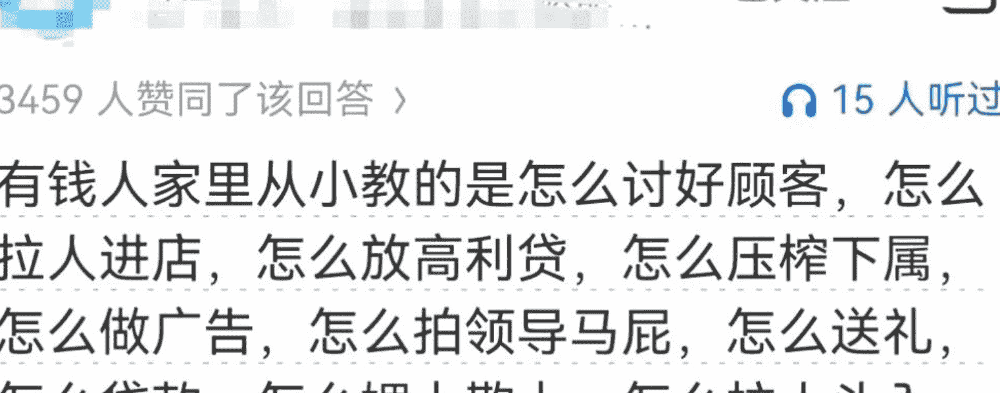

# 如何看待主的后代依然是主

知乎·715个回答·426个关注

关注

3459 人问过这个回答 · 15 人听过

有钱家里小教怎么讨好人，怎么让人进圈，怎么放高利贷，怎么压榨底层，怎么做广告，怎么抬头狮马，怎么送礼，怎么贷款，怎么上课拉人，怎么保护自己的财产，怎么持续增长自己的积蓄。有些资产可以买，买了以后后主租出去，租少些。怎么做PPT，怎么用一份PPT来集。怎么募集信息，怎么关系关系，怎么让别人人口口播粪，怎么选优劣击败者。

穷人家的啥哟，好学习，天上有报，你别事，惹惹愁愁不起你。你跟别人的孩子学习成绩差，不要享受。

~~~~~~~~~~~~~~~~~~~~~~~~~~~~~~~~~~~~~~~~~~~~~~~~~~

我在知乎上跟大家说，钱人没没道德，不是好人。有钱人到了那一步资产，就是圣个，要是个道德德，要不要心如钢铁，早死了。

很多时候是坑皇帝抢劫，碰豆腐裙子才能发家致富的。一堆人死都不信。一堆人就在那里反命败。

我看《三体》印象最深的就是“思想钢印*”四个字。

他们他们都不是思想钢印，那是钢卷。

~~~~~~~~~~~~~~~~~~~~~~~~~~~~~~~~~~~~~~~~~~~~~~~~~~

你一个人未来会不会成为一个有钱人

看这个人的挣来的钱是用来消费，还是购买生产工具和资产？

你挣了钱，拿来买衣服，鞋子，包包，化妆品，保养品，你那你就没沦为有钱人了

你挣了钱，拿来买生产工具，比如机器，汽车，自己学习学习的电脑，沿街商铺啊。

你以后肯定一定有作为的。

为什么古代要搞白事，红星*，大百姓呢？

因为是主阶级阻止贫富变迁的手段。

贵州为什么要阻止农村地区的各种摇搓收礼费一次的。

盖一次房子盖一次，家里狗生了一只就盖一次。盖一层楼盖一次。

有钱人酒席是支撑得起，而且可以到达不同的种阶。可以联系到不同阶的人，整合资源。

穷人喝酒酒席，经济就不不起来。请的人都是穷人，都是电子打工的苦奴。整合整个资源。

吃完喝掉了，又返了。国家几十年扶贫的工作的，累死了那么多的扶贫干部，三年贫贫滥又给折了，

编辑者 2020-03-08 15:53:15 · 广东 ·

# 免费 价值 及时 专注

# 扫码加入 知识星球TOP 免费资源群

- 每日免费获取有价值资源
- 可提供各类资源搜索服务

| 热门付费文章 | 各行行业报告 |
| 精选图书资源 | 副业赚钱方法 |
| 职场实用资源 | AI经营自媒体体 |

公众号：知识星球TOP 微信信号：jntsg8 微信：jntsg2

分享资料仅供个人学习，请及时删除，切勿商用传播
