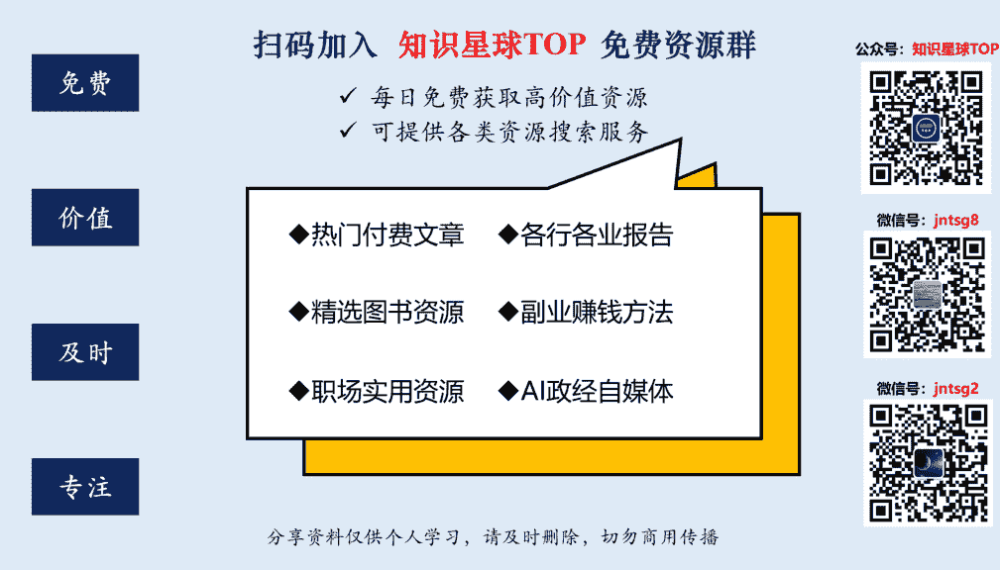
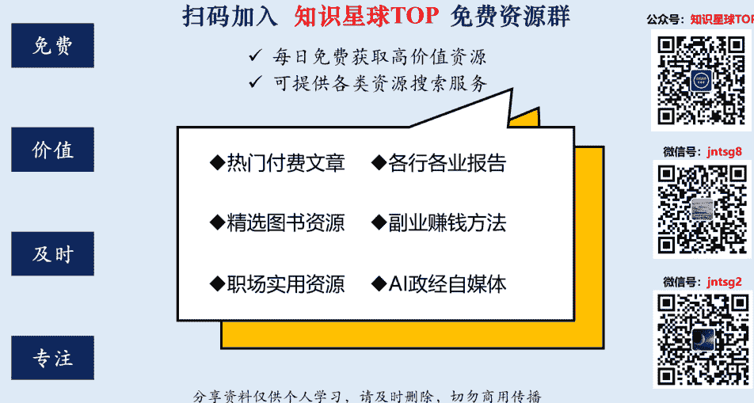

## 特朗普的溃烂

发布时间：2025年6月11日

【源自0610时政群聊】

美国跟巴拉特一样，

都是遭遇了王朝中期综合征，

必须要通过一整套有效的改革来给王朝续命，

“改桑”与“一条鞭”都是他们必须的选择。

美国换届后，

“改相”出现了巨大的调整，

拜登的策略类似于胡宗宪，比较温和，

主张一方面百姓发钱一边慢慢改变，

特朗普的策略倾向于严袭，更为激进，

为了加速改革可以接受毁淹坝田的后果。

现在美国是特朗普当政，

他的激进改革就会跟巴拉特21-22很类似，不在对全球经济贸易体系造成多大的冲击，毕竟，心里装的是美利强的九州万万方，

全球两个大区的事儿根本不在他的视野范围内，死一万企业是个数字，死十万企业是个数字，死百万企业也是数字，咱们谁也挡不住。个人与资金提早逃离漩涡中心。

避免被溅一身血才是理智的选择。

而对巴拉特来说，现在的国际局势是，特朗普的草台班子正到到处毁淹坝田，清流与严厉的激烈冲突已经暴在即。

加微信jntsg2，免费进资料群

而巴拉特的改洛桑已经完成了版本更新，以不小的代价，渡过了最为艰难的时刻，能否借助这个巨大的战略优势期，就看最高决策团队能否抓住机会，适时开启反攻了。

## 理想主义者马部长

### 发布专栏：知几共话（原子明和他的朋友们聊）

当理想主义者踏入权力旋涡。离场，是最后的体面。

加微信号jntsg2，免费进资料群

2025年6月6日，正当我们陷入睡眠之时，大洋彼岸的美国高层开展了一场公开骂战，特朗普和马斯克互相攻攻，一方表示“非常失望”，一方立刻回怼“没有我，他赢不了大选”，几轮对骂和威胁后，双方的关系终走向了不可调和的冰点。

从昔日的亲密盟友到如今的彻底翻脸，特朗普和马斯克矛盾爆发并不是没有预兆的，双方的价值追求、利益结构都有着一定的分歧。

他们的分歧的背后隐藏了怎样的政治逻辑？

这场网络骂战又将对我们产生怎样的影响？

网友：一大早的，霍王和马斯克就这么吵起来了，还是当着全世界人民的面，霍王这个人真的是表里不一，当初把马斯克造成一个改革者的形象，结果改革到自己头上的时候就不改了。这样才符合现实，才和理想在权力面前什么也不是，放之四海皆准。

子明：想想兔子的任志强、马云，俄罗斯的扇子（注①），现在轮到美国演出戏码了。

网友：马斯克眼下是民主党和共和党都得罪了，处境比马云当年可要麻烦多了。

子明：之前我觉得现在是马斯克的马云时刻，但今天才发现，马部长已经加速到任大炮时刻了。

网友：对，已经该进去了。话是这么说的，但是感觉马部长长这把刀其实可以再用久一点，毕竟这才刚过了几个月，内部洗牌远没有结束，他还是可以继续替王卿清洗内部的。或许在资本主义社会，作为资本本身，马部长本身也不可能委曲求全吧，二人也更容易闹掰。

子明：特朗普毕竟是基于政治家的角度，必须要给自的团队分红，马斯克挡住了这笔分红，就是在跟整个特朗普集团为敌。

网友：那是我理解错了，我还以为是因为懂王革新不顺利，所以要弃马帅了。

子明：这样理解其实也没错，改革就是要就是要削减旧利益集团的利益。

子明：而特朗普依旧需要向旧利益集团输送利益，这就让想要改革的马斯克很不爽。

网友：选上总总统之前还打算着理想的旗号，选上之后就开始谋着给自己人分红，真是熟悉的剧本..

其实也怪现在的世界局势，谁都不给王面子，致王一直打不开局面，要是能一直“赢麻”，可能就不用这么早和马斯克破脸，给其他的资本交卷了。

马斯克还在社交媒体支持万斯上位。他是明摆着要懂王难堪，如此公然支持万斯，无疑让懂王集团内部也开始相互猜忌与权衡。而且，我猜万斯是有“反骨”的。

万斯能有什么“反骨”呢？他内心一直是反MAGA的，写的书里字行间都透着对低文化的鄙夷，还娶了印度的妻子。还有曝光出来的空袭行动的聊天记录，你看他的话用词，对领导是轻蔑调侃的。

不管怎么说，现在懂王面临的处境实在不容乐观，他才和老板通电话，不知道有没有从我们这里取经。

政治共识和斗争传统完全不一样，学习不了的，我觉得还是别小唯马部长的影响力，特斯拉的股票别卖，静观其变。进群加微二八一八三六三八四五。

子明：肯定要卖了。

网友：看起来马斯克这次是真的和懂王渐行渐远了。

那懂王还发展什么AI科技啊，估计又回到自己第一任期的情况了。

话说回来，现在惧王于内和马斯克闹绯，外有俄乌冲突难以平息，正是内外交困的艰难时刻，所以他应该很急于向我们示好。

子明：我们现在就坐等科技巨头们带着钱来骗兔子吧。在这个烂的世界，只要不是烂就可以了。

注①俄罗斯的厨子：此处指普戈任。早年经营餐厅而结识普京，随着商业版图扩张逐渐走入俄罗斯政界高层。之后，他不仅挑战了整个俄罗斯官僚体系，还发表了一系列挑衅的言论，导致了整个体制对他的强烈反感。2022年9月承认参与瓦格纳集团，23年6月被指控参与叛乱，同年8月在坠机逝世。

曾经的马省长，如今的马部长，都是顶级商人进入领域，际遇也如此相似。马斯克理想主义者的宏图特朗普，新皇帝登基，功臣大展拳脚之际，却因阻碍了特朗普集团的利益输送而成为弃子。

不过，马斯克一己之力罪了美国两党，恐怕已无立足，体面的分手应该是他们最好的结局，而如今马斯克公开的漫骂与威胁，也不是对理想破灭的最后一丝不甘。

特朗普外战不利，盟友背离，向兔子示好也变成了他缓和局势的最佳出路。那以他为代表的科技巨头看向兔子也只是时间问题。

加微信jntsg2，免费进资料群
