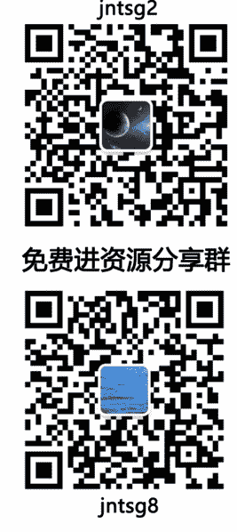
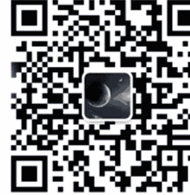

# 特朗普准枪口转向了伊朗

发布时间：2025年6月13日

人心中的成见，是一座大山。

譬如今天以色列对伊朗的突袭，是为了阻止美国与伊朗达成妥协，已经筹划酝酿一个月了，英美等西方国家早就对此知晓，媒体提前报道，油价提前拉高，大使馆也提前撤侨。

但新闻出来的时候，民众仍然会认为以色列的偷袭打了伊朗一个措手不及。

譬如中、俄两国的谈判团队去伦敦谈判前，两位老板都已经打电话了，约定了霍王访华，谈判团队去伦敦是为了共同形成一系列的纸面协议，好回去给老板签字变成可执行条例。

但新闻和通稿出来后，民众普遍仍会认为中俄两国的不好，哪怕特朗普连续几天发文说跟兔子达成了 Good Deal。

这两个事情之间，有着非常紧密的关联。

24年底特朗普上台时，我曾在在线活动中给过一个预测：特朗普上台后必会在中伊之间确定一个对手。如果伊朗与美国谈判推进迅速，那么特朗普的主要力量和矛头直指兔子，兔子需要在25年上半年（美国新政府战略制定）。

竭尽所能，把伊朗推到前面承担特朗普的怒火。

经历历史玄妙的是，6月10日，中俄会谈完成，特朗普发表表示满意。6月11日，特朗普发文，对美伊达成协议的“信心减弱”。

也就是说，随着中俄达成纸质版的“停火”协议，伊朗这个备胎和 Plan B 旋即被特朗普所冷落。

很多朋友都在问，伦敦会谈到底哪里超预期？近期，特朗普一而再发文跟兔子 Good Deal，不仅是吹嘘，也是一个对内的严严肃表态，是他在勒令下属不要破坏已经达成的协议，否则就是在触碰他的霉头。

随后，特朗普发表了声明，对美伊达成协议的“信心减弱”。相较于之前非常好的“对话”，很快有“好消息”公布，也是在对内释放信号：他不再对美伊谈判提供“保护”，允许以色列和美国国内的政治力量去做一些想做的事情，自己可以假装配合“不知情”，释放一下他内部巨大的压力，也为后续的对伊谈判施压。

随着今天的伊冲突，美伊谈判短期内再无缓和余地，特朗普只能被迫把注意力转向中东，这将有利于东亚足够的发展空间。

而东大这边，这段时间也将在下达“口头通知”，要求舆论界务必要为中俄塑造良好的氛围，跟之前的口径对比，再次来了个秋名山大漂移。

## Iran to present counter-proposal to US, Trump's talks to resume

伊朗将向美国提出反向建议，特朗普称谈判将恢复
来源：路透社 2025年6月10日

迪拜/华盛顿6月9日（路透社）伊朗周一表示，将很快向美国提交一份联核协议反向建议提案，以回应德黑兰认为“不可接受”的美国提议，而美国总统唐纳德·特朗普表示谈判将继续进行。特朗普明确表示，双方在是否允许伊朗继续在伊朗领土上进行铀浓缩问题仍然存在分歧。

## 美伊最新表态：特朗普称对达成核协议“信心减弱”，伊朗称爆发冲突将以美军基地为目标

来源：环球网 2025年6月11日

## 阿曼宣布第六轮伊美核问题谈判于6月15日举行

来源: 央视新闻客户端 2025年6月12日

当地时间12日，阿曼外交大臣阿德尔通过其社交账号表示，伊朗和美国的第六轮间接谈判将于6月15日在马斯喀特举行。伊朗外交部发言人巴加埃10日也表示，根据目前进行的磋商，下一轮伊美间接会议设计于15日在阿曼马斯喀特举行。

## 相关报道汇总

来源: 综合自参考消息 2025年6月13日

据法新社6月13日报道，以色列国防部部长宣布，以色列对伊朗实施“先发制人打击”。

新华社快讯：以色列总理内塔尼亚胡13日说，以军对伊朗的打击会“持续”。以军行动目标是“打击伊朗核设施、弹道导弹工厂和军事能力”。

格路透社6月13日报道，美国国务卿马克·鲁比表示，美国没有参与以色列对伊朗的袭击。

据德新社6月13日报道，伊朗最高领袖哈梅内伊的办公室13日发表声明称，在以色列对伊朗发动大规模袭击后，伊朗将对以色列进行报复和“严厉惩罚”。

格法新社6月13日报道，美国总统唐纳德·特朗普告诉克斯新闻，他在以色列对伊朗发动袭击之前就知道了这次计划，并强调德黑兰“不可能拥有核武器”。

# 扫码加入 知识星球 免费资源群

| 类型 | 内容 |
| :--- | :--- |
| 免费 | 每日免费获取高价值资源 / 可提供各类资源服务 |
| 价值 | 热门付费文章 ◆各行业报告 / 精选图书资源 ◆副业赚钱方法 |
| 及时 | 职场实用资源 ◆AI致自媒体 |

