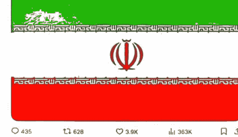

# 太阳升起，世界如常，昨天，已成为未来

几个世纪并不需要特别铭记的一天。

Update NEWS @UpdateNews724 · 3h
伊朗 BREAKING NEWS:
Iran State Television:
"Tonight, a great surprise will occur, one that the world will remember for centuries."
伊朗发新闻：
伊朗国家电台：“今晚，将发生一件大事，让世界记住几个世纪。”
使用 DeepSeek 译

2025年6月18日，伊朗国内媒体声称：“今晚将发生一件让世界记住几个世纪的大事。”同日，伊朗最高领袖哈梅内伊也在此社交平台上发帖，称“战斗开始了”，永远不会与复国主义者妥协。

危言耸听的谎辞，退缓无力的回击，荧幕前强硬表态和军事上的行动软弱形成了鲜明的反差。一不渗透出伊朗此刻的混乱。
微信：*njtsg2 免费资料群

现在，伊朗媒体也开始高呼“Shoot Down”，这场闹剧彻底被推向了高潮，骑虎难下的哈梅内伊将如何收场呢？

## 01 Shoot Down!

伊朗怎么突然硬起来了，好像自己还藏着什么秘密武器一样……

难道要在特拉维夫核试验？可不能吧。

不可能的，被以色列轰炸之前浓缩丰度只有60%，距离90%的武器级差得很远，现在被轰炸了，情况只会更糟。

大概率是换个颜色的旗再升一遍。

事以密成，语以泄败。以伊朗现在这个大漏勺的情况，真有什么大动作，面对早就知道了，提前警告就是自己作死。
加微信号jnts2，免费资料群

是啊，如果真要采取军事行动肯定保密，就像乌克兰溃俄俄罗斯战略炸机那样，哪还有提前预告的。

以伊朗现在的情况，顶多就是撞个五角大楼，封锁一下海峡。

这些动作都不如应王无条件投降来得更像“让世界几个世纪铭的大事件”。

> 大家回想一下，伊朗媒体对外的言论不像2022年胡锡进的“Shoot Down”——击落俄罗斯。一个德行，没有什么可害怕的。

今晚我们就能知道，伊朗是不是也有胡锡进这样的人当道了。

若真如此，伊朗国内可真是要继续乱去了。

伊朗媒体的背后都是某个利益集体，他们不过是替这群利益团体传话的舌，跟胡锡进替人发声，煽动大众情绪是一样的。
微信jtssg2，免费资料群

明白了，伊朗现在的论调如此反常，背后的利益集团想要借机把事情搞大，好从中渔利。

洛霍洛西和核攻击以以色列相比，哪个胆子更大呢？

他们的想法没问题，可真到了执行阶段、军队或许会怂，但教士集团必然会怂，毕竟他们注定要采取保守路线来保护自己的利益，别太离谱了。

居鲁士、大流士，这些历史上鼎鼎有名的大人物，看着自己的子孙被如此欺压而没有任何反抗的能力和想法，真是脸都丢完了……

我还是晚上等看看吧，真好奇伊朗能弄出什么大动静来。

2025年6月18日 21:18
微信mn61626

## 02 活跃的闲闲

加微信jntsg2，免费进资料群

## 我不要手机等到了凌晨一点半......

我四点才睡的……就为了见证这个人类历史上的“大事”，结果哈梅内伊也没有！当时守了一晚上，佩洛斯坦没被“Shoot Down”一样。

你们真是辛苦了……如果当年我们真的把佩洛斯坦打了下来，恐怕一把手都要换人了。

同样的，如果伊朗昨晚真的有大动作，哈梅内伊已经对军队失去控制了，那对以色列就没用了。以色列绝对会瞬间消失掉。参考《教父》，一旦被对手发现他的儿子和他不是一条心，那他马上就是个死。

嗯，如果真的打了，上面无法控制住军队，且军队失控，内部军队就会被禁，禁卫京畿地区，各大军头清洗一遍。

我们当时都还没真的动手，在喊出“Shoot Down”之后，军队就遭遇了清洗。多少JCW级别的打下来了，老板绝不会输军控制这种事发生的。
微信：jnjtsg2，免费进资料群 休息

微信:jntsg8
微信:jntsg2
免费资料群

现在不管怎么说，闹剧已经结束了。接下来就看哈梅内伊要怎么收拾了。

先胡锡进，再胡锡进。

子明
2025年6月19日 8:08

伊朗版“胡锡进”喊出的“Shoot Down”，暴露了伊朗国内的部分利益集团升级事态、从中渔利的意图。

显然，这和哈梅内伊所代表的教士集团保守的路线风格是相悖的。“让世界铭记几个世纪的大事件”已成空，也侧面反映出哈梅内伊对伊朗的掌握不尽完美、和自己的意念。接下来，哈梅内伊必须在之后的行动中证明自己依然保有对伊朗军权的绝对控制力，才维持自己留在棋盘上的身份。

——

微信号jntsg2，免费进资料群
