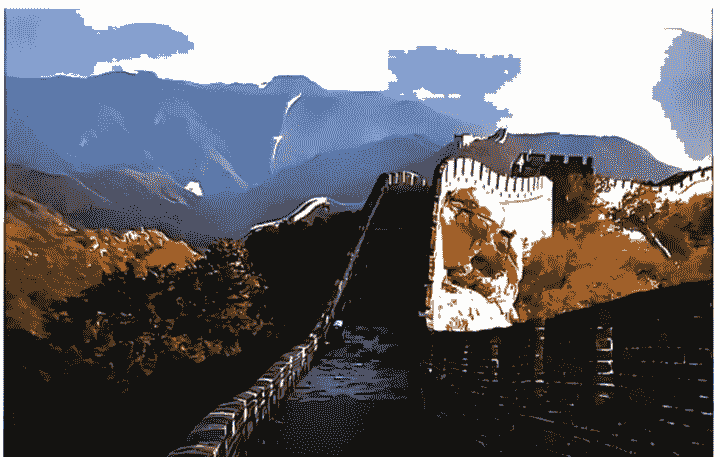

# 长城与均势衡

发布专栏 乌几共识
发布时间 2025年6月24日

微信:jntsg8
免费进资料群
微信:jntsg2

古老的攻防术在现代重演，“烽火连三年”实为一场城墙外的制衡游戏。

2025年3月8日，特朗普警告俄罗斯“强烈考虑”实施包括行业制裁、经济制裁和关税在内的系列措施，直至俄乌达成停火协议，并要求双方“立即谈判”。颇具戏剧性的是，美国对俄强硬表态的同时，却持续为乌克兰提供军事和经济援助，试图让美方在“俄乌”谈判过程中拥有更大的筹码。

俄乌战争的走向已和美国的态度牢牢绑定。

微信公众号jntsg2，免费进资料群

熟悉子明往期内容的铁杆读者应该知道，国家的任何对外举措都是为自身博取利益，更何况是美国这种“无利不起早”的大国。

### 美国为什么要如此关注大洋彼岸的这场战争呢？它又是如何从这场战争中获益的呢？

今天，子明从我国的长城谈起。

## 01 长城的真正价值

> 子明，美国在墨西哥国境那里修建的边墙是不是和咱们长城的作用类似吗？

有一些相似的地方，但是本质上是不相同的。

子明

长城的主要作用是实施经济封锁和贸易，分隔游牧文明与农牧文明，确保中原地区安全则是次要作用。美国边境墙的主要作用在于减少非法移民，确保美国边境安全。

关于这一点，如果玩过《文明6》的朋友，应该深有感触，设计师在这个节点上的理解很深彻。

微信号jntsg2，免费资料资料

还有一种观点是，长城的建立在某种程度上偏散的草原部落整合为统一的王国。

这种说法是片面的，长城不仅让我们草原部落完成整合，反而有利于我们从草原内部对他们进行分化。

长城本质上是一种“关税墙”，可以让王朝能够操纵草原各个部落的经济实力和军备实力的能力，维持草原的动态均衡局面，我们始终保持着一家独大的局面。

大唐就是用了这种动态制衡的办法，我们才能成为“天可汗”，大明那种一味攻击的做法是不可取的。

这是怎么呢?

长城为“坝内”的中央政府提供了更多的筹码。所谓大唐的“动态制衡”体现在长城来控制周边部落的发展进程。

我们跟哪个部落做“开关”贸易，哪个部落的经济和军事实力就会兴起，一旦发现哪个部落的实力变得不受控制了，我们就中断与他们的贸易，对他们搞“制裁”，削弱他们的经济和军备实力。

微信njts2，免费资料群

### 这个思路的核心不是和当时李成梁在辽东时，扶持努尔哈的做法是一样的？

是的，努尔哈就是李成梁扶持起来的一股草原势力，明朝后期内部崩溃，外部的平衡也被打破了，这才缔造了女真大团结。

2025年3月26日 14:30

注：努尔哈与李成梁之间的关系：据《东夷考略》和《建夷授官后记》记载，努尔哈曾做李成梁的奴仆或卫兵。李成梁任辽东总兵，屯兵防御蒙古部落和女真部落，努尔哈所统治的建州女真部落，正是李成梁重点扶持的，用以制衡他的复杂草原部落。

历史总在重演，昔日长城的制衡作用，为理解现代国际博弈提供一层窗口。

## 02 动态制衡下的策略

扶持弱小的，制裁强大的，这样的政治逻辑其实直到今天还被大国们使用。

加公众号 jntsg2，免费进资料群

### 大国们对这套玩法已经相当熟练了。

美国来说，他们就是把欧亚大陆视为了一整个“草原”，在“草原”内部不断制造分裂，让各种政治力相互制衡。

如果想打压苏联，就去扶持中国，想要打压俄罗斯，就需要支持乌克兰继续在俄乌战斗中做出动作。

英国政府也深谙此道，所以之前扶持德国、大清，以此来倾法国和俄的发展。美国以前也扶持过德国、国家政府，用来倾斜法国和德国。

往根源上说，这可能是海权国家和陆权国家深层的矛盾。

这么来看，列强在中国也是，用子明的话就是，把中国看成一个“草原”。

孙文先生早就被日本和苏俄扶持过，苏俄也扶持过冯玉，除此之外，蒋委员长也被日本、苏俄和英美先后扶持。

加微信号jnts2，免费进资料群

> 西方列强在中日中不能团结这一点上有着高度的共识，坚决不能让国民党和日本政府有任何连结的。

西方列强在中日中不能团结这一点上有着高度的共识，坚决不能让国民党和日本政府有任何连结的。

西方列强在中日中不能团结这一点上有着高度的共识，坚决不能让国民党和日本政府有任何连结的。

西方列强在中日中不能团结这一点上有着高度的共识，坚决不能让国民党和日本政府有任何连结的。

西方列强在中日中不能团结这一点上有着高度的共识，坚决不能让国民党和日本政府有任何连结的。

西方列强在中日中不能团结这一点上有着高度的共识，坚决不能让国民党和日本政府有任何连结的。

西方列强在中日中不能团结这一点上有着高度的共识，坚决不能让国民党和日本政府有任何连结的。

西方列强在中日中不能团结这一点上有着高度的共识，坚决不能让国民党和日本政府有任何连结的。

西方列强在中日中不能团结这一点上有着高度的共识，坚决不能让国民党和日本政府有任何连结的。

西方列强在中日中不能团结这一点上有着高度的共识，坚决不能让国民党和日本政府有任何连结的。

西方列强在中日中不能团结这一点上有着高度的共识，坚决不能让国民党和日本政府有任何连结的。

西方列强在中日中不能团结这一点上有着高度的共识，坚决不能让国民党和日本政府有任何连结的。

西方列强在中日中不能团结这一点上有着高度的共识，坚决不能让国民党和日本政府有任何连结的。

西方列强在中日中不能团结这一点上有着高度的共识，坚决不能让国民党和日本政府有任何连结的。

西方列强在中日中不能团结这一点上有着高度的共识，坚决不能让国民党和日本政府有任何连结的。

西方列强在中日中不能团结这一点上有着高度的共识，坚决不能让国民党和日本政府有任何连结的。

西方列强在中日中不能团结这一点上有着高度的共识，坚决不能让国民党和日本政府有任何连结的。

西方列强在中日中不能团结这一点上有着高度的共识，坚决不能让国民党和日本政府有任何连结的。

西方列强在中日中不能团结这一点上有着高度的共识，坚决不能让国民党和日本政府有任何连结的。

西方列强在中日中不能团结这一点上有着高度的共识，坚决不能让国民党和日本政府有任何连结的。

西方列强在中日中不能团结这一点上有着高度的共识，坚决不能让国民党和日本政府有任何连结的。

西方列强在中日中不能团结这一点上有着高度的共识，坚决不能让国民党和日本政府有任何连结的。

西方列强在中日中不能团结这一点上有着高度的共识，坚决不能让国民党和日本政府有任何连结的。

西方列强在中日中不能团结这一点上有着高度的共识，坚决不能让国民党和日本政府有任何连结的。

西方列强在中日中不能团结这一点上有着高度的共识，坚决不能让国民党和日本政府有任何连结的。

西方列强在中日中不能团结这一点上有着高度的共识，坚决不能让国民党和日本政府有任何连结的。

西方列强在中日中不能团结这一点上有着高度的共识，坚决不能让国民党和日本政府有任何连结的。

西方列强在中日中不能团结这一点上有着高度的共识，坚决不能让国民党和日本政府有任何连结的。

西方列强在中日中不能团结这一点上有着高度的共识，坚决不能让国民党和日本政府有任何连结的。

西方列强在中日中不能团结这一点上有着高度的共识，坚决不能让国民党和日本政府有任何连结的。

西方列强在中日中不能团结这一点上有着高度的共识，坚决不能让国民党和日本政府有任何连结的。

西方列强在中日中不能团结这一点上有着高度的共识，坚决不能让国民党和日本政府有任何连结的。

西方列强在中日中不能团结这一点上有着高度的共识，坚决不能让国民党和日本政府有任何连结的。

西方列强在中日中不能团结这一点上有着高度的共识，坚决不能让国民党和日本政府有任何连结的。

西方列强在中日中不能团结这一点上有着高度的共识，坚决不能让国民党和日本政府有任何连结的。

西方列强在中日中不能团结这一点上有着高度的共识，坚决不能让国民党和日本政府有任何连结的。

西方列强在中日中不能团结这一点上有着高度的共识，坚决不能让国民党和日本政府有任何连结的。

西方列强在中日中不能团结这一点上有着高度的共识，坚决不能让国民党和日本政府有任何连结的。

西方列强在中日中不能团结这一点上有着高度的共识，坚决不能让国民党和日本政府有任何连结的。

西方列强在中日中不能团结这一点上有着高度的共识，坚决不能让国民党和日本政府有任何连结的。

西方列强在中日中不能团结这一点上有着高度的共识，坚决不能让国民党和日本政府有任何连结的。

西方列强在中日中不能团结这一点上有着高度的共识，坚决不能让国民党和日本政府有任何连结的。

西方列强在中日中不能团结这一点上有着高度的共识，坚决不能让国民党和日本政府有任何连结的。

西方列强在中日中不能团结这一点上有着高度的共识，坚决不能让国民党和日本政府有任何连结的。

西方列强在中日中不能团结这一点上有着高度的共识，坚决不能让国民党和日本政府有任何连结的。

西方列强在中日中不能团结这一点上有着高度的共识，坚决不能让国民党和日本政府有任何连结的。

西方列强在中日中不能团结这一点上有着高度的共识，坚决不能让国民党和日本政府有任何连结的。

西方列强在中日中不能团结这一点上有着高度的共识，坚决不能让国民党和日本政府有任何连结的。

西方列强在中日中不能团结这一点上有着高度的共识，坚决不能让国民党和日本政府有任何连结的。

西方列强在中日中不能团结这一点上有着高度的共识，坚决不能让国民党和日本政府有任何连结的。

西方列强在中日中不能团结这一点上有着高度的共共，，坚不能让国民党和日本政府有任何连结的。

西方列强在中日中不能团结这一点上有着高度的共识，坚决不能让国民党和日本政府有任何连结的。

西方列强在中日中不能团结这一点上有着高度的共识，坚决不能让国民党和日本政府有任何连结的。

西方列强在中日中不能团结这一点上有着高度的共识，坚决不能让国民党和日本政府有任何连结的。

西方列强在中日中不能团结这一点上有着高度的共识，坚决不能让国民党和日本政府有任何连结的。

西方列强在中日中不能团结这一点上有着高度的共识，坚决不能让国民党和日本政府有任何连结的。

西方列强在中日中不能团结这一点上有着高度的共识，坚决不能让国民党和日本政府有任何连结的。

西方列强在中日中不能团结这一点上有着高度的共识，坚决不能让国民党和日本政府有任何连结的。

西方列强在中日中不能团结这一点上有着高度的共识，坚决不能让国民党和日本政府有任何连结的。

西方列强在中日中不能团结这一点上有着高度的共识，坚决不能让国民党和日本政府有任何连结的。

西方列强在中日中不能团结这一点上有着高度的共识，坚决不能让国民党和日本政府有任何连结的。

西方列强在中日中不能团结这一点上有着高度的共识，坚决不能让国民党和日本政府有任何连结的。

西方列强在中日中不能团结这一点上有着高度的共识，坚决不能让国民党和日本政府有任何连结的。

西方列强在中日中不能团结这一点上有着高度的共识，坚决不能让国民党和日本政府有任何连结的。

西方列强在中日中不能团结这一点上有着高度的共识，坚决不能让国民党和日本政府有任何连结的。

西方列强在中日中不能团结这一点上有着高度的共识，坚决不能让国民党和日本政府有任何连结的。

西方列强在中日中不能团结这一点上有着高度的共识，坚决不能让国民党和日本政府有任何连结的。

西方列强在中日中不能团结这一点上有着高度的共识，坚决不能让国民党和日本政府有任何连结的。

西方列强在中日中不能团结这一点上有着高度的共识，坚决不能让国民党和日本政府有任何连结的。

西方列强在中日中不能团结这一点上有着高度的共识，坚决不能让国民党和日本政府有任何连结的。

西方列强在中日中不能团结这一点上有着高度的共识，坚决不能让国民党和日本政府有任何连结的。

西方列强在中日中不能团结这一点上有着高度的共识，坚决不能让国民党和日本政府有任何连结的。

西方列强在中日中不能团结这一点上有着高度的共识，坚决不能让国民党和日本政府有任何连结的。

西方列强在中日中不能团结这一点上有着高度的共识，坚决不能让国民党和日本政府有任何连结的。

西方列强在中日中不能团结这一点上有着高度的共识，坚决不能让国民党和日本政府有任何连结的。

西方列强在中日中不能团结这一点上有着高度的共识，坚决不能让国民党和日本政府有任何连结的。

西方列强在中日中不能团结这一点上有着高度的共识，坚决不能让国民党和日本政府有任何连结的。

西方列强在中日中不能团结这一点上有着高度的共识，坚决不能让国民党和日本政府有任何连结的。

现代的，的的的的。的的的，回到的。

jntsg2，免费的。

## TOP级资源 TOP社群

| 序号 | 公号/社群 | 原价 | 领域 |
| :--- | :--- | :--- | :--- |
| 1 | 生态有 | 275 | 亚洲 |
| 2 | 记忆承 | 365 | 历史 |
| 3 | 赢在八小时之外 | 365 | 成长 |
| 4 | 欧洲金 | 399 | 时政 |
| 5 | 卢克文青 | 599 | 时政 |
| 6 | 体内主任 | 599 | 体制 |
| 7 | 外人的视角 | 669 | 金融 |
| 8 | 濑泽异谈 | 416 | 亚洲 |
| 9 | 守夜人总 | 599 | 军事 |
| 10 | 江宁知府 | 365 |  |
| 11 | 政堂/顾子明 | 568 | 经济 |
| 12 | 唐书院 | 1399 | 融 |
| 13 | 大树乡谈 | 199 | 成长 |
| 14 | 水库欧大 | 10000 | 房产 |
| 15 | 洪灏的宏观策略 | 4376 | 经济 |
| 16 | 金政通鉴/北海道山 | 4576 | 股票 |
| 17 | 猫留的世界 | 299 | 社会 |
| 18 | 飞沫 | 3600 | 股市 |
| 19 | 米联储见闻 | 599 | 经济 |
| 20 | 鉴茶财经院 | 330 | 房产 |

十五免费
