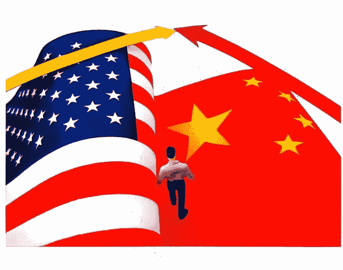

# 要秀肌肉内，不要拍桌子

发布专栏 知几共语

美国不一定是“纸老虎”，我们却一定要成为“真巨龙”。

上文中我们谈到，随着中国的不断强大，美国还需要在东方扶持日本来制衡我们。这使得我们越强大，我们邻居的日子就会越越好。

但如果我们不想让日本腾飞，难道就要收起胆侠，不再展示肌肉吗？美国真的会吃这一套吗？

深度视野大V文集cuk255 有温度高质社群cuk255

## 9月5日 9:31

到底，我们和日本走的不是一条路。在日本在美国的支持下，短期内实现腾飞是必然的。对于我们而言，现在只要要外部环境不再继续恶化，就是好消息。以我们现在的体质，别指望美国还能给我们“兄道弟”。

> 不要指望再跟美国回到蜜期，除非出现一个共同威胁的敌人。但是也不要惹美国，把自己变成美国的头号故人。

可 reality，在俄罗斯与欧洲逐渐衰弱的背景下，不管我们惹不惹他，恐怕已经是“头号”了吧？

美国是资本优先，只要挑战了那些财团对世界的控制力，必定就是死敌。而我们的体制也恰恰在这一点上和他们有核心冲突，只要中国政府放弃对资本的管控，随着我们在世界范围内的影响力增强，成为“头号故人”只是时间问题。

深度视野大V文集cuk255 有温度高质社群cuk255

其实没那么复杂，你作为二哥就避免了被歧视，但不要成为美国集中力量多次击败的对象，美国人太愚蠢了——且锚定一件事，就会开始不计代价。

子明

美国对于头号敌人从来都是那种一力降十会，以最高期望评估对手的态势，不计后果本地地掐死对手。

你看美国，每一次战争就两种结果：要是类似于海湾战争，筹集对手十倍以上的筹码，彻底地消灭对手；要么类似于反恐战争，筹集对手百倍以上的筹码，结果把自己陷入泥潭里。

为什么投入了更多的资源，反而不能快速结束战斗了？

这么多资源投入，在座的各位，就也不想战争停止了？

子明

俄乌冲突，本质上也是美国筹集了一百倍的筹码，导致的战争双方不愿意停下，你看着俄罗斯的盟友，有一个真心希望战争停下来的吗？睁眼巴巴看着俄罗斯的军费和科技，印度看着俄罗斯的石油，中国也希望展望廉价的天然气和链商品。

深度视野大文集cuk255 有高清质社群cuk255

这管理思维真厉害，聚焦+专注。

说穿了就是二杆子思维。不过俄乌打下去也好，对我们也有好处。

美国的自由经济体制，决定了它比我们更依赖舆论驱动社会、集中资源投入某一方。

嗯，其实政治体制也有这样的问题，就像罗马帝国总有执政官和元老院的矛盾，意大利公民和外围公民的矛盾，各种矛盾交织，就是很难通过政令统一行动。

子明

| 美国属于船大难运集头的 |
| :--- |
| | |

特朗普权力都集中了，也跟军事对手手普京、三胖、老板莫逆之交，还是做不到他所说的24小时停止战争。

美国这种锚定一倍资源对死对手的打法，涉及的利益太大了。脑洞直观地想象地，如果美国拿这笔钱的十分之一来收朝鲜，百万美人民币就能替小洋挣回来。

深度视大文集cuk255 有温度高质群cuk255

这种玩法应该没法用到中国上吧，对付中国要用的资源也是海量的。

> 如果美国认为中国的军事力是10，那么它拥有100的时候才会试图阻挡军事对抗，一旦发现中国军事力是20，那么美国就需要200才会试图阻挡军事对抗，因为它清楚自己拿不出十倍的资源。美国的思路就是只打有把握的仗。

子明

此类看来，“秀肌肉”非常必要。只有拳头够硬，才能让美国不敢all in。

微信pep854

> 中国军事力是没问题的，这点千万不要认为是要韬光养。

我虽然反对挑战美国，但是支持支持军事科学进步，因为美国就是那种，如果实力被你压了，那么它就会基于实力出发，毫无忌忌地接你；但是如果你觉得你可能会被咬一口，哪怕实力你是你的五倍，也不会发动，然后双方就可以坐下来谈条件了。

子明

参考一下，当特朗普发现伊朗就是一个空架子，他不会批准空袭？

深度视野V大集cuk255 有温度高质社群cuk255

就像明白之前说的，你冤枉我有的时候，我不能真的没有。
