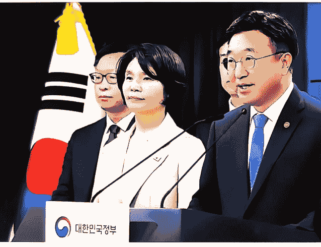

# 非卖品的交易

发布专栏 知几共话

我们围观、我们计算、更在控量自己愿意为和平标出什么价码。

2025年9月7日，新华社首尔消息称，韩国行政安全部发布政府组织架构调整方案，检察厅将被废除，并新设“公诉厅”和“重大犯罪侦查厅”以取其职能。

深度视野大V文集cuk255 有高质量社群cuk255

韩国检察厅的权力配置在全局司法体系中堪称异类，它拥有搜查指挥权、直接起诉权和垂直管理权。这种“侦诉一体”的模式使其能够独立于政府，调查总统级案件，2017年朴槿惠案就是典型例证，处理各类财阀更是不在话下。

## 如今检察厅已成历史，对于韩国而言意味着什么呢？我们又能从中得到怎样的借鉴呢？

9月8日 10:08

> 韩国有大动作了，直接把检察厅给拆了，悄悄咪咪干了大事。

> 检察厅从48年美军占领时候就开始独立于行政、立法和司法体系之外，能够调查总统，财阀在内的所有人，而且不受任任何机构制衡，几近美国安插在韩国的对手，这相当于把东厂给除了。

> 特朗普竟然开出了个什么价，就把检察厅卖卖了李在明？

深度视野大V文集cuk255 有高质量社群cuk255

韩国承诺向美国投资3500亿美元，其中1500亿是韩美造船合作基金，剩余2000亿向半导体、生物技术等领域。

石破茂如果在此之前也能把特搜部撤了，也算个汉子。

> 中日韩欧都是一样，经济血交换美国撒出政治控制，韩国是司法、军事解禁，日本是军事、外交解禁(注①)、欧洲是军事解禁。

这是懂王的风格，什么都可以谈，谈钱就好了。

每一个美国交钱的国家，都可以拿到他们最希望得到的东西，遇到特朗普这个青芒非非洲产品的总统，赶紧做交易才是正理。

那我们不能谈科技、金融解禁？

中国的诉求是地缘政治和科技解禁，相比于其他国家中国的诉求是最深的。

子明

如果真把这两个领域解禁了，那还有绳子能拴住我们？

大哥把他的女人给我们，把芯片给我们，顺便能不能再默认许我们来牛市？

再加上一个宝宝岛就更好了。

如果要求中国每个人都拿出净资产的20%来买，群里有多少人接受？

子明

那么贵吗？

哈哈哈哈，这个问题可以抛在红脖子群里。

深度视野大V文集cuk255 有高质量社群cuk255

净资产的20%还好吧，如果真要发展到俄乌那种地步，预计损失不止20%。

而且如果这样就能换来20年不折腾，那我还是愿意的。

主要是普通人的资产很多都是负的，各位群友才是真的有。

> 我个人是接受的。

明是有理想的，我们算自己的帐。

我是真觉得20%还好，但是前提是未来20年都不折腾了，这样的话，2-3年的好光景就能回来。

但如果真像俄乌那样打起来，权力会在战争中进一步集中，未来一定会有更大的折腾。

深度视野大V文集cuk255 有高质量社群cuk255

花20%买回来的收益，对个人来说未必都能赚回来。我觉得，个人资产少的人和个人资产特别多的人，赚回来的概率大一些，中间的人怕是。

我是认为花钱只会买来控制吧，历史上有花钱去掉控制的先例吗？

也可能是每个人掏5万块，加起来70万亿。

子明

这是最理想情况了，20%或者5万块我都可以接受，但是怕土地兼并那种，权责不负担，全加给“自耕农”，那承担的就不止20%了。到最后，百姓苦亡，百姓苦。

也可能是掏钱的方式，货币贬值20%也不一样吗？

可能最后还是要打，一波才能降价，70万亿什么概念？

深度视野大V文集cuk255 有高质量社群cuk255

当年马歇尔计划130亿美金调整通胀，估计70万亿都能复兴一个砸烂的欧洲。

直接打字相当于直接折腾了，我认为这是最差的选择。

其实无论怎样都一定折腾的，当年武帝北汉决战之后才不折腾了，那也是因为再折腾就完了，但是只要要折腾完事，那就一定会折腾。

非要说折腾的话，我觉得还是不要发生战争冲突，外交的方式是比军事更有性价比，而且我们现在好容易遇到一个外交机会，还是应该把握住的。

透了战争的本质，才会从心底反战。大部分的战争本质上都是让底层去送死。现在在莫斯科治安都还好。

深度视野大V文集cuk255 有高质量社群cuk255

## 战争的本质

- 让底层去送死
- 莫斯科治安

## 韩国的现状

- 韩国是司法、军事解放
- 日本是军事、外交解放(注①)
- 欧洲是军事解放

## 中国的诉求

- 地缘政治
- 科技解放

## 讨论点

- 20%的净资产
- 土地兼并与权责负担
- 货币贬值20%
- 70万亿的概念
- 马歇尔计划与通胀
- 外交与军事的性价比

